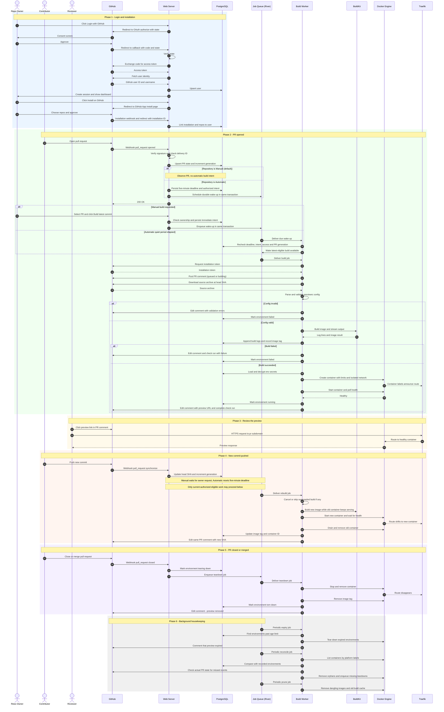

# PR Preview Environments: Design Document

Companion to `README.md` (requirements and stack). This document covers every feature in depth: what it must do, how hard it is, which tools apply to it specifically, how it works step by step, and the design decisions and edge cases behind it. No code appears here except the Mermaid diagram at the end.

## How to read this document

Each feature has five parts:

- **Requirement**: what the feature must do and why it exists.
- **Complexity**: a rating (Low / Medium / High) and the reason for it.
- **Tech stack (feature-specific)**: the tools and libraries that matter for this feature only.
- **Technical implementation**: the steps or overall logic.
- **Design decisions and edge cases**: choices made, alternatives rejected, and failure scenarios.

## Feature index

1. Data model and state store (foundation)
2. GitHub OAuth login
3. Session management
4. GitHub App installation and repo linking
5. Repo configuration file (`.previewrc.yaml`)
6. Webhook receiver
7. Job queue and worker orchestration
8. Source fetching
9. Image building
10. Container runtime and isolation
11. Dynamic routing, subdomains and TLS
12. PR feedback (comments and check runs)
13. Rebuild on new commits
14. Teardown on PR close
15. Housekeeping, expiry and reconciliation
16. Secrets and environment variables for previewed apps
17. Build log streaming and dashboard
18. Observability
19. End-to-end sequence diagram

---

## 1. Data model and state store (foundation)

### Requirement
Persist everything the system needs to survive restarts and to reason about the world: who the users are, which repos are connected, which PRs have environments, what state each environment is in, and enough identifiers (container ID, comment ID, image tag) to act on them later. The database is the single source of truth about intended state; Docker and GitHub hold actual state, and the system reconciles the two.

### Complexity
Medium. The tables are simple, but correctness under duplicate and out-of-order events (constraints, state machine, transactions) is where the difficulty lives.

### Tech stack (feature-specific)
- PostgreSQL as the only datastore (also backs the job queue, sessions and logs in the MVP).
- `pgx` driver, `sqlc` for typed queries, `goose` for migrations.

### Technical implementation
1. Define core entities: users, installations, repos, pull requests, environments, build logs, and encrypted env secrets.
2. Model an environment as a state machine with explicit statuses: `queued`, `building`, `running`, `failed`, `tearing_down`, `torn_down`. Only defined transitions are allowed; the update statement itself checks the current status so illegal transitions fail rather than silently succeed.
3. Enforce uniqueness at the database level: one pull request row per (repo, PR number), one lifetime environment row per pull request (reused after teardown/reopen), and globally unique subdomains. Migration 9 enforces lifetime identity rather than only uniqueness among active environments.
4. Store timestamps for creation, last activity and expiry so the housekeeping job can work purely from the database.
5. Store external identifiers: Docker container ID and image tag, GitHub comment ID, head commit SHA, so any later job can locate and act on the right resources.
6. PR discovery is open-only at connection and every later sync; closing/merging
   only updates records observed while open. Store nullable GitHub mergeability
   plus derived `open`/`checking`/`conflicts` build status separately from lifecycle.
   Unresolved events poll briefly outside locks; all builds fail closed under the
   generation/admission lock. See README Section 4.5 for the Phase 3 scope.
7. All multi-step state changes (for example "mark building and enqueue job") happen inside a single transaction.

### Design decisions and edge cases
- **Postgres for everything in the MVP** reduces moving parts; the queue, sessions and logs can move out later.
- **Constraints over application checks:** two webhook deliveries racing each other cannot create two environments because the database rejects the second.
- **Soft state, hard truth:** the database says what should exist; a reconciler (feature 15) corrects drift when it disagrees with Docker.

---

## 2. GitHub OAuth login

### Requirement
Let a repo owner sign in to the dashboard with their GitHub identity. No separate password system. This feature establishes identity only; it grants no repo permissions.

### Complexity
Medium. The standard flow is well understood, but the security details (state parameter, redirect validation, token handling) are easy to get subtly wrong.

### Tech stack (feature-specific)
- A registered GitHub **OAuth App** (distinct from the GitHub App in feature 4).
- `golang.org/x/oauth2` with the GitHub endpoint.
- `go-github` to call the `/user` endpoint after token exchange.

### Technical implementation
1. User clicks "Login with GitHub". The server generates a random `state` value, stores it in a short-lived signed cookie, and redirects to GitHub's authorize URL with the client ID, redirect URI and state.
2. GitHub shows a consent screen and, on approval, redirects back to the server's callback URL with a temporary `code` and the same `state`.
3. The callback handler compares the returned `state` with the cookie value and rejects the request on mismatch (CSRF protection).
4. The server exchanges the `code` plus client secret for an access token by calling GitHub server to server.
5. It calls GitHub's user endpoint with that token to fetch the numeric GitHub user ID, username and avatar.
6. It upserts the user row keyed by the numeric GitHub ID (never by username or email, which can change).
7. It creates a session (feature 3) and returns to the requested local page
   (including a PR's build logs); direct sign-in defaults to the dashboard.
8. The OAuth access token is either discarded or stored encrypted; the MVP needs it only for the identity call, so discarding is preferred.

### Design decisions and edge cases
- **Key on GitHub numeric ID**, because usernames are renameable.
- **Minimal scopes:** request only what identity needs. Repo access comes from the GitHub App, not from OAuth scopes.
- **Failure paths:** user denies consent, GitHub is down, or state mismatch. Each shows a clear error page and never leaves a half-created session.

---

## 3. Session management

### Requirement
After login, keep the user authenticated across dashboard requests securely, and let them log out.

### Complexity
Low to Medium. Simple in concept; security settings matter.

### Tech stack (feature-specific)
- `alexedwards/scs` with its Postgres store.
- Secure, HttpOnly, SameSite cookies.

### Technical implementation
1. On successful login, create a server-side session record containing the user ID and expiry, and issue an opaque session ID in a cookie.
2. Middleware loads the session on every dashboard request and attaches the user to the request context; unauthenticated requests to protected routes redirect to login.
3. Rotate the session ID at login to prevent session fixation.
4. Set both an idle timeout and an absolute lifetime.
5. Logout asks for confirmation in a modal over the current screen; confirming
   submits a CSRF-protected POST that deletes the server-side record and clears the cookie.
6. State-changing dashboard actions (for example "tear down now") require a CSRF token.

### Design decisions and edge cases
- **Server-side sessions over JWTs:** revocation is trivial and nothing sensitive lives in the cookie.
- **Separation of concerns:** dashboard sessions are unrelated to the credentials used to call GitHub on behalf of a repo (feature 4).

---

## 4. GitHub App installation and repo linking

### Requirement
Give the system permission to receive events from, read code from, and write comments and checks to specific repositories, chosen explicitly by the repo owner. This is the integration that does the actual work.

### Complexity
High. Two credential types, a private key to protect, short-lived tokens to manage, and lifecycle events (install, uninstall, permission changes) to handle.

### Tech stack (feature-specific)
- A registered **GitHub App** with declared permissions (pull requests read, contents read, checks write, pull request comments write) and subscribed events (`pull_request`, `installation`, `installation_repositories`).
- `ghinstallation` for minting installation tokens; `go-github` for API calls.

### Technical implementation
1. From the dashboard, the user clicks "Install on GitHub", which sends them to GitHub's installation page for the App.
2. GitHub asks which repositories to grant access to and shows the permissions requested.
3. On approval, GitHub redirects back with an installation ID and also sends an `installation` webhook.
4. The server associates the installation ID with the logged-in user and records the selected repositories.
5. Whenever the system must call GitHub for a repo, it authenticates **as the App** using its private key to create a short-lived signed assertion, exchanges that for an **installation access token** scoped to that installation, and uses the token for the call.
6. Tokens are cached in memory until shortly before they expire, then refreshed automatically.
7. `installation_repositories` events keep the repo list in sync when the owner adds or removes repos later; an uninstall event marks the installation inactive and triggers teardown of its environments.

### Design decisions and edge cases
- **GitHub App, not personal access tokens:** scoped per repo, revocable by the owner, not tied to one person's account.
- **The private key is the crown jewel:** stored outside the repo, file permissions locked down, never logged.
- **Uninstall handling:** if the App is removed, running previews for that installation must be cleaned up, not orphaned.
- **Linking installer to user** relies on the browser redirect; the webhook alone does not say which dashboard user did it, so the two events are matched by installation ID.
- **Verified linking (approved refinement):** do not trust the redirect's installation ID alone. Use expiring, one-use, session-bound state, then a separate GitHub App user authorization flow. Verify its numeric user identity against dashboard sign-in and verify installation access through GitHub before linking. Keep dashboard OAuth credentials separate from App client credentials; discard the App user token after verification.
- **Persistence:** owner may be NULL until a verified redirect; unlinked records are hidden. Store status, numeric repository IDs and access flags without deleting history. A callback captures installation revision before GitHub calls and verifies it under a row lock in its final short transaction; lifecycle calls bump revision. Existing ownership cannot be reassigned. Same-owner reinstall can retain repository history only after the old installation is inactive.
- **Current implementation:** verified redirect linking, token caching, signed lifecycle webhooks and ordering tombstones are implemented. Suspension, deletion and repository removal revoke access, record durable `cleanup_pending` and, in the same transaction, request teardown of every affected PR; the teardown sweep starts those teardowns without GitHub access and clears the marker only when nothing remains ([13-teardown-and-cleanup.md](docs/13-teardown-and-cleanup.md)). See `docs/04-github-sign-in-and-app.md` for configuration, real testing and lifecycle rules.


---

## 5. Repo configuration file (`.previewrc.yaml`)

### Requirement
Let each repo declare how its app is built and run: Dockerfile path, exposed port, non-secret environment variables, optionally a health check path and resource tier.

### Complexity
Low to Medium. Parsing is easy; useful validation and safe defaults take care.

### Tech stack (feature-specific)
- `goccy/go-yaml` v1.19.2 for parsing, `go-playground/validator/v10` v10.30.5 for validation.

### Technical implementation
1. When a build job starts, fetch the config file from the repo at the exact PR head SHA (not the default branch), so config changes in a PR apply to that PR's preview.
2. Parse one typed YAML mapping; reject unknown/duplicate keys, incorrect scalar types, explicit nulls, tags, anchors, aliases and merges so ambiguity does not silently change effective values.
3. Validate: Dockerfile is a relative file path without traversal/absolute paths, port is an integer 1–65535, env is a list of unique `NAME=value` entries with well-formed names. Optional health path is a local absolute HTTP path without host/query/fragment/traversal. Resolve the named resource tier and clamp CPU/memory to platform ceilings with notices.
4. Optional `context` selects a contained repository subfolder (default `.`); Dockerfile paths are relative to that context. The root config stays required. Optional `build_timeout` is a positive duration bounded by the operator's overall `BUILD_TIMEOUT`; it limits the image stage without extending the pipeline deadline. Both affect the effective config hash.
5. Defaults apply to omitted fields: `Dockerfile`, port `3000`, empty env, no HTTP health path, and `resource_tier: standard`. Small = 0.5 vCPU/512 MiB, standard = 1 vCPU/1 GiB, large = 2 vCPU/2 GiB. Default platform ceilings are 2 vCPU/2 GiB per preview. No numeric resource YAML or build-policy field is supported.
6. On validation failure, do not build; post a comment listing the specific problems.
7. Store a hash of the effective config on the environment record to detect config changes between builds.

### Design decisions and edge cases
- **Config from the PR's own commit** matches developer expectations and lets them iterate on the config inside the PR.
- **Server-side ceilings:** a repo cannot ask for unlimited CPU or memory; the config can request less than or equal to the platform limit, never more.
- **Missing config** produces a helpful comment explaining what to add, not silence.
- **Approved contract:** the config file is required, but `{}` is valid when defaults match the app. Explicit invalid/null values do not become defaults. Omitting a health path does not require `/health`; runtime readiness still needs implementation.
- **Safety:** 64 KiB config / 128 KiB API response envelope; 15-second overall fetch context plus existing HTTP timeouts. GitHub 404 is called missing-file only after the installation can verify the exact commit. Errors expose safe fields/codes/locations rather than YAML/env values or raw API bodies.
- **Filesystem boundary:** validation is lexical; later source extraction/build adapters must reject unsafe symlinks and enforce actual repository containment.
- **Backend previews (Prompt 13):** optional `services` (PostgreSQL/Redis/MySQL versions from the worker's digest-pinned catalog, `PREVIEW_SERVICE_CATALOG`), `setup` (argv), `processes` (at most 3) and `docs_path`, validated against the catalog during preparation (`repoconfig.ParseFor` with a `Platform`) and part of the effective hash. See [11-backend-previews.md](docs/11-backend-previews.md).
- **Starter kits (an addition after Prompt 13):** a signed-in page writes a `Dockerfile` and `.previewrc.yaml` for one of nine stacks (or only the config, for an existing Dockerfile) from a few choices (services, migrations, a worker, docs link, port, health path, size). Files open in an editable two-tab editor; every generated config and every edit of `.previewrc.yaml` is checked with `repoconfig.ParseFor` against the versions the running worker offers, so the page never suggests a file a build would refuse. `internal/starterkits` owns generation and the handler; `web/pages/starterkits` the view. See [21-ui-architecture.md](docs/21-ui-architecture.md#starter-kits).
- **Current implementation:** standalone `internal/repoconfig` fetch/parse/effective-limit/hash APIs and fixtures are implemented. Config hash excludes requested tier metadata and uses resolved resources plus sorted unique env entries. No database persistence, webhook/job/UI wiring, health execution or GitHub comments are implemented here. See [06-source-and-configuration.md](docs/06-source-and-configuration.md).

---

## 6. Webhook receiver

### Requirement
Accept events from GitHub, prove they are genuine, extract what matters, and hand work to the queue fast. Must respond within seconds and never do heavy work inline.

### Complexity
Medium. Small code, high consequence: authenticity, idempotency and ordering all live here.

### Tech stack (feature-specific)
- `chi` HTTP handler, `go-github` payload validation and parsing, River for enqueueing.

### Technical implementation
1. Read the raw request body before any parsing, since signature verification needs the exact bytes.
2. Verify the HMAC signature header against the shared webhook secret using a constant-time comparison; reject with an error status on mismatch.
3. Read the event type and delivery ID headers. Record the delivery ID; if it has been seen before, return success without doing anything (GitHub retries deliveries).
4. Route by event type and action: PR `opened`, `reopened`, `synchronize` record current PR state; Manual creates no automatic build intent, while Automatic schedules/resets a five-minute quiet period. `closed` invalidates builds and requests immediate teardown in both modes; `installation` events go to feature 4 handling. Other events, including comments/reviews, do not trigger builds or reset deadlines.
5. Look up the repo: is it linked and active? Enforce owner-controlled build policy. Fetch and validate `.previewrc.yaml` at the requested SHA in the eligible build path, not through an unbounded inline webhook call.
6. In one database transaction, update the PR row (latest head SHA, state, generation) and persist policy-controlled scheduling/teardown intent plus the required River wake-up. A state update alone does not imply a build job.
7. Return success immediately.

### Design decisions and edge cases
- **Ack fast, work later:** GitHub treats slow responses as failures and retries, which multiplies load.
- **Idempotency by delivery ID plus natural keys:** duplicate deliveries collapse into one effect.
- **Durable receipt composition:** bounded raw-body SHA-256 verification precedes
  parsing. Receipt, parsed lifecycle/PR update and policy-controlled wake-up commit
  together; no GitHub calls occur under database locks. This avoids an inbox queue
  while work remains small and transactional.
- **Source chronology:** PR `updated_at` is distinct from generation. Older source
  observations cannot revert current state; timestamp conflicts require a fenced
  API refresh, with close/revocation favored conservatively. Discovery never
  bulk-authorizes builds. Installation deletion is terminal; per-repository access
  tombstones preserve revocation on ambiguous timestamp ties. Cleanup stays
  durably pending until the worker's revocation sweep (feature 14) confirms nothing
  is left. See
  [05-webhooks-and-pr-discovery.md](docs/05-webhooks-and-pr-discovery.md).
- **Out-of-order delivery:** jobs carry the head SHA; a job whose SHA is no longer the latest for that PR is discarded on start (see feature 13).
- **Fork PRs:** detect them from the payload and apply the fork policy from feature 10 and 16.
- **Decision status:** Manual-default policy, current intent persistence, five-minute durable wake-ups and intent-aware handoff are implemented behind tested interfaces. HTTP ingress and PR discovery/workspace controls are implemented. The worker runs them against the real runtime ([22-mvp-operations.md](docs/22-mvp-operations.md)). See [16-build-policy-and-intents.md](docs/16-build-policy-and-intents.md); see [17-build-scheduling.md](docs/17-build-scheduling.md) for parsed-event coordination, worker admission and interruption.

---

## 7. Job queue and worker orchestration

### Requirement
Run builds, deploys, teardowns and expiry tasks reliably in the background, with retries, ordering per PR, a cap on concurrent builds, and survival across restarts.

### Complexity
High. This is the coordination core of the system.

### Tech stack (feature-specific)
- River (Postgres-backed) with a dedicated worker process; unique jobs and per-queue concurrency limits.

### Technical implementation
1. Define job kinds: build, rebuild, teardown, expire, reconcile, prune.
2. Use separate queues so long builds never block quick teardowns.
3. Set queue concurrency to a configured maximum simultaneous builds; excess jobs wait.
4. Enforce **one active job per pull request** using job uniqueness on the PR key, so a build and teardown for the same PR never run simultaneously.
5. Persist authorized scheduling intent and the required River wake-up in the same transaction as its state change. Manual PR observations create no build intent; Automatic deadlines survive restarts. Delayed wake-ups recheck current policy, request, generation, access, PR state and deadline before execution.
6. Retries use backoff for transient errors (network, registry, GitHub rate limits); permanent errors (invalid config, Dockerfile failure) fail once and report to the user without retrying.
7. Jobs are written to be idempotent: running one twice leaves the same end state (for example, "ensure container for SHA X exists" rather than "start a container").
8. On worker startup, jobs left running by a crashed worker are reclaimed and re-run.
9. Once worker admission has rechecked access, generation, revision and eligibility,
   clear the environment's previous build logs in that same short transaction,
   before invoking the runtime. Rejected jobs preserve logs; a log-clear failure
   rolls back admission. The build then writes its output to that stream.
10. The worker composes the pipeline only from validated dependencies
    (`internal/app/pipeline.go`): without the App nothing but log retention runs;
    with the App, discovery; with a preview domain, Docker and the routing settings,
    every build, wake-up, route, report, cleanup, teardown and housekeeping worker.
    Whatever is missing is logged with its reason and the worker publishes what it
    can do in `worker_capabilities` (a 30-second heartbeat, stale after 90 seconds).
    The server only records work (requests with their wake-ups, teardowns, reports)
    and refuses owner build requests with 503 while no live worker can build. See
    [22-mvp-operations.md](docs/22-mvp-operations.md).
11. Before admitting a build the worker reads the PR from GitHub again, outside any
    lock; a newer commit or close supersedes the request. Permanent failures end the
    request after one attempt; a worker shutdown mid-build is no failure (the job is
    snoozed and runs again without spending an attempt); a GitHub rate limit waits
    for GitHub's delay. On `SIGTERM` the worker removes its capability row, lets
    running jobs finish for 30 seconds, then cancels the rest.
12. The execution kill switch (`BUILDS_PAUSED`, migration 0018): a paused worker
    admits no build and makes no GitHub or Docker call for one; requests wait with
    reason `paused` while teardown, cleanup, routing, reports and housekeeping keep
    running. The worker reports `paused`, so the dashboard says why builds are
    refused ([24-incident-runbook.md](docs/24-incident-runbook.md#execution-kill-switch)).

### Design decisions and edge cases
- **Transactional outbox for free:** the database-backed queue avoids the classic lost-job window.
- **Latest-SHA-wins:** if commits arrive faster than builds finish, superseded builds are cancelled or skipped.
- **Intent-aware handoff:** a newer observed PR generation does not itself authorize a successor build. Completion, terminal failure, retries and recovery must consult durable authorized intent and its deadline; teardown remains immediate in either mode.
- **Request identity:** one current `build_intents` row per PR captures generation/SHA and an independent monotonic revision. Duplicate Build commands coalesce; explicit Retry/Rebuild uses a fresh key and expected revision. Intent transitions use locked PR state plus guarded SQL. Result/publication guards now carry generation and revision, including operation keys/payloads, pending/active state and resource references. External adapters enforce the same version fence; production dispatch runs in the worker described above.
- **Manual override:** an ownership-checked, CSRF-protected request builds the current PR SHA without the Automatic delay; coalesce matching pending Automatic work and repeated submissions. Mode is platform-owned, not a repo YAML field.
- **Backpressure:** a waiting request's status is visible in the PR comment, check run and dashboard so waiting is not mistaken for failure: queued, waiting for the quiet period (with its time), waiting for build capacity or for disk space. **Deviation:** no queue position ("position N") is shown. Waiting requests are retried with backoff, not served in a strict order, so a position would be invented; see [15-housekeeping-and-capacity.md](docs/15-housekeeping-and-capacity.md).

---

## 8. Source fetching

### Requirement
Obtain the repo's code at the exact commit under review, securely and quickly, without leaving credentials behind.

### Complexity
Medium.

### Tech stack (feature-specific)
- GitHub API archive download (tarball at a commit SHA) using an installation token, or a shallow git clone.

### Technical implementation
1. Mint or reuse an installation token for the repo (feature 4).
2. Download the archive for the exact head SHA (preferred over cloning: no history, no `.git` directory, faster).
3. Extract into a fresh, uniquely named temporary build directory owned by the worker.
4. Guard extraction against malicious archives: reject paths that escape the directory, cap total extracted size and file count.
5. Read the configuration file from this directory (feature 5).
6. After the build completes or fails, delete the directory.

### Design decisions and edge cases
- **Archive over clone** because previews never need history.
- **The token must never be baked into anything** that persists: not in the build context, not in image layers, not in logs.
- **Fork PRs:** the head commit lives in the fork; the archive is fetched by SHA from the base repo's PR ref, and secrets are withheld (feature 16).
- **Current implementation:** `internal/source` resolves the base repository by numeric ID, requests the tarball for the full SHA, and downloads it from an allowlisted HTTPS host with a credential-free client (the installation token never follows a redirect). The archive's git global header must declare exactly that SHA. Extraction allows only directories, regular files and in-tree relative symlinks (created after all files, writes through `os.Root`), with byte, entry, path and time limits, into a `0700` workspace whose marker makes crash leftovers discoverable. `.previewrc.yaml` and the Dockerfile are read from that same tree. `context` narrows the BuildKit filesystem boundary; the full archive safety limits still apply. Source preparation detects relevant `.gitmodules` manifests and LFS pointer files and refuses incomplete contexts before building; automatic fetching remains unavailable. Immediately before authorization or execution, `pullrequests.SyncService.VerifyUpstream` re-reads the PR (lifecycle, head SHA, fork identity, mergeability) under revision fences and fails closed. Both are tested, including a real GitHub check (`make test-source`); the Build action/worker connect them in a later phase. See [06-source-and-configuration.md](docs/06-source-and-configuration.md).

---

## 9. Image building

### Requirement
Turn the fetched source into a runnable container image using the repo's Dockerfile, quickly on repeat builds, without giving the build access to the host.

### Complexity
High. Build isolation, caching and resource control interact.

### Tech stack (feature-specific)
- BuildKit via the `moby/buildkit` client (or Docker's build API backed by BuildKit), with an on-host layer cache.

### Technical implementation
1. Submit the build context and Dockerfile path to BuildKit with a unique image tag derived from repo, PR number and commit SHA.
2. Stream build output line by line into the log store (feature 17) as it is produced.
3. Apply a build timeout and a cap on resulting image size; abort if exceeded.
4. Use BuildKit's layer cache so unchanged layers are reused across builds of the same repo, which is the main speed lever.
5. Do not pass secrets as build arguments; if a build needs a secret, use BuildKit secret mounts so it never lands in a layer.
6. On success, record the image tag on the environment; on failure, mark it failed and preserve the log.

### Design decisions and edge cases
- **Untrusted Dockerfiles:** a Dockerfile can run arbitrary commands at build time. The build runs with resource limits and no access to the control plane network.
- **Cache poisoning risk:** cache is scoped per repo so one repo's builds cannot influence another's.
- **Disk pressure:** builds are the main source of disk growth; pruning is handled by feature 15.
- **Current implementation:** `internal/builds` runs every build in a fresh rootless BuildKit container (pinned `moby/buildkit:v0.33.1-rootless`) on its own internal Docker network whose only exit is `previa-egress`, a Go forward proxy (shared with previews) that reaches ports 80/443 on public addresses only and dials exactly the address it checked. The builder drops every capability except `SETUID`/`SETGID`, has a read-only root, no Docker socket or host paths, and CPU/memory/PID cgroup limits; disk usage is polled against a budget, free disk is checked before starting and the exported image is size-capped. Images are tagged `previa/pr-<id>:g<gen>-r<rev>-<sha12>` with identity labels; retries reuse a finished image; failures leave no builder or network. **Deviation (owner-approved):** the cache is scoped per base repository *and source repository*, not per repository, so fork builds cannot poison caches reused by trusted builds. Owners may opt individual encrypted repository secrets into trusted builds through BuildKit secret mounts; `REGISTRY_AUTH` is a pull-only registry login. Forks and unverified heads receive no providers, and output and returned failures are redacted. The worker calls the builder through the runtime pipeline. See [09-image-builds.md](docs/09-image-builds.md).

---

## 10. Container runtime and isolation

### Requirement
Start the built image as an isolated, resource-limited container that serves the preview, reachable only through the router, and unable to harm the host or other previews.

### Complexity
High. This is the security-critical feature.

### Tech stack (feature-specific)
- Docker Engine API via the official Go client; optional gVisor (`runsc`) runtime; an isolated Docker network.
- A `Runtime` interface so another backend (Kubernetes) can be added later.

### Technical implementation
1. Create the container with: memory and CPU limits from the (clamped) config, a process count limit, all Linux capabilities dropped, no privilege escalation, and a read-only root filesystem where the app allows it, with a small writable temp area.
2. Attach it to a dedicated preview network that has **no route** to the host, the control plane, the database, or cloud metadata endpoints; only the router can reach it.
3. Do not publish container ports on the host; exposure is exclusively via the router (feature 11).
4. Inject environment variables: non-secret ones from config, secrets from feature 16.
5. Add labels identifying repo, PR, environment ID and SHA; the router reads routing labels and the reconciler uses the rest.
6. Start the container, then poll its health (declared health check path or TCP port open) until healthy or a startup timeout elapses.
7. Only after it is healthy is it considered `running` and eligible for traffic.
8. If unhealthy at timeout, capture recent container logs, mark failed, remove the container, and report.

### Design decisions and edge cases
- **Docker socket is worker-only:** never mounted into a preview container.
- **Fork PRs** run with no secrets and never build automatically: in an Automatic repository they wait until the owner clicks Build (implemented; [16-build-policy-and-intents.md](docs/16-build-policy-and-intents.md#behaviour-rules)).
- **Crash loops:** a container that keeps restarting is stopped after a small number of restarts and marked failed.
- **Noisy neighbours:** limits keep one preview from starving others; a per-repo cap on concurrent previews bounds total load.
- **gVisor** raises the isolation bar substantially and is a low-cost upgrade path if kernel-level escape risk matters.
- **Backend previews (Prompt 13):** a candidate may bring managed PostgreSQL/Redis/MySQL (its own, per build revision, with generated credentials, on a per-PR internal services network with no egress or route, data on a size-capped tmpfs), a one-off setup container and up to three processes from the same image. Readiness runs services (protocol check), setup, processes, then the app; every container carries the candidate's key and is counted, inventoried and removed with the app's artifact through the existing cleanup contract. Owner-approved outbound connections reach external databases through the egress proxy, which identifies the repository by the preview's network; forks get none. See [11-backend-previews.md](docs/11-backend-previews.md).
- **Current implementation:** `internal/runtime` implements `environments.Runtime`: it rechecks that the request is still current and accessible, builds through `internal/builds`, rechecks again, decides secrets (`secrets.Provider`; none for forks or unknown heads), and starts a candidate on the PR's own internal network `previa-pr-<id>`, shared only with the egress proxy and, once published, the router. Candidates run as UID 65532 when the image would run as root, with a read-only root and a bounded `/tmp` tmpfs (server-wide operator opt-outs only), no capabilities, `no-new-privileges`, IPv6 disabled, clamped tier CPU/memory, a PID limit, half CPU weight, a raised OOM score, capped logs and on-failure restarts (3, then a crash loop). Outbound traffic goes only through `previa-egress` (public addresses, ports 80/443). Readiness is probed from inside the egress container (HTTP 200-399 on `health_check_path`, else TCP), within `PREVIEW_STARTUP_TIMEOUT`. Admission keeps previews within 60% of Docker memory, 75% of CPUs and 10 per repository. Inventory and removal verify ownership labels, including the PR (`RemoveResource`, used by cleanup operations: graceful stop, then force; images never forced; idle networks); `Endpoint` re-checks a candidate right before it is routed. gVisor is optional via `PREVIEW_OCI_RUNTIME`. Docker keeps at most 2 × 5 MB of output per container. See [10-preview-runtime.md](docs/10-preview-runtime.md).
- **After publication (an addition):** the worker follows Docker's `die` events and copies a live preview's last output into its build log when its app or a process stops (once per event, workers sharing a host included); reads the router's per-preview request counters every minute for "Last opened" (counts only, never request details); and, with `PREVIEW_IDLE_SLEEP`, stops an idle preview's app and processes while the router sends visitors to a public wake page, which starts it again (services keep running, so their data survives). Previews never sleep while visit counts cannot be read. Output read after startup is redacted from the container's `io.previa.redact-env` label (names of secret variables, never values). Per-account caps (`PREVIEW_MAX_PER_ACCOUNT`) join the per-repository one. Private previews (owner setting) put the router's forward authentication in front of a repository's previews: visitors sign in with GitHub and must be able to see the repository ([12-routing-and-https.md](docs/12-routing-and-https.md#private-previews)).

---

## 11. Dynamic routing, subdomains and TLS

### Requirement
Give each PR a stable public URL (for example `pr-42-k2j4ld-7xq9m2fa.preview.yourdomain.com`), route requests to the correct container, and serve HTTPS, all updating automatically as environments come and go.

### Complexity
High. Correctness under churn and certificate handling are the hard parts.

### Tech stack (feature-specific)
- Traefik v3 with the **file provider**, fed by Previa's route controller; wildcard certificate via Let's Encrypt DNS-01 (staging first); a wildcard DNS record.

### Technical implementation
1. **Subdomain allocation:** when a PR's first build is admitted, its lifetime environment is provisioned with the label `pr-<number>-<GitHub repository ID in base 36>-<8 random characters>`: DNS-safe, unique (database constraint), immutable across renames, unguessable for private repositories, and never reassigned. It stays the same across rebuilds, teardown and reopening.
2. **Route controller (not labels):** an `activate_route` operation verifies the candidate (this PR, generation, revision and image; running; ready now), attaches the router to the PR's network, and accepts the route in PostgreSQL only if the PR still wants exactly that request and the route version is newer in (generation, revision) order. Removals are kept as tombstones. The controller renders the whole accepted table into one file Traefik watches; the file is replaced atomically and only when its version moves forward, so the router never steps back to an older table.
3. **TLS:** one wildcard certificate covers every preview subdomain, obtained via DNS-01 with the DNS provider's token read from a protected file; `acme.json` lives on a persistent volume. No per-PR certificate issuance, which avoids rate limits and delays.
4. **Traffic gating and convergence:** only verified, accepted candidates are written. A version counts as served once Traefik's loopback-only API shows it; only then do older artifacts retire.
5. **Unknown and removed subdomains** are redirected to the dashboard's friendly, public "Preview not found or expired" page rather than a raw error.
6. **On teardown**, a route removal is accepted and confirmed before any container is removed (feature 14).

### Design decisions and edge cases
- **File provider over Docker labels (changed from the original design):** labels are fixed at container creation, so every candidate would be routed before it was accepted, and they cannot be fenced by (generation, revision); the Docker provider would also need the Docker socket in Traefik. With the file provider Traefik has no socket at all, and the worker, which already holds it, attaches networks and reads the API.
- **Guarantee and limit:** older versions can never replace newer ones and removed routes never return; the router's view may lag (about a second) but never moves backwards. Strict per-request freshness is not promised: Traefik has no compare-and-set, so the fence is in PostgreSQL and in the file's version, not on the traffic path.
- **Wildcard cert over per-host certs:** faster first request and no rate-limit exposure.
- **Stable URLs across rebuilds** so reviewers' bookmarks and links in comments stay valid.
- **Subdomain takeover risk:** stale DNS is not an issue with a wildcard record, and hostnames are never reassigned; containers are fully removed on teardown.
- **Origins:** the dashboard may not be the preview domain or below it; a separate registrable domain is recommended, and dashboard cookies are `__Host-` prefixed over HTTPS.
- **Security headers and access:** MVP previews are public by URL obscurity (now real, through the random hostname part); optional access control (login required) is a documented upgrade.
- **Current implementation:** `internal/routing` (controller, rendering, forward-only file, Traefik adapter, hostnames, unavailable page), the fence in `internal/environments`, `deploy/traefik/compose.yml` and `cmd/route-sync`, verified with real Traefik, Pebble-issued certificates and real previews by `make test-routing`. In production `deploy/production/compose.yml` runs the same router (still no Docker provider) with the dashboard's own route and a TLS-ALPN-01 certificate for it ([25-production-deployment.md](docs/25-production-deployment.md)). See [12-routing-and-https.md](docs/12-routing-and-https.md).
- **Private-preview configuration:** enabling requires all live routing workers to advertise a configured authentication endpoint (migration 0029). Existing private routes deny access if an endpoint is missing; publication reports `private_preview_unconfigured` instead of waiting for convergence. Startup/recovery may refresh changed worker settings at the same table version, while older tables remain fenced out. An operation waiting for its durable backoff or another attempt's lease snoozes in River without spending an execution attempt.

---

## 12. PR feedback (comments and check runs)

### Requirement
Tell reviewers what is happening, directly in the PR: queued, building, ready with a link, failed with a reason, expired. One living comment, not a stream of new ones.

### Complexity
Medium. Simple API calls, but rate limits, race conditions and idempotency matter.

### Tech stack (feature-specific)
- `go-github` with installation tokens: issue comments API and Checks API.

### Technical implementation
1. **Report work is durable and transactional:** every reportable change (observation, build request, queueing, admission, build result, route activation or its failure, teardown start, confirmed removal) bumps the PR's `wanted_version` in `pull_request_reports` and inserts a `report_status` outbox operation in the same transaction. PRs without preview work (no build request, environment or living comment) are not reported.
2. **Latest-state sync:** the reporter (`environments.OperationExecutor`) renders the PR's *current* persisted state, not the event that queued it, so late, duplicate or reordered operations cannot restore an older state. Content digests skip unchanged writes, and queued operations for one PR collapse into one update.
3. **One living comment:** its ID is stored on the PR; the body carries a stable marker and the report version. A deleted comment, or a create whose ID was never saved, is recovered by bounded discovery of this App's marker comment (5 pages of 100) before anything new is created.
4. **Check runs per build request:** one per (head SHA, request revision) with external ID `previa:pr:<id>:<sha>:r<revision>`, so a same-commit Retry/Rebuild gets its own run; a superseded or interrupted open run is completed as cancelled, finished runs are kept. Details link to the owner-authenticated build-log page.
5. **Comment content:** state, the commit it describes, the deployed commit and URL of a still-serving older preview, a fixed sentence for the failure category, fork-secret notice, and links only to a published preview and an existing log page. Ready requires the route to be confirmed.
6. **Serialization:** one reporter per PR through a lease in PostgreSQL; progress is recorded only while the lease is held. Failures to update GitHub never fail the deployment; reports retry independently, honouring GitHub's rate-limit delays.

### Design decisions and edge cases
- **Comment plus check run:** the comment is human friendly; the check run integrates with branch protection and the merge box.
- **Stale updates (changed from the original design):** instead of comparing SHAs on each write, every write renders the latest state and is serialized per PR; the comment's version marker prevents overwriting a newer comment. GitHub has no compare-and-set, so a write by a reporter paused past its lease can appear briefly, but the report for the newer change always follows and replaces it.
- **Debouncing (changed from the original design):** no timer; collapsing queued reports and skipping unchanged content give the same effect, and the final state is always written.
- **First report (owner decision):** once a PR has preview work, not on every observed PR.
- **Rate limiting and permissions:** primary and secondary limits are retried after GitHub's own delay; 403/404 on the repository records `inaccessible` and writes nothing; a refused comment or check write is recorded and does not block the other.
- **Current implementation:** `internal/reporting` (state, render, GitHub adapter, reporter) and `internal/environments/reports.go`, migration 0015, tested against PostgreSQL and a fake GitHub, with an opt-in live proof (`make test-reporting`, verified on an authorized real PR on 2026-10-13). The proof uses a separate comment marker to preserve active preview feedback. The worker registers the reporter with builds; `make test-e2e` proves the comment and check runs through the whole pipeline. See [14-pr-feedback.md](docs/14-pr-feedback.md).

---

## 13. Rebuild on new commits

### Requirement
Track new PR commits in both modes. Rebuild the same environment only on an explicit Manual request or after Automatic's five-minute quiet period; keep its URL stable and avoid downtime and leaked old containers.

### Complexity
High. Concurrency and zero-gap swapping.

### Tech stack (feature-specific)
- River uniqueness and cancellation, Docker API, Traefik health-gated routing.

### Technical implementation
1. A `synchronize` webhook records the new head SHA and increments PR generation. Manual waits for an explicit request; Automatic persists/resets the PR's five-minute deadline. It does not enqueue an immediate rebuild merely because state changed.
2. If a build for an older SHA is still in progress for this PR, cancel it or mark it superseded so its result is discarded.
3. Build the new image while the **old container keeps serving**.
4. Start the new container alongside the old one (same hostname, different container identity) and wait for it to become healthy.
5. Once healthy, shift traffic: the new container starts receiving requests, and the old one is drained and then stopped and removed.
6. Update the environment record (image tag, container ID, SHA) in one transaction and edit the PR comment.
7. If the new build or container fails, the old one keeps running; the comment says the latest commit failed while the previous preview remains available.

### Design decisions and edge cases
- **Blue/green at container level:** guarantees a working URL exists whenever possible.
- **Latest wins:** intermediate commits may never deploy; only the newest matters.
- **Orphan protection:** any container labeled for this PR but not referenced by the current record is removed by the reconciler.
- **Manual freshness:** a new commit fences an older in-flight result but does not authorize its successor in Manual mode. An already deployed healthy preview stays available and the UI distinguishes its deployed SHA from the latest PR SHA.
- **Mode changes:** switching to Manual cancels unstarted Automatic intent; enabling Automatic applies to future relevant events, not a bulk build of existing PRs. Already-running authorized work may finish if its generation/request remains current. Explicit Retry after failure or Rebuild after success advances request revision without fabricating a PR event. The schema/domain foundation is implemented; see [16-build-policy-and-intents.md](docs/16-build-policy-and-intents.md). Scheduling propagates revision through jobs, results and publication; [17-build-scheduling.md](docs/17-build-scheduling.md) records exact SQL and integration limits.

The durable publication decision and its implementation are in
[19-generation-ordering.md](docs/19-generation-ordering.md). External
routing and reporting calls run outside transactions with generation fencing and
recovery across crashes. The swap itself is implemented by the route controller
([12-routing-and-https.md](docs/12-routing-and-https.md)): the new candidate is verified
and accepted behind the fence, the router is confirmed to serve it, and only then is
the environment recorded running and the old container retired; a candidate that
fails before publication leaves the old preview serving and the environment `failed`.
The worker runs this pipeline ([22-mvp-operations.md](docs/22-mvp-operations.md));
`make test-e2e` proves it on real Docker, BuildKit and Traefik, including a failed
rebuild that keeps the old preview serving and an Automatic burst that builds only
the newest commit.

---

## 14. Teardown on PR close

### Requirement
When a PR is closed or merged, or GitHub access to it is revoked, remove everything created for it: container, route, image, temporary resources, and update the PR comment. Leaks cost money and widen the attack surface.

### Complexity
Medium.

### Tech stack (feature-specific)
- River teardown job and the durable operation outbox, Docker API, the route controller (feature 11).

### Technical implementation
1. `closed` webhook advances the PR's generation and records teardown work; installation suspension/deletion and repository removal record a teardown request (and a new generation) for each affected PR in the same transaction. The environment becomes `tearing_down` and hands its artifacts to a durable route-removal operation.
2. The route removal is accepted behind the route fence and confirmed by the router before anything is removed.
3. Stop each container gracefully with a timeout, then force remove; then remove its exclusively owned image tag (never forced, shared layers stay cached), build leftovers and the PR's preview network.
4. Repository secrets are kept (they are repository-level); no environment-scoped copy exists outside the removed container. Build logs follow their retention.
5. Mark the environment `torn_down` once the route removal converged; cleanup operations stay visible until Docker is clean. Edit the comment ("Preview removed", feature 12).
6. Reopening records a new generation and follows repository policy: Manual waits
   for an owner request; Automatic schedules after the five-minute quiet period. The
   PR row and its lifetime environment (and hostname) are kept.

### Design decisions and edge cases
- **Idempotent teardown:** every step tolerates the resource already being gone, verified by labels for the exact recorded ID; a retried or duplicate teardown starts once.
- **No GitHub needed:** teardown, route removal and cleanup never need an installation token, so revoked access cannot strand a preview.
- **Never remove the replacement:** a late teardown after a reopen cannot remove the newer route (tombstone ordering) or its artifacts (reference checks).
- **Missed webhook:** if the `closed` event is lost, the reconciler (feature 15) catches it by comparing with GitHub's actual PR state.
- **Logs retention:** build logs may be kept for a short period after teardown for debugging, then deleted.
- **Current implementation:** see [13-teardown-and-cleanup.md](docs/13-teardown-and-cleanup.md); verified with real Docker and Traefik by `make test-routing`. The worker registers the teardown, route, cleanup and sweep workers; the owner's **Tear down preview** (a CSRF-protected form in a confirmation dialog, on the PR page and per row on Previews) records a teardown with reason `requested` that supersedes unfinished work and runs when a worker does. `make test-e2e` proves it end to end.

---

## 15. Housekeeping, expiry and reconciliation

### Requirement
Protect against everything that goes wrong quietly: missed webhooks, crashed workers, forgotten PRs, orphaned containers, full disks. Keep the real world matching the database.

### Complexity
High. Reconciliation logic is subtle, and getting it wrong can delete live environments.

### Tech stack (feature-specific)
- River periodic jobs, Docker API listing by labels, GitHub API for PR state.

### Technical implementation
1. **Expiry job (every 10 minutes):** previews whose `expires_at` (set at each publication to now plus `ENV_TTL_HOURS`; unchanged by failed attempts; cleared by teardown) has passed are torn down through a local teardown request with reason `expired`, which supersedes the build request; the PR comment says the preview expired and how to bring it back. PRs whose current request is still pending, queued or running are left until it publishes.
2. **Resource reconciliation (every 5 minutes):** this instance's Docker objects (filtered by the instance label every object carries) are compared with the active, pending, route-protected and operation-held artifacts.
   - Unreferenced objects older than the grace period: durable cleanup operations (containers, then images, then networks); objects of PRs the database no longer has are removed directly after verifying their labels.
   - An active preview whose container no longer exists: the environment is recorded as failed (`preview_missing`) without a deployed preview and the PR is reported; nothing is rebuilt without a new request.
3. **PR reconciliation (every 15 minutes):** open PRs with live work are confirmed with GitHub through the fenced upstream verification, at most 10 per pass and each at most every 15 minutes; a recorded close leads to the usual teardown.
4. **Recovery (every minute and at startup):** lost wake-ups for due, queued and running requests and for closed PRs awaiting teardown, lost operation wake-ups and expired leases, unstarted revocation teardowns, route-file drift, and router network attachments lost during container recreation (restored from accepted routes).
5. **Prune job (hourly, and at once when a build waits for disk):** untagged images, source workspaces older than any build may run, caches of repositories that can no longer be built, then the oldest unused caches beyond `BUILD_CACHE_BUDGET` (half of it under disk pressure).
6. **Capacity:** global build slots (`MAX_CONCURRENT_BUILDS`) counted atomically at admission; preview CPU, memory and per-repository limits checked under a PostgreSQL advisory lock until the candidate exists, counting the old active preview and the candidate during swaps and freeing capacity only when a container is removed; a disk check counting other running builds. A request that cannot run waits ("Waiting for capacity") and is retried with backoff instead of failing.
7. All decisions are made from labels and database state, never from names alone.

### Design decisions and edge cases
- **Grace periods** (`HOUSEKEEPING_GRACE`, 15 minutes) prevent races between creation and cleanup.
- **Dry-run mode** (`HOUSEKEEPING_DRY_RUN`, and `make housekeeping-dry-run`) logs every deletion it would make; cleanup is planned in a rolled-back transaction.
- **Instance identity (added during implementation):** every Docker object is labelled and named with its database's instance (`platform_instance`), so two databases on one Docker host (a test schema next to a development one) never touch each other's objects when PR IDs coincide.
- **Recovery never authorizes:** re-dispatched work passes the usual policy, deadline, generation and mergeability checks; an expired preview is never rebuilt by recovery.
- **Disk exhaustion is the most likely real outage;** a build short of disk waits and triggers an emergency prune. Metrics and alerts are Prompt 11.
- **Current implementation:** `internal/housekeeping` (recovery, resources, PR reconciliation, expiry, prune, River jobs) with capacity in `internal/environments` (build slots, waiting), `internal/runtime` (admission lock, headroom) and `internal/builds` (disk check, caches), migration 0016. The worker registers housekeeping with builds and applies build slots and preview headroom at admission. See [15-housekeeping-and-capacity.md](docs/15-housekeeping-and-capacity.md).
- **Retention of records (an addition):** an hourly job deletes webhook delivery records and finished operations after 30 days (keeping route operations that protect a live preview and failed cleanups), daily build-minute ledgers after 90 days, and closed or merged pull requests with everything recorded about them 90 days after closing, once their teardown finished and nothing is pending. Backups keep deleted rows until they expire. See [15-housekeeping-and-capacity.md](docs/15-housekeeping-and-capacity.md#retention-of-records).
- **Fair sharing (an addition):** optional per-account limits on running builds, daily build minutes and previews; waiting builds take turns by account, and a finished build wakes the next in turn. See [17-build-scheduling.md](docs/17-build-scheduling.md#fair-sharing-between-accounts).

---

## 16. Secrets and environment variables for previewed apps

### Requirement
Previewed apps often need configuration (API keys, database URLs). Let repo owners provide them safely, and never leak them to untrusted code paths or logs.

### Complexity
High. Security-sensitive with subtle leakage paths.

### Tech stack (feature-specific)
- AES-GCM (Go standard library) or `age` for encryption at rest; key supplied through server environment.

### Technical implementation
1. The repo owner adds key/value pairs in the dashboard; the server encrypts each value with a unique nonce before storing it, keyed by repo.
2. Values are never shown again after saving (write-only in the UI; only key names are listed).
3. At container start, the worker decrypts the values in memory and injects them as environment variables.
4. The log pipeline redacts any string matching a known secret value before storing build or runtime output.
5. **Fork PR policy:** secrets are never injected for PRs from forks, because fork authors control the code. The same rule withholds owner-approved outbound connections (Prompt 13).
5a. **Platform connection settings (Prompt 13):** `DATABASE_URL`, `PG*` and `REDIS_URL` of managed services override YAML and secrets, with a notice naming the replaced names; their generated passwords are registered with the redactor and never stored in PostgreSQL.
6. Rotating the encryption key is supported by tagging each value with a key version and re-encrypting lazily.

### Design decisions and edge cases
- **Not in the repo config file:** anything in the repo is visible to anyone with read access.
- **Build-time vs run-time:** secrets are runtime by default; build-time use only through BuildKit secret mounts.
- **Build permission:** migration 0028 defaults every secret's build permission to false. Owners allow or stop build use through a CSRF-protected modal flow; `Provider.ForBuild` decrypts only allowed secrets for verified same-repository heads, and the runtime rechecks trust before execution. `REGISTRY_AUTH` is reserved for pull authentication and excluded from Dockerfile mounts and runtime injection. Build output and returned failures redact credential values.
- **Blast radius:** a preview-only credential (for example, a sandbox API key) should be recommended in docs; previews are not the place for production keys.
- **Current implementation:** `internal/secrets` stores values as AES-256-GCM ciphertext with random nonces, authenticating repository, name and key version. Keys come from `SECRETS_ENCRYPTION_KEYS`/`SECRETS_ACTIVE_KEY_VERSION`; rotation uses an explicit, repeatable `make secrets-reencrypt` (not lazy re-encryption) and keeps old keys until it reports zero. Owners manage values on a repository Secrets tab (write-only, CSRF): several lines or pasted `.env` text are saved in one transaction, all or nothing, and deletion confirms in a modal for one name or the selected ones. At container creation the worker calls `Provider.ForContainer`: untrusted sources (forks, unknown heads) decrypt nothing; for trusted sources a stored secret overrides a same-named YAML entry. `Redactor` streams exact-value redaction across write boundaries; its limits are documented. The preview runtime injects them after a fresh access recheck. The worker's keyring is optional: without it, repositories without secrets build normally and a repository with secrets fails closed (`secrets_unavailable`). See [07-repository-secrets.md](docs/07-repository-secrets.md).

---

## 17. Build log streaming and dashboard

### Requirement
Give users a place to see live build output and the state of their previews, without leaving the browser, and link to it from the PR.

### Complexity
Medium.

### Tech stack (feature-specific)
- `templ` + HTMX for pages; Server-Sent Events for live logs; Postgres for log storage; Tailwind for styling.

### Technical implementation
1. During builds and container startup, each output line is appended to the log table with a sequence number per environment.
2. The logs page loads existing lines, then opens an SSE stream that pushes new lines as they arrive. Use `internal/platform/realtime`: the hub wakes the stream on a log notification and `realtime.SSE` frames lines whose ids are log sequence numbers.
3. A reconnecting client resumes from the last sequence number it received, so nothing is duplicated or lost.
4. The workspace has separate Overview, Repositories, Builds and Previews pages. Overview summarizes real state; Repositories uses ownership-scoped database pagination (10 records), search and Available/Unavailable/All access tabs (Available by default). Environments shows each preview's status, URL, deployed commit SHA (marked when earlier than the latest), expiry and a **Tear down** action confirmed in a modal; it shows the expiry rather than the age, because expiry is what an owner acts on. Builds shows queued and running work with latest and requested SHAs, wait and failure reasons and log links. Overview places the owner's open pull requests along the delivery pipeline (waiting, building, live, failed) with their shares and preview coverage, lists the newest build requests and previews (rows expand to their details) and shows which pipeline stages a running worker provides. Developer tools has its own local diagnostic page. An FAQ page, and the home page's How it works and FAQ sections, explain Previa as a conversation with it: static copy kept true to the current release, with examples labelled as examples.
5. Dashboard actions check both authentication and ownership: a user can only see and act on environments in installations they own.
6. Log retention has a size and age cap; old logs are pruned.
7. Build log viewers share a presentation component (`web/components/logviewer`):
   full inline copyable timestamps, source colors and owner-scoped source/literal
   text filters. The full page shows 500 matching events with sequence pagination;
   PR detail links open a recent panel under the main card, bounded to 300 matching
   events, with a full-page link. Closing releases SSE; PR invalidation refreshes
   preserve the open panel and filters. No-JavaScript links retain full-page access.
   Existing `kind=system/output` identifies Previa/application output. Filters do
   not alter storage, build progress or the SSE replay protocol.


The accepted manual build policy requires owner-controlled per-repository mode and
an explicit per-PR build action. Repositories lists sources at `/repositories`;
`/repositories/{id}` is a dedicated repository/PR-list page, and
`/repositories/{id}/pull-requests/{number}` is a dedicated PR detail page. Selection
uses ordinary navigation, with clickable breadcrumbs and Back links preserving
filters. Earlier query-based workspace bookmarks redirect after ownership checks.
Repositories uses a content-sized, responsive card grid (up to three columns,
one on phones) with name/owner/access metadata, a sticky search/access toolbar, a
result count and pagination only across multiple pages. Breadcrumb labels and
separators share one size. Directory and PR filters use independent query keys.
Search and filters share a desktop row; narrow screens stack them. The workspace
shell keeps the sidebar and header fixed and scrolls one content region. PR tables
become labelled cards on phones. Presentation-only enhancements (theme toggle,
Ctrl/⌘ K command palette, view transitions and hover prefetch of workspace links)
layer over ordinary links and never replace server-rendered navigation. HTMX updates search results, Sync Pull Requests and policy saves
without reloading the page. Sync and the Automatic builds switch appear
only on the repository's PR list page. Individual PR details retain read-only
sync information. Automatic is off for Manual; enabling requires an
accessible confirmation modal, while turning it off directly saves Manual.
Committed changes stream to open repository/PR pages as Server-Sent Events
(PostgreSQL triggers -> NOTIFY -> one LISTEN session per server -> in-process hub
-> per-repository stream). Events are invalidation signals with resumable cursors;
pages refetch through ordinary authorized GETs, defer while search is focused or a
policy modal is open, and send nothing while idle. See docs/20-realtime-updates.md;
build-log streaming reuses the same SSE writer with its own sequence replay. PR
detail shows the latest observed, requested and deployed commits separately, with
the owner's Build latest commit, Build now (an Automatic request still waiting),
Retry build (after a failure) or Rebuild preview (after a success), and Tear down
preview. Builds is
a cross-repository view of current/latest work; Previews (formerly Environments) is
the view of what is live, not another name for Builds: it lists only environments
that serve a commit. Do not add historical build storage implicitly.
Initial discovery and detail screens are implemented by a feature-owned
`internal/pullrequests` package: explicit refresh, bounded River pagination,
source/access snapshot fences and owned Templ pages. The build action checks
ownership, the PR's state and mergeability, a live worker that can build (otherwise
503 with nothing recorded) and a fresh GitHub read, then records one idempotent,
revision-checked request with its wake-up. There is no bulk build. See the
[user guide](technical-docs/user-guide.md).

### Design decisions and edge cases
- **Server-rendered UI** keeps everything in one binary and one deploy.
- **Authorization at the query level:** every query is scoped by the user's installations, not just by an ID from the URL.
- **Log volume:** large or runaway output is truncated with a marker to protect the database.
- **Failures that need attention (an addition after Prompt 13):** the dashboard highlights a failed build request only for 7 days after it finished (`pullrequests.FailureAttentionWindow`); older ones stay listed on Builds without highlighting and are counted apart. An owner can dismiss one failed attempt (`build_failure_dismissals`, keyed by user and pull request, holding the request revision), which stops it counting until the pull request fails again; Undo deletes it. Builds filters failures the same way the Overview counts them. See [21-ui-architecture.md](docs/21-ui-architecture.md#overview).
- **Current implementation:** `internal/buildlogs` keeps one attempt per environment in `build_log_streams`; build admission bumps its `epoch` and clears old lines in one transaction, and the runtime receives an `environments.Attempt`. Writers strip control sequences, redact, split and cap lines (5 MiB / 20,000 lines / 8 KiB), batch in the background and append only while their epoch is current; storage loss is counted and marked, never silent. `/repositories/{id}/pull-requests/{n}/logs` shows the newest lines with paging, Copy and a whole-attempt Download (`…/logs/download`), the PR page quotes a failed attempt's last lines (`Store.Tail`, fenced by generation and revision), and its SSE stream uses `<epoch>.<next>` ids with `reset` for a replacement attempt, per-user and global stream caps and per-frame write timeouts. A River job deletes logs `BUILD_LOG_RETENTION_DAYS` (14 by default, at most 90) after an attempt finishes, and the owner can delete a finished attempt's logs from its page (confirmed in a modal). Every line keeps the time it was received (local time on the page, a UTC prefix in downloads). See [08-build-logs.md](docs/08-build-logs.md).
- **Live app output (an addition):** a separate owner-only page follows a running preview's own output while someone watches it, redacted like the startup log and kept only while watched (at most 1,000 lines); no request is ever logged by Previa itself. See [08-build-logs.md](docs/08-build-logs.md#live-app-output).

---

## 18. Observability

### Requirement
Make the system operable: know what it is doing, how it fails, and when it is about to run out of capacity.

### Complexity
Medium.

### Tech stack (feature-specific)
- `slog` structured logs, Prometheus metrics, Grafana dashboards, optional OpenTelemetry tracing.

### Technical implementation
1. Structured logs everywhere, carrying correlation fields: delivery ID, repo, PR number, environment ID, job ID, commit SHA.
2. Metrics: webhook deliveries by type and outcome, queue depth and wait time, build duration and outcome, active environments, container starts and failures, GitHub API errors and rate-limit headroom, disk usage.
3. Dashboards for the health of the pipeline (webhook to running preview latency is the headline number).
4. Alerts on: queue wait beyond a threshold, failure rate spike, disk above threshold, GitHub rate limit nearly exhausted, reconciler deleting unexpectedly many resources.
5. Optional tracing follows one PR event from webhook through queue, build and comment.

### Design decisions and edge cases
- **Correlation IDs** turn a scattered incident into one searchable story.
- **Never log secrets or tokens;** redaction happens at the logging layer.
- **Current implementation:** `internal/platform/logging` (JSON at `LOG_LEVEL`,
  correlation fields from request, webhook and job contexts, redaction by key and
  by credential shape), `internal/platform/metrics` (bounded labels; durable state
  exported by the server at scrape time), River job middleware in
  `internal/platform/queue`, and `/livez`, `/readyz` and `/metrics` on an internal
  listener per process (`internal/platform/httpx`). The headline number is
  `previa_request_to_preview_seconds`, measured from a request becoming eligible
  (after Automatic's quiet period) to its preview serving. `deploy/observability`
  holds the Prometheus configuration, 24 alert rules with promtool tests and a
  provisioned Grafana dashboard. Tracing stays optional and is not built. See
  [23-observability-and-hardening.md](docs/23-observability-and-hardening.md) and
  [24-incident-runbook.md](docs/24-incident-runbook.md).

---

## 19. End-to-end sequence diagram

The diagram below connects the target features: login and installation (features 2 to 4), policy-controlled PR builds (6 to 12), push (13), close (14), and background housekeeping (15). It is not a claim that these adapters are connected today. Paste the code into any Mermaid renderer (GitHub renders it natively in Markdown).



---

## 20. Recommended folder structure: package by feature

Backend code is **packaged by feature**: each feature owns its handler, routes, business logic, database queries and background jobs. Shared infrastructure lives under `internal/platform`. Presentation is the explicit exception: all pages, HTMX fragments, layouts, browser assets and reusable UI components live under `web/`, with pages grouped by feature. HTTP handlers remain in feature packages; there are no global handlers/routes/store layers.

### The tree

```
preview/
├── cmd/
│   ├── server/main.go              # thin: load config, call app.RunServer
│   ├── worker/main.go              # thin: load config, call app.RunWorker
│   ├── migrate/main.go             # release images: embedded Goose + River migrations
│   ├── river-migrate/  secrets-reencrypt/  route-sync/  housekeeping/   # maintenance commands
│   └── egress/main.go              # previa-egress: proxy and prober, in its own container
│
├── internal/
│   ├── app/                        # composition root: builds and wires everything
│   │   ├── server.go               # creates features, mounts routes, starts HTTP
│   │   ├── worker.go               # starts River, the capability heartbeat, draining
│   │   ├── pipeline.go             # composes the worker pipeline from validated dependencies
│   │   ├── observe.go              # scrape-time state gauges from the features' counts
│   │   └── migrate.go              # embedded Goose and River migrations (cmd/migrate)
│   │
│   ├── auth/                       # FEATURE: GitHub OAuth login + sessions
│   │   ├── handler.go              # login, callback, logout (the "controller")
│   │   ├── routes.go               # Mount(r chi.Router): this feature's URLs
│   │   ├── service.go              # login logic: verify state, upsert user
│   │   ├── repository.go           # wraps generated queries for users/sessions
│   │   ├── middleware.go           # RequireUser, CSRF
│   │   ├── queries.sql             # SQL owned by this feature
│   │   ├── dbgen/                  # sqlc output (generated, never edited)
│   │   └── auth_test.go
│   │
│   ├── installations/              # FEATURE: GitHub App install + repo linking
│   │   ├── handler.go  routes.go  service.go  repository.go
│   │   ├── events.go               # handles installation / installation_repositories events
│   │   ├── queries.sql  dbgen/
│   │
│   ├── webhooks/                   # FEATURE: receive and dispatch GitHub events
│   │   ├── handler.go              # read body, verify signature, dedupe by delivery ID
│   │   ├── routes.go
│   │   ├── dispatcher.go           # event type + action -> which feature handles it
│   │   ├── deliveries.go           # delivery-ID tracking (idempotency)
│   │   ├── queries.sql  dbgen/
│   │
│   ├── environments/               # CORE FEATURE: the preview environment lifecycle
│   │   ├── environment.go          # entity + status constants + allowed transitions
│   │   ├── service.go              # RequestBuild, RequestTeardown, MarkRunning...
│   │   ├── repository.go
│   │   ├── jobs.go                 # build / rebuild / teardown River jobs
│   │   ├── routes.go               # route fence: accept, remove, served, protection
│   │   ├── teardown.go             # teardown requests, revocation, the teardown sweep
│   │   ├── scheduler.go            # request broker (server) and execution broker (worker)
│   │   ├── messages.go             # waiting and failure wording (PR reports, dashboard)
│   │   ├── queries.sql  dbgen/
│   │
│   ├── pullrequests/               # FEATURE: PR observations, discovery and workspace
│   │   ├── handler.go  repository.go  queries.sql  dbgen/
│   │   ├── actions.go              # owner actions: Build/Retry/Rebuild, teardown
│   │   ├── observation.go  github.go  sync.go
│   │
│   ├── repoconfig/                 # FEATURE: .previewrc.yaml parse + validate
│   │   ├── config.go               # typed struct + defaults
│   │   ├── parser.go
│   │   ├── validate.go             # path traversal, port range, resource ceilings
│   │
│   ├── source/                     # FEATURE: fetch code at a commit SHA
│   │   ├── github.go               # exact-SHA archive via base repo, credential-free download
│   │   ├── extract.go              # identity check, traversal/link/size guards
│   │   ├── workspace.go            # worker-owned dirs, crash-discoverable leftovers
│   │   ├── source.go               # Preparer: extract + config/Dockerfile from the tree
│   │
│   ├── builds/                     # FEATURE: build images
│   │   ├── builder.go              # Build: reuse, sandbox, solve, export, failure classes
│   │   ├── sandbox.go  dial.go     # per-build rootless builder, network, cache lock, exec dial
│   │   ├── image.go  labels.go     # size-capped export, inventory, removal, identity
│   │   ├── logsink.go              # sends build output to buildlogs
│   │
│   ├── runtime/                    # FEATURE: run containers (isolation lives here)
│   │   ├── runtime.go              # environments.Runtime: recheck, build, secrets, start
│   │   ├── target.go  queries.sql  # access, freshness and fork recheck
│   │   ├── hardening.go            # user, read-only fs, caps, limits, network
│   │   ├── capacity.go  health.go  # admission; wait-until-healthy, observed health
│   │   ├── docker.go  inventory.go # preview network, output, inventory
│   │   ├── endpoint.go  cleanup.go # pre-publication check; owner-verified cleanup executor
│   │   ├── crashes.go              # stops of live previews -> build log; following app output
│   │   ├── sleep.go                # stop and start an idle preview's app and processes
│   │
│   ├── routing/                    # FEATURE: hostnames, route controller, Traefik
│   │   ├── hostname.go             # stable DNS-safe labels per lifetime environment
│   │   ├── controller.go           # verify, accept behind the fence, publish, confirm
│   │   ├── render.go  file.go      # Traefik dynamic config; forward-only route table file
│   │   ├── traefik.go              # router network attachment, loopback API via Docker
│   │   ├── visits.go               # preview request counts from the router's metrics
│   │   ├── unavailable.go          # page for unknown and removed preview hosts
│   │
│   ├── reporting/                  # FEATURE: PR comments + check runs
│   │   ├── reporter.go             # leased report executor: living comment, check runs
│   │   ├── state.go                # persisted truth -> what GitHub should show
│   │   ├── render.go               # comment text, marker, version, digests
│   │   ├── github.go               # go-github adapter, error classification
│   │
│   ├── outbound/                   # FEATURE: owner-approved outbound connections
│   │   ├── handler.go  outbound.go  repository.go  jobs.go
│   │
│   ├── starterkits/                # FEATURE: Dockerfile + .previewrc.yaml per stack
│   │   ├── kits.go  stacks.go      # choices, the ten stacks, Dockerfile writers
│   │   ├── config.go  view.go      # commented .previewrc.yaml; page view model
│   │   ├── handler.go              # page, download and check of an edited file
│   │
│   ├── secrets/                    # FEATURE: encrypted env vars for previewed apps
│   │   ├── handler.go  service.go  repository.go
│   │   ├── crypto.go               # AES-GCM, key versioning
│   │   ├── runtime.go              # fork rule, YAML precedence, ContainerEnv
│   │   ├── rotation.go             # re-encryption onto the active key
│   │   ├── redact.go               # strip secret values from logs
│   │   ├── queries.sql  dbgen/
│   │
│   ├── buildlogs/                  # FEATURE: store + stream logs
│   │   ├── store.go                # fenced appends, owner-scoped reads, finish, delete, prune
│   │   ├── writer.go               # redacting, bounded, batched, timed writer per attempt
│   │   ├── handler.go  status.go   # log page and SSE endpoint
│   │   ├── prune.go                # retention River job
│   │   ├── queries.sql  dbgen/
│   │
│   ├── appoutput/                  # FEATURE: a running preview's output, live, kept only while watched
│   │   ├── handler.go  store.go    # page and SSE stream; watches and transient lines
│   │   ├── follow.go               # worker job that follows Docker's output, redacted
│   │   ├── queries.sql  dbgen/
│   │
│   ├── idle/                       # FEATURE: idle previews sleep, the next visit wakes them
│   │   ├── idle.go                 # sleep pass and wake job (worker)
│   │   ├── handler.go              # public wake page the router sends visitors to
│   │   ├── queries.sql  dbgen/
│   │
│   ├── previewaccess/              # FEATURE: private previews (GitHub sign-in, repo access)
│   │   ├── handler.go  sign.go     # router check, sign-in step, owner setting; signed cookie
│   │   ├── queries.sql  dbgen/
│   │
│   ├── housekeeping/               # FEATURE: expiry, reconcile, prune
│   │   ├── expiry.go
│   │   ├── records.go              # retention: deliveries, operations, closed PRs
│   │   ├── recovery.go             # lost wake-ups, leases, sweeps, route drift
│   │   ├── resources.go            # Docker objects vs DB (with environments.Reconciler)
│   │   ├── pullrequests.go         # live PRs vs actual GitHub PR state
│   │   ├── prune.go                # images, build caches, source workspaces
│   │   ├── jobs.go                 # periodic River jobs
│   │
│   ├── dashboard/                  # FEATURE: pages that compose other features
│   │   ├── handler.go  routes.go
│   │
│   └── platform/                   # SHARED infrastructure: knows nothing about features
│       ├── config/                 # env var loading + validation
│       ├── database/               # pgx pool, transaction helper, migrations runner
│       ├── queue/                  # River client setup
│       ├── realtime/               # LISTEN/NOTIFY hub + Server-Sent Events streams
│       ├── workers/                # capability heartbeat: what running workers can do
│       ├── githubapp/              # App JWT, installation-token cache, API client
│       ├── dockerx/                # Docker client construction, shared labels
│       ├── egress/                 # egress proxy, build metering, readiness probe, its container
│       ├── textlines/              # control-sequence stripping and bounded line splitting
│       ├── httpx/                  # router, ingress controls, security headers, internal listener
│       ├── logging/                # slog setup, correlation, secret redaction
│       ├── metrics/                # Prometheus registry + bounded shared metrics
│       └── version/                # release identity for logs, readiness and metrics
│
├── db/
│   ├── migrations.go               # embeds the migrations for release images
│   └── migrations/                 # goose files: 0001_init.sql ...
│
├── web/
│   ├── assets.go                   # embeds and serves static assets
│   ├── layouts/                    # shared HTML shells (base.templ)
│   ├── pages/                      # pages/fragments grouped by feature
│   │   ├── auth/                   # error pages; logout uses a shared modal
│   │   ├── home/                   # public landing page, How it works conversation
│   │   ├── faq/                    # FAQ conversation (home page and workspace page)
│   │   ├── opensource/             # Open Source Tests: apps Previa is tested against (public)
│   │   ├── dashboard/              # overview, session, developer tools
│   │   ├── repositories/           # paginated, filtered repository page
│   │   ├── pullrequests/           # repository/PR detail and shared current activity
│   │   ├── builds/                 # Builds page, current-attempt build log page
│   │   ├── appoutput/              # live app output page
│   │   ├── idle/                   # "Waking the preview…" page (public)
│   │   ├── previewaccess/          # "You can't open this preview" (private previews)
│   │   ├── previews/               # Previews page (shares the activity view)
│   │   ├── starterkits/            # Starter kits: choices beside a two-tab editor
│   │   └── routing/                # "preview not found or expired" (public)
│   ├── components/                 # local, reusable UI; no backend imports
│   ├── styles/                     # Tailwind entry CSS and theme tokens
│   └── static/                     # local HTMX, generated CSS, browser assets
│
├── deploy/
│   ├── docker-compose.yml          # local PostgreSQL
│   ├── egress/Dockerfile           # previa-egress image for development (make egress-image)
│   ├── traefik/compose.yml         # the development router (static flags; routes come from the worker's file)
│   ├── production/                 # production Compose, setup, backup, restore, smoke test
│   └── observability/              # Prometheus config, alert rules and tests, Grafana dashboard
│
├── Dockerfile                      # release images: server, worker, egress
├── .goreleaser.yaml                # versioned binaries, archives, checksums, SBOMs
│
├── docs/                           # README.md, DESIGN.md, ADRs
├── .github/workflows/              # ci.yml (checks, browser, images, real Docker) + release.yml
├── sqlc.yaml                       # one entry per feature (see below)
├── .air.toml                       # live reload
├── Makefile                        # generate, test, run, migrate
└── go.mod
```

### The rules that make it stay clean

**1. A feature owns its backend behavior.** Teardown functionality lives in `internal/environments`; the owner's teardown action is an HTTP handler in `internal/pullrequests` behind a consumer-defined interface, and its page in `web/pages/environments`. Auth HTTP/session behavior lives in `internal/auth`, while its presentation lives in `web/pages/auth`. Shared presentation stays in `web/layouts` and `web/components`.

**2. Dependencies point one way.**

```
cmd  ->  app  ->  features  ->  platform
                    |
                    +-> web/pages/<feature> -> web/layouts/components
```

`platform` and presentation packages never import a feature. A feature never imports another feature's internals. Handlers pass primitive display values or page-owned view models; templates never fetch data, access sessions, or authorize actions. Use import aliases such as `authpages` for page packages that share a feature name.

**3. Features talk through small interfaces defined by the consumer.** This is the Go idiom. Example: `environments` needs to post PR updates, so it defines what it needs:

```go
// internal/environments/service.go
type Reporter interface {
    Building(ctx context.Context, envID string) error
    Ready(ctx context.Context, envID, url string) error
    Failed(ctx context.Context, envID, reason string) error
}
```

`reporting.Reporter` happens to satisfy it. `internal/app` (`pipeline.go`) connects them. `environments` never imports `reporting`, so there are no cycles and testing is easy with a fake.

**4. `environments` is the center.** `webhooks`, `dashboard` and `housekeeping` call into it. It orchestrates `source`, `builds`, `runtime`, `routing` and `reporting` through interfaces. The pure-mechanism packages (`source`, `builds`, `runtime`, `routing`) know nothing about PRs or users, which is what makes them reusable and testable.

**5. Keep each feature flat.** Files inside a feature sit side by side (`handler.go`, `service.go`, `repository.go`). Don't create `handler/`, `service/` subfolders inside a feature; that's the layered structure sneaking back in. Split a feature into subpackages only when it passes roughly 10 files.

### Inside one feature: how a request flows

Take "Tear down now" from the dashboard, with backend behavior owned by `internal/environments` and presentation under `web/pages/environments`:

```
routes.go       POST /environments/{id}/teardown  ->  handler.Teardown
handler.go      reads user + id, calls service.RequestTeardown, renders the row
service.go      checks ownership, validates the state transition,
                in ONE transaction: mark tearing_down + enqueue teardown job
repository.go  the SQL calls (backed by dbgen/)
jobs.go         the teardown worker: calls runtime, then reporting
web/pages/environments/row.templ  EnvironmentRow component returned to HTMX
```

Handler stays thin (HTTP in, HTTP out), service holds the decisions, repository holds the SQL. That's the same idea as Rails controller / model, minus the magic.

### UI generation and styling

All handwritten `.templ` files live under `web/`. Generated `*_templ.go` files
stay beside their sources and are Git-ignored; run generation before compilation.
Official Tailwind CSS v4.1.18 is installed as a checksum-verified standalone CLI
by `deploy/install-tailwind.sh`. It compiles `web/styles/app.css` into the ignored
`web/static/css/app.css`, scanning presentation sources explicitly. Build/server
Make targets prepare assets before Go embeds them; Air does the same on source
changes and excludes generated output to prevent rebuild loops.

Button, input, card and alert source is selectively copied from stable templUI
v1.13.2 (MIT), a community shadcn-style Go/Templ project. This is not official
React shadcn/ui or the v2 beta. No component JavaScript is currently required.
Keep upstream provenance and local changes in `web/components/README.md`; updates
are reviewed and pinned, not automatic. Worker startup does not require Tailwind.
Shared palette/font tokens live in `web/styles/theme.css`; `site.css` composes
base, home, workspace, confirmation and motion styles into the same compiled asset.
Optional `web/tests/browser` regression tooling uses pinned Playwright v1.58.2 and
Node.js 20+ only for development; the application has no Node.js runtime dependency.
See `docs/21-ui-architecture.md` for the implemented presentation boundary.

### sqlc and migrations in a feature-based layout

Migrations stay global in `db/migrations`, since the schema is one database. But each feature keeps its own `queries.sql` and its own generated package, configured in `sqlc.yaml` with one entry per feature that points at the shared migrations as its schema:

```yaml
version: "2"
sql:
  - engine: postgresql
    schema: db/migrations
    queries: internal/environments/queries.sql
    gen:
      go:
        package: dbgen
        out: internal/environments/dbgen
        sql_package: pgx/v5
  - engine: postgresql
    schema: db/migrations
    queries: internal/auth/queries.sql
    gen:
      go:
        package: dbgen
        out: internal/auth/dbgen
        sql_package: pgx/v5
  # ...one block per feature
```

Now a feature can only call queries it owns. If `dashboard` needs data from `environments`, it asks `environments.Service`, not the tables directly.

### The composition root

All the wiring lives in `internal/app`: `server.go` assembles the HTTP side,
`pipeline.go` decides which stages the worker runs and `execution.go` composes its
build-and-publish chain, so a few files show how each process is put together. The
worker builds a stage only from dependencies that validated, and records why the
rest is unavailable:

```go
// internal/app/pipeline.go and execution.go (abridged)
if !cfg.RoutingConfigured() {
    p.addDiscovery(discovery) // requests and wake-ups still wait durably
    p.unavailable = append(p.unavailable, "PREVIEW_BASE_DOMAIN is not set: ...")
    return p, nil
}
repo := environments.NewRepository(pool, operations).WithHostnames(routing.NewLabel).
    WithReports().WithLifetime(cfg.PreviewLifetime()).WithBuildSlots(cfg.MaxConcurrentBuilds)
service, err := environments.NewService(repo, rt, log, cfg.BuildTimeout)
service.WithVerifier(sync).WithHeadroom(rt).WithBuildLogs(logStore)
```

`cmd/server/main.go` and `cmd/worker/main.go` stay a few lines each. The two
processes construct the features they share (repositories, brokers) the same way;
the server records work and the worker executes it.

### Why this is the industry-standard shape

- `cmd/` for binaries and `internal/` for code nobody else can import are the official Go conventions.
- Package-by-feature is what larger Go codebases converge on, because layered folders don't scale past a few features.
- A single composition root with consumer-defined interfaces is the standard way to keep Go packages decoupled without a DI framework.
- One `platform/` package holding cross-cutting infrastructure mirrors what teams call "shared kernel" or "common".

Start with a smaller version: create `auth`, `environments`, `platform` and `dashboard` first, and add the other folders as you reach each feature. The names above are the ones to grow into.
