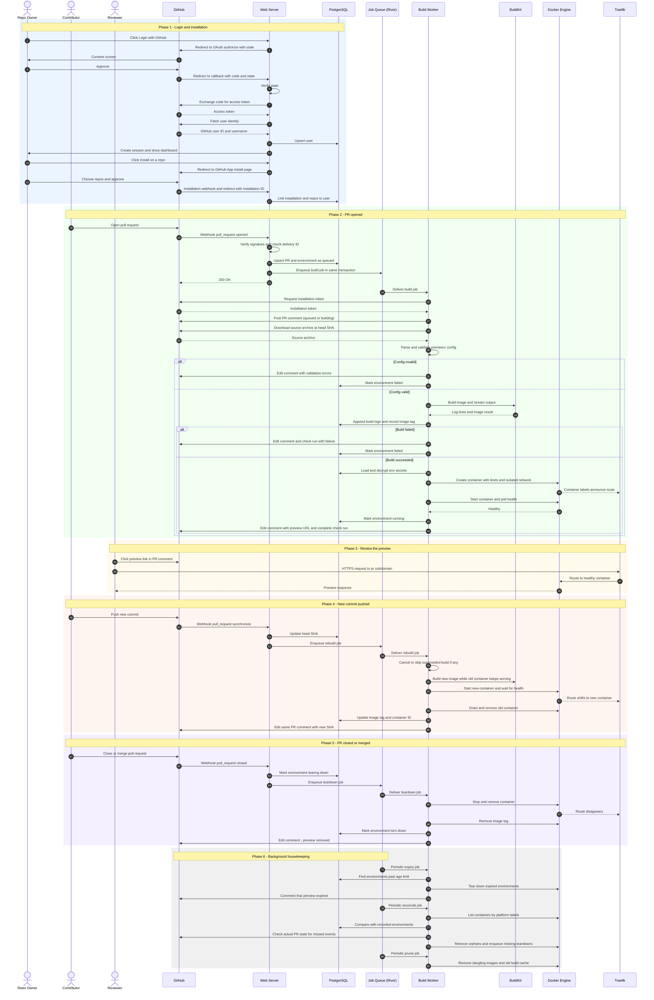

# PR Preview Environments: Design Document

Companion to `README.md` (requirements and stack). This document covers every feature in depth: what it must do, how hard it is, which tools apply to it specifically, how it works step by step, and the design decisions and edge cases behind it. No code appears here except the Mermaid diagram at the end.

## How to read this document

Each feature has five parts:

- **Requirement**: what the feature must do and why it exists.
- **Complexity**: a rating (Low / Medium / High) and the reason for it.
- **Tech stack (feature-specific)**: the tools and libraries that matter for this feature only.
- **Technical implementation**: the steps or overall logic.
- **Design decisions and edge cases**: choices made, alternatives rejected, and failure scenarios.

## Feature index

1. Data model and state store (foundation)
2. GitHub OAuth login
3. Session management
4. GitHub App installation and repo linking
5. Repo configuration file (`.previewrc.yaml`)
6. Webhook receiver
7. Job queue and worker orchestration
8. Source fetching
9. Image building
10. Container runtime and isolation
11. Dynamic routing, subdomains and TLS
12. PR feedback (comments and check runs)
13. Rebuild on new commits
14. Teardown on PR close
15. Housekeeping, expiry and reconciliation
16. Secrets and environment variables for previewed apps
17. Build log streaming and dashboard
18. Observability
19. End-to-end sequence diagram

---

## 1. Data model and state store (foundation)

### Requirement
Persist everything the system needs to survive restarts and to reason about the world: who the users are, which repos are connected, which PRs have environments, what state each environment is in, and enough identifiers (container ID, comment ID, image tag) to act on them later. The database is the single source of truth about intended state; Docker and GitHub hold actual state, and the system reconciles the two.

### Complexity
Medium. The tables are simple, but correctness under duplicate and out-of-order events (constraints, state machine, transactions) is where the difficulty lives.

### Tech stack (feature-specific)
- PostgreSQL as the only datastore (also backs the job queue, sessions and logs in the MVP).
- `pgx` driver, `sqlc` for typed queries, `goose` for migrations.

### Technical implementation
1. Define core entities: users, installations, repos, pull requests, environments, build logs, and encrypted env secrets.
2. Model an environment as a state machine with explicit statuses: `queued`, `building`, `running`, `failed`, `tearing_down`, `torn_down`. Only defined transitions are allowed; the update statement itself checks the current status so illegal transitions fail rather than silently succeed.
3. Enforce uniqueness at the database level: one pull request row per (repo, PR number), one active environment per pull request, and globally unique subdomains.
4. Store timestamps for creation, last activity and expiry so the housekeeping job can work purely from the database.
5. Store external identifiers: Docker container ID and image tag, GitHub comment ID, head commit SHA, so any later job can locate and act on the right resources.
6. All multi-step state changes (for example "mark building and enqueue job") happen inside a single transaction.

### Design decisions and edge cases
- **Postgres for everything in the MVP** reduces moving parts; the queue, sessions and logs can move out later.
- **Constraints over application checks:** two webhook deliveries racing each other cannot create two environments because the database rejects the second.
- **Soft state, hard truth:** the database says what should exist; a reconciler (feature 15) corrects drift when it disagrees with Docker.

---

## 2. GitHub OAuth login

### Requirement
Let a repo owner sign in to the dashboard with their GitHub identity. No separate password system. This feature establishes identity only; it grants no repo permissions.

### Complexity
Medium. The standard flow is well understood, but the security details (state parameter, redirect validation, token handling) are easy to get subtly wrong.

### Tech stack (feature-specific)
- A registered GitHub **OAuth App** (distinct from the GitHub App in feature 4).
- `golang.org/x/oauth2` with the GitHub endpoint.
- `go-github` to call the `/user` endpoint after token exchange.

### Technical implementation
1. User clicks "Login with GitHub". The server generates a random `state` value, stores it in a short-lived signed cookie, and redirects to GitHub's authorize URL with the client ID, redirect URI and state.
2. GitHub shows a consent screen and, on approval, redirects back to the server's callback URL with a temporary `code` and the same `state`.
3. The callback handler compares the returned `state` with the cookie value and rejects the request on mismatch (CSRF protection).
4. The server exchanges the `code` plus client secret for an access token by calling GitHub server to server.
5. It calls GitHub's user endpoint with that token to fetch the numeric GitHub user ID, username and avatar.
6. It upserts the user row keyed by the numeric GitHub ID (never by username or email, which can change).
7. It creates a session (feature 3) and redirects to the dashboard.
8. The OAuth access token is either discarded or stored encrypted; the MVP needs it only for the identity call, so discarding is preferred.

### Design decisions and edge cases
- **Key on GitHub numeric ID**, because usernames are renameable.
- **Minimal scopes:** request only what identity needs. Repo access comes from the GitHub App, not from OAuth scopes.
- **Failure paths:** user denies consent, GitHub is down, or state mismatch. Each shows a clear error page and never leaves a half-created session.

---

## 3. Session management

### Requirement
After login, keep the user authenticated across dashboard requests securely, and let them log out.

### Complexity
Low to Medium. Simple in concept; security settings matter.

### Tech stack (feature-specific)
- `alexedwards/scs` with its Postgres store.
- Secure, HttpOnly, SameSite cookies.

### Technical implementation
1. On successful login, create a server-side session record containing the user ID and expiry, and issue an opaque session ID in a cookie.
2. Middleware loads the session on every dashboard request and attaches the user to the request context; unauthenticated requests to protected routes redirect to login.
3. Rotate the session ID at login to prevent session fixation.
4. Set both an idle timeout and an absolute lifetime.
5. Logout asks for confirmation in a modal over the current screen; confirming
   submits a CSRF-protected POST that deletes the server-side record and clears the cookie.
6. State-changing dashboard actions (for example "tear down now") require a CSRF token.

### Design decisions and edge cases
- **Server-side sessions over JWTs:** revocation is trivial and nothing sensitive lives in the cookie.
- **Separation of concerns:** dashboard sessions are unrelated to the credentials used to call GitHub on behalf of a repo (feature 4).

---

## 4. GitHub App installation and repo linking

### Requirement
Give the system permission to receive events from, read code from, and write comments and checks to specific repositories, chosen explicitly by the repo owner. This is the integration that does the actual work.

### Complexity
High. Two credential types, a private key to protect, short-lived tokens to manage, and lifecycle events (install, uninstall, permission changes) to handle.

### Tech stack (feature-specific)
- A registered **GitHub App** with declared permissions (pull requests read, contents read, checks write, pull request comments write) and subscribed events (`pull_request`, `installation`, `installation_repositories`).
- `ghinstallation` for minting installation tokens; `go-github` for API calls.

### Technical implementation
1. From the dashboard, the user clicks "Install on a repo", which sends them to GitHub's installation page for the App.
2. GitHub asks which repositories to grant access to and shows the permissions requested.
3. On approval, GitHub redirects back with an installation ID and also sends an `installation` webhook.
4. The server associates the installation ID with the logged-in user and records the selected repositories.
5. Whenever the system must call GitHub for a repo, it authenticates **as the App** using its private key to create a short-lived signed assertion, exchanges that for an **installation access token** scoped to that installation, and uses the token for the call.
6. Tokens are cached in memory until shortly before they expire, then refreshed automatically.
7. `installation_repositories` events keep the repo list in sync when the owner adds or removes repos later; an uninstall event marks the installation inactive and triggers teardown of its environments.

### Design decisions and edge cases
- **GitHub App, not personal access tokens:** scoped per repo, revocable by the owner, not tied to one person's account.
- **The private key is the crown jewel:** stored outside the repo, file permissions locked down, never logged.
- **Uninstall handling:** if the App is removed, running previews for that installation must be cleaned up, not orphaned.
- **Linking installer to user** relies on the browser redirect; the webhook alone does not say which dashboard user did it, so the two events are matched by installation ID.

---

## 5. Repo configuration file (`.previewrc.yaml`)

### Requirement
Let each repo declare how its app is built and run: Dockerfile path, exposed port, non-secret environment variables, optionally a health check path and resource tier.

### Complexity
Low to Medium. Parsing is easy; useful validation and safe defaults take care.

### Tech stack (feature-specific)
- `goccy/go-yaml` for parsing, `go-playground/validator` for validation.

### Technical implementation
1. When a build job starts, fetch the config file from the repo at the exact PR head SHA (not the default branch), so config changes in a PR apply to that PR's preview.
2. Parse into a typed structure and reject unknown keys, so typos surface as errors instead of being ignored.
3. Validate: Dockerfile path stays inside the repo (no path traversal), port in a valid range, environment variable names are well formed, requested resources do not exceed server-defined maximums.
4. Apply defaults for anything omitted (for example a default port and a standard health check).
5. On validation failure, do not build; post a comment listing the specific problems.
6. Store a hash of the effective config on the environment record to detect config changes between builds.

### Design decisions and edge cases
- **Config from the PR's own commit** matches developer expectations and lets them iterate on the config inside the PR.
- **Server-side ceilings:** a repo cannot ask for unlimited CPU or memory; the config can request less than or equal to the platform limit, never more.
- **Missing config** produces a helpful comment explaining what to add, not silence.

---

## 6. Webhook receiver

### Requirement
Accept events from GitHub, prove they are genuine, extract what matters, and hand work to the queue fast. Must respond within seconds and never do heavy work inline.

### Complexity
Medium. Small code, high consequence: authenticity, idempotency and ordering all live here.

### Tech stack (feature-specific)
- `chi` HTTP handler, `go-github` payload validation and parsing, River for enqueueing.

### Technical implementation
1. Read the raw request body before any parsing, since signature verification needs the exact bytes.
2. Verify the HMAC signature header against the shared webhook secret using a constant-time comparison; reject with an error status on mismatch.
3. Read the event type and delivery ID headers. Record the delivery ID; if it has been seen before, return success without doing anything (GitHub retries deliveries).
4. Route by event type and action: PR `opened`, `reopened`, `synchronize` lead to build or rebuild; `closed` leads to teardown; `installation` events go to feature 4 handling; everything else is acknowledged and ignored.
5. Look up the repo: is it linked, active, and does it have a usable configuration? If not, stop (optionally enqueue a "explain what is missing" comment).
6. In one database transaction, update the pull request row (latest head SHA, state) and enqueue the appropriate job.
7. Return success immediately.

### Design decisions and edge cases
- **Ack fast, work later:** GitHub treats slow responses as failures and retries, which multiplies load.
- **Idempotency by delivery ID plus natural keys:** duplicate deliveries collapse into one effect.
- **Out-of-order delivery:** jobs carry the head SHA; a job whose SHA is no longer the latest for that PR is discarded on start (see feature 13).
- **Fork PRs:** detect them from the payload and apply the fork policy from feature 10 and 16.

---

## 7. Job queue and worker orchestration

### Requirement
Run builds, deploys, teardowns and expiry tasks reliably in the background, with retries, ordering per PR, a cap on concurrent builds, and survival across restarts.

### Complexity
High. This is the coordination core of the system.

### Tech stack (feature-specific)
- River (Postgres-backed) with a dedicated worker process; unique jobs and per-queue concurrency limits.

### Technical implementation
1. Define job kinds: build, rebuild, teardown, expire, reconcile, prune.
2. Use separate queues so long builds never block quick teardowns.
3. Set queue concurrency to a configured maximum simultaneous builds; excess jobs wait.
4. Enforce **one active job per pull request** using job uniqueness on the PR key, so a build and teardown for the same PR never run simultaneously.
5. Because enqueueing happens in the same transaction as the state change, a job exists if and only if the state change committed.
6. Retries use backoff for transient errors (network, registry, GitHub rate limits); permanent errors (invalid config, Dockerfile failure) fail once and report to the user without retrying.
7. Jobs are written to be idempotent: running one twice leaves the same end state (for example, "ensure container for SHA X exists" rather than "start a container").
8. On worker startup, jobs left running by a crashed worker are reclaimed and re-run.

### Design decisions and edge cases
- **Transactional outbox for free:** the database-backed queue avoids the classic lost-job window.
- **Latest-SHA-wins:** if commits arrive faster than builds finish, superseded builds are cancelled or skipped.
- **Backpressure:** a queued job's status is visible in the PR comment ("queued, position N") so waiting is not mistaken for failure.

---

## 8. Source fetching

### Requirement
Obtain the repo's code at the exact commit under review, securely and quickly, without leaving credentials behind.

### Complexity
Medium.

### Tech stack (feature-specific)
- GitHub API archive download (tarball at a commit SHA) using an installation token, or a shallow git clone.

### Technical implementation
1. Mint or reuse an installation token for the repo (feature 4).
2. Download the archive for the exact head SHA (preferred over cloning: no history, no `.git` directory, faster).
3. Extract into a fresh, uniquely named temporary build directory owned by the worker.
4. Guard extraction against malicious archives: reject paths that escape the directory, cap total extracted size and file count.
5. Read the configuration file from this directory (feature 5).
6. After the build completes or fails, delete the directory.

### Design decisions and edge cases
- **Archive over clone** because previews never need history.
- **The token must never be baked into anything** that persists: not in the build context, not in image layers, not in logs.
- **Fork PRs:** the head commit lives in the fork; the archive is fetched by SHA from the base repo's PR ref, and secrets are withheld (feature 16).

---

## 9. Image building

### Requirement
Turn the fetched source into a runnable container image using the repo's Dockerfile, quickly on repeat builds, without giving the build access to the host.

### Complexity
High. Build isolation, caching and resource control interact.

### Tech stack (feature-specific)
- BuildKit via the `moby/buildkit` client (or Docker's build API backed by BuildKit), with an on-host layer cache.

### Technical implementation
1. Submit the build context and Dockerfile path to BuildKit with a unique image tag derived from repo, PR number and commit SHA.
2. Stream build output line by line into the log store (feature 17) as it is produced.
3. Apply a build timeout and a cap on resulting image size; abort if exceeded.
4. Use BuildKit's layer cache so unchanged layers are reused across builds of the same repo, which is the main speed lever.
5. Do not pass secrets as build arguments; if a build needs a secret, use BuildKit secret mounts so it never lands in a layer.
6. On success, record the image tag on the environment; on failure, mark it failed and preserve the log.

### Design decisions and edge cases
- **Untrusted Dockerfiles:** a Dockerfile can run arbitrary commands at build time. The build runs with resource limits and no access to the control plane network.
- **Cache poisoning risk:** cache is scoped per repo so one repo's builds cannot influence another's.
- **Disk pressure:** builds are the main source of disk growth; pruning is handled by feature 15.

---

## 10. Container runtime and isolation

### Requirement
Start the built image as an isolated, resource-limited container that serves the preview, reachable only through the router, and unable to harm the host or other previews.

### Complexity
High. This is the security-critical feature.

### Tech stack (feature-specific)
- Docker Engine API via the official Go client; optional gVisor (`runsc`) runtime; an isolated Docker network.
- A `Runtime` interface so another backend (Kubernetes) can be added later.

### Technical implementation
1. Create the container with: memory and CPU limits from the (clamped) config, a process count limit, all Linux capabilities dropped, no privilege escalation, and a read-only root filesystem where the app allows it, with a small writable temp area.
2. Attach it to a dedicated preview network that has **no route** to the host, the control plane, the database, or cloud metadata endpoints; only the router can reach it.
3. Do not publish container ports on the host; exposure is exclusively via the router (feature 11).
4. Inject environment variables: non-secret ones from config, secrets from feature 16.
5. Add labels identifying repo, PR, environment ID and SHA; the router reads routing labels and the reconciler uses the rest.
6. Start the container, then poll its health (declared health check path or TCP port open) until healthy or a startup timeout elapses.
7. Only after it is healthy is it considered `running` and eligible for traffic.
8. If unhealthy at timeout, capture recent container logs, mark failed, remove the container, and report.

### Design decisions and edge cases
- **Docker socket is worker-only:** never mounted into a preview container.
- **Fork PRs** run with no secrets and, if the owner enables approval, wait for a maintainer to approve before running.
- **Crash loops:** a container that keeps restarting is stopped after a small number of restarts and marked failed.
- **Noisy neighbours:** limits keep one preview from starving others; a per-repo cap on concurrent previews bounds total load.
- **gVisor** raises the isolation bar substantially and is a low-cost upgrade path if kernel-level escape risk matters.

---

## 11. Dynamic routing, subdomains and TLS

### Requirement
Give each PR a stable public URL (for example `pr-42-reponame.preview.yourdomain.com`), route requests to the correct container, and serve HTTPS, all updating automatically as environments come and go.

### Complexity
High. Correctness under churn and certificate handling are the hard parts.

### Tech stack (feature-specific)
- Traefik v3 with the Docker provider, wildcard certificate via Let's Encrypt DNS-01, a wildcard DNS record.

### Technical implementation
1. **Subdomain allocation:** derive the hostname from repo and PR number, sanitized to valid DNS label characters and length; store it with a uniqueness constraint. It stays the same across rebuilds of the same PR.
2. **Routing by labels:** when the container is created, attach labels declaring the host rule and internal port. Traefik watches Docker events and updates its routing table live, with no reload.
3. **TLS:** one wildcard certificate covers every preview subdomain, obtained via DNS-01 challenge with the DNS provider's API token. No per-PR certificate issuance, which avoids rate limits and delays.
4. **Traffic gating:** a container gets routing labels or a healthy status only once it passes its health check, so users never hit a half-started app.
5. **Unknown subdomains** route to a friendly "environment not found or expired" page rather than a raw error.
6. **On teardown**, removing the container removes its route automatically.

### Design decisions and edge cases
- **Wildcard cert over per-host certs:** faster first request and no rate-limit exposure.
- **Stable URLs across rebuilds** so reviewers' bookmarks and links in comments stay valid.
- **Subdomain takeover risk:** stale DNS is not an issue with a wildcard record, but a released subdomain must not be reassignable in a way that exposes old data; containers are fully removed on teardown.
- **Security headers and access:** MVP previews are public by URL obscurity; optional access control (login required) is a documented upgrade.

---

## 12. PR feedback (comments and check runs)

### Requirement
Tell reviewers what is happening, directly in the PR: queued, building, ready with a link, failed with a reason, expired. One living comment, not a stream of new ones.

### Complexity
Medium. Simple API calls, but rate limits, race conditions and idempotency matter.

### Tech stack (feature-specific)
- `go-github` with installation tokens: issue comments API and Checks API.

### Technical implementation
1. On first job for a PR, create a comment and store its ID on the pull request row.
2. Every later state change **edits** that comment rather than creating a new one; if the stored comment was deleted by a human, detect the not-found response and create a fresh one.
3. In parallel, create a **check run** for the head SHA with statuses queued, in progress, completed (success or failure), and a details link to the build logs page.
4. Comment content: current status, preview URL when ready, commit SHA it reflects, and a short failure summary with a link to logs when applicable.
5. Updates are debounced so a rapid series of transitions does not exceed GitHub's rate limits; final state is always written.
6. Failures to update GitHub never fail the deployment itself; they are retried separately.

### Design decisions and edge cases
- **Comment plus check run:** the comment is human friendly; the check run integrates with branch protection and the merge box.
- **Stale updates:** an update for an older SHA must not overwrite a newer one; every write compares the SHA it represents against the latest.
- **Rate limiting:** installation tokens have their own budget; respect and back off on rate-limit responses.

---

## 13. Rebuild on new commits

### Requirement
When new commits are pushed to a PR, update the same environment to the new code, keep the URL the same, and avoid downtime and leaked old containers.

### Complexity
High. Concurrency and zero-gap swapping.

### Tech stack (feature-specific)
- River uniqueness and cancellation, Docker API, Traefik health-gated routing.

### Technical implementation
1. A `synchronize` webhook records the new head SHA and enqueues a rebuild.
2. If a build for an older SHA is still in progress for this PR, cancel it or mark it superseded so its result is discarded.
3. Build the new image while the **old container keeps serving**.
4. Start the new container alongside the old one (same hostname, different container identity) and wait for it to become healthy.
5. Once healthy, shift traffic: the new container starts receiving requests, and the old one is drained and then stopped and removed.
6. Update the environment record (image tag, container ID, SHA) in one transaction and edit the PR comment.
7. If the new build or container fails, the old one keeps running; the comment says the latest commit failed while the previous preview remains available.

### Design decisions and edge cases
- **Blue/green at container level:** guarantees a working URL exists whenever possible.
- **Latest wins:** intermediate commits may never deploy; only the newest matters.
- **Orphan protection:** any container labeled for this PR but not referenced by the current record is removed by the reconciler.

Implementation status and the proposed durable publication boundary are kept
separate: see [the current generation-ordering implementation](docs/GENERATION_ORDERING.md)
and [the durable publication design](docs/DESIGN_DURABLE_PUBLICATION.md). The target
design moves external routing/reporting calls out of the transaction while retaining
generation fencing and recovery across crashes.

---

## 14. Teardown on PR close

### Requirement
When a PR is closed or merged, remove everything created for it: container, route, image, temporary files, and update the PR comment. Leaks cost money and widen the attack surface.

### Complexity
Medium.

### Tech stack (feature-specific)
- River teardown job, Docker API, Traefik (automatic route removal).

### Technical implementation
1. `closed` webhook marks the environment `tearing_down` and enqueues a teardown job.
2. Stop the container gracefully with a timeout, then force remove.
3. Remove per-environment resources: container, image tag (shared layers stay cached), any volumes.
4. Delete stored non-audit data: env secrets scoped to this environment, temporary directories.
5. Mark the environment `torn_down` and edit the comment ("Preview removed").
6. Reopening the PR later simply enqueues a fresh build.

### Design decisions and edge cases
- **Idempotent teardown:** every step tolerates the resource already being gone.
- **Missed webhook:** if the `closed` event is lost, the reconciler (feature 15) catches it by comparing with GitHub's actual PR state.
- **Logs retention:** build logs may be kept for a short period after teardown for debugging, then deleted.

---

## 15. Housekeeping, expiry and reconciliation

### Requirement
Protect against everything that goes wrong quietly: missed webhooks, crashed workers, forgotten PRs, orphaned containers, full disks. Keep the real world matching the database.

### Complexity
High. Reconciliation logic is subtle, and getting it wrong can delete live environments.

### Tech stack (feature-specific)
- River periodic jobs, Docker API listing by labels, GitHub API for PR state.

### Technical implementation
1. **Expiry job (hourly):** find environments past their maximum age or inactivity limit, tear them down, and comment that they expired and will redeploy on the next push.
2. **Reconciliation job (every few minutes):** list all containers carrying the platform's labels and compare with database records.
   - Container with no matching record: orphan, remove it (after a grace period so a just-created container is not killed mid-creation).
   - Record marked running with no container: mark failed or redeploy.
   - Environment whose PR is actually closed on GitHub: enqueue teardown.
3. **Prune job (daily and on disk-pressure threshold):** remove dangling images, old build cache beyond a size budget, and stale temporary directories.
4. **Stuck-state detection:** environments in `building` or `tearing_down` longer than a timeout are flagged and retried.
5. All decisions are made from labels and database state, never from names alone.

### Design decisions and edge cases
- **Grace periods** prevent races between creation and cleanup.
- **Dry-run mode** for the reconciler during development, logging what it would delete before it is trusted to delete.
- **Disk exhaustion is the most likely real outage;** it gets a metric, an alert threshold and an emergency prune path.

---

## 16. Secrets and environment variables for previewed apps

### Requirement
Previewed apps often need configuration (API keys, database URLs). Let repo owners provide them safely, and never leak them to untrusted code paths or logs.

### Complexity
High. Security-sensitive with subtle leakage paths.

### Tech stack (feature-specific)
- AES-GCM (Go standard library) or `age` for encryption at rest; key supplied through server environment.

### Technical implementation
1. The repo owner adds key/value pairs in the dashboard; the server encrypts each value with a unique nonce before storing it, keyed by repo.
2. Values are never shown again after saving (write-only in the UI; only key names are listed).
3. At container start, the worker decrypts the values in memory and injects them as environment variables.
4. The log pipeline redacts any string matching a known secret value before storing build or runtime output.
5. **Fork PR policy:** secrets are never injected for PRs from forks, because fork authors control the code.
6. Rotating the encryption key is supported by tagging each value with a key version and re-encrypting lazily.

### Design decisions and edge cases
- **Not in the repo config file:** anything in the repo is visible to anyone with read access.
- **Build-time vs run-time:** secrets are runtime by default; build-time use only through BuildKit secret mounts.
- **Blast radius:** a preview-only credential (for example, a sandbox API key) should be recommended in docs; previews are not the place for production keys.

---

## 17. Build log streaming and dashboard

### Requirement
Give users a place to see live build output and the state of their previews, without leaving the browser, and link to it from the PR.

### Complexity
Medium.

### Tech stack (feature-specific)
- `templ` + HTMX for pages; Server-Sent Events for live logs; Postgres for log storage; Tailwind for styling.

### Technical implementation
1. During builds and container startup, each output line is appended to the log table with a sequence number per environment.
2. The logs page loads existing lines, then opens an SSE stream that pushes new lines as they arrive (the server polls or listens for new rows, or uses Postgres notifications).
3. A reconnecting client resumes from the last sequence number it received, so nothing is duplicated or lost.
4. The dashboard lists the user's repos and their active environments with status, URL, commit SHA, age, and a manual "tear down now" action.
5. Dashboard actions check both authentication and ownership: a user can only see and act on environments in installations they own.
6. Log retention has a size and age cap; old logs are pruned.

### Design decisions and edge cases
- **Server-rendered UI** keeps everything in one binary and one deploy.
- **Authorization at the query level:** every query is scoped by the user's installations, not just by an ID from the URL.
- **Log volume:** large or runaway output is truncated with a marker to protect the database.

---

## 18. Observability

### Requirement
Make the system operable: know what it is doing, how it fails, and when it is about to run out of capacity.

### Complexity
Medium.

### Tech stack (feature-specific)
- `slog` structured logs, Prometheus metrics, Grafana dashboards, optional OpenTelemetry tracing.

### Technical implementation
1. Structured logs everywhere, carrying correlation fields: delivery ID, repo, PR number, environment ID, job ID, commit SHA.
2. Metrics: webhook deliveries by type and outcome, queue depth and wait time, build duration and outcome, active environments, container starts and failures, GitHub API errors and rate-limit headroom, disk usage.
3. Dashboards for the health of the pipeline (webhook to running preview latency is the headline number).
4. Alerts on: queue wait beyond a threshold, failure rate spike, disk above threshold, GitHub rate limit nearly exhausted, reconciler deleting unexpectedly many resources.
5. Optional tracing follows one PR event from webhook through queue, build and comment.

### Design decisions and edge cases
- **Correlation IDs** turn a scattered incident into one searchable story.
- **Never log secrets or tokens;** redaction happens at the logging layer.

---

## 19. End-to-end sequence diagram

The diagram below connects the features: login and installation (features 2 to 4), PR open (6 to 12), push (13), close (14), and background housekeeping (15). Paste the code into any Mermaid renderer (GitHub renders it natively in Markdown).



---

## 20. Recommended folder structure: package by feature

Backend code is **packaged by feature**: each feature owns its handler, routes, business logic, database queries and background jobs. Shared infrastructure lives under `internal/platform`. Presentation is the explicit exception: all pages, HTMX fragments, layouts, browser assets and reusable UI components live under `web/`, with pages grouped by feature. HTTP handlers remain in feature packages; there are no global handlers/routes/store layers.

### The tree

```
preview/
├── cmd/
│   ├── server/main.go              # thin: load config, call app.RunServer
│   └── worker/main.go              # thin: load config, call app.RunWorker
│
├── internal/
│   ├── app/                        # composition root: builds and wires everything
│   │   ├── server.go               # creates features, mounts routes, starts HTTP
│   │   ├── worker.go               # creates features, registers jobs, starts River
│   │   └── wire.go                 # dependency construction in one readable place
│   │
│   ├── auth/                       # FEATURE: GitHub OAuth login + sessions
│   │   ├── handler.go              # login, callback, logout (the "controller")
│   │   ├── routes.go               # Mount(r chi.Router): this feature's URLs
│   │   ├── service.go              # login logic: verify state, upsert user
│   │   ├── repository.go           # wraps generated queries for users/sessions
│   │   ├── middleware.go           # RequireUser, CSRF
│   │   ├── queries.sql             # SQL owned by this feature
│   │   ├── dbgen/                  # sqlc output (generated, never edited)
│   │   └── auth_test.go
│   │
│   ├── installations/              # FEATURE: GitHub App install + repo linking
│   │   ├── handler.go  routes.go  service.go  repository.go
│   │   ├── events.go               # handles installation / installation_repositories events
│   │   ├── queries.sql  dbgen/
│   │
│   ├── webhooks/                   # FEATURE: receive and dispatch GitHub events
│   │   ├── handler.go              # read body, verify signature, dedupe by delivery ID
│   │   ├── routes.go
│   │   ├── dispatcher.go           # event type + action -> which feature handles it
│   │   ├── deliveries.go           # delivery-ID tracking (idempotency)
│   │   ├── queries.sql  dbgen/
│   │
│   ├── environments/               # CORE FEATURE: the preview environment lifecycle
│   │   ├── environment.go          # entity + status constants + allowed transitions
│   │   ├── service.go              # RequestBuild, RequestTeardown, MarkRunning...
│   │   ├── repository.go
│   │   ├── jobs.go                 # build / rebuild / teardown River jobs
│   │   ├── handler.go  routes.go   # dashboard actions (teardown now)
│   │   ├── queries.sql  dbgen/
│   │
│   ├── repoconfig/                 # FEATURE: .previewrc.yaml parse + validate
│   │   ├── config.go               # typed struct + defaults
│   │   ├── parser.go
│   │   ├── validate.go             # path traversal, port range, resource ceilings
│   │
│   ├── source/                     # FEATURE: fetch code at a commit SHA
│   │   ├── fetcher.go              # download archive, safe extraction
│   │   ├── extract.go              # zip-slip and size guards
│   │
│   ├── builds/                     # FEATURE: build images
│   │   ├── builder.go              # BuildKit client, cache, timeouts
│   │   ├── logsink.go              # sends build output to buildlogs
│   │
│   ├── runtime/                    # FEATURE: run containers (isolation lives here)
│   │   ├── runtime.go              # Runtime interface (swap Docker for K8s later)
│   │   ├── docker.go               # Docker implementation
│   │   ├── hardening.go            # caps, limits, read-only fs, network policy
│   │   ├── health.go               # wait-until-healthy
│   │
│   ├── routing/                    # FEATURE: subdomains + Traefik labels
│   │   ├── subdomain.go            # sanitize, allocate, uniqueness
│   │   ├── labels.go               # build Traefik labels for a container
│   │
│   ├── reporting/                  # FEATURE: PR comments + check runs
│   │   ├── reporter.go             # Reporter interface used by other features
│   │   ├── comment.go              # create-or-edit the living comment
│   │   ├── checkrun.go
│   │   ├── render.go               # comment text per status
│   │
│   ├── secrets/                    # FEATURE: encrypted env vars for previewed apps
│   │   ├── handler.go  routes.go  service.go  repository.go
│   │   ├── crypto.go               # AES-GCM, key versioning
│   │   ├── redact.go               # strip secret values from logs
│   │   ├── queries.sql  dbgen/
│   │
│   ├── buildlogs/                  # FEATURE: store + stream logs
│   │   ├── store.go                # append lines with sequence numbers
│   │   ├── handler.go  routes.go   # SSE endpoint
│   │   ├── queries.sql  dbgen/
│   │
│   ├── housekeeping/               # FEATURE: expiry, reconcile, prune
│   │   ├── expire.go
│   │   ├── reconcile.go            # containers vs DB vs actual GitHub PR state
│   │   ├── prune.go                # images, build cache, temp dirs
│   │   ├── jobs.go                 # periodic River jobs
│   │
│   ├── dashboard/                  # FEATURE: pages that compose other features
│   │   ├── handler.go  routes.go
│   │
│   └── platform/                   # SHARED infrastructure: knows nothing about features
│       ├── config/                 # env var loading + validation
│       ├── database/               # pgx pool, transaction helper, migrations runner
│       ├── queue/                  # River client setup
│       ├── githubapp/              # App JWT, installation-token cache, API client
│       ├── dockerx/                # Docker client construction
│       ├── httpx/                  # middleware, error responses, HTMX helpers
│       ├── logging/                # slog setup + secret redaction
│       └── metrics/                # Prometheus registry + shared metrics
│
├── db/
│   └── migrations/                 # goose files: 0001_init.sql ...
│
├── web/
│   ├── assets.go                   # embeds and serves static assets
│   ├── layouts/                    # shared HTML shells (base.templ)
│   ├── pages/                      # pages/fragments grouped by feature
│   │   ├── auth/                   # error pages; logout uses a shared modal
│   │   ├── home/                   # public landing page
│   │   └── dashboard/              # authenticated dashboard/session; future screens as needed
│   ├── components/                 # local, reusable UI; no backend imports
│   ├── styles/                     # Tailwind entry CSS and theme tokens
│   └── static/                     # local HTMX, generated CSS, browser assets
│
├── deploy/
│   ├── docker-compose.yml
│   ├── traefik/                    # static + dynamic config
│   └── setup.sh
│
├── docs/                           # README.md, DESIGN.md, ADRs
├── .github/workflows/              # CI + release
├── sqlc.yaml                       # one entry per feature (see below)
├── .air.toml                       # live reload
├── Makefile                        # generate, test, run, migrate
└── go.mod
```

### The rules that make it stay clean

**1. A feature owns its backend behavior.** Teardown functionality lives in `internal/environments`; its pages and fragments belong in `web/pages/environments` when built. Auth HTTP/session behavior lives in `internal/auth`, while its presentation lives in `web/pages/auth`. Shared presentation stays in `web/layouts` and `web/components`.

**2. Dependencies point one way.**

```
cmd  ->  app  ->  features  ->  platform
                    |
                    +-> web/pages/<feature> -> web/layouts/components
```

`platform` and presentation packages never import a feature. A feature never imports another feature's internals. Handlers pass primitive display values or page-owned view models; templates never fetch data, access sessions, or authorize actions. Use import aliases such as `authpages` for page packages that share a feature name.

**3. Features talk through small interfaces defined by the consumer.** This is the Go idiom. Example: `environments` needs to post PR updates, so it defines what it needs:

```go
// internal/environments/service.go
type Reporter interface {
    Building(ctx context.Context, envID string) error
    Ready(ctx context.Context, envID, url string) error
    Failed(ctx context.Context, envID, reason string) error
}
```

`reporting.Reporter` happens to satisfy it. `app/wire.go` connects them. `environments` never imports `reporting`, so there are no cycles and testing is easy with a fake.

**4. `environments` is the center.** `webhooks`, `dashboard` and `housekeeping` call into it. It orchestrates `source`, `builds`, `runtime`, `routing` and `reporting` through interfaces. The pure-mechanism packages (`source`, `builds`, `runtime`, `routing`) know nothing about PRs or users, which is what makes them reusable and testable.

**5. Keep each feature flat.** Files inside a feature sit side by side (`handler.go`, `service.go`, `repository.go`). Don't create `handler/`, `service/` subfolders inside a feature; that's the layered structure sneaking back in. Split a feature into subpackages only when it passes roughly 10 files.

### Inside one feature: how a request flows

Take "Tear down now" from the dashboard, with backend behavior owned by `internal/environments` and presentation under `web/pages/environments`:

```
routes.go       POST /environments/{id}/teardown  ->  handler.Teardown
handler.go      reads user + id, calls service.RequestTeardown, renders the row
service.go      checks ownership, validates the state transition,
                in ONE transaction: mark tearing_down + enqueue teardown job
repository.go  the SQL calls (backed by dbgen/)
jobs.go         the teardown worker: calls runtime, then reporting
web/pages/environments/row.templ  EnvironmentRow component returned to HTMX
```

Handler stays thin (HTTP in, HTTP out), service holds the decisions, repository holds the SQL. That's the same idea as Rails controller / model, minus the magic.

### UI generation and styling

All handwritten `.templ` files live under `web/`. Generated `*_templ.go` files
stay beside their sources and are Git-ignored; run generation before compilation.
Official Tailwind CSS v4.1.18 is installed as a checksum-verified standalone CLI
by `deploy/install-tailwind.sh`. It compiles `web/styles/app.css` into the ignored
`web/static/css/app.css`, scanning presentation sources explicitly. Build/server
Make targets prepare assets before Go embeds them; Air does the same on source
changes and excludes generated output to prevent rebuild loops.

Button, input, card and alert source is selectively copied from stable templUI
v1.13.2 (MIT), a community shadcn-style Go/Templ project. This is not official
React shadcn/ui or the v2 beta. No component JavaScript is currently required.
Keep upstream provenance and local changes in `web/components/README.md`; updates
are reviewed and pinned, not automatic. Worker startup does not require Tailwind.
See `docs/UI_ARCHITECTURE.md` for the implemented presentation boundary.

### sqlc and migrations in a feature-based layout

Migrations stay global in `db/migrations`, since the schema is one database. But each feature keeps its own `queries.sql` and its own generated package, configured in `sqlc.yaml` with one entry per feature that points at the shared migrations as its schema:

```yaml
version: "2"
sql:
  - engine: postgresql
    schema: db/migrations
    queries: internal/environments/queries.sql
    gen:
      go:
        package: dbgen
        out: internal/environments/dbgen
        sql_package: pgx/v5
  - engine: postgresql
    schema: db/migrations
    queries: internal/auth/queries.sql
    gen:
      go:
        package: dbgen
        out: internal/auth/dbgen
        sql_package: pgx/v5
  # ...one block per feature
```

Now a feature can only call queries it owns. If `dashboard` needs data from `environments`, it asks `environments.Service`, not the tables directly.

### The composition root

All the wiring lives in `internal/app/wire.go`, so it's obvious in one file how the system is assembled:

```go
func buildEnvironments(p *platform, rep *reporting.Reporter, rt runtime.Runtime) *environments.Service {
    repo := environments.NewRepository(p.DB)
    return environments.NewService(repo, p.Queue, rep, rt)
}
```

`cmd/server/main.go` and `cmd/worker/main.go` stay a few lines each. The server and worker share the same `wire.go`, so the same features are constructed the same way in both processes.

### Why this is the industry-standard shape

- `cmd/` for binaries and `internal/` for code nobody else can import are the official Go conventions.
- Package-by-feature is what larger Go codebases converge on, because layered folders don't scale past a few features.
- A single composition root with consumer-defined interfaces is the standard way to keep Go packages decoupled without a DI framework.
- One `platform/` package holding cross-cutting infrastructure mirrors what teams call "shared kernel" or "common".

Start with a smaller version: create `auth`, `environments`, `platform` and `dashboard` first, and add the other folders as you reach each feature. The names above are the ones to grow into.
