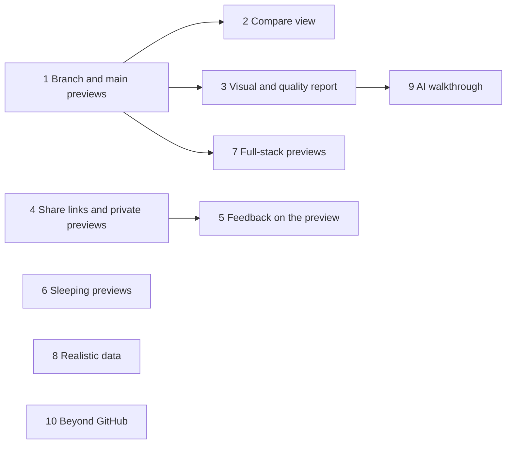

# Next features

Ten features that would make Previa more useful and bring it to more people. Each
one answers a problem that hosted preview services leave open or only solve on
paid plans, and each builds on parts Previa already has.

**None of these are built.** They are candidates, not commitments. Planned work
(Prompt 14 and the release checklist) is in [docs/27-roadmap.md](docs/27-roadmap.md).
Sizes are relative: **S** is days, **M** is a couple of weeks, **L** is a month or
more, **XL** is a multi-month effort.

| # | Feature | The problem it solves | Who it brings in | Size | Needs |
| ---: | --- | --- | --- | --- | --- |
| 1 | [Branch and main-branch previews](#1-branch-and-main-branch-previews) | Only pull requests get a preview; `main` has no live environment | Solo developers, teams without a staging server | L | – |
| 2 | [Compare view: main and the PR side by side](#2-compare-view-main-and-the-pr-side-by-side) | Reviewers flip between two tabs to spot what changed | Frontend teams, designers | M | 1 |
| 3 | [Visual and quality report on every PR](#3-visual-and-quality-report-on-every-pr) | Visual regressions and performance drops slip through review | Frontend teams | L | 1 |
| 4 | [Share links and private previews](#4-share-links-and-private-previews) | Clients and QA without GitHub cannot review; anyone with a link can | Agencies, companies with private products | M | – |
| 5 | [Feedback pinned on the preview](#5-feedback-pinned-on-the-preview) | Feedback arrives as vague chat messages and screenshots | Product managers, designers, clients | L | 4 |
| 6 | [Sleeping previews that wake on visit](#6-sleeping-previews-that-wake-on-visit) | Idle previews hold memory, so a small host fills up | Self-hosters on a budget | M | – |
| 7 | [Full-stack previews across repositories](#7-full-stack-previews-across-repositories) | A frontend PR cannot be previewed against its real backend | Teams with separate frontend and API repositories | L | 1 |
| 8 | [Realistic data in backend previews](#8-realistic-data-in-backend-previews) | Fresh databases are empty, so previews show nothing useful | Backend and full-stack teams | M | – |
| 9 | [AI walkthrough of each preview](#9-ai-walkthrough-of-each-preview) | Nobody clicks through every changed flow before merging | Everyone; a strong launch story | L | 3 |
| 10 | [Beyond GitHub: GitLab, Gitea and Forgejo](#10-beyond-github-gitlab-gitea-and-forgejo) | Hosted preview services barely support self-hosted Git | Self-hosting teams and open-source communities | XL | – |

Suggested order, following the dependencies:



Features 4, 6 and 8 stand alone and can come first; 6 also makes the low-cost host
in [docs/25](docs/25-production-deployment.md#choosing-a-host-and-keeping-costs-low)
hold many more previews.

## 1. Branch and main-branch previews

**The problem.** Previa previews pull requests only. A repository's `main` branch
has no live environment, a feature branch without a PR cannot be previewed, and a
solo developer who pushes straight to `main` gets nothing.

**What Previa adds.**

- A **main preview** that rebuilds on every push to the default branch: a free,
  always-current staging environment at a stable address.
- **Branch previews** on request (or automatically for branches matching a
  pattern), for work that is not ready for a PR.
- A **Build this commit** action for any repository, PR or not.

**Why it stands out.** Most self-hosted preview tools stop at PRs; this turns
Previa into a lightweight staging platform too, and it is the baseline that
features 2, 3 and 7 compare against.

**Builds on.** The build pipeline, routing and teardown are unchanged. The work is
in the data model and triggers: environments are unique per pull request today
(`environments_pull_request_key`), so a preview needs a subject that is either a
PR or a branch; the App must subscribe to `push` events (webhooks accept only
`pull_request` and installation events now); feedback goes to commit statuses and
check runs instead of a PR comment.

## 2. Compare view: main and the PR side by side

**The problem.** Reviewing a frontend change means opening the old and new
versions in two tabs and hunting for differences by eye.

**What Previa adds.** A compare page for every PR of a frontend repository:

- **Live mode:** the main preview and the PR preview side by side at the same path,
  with viewport presets (phone, tablet, desktop) and one address bar for both.
- **Snapshot mode:** screenshots of both at the same moment with a slider, an
  overlay and a highlighted pixel diff, which works even when an app refuses to be
  framed.
- A link to the compare page in the PR comment.

**Why it stands out.** Hosted preview services show one preview at a time;
side-by-side comparison usually requires a separate paid visual-testing product.

**Builds on.** Feature 1 for the main preview and the screenshot runner from
feature 3. The page must live on the preview domain, never the dashboard's, to keep
untrusted apps away from the dashboard's origin. Apps that forbid framing
(`X-Frame-Options`) fall back to snapshot mode; scroll sync across two origins is
not possible without code in the app, so live mode syncs paths, not scrolling.

## 3. Visual and quality report on every PR

**The problem.** A CSS change breaks a page nobody looked at, or a new dependency
makes the site slower, and review does not notice.

**What Previa adds.** When a preview goes live, Previa opens a configured list of
pages on main and on the PR in headless Chromium and reports in the PR comment and
a check run:

- **Visual changes:** before, after and diff images for each page and viewport
  that changed ("3 of 12 pages changed").
- **Quality:** Lighthouse performance, accessibility and SEO scores, broken links
  and console errors, compared with main, with optional thresholds in
  `.previewrc.yaml` that fail the check.

**Why it stands out.** Visual regression testing exists mainly as paid SaaS
(Chromatic, Percy). Built into a self-hosted preview platform, it costs nothing
extra.

**Builds on.** Feature 1 for the baseline, the reporting package for the comment
and check runs, and Playwright, which the browser tests already use. The browser
runs in its own container on the PR's network with the usual egress rules, so it
can reach only the previews.

## 4. Share links and private previews

**The problem.** Preview addresses are unguessable but public: anyone with the
link can open them, which is a problem for unreleased products. Clients, QA
testers and stakeholders without GitHub accounts have no proper way in.

**What Previa adds.**

- **Private previews:** a repository setting that requires sign-in before a
  preview opens.
- **Share links:** expiring, revocable links (optionally with a password) for
  people without GitHub, created from the PR page.
- **Visit log:** who opened which preview and when.

**Why it stands out.** Access-protected previews are usually an enterprise-plan
feature. Self-hosted and free, they open Previa to agencies and companies that
cannot publish unreleased work.

**Builds on.** Routing: the route controller adds a Traefik forward-auth
middleware to protected routes, pointing at a small Previa endpoint on the preview
domain. Its cookies stay on the preview domain, separate from the dashboard's, as
the security model requires.

## 5. Feedback pinned on the preview

**The problem.** Reviewers who are not developers send feedback as chat messages
and cropped screenshots, without the page, the browser or the viewport, and none
of it reaches the PR.

**What Previa adds.** An opt-in review toolbar on previews: click any element,
write a comment, and Previa posts it to the PR as a review comment with a
screenshot, the page address, the element, the viewport and the browser.
Reviewers with a share link (feature 4) can comment too. The dashboard lists open
feedback per PR.

**Why it stands out.** This is the feature agencies pay hosted services for. Done
on top of a self-hosted platform, it reaches designers, PMs and clients, not only
developers.

**Builds on.** Feature 4 for identity. The toolbar needs a script added to HTML
responses of opted-in previews, through a small proxy in front of them; it must
never run on the dashboard's origin. Comments go out through the existing reporter.

## 6. Sleeping previews that wake on visit

**The problem.** Every live preview holds its memory budget even when nobody has
opened it for days, so a small host runs out of room for new previews.

**What Previa adds.** Previews with no requests for a configurable time are
stopped and their budget released. The next visit shows a short "waking up" page;
Previa starts the container, waits for readiness and reloads the page. Expiry and
teardown work as before.

**Why it stands out.** Scale-to-zero is rare in self-hosted preview tools. A €7
host could hold several times more previews, which matters for teams and open-source
projects with many open PRs.

**Builds on.** Capacity admission (budgets count only awake previews), the route
controller (a sleeping preview's route points at the wake endpoint, as removed
previews point at the unavailable page today) and Traefik's per-router request
metrics for idle detection. Backend previews' fresh databases do not survive a
sleep, which suits them because they are disposable already.

## 7. Full-stack previews across repositories

**The problem.** When the frontend and the API live in separate repositories, a
frontend PR preview talks to a shared staging API, or to nothing, so it cannot
show a change that needs both.

**What Previa adds.** `.previewrc.yaml` declares companion repositories:

```yaml
companions:
  - repository: acme/api
    ref: same-branch-or-main   # the PR's branch name if it exists there, else main
    env: API_URL                # injected into this preview with the companion's address
```

Previa builds or reuses the companion's preview, places both on one private
network and passes the address in. Changing a branch in either repository updates
the pair.

**Why it stands out.** Multi-repository previews are rare even in paid products,
and microservice teams need them the most.

**Builds on.** Feature 1 for branch and main previews of the companion, backend
previews' private service network and readiness ordering, and installation access
checks so a companion must belong to the same owner.

## 8. Realistic data in backend previews

**The problem.** Each backend preview starts with an empty database (or a few seed
rows), so reviewers cannot see the change against data that looks real.

**What Previa adds.** A repository can provide a database snapshot: an encrypted
dump uploaded on the dashboard, or a command that produces one. Previa applies
masking rules (for example, replace emails and names) before any preview receives
it, then restores the result into every new preview's database, before the setup
command runs.

**Why it stands out.** Data branching with masking is a paid feature of managed
databases; here it works with any app and stays on your host.

**Builds on.** Backend previews (fresh PostgreSQL per candidate, setup ordering)
and repository secrets' encryption for the stored snapshot. Today's preview
databases live on tmpfs with 192 MiB of data, so larger snapshots need a
disk-backed, size-capped option.

## 9. AI walkthrough of each preview

**The problem.** Nobody clicks through every flow a PR touches before merging,
so broken buttons and error pages ship.

**What Previa adds.** An opt-in agent reads the PR's diff, opens the preview in a
headless browser, exercises the flows the change affects, and posts a short,
illustrated summary in the PR comment: what changed for a user, what it tried, and
anything that broke (errors, failed requests, dead ends).

**Why it stands out.** It turns every preview into a first-pass QA run and makes a
clear launch story. Few tools combine preview environments with automated
exploration.

**Builds on.** The browser runner from feature 3 and the reporter. It needs a model
API key from the repository owner (so the owner controls cost), an explicit opt-in
because screenshots and the diff are sent to the model provider, and egress limited
to the previews and that API.

## 10. Beyond GitHub: GitLab, Gitea and Forgejo

**The problem.** Teams and communities that host their own Git with Gitea or
Forgejo, or use GitLab, have almost no preview options; hosted services focus on
GitHub.

**What Previa adds.** The same previews, comments and status checks for merge
requests and pull requests on GitLab, Gitea and Forgejo, chosen per installation.

**Why it stands out.** A self-hosted preview platform for self-hosted Git is a
natural fit and an underserved audience, and open-source forges bring community
attention.

**Builds on.** GitHub-specific code is concentrated in sign-in, App installation,
webhooks, discovery, source archives and reporting. Each consumer would depend on a
small "forge" interface it defines (the pattern [AGENTS.md](AGENTS.md) prescribes),
with one implementation per forge. Start with Gitea and Forgejo, which share an
API.

## Also worth considering

Smaller ideas that fit between the features above:

- **Five-minute setup:** create the GitHub App from a manifest in one click and
  provision the host and DNS from an API token, replacing most manual steps in
  [docs/25](docs/25-production-deployment.md).
- **QR codes and device frames** in the PR comment, for checking previews on a phone.
- **Preview history:** keep the last few builds of a PR and switch between them.
- **Chat notifications:** Slack, Microsoft Teams or Discord messages when a
  preview is ready or fails.
- **CLI and API:** open, rebuild and tail logs of previews from a terminal or CI.
