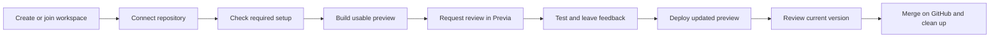
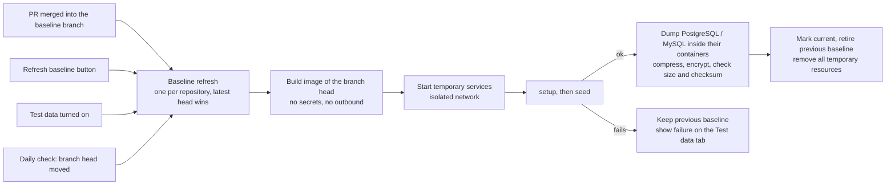
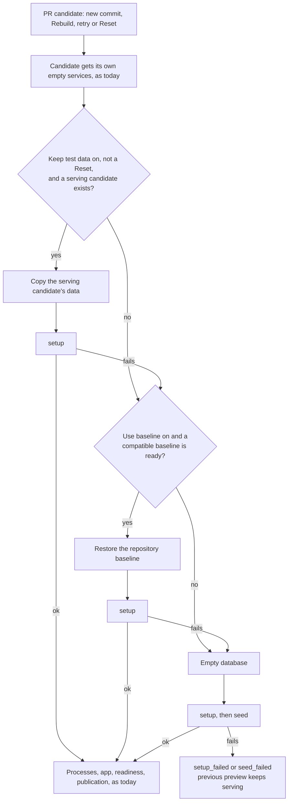

# Previa: complete team SaaS MVP specification

**Status:** Features 1 (shared workspaces), 2 (guided onboarding), 3 (native review and feedback, with step B's publication references and activity records) and 5 (ready-to-test sample data) are implemented. The MVP release continues with Feature 5B and the free-plan part of 6 ([§1.2](#12-mvp-release-scope-and-order)); Feature 4, paid subscriptions and GitHub review-status projection are deferred until early-access feedback asks for them.
**Prepared:** 14 October 2026. **Updated:** 16 October 2026 (Features 3 and 5 implemented; release scope narrowed to a preview-first MVP; Feature 5B added after Feature 5 on 15 October).  
**Audience:** small development teams using hosted Previa.  
**Scope:** the product improvements agreed with the owner for the MVP release: Features 1, 2, 3, 5, 5B and the free-plan part of 6. Previa is a preview platform first; review workflow depth (Feature 4), paid subscriptions and separate notification integrations are deferred.

This document explains the complete product behavior to implement, the changes to the existing application, and how completion will be demonstrated. Feature 1's workspace creation, membership, access, invitations, handover and shared quota identity now have application code and verification described in [Shared team workspaces](docs/28-shared-workspaces.md). Native feedback is implemented as described in [Native review and feedback](docs/30-reviews.md); visible account usage and durable workspace deletion/disconnection referenced in its permission matrix depend on Feature 6 and are not implemented yet, and review assignments and decisions are deferred with Feature 4. Ready-to-test sample data is implemented as described in [Ready-to-test sample data](docs/31-test-data.md). The remaining features are planned; this document does not claim they already exist.

All of these capabilities belong to the existing Previa application. Previa owns team access, review instructions, feedback, review decisions, activity, usage, and account settings. GitHub continues to provide identity, source, PR lifecycle, and a living status comment/check; it receives summaries and links back to Previa. Reviewers must not have to finish the Previa review workflow in GitHub, Slack, or another application.

## Contents

1. [Scope and product outcome](#1-scope-and-product-outcome)
2. [Verified current baseline](#2-verified-current-baseline)
3. [Shared product and engineering rules](#3-shared-product-and-engineering-rules)
4. [Feature 1: shared team workspace](#4-feature-1-shared-team-workspace)
5. [Feature 2: minimal guided onboarding](#5-feature-2-minimal-guided-onboarding)
6. [Feature 3: native preview review and feedback](#6-feature-3-native-preview-review-and-feedback)
7. [Deferred: review status and activity timeline (formerly Feature 4)](#7-deferred-review-status-and-activity-timeline-formerly-feature-4)
8. [Feature 5: ready-to-test sample data](#8-feature-5-ready-to-test-sample-data)
   - 8B. [Feature 5B: persistent test data](#8b-feature-5b-persistent-test-data)
9. [Feature 6: usage and account management](#9-feature-6-usage-and-account-management)
10. [GitHub reporting across all features](#10-github-reporting-across-all-features)
11. [Migration and implementation sequence](#11-migration-and-implementation-sequence)
12. [Verification and release acceptance](#12-verification-and-release-acceptance)
13. [Product configuration and unresolved business inputs](#13-product-configuration-and-unresolved-business-inputs)
14. [Research references](#14-research-references)

## 1. Scope and product outcome

| Agreed feature | Implementation scope | End-user outcome |
| --- | --- | --- |
| 1. Shared team workspace | Complete membership, permissions, repository scope, handover, and ownership migration | The team can operate Previa without depending on the installer. |
| 2. Guided onboarding | Only the steps required to connect a repository and obtain a usable preview | The next action is clear and blockers have actionable explanations. |
| 3. Shared review and feedback | Complete native review page, instructions, contextual threads, replies, editing, removal, resolution, and access control | A reviewer can understand, test, and discuss a change inside Previa. |
| 4. Review status and activity | **Deferred after the MVP release** ([§7](#7-deferred-review-status-and-activity-timeline-formerly-feature-4)). Publication references and bounded activity records already exist (step B). | Revisit when early-access teams ask for review workflow. |
| 5. Sample data | Complete documented setup/seed workflow, example journeys, test-access guidance, and failure/rebuild behavior | A deployed application is usable for testing. |
| 5B. Persistent test data | Repository baseline built from the baseline branch, PR data kept across builds, a separate `seed` step, layered starting data with automatic fallback, and Reset choices | Every preview opens with useful data, and testers' work survives new commits without PRs sharing a database. |
| 6. Usage and accounts | Free plan for the MVP release: complete usage/limit visibility and enforcement, account lifecycle, support/status and policy pages. The paid subscription lifecycle is deferred. | Customers understand access, limits, retention, and how to leave. |

The target journey is:



"Complete" means each included operation has a working UI, server authorization, persistence, concurrency rules, meaningful error handling, cleanup/retention behavior, and verification. A disabled button, hard-coded count, mock billing confirmation, or a route whose backend is missing does not complete a feature.

Complete scope does not mean every possible adjacent feature. General chat, visual annotations, screenshot/video storage, anonymous guest access, SSO/SCIM, Compose support, framework auto-detection, production-data cloning, permanent build-log archives, and separate notification integrations are excluded. These exclusions keep the features coherent and do not leave holes in their stated workflows. A live database shared by several PRs is also excluded; Feature 5B shares copies of synthetic data instead.

### 1.1 Changes to the existing source-of-truth boundaries

The owner has authorized this document as the plan for a broader hosted team product. The existing [README](README.md) and [DESIGN](DESIGN.md) still describe the implemented baseline until their requirements are revised alongside implementation.

| Existing boundary | Required change | What remains bounded |
| --- | --- | --- |
| Installation owner is the dashboard/account scope; team management is excluded in README §2.5 | Workspace membership and repository permissions become the customer authorization scope. | GitHub-only human identity; explicit grants; no enterprise identity system. |
| GitHub comments/checks are the review-facing channel in README §2.4 | Previa becomes the canonical application for preview review; GitHub displays summaries and links. | No bidirectional synchronization of all human GitHub discussions. |
| One current build/environment per PR; no build archive in README §4.5 | Add bounded activity records and immutable references to reviewed deployments. | No historical containers, past-build browsing, or retained copies of every log. |
| Self-hosted control plane with operator/account limits | Hosted workspaces need visible entitlements, usage, billing state, and account lifecycle. | Existing server/worker architecture and host resource ceilings remain. |
| Managed-service data never survives a rebuild (README §2.5, [backend previews](docs/11-backend-previews.md)); every build is a PR build | Feature 5B copies a repository baseline or the PR's own serving data into each new candidate, adds a `seed` key, and adds a baseline build of one branch that is not attached to a PR. | Every candidate keeps its own service containers, credentials, network and tmpfs. No shared live database, no production data, no data moving between PRs or from a PR into the baseline; Redis stays fresh. |

These are explicit product-scope changes, not incidental UI polish. Nothing here requires React, Kubernetes, another database, a separate service, or a replacement orchestration pipeline.

### 1.2 MVP release scope and order

Decided by the owner on 16 October 2026: Previa is marketed and built as a **preview platform**, not a review platform. The release therefore completes what makes a preview usable and safe to run for real teams, ships it as a free early access, and lets measured use decide what comes next.

| Order | Work | Status |
| --- | --- | --- |
| 1 | Feature 1: shared team workspaces | Done ([28](docs/28-shared-workspaces.md)) |
| 2 | Feature 2: guided onboarding | Done ([29](docs/29-guided-onboarding.md)) |
| 3 | Feature 3: native review and feedback, with step B (publications, activity) | Done ([30](docs/30-reviews.md)) |
| 4 | Feature 5: ready-to-test sample data, with two reference journeys | Done ([31](docs/31-test-data.md)) |
| 5 | Feature 5B: persistent test data (repository baseline, kept PR data) | Done ([32](docs/32-persistent-test-data.md)); the owner's hands-on pass is part of release acceptance |
| 6 | Feature 6, free plan: usage and limits, disconnect and deletion, support and status, policy pages | Next |
| 7 | Deploy early access ([production deployment](docs/25-production-deployment.md)) and measure ([§12.3](#123-product-measurements)) | After Feature 6 |

**Deferred until feedback asks for them:** Feature 4 (review requests, assignments, decisions, review queue, activity timeline view), GitHub projection of review status and counts (step E; the comment links the review only), paid subscriptions (step J), the third reference journey (an app with a background process), and separate notification integrations. Preview-centric growth (branch previews, multiple code bases or services per preview, a main-versus-PR compare view; see [NEXT-FEATURES.md](NEXT-FEATURES.md)) ranks ahead of review workflow depth.

## 2. Verified current baseline

The baseline below was checked against source and project documents while preparing this specification. Operational proof claims in older documents can lag the handoff; this specification does not rerun or resume previous release tasks.

| Area | Present behavior | Relevant implementation |
| --- | --- | --- |
| Identity | GitHub OAuth login, persisted sessions, CSRF, safe return navigation | `internal/auth`, `internal/platform/githubapp` |
| Repository connection | Verified GitHub App installation linking; owner-scoped repository lists and lifecycle cleanup | `internal/installations`, `internal/webhooks` |
| Dashboard access | Queries commonly check `installations.owner_user_id` | `internal/installations/queries.sql`, `internal/pullrequests/queries.sql` |
| Build workflow | Manual by default; optional five-minute Automatic quiet period; fresh upstream checks; fenced requests | `internal/environments`, `internal/pullrequests` |
| Preview lifecycle | One reusable environment per PR; stable URL; previous preview survives a failed update | `internal/runtime`, `internal/routing`, `internal/environments` |
| Private previews | Installer or an authorized GitHub repository reader can open a protected preview | `internal/previewaccess` |
| Secrets | Encrypted, write-only repository values; separate owner permission for build use; withheld from forks | `internal/secrets`, `internal/builds`, `internal/runtime` |
| Output | Current-attempt build logs and bounded live application output | `internal/buildlogs`, `internal/appoutput` |
| Backend setup | Managed PostgreSQL/Redis/MySQL; argv-based setup; setup runs per fresh candidate; background processes; docs path | [Backend previews](docs/11-backend-previews.md) |
| Onboarding material | Overview checklist; downloadable/validated Dockerfile and config Starter kits; compatibility guidance | `internal/starterkits`, `web/pages/starterkits` |
| GitHub reporting | One living App comment plus exact-commit build checks; durable versioned reporting | `internal/reporting`, `internal/environments/reports.go` |
| Quotas | Running builds, daily build minutes, and live-preview limits keyed to installation owner | `internal/environments/scheduling_queries.sql`, `internal/runtime/target.go` |
| Activity counters | Router request counts, including assets; they do not count distinct reviewers | [Preview requests](docs/10-preview-runtime.md#visits-last-opened) |
| Retention | Bounded current logs and scheduled removal of finished operations and eligible closed PR records | `internal/housekeeping`, [Retention](docs/15-housekeeping-and-capacity.md) |
| Presentation | Signal theme; Go/templ/HTMX; SSE invalidation; accessible modal confirmations; ordinary navigation/forms | `web/layouts`, `web/components`, `web/pages`, `web/styles` |

Use these capabilities. In particular, sample-data support does not need a new database orchestrator, and review activity does not need a second job queue.

## 3. Shared product and engineering rules

### 3.1 Access and ownership

- A human identity is a Previa user identified by immutable GitHub numeric ID. A GitHub username is display information and may change.
- A workspace owns connected installations, repositories, plan entitlements, and new usage. The connecting human remains recorded as provenance, not the continuing access authority.
- Repository IDs and PR IDs determine their owning workspace on the server. A selected workspace cookie, URL parameter, hidden form field, or client-supplied role cannot grant access.
- An active workspace membership plus an explicit repository grant is required for developer/reviewer access. Owner/Admin have workspace-wide administration, subject to installation availability and action-specific checks.
- GitHub verifies connection authority and current source permissions where required. A Previa invitation alone does not authorize a developer to fetch a private source tree or change its secrets. Reviewer grants can deliberately authorize preview/review access without source access.
- Revocation takes effect at the next request and before each subsequent SSE fetch/write. Protected preview cookies must carry an authorization version and have a server-side revocation check; removing a member must not leave their cookie valid until natural expiry.
- Cleanup, billing reconciliation, and security recovery remain executable after access or paid entitlement is revoked. Losing entitlement must never block teardown.

### 3.2 Workflow consistency

- Latest observed SHA, requested build SHA, and deployed SHA remain separate throughout the UI and GitHub comment.
- A deployment identity includes PR, SHA, applied generation, and applied revision. Reviews additionally distinguish same-SHA publications because data/configuration may have changed.
- A newly observed commit does not authorize a Manual build. Review requests, comments, sign-in, and onboarding checks do not authorize builds either.
- Forks continue to require approved manual execution and receive no protected repository secrets or outbound approvals. Reviewer access does not alter source trust.
- All external calls happen outside short SQL transactions. Relevant state and durable jobs/events are committed together using PostgreSQL/River; workers recheck versions before applying results.
- Native comments and review decisions use optimistic revisions and idempotency keys. A double-click/retry cannot create duplicate findings or votes.
- SSE conveys invalidations or bounded messages after authorization; it does not broadcast unrestricted workspace data. Ordinary GET/POST navigation works when JavaScript is unavailable.

### 3.3 Implementation structure

Preserve DESIGN §20: feature packages remain flat and own their handler, service, SQL/repository, routes, and jobs. The following are proposed additions, not directories to scaffold before their implementation step:

| Responsibility | Backend ownership | Presentation |
| --- | --- | --- |
| Membership, workspace scope, repository grants | `internal/workspaces` | `web/pages/workspaces` |
| Minimal setup progress and preflight results | `internal/onboarding` | `web/pages/onboarding` and existing repository pages |
| Instructions, contextual feedback, review rounds/decisions | `internal/reviews` | `web/pages/reviews` and PR tabs |
| Bounded activity recording and authorized feeds | `internal/activity` | `web/pages/activity`, reusable display components |
| Setup/seed execution | Existing `internal/runtime`, `internal/repoconfig`, `internal/starterkits` | Existing kit pages and review instructions |
| Test-data settings, repository baselines, refresh jobs and starting-data records | `internal/sampledata` (not `testdata`, which the Go tool ignores); data copy and baseline execution in `internal/runtime` | `web/pages/sampledata` (repository Test data tab) and existing PR/review pages |
| Usage ledger and entitlement checks | `internal/usage` | `web/pages/usage` |
| Provider subscription lifecycle | `internal/billing` | `web/pages/billing` |
| Personal account deletion and lifecycle coordination | `internal/accounts` | `web/pages/accounts` |

Construct and connect these in `internal/app`. Consumers define small interfaces for authorization, event recording, usage admission, and reporting. SQL stays feature-owned and generated with existing sqlc conventions. Do not introduce global `handlers/`, `store/`, `routes/`, a generic event-sourcing framework, or a speculative payment-provider factory.

### 3.4 Presentation and privacy

Keep the approved signal theme and existing navigation patterns. Workspace switching, Settings, Review queue, and Usage are functional navigation additions. Team management and destructive changes use accessible modals over the current screen with CSRF protection.

Reviewers receive a compact review-oriented page. They do not see disabled administrator controls, build logs, secret names/values, outbound destinations, billing, or infrastructure settings. Empty states explain the actual next step; no invented activity or metrics fill the screen.

Previa review content is escaped plain text with paragraph formatting and validated links. Arbitrary HTML, rich-text libraries, injected preview scripts, and uploaded files are outside this scope. An API preview uses its docs path and reproduction instructions rather than an HTML-specific review overlay.

## 4. Feature 1: shared team workspace

Implementation and current scope: [Shared team workspaces](docs/28-shared-workspaces.md). Native review interactions and durable workspace deletion in this section are boundaries for Features 3 and 6; their controls are omitted until those features are implemented.

### 4.1 Problem and user benefit

Today, the installer is effectively the dashboard owner. Another developer can sometimes open a private preview through GitHub repository access, but cannot share the installer's dashboard operations. The team therefore depends on one person to rebuild previews, inspect failures, change settings, and explain state.

After this feature, users operate within a named workspace. Repository connections and active previews survive the installer's role change or departure. Reviewers gain intentionally limited access; developers can work without being given billing or secret administration.

### 4.2 Current and proposed user flow

**Current:** sign in → connect installation → installer sees repositories → installer operates builds → teammates receive preview URLs.

**Proposed:** sign in → create/join workspace → administrator connects repositories → invite members with roles and repository grants → each member sees their permitted work → permitted developers operate previews → reviewers open their review queue.

Example: Ajay creates “Acme Engineering,” connects `acme/api`, and invites Maya as Developer and Ravi as Reviewer for that repository. Maya can rebuild and inspect logs. Ravi can read testing instructions, open the preview, comment, and record a review. Ajay manages secrets and billing. Leaving the workspace does not disconnect the App installation.

### 4.3 Complete user-facing behavior

1. **Creation and selection:** create a workspace with a name and stable ID. If a user belongs to multiple workspaces, the switcher lists only active memberships. An invitation takes precedence as the initial destination after sign-in; a new user is not forced through an unrelated personal-workspace wizard.
2. **Invitations:** an administrator selects a GitHub account, role, and repository grants. Resolve/store the immutable GitHub ID. Show a one-use, expiring invitation link to copy manually; no email integration is needed. The recipient signs in, sees the invitation scope, and explicitly accepts or declines. Administrators can revoke or regenerate pending invitations.
3. **Members:** show active members and pending invitations, roles, and repository access. Role/grant changes take effect immediately. Prevent administrators from assigning Owner through an ordinary role-edit form.
4. **Connections:** an Owner/Admin connects an installation through the existing verified GitHub flow, selecting the workspace before leaving Previa. Bind that choice to the one-use OAuth/App-link state. An already-connected installation cannot be silently claimed by another workspace.
5. **Repository grants:** Developer and Reviewer access is explicit per repository. A bulk selection can help administrators, but a new repository is not silently exposed to all existing reviewers.
6. **Departure/removal:** a member can leave; an administrator can remove members. A sole Owner must transfer ownership or delete the workspace first. Removing someone invalidates their sessions' workspace access and preview grants, preserves attributed history, and marks their pending review assignments unavailable.
7. **Handover:** Owner nominates an existing Admin, who accepts. Transfer is atomic and preserves installation links, usage, subscription identity, and stable URLs. Concurrent transfers cannot create two Owners or none.
8. **Deletion/disconnection:** connect the controls to Feature 6's durable lifecycle. Explain effects before confirming; an HTTP success alone is not proof that every preview has been cleaned up.

### 4.4 Permission contract

| Action | Owner | Admin | Developer with repository grant | Reviewer with repository grant |
| --- | --- | --- | --- | --- |
| View granted PR review pages and previews | Yes | Yes | Yes | Yes |
| Comment/reply and submit own review decision | Yes | Yes | Yes | Yes |
| Edit own feedback; resolve own threads | Yes | Yes | Yes | Yes |
| Moderate feedback; resolve any thread | Yes | Yes | Yes, in granted repository | No |
| Build, retry, rebuild, teardown, sync PRs | Yes | Yes | Yes, after current GitHub permission check | No |
| Inspect build/app output | Yes | Yes | Yes, after current GitHub permission check | No |
| Request/assign/reopen a review | Yes | Yes | Yes, in granted repository | No |
| Manage secrets, build-secret permissions, outbound, private/Automatic policy | Yes | Yes, with source authority | No | No |
| Connect/disconnect repositories or installations | Yes | Yes, with GitHub connection authority | No | No |
| Manage invitations, grants, Developer/Reviewer roles | Yes | Yes | No | No |
| Appoint/demote Admins | Yes | No | No | No |
| View usage | Yes | Yes | Repository-level technical usage only | No |
| Change paid subscription/payment method | Yes | No | No | No |
| Transfer ownership or delete workspace | Yes | No | No | No |

Trusted developers execute repository code; hiding secret-management controls does not guarantee code cannot access secrets deliberately injected into its runtime. Keep existing fork/source-trust enforcement and communicate the operational meaning of the Developer role.

GitHub-readable outsiders retain the current ability to open eligible private previews if that repository policy allows it. This does not give them a workspace dashboard or native feedback access. An administrator invites them to participate in Previa reviews. Invited Reviewers may view their explicitly granted previews without private-source access, including protected previews; granting Reviewer access is therefore an intentional disclosure decision.

### 4.5 Technical changes and data

Proposed records:

- `workspaces`: stable ID, display name, lifecycle state, authorization revision, timestamps.
- `workspace_memberships`: workspace/user key, role, active/removed state, revision, joined/removed timestamps; a constraint guarantees one active Owner.
- `workspace_invitations`: workspace, intended GitHub ID, role, token digest, expiry, state, creator, revision. Store granted repositories relationally; acceptance and grant creation share a transaction.
- `repository_memberships`: workspace, repository, member, permission scope; constraints prevent cross-workspace grants.
- `installations.workspace_id`: authoritative customer ownership after backfill. Existing `owner_user_id` becomes migration/provenance information and must not remain a parallel authorization route.

Authorization queries must change across installations, pull requests, environments, secrets, build logs, app output, outbound settings, private access, idle wake, reporting links, counts/search, downloads, and realtime subscriptions. Changing only navigation and list queries is incomplete.

Existing unscoped resource URLs can remain valid: derive ownership from the resource, authorize the actor, then select the owning workspace for display. `/workspaces/{id}/members` and `/workspaces/{id}/settings` add explicit team settings. Denied resource IDs return a non-enumerating response; an invitation addressed to a different user shows a clear invitation error without exposing workspace resources.

Manual requests record the requesting membership and its authorization revision. Workers recheck it before admission and before protected external execution. Losing Developer access cancels that actor's unstarted requests; an already-serving preview remains workspace-owned. A running request that loses authorization is fenced/cancelled at a safe boundary and its candidate is cleaned up. Automatic requests rely on current workspace/repository policy rather than a departed installer.

Migrate quota/account IDs in scheduling, runtime labels, target loading, fair sharing, and admission locks to workspace identity. Record usage against a stable workspace captured for the attempt; ownership transfer cannot move historical consumption between accounts.

### 4.6 Failure, concurrency, and migration cases

- Duplicate invitation acceptance is idempotent. Wrong GitHub identity, expired/revoked token, removed repository grant, or deleting workspace cannot be accepted.
- Role changes and request authorization use compatible locking/version checks so stale pages cannot regain permissions.
- If GitHub is temporarily unavailable, source-sensitive mutations fail closed with a retryable explanation; already-authorized review reads can use local membership/grants.
- GitHub uninstall/suspension still revokes availability and triggers cleanup, even with multiple administrators.
- Installation relinking requires current proof and same-workspace ownership; GitHub usernames or matching display names never establish ownership.
- Existing owner-linked installations backfill into one workspace per existing owner. Unlinked installations remain hidden. Preserve all repo/PR/environment identifiers and preview URLs.
- Existing users with no installation can create a workspace when needed. Do not manufacture historical members from GitHub contributors.
- No session-selected workspace can override the workspace recorded on a build, review, or billing object.

### 4.7 Benefits and costs

**Benefits:** removes the installer bottleneck; enables collaboration without shared credentials; makes offboarding and billing ownership clear; supports non-engineering reviewers without giving them deployment administration.

**Costs:** this is the largest access-model change in the plan. Every owner-scoped path must be audited, tested, and migrated together. Explicit grants create a little administrative work; they also prevent accidental sharing of private repositories.

### 4.8 Completion criteria

- Owner, Admin, Developer, Reviewer, removed member, outsider, and member of another workspace each pass the permission matrix through actual routes, not just service mocks.
- Invite acceptance, role changes, handover, removal, and workspace switching work with and without JavaScript.
- Removing a member prevents further authorized SSE data and protected-preview access; replayed forms fail.
- Two developers cannot bypass shared quotas by requesting the same repository from separate accounts.
- A migrated owner retains existing repositories/previews; an offboarded installer cannot control them; remaining authorized administrators can.
- Cross-workspace forged IDs fail for lists, details, logs, downloads, actions, grants, previews, and billing.

## 5. Feature 2: minimal guided onboarding

Implementation and current scope: [Guided onboarding](docs/29-guided-onboarding.md). It was delivered right after Feature 1, ahead of step F in §11.2, at the owner's request. Since Feature 3, the step after an opened preview is the pull request's review page (write testing instructions, share its link); asking specific people to review is labelled as not yet available until Feature 4, and Reviewers land on Previews (each preview with a **Review** action) instead of a review queue. Flagged deviations: checks are recorded per pull request (their repository derived), and building acknowledges the application prerequisites (no separate acknowledgement is stored).

### 5.1 Problem and user benefit

The current Overview checklist and Starter kits explain setup, but repository configuration, secrets, and the first build remain separate steps. A user can connect successfully and still not know whether their application is ready to run.

The change is a short, repository-specific path to the first usable preview. It does not become a framework-detection system, project generator, automatic code-writing assistant, or infrastructure wizard.

### 5.2 Current and proposed user flow

**Current:** connect repository → discover PRs → read setup material separately → add files/secrets → request build → discover remaining problems through failure.

**Proposed:** connect repository → select one open PR → see required setup checks for that exact commit → fix blockers using existing settings/kits → explicitly build → open the published preview → see “Request review” as the next action.

Example: the selected PR has a Dockerfile but lacks `.previewrc.yaml`. Previa explains the required file, links to a Starter kit with the appropriate choices, and lets the user recheck after committing it. It does not automatically open a PR, enable Automatic builds, or build unrelated open PRs.

### 5.3 Minimum complete UI

Use the existing repository page and checklist, with these steps only:

1. **Connection available:** active installation, selected repository accessible, current member can perform the required operation.
2. **Configuration present and valid:** required config exists, contained Dockerfile/context paths resolve, selected managed service versions are offered, and declared settings parse.
3. **Application prerequisites acknowledged:** show listening port, declared health/docs paths, setup command, secret names already configured, and fork restrictions. Do not claim to discover undeclared secrets.
4. **Preview published:** an explicit Build action succeeds through the existing pipeline. Display deployment identity, live link, and any readiness failure.
5. **Usable preview opened:** an authenticated Previa action opens it; offer review instructions and Request review. Call this “Opened,” not “Test passed.”

The checklist updates from actual state. “Recheck setup” re-runs cheap preparation checks for the selected commit; “Build preview” is a separate authorized mutation. Users can leave and resume. Experienced users can use the ordinary repository/PR pages without completing a wizard.

Reviewers who join an existing workspace land in the review queue, not installation setup. Developers who cannot manage secrets get a clear blocker and the responsible Owner/Admin; they do not receive a nonfunctional secrets editor.

### 5.4 Technical changes

Add a small onboarding service that composes existing installation state, PR observation, config validation, Starter kits, and deployment state through consumer-defined interfaces. It owns checklist/preflight persistence, not source extraction or build logic.

An optional `repository_setup_checks` record holds repository, selected SHA/generation, state, checked time, expiry, checks, and safe failure categories. Run remote preparation through a bounded River job. Reuse source preparation safety rules and release its temporary workspace when the check finishes. No image build, runtime candidate, usage reservation for compute, or publication follows from a preflight request.

Cap/rate-limit preflight work because source download still consumes platform resources. Do not fetch the whole archive for every page view. A cached result identifies the exact SHA and check time; new commits, service-catalog changes, and source-access changes invalidate relevant results. A check from the default branch cannot claim that a PR's configuration is valid.

Checking application readiness paths or credentials is possible only during actual startup. Static preflight validates syntax and presence, and labels runtime-dependent checks “Verified during build.” Existing Starter kit validation remains the authority for generated settings; avoid a second parser with different defaults.

Routes can be `GET /repositories/{id}/setup` and CSRF-protected `POST /repositories/{id}/setup/check`; the existing PR Build endpoint starts actual work. Store only resumable state that cannot be derived reliably from existing records. Do not store fake “completed” booleans for connection/configuration checks that can become invalid.

### 5.5 Edge cases and recovery

- No open PR: explain that an open PR is needed and offer refresh. Do not create synthetic PR data or a hidden branch-preview feature.
- Configuration changes while checking: discard the stale result or display its older SHA; never mark the new commit ready.
- Missing secrets: show configured names and documented requirements, never values. Forks explicitly show withheld capabilities.
- GitHub rate limit/outage: keep the last check with its time and offer retry; do not call it current success.
- Preflight passes but build/startup fails: show the real failure diagnosis; configuration validity is not a guarantee of compilation or health.
- No platform capacity: hosted users see “Build capacity is temporarily unavailable”; operator debugging retains the worker detail privately.
- Installation is revoked or the repository is disconnected: invalidate the checks and prevent a delayed job from making setup appear complete.

### 5.6 Benefits and costs

**Benefits:** clearer activation, earlier actionable configuration errors, reuse of existing kits, and fewer support exchanges about the next step.

**Costs:** preflight adds bounded GitHub/source work and cache invalidation. It must be honest about what it can prove. Keeping this feature small means some errors still appear during a real build, with the existing diagnosis flow.

### 5.7 Completion criteria

- A new Owner connects one repository, fixes missing config using a kit, builds one PR, opens its preview, and requests review without undocumented steps.
- The same journey resumes after logout/restart and works with ordinary forms.
- Missing config, bad context, unavailable services, missing permission, stale SHA, and GitHub outage each produce the correct action.
- Preflight/checklist operations never enable Automatic builds or create a build intent implicitly.
- New members receive onboarding appropriate to their role; no duplicate setup wizard is required for an already-working repository.

## 6. Feature 3: native preview review and feedback

Implementation and current scope: [Native review and feedback](docs/30-reviews.md), together with step B of §11.2 (publication records at route activation and bounded activity events). Flagged deviations: one review page with the instructions, the deployment and the findings side by side, reached from the pull request page through a **Preview | Review** switch, instead of separate Review, Feedback and Activity tabs; the GitHub comment carries a link to the review only, since review status and counts need the sharing policy of step E; activity is recorded and pruned but has no view until Feature 4; a cap of 200 messages per finding and an hourly allowance of 300 review changes per member bound rendering and churn. Requested reviewers and review status appear as not yet available.

### 6.1 Problem and user benefit

The PR detail page currently emphasizes deployment operations and diagnostic data. A reviewer receiving only a live URL must work out what changed, which version they are seeing, how to test, and where to record a finding.

Add a reviewer-facing view and complete feedback lifecycle inside Previa. The build page remains available to developers; reviewers get the context needed to evaluate the running change.

### 6.2 Current and proposed user flow

**Current:** developer builds → GitHub comment shows preview link → reviewer opens application → testing instructions and human feedback are handled separately.

**Proposed:** developer opens the PR's Review tab → adds/reuses testing instructions → selects reviewers → reviewer opens the Previa review link → checks the displayed deployed version → opens the application/docs → records a contextual finding in Previa → developer replies/fixes → reviewer verifies the new deployment and resolves or responds.

Example: Ravi tests `/checkout`, finds that an empty address crashes, and starts a thread with that relative page path and reproduction steps. The thread records the deployment he tested. Maya deploys a fix and replies. Ravi returns to the updated preview and verifies it; the earlier finding remains attributed to the earlier deployment.

### 6.3 Review page and instructions

Use `/repositories/{repoID}/pull-requests/{number}/review` as a stable link within the existing PR workspace. Developer views can use Review, Feedback, and Activity tabs; Reviewer views hide operational tabs rather than duplicating backend state.

The page contains PR title/author/branch, safe description, latest/deployed SHA distinction, live/expired/updating state, expiry, instructions, entry-point links, requested reviewers, review status, and paginated feedback. Open preview/docs and Copy review link work as normal links/actions. A reviewer can finish every included review action within Previa.

Native instructions have a short summary, ordered testing steps, expected result, and optional validated relative app/docs paths. Show GitHub's description as separately labeled imported context. A new GitHub description cannot silently overwrite an author's native testing instructions. Save edits with a revision; retain instruction changes as timeline events.

Instructions are workspace-owned, not mutable by PR-controlled config. Developers/Admins author them. An assigned reviewer can comment that instructions are incomplete, but cannot rewrite the acceptance criteria for everyone.

### 6.4 Complete feedback behavior

| Operation | User behavior | Persistence/authorization requirement |
| --- | --- | --- |
| Start thread | Enter finding, optional relative page path, and reproduction details | Capture visible deployment reference, author membership, idempotency key, and thread revision. |
| Reply | Reply within a thread; see chronological conversation | Authorize each write; cap body size; preserve reply IDs and order. |
| Edit own message | Correct wording; show “Edited” | Optimistic revision; no covert author replacement; record edit metadata. |
| Remove own message | Confirm; show a removal tombstone when replies depend on it | Soft removal hides body; retained metadata follows published retention. |
| Moderate message/thread | Authorized developer/admin removes abusive or accidental content | Record moderator, reason category, and time; no hidden hard-delete endpoint. |
| Resolve/reopen | Author or permitted developer resolves/reopens a finding | Compare thread revision; preserve actor/time and deployment tested during verification. |
| Filter/search | Open/resolved, author, deployment, and literal text | Tenant/repository-scoped query; bounded input and pagination. |
| Link to thread | Copy a stable link and return after sign-in | Ordinary authorized route; deleted/expired resource has a clear state. |

Use escaped plain text and explicit URL fields. A thread can reference an API docs path and a bounded request/expected-response example; never assume all previews render web pages. Do not execute submitted snippets or fetch arbitrary reviewer-provided URLs.

A resolved thread is evidence of a conversation outcome, not an automatic code-review approval. Feature 4 handles review decisions explicitly. A new deployment does not automatically resolve findings, and an edit does not reset their original deployment context.

### 6.5 Version and access behavior

- Every finding records the version selected on the review page. A visible banner identifies older deployment context when a newer one is published.
- If publication happens before the server accepts a new thread, return a version-conflict screen preserving the draft. The reviewer can intentionally submit against the previously displayed deployment or refresh and submit against the current one. Never silently relabel the finding as current.
- Replying to an older finding is allowed with clear context; recording a formal current review decision requires a current review round.
- The browser may still display content fetched from an older stable preview URL. Make version selection explicit; do not claim the dashboard can prove exactly which bytes the reviewer saw in another tab.
- Current protected previews admit explicitly invited repository Reviewers using Feature 1 grants. Existing source-reader access remains preview-only unless invited into the workspace.
- No anonymous/bearer guest link is added. Invitation and shared review links require GitHub sign-in and current authorization. Copying a URL never grants access by itself.
- After PR close/merge, allow authorized reads of retained context, but make new feedback/decisions read-only. Expiry alone keeps feedback available while the PR remains open; recording new deployment-specific verification waits for a usable preview.

### 6.6 Technical changes

`internal/reviews` owns instructions and feedback. Proposed records are `pr_review_instructions`, `preview_feedback_threads`, and `preview_feedback_messages`, each tied to workspace/repository/PR with relational constraints. Threads reference immutable deployment publications introduced in Feature 4. Messages record actor, body, revision, created/edited/removed times, and removal actor; thread state records open/resolved and state revision.

Keep the current rendered body plus edit/removal metadata, rather than creating an unbounded copy of every previous message body. Deletion/privacy erasure must actually remove retained bodies when required by the account lifecycle; a UI tombstone alone is not erasure.

Thread/reply/state changes atomically write bounded activity metadata and bump the relevant review/report versions. Existing River reporting jobs update the GitHub summary asynchronously. An unavailable GitHub API must not prevent saving a Previa comment.

SSE invalidates authorized review fragments after committed changes. Preserve focused drafts, filters, scroll position, and open modals; show a refresh/version notice while deferring replacement. Reconnect reads the latest authorized state. Use normal forms and server-side validation for no-JavaScript access.

Proposed mutations under the review route cover instructions, thread creation, reply, edit, remove, resolve, and reopen. Each route requires CSRF and server checks for actor, repository scope, lifecycle, deployment identity, revision, and bounded content. Changing HTML controls alone never authorizes writes.

### 6.7 Edge cases and recovery

- Double-submission returns the existing message/thread rather than creating a second one.
- Concurrent edits or resolve/reopen actions return a recoverable conflict with the draft intact.
- A removed member's content stays attributable to a former member, but their access and ability to edit end immediately.
- A removed thread still linked from retained events shows a tombstone; paginated counts reflect its actual state.
- Script-looking text, unusual Unicode, oversized bodies, malicious links, and forged cross-workspace IDs remain inert or are rejected.
- GitHub description HTML is escaped; links are safe and labeled. URLs that contain tokens/passwords are rejected from shareable context fields.
- A failed rebuild keeps the previous deployment visible and reviewable as that previous version; the page does not present it as the latest commit's success.

### 6.8 Benefits and costs

**Benefits:** testing context and feedback stay together; non-engineering reviewers can participate; findings retain commit/page context; developers can trace resolution without recreating conversations elsewhere.

**Costs:** comments require authorization, revision handling, moderation, retention, and careful refresh behavior. A separate tab beside the actual preview is less convenient than an injected toolbar, but works for both web and API previews without modifying customer responses or CSP.

### 6.9 Completion criteria

- An invited Reviewer can open a protected preview, read instructions, create a finding, reply, edit/remove their own message, and resolve/reopen their own thread entirely inside Previa.
- Developers can respond/moderate within granted repositories; Reviewers cannot read logs or mutate secrets/build settings through forged requests.
- Drafts survive validation errors, SSE refreshes, and concurrent publication conflicts.
- Current and historical deployment context, removed content, closed PRs, unavailable previews, and revoked access render accurately.
- All feedback actions work with no JavaScript; GitHub summaries eventually reflect committed counts/status without copying private content.

## 7. Deferred: review status and activity timeline (formerly Feature 4)

Not part of the MVP release ([§1.2](#12-mvp-release-scope-and-order)). Previa's goal is a usable preview; review workflow depth is revisited only if early-access teams ask for it.

What the deferred feature covered: explicit review requests to selected members, required and optional assignments, **Reviewed** / **Changes requested** decisions bound to one publication, a derived review state (awaiting review, changes requested, reviewed, re-review needed, preview unavailable), a "My reviews" queue, and a PR and workspace activity timeline.

What already exists and stays: immutable publication references recorded at route activation, with same-commit rebuilds as new publications; findings recorded against them; and bounded activity events (90 days, 5,000 per pull request, pruned hourly) for publications, instructions and every finding change ([30](docs/30-reviews.md)). A future review-status feature builds on those records. Until then the review page labels requesting reviewers and recording decisions as not available, and nothing implies an approval.

## 8. Feature 5: ready-to-test sample data

Implementation and current scope: [Ready-to-test sample data](docs/31-test-data.md). The review page shows the serving deployment's setup (*Completed in 12.4 s* or *No setup declared*) and says when a newer commit failed in its setup command; **Reset test data** is a confirmed Rebuild through the pull request's Build action, recorded as its own activity event; **Test access** is a repository-level account with a sealed password that Owners and Admins set and members with preview access reveal, each reveal recorded. Two reference journeys (the API with SQL data, the web app with a test login) pass on real Docker (`make test-reference`). Flagged deviations: while a build runs the page says the commit is being built instead of a separate *Setup declared* state; test access is one value per repository carried across rebuilds (binding to one publication is deferred, as above); the third journey is deferred (§1.2).

### 8.1 Problem and user benefit

Previa already creates isolated fresh databases and can run setup commands, but an empty database or missing test login can make the app unusable for review. Merely adding a managed database does not prepare an application-specific test journey.

Make the existing setup path a complete customer workflow: migrations plus repository-owned seed data, clear test-access instructions, visible setup outcomes, and predictable reset behavior. Previa does not invent data for an arbitrary application's schema or change customer source automatically.

### 8.2 Current and proposed user flow

**Current:** repository declares services/setup → setup runs in the candidate → app publishes if ready → developer explains data/login separately.

**Proposed:** developer uses a documented seed example → commits an application-specific seed script → configures it in `setup` → builds → review page states that declared setup completed and supplies testing/test-access instructions → reviewer immediately exercises the scenario → rebuild creates fresh seeded state.

Example: an API repository creates two synthetic orders and a preview-only test user. Its Review page explains the test login and `/docs` requests to exercise. A reviewer changes an order while testing; the next build starts with the same defined sample scenario, and the page states that earlier edits were reset.

### 8.3 Complete included behavior

1. Starter kits show an optional migrations-and-seed setup command using the existing argv model. They explain how to combine steps explicitly with `sh -c` where needed and how to keep seed scripts repeatable.
2. Provide runnable reference journeys for one web app with a test login and one HTTP API with SQL data (the MVP release; a journey for an app with a background process is deferred). Adapt existing kits/fixtures rather than add another framework catalog. Publish tested versions and dates only after executing each journey.
3. Each reference includes actual seed implementation, config, required preview-only secrets, expected records, reproduction steps, rebuild/reset behavior, and cleanup verification. A passing config parser alone does not label the app tested.
4. Review instructions contain test-access guidance and synthetic scenario descriptions. Optional public demo credentials must be explicitly labeled preview-only; confidential login/API credentials are referenced by name and obtained through an application-approved mechanism. They are not copied into ordinary comments, events, GitHub, or logs.
5. The UI reports **Setup declared / Setup completed / Setup failed / No setup declared** from executed state. Unless the application provides explicit evidence, it cannot claim “Data seeded” from a generic successful setup command.
6. A Reset test data action is an explicit rebuild of the current authorized commit through the existing pipeline, confirmed in a modal. Explain that the preview app/data are replaced, that the current preview keeps serving until the replacement is live, and that existing findings stay attached to the earlier deployment. No direct arbitrary SQL console or in-place seed command is added.
7. All app, worker, and setup processes use candidate-specific credentials/services. The reviewed running candidate remains untouched while a replacement seeds; failure keeps the previous preview serving.

For confidential preview-only test access, provide an explicit Owner/Admin-managed Test access field on the Previa review page, separate from ordinary instructions and repository runtime secrets. Store its value encrypted with the existing keyring primitives and associated workspace/repository scope, keep edits write-only, and allow current granted Reviewers to reveal it through a CSRF-protected, no-cache POST with recorded access metadata. Render only the requested value to that authorized response; never include it in page prefetched fragments, SSE events, exports, GitHub, logs, or activity bodies. Revocation removes reveal access immediately. The administrator must supply credentials that the committed seed script actually creates; Previa cannot infer them. In the MVP release the value is repository-level and carried across rebuilds, so the seed script must recreate the same preview-only account on every candidate (the documented practice); binding a value to one publication for seeds that generate new credentials is deferred.

### 8.4 Technical changes

Keep `services`, `setup`, `processes`, and `docs_path` in the existing configuration schema; this feature does not require a `seed` parser or a second lifecycle hook. Setup currently runs once per candidate, which correctly recreates data for every rebuild. Starter kit generation must reflect actual supported service versions and syntax.

Expose setup outcome and safe timing/error category from the existing candidate/build execution to the review view. Extend the existing backend-component display record if those outcomes are not already available; use publication identity so old setup success cannot label a new failed candidate complete. Startup logs remain redacted and developer-only.

Reference seed scripts live in the existing example/test-fixture structure or feature-owned fixtures, with documented customer copies. The runtime executes customer code from the exact PR image and applies existing resource/time/fork controls. Do not connect a control-plane seed worker to preview databases or create a platform database credential viewer.

`internal/reviews` owns any `review_test_access` encrypted records and reveal policy; use a small encryption interface wired from existing platform/secret primitives rather than importing the secrets feature's repository. These values are deliberately shared test-login material, not a read endpoint for write-only runtime/build secrets. Support rotation/removal, key rotation, privacy deletion, repository disconnection, and publication invalidation. The UI states precisely which granted members can reveal them. Reference journeys verify reveal authorization and prove no access to other stored secret categories.

The reset button records a distinct human intent/event but executes the existing Rebuild action; it must still satisfy source verification, permissions, quotas, health, publication fences, and cleanup. It does not create unlimited free rebuilds or circumvent Manual policy.

### 8.5 Data and access rules

- Use synthetic non-production records. Importing live production data, production credentials, or a persistent database snapshot is excluded.
- Managed service data remains ephemeral. A page refresh and ordinary idle sleep/wake do not reset it; a replacement candidate/rebuild does. State this beside Reset and the testing instructions.
- An application may offer its own safe test-login mechanism. Previa does not bypass the app's authentication or assume the reviewer's Previa identity signs them into customer software.
- Never create a privileged production-style administrator by default. Reference examples use limited preview-only accounts and cannot point to production database endpoints.
- Fork previews must remain demonstrably useful using synthetic fixtures and generated managed credentials, or show exactly which secret-dependent test scenarios are unavailable.
- A secret that is mounted during setup stays under existing source trust/redaction rules. A Reviewer grant does not expose stored repository credentials.

Render supports preview initialization with sample data, and Heroku recommends comprehensive non-production seeds for review apps. The recommendation here is to complete Previa's existing setup experience rather than implement production cloning. [Render initialization](https://render.com/docs/preview-environments), [Heroku review-app setup](https://devcenter.heroku.com/articles/github-integration-review-apps)

### 8.6 Edge cases and recovery

- Migration fails: setup failure is diagnosed before publication; the previous preview survives.
- Seed times out or exceeds resources: apply existing deadline/limits, redact logs, clean the failed candidate, and permit an authorized retry.
- Setup succeeds but sample scenarios are absent: show setup success accurately; reference tests must catch missing expected data.
- Repeated seed execution: reference scripts are repeatable; candidates are fresh, but runtime recovery must not corrupt the serving candidate's data.
- Reviewer resets while another developer publishes: use revision conflict and normal rebuild deduplication; do not seed the wrong candidate.
- Secret-dependent fork scenario: show withheld capability without asking a Reviewer to bypass protections.
- Reset is rejected by quota/capacity: preserve the current preview/data and explain when rebuilding can proceed.

### 8.7 Benefits and costs

**Benefits:** reviews begin with useful scenarios; backend previews become easier to demonstrate; reproducible seed/reset flows reduce manual preparation and confusion.

**Costs:** customer seed logic remains application-specific. Examples require real maintenance and verification; declaring a generic setup command cannot prove business data exists. Rebuild-based reset consumes build time and invalidates prior review decisions, but reuses the tested isolation/publication path.

### 8.8 Completion criteria

- Each reference journey publishes real data that a Reviewer can exercise, with accurate login/API guidance and no undeclared preparation.
- A rebuild/reset creates fresh expected data in a new publication; prior reviewer mutations disappear as documented, and earlier findings stay attached to the earlier publication.
- A failed seed keeps the serving preview/data unchanged and cleans all replacement resources.
- Same-repository and fork cases prove credential separation and redaction.
- Startup/setup output is not visible to Reviewers; no confidential test credentials reach GitHub summaries or activity events.

### 8.9 Relationship to Feature 5B

Feature 5 ships first with the behavior above: every candidate starts from an empty database and runs `setup`. Feature 5B is delivered next and changes only these Feature 5 statements, and only for repositories that turn Test data on:

- §8.4 "no `seed` parser": Feature 5B adds an optional `seed` key. Repositories that do not declare it keep running `setup` as before.
- §8.5 "a persistent database snapshot is excluded" and "data remains ephemeral": production snapshots stay excluded. A repository baseline is a regenerable dump of the repository's own synthetic seed, and kept PR data never outlives the PR's preview.
- §8.2 example, §8.3 item 6 and §8.8 "a rebuild resets reviewer edits": with Keep test data on, a new commit or Rebuild keeps them; Reset test data still returns to a defined seeded state.

Repositories with Test data off behave exactly as Feature 5 describes.

## 8B. Feature 5B: persistent test data

### 8B.1 Problem and user benefit

Feature 5 makes a preview usable by seeding every candidate. Three problems remain:

1. **Work is lost on every push.** Managed services belong to a candidate, so each new commit, Rebuild or Reset starts from an empty database. Records a reviewer created while testing disappear and must be recreated after every push.
2. **The same preparation repeats.** PRs of one repository need almost the same starting data, yet every candidate of every PR runs the full seed again, and each PR branch must keep its seed working against its own schema changes.
3. **Migrations are only tested on empty tables.** A PR's migration never meets existing rows, so failures that only appear with data (a NOT NULL column without a default, a unique index over duplicate values, a data backfill) surface after merge.

One live database shared by all PRs of a repository is rejected:

| Problem with a shared database | Consequence |
| --- | --- |
| Schema divergence | PRs change the schema. One PR's migration renames or drops a column and every other preview breaks; migration-history tables (`goose_db_version`, `schema_migrations`, `_prisma_migrations`) hold versions other branches do not know, and some tools refuse to start. Closing the PR does not undo its migration. |
| Data contamination | One PR's testing changes data another reviewer relies on; results stop being reproducible. |
| Isolation and trust | Each PR's services network has no route anywhere ([backend previews](docs/11-backend-previews.md)). A shared database connects PRs, and a fork's untrusted code could read or destroy every preview's data. |
| Queues | PR A's worker would take jobs enqueued by PR B in a shared Redis and run them with the wrong code. |
| Blast radius and storage | One bad migration or seed breaks every preview; the database needs persistent disk, backups and growth limits that tmpfs services avoid. |

Feature 5B instead **shares copies of data, never a live database**. Each candidate still has its own service containers; what changes is what is loaded into them before `setup` runs.

| Layer | What it adds | Problem solved |
| --- | --- | --- |
| Seed (Feature 5, refined) | A separate `seed` command creates the starting data, only in an empty database | Data is written once, in the repository |
| Repository baseline | Previa runs the baseline branch's migrations and seed once and saves an encrypted dump; every PR candidate restores its own copy | Previews open with data; preparation is not repeated per PR; PR migrations run against existing rows |
| Kept PR data | A new candidate of a PR starts from a copy of that PR's serving data | Reviewers' work survives new commits |

The rule that keeps this safe: **data moves only from the baseline branch to a PR, and from a PR to that same PR's next candidate.** It never moves from one PR to another, from a PR into the baseline, from a fork anywhere, or out of Previa.

### 8B.2 Current and proposed user flow

**Current (after Feature 5):** developer declares services and setup → every candidate starts empty → setup migrates and seeds → reviewer tests → developer pushes → the new candidate starts empty again and the reviewer's records are gone.

**Proposed:** Owner/Admin turns on Test data for a repository → Previa builds a baseline from the baseline branch → each PR's first candidate restores the baseline and runs only that PR's new migrations → reviewer tests immediately with seeded accounts → developer pushes → the new candidate copies the PR's serving data and migrates it → the reviewer's records are still there → anyone permitted can Reset to the baseline or to an empty seeded database → merging into the baseline branch refreshes the baseline for later PRs.

#### Example: `acme/shop` (Rails, PostgreSQL 17)

```yaml
services: { postgres: 17, redis: 7 }
setup: ["bin/rails", "db:migrate"]   # every candidate: bring the schema up to date
seed:  ["bin/rails", "db:seed"]      # empty database only: admin@preview.test, 3 products, 2 orders
```

1. The Owner turns on Test data. The repository's GitHub default branch is `main`. Previa builds `main@a1b2c3` without repository secrets, starts a temporary PostgreSQL, runs `db:migrate` then `db:seed`, and stores a 4 MB encrypted dump. The Test data tab shows *Baseline ready · main@a1b2c3 · PostgreSQL 17 · 4 MB*.
2. PR #42 *Discount codes* adds one migration. Its first candidate restores the baseline; `db:migrate` applies only the new `discount_codes` migration to tables that already hold rows; `seed` is skipped. Ravi opens the preview, signs in as `admin@preview.test`, creates code `SAVE10` and places an order.
3. Maya pushes a fix to #42. The new candidate copies the serving candidate's database, runs `db:migrate` (nothing new) and publishes. `SAVE10` and Ravi's order are still present. The PR page says *Started from: previous build (d4e5f6)*.
4. PR #43 *Checkout redesign* builds at the same time. It restores its own copy of the baseline: the seeded admin and products, but not `SAVE10`.
5. PR #44 branched from an older `main`, and its migration tool rejects the baseline's newer migration history. Setup fails on the baseline copy, the attempt is discarded, and the candidate retries on an empty database with `setup` and `seed`. The page says *Started from: empty database and seed. The repository baseline did not work with this branch (setup failed).*
6. #42 is merged into `main`. Previa refreshes the baseline from the new `main` head; later PRs start with the `discount_codes` table.
7. Ravi clicks **Reset test data** on #42 and confirms *Repository baseline* in the modal. A new candidate starts from the current baseline; his earlier records are gone, and the new publication starts with no findings of its own.

### 8B.3 Complete included behavior

1. **Repository settings** on a new **Test data** tab, editable by Owner/Admin through CSRF-protected forms: Test data on/off (default off); Keep test data between builds (default on); Use repository baseline (default on); Baseline branch (default: the repository's GitHub default branch); Refresh baseline automatically (default on). Repository YAML can never set them.
2. **`seed` key** in `.previewrc.yaml` (§8B.8). It runs only when a candidate's database starts empty, and in baseline builds.
3. **Repository baseline** built, refreshed, stored and retired as described in §8B.4.
4. **Kept PR data** copied from the serving candidate as described in §8B.5.
5. **Starting-data selection with automatic fallback** for every candidate of a repository with Test data on (§8B.6).
6. **Reset test data** extended with a source choice (§8B.7).
7. **Visible outcomes:** the PR page shows the starting-data source, any fallback and its reason, and Setup/Seed outcomes. The Review page (Feature 3) shows a one-line reviewer version: *Test data kept from the previous version*, *Test data reset to the repository baseline* or *Fresh seeded data*. The Rebuild modal states that test data is kept and points to Reset for a clean start.
8. **Test data tab status:** current baseline per service (branch, commit, build time, size), whether the branch has moved since, the last refresh attempt with a safe failure category and a link to its build log (developers only), Refresh baseline, and Delete baseline (confirmed in a modal).
9. **GitHub comment:** one line naming the starting-data source, for example *Test data: kept from previous build*. Never row contents, sizes or credentials.

When Test data is off, or the worker's service catalog is empty, the tab says so and builds behave exactly as Feature 5 describes.

### 8B.4 Repository baseline

**Which branch.** The baseline is built from **the repository's GitHub default branch**, whatever it is called (`main`, `master`, `develop`). It is read from the repository API at every refresh, so a renamed or changed default branch is followed automatically; it is never a hard-coded `main`. An Owner/Admin may choose another existing branch instead, for example `develop` when PRs target `develop` and the default branch only receives releases. There is one baseline branch per repository; PRs targeting other branches use the same baseline and fall back when it does not fit. The branch's code decides what every PR, forks included, starts with, so it should be a branch only trusted maintainers can push to; the tab says this.



**Triggers.**

| Trigger | Source | Notes |
| --- | --- | --- |
| Test data turned on | Settings form | Builds the first baseline. |
| PR merged into the baseline branch | Existing `pull_request` `closed` webhook with `merged` true and the base branch equal to the baseline branch | No new GitHub event subscription or permission. The refresh intent is committed in the same transaction as the PR state update. |
| Refresh baseline button | Owner/Admin, or a Developer with a repository grant | Confirmed in a modal stating that it uses build minutes. |
| Daily freshness check | Housekeeping: one branch-head request per enabled repository per day, through existing rate-limit handling | Catches direct pushes and default-branch changes. |
| Baseline unusable | Missing or corrupt file; the catalog no longer offers its version | A refresh is scheduled; candidates fall back meanwhile. |

With *Refresh baseline automatically* off, only the button and the first build create baselines, and the tab shows when the branch has moved. Turning Test data on is the Owner/Admin's explicit authorization for automatic baseline builds. It does not authorize PR builds; Manual build policy for PRs is unchanged.

**Coalescing and ordering.** At most one refresh per repository runs at a time. Requests arriving meanwhile collapse into one follow-up that resolves the branch head when it starts. Each refresh carries an increasing refresh sequence; a finished refresh becomes current only if its sequence is newer than the current baseline's, so a slow older refresh never replaces a newer baseline. Automatic refreshes of one repository are spaced at least `PREVIEW_BASELINE_MIN_INTERVAL` apart.

**Baseline build steps.**

1. Resolve the branch head SHA with the installation token, outside database transactions. A missing branch fails with `branch_not_found`.
2. Fetch and validate `.previewrc.yaml` at that commit with the existing parser and the worker's catalog. A baseline needs a `seed` key and at least one PostgreSQL or MySQL service; otherwise the tab explains what to add and no build runs.
3. Build the image through the existing builder, limits, cache and redacted build log, as a **baseline build** owned by the repository rather than a PR. It is admitted under the same workspace running-build limit, build-minute accounting and host capacity checks as PR builds, and waits the same way.
4. Start every requested service (Redis too, in case `setup` or `seed` needs it) with generated credentials on a dedicated internal baseline network: no egress proxy, no outbound approvals, no route, no published port. **Repository secrets are never provided**, so the result can be given to fork PRs. `env` entries from the YAML apply as usual.
5. Run `setup`, then `seed`, each as a one-off container with the app's hardening within `PREVIEW_SETUP_TIMEOUT`. Processes and the app are not started; there is no URL and no readiness check.
6. Capture each PostgreSQL and MySQL service: `pg_dump --format=custom`, or `mysqldump --single-transaction --routines --triggers`, runs inside the service container with that container's own credentials and streams to the worker, which compresses it, encrypts it with the platform keyring, checks the size limit, records a checksum and writes it to baseline storage. Redis is never captured.
7. In one transaction, mark the new baseline current for each service and the previous one retired; then delete retired files.
8. Remove every baseline container, network and setup container through the existing cleanup contract. All carry a baseline label, so inventory, housekeeping and crash recovery find them.

Any failure keeps the previous baseline current and records one safe category: `branch_not_found`, `config_invalid`, `build_failed`, `service_failed`, `setup_failed`, `seed_failed`, `capture_failed`, `capture_too_large`, `quota_blocked` or `capacity_wait`. PR builds are never affected by a failed refresh.

**Storage.** Baseline dumps are encrypted files in a worker-owned directory (`PREVIEW_BASELINE_DIR`), at most `PREVIEW_BASELINE_MAX_SIZE` per service after compression; restores are additionally bounded by the existing service data tmpfs (192 MiB PostgreSQL, 384 MiB MySQL). PostgreSQL holds only metadata. Baselines are derived data: a lost or corrupt file is marked missing and rebuilt from the branch. Keeping them out of the control-plane database keeps its backups small and free of customer rows. Several workers would need shared storage; that is outside this release and stated in the operations documentation.

### 8B.5 Kept PR data

When *Keep test data between builds* is on and the build is not a Reset, a new candidate of a PR starts from a copy of **that PR's currently serving candidate**:

- The serving candidate may be active or asleep. Sleeping previews keep their services running, so no wake-up is needed.
- The copy is taken just before the new candidate's `setup`. The dump runs inside the serving service container and streams straight into the new candidate's service container, where it is restored. Nothing is written to disk and no network path is opened between the two candidates.
- `pg_dump` and `mysqldump --single-transaction` read a consistent snapshot without stopping the serving preview. Writes made after the snapshot, while the new candidate prepares, are not copied; the PR page says so.
- The copy is per service kind. A service is copied only if the new configuration still requests that kind at the same or a newer major version. An added, removed or downgraded service starts from the baseline or empty instead.
- If nothing serves (the PR never published, or its preview expired or was torn down), there is nothing to keep and the baseline is used.
- Fork PRs keep their own data like any PR. Kept data never leaves its PR.

Kept data lives only inside candidates' tmpfs, so it ends with the PR's preview: expiry, teardown, close and merge delete it. Previa never stores a copy.

### 8B.6 Starting data for every candidate



1. Sources are tried in order: **kept PR data → repository baseline → empty database**. A Reset starts at the source the user chose.
2. `setup` runs after every source. `seed` runs **only** when the source is the empty database.
3. A failing `setup` (non-zero exit or timeout) on copied data does not fail the build. The worker records the reason, recreates the candidate's database service containers from the same specification so their tmpfs starts empty again, and tries the next source. At most two fallbacks occur. The empty-database attempt is authoritative: its failure is the build's `setup_failed` or `seed_failed`, with the existing rules for logs and the serving preview.
4. A copy problem also moves to the next source, recorded as `copy_failed`, `restore_failed`, `too_large` or `version_incompatible`.
5. Only setup and copy failures trigger fallback. If the app later fails its readiness check, the build fails normally, because Previa cannot tell an application bug from a data problem; the failure page suggests Reset test data.
6. Each attempt has its own setup deadline, and usage accounting counts the execution time of every attempt.
7. The candidate's record stores the source used (kept: the source candidate's commit and publication; baseline: branch, commit and build time; empty), every fallback reason, and the Setup and Seed outcomes. The publication record references it, so the review page says whether data was kept or reset for the deployment under review.

Repositories that do not declare `seed` still run `setup` on copied data. If their `setup` seeds in a way that cannot repeat, the copied-data attempt fails and the fallback reaches the empty database: the same result as Feature 5, only slower. The PR page then suggests moving seeding into `seed`.

### 8B.7 Reset test data

Feature 5's Reset action gains a source choice in its confirmation modal:

| Choice | Starts from | Available when |
| --- | --- | --- |
| Repository baseline (default) | The current baseline, then `setup` | Test data on and a ready baseline |
| Empty database and seed | Empty services, then `setup` and `seed` | Always |

Reset still executes the existing Rebuild path of the current authorized commit with the same source verification, permissions, quotas, Manual-policy rules, fences and cleanup. It records a distinct activity event with the chosen source and produces a new publication. The modal explains that everything testers created in this preview will be replaced, and that the serving preview keeps its data until the replacement publishes. A Reset never alters other PRs or the baseline.

### 8B.8 Configuration contract

`.previewrc.yaml` gains one optional key; existing keys are unchanged.

| Key | Type | Rules |
| --- | --- | --- |
| `seed` | list of strings (argv) | Same limits as `setup`: program first, at most 64 arguments and 4 KiB, no NUL bytes; replaces the image's entrypoint and command. Requires a PostgreSQL or MySQL service. Runs after `setup`, only on an empty database and in baseline builds, within `PREVIEW_SETUP_TIMEOUT`. Part of the effective configuration hash. |

When `seed` is declared, `setup` must be safe to run again on a database that already has data. Migration commands are; seeding commands usually are not. Starter kits and the Feature 5 reference journeys show the split for Node.js (Prisma), Rails, Django and Go (goose).

Operator settings (implemented; defaults decided 17 October 2026, §13):

| Variable | Process | Default | Meaning |
| --- | --- | --- | --- |
| `PREVIEW_BASELINE_DIR` | worker | the worker's `baselines` volume in production (`/var/lib/previa/baselines`); a temporary directory locally | Where encrypted baseline dumps are written |
| `PREVIEW_BASELINE_MAX_SIZE` | worker | `64MiB` | Compressed size limit per service dump |
| `PREVIEW_DATA_COPY_TIMEOUT` | worker | `2m` | Limit for one dump-and-restore (kept data or baseline) |
| `PREVIEW_BASELINE_MIN_INTERVAL` | worker | `1h` | Minimum gap between automatic refreshes of one repository |

Why these values: a preview's database lives in a 192 MiB (PostgreSQL) or 384 MiB (MySQL) tmpfs, so any database that fits dumps to well under 64 MiB compressed, and synthetic seeds are usually a few megabytes. Copies of such data take seconds, so two minutes leaves room while two fallbacks still fit the build deadline. Baseline refreshes spend the workspace's daily build minutes, which pull request builds share: one hour bounds automatic refreshes to 24 a day per repository, the first merge after a quiet hour still refreshes at once, and **Refresh baseline** is never spaced.

### 8B.9 Technical changes

- **`internal/repoconfig`:** the `seed` key, its validation and its place in the configuration hash.
- **`internal/runtime`:** a *load starting data* step in the candidate sequence between "services pass their protocol check" and `setup`; dump and restore commands executed inside service containers, the same mechanism as today's in-container readiness checks (no control-plane network connection to preview databases, no credential viewer); service-container recreation for fallback; a baseline runner that starts services, runs `setup` and `seed`, captures, and never starts an app; baseline labels in inventory, capacity and cleanup.
- **`internal/sampledata` (new):** settings with revisions, baseline records, refresh requests and River jobs (unique per repository), the daily freshness job, storage behind a small encrypted-file interface wired from the platform keyring, the Test data tab handlers and routes, and retention/cleanup jobs. It defines consumer interfaces for what it needs: a baseline builder (implemented by builds/runtime), branch-head lookup (GitHub), repository authorization (workspaces) and usage admission (Feature 6).
- **Builds and scheduling:** a baseline build target owned by a repository instead of a PR. It reuses the builder, build-log streaming and admission but not PR generations; its fence is the refresh sequence. Build logs gain a repository-baseline owner, visible to Owner/Admin and Developers with a repository grant.
- **Webhooks and pull requests:** when a merged `closed` event targets the baseline branch of an enabled repository, enqueue a refresh in the same transaction.
- **Environments:** Rebuild and Reset intents carry the requested starting source; Reset's source is validated server-side.
- **Housekeeping:** orphaned baseline files and containers, retired files, and the daily freshness check.
- **Reviews and activity (Feature 3):** publications reference the candidate's starting-data record; activity records Reset and baseline-refresh events.
- **Reporting:** the source line in the living PR comment.

Proposed records: `repository_sampledata_settings` (repository, enabled, keep data, use baseline, baseline branch or null for the default branch, automatic refresh, revision, actor, time); `repository_baselines` (repository, service kind and major version, branch, commit, configuration hash, refresh sequence, storage key, size, checksum, key ID, status building/current/retired/failed/missing, failure category, times); `baseline_refresh_requests` (repository, trigger, actor, sequence, state, attempt, result); and starting-data fields on the existing candidate component record (source kind, source reference, fallback reasons, setup and seed outcomes).

Presentation follows the signal theme: status in semantic tones, commits and branches in monospace, modals for Refresh, Delete and Reset, working no-JS forms, and SSE invalidation of the Test data tab and the PR panel after committed changes.

### 8B.10 Data and access rules

- Data flows only baseline branch → baseline → PR candidates, and PR candidate → the same PR's next candidate.
- Every candidate keeps its own service containers, generated credentials, per-PR services network and tmpfs. No database is ever reachable by two PRs.
- Only PostgreSQL and MySQL are copied. Redis always starts fresh, so queued jobs and caches never cross builds; sessions stored in Redis end at each new build.
- Baselines come only from the repository's own `seed`. Uploading dumps, capturing a preview's data into the baseline, and copying external databases reached through outbound connections are excluded. Production data stays excluded.
- Baseline builds receive no repository secrets or outbound approvals, so baselines may be restored into fork PRs.
- Baseline files are encrypted, never downloadable and never shown as rows. Logs record only sizes, durations and failure categories; dump and restore output is redacted.
- Owner/Admin change settings and delete baselines. Owner/Admin and Developers with a repository grant refresh baselines and reset test data. Reviewers see the source line only and cannot change sources.
- Repository disconnection and workspace deletion delete baselines and settings through Feature 6's lifecycle. Turning Test data off deletes the repository's baselines after a confirmation modal.

### 8B.11 Edge cases and recovery

- PR branched before the baseline's newest migration: setup on the baseline may fail; the fallback to empty and seed is shown with its reason.
- A developer edits a migration that already ran on kept data: the migration tool considers it applied, so the schema can be stale while setup succeeds. Previa cannot detect this; the Rebuild modal and failure page point to Reset.
- Serving database unhealthy, dump fails, or the copy exceeds `PREVIEW_DATA_COPY_TIMEOUT`: skip to the baseline. The serving preview is only read and stays untouched.
- Baseline file missing or checksum mismatch: mark it missing, schedule a refresh, and fall back for candidates meanwhile.
- Baseline branch deleted or renamed: with the default branch, the new default is followed; with a chosen branch, refresh fails with `branch_not_found` until an Owner/Admin picks another.
- Refresh blocked by quota or capacity: the previous baseline remains current; the refresh resumes when allowed.
- Worker crash during a baseline build or a copy: labelled resources are removed by housekeeping, the refresh retries, and a candidate interrupted mid-copy is cleaned like any failed candidate.
- Two refreshes race: the refresh-sequence fence keeps the newest; the older result is discarded and its file deleted.
- Service version changed in a PR or on the baseline branch: data is restored only into the same kind at the same or a newer major version; otherwise the next source is used.
- Expired preview reopened: nothing to keep; it starts from the baseline.
- Settings changed during a build: the candidate uses the settings revision captured at admission; the next build uses the new one.
- Seeds that generate random values: everyone starts from the same baseline snapshot, which makes PRs comparable.

### 8B.12 Benefits and costs

**Benefits:** previews open ready to test; reviewers' work survives new commits; the seed is maintained on one branch and its failures appear once on the Test data tab instead of in every PR; PR migrations are exercised against existing rows; parallel PRs stay isolated; forks get useful data without secrets.

**Costs:** a new build kind not owned by a PR; baseline builds use build minutes; encrypted dumps need worker storage and, for now, a single worker; copy and restore add seconds to each build; fallbacks can triple setup time in the worst case; edited migrations on kept data are not detected; more states to explain on the PR, Review and Test data pages.

### 8B.13 Completion criteria

- A baseline is built from the GitHub default branch and from a chosen branch, refreshed on merge, button and daily check, coalesced and fenced; a failed refresh keeps the previous baseline and affects no PR.
- A PR's first candidate restores the baseline, runs only its new migrations, skips `seed`, and a Reviewer can use the seeded accounts immediately.
- After a new commit and after a Rebuild, records a Reviewer created are still present; a parallel PR never sees them.
- Reset to the baseline and Reset to empty and seed each produce the expected data in a new deployment.
- An incompatible migration history falls back to empty and seed with the reason shown; a genuinely broken migration still fails the build as `setup_failed`.
- A fork PR receives the baseline, no secrets, and never another PR's data. Redis starts empty in every candidate.
- Crash injection during refresh and copy leaves no orphaned containers, networks or files; disconnecting the repository deletes its baselines.
- Size limits, checksum mismatches and missing files are handled as specified; no row contents, credentials or dump output appear in logs, SSE, activity or GitHub.
- The Feature 5 reference journeys pass with Test data on (PostgreSQL and MySQL) and with Test data off.

## 9. Feature 6: usage and account management

### 9.1 Problem and user benefit

Current resource fairness/quota controls are operator-facing and installer-keyed. Hosted customers need to understand what their team can use, why an action is blocked, who pays, and what happens when they disconnect or leave.

Add visible workspace entitlements and usage, and durable account/disconnection/deletion workflows. Users should be able to make these decisions inside Previa without interpreting worker settings.

**MVP release scope:** the free early-access plan only. Usage, finite free limits, account/repository/workspace lifecycle, support/status and policy pages are included; the paid subscription lifecycle (§9.4) and everything provider-related in §9.5–§9.10 are deferred, and no purchase control appears.

### 9.2 Current and proposed user flow

**Current:** user connects repositories → platform applies configured account/host limits → build waits or fails with the applicable reason → account cleanup/billing is not a complete customer-facing workflow.

**Proposed:** Owner sees the workspace plan and included limits → team operates previews → Usage explains consumption, resets, and blockers → Owner can enable/change/cancel a paid plan → members can leave or delete their own identity → Owner can disconnect or delete resources with visible cleanup progress.

Example: Acme reaches its included build-minute allowance. Existing previews keep serving until their normal expiry, and reviewers can continue discussing them. New builds show the limit, reset time, and permitted next action. An upgrade only grants additional allowance after verified payment/subscription state; pressing Back on checkout does not grant it.

### 9.3 Usage screen and limit contract

Use one workspace Usage page, with repository breakdown available to authorized developers. Show current plan, billing/allowance period, consumed and reserved build seconds displayed as minutes, running-build limit, active-preview slots, retention/expiry policy, and any blocked work. Include measured timestamps and pending reconciliation state; omit financial estimates that cannot be calculated from actual pricing.

| Limit | What it counts | Behavior at limit |
| --- | --- | --- |
| Concurrent builds | Admitted running requests in the workspace | Wait fairly; no invented queue position. |
| Included build minutes | Actual bounded worker execution for admitted build attempts, including failed/superseded work and Feature 5B baseline builds and fallback attempts | Deny/wait new execution until reset or a verified entitlement change; stop admitted work at its reserved deadline if allowance runs out. |
| Operator daily build ceiling | Additional UTC-day safety ceiling when configured | Block further build execution until the next UTC day; explain that upgrading cannot bypass a platform safety cap. |
| Active preview slots | PR environments retaining active/sleeping previews or reserved new slots; a same-PR replacement reuses its slot | Preserve existing previews; block a new PR's publication/admission until a slot is available. |
| Host CPU/memory/disk | Existing platform-wide budgets, counting candidate swaps/resources | Existing capacity wait; workspace entitlement does not override host capacity. |
| Preview lifetime | Published expiry and idle policy | Existing sleep/expiry/teardown with clear state; no silent perpetual keep-alive. |
| Feedback/activity storage | Published body/count/retention limits | Explicit write/retention behavior; current review correctness cannot depend on pruned events. |

For the first paid release, use **a flat workspace subscription with included limits and no automatic usage overage charges**. Reviewers are not separately billed seats. Do not add per-CPU, per-network-request, credit marketplace, seat prorations, or a usage-invoice engine to complete this scope. Prices and allowance amounts are business inputs, not invented in this document.

Free beta workspaces receive explicit finite plan allowances; existing operator defaults of zero/unlimited are not suitable customer plan defaults. Self-hosted mode can retain its documented operator controls and hide unavailable paid purchase actions, while exposing actual configured technical limits.

Allowance exhaustion blocks compute mutations, not reads, feedback, account access, cancellation, or teardown. Existing previews follow their already-published expiry. No limit behavior deletes customer data without the documented preview lifecycle or explicit deletion action.

### 9.4 Subscription and payment flow

Deferred after the MVP release ([§1.2](#12-mvp-release-scope-and-order)). When paid plans are wanted, specify and implement the full provider-verified lifecycle then: real prices, embedded provider checkout, verified entitlement only, payment-method updates, period-end cancellation and reversal, scheduled plan changes, payment failure with grace, reconciliation of out-of-order provider events, and no entitlement from client-side success. A fake upgrade screen or a manually toggled "paid" flag never counts as this feature.

### 9.5 Account, repository, and workspace lifecycle

| User action | User-visible result | Required background completion |
| --- | --- | --- |
| Sign out / end other sessions | Current/all other selected sessions stop working | Revoke session records; membership and workspace resources remain. |
| Leave workspace | Membership ends; resources remain with the team | Revoke grants/streams/cookies; repair outstanding assignments and unstarted actor requests. |
| Disconnect repository | Repository becomes unavailable in Previa; current work/preview cleanup is visible | Fence new work, cancel intents and baseline refreshes, remove routes/containers/services, delete its secrets, test-data baselines and local settings according to retention. |
| Disconnect installation | All connected repositories become unavailable | Same durable cleanup for each repository; explain how to uninstall the GitHub App separately if desired. |
| Delete workspace | Owner confirms affected resources and subscription outcome; page shows Deleting until completed | Disable admission, settle/cancel provider subscription, fence work, remove previews, erase secrets and product data, then tombstone required billing metadata. |
| Delete personal account | Identity and sessions are removed after ownership constraints are resolved | Remove memberships/grants, revoke sessions, erase personal fields, pseudonymize retained shared attribution; do not delete other members' workspaces. |

Disconnecting locally does not pretend to uninstall the GitHub App. Signed incoming events for a disconnected installation must not reconnect it or authorize new work. A future reconnect requires fresh proof, active workspace, explicit authorization, and defined retained-history behavior.

Owner must transfer or delete every owned workspace before deleting their personal account. Admins cannot bypass this by removing the last Owner. Personal deletion must never cascade through `users` foreign keys and erase a shared team's repositories or billing usage accidentally.

Workspace deletion is an ordered, resumable operation: record intent and deny new writes → cancel new/queued work and fence running candidates → remove published routes and preview resources → revoke grants/sessions scoped to the workspace → delete secrets/configuration/test-data baselines/review content → complete provider cancellation/reconciliation → mark complete and show the final confirmation. Cleanup and billing may retry independently; expose the actual outstanding steps to Owner/support and never label partial cleanup complete.

Deleting a workspace requests immediate subscription cancellation to prevent renewal, unlike ordinary period-end cancellation. Previa must reconcile the provider result before confirming that future renewals are stopped. Refund/credit treatment and legally retained invoice records follow published provider/business policy; no refund is promised implicitly.

### 9.6 Support, status, and data information

Add a Help/support page inside Previa with a working support contact mechanism, searchable existing FAQ links, current service availability, and a copyable safe diagnostic reference. A native support request form persists workspace/user, category, bounded message, relevant PR/build identifiers, and state; an operator-only view in the same app lets authorized support staff read/resolve it. Do not promise an unstaffed live chat or guaranteed response time.

Support actors use a configured immutable-identity operator role distinct from customer membership. Their view contains redacted operational references and support messages; it does not grant blanket access to customer source, secrets, or private previews. Record access/actions in administrator activity and require explicit operational authorization for any broader inspection.

The status view reports actual build/routing availability and known operator-published incidents, with checked times. Do not interpret a single worker's healthy heartbeat as a complete public uptime promise. Incidents can be created/updated/closed through an operator-only form; unknown dependency state is labeled unknown.

Publish plain-language pages explaining stored data, retention, GitHub permissions, disconnect/delete behavior, usage limits, and paid cancellation terms. Product documentation does not substitute for operator-approved legal policies. Backup expiry and retained financial records must be stated accurately; deleting live rows is not a claim that every backup copy vanished immediately.

### 9.7 Technical changes and persistence

`internal/usage` owns workspace entitlements, period usage, and idempotent per-attempt execution accounting. `internal/billing` owns provider customer/subscription mapping, checkout operations, invoice summaries, webhook inbox/reconciliation, and pending plan changes. `internal/accounts` coordinates deletion via small consumer-owned interfaces; feature owners delete their own data/resources. Support/status handlers can extend `internal/dashboard` while they remain small; split a dedicated feature only when the implementation responsibilities warrant it.

Ending other sessions needs a user-to-session index or a user/session authorization epoch integrated with the current SCS store; the existing opaque session table is not a queryable list of user sessions. On sign-in/token rotation, update the mapping or epoch atomically, expire it with the session, and recheck it before authenticated requests/stream delivery. Keep the current session only when the user selects that behavior. Account deletion advances the epoch and removes all indexed sessions; do not deserialize arbitrary session blobs in a deletion handler.

Proposed records:

- `workspace_entitlements`: plan key, revision, period start/end, finite limits, source, last verified time, grace/compute restriction state.
- `workspace_usage_periods` and `workspace_usage_attempts`: workspace captured at admission, physical attempt key, execution segments, consumed/reserved seconds, completion state. Unique segment/attempt keys prevent double charge on worker replay.
- `workspace_subscriptions`, `billing_operations`, `billing_events`, `billing_invoices`: immutable provider IDs, operation/event deduplication, status and timestamps. Store minimal fields; do not persist full unredacted payment payloads by default.
- `account_deletion_requests` and `workspace_deletion_requests`: actor, lifecycle revision, steps, durable retry state, completed time and safe failure categories.
- `support_requests` and `service_incidents`: bounded messages/public status, operator actions, scope, revisions, and retention.

Today `account_build_usage` adds an intent's elapsed time from start to completion to the owner's UTC day. That can include retry/wait intervals and is not an invoice-grade measure of actual execution. Preserve it as legacy technical usage; do not retroactively bill customers from it or attribute one user's combined historical usage to multiple future workspaces.

New execution accounting begins at a documented cutover. At admission, reserve a bounded time slice under the workspace/period lock and relevant global admission lock. Active workers account actual execution segments and renew reservations; queue, quiet-period, and snoozed capacity wait do not consume included build seconds. Source/build/startup/setup execution does. Failed/superseded execution counts because work occurred; retries have distinct physical attempt IDs and show that policy.

Workers cannot execute after reservation expiry. On crash, reconcile the last known execution segment and release expired reservations using bounded recovery rules; provisional usage is labeled until reconciliation. At period/day boundaries, split segments across their actual UTC boundaries. Recheck entitlements after scheduling delays and before execution/publication. Hard limits require a bounded execution deadline/cancellation path, not merely recording usage at the end after an unlimited overshoot.

Webhook ingestion verifies the provider signature over the untouched raw body, records a deduplicated event and River job transactionally, then acknowledges. Reconciliation fetches current subscription/payment state outside locks before applying it under local versions. Events can duplicate or arrive out of order; a stale event cannot resurrect cancellation or move entitlement backwards. Provider mutations use stable operation idempotency keys. [Stripe webhook behavior](https://docs.stripe.com/webhooks), [Subscription events](https://docs.stripe.com/billing/subscriptions/webhooks), [Idempotent requests](https://docs.stripe.com/api/idempotent_requests)

Subscription cancellation state must distinguish a scheduled end from an already-ended subscription; paid access follows the verified applicable period. [Stripe cancellation lifecycle](https://docs.stripe.com/billing/subscriptions/cancel)

Customer billing secrets belong only in validated server/worker configuration, never preview env, jobs, URLs, or logs. The embedded payment page needs narrowly documented provider CSP/connect/frame allowances, rather than relaxing the application CSP globally.

### 9.8 Failure, recovery, and privacy cases

- Duplicate checkout clicks, webhook retries, or worker restarts cannot create two paid subscriptions or double-count usage.
- Unknown billing state keeps the last verified entitlement within its stated period; it does not grant indefinite paid compute or abruptly delete resources.
- Ownership transfer changes the human manager, not customer/subscription IDs or historical charges.
- Exceeding a lowered plan limit blocks new work and explains the excess; it does not tear down an arbitrary existing preview immediately.
- A provider outage during deletion leaves “Cancellation pending” visible and retries; the UI never says renewal stopped without evidence.
- A stale GitHub event cannot reverse disconnect/delete. Cleanup keeps running after workspace/member access is revoked.
- Support text can contain sensitive customer material: bound storage, escape output, restrict operator access, and include it in deletion/retention policy.
- Export invoice/usage data only through authorized routes; provider invoice URLs are treated as sensitive account data.
- Backup restores must reapply live deletion/revocation tombstones from retained operational records before serving traffic; the runbook must prevent restored accounts or subscriptions from reactivating silently.

Restore-safe erasure requires a deletion/revocation journal newer than the restored snapshot, not tombstones stored only inside that snapshot. Write an encrypted, bounded journal through the existing backup-storage channel, containing IDs/sequence/time and required erasure actions without deleted message bodies or credentials. Completion records durable journal acknowledgement before promising restore-safe deletion. The restore procedure reads the journal and applies it while serving/admission are disabled, then reconciles GitHub/provider state before reopening. A missing/unverified journal leaves restore readiness blocked for operator recovery; it cannot be treated as an empty list of deletions.

### 9.9 Benefits and costs

**Benefits:** predictable hosted usage, a real ownership/payment lifecycle, clear exit paths, fewer unexplained quota blocks, and trustworthy support/status information.

**Costs:** strict accounting and paid-state reconciliation are substantial work. Embedded payment components add an external dependency and narrowly scoped CSP changes. Deletion is a distributed lifecycle across GitHub-facing state, Docker resources, local data, and the payment provider; it needs visible retries and operational procedures.

### 9.10 Completion criteria

- UI totals reconcile with authoritative attempt records; duplicate/replayed jobs cannot increase consumption twice.
- Concurrent requests by several members cannot exceed workspace reservations, preview slots, or global ceilings.
- Free allowance exhaustion and reset reach the specified state; paid-plan states are deferred with §9.4.
- Leave/removal revokes access immediately; personal deletion preserves others' work; repository/workspace deletion survives crashes until every required step finishes.
- Disconnection cannot be undone by a webhook, and a deleting workspace cannot create new work or accept a delayed invitation.
- Help, support requests, incident/status information, retention pages, and cancellation/delete controls are real and accessible inside Previa.
- The free early access is labeled free and finite; no purchase control appears and nothing implies that paid billing exists.

## 10. GitHub reporting across all features

### 10.1 Canonical data and visible result

All human feedback, assignments, instructions, decisions, usage, membership, and account actions remain in Previa. GitHub's living App comment is a projection of current permitted status. Updating it is part of Features 3/4, not the deferred Feature 7 notification integration.

An illustrative comment for an open PR might contain:

```text
Previa preview: Ready
Preview: <live preview URL>
Deployed: abc1234 | Latest PR commit: abc1234
Review: Changes requested for this deployment
Feedback: 2 open findings
Review in Previa: <authorized review-page URL>
Expires: <actual published expiry>
```

This is an example format, not sample activity to render in the product. The exact comment must be built from committed records and preserve current waiting/failure/previous-preview/fork notices.

Do not copy private test credentials, message bodies, testing instructions that contain sensitive information, reviewer identity lists, workspace members, billing data, usage totals, or support content into GitHub. The MVP release projects the review as a link only (*Review in Previa*). Aggregate review status/counts are deferred with Feature 4; if ever added they need an explicit administrator-enabled repository sharing policy, shown during connection with an explanation that GitHub repository readers can see them.

### 10.2 Durable reporting changes

Extend the existing `pull_request_reports` wanted/reported version workflow and `internal/reporting` snapshot/rendering. Review changes bump report intent in the same transaction as the local write; keep the per-PR reporting lease, one living comment marker, digest-based no-op behavior, bounded recovery, and rate-limit handling.

Render latest state when the job runs, not the historical state captured when it was enqueued. Rapid feedback changes can coalesce into one correct summary. GitHub failure records a safe reason and retries where appropriate; local reviews continue functioning. Show the last reporting result to authorized developers without making review completion depend on remote delivery.

Continue exact-SHA build checks for deployment success/failure. Human review is separately labeled in the comment; do not turn a ready build check red because someone left a finding, and do not claim GitHub native approval. An additional required human-review check is excluded from this plan.

Keep App permissions minimal. The existing comment-update endpoint accepts a GitHub App installation token with the documented applicable repository write permission; verify the configured App permissions in the actual integration rather than request broad organization access. [GitHub issue/PR comment endpoints](https://docs.github.com/en/rest/issues/comments)

### 10.3 Boundary cases

- A deleted App comment is recovered/recreated using existing marker ownership rules; human comments are never edited.
- Closed/merged PR reporting reflects final deployment/review state but does not create a new review round.
- Explicit disconnection can attempt a final “Disconnected” projection only while current App access is still authorized, through durable intent with a finite retry policy. Uninstall/revocation prevents writes; neither cleanup nor account deletion waits forever for GitHub.
- Workspace deletion and PR-data pruning remove projected private data where authorized and configured, but do not falsely claim they can erase GitHub history after repository access is gone. State this retention boundary in the product policy.
- Review links require normal Previa access. A public GitHub PR does not grant workspace membership or expose its private native feedback.

### 10.4 Explicitly deferred notifications

No Previa email delivery, Slack integration, notification-preferences center, push delivery, invitation emails, or notification inbox is required here. Invitation links are copied manually. Review queue, activity, current page state, and GitHub summaries provide discovery within the agreed features. Any unavoidable payment-provider transactional communication is provider behavior, not a separate Previa messaging integration.

## 11. Migration and implementation sequence

This is an ordered implementation plan, not permission to resume a previous roadmap prompt or run live release proofs now. Each step must complete its behavior and checks before the next begins. Reuse the current schema head at implementation time; do not assume migration `0030` is still free.

### 11.1 Database and ownership migration

1. Inventory every installer-owner check and account identifier, including raw SQL, generated code, service interfaces, session-selected views, worker target data, quotas, Docker labels, and SSE/private-preview paths.
2. Add workspaces, memberships, invitations, and repository grants with explicit constraints/indexes. Enforce one Owner using database uniqueness plus an authoritative workspace-owner reference and a transactionally checked/deferrable relationship; ordinary role changes cannot temporarily leave an active workspace ownerless.
3. Backfill one workspace per existing installation owner, preserving null/unlinked installations and all repository/PR/environment IDs. Preserve the connecting user separately as provenance. Record migration progress so it can resume safely.
4. Cut over dashboard and mutation authorization together. Do not run mixed owner/workspace checks that accidentally permit old ownership as a bypass.
5. Change build/runtime quota identity and labels to workspace IDs. Existing live containers require a controlled reconciliation/update or a bounded transition mapping so host counting and fairness include them. An ignored legacy label cannot create free capacity.
6. Keep legacy account usage visible only as correctly labeled legacy data; start workspace accounting at the documented cutover. Do not duplicate one historical ledger into every workspace.
7. Add publication/review/activity state. Existing live previews can receive a backfilled publication reference marked “Present at migration,” with their actual deployed fence; do not invent historical review outcomes or build events.
8. Add Feature 5B test-data settings, baseline and refresh records, and starting-data fields on the candidate component record. No backfill is needed: existing repositories start with Test data off, so existing previews and builds behave as before, and no baseline is built during a schema migration.
9. Add entitlement/account/billing lifecycle records. Existing users start in a documented grandfathered/free-beta policy chosen by the owner; never create provider subscriptions or charges during a schema migration.
10. Verify upgrade on a populated database with live previews and inactive installations. A rollback after new memberships/reviews exist cannot silently discard them; document forward-fix requirements and backup/restore procedure where a lossless down migration is impossible.

### 11.2 Delivery order and dependency boundaries

| Step | Deliverable | Must be operational before proceeding |
| --- | --- | --- |
| A | Workspace ownership and complete access migration | Existing owner behavior plus new roles/grants; revocation; quota identity; no tenant leaks. |
| B | Immutable publication references and bounded activity hooks | Done with Feature 3. |
| C | Native review page, instructions, feedback lifecycle | Done (Feature 3). |
| D | Assignments, decisions, review queue and freshness | **Deferred** after the MVP release (§7). |
| E | GitHub projection of native review state | **Deferred**; the comment links the review only. |
| F | Minimal onboarding and complete seed/reference journeys | Done (Features 2 and 5). |
| G | Feature 5B persistent test data: `seed` key, repository baseline, kept PR data, fallback, Reset choices | Baseline refresh/fence/storage, starting-data selection and fallback, fork and Redis isolation, crash cleanup, and reference journeys with Test data on and off. |
| H | Usage reservations and finite plans | Shared limits and exact cutover accounting, including baseline builds; recovery/boundary tests. |
| I | Accounts, disconnect/delete, support/status | Resumable cleanup/erasure, including baselines; ownership constraints; working customer controls. |
| J | Paid subscription mode | **Deferred** after the MVP release (§9.4). |

Step G follows F because Feature 5B extends Feature 5's seed workflow, setup outcomes, Reset action and test-access guidance, and needs Feature 3's publications to show reviewers, per deployment, whether data was kept or reset. It precedes H and I so usage accounting and deletion cover baseline builds and stored baselines from their first release instead of being retrofitted.

Feature 2's onboarding part of step F was delivered after step A at the owner's request ([Guided onboarding](docs/29-guided-onboarding.md)). Steps B and C followed ([Native review and feedback](docs/30-reviews.md)). The rest of F (Feature 5) followed ([Ready-to-test sample data](docs/31-test-data.md)). For the MVP release the order continues with G (5B), H and I for the free plan, then deployment ([§1.2](#12-mvp-release-scope-and-order)); D, E and J are deferred.

Features can reuse small interfaces from an earlier step, but visible functionality must not end with mock persistence or an unimplemented action. Keep beta/purchase controls unavailable until their corresponding backend and verification exist. A free beta release can omit paid mode only if explicitly labeled and agreed; it does not satisfy a later claim that paid subscription support is complete.

### 11.3 Documents and development operations during implementation

For each actual implementation step, update the relevant README/DESIGN requirements, feature docs, user guide, and `HANDOFF.md`. Add SQL generation ownership in `sqlc.yaml` when new feature SQL is introduced. Preserve flat feature packages, theme, modal confirmations, CSRF, and source/request/publication fences.

When migrations, prerequisites, configuration, setup commands, startup behavior, or verification targets change, update [development setup](docs/02-development-setup.md) alongside `.env.example`, config loaders, Makefile, and Air. Describe automatic Make environment loading separately from manual exports needed by direct Go commands. All proposed settings in this specification are future design inputs, not settings accepted by today's executable.

Paid integration introduces provider credentials, an API version policy, webhook endpoint registration, embedded payment CSP allowances, and test-mode setup; these belong in that same operational documentation update. Do not install a payment SDK, alter startup, or start provider calls merely to create this specification.

## 12. Verification and release acceptance

### 12.1 Required engineering checks

Use current repository commands after each implemented feature:

```sh
make build
make test
make lint
```

These cover generation/assets, Go build, existing tests, and the pinned lint workflow (including vet). Run meaningful feature tests against PostgreSQL, plus browser journeys with and without JavaScript. Run affected real runtime/routing/E2E suites for access, publication, seed, baseline/kept-data, usage, and cleanup changes; do not rely only on mock adapters.

Direct equivalents where generated sources/assets already exist include `go build ./...`, `go test ./...`, and `go vet ./...`. The repository's pinned golangci-lint invocation is defined by `make lint`; do not substitute an unpinned global version. State opt-in skips/prerequisites accurately. No new test is needed merely to mirror this Markdown text.

### 12.2 End-to-end product journeys

| Journey | Required evidence |
| --- | --- |
| New small team | Owner creates workspace, connects repository, invites Developer/Reviewer, completes minimal setup, publishes preview, and requests review. |
| Complete review | Reviewer opens private preview, follows instructions, uses the test access, creates/replies/edits/removes feedback, verifies a replacement deployment and resolves the finding. |
| Deployment freshness | New commit, delayed Manual build, same-SHA rebuild, failed update, sleep/wake, expiry, and close/merge preserve correct publication/review relationships. |
| Offboarding/handover | Removal revokes routes/streams/actions; Owner transfers; installer leaves; team retains resources and subscription without privilege leakage. |
| Useful seed/reset | Example data exists; test login/API journey works; reset recreates it; failure preserves prior data and cleans replacement resources. |
| Persistent test data | Baseline builds from the default branch; first PR build starts seeded; reviewer records survive a new commit; a parallel PR and a fork never see them; incompatible history falls back with its reason; Reset to baseline and to empty both work; crashes leave nothing behind. |
| Shared quota | Several members contend for finite allowance/slots; duplicate/retried/crashed work counts correctly and cannot overrun reservations. |
| Exit | Disconnect, workspace deletion, and personal deletion finish after injected crashes/provider outages without renewed work or accidental deletion of another team's resources. |
| GitHub integration | One living comment reflects current allowed summary, survives deletion/duplicates/outage, preserves exact-SHA build checks, and leaks no private review bodies or credentials. |
| Support/status | Customer submits a persisted support request; only authorized operator handles it; current incidents and checked dependency state are real. |
| Retention/restore | Event pruning preserves current review state; closed-PR/account erasure removes dependent data; restoring backups cannot revive revoked/deleted access silently. |

Cross-workspace denial and role escalation attempts must cover every GET, mutation, export/download, SSE stream, protected-preview cookie, invitation, and payment operation. Race tests cover publication/decision, membership/action, close/build, entitlement/admission, and deletion/webhook delivery.

### 12.3 Product measurements

Record only actual events needed to assess the product:

- Connection-to-first-published-preview time, separated from time waiting for the customer's configuration change.
- Workspaces where a second member opens a review and submits feedback/decision.
- Pull requests whose previews receive findings, and findings resolved on a later deployment.
- Repeat review use across subsequent PRs, rather than time spent in the dashboard.
- Setup/build failure categories, quota blocks, stale decisions rejected, and failed cleanup/reporting reconciliation.
- Candidates by starting-data source (kept, baseline, empty) and fallback reason, and baseline refresh outcomes.

An authenticated Open preview action is not proof of a completed review. Router asset/request counts are operational counters, not distinct reviewers, engagement, or test success. Do not introduce session replay or invasive analytics to obtain these measures.

### 12.4 Definition of release-complete

The MVP release is complete when the included features' acceptance criteria and the above journeys pass, the operational/user documents reflect shipped behavior, and there are no placeholder actions or undisclosed manual steps in an included flow. Deferred items (§1.2) are labelled as not available, never shown as working controls.

Existing deployment/security release acceptance remains a separate required release discipline. This specification does not claim that product features can replace production-host, backup, routing, or source-isolation verification.

## 13. Product configuration and unresolved business inputs

Most behavior above is specified. The following inputs must be supplied or agreed before their dependent implementation can be enabled; these are concrete business/operator dependencies rather than omitted code paths:

| Input | Defined behavior around it | Needed for |
| --- | --- | --- |
| Free early-access allowance amounts | Finite included limits; no charges; Reviewers are not per-seat. Paid prices and a payment provider are deferred with §9.4. | Displaying the free plan. |
| Migration entitlement policy | No migration creates charges; legacy usage is labeled; stable resources/access preserved. | Backfilling existing hosted users. |
| Support operator IDs and staffing/contact | Native request/status workflow; restricted operator access; no invented SLA. | Operating customer support. |
| Operator-approved privacy/terms and retained financial-record policy | Explicit live-data/backup/provider/GitHub boundaries; real deletion behavior. | Public account and paid release. |
| Content limits | Bounded feedback text/counts, support text, instructions, and events with tested rejection/pruning. | Abuse resistance and storage behavior. |
| Test-data storage and defaults | **Decided 17 October 2026** (§8B.8): baselines on the worker's `baselines` volume (not backed up), 64 MiB per dump, 2-minute copies, automatic refreshes at most hourly per repository; Keep test data on by default once Test data is enabled. | Enabling Feature 5B on a hosted worker. |

Recommended starting technical bounds, to make implementation concrete: invitation expiry seven days; feedback message 8 KiB; instructions 32 KiB; 500 threads and 5,000 messages per PR; 50-item feedback/activity pages; activity 90 days/5,000 events per PR; preflight result expiry 15 minutes; support message 16 KiB and resolved support retention 90 days; usage execution reservations at most 60 seconds. Active unresolved reviews/support must not be silently deleted by age-based pruning. These are proposed defaults, not current configuration values, and must be validated against actual costs and enforced consistently.

Deleting a thread/message frees its visible content allowance only according to the enforced storage policy; tombstones/events still count toward their own limits. Per-member mutation/preflight rate limits prevent rapid edit/delete loops from bypassing bounded storage. Set these rates from observed capacity, expose retry timing, and reuse the existing platform limiting mechanisms.

Store timestamps in UTC, display them in the user's locale/timezone with exact-time disclosure, and clearly distinguish allowance UTC-day resets from provider billing periods. Date examples in UI/docs are illustrative; real screens use persisted period/expiry times.

Do not add broad policy settings for hypothetical future features. For paid mode, incomplete provider/price/policy configuration must produce a clear configuration error or unavailable purchase state; it must never fall back to a fake successful payment.

## 14. Research references

The external references describe market patterns and integration contracts. They do not prove Previa's implementation or guarantee better retention. The concrete flows, boundaries, permissions, and defaults in this document are proposed Previa product decisions.

- Contextual preview feedback and version awareness: [Vercel Comments](https://vercel.com/docs/comments), [Managing comments](https://vercel.com/docs/comments/managing-comments).
- Reviewer participation and issue-context workflows: [Netlify Drawer](https://docs.netlify.com/deploy/review-deploys/netlify-drawer-for-feedback/overview/).
- Shared workspace roles: [Render members and permissions](https://render.com/docs/team-members).
- Initialization and synthetic test data: [Render preview environments](https://render.com/docs/preview-environments), [Heroku Review Apps](https://devcenter.heroku.com/articles/github-integration-review-apps).
- Baseline capture and restore: [pg_dump](https://www.postgresql.org/docs/current/app-pgdump.html), [pg_restore](https://www.postgresql.org/docs/current/app-pgrestore.html), [mysqldump](https://dev.mysql.com/doc/refman/8.4/en/mysqldump.html); baseline branch and merge trigger: [Repositories API (`default_branch`)](https://docs.github.com/en/rest/repos/repos), [`pull_request` webhook](https://docs.github.com/en/webhooks/webhook-events-and-payloads#pull_request).
- Visible usage and limit behavior: [Railway Cost Control](https://docs.railway.com/pricing/cost-control).
- GitHub projection contract: [Issue/PR comments API](https://docs.github.com/en/rest/issues/comments).
- Subscription implementation contracts: [Stripe Checkout subscriptions](https://docs.stripe.com/payments/checkout/build-subscriptions), [Webhooks](https://docs.stripe.com/webhooks), [Subscription events](https://docs.stripe.com/billing/subscriptions/webhooks), [Cancellation](https://docs.stripe.com/billing/subscriptions/cancel), [Idempotency](https://docs.stripe.com/api/idempotent_requests).

Primary project references: [README](README.md), [DESIGN](DESIGN.md), [development setup](docs/02-development-setup.md), [backend previews](docs/11-backend-previews.md), [GitHub reporting](docs/14-pr-feedback.md), [housekeeping/capacity](docs/15-housekeeping-and-capacity.md), [build policy](docs/16-build-policy-and-intents.md), [scheduling](docs/17-build-scheduling.md), [ordering](docs/19-generation-ordering.md), [realtime](docs/20-realtime-updates.md), and [UI architecture](docs/21-ui-architecture.md).

