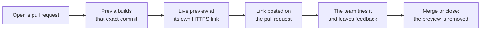

<p align="center">
  <picture>
    <source media="(prefers-color-scheme: dark)" srcset="web/static/brand/previa-logo-on-dark.png">
    
  </picture>
</p>

<p align="center"><strong>A live preview for every pull request.</strong></p>

<p align="center">
  <a href="https://previa.live">Website</a> ·
  <a href="technical-docs/user-guide.md">User guide</a> ·
  <a href="https://previa.live/#faq">FAQ</a> ·
  <a href="docs/README.md">Documentation</a>
</p>

<p align="center">
  <a href="https://github.com/ajaykathwate/Previa/actions/workflows/ci.yml"></a>
</p>

Previa turns every GitHub pull request into its own live preview: the exact
commit, built from your own Dockerfile, running at a private HTTPS link that is
posted right on the pull request. Reviewers click, try the change and leave
feedback, without checking out a branch, installing dependencies or setting up a
database.

> **Early access.** Previa is free while it is in early access. New workspaces are
> approved by hand.

## Why Previa

Reviewing a pull request usually means reading a diff and imagining the result,
or pulling the branch, installing everything and hoping it starts. A screenshot
shows a moment; a preview is a place to explore. Previa puts the running change
one click away from the review, so designers, QA, product managers, backend teams
and maintainers all review what will actually ship.

## How it works



1. **Connect** a GitHub repository by installing the Previa GitHub App on it.
2. **Describe your app** with a `Dockerfile` and a small `.previewrc.yaml`, or let
   a starter kit write both.
3. **Build** when someone clicks, or automatically five minutes after the last push.
4. **Review**: open the link from the pull request, try the change and record what
   you find.
5. **Clean up** happens on its own: merging or closing the pull request removes its
   preview.

## Features

### A preview for every pull request

- **The exact commit, running.** Each preview is built from the pull request's
  latest commit with your own Dockerfile.
- **One link per pull request**, the same across every push and rebuild.
- **Almost any stack.** Anything that runs in a Docker container and answers HTTP:
  Node.js, Python, Ruby, Go, Java, PHP, static sites and APIs.
- **No broken links during updates.** A new version replaces the old one only once
  it is running, and a failed rebuild never takes down a working preview.
- **Only mergeable code.** Previa checks with GitHub right before building and
  does not build a pull request that has conflicts.

### You decide when it builds

- **Manual**, the default: a preview builds when someone clicks **Build latest
  commit**.
- **Automatic**: five minutes after the last push, so a burst of pushes becomes one
  build. The pull request counts down to it.
- **Retry, Rebuild and Tear down** whenever you need them.

### Feedback where your team works

- **On GitHub:** one comment on the pull request that keeps itself up to date, and
  a check for every build.
- **In Previa:** every pull request has a review page. Developers write what to
  test; reviewers record findings against the exact version they tested, discuss
  them and mark them resolved.

### Ready to test, not just to look at

- **Backend and full-stack apps.** Ask for PostgreSQL, Redis or MySQL, run
  migrations and seed data, keep up to three background processes running and link
  your API docs. Every preview gets its own databases.
- **Sample data.** Your seed fills each preview's database, and **Reset test data**
  starts it over.
- **Data that survives pushes.** With **Test data** on, previews start from a
  snapshot of your default branch and keep testers' records across new commits.
- **Test access.** Give reviewers a preview-only login through Previa.
- **Outbound connections.** Approve the outside test services a preview may reach.

### Quick to set up

- **Starter kits.** Pick your stack and what it uses, and Previa writes a checked
  `Dockerfile` and `.previewrc.yaml` for you to copy.
- **Setup check.** On a repository's **Setup** tab, Previa reads both files on a pull
  request's latest commit and tells you what to fix before anything builds.

### Built for teams

A **workspace** holds a team's repositories, members and previews, and one person
can belong to several. Everyone sees only what their role allows:

| Role | What they can do |
| --- | --- |
| **Owner** | Everything an Admin can, plus appoint Admins and hand over ownership |
| **Admin** | Everything a Developer can on every repository, plus connect repositories; manage secrets, outbound connections, private previews and Automatic builds; invite Developers and Reviewers |
| **Developer** | Build, rebuild and read the logs of the repositories they are given |
| **Reviewer** | Open the previews they are given and leave feedback, without seeing code, logs or secrets |

Invite people by their GitHub username. Reviewers can also be invited by email and
sign in with Google, no GitHub account needed. Ownership can be handed over without
losing connections or preview links, and removing someone ends their access at once.

### Safe by default

- **Every pull request is treated as untrusted**, even your own team's.
- **Forks** never build on their own: someone has to click **Build**. They never
  receive your secrets or approved connections.
- **Secrets** live in one encrypted `.env` file per repository. Values stay hidden
  on the page, are masked in logs and are never given to forks.
- **Isolated previews** cannot reach your private systems, each other or your
  Previa account.
- **Private previews.** By default anyone with a preview's unguessable link can open
  it. Make a repository's previews private and visitors must sign in and have access
  to that repository.
- **Signing in does not give Previa your code.** Only the repositories where you
  install the GitHub App are used, and only to build their previews.

### Clear and tidy

- **See everything at a glance.** Overview, Builds and Previews show what is
  waiting, building and live, and pages update as things change.
- **Live build logs** in the browser, with secrets masked, kept for 14 days.
- **Plain-language failures.** A failed build says what went wrong and what to do
  next.
- **Cleans up after itself.** Previews are removed when their pull request closes or
  merges, when you tear them down, or when they have not been updated for a while.
  Idle previews sleep and wake in seconds on the next visit.
- **Usage at a glance.** Each workspace has a monthly allowance of build minutes and
  live previews, shown on its **Usage** page.

### Your account, your data

- **Account & connections:** connect GitHub and Google, sign out other sessions, and
  delete your account or a workspace.
- **Support & status:** contact support, check service status and read the privacy
  policy and terms.

## What your repository needs

Two files at the repository root: a `Dockerfile` and a `.previewrc.yaml`. Every
setting has a default, so `{}` is a valid configuration when your app listens on
port 3000:

```yaml
# .previewrc.yaml
port: 8080                  # where your app listens inside its container
health_check_path: /health  # optional
resource_tier: small        # small, standard or large
services:                   # optional databases and caches, one set per preview
  postgres: 17
setup: ["npm", "run", "migrate"]   # optional: migrations and seed data
```

Don't have them yet? **Starter kits** write both for your stack. The
[repository configuration](docs/06-source-and-configuration.md) and
[backend previews](docs/11-backend-previews.md) references list every option.

## Get started

1. Sign in at [previa.live](https://previa.live) with GitHub.
2. Create a workspace. During early access it is approved by hand.
3. Install the Previa GitHub App on the repositories you want previews for.
4. Add a `Dockerfile` and `.previewrc.yaml`, or use **Starter kits**, and run the
   check on the repository's **Setup** tab.
5. Open a pull request and click **Build latest commit**, or turn on **Automatic**.

The [user guide](technical-docs/user-guide.md) walks through every screen.

## Not available yet

- Git hosts other than GitHub, such as GitLab or Bitbucket.
- Previews for branches without a pull request.
- Docker Compose files and separately chosen service images. Managed PostgreSQL,
  Redis and MySQL cover databases and caches.
- Review requests, assignments and approval decisions inside Previa.
- Custom domains for previews.
- Windows containers, GPU workloads, and repositories that need Git submodules or
  LFS files to build.

## Documentation

| Read this | For |
| --- | --- |
| [User guide](technical-docs/user-guide.md) | Every screen and flow, from sign-in to a removed preview |
| [Documentation index](docs/README.md) | How each part of Previa works, in reading order |
| [Requirements](REQUIREMENTS.md) and [design](DESIGN.md) | Product requirements, design decisions and edge cases |
| [Development setup](docs/02-development-setup.md) | Running Previa on your own machine |
| [Production deployment](docs/25-production-deployment.md) | Running your own Previa server |
| [Tech stack](technical-docs/tech-stack.md) | What Previa is built with |

## Contributing

Start with the [development setup](docs/02-development-setup.md); the project's
conventions are in [AGENTS.md](AGENTS.md). Changes reach `master` through pull
requests, and CI must pass before they merge.

## License

Previa is licensed under the [Apache License 2.0](LICENSE).
