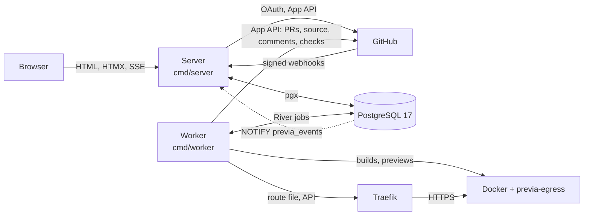

# 01 · System overview

Previa is a self-hosted control plane that gives each GitHub pull request its own
temporary preview environment. This document is the map: what exists today, how
the pieces fit, the decisions behind them and the hard problems they solve.
Requirements and the technology comparison live in [README.md](../README.md);
per-feature design lives in [DESIGN.md](../DESIGN.md).

## Status at a glance

| Area | State |
| --- | --- |
| GitHub sign-in, sessions, CSRF, logout | Working |
| GitHub App installation linking and repository access | Working |
| Signed, deduplicated webhook ingestion | Working (local signed fixtures verified; hosted delivery not yet observed) |
| Open-only PR discovery, sync and mergeability checks | Working |
| Manual/Automatic build policy, durable build intent, five-minute debounce | Working end to end: the server records requests and wake-ups, the worker admits and builds |
| Repository/PR dashboard with live updates (SSE) | Working |
| Build/teardown orchestration, durable publication outbox, reconciler | Working: registered by the worker when its dependencies validate ([22](22-mvp-operations.md)) |
| Fresh upstream verification before authorization/execution | Working: before the owner's request is recorded and again at worker admission, outside locks |
| Exact-commit source fetch, safe extraction, `.previewrc.yaml` from the same tree | Working; every build starts with it (real GitHub check: `make test-source`) |
| Repository secrets: encrypted storage, Secrets tab, key rotation, fork withholding, redaction | Working for owners; the preview runtime injects them for trusted sources |
| Current-build logs: bounded, redacted storage, live log page with resume/reset, retention | Working; every build writes its output |
| Isolated image builds: rootless BuildKit per build, egress proxy, per-source caches, limits | Implemented and verified on real Docker (`make test-builder`) |
| Preview runtime: hardened unrouted candidates, secrets after recheck, readiness, capacity, cleanup | Working; verified on real Docker (`make test-runtime`) |
| Stable HTTPS hostnames, fenced route controller, Traefik wildcard TLS, unavailable page | Working; verified with real Traefik, Pebble-issued certificates and previews (`make test-routing`); Let's Encrypt staging/live needs a domain |
| Teardown on close, revocation and owner request (confirmation dialog), owner-verified cleanup, teardown sweep | Working; verified on real Docker and Traefik (`make test-routing`, `make test-e2e`) |
| PR feedback: one living comment and exact-commit check runs, rendered from persisted state | Working against a fake GitHub (`make test-e2e`); the live proof on a real PR (`make test-reporting`) is still to run |
| Housekeeping: recovery, expiry, orphan cleanup with grace periods, PR reconciliation, pruning; build slots and atomic preview capacity | Working; tested against PostgreSQL, River and real Docker (`make test-housekeeping`, `make test-runtime`); dry-run diagnostics (`make housekeeping-dry-run`) |
| Worker capabilities, Build/Retry/Rebuild/Tear down controls, Builds/Environments/Overview with real state | Working; the whole pipeline proven on real Docker, BuildKit and Traefik with a fake GitHub, including a GitHub reporting outage (`make test-e2e`) |
| Observability: correlated redacted logs, bounded metrics, readiness on internal listeners, Grafana dashboard, 24 alert rules | Working; rules unit-tested (`make observability-check`) ([23](23-observability-and-hardening.md)) |
| Hardening: nonce CSP and security headers, host and trusted-proxy validation, body and rate limits, production mode, execution kill switch | Working; browser suite runs under the CSP; incident runbook ([24](24-incident-runbook.md)) |
| Release images, production Compose, host setup, encrypted backups and restore, upgrades and rollback, CI and releases | Working on local staging (`make prod-smoke`: 40 checks, 43 with an older-schema restore); a real host, DNS and hosted GitHub are pending ([25](25-production-deployment.md), [26](26-release-report.md)) |

This is an operational MVP, packaged and rehearsed for production on local staging
infrastructure. What each capability needs and what is proven by which test are
in [22](22-mvp-operations.md); running it on a host is [25](25-production-deployment.md);
the evidence for every release acceptance item, and the live checks still pending
before a public rollout, are in [26](26-release-report.md);
[27-roadmap.md](27-roadmap.md) lists the work in order.

## Architecture

- **One database does everything stateful.** PostgreSQL stores application data,
  sessions (SCS `pgxstore`), the job queue (River) and change notifications
  (`LISTEN/NOTIFY`). There is no Redis, broker or separate queue server.
- **Two processes.** The server handles HTTP, OAuth, webhooks, the dashboard and
  live event streams, and records work (requests, wake-ups, teardowns, reports); it
  never touches Docker. The worker executes: PR discovery and mergeability with the
  App settings, and with a preview domain, Docker and the router also builds,
  previews, routing, PR feedback, teardown and housekeeping. It publishes what it can
  do in `worker_capabilities`, which the dashboard reads. Each process loads only
  its own configuration; the worker holds no sign-in or session secrets.
- **Server-rendered UI.** Go `templ` pages enhanced with local HTMX and one plain
  JavaScript file. No SPA, frontend build service or Node.js runtime.
- **Docker for builds and previews.** The image builder ([09](09-image-builds.md))
  runs one rootless BuildKit container per build on a private network; the preview
  runtime ([10](10-preview-runtime.md)) runs each PR's hardened preview on its own
  internal network. The only exit from either is the shared `previa-egress` proxy
  container. Traefik ([12](12-routing-and-https.md)) serves the healthy preview at
  its stable HTTPS address.

## Where the details live

This overview keeps the map and the reasoning; the references hold the inventories.

| To find | Read |
| --- | --- |
| Every package and folder, and what it holds | [DESIGN.md Section 20](../DESIGN.md#20-recommended-folder-structure-package-by-feature) (the tree) and [Inside Previa §1.5](../technical-docs/inside-previa.md#15-where-the-code-lives) |
| Every table, column, constraint and trigger | [database-schema.md](../technical-docs/database-schema.md) and its [diagram](../technical-docs/database-schema-diagram.md) |
| Every technology and version, process, container, URL and admin command | [tech-stack.md](../technical-docs/tech-stack.md) |
| Every package's types and how they connect | [class-diagram.md](../technical-docs/class-diagram.md) |
| Every term (generation, revision, intent, operation, candidate, …) | [Inside Previa, Appendix D](../technical-docs/inside-previa.md#appendix-d-glossary). Two more used in these docs: a **topic / cursor** is a realtime channel name such as `repository:42` and a resumable position in it ([20](20-realtime-updates.md)); an **upstream snapshot** is a PR as GitHub reported it moments ago, recorded under the usual fences ([05](05-webhooks-and-pr-discovery.md)). |

## Key decisions and trade-offs

| Decision | Why | Trade-off accepted |
| --- | --- | --- |
| Go + templ + HTMX, server-rendered | One binary, one deploy, no frontend toolchain; works without JavaScript. | Rich client interactions take more care than in a SPA. |
| PostgreSQL for queue, sessions and events | One stateful dependency to run, back up and reason about; job inserts share transactions with state changes. | Throughput ceilings are lower than dedicated brokers; fine at preview-platform scale. |
| River with at-least-once delivery | Transactional enqueue (`InsertTx`), retries, uniqueness, rescue. | Every job must be idempotent and fenced; exactly-once is never assumed. |
| Generation + revision fencing | A newer commit, close or deliberate rebuild must always beat stale work. | Extra columns, guards and tests on every write path. |
| Manual build policy by default | Contributors cannot trigger platform spend; owners opt into Automatic. | Manual users must click to update a preview. |
| Five-minute trailing debounce for Automatic | Bursts of pushes produce one build, not many. | Continuous pushing postpones builds; Manual is the override. |
| Transactional webhook ingestion (no inbox) | Receipt, state change and intent commit together; no external IO in ingress. | Ingress must stay short; an inbox is the upgrade path if it cannot. |
| Open-only PR discovery | Avoids importing history and API fan-out. | Closed PRs appear only if Previa tracked them while open. |
| Mergeability as a hint, gate re-checked at build time | GitHub computes it asynchronously and it changes when the base branch moves. | The UI can briefly show Checking. |
| Fresh upstream verification before authorizing or executing | Saved state can be stale; failing closed is cheaper than building the wrong commit. | One extra GitHub read per build. |
| Archive by exact SHA through the base repository, credential-free download | No fork access needed; the token never follows a redirect; the archive declares its commit. | Large repositories pay the full archive download each build. |
| Repository secrets withheld from forks, secrets override YAML | Fork authors control the code; owner values must beat contributor-editable YAML. | Fork previews run without secrets. |
| Outbox/saga for publication | PostgreSQL cannot commit atomically with Docker, Traefik and GitHub. | Eventual convergence; adapters must be idempotent and fenced. |
| Every Docker object labelled and named with its database's instance | Housekeeping and capacity never touch another database's objects on a shared host. | Objects created before migration 16 are invisible to housekeeping. |
| Capacity full means waiting, not failing | A busy host delays previews; nothing fails or spends retry attempts. | Requests are retried with backoff, not in strict order. |
| PR feedback rendered from current state, one reporter per PR | Late or duplicate reports cannot restore an older state; no duplicate comments. | GitHub has no compare-and-set, so a stale write can be visible briefly until the next report replaces it. |
| SSE invalidation instead of polling | Idle pages send nothing; changes arrive within moments; reuses Postgres. | One long-lived connection per open page; proxies must not buffer. |
| Current-attempt logs with an admission epoch | The useful log is the current one; an epoch fences stale writers and browser cursors even on same-revision retries. | No build history; a failed attempt's log disappears when the next one starts. |
| A fresh rootless BuildKit container per build, behind an egress proxy | Limits cover every step, builds cannot touch each other, and nothing internal is reachable. | A few seconds of startup per build; builder needs relaxed outer seccomp/AppArmor (steps keep BuildKit's). |
| Build caches per base and source repository | Forks cannot poison caches that trusted, secret-receiving builds reuse. | Fork PRs build with less cache. |
| Previews strict by default: UID 65532, read-only root, no capabilities, own internal network, egress only via the proxy | The safest default for running PR code; exceptions are explicit and server-wide. | Some apps need the operator opt-outs; proxy-ignoring libraries cannot reach the internet. |
| Host-derived preview budget | 60% of Docker memory and 75% of CPUs for previews keeps the platform responsive. | Previews may be refused (retryable) on a busy host. |
| Package by feature, consumer-defined interfaces | Features evolve independently; no global handler/store layers. | Some small duplication across features. |
| The server records, the worker executes and publishes its capabilities | The server needs no Docker or execution secrets; a missing capability is an explicit unavailable state, never a silent no-op. | The dashboard trusts a heartbeat seen within 90 seconds, so it can lag a crashed worker by that much; requests made meanwhile wait durably. |
| Health and metrics on an internal listener; durable state exported by the server | Nothing operational is reachable from the internet or from previews; queue depth stays visible when no worker runs. | Prometheus must run on the control network. |
| Release images distroless and non-root; only the worker has the Docker socket | The smallest attack surface that still lets the worker build and run previews. | The worker's socket access is root-equivalent on the host: the host is dedicated to Previa. |
| Forward-only migrations, binaries refusing an older schema | Upgrades are one command; a rollback is the previous image, or a restore when a release says its migrations are not backward compatible. | Every migration must stay compatible with the previous release. |

## Hard problems and how they are handled

- **Out-of-order and duplicate events.** GitHub can redeliver or reorder webhooks.
  Unique delivery receipts make retries no-ops; PR `updated_at` orders snapshots;
  equal-time conflicts are marked `needs_refresh` instead of guessed
  ([05](05-webhooks-and-pr-discovery.md)).
- **Stale work finishing late.** Every job captures the PR generation and request
  revision; result writes lock the PR row and refuse anything not current
  ([19](19-generation-ordering.md)).
- **Same-commit retries.** Rebuilding an unchanged SHA advances the intent revision,
  so old operations cannot collide with new ones ([16](16-build-policy-and-intents.md)).
- **No transactions across systems.** Desired state commits in PostgreSQL with a
  durable operation row; external calls run outside transactions and a reconciler
  repairs partial failures ([19](19-generation-ordering.md#the-decision)).
- **Long locks versus slow IO.** GitHub/Docker calls never run while a row lock or
  transaction is open; revisions are captured before IO and rechecked after.
- **Asynchronous mergeability.** Unknown results trigger a bounded, fenced recheck
  job; builds fail closed while Checking or Conflicts.
- **Hostile source archives.** The PR author controls every byte: the archive must
  declare the exact commit, paths are confined, links cannot be written through,
  sizes and entry counts are capped ([06](06-source-and-configuration.md)).
- **Secrets near untrusted code.** Values are encrypted at rest, decrypted only in
  worker memory just before container start, never given to forks and redacted from
  logs, with the limits of redaction stated plainly ([07](07-repository-secrets.md)).
- **Late log writers and stale cursors.** Each admission bumps the stream epoch in the
  same transaction that clears old lines; appends are fenced on it, and browsers with
  another epoch's cursor get a reset ([08](08-build-logs.md)).
- **Untrusted Dockerfiles.** Every build runs in its own rootless, resource-limited
  BuildKit container with no route anywhere except a proxy that only reaches public
  addresses; probes from inside builds verify it ([09](09-image-builds.md)).
- **Untrusted running code next to the platform.** Each preview is unprivileged and
  bounded on its own internal network; it cannot reach Postgres, the server, the host,
  metadata or other previews, which probes from a running preview verify. Secrets are
  decided after a fresh recheck and never reach forks ([10](10-preview-runtime.md)).
- **Revoked access.** Suspension, deletion and repository removal request teardown
  of every affected PR in the same transaction (a new generation fences in-flight
  work) and set `cleanup_pending`; a sweep starts the teardowns without GitHub access
  and clears the marker only when PostgreSQL and Docker show nothing left
  ([13](13-teardown-and-cleanup.md)).
- **Stale routes.** Route versions only move forward behind a PostgreSQL fence, removals
  are tombstones, and the router's file only moves forward; old containers retire only
  after the router confirms the newer version ([12](12-routing-and-https.md)).
- **Live UI without missed updates.** SSE streams carry resumable cursors; the page
  cursor is read before page state, so a commit in between is replayed
  ([20](20-realtime-updates.md)).

## Read next

[02-development-setup.md](02-development-setup.md) to run it locally, then the
[user guide](../technical-docs/user-guide.md) to walk through the screens.
