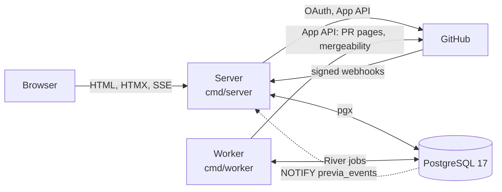

# 01 · System overview

Previa is a self-hosted control plane that gives each GitHub pull request its own
temporary preview environment. This document is the map: what exists today, how
the pieces fit, the decisions behind them and the hard problems they solve.
Requirements and the technology comparison live in [README.md](../README.md);
per-feature design lives in [DESIGN.md](../DESIGN.md).

## Status at a glance

| Area | State |
| --- | --- |
| GitHub sign-in, sessions, CSRF, logout | Working |
| GitHub App installation linking and repository access | Working |
| Signed, deduplicated webhook ingestion | Working (local signed fixtures verified; hosted delivery not yet observed) |
| Open-only PR discovery, sync and mergeability checks | Working |
| Manual/Automatic build policy, durable build intent, five-minute debounce | Working as persisted coordination; **no build executes** |
| Repository/PR dashboard with live updates (SSE) | Working |
| Build/teardown orchestration, durable publication outbox, reconciler | Implemented and tested behind interfaces; **not registered in production** |
| Fresh upstream verification before authorization/execution | Implemented and tested; connected to the Build action and worker in Prompt 10 |
| Exact-commit source fetch, safe extraction, `.previewrc.yaml` from the same tree | Implemented and tested, including a real GitHub check; not yet called by a build |
| Repository secrets: encrypted storage, Secrets tab, key rotation, fork withholding, redaction | Working for owners; containers receive them once the runtime exists (Prompt 5) |
| Current-build logs: bounded, redacted storage, live log page with resume/reset, retention | Working page and store; empty until builds execute |
| Isolated image builds: rootless BuildKit per build, egress proxy, per-source caches, limits | Implemented and verified on real Docker (`make test-builder`) |
| Preview runtime: hardened unrouted candidates, secrets after recheck, readiness, capacity, cleanup | Implemented and verified on real Docker (`make test-runtime`); not yet called by the worker |
| Routing/TLS, PR comments, expiry | **Not built** (placeholder packages only) |

The **Build latest commit** action is deliberately disabled and its endpoint refuses
work. Nothing deploys a preview yet. [17-roadmap.md](17-roadmap.md) lists the
remaining work in order.

## Architecture

- **One database does everything stateful.** PostgreSQL stores application data,
  sessions (SCS `pgxstore`), the job queue (River) and change notifications
  (`LISTEN/NOTIFY`). There is no Redis, broker or separate queue server.
- **Two processes.** The server handles HTTP, OAuth, webhooks, the dashboard and
  live event streams, and inserts jobs. The worker runs River jobs: the `ping`
  diagnostic and, when App credentials are configured, PR discovery and
  mergeability checks. Each process loads only its own configuration.
- **Server-rendered UI.** Go `templ` pages enhanced with local HTMX and one plain
  JavaScript file. No SPA, frontend build service or Node.js runtime.
- **Docker for builds and previews.** The image builder ([09](09-image-builds.md))
  runs one rootless BuildKit container per build on a private network; the preview
  runtime ([10](10-preview-runtime.md)) runs each PR's hardened preview on its own
  internal network. The only exit from either is the shared `previa-egress` proxy
  container. The worker does not call them yet.

## Code layout

`cmd → internal/app → feature packages → internal/platform`. Features own their
handlers, services, SQL and jobs in flat packages; presentation lives in `web/`.

| Path | What it holds |
| --- | --- |
| `cmd/server`, `cmd/worker`, `cmd/river-migrate`, `cmd/secrets-reencrypt`, `cmd/egress` | Thin entry points (`river-migrate` and `secrets-reencrypt` are maintenance commands run through Make; `egress` runs as `previa-egress`, the proxy and prober container). |
| `internal/app` | Composition root: builds dependencies, starts and stops processes. |
| `internal/auth` | GitHub OAuth login, user upsert, SCS sessions, CSRF, logout. |
| `internal/installations` | Verified App linking, installation lifecycle, repository directory, build-mode policy. |
| `internal/webhooks` | Signed ingress, delivery deduplication, lifecycle dispatch. |
| `internal/pullrequests` | PR observations, discovery/sync, mergeability, repository/PR pages, event stream endpoint. |
| `internal/environments` | Build intent, scheduling, admission, generation-fenced results, publication outbox, reconciler. |
| `internal/repoconfig` | `.previewrc.yaml` strict validation, defaults, resource tiers, effective hash. |
| `internal/source` | Exact-commit archive download through the base repository, identity check, hardened extraction, workspaces, config from the tree. |
| `internal/secrets` | Encrypted repository secrets, Secrets tab, worker `ContainerEnv` contract, streaming redaction, re-encryption. |
| `internal/buildlogs` | Current-attempt log streams: fenced bounded writer, owner page, live SSE, retention job. |
| `internal/builds` | Isolated BuildKit image builder, size-capped export, labelled cleanup. |
| `internal/runtime` | Hardened preview candidates: recheck, secrets, readiness, capacity, inventory, owner-verified removal. |
| `internal/dashboard` | Home, overview, session and developer-tools pages; queue ping. |
| `internal/platform/*` | Shared infrastructure: `config`, `database`, `queue` (River), `githubapp` (App auth), `httpx` (router), `realtime` (LISTEN/NOTIFY hub, SSE, stream limiter), `dockerx` (Docker client, shared labels), `egress` (the egress proxy, readiness probe and its container). |
| `internal/{routing,reporting,housekeeping}` | Placeholders for unbuilt features (`doc.go` only). |
| `web/` | `pages/<feature>`, `layouts`, `components`, `styles` (Tailwind), `static` (HTMX, compiled CSS, `ui.js`), browser tests. |
| `db/migrations` | Goose migrations 0001–0013; sqlc generates typed queries into each feature's `dbgen/`. |
| `deploy/egress` | Dockerfile for the egress proxy and prober image (`make egress-image`). |
| `tools/go.mod` | Pinned dev tools: templ, sqlc, Goose, Air, golangci-lint. |

## Data model

| Table | Purpose |
| --- | --- |
| `users`, `sessions` | GitHub identities and server-side sessions. |
| `installations`, `repos` | Linked App installations (owner, status, revision) and repositories (access, `build_mode`, observation version). |
| `installation_repository_events`, `webhook_deliveries` | Lifecycle ordering tombstones and delivery receipts (hash, not payload). |
| `pull_requests` | Observed PR state: head SHA, lifecycle, `generation`, source timestamp, mergeability, fork data. |
| `pr_syncs` | Discovery run state per repository. |
| `build_intents` | One current authorized build request per PR, with `revision`. |
| `environments`, `environment_operations` | One lifetime preview per PR (active and pending artifacts) and the durable publication outbox. |
| `env_secrets` | Repository secrets: nonce ‖ AES-256-GCM ciphertext bound to repository, name and key version. |
| `build_log_streams` | One row per environment for the current build attempt: `epoch`, generation/revision, state, line and byte counts, truncation and loss counters. |
| `build_logs` | That attempt's lines (`epoch`, `sequence`, `kind`); replaced on admission, pruned after 14 days. |
| `river_*` | River's own job tables, migrated separately. |

## Key decisions and trade-offs

| Decision | Why | Trade-off accepted |
| --- | --- | --- |
| Go + templ + HTMX, server-rendered | One binary, one deploy, no frontend toolchain; works without JavaScript. | Rich client interactions take more care than in a SPA. |
| PostgreSQL for queue, sessions and events | One stateful dependency to run, back up and reason about; job inserts share transactions with state changes. | Throughput ceilings are lower than dedicated brokers; fine at preview-platform scale. |
| River with at-least-once delivery | Transactional enqueue (`InsertTx`), retries, uniqueness, rescue. | Every job must be idempotent and fenced; exactly-once is never assumed. |
| Generation + revision fencing | A newer commit, close or deliberate rebuild must always beat stale work. | Extra columns, guards and tests on every write path. |
| Manual build policy by default | Contributors cannot trigger platform spend; owners opt into Automatic. | Manual users must click to update a preview. |
| Five-minute trailing debounce for Automatic | Bursts of pushes produce one build, not many. | Continuous pushing postpones builds; Manual is the override. |
| Transactional webhook ingestion (no inbox) | Receipt, state change and intent commit together; no external IO in ingress. | Ingress must stay short; an inbox is the upgrade path if it cannot. |
| Open-only PR discovery | Avoids importing history and API fan-out. | Closed PRs appear only if Previa tracked them while open. |
| Mergeability as a hint, gate re-checked at build time | GitHub computes it asynchronously and it changes when the base branch moves. | The UI can briefly show Checking. |
| Fresh upstream verification before authorizing or executing | Saved state can be stale; failing closed is cheaper than building the wrong commit. | One extra GitHub read per build. |
| Archive by exact SHA through the base repository, credential-free download | No fork access needed; the token never follows a redirect; the archive declares its commit. | Large repositories pay the full archive download each build. |
| Repository secrets withheld from forks, secrets override YAML | Fork authors control the code; owner values must beat contributor-editable YAML. | Fork previews run without secrets. |
| Outbox/saga for publication | PostgreSQL cannot commit atomically with Docker, Traefik and GitHub. | Eventual convergence; adapters must be idempotent and fenced. |
| SSE invalidation instead of polling | Idle pages send nothing; changes arrive within moments; reuses Postgres. | One long-lived connection per open page; proxies must not buffer. |
| Current-attempt logs with an admission epoch | The useful log is the current one; an epoch fences stale writers and browser cursors even on same-revision retries. | No build history; a failed attempt's log disappears when the next one starts. |
| A fresh rootless BuildKit container per build, behind an egress proxy | Limits cover every step, builds cannot touch each other, and nothing internal is reachable. | A few seconds of startup per build; builder needs relaxed outer seccomp/AppArmor (steps keep BuildKit's). |
| Build caches per base and source repository | Forks cannot poison caches that trusted, secret-receiving builds reuse. | Fork PRs build with less cache. |
| Previews strict by default: UID 65532, read-only root, no capabilities, own internal network, egress only via the proxy | The safest default for running PR code; exceptions are explicit and server-wide. | Some apps need the operator opt-outs; proxy-ignoring libraries cannot reach the internet. |
| Host-derived preview budget | 60% of Docker memory and 75% of CPUs for previews keeps the platform responsive. | Previews may be refused (retryable) on a busy host. |
| Package by feature, consumer-defined interfaces | Features evolve independently; no global handler/store layers. | Some small duplication across features. |

## Hard problems and how they are handled

- **Out-of-order and duplicate events.** GitHub can redeliver or reorder webhooks.
  Unique delivery receipts make retries no-ops; PR `updated_at` orders snapshots;
  equal-time conflicts are marked `needs_refresh` instead of guessed
  ([05](05-webhooks-and-pr-discovery.md)).
- **Stale work finishing late.** Every job captures the PR generation and request
  revision; result writes lock the PR row and refuse anything not current
  ([14](14-generation-ordering.md)).
- **Same-commit retries.** Rebuilding an unchanged SHA advances the intent revision,
  so old operations cannot collide with new ones ([11](11-build-policy-and-intents.md)).
- **No transactions across systems.** Desired state commits in PostgreSQL with a
  durable operation row; external calls run outside transactions and a reconciler
  repairs partial failures ([13](13-durable-publication-design.md)).
- **Long locks versus slow IO.** GitHub/Docker calls never run while a row lock or
  transaction is open; revisions are captured before IO and rechecked after.
- **Asynchronous mergeability.** Unknown results trigger a bounded, fenced recheck
  job; builds fail closed while Checking or Conflicts.
- **Hostile source archives.** The PR author controls every byte: the archive must
  declare the exact commit, paths are confined, links cannot be written through,
  sizes and entry counts are capped ([06](06-source-and-configuration.md)).
- **Secrets near untrusted code.** Values are encrypted at rest, decrypted only in
  worker memory just before container start, never given to forks and redacted from
  logs, with the limits of redaction stated plainly ([07](07-repository-secrets.md)).
- **Late log writers and stale cursors.** Each admission bumps the stream epoch in the
  same transaction that clears old lines; appends are fenced on it, and browsers with
  another epoch's cursor get a reset ([08](08-build-logs.md)).
- **Untrusted Dockerfiles.** Every build runs in its own rootless, resource-limited
  BuildKit container with no route anywhere except a proxy that only reaches public
  addresses; probes from inside builds verify it ([09](09-image-builds.md)).
- **Untrusted running code next to the platform.** Each preview is unprivileged and
  bounded on its own internal network; it cannot reach Postgres, the server, the host,
  metadata or other previews, which probes from a running preview verify. Secrets are
  decided after a fresh recheck and never reach forks ([10](10-preview-runtime.md)).
- **Revoked access.** Revocation records durable `cleanup_pending`; no absent
  adapter is ever reported as having cleaned up.
- **Live UI without missed updates.** SSE streams carry resumable cursors; the page
  cursor is read before page state, so a commit in between is replayed
  ([15](15-realtime-updates.md)).

## Glossary

| Term | Meaning |
| --- | --- |
| Observation | A PR state learned from a webhook, sync or targeted API read. |
| Generation | Monotonic counter on a PR, advanced by each fresh relevant observation. |
| Intent | The single current authorized build request for a PR (`build_intents`). |
| Revision | Monotonic counter on an intent; distinguishes deliberate requests for the same SHA. |
| Wake-up | A delayed River job that rechecks durable intent when its deadline arrives. |
| Environment | The one lifetime preview record per PR, holding active and pending artifacts. |
| Operation | A durable outbox row for an external side effect (route, report, cleanup). |
| Topic / cursor | A realtime channel name such as `repository:42` and a resumable event position. |
| Upstream snapshot | A PR as GitHub reported it moments ago, recorded under the usual fences. |
| Workspace | A worker-owned directory holding one extracted commit and its marker file. |
| Trusted source | A head repository that is provably the base repository; only these receive secrets. |
| Attempt / log epoch | One admitted execution of a request; its epoch changes on every admission, even a retry. |
| Egress proxy | The only route out of build networks: ports 80/443 to public addresses. |
| Cache scope | Base repository plus source repository; builds share a BuildKit cache only within one. |
| Candidate | A healthy preview container that is not yet routed; publication decides whether it becomes active. |

## Read next

[02-development-setup.md](02-development-setup.md) to run it locally, then
[03-user-guide.md](03-user-guide.md) to walk through the screens.
