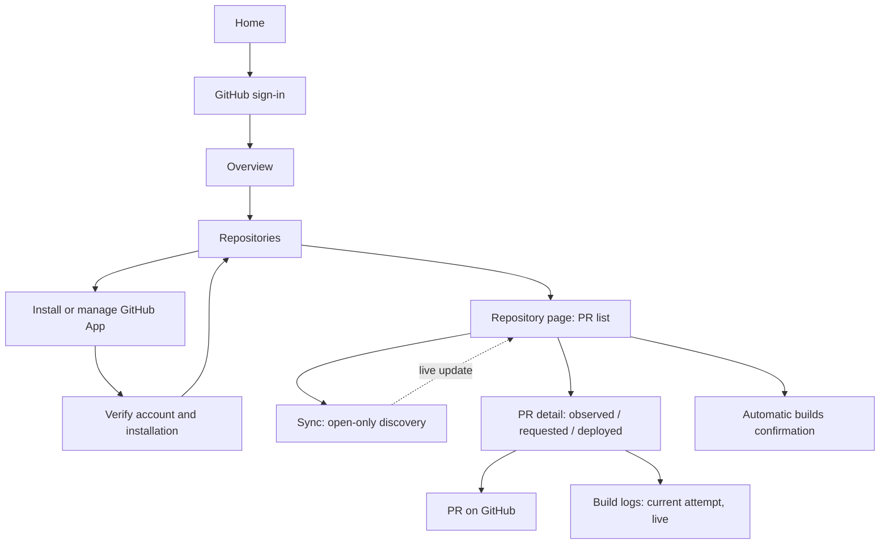
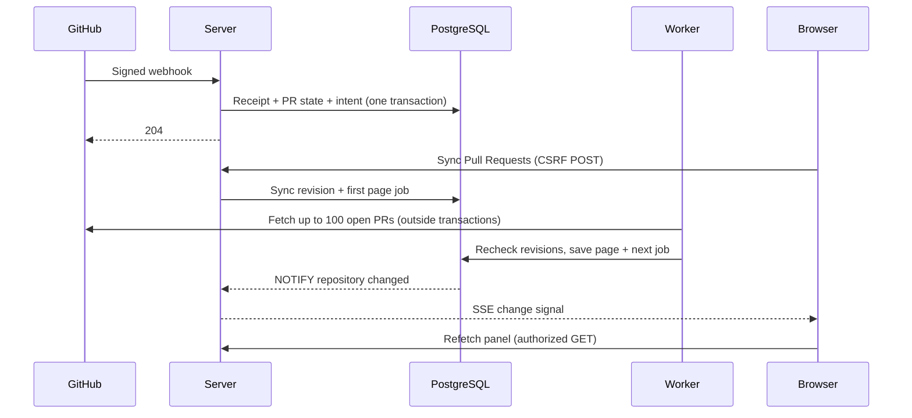

# 03 · User guide

A walk through the working screens: sign in, connect repositories, track pull
requests, choose a build policy, manage secrets and read build logs. Setup commands
are in [02-development-setup.md](02-development-setup.md). Building and serving
previews is not available yet; the screens show real saved state only.

## Before you start

- PostgreSQL running and migrated (`make migrate-up`).
- `make dev` (or `make run-server`) in one terminal, `make run-worker` in another.
- Sign-in needs OAuth values and `SESSION_SECRET`. Linking repositories needs the
  five GitHub App settings; discovery workers need App ID and private-key path;
  webhooks need `GITHUB_WEBHOOK_SECRET`. See [04](04-github-sign-in-and-app.md).
- Repository secrets need `SECRETS_ENCRYPTION_KEYS` and `SECRETS_ACTIVE_KEY_VERSION`
  on the server ([02](02-development-setup.md), [07](07-repository-secrets.md)).

## Moving around

- The sidebar groups **Workspace** (Overview, Repositories), **Delivery** (Builds,
  Environments) and **System** (Developer tools). **Coming next** items (preview
  URLs) are labels, not links.
- Medium screens collapse the sidebar to icons; phones use the menu button.
- **Ctrl K** (**⌘K** on macOS) or the header search opens the command palette. Type
  to filter pages, repository filters and account actions; arrow keys and Enter
  choose, Esc closes. **Log out…** still asks for confirmation.
- The sun/moon button switches light and dark themes. The choice is stored in this
  browser; without a choice Previa follows the operating system.
- Pages are bookmarkable. Back/Forward and reload keep the current page and filters.
  Without JavaScript, links, GET forms and native confirmation dialogs still work.

## Sign in and connect repositories

1. On Home, click **Get started with GitHub** and authorize. You land on **Overview**:
   real installation/repository/access counts, a setup checklist derived from those
   counts and a pipeline view showing which stages are connected.
2. Open **Repositories** and click **Install on a repo** (later **Manage
   connections**). On GitHub, choose the account and repositories.
3. Complete GitHub's redirect and App user authorization with the **same account**.
   Previa verifies your access to that installation before linking it.
4. Repositories appear as cards (up to three columns, one on phones) with name,
   owner and access badge. Tabs filter **Available** (default), **Unavailable**
   (access removed or installation suspended; history kept) and **All**. Search
   updates after a short pause; the toolbar stays pinned while you scroll. Pages hold
   ten repositories; pagination appears only when needed.

Linking never starts a build. Verified linking also queues a first open-only PR
discovery for each newly accessible repository.

## Track pull requests

1. Select a repository card to open its page: a breadcrumb (owner / repository),
   **Last synced**, the current build mode and the PR list.
2. **Sync Pull Requests** queues another open-only discovery. It fetches metadata
   only and never starts builds. Repeated clicks while syncing coalesce.
3. With the worker running, progress, webhook changes and mergeability results
   appear by themselves. A green **Live** dot beside Last synced means the page is
   receiving updates; nothing is polled.
4. The list defaults to **Open**, with **Closed**, **Merged** and **All** tabs, and
   searches title, number, author or branch. Ten PRs per page. On phones each row
   becomes a labelled card.
5. Open PR states:

   | State | Meaning | Can it build? |
   | --- | --- | --- |
   | **Open** | GitHub reports the PR as mergeable. | Yes, once execution exists. |
   | **Checking** | GitHub has not finished computing mergeability. | No; wait or sync again. |
   | **Conflicts** | The PR conflicts with its base branch. | No; resolve and push a new commit. |

   Closed and merged PRs appear only if Previa tracked them while they were open.
   **Refresh required** means conflicting observations arrived at the same instant;
   sync again to get an authoritative snapshot.
6. Select a PR for its detail page, which tracks three things separately:
   - **Latest observed commit:** the head GitHub reports.
   - **Current build request:** authorized work, its captured commit and any deadline.
   - **Deployed preview:** what a preview actually serves. It can lag the latest commit.

   **Not requested** means no build intent exists; **Not deployed** means no
   environment exists. **Build logs** opens the PR's log page (below). Placeholders
   for preview URL/health and teardown are labelled **Soon**. **View on GitHub**
   opens the real PR.
7. **Back to pull requests**, the breadcrumb and **Repositories** return to the
   previous list with its search, tab and page preserved.

## Choose a build policy

The **Enable Automatic Builds** switch and **Sync Pull Requests** appear only on a
repository's PR list, never on PR details.

- **Manual** (default): PR events update tracking but never authorize a build.
- **Automatic**: each relevant new commit sets a five-minute quiet deadline; another
  push resets it. Enabling Automatic does not build existing PRs.
- Turning Automatic on asks for confirmation in a modal over the page. Cancel, Close
  or Escape leaves it off. Turning it off saves Manual immediately and cancels
  unstarted automatic work, but keeps running work and existing previews.
- Closing or merging a PR supersedes outstanding work and records teardown intent
  in either mode. Suspending or uninstalling the GitHub App, or removing a repository
  from it, tears down that repository's previews too; restoring access does not
  rebuild them by itself.

**Build latest commit is disabled.** Source fetching, image builds, isolated previews,
HTTPS routing and cleanup exist and are verified on their own; the worker connects
them in a later step ([21-roadmap.md](21-roadmap.md)).

**Preview addresses.** Each PR will get one HTTPS address for its whole life, such as
`https://pr-42-k2j4ld-7xq9m2fa.preview.example.com`, kept across rebuilds, teardown and
reopening. Opening the address of a preview that does not exist (never published,
closed, torn down, expired or revoked) shows **Preview not found or expired** on the
dashboard's site.

**On the pull request** (once the worker runs it, [13](13-pr-feedback.md)), Previa keeps
one comment up to date and adds a check run per build request: queued, waiting for
capacity or disk space, building, ready (with the address and when it expires,
48 hours after the latest publication by default), failed with a short reason,
removed or expired. An expired preview comes back at the same address with the next
commit on an Automatic repository, or when you request a build
([14](14-housekeeping-and-capacity.md)).
Direct POSTs are refused too: HTTP 409 with the reason for Checking, Conflicts or
Refresh required PRs, otherwise HTTP 503 "not available yet". No intent is created.

## Manage repository secrets

Each repository page has two tabs: **Pull requests** and **Secrets**. Secrets are
environment variables your previews receive when their container starts.

1. Open a repository, then **Secrets**.
2. Enter a **Name** (letters, digits and underscores, such as `STRIPE_KEY`) and a
   **Value**, then **Save secret**. The value is encrypted immediately; from then on
   only the name and its update time are shown.
3. **Replace** asks for a new value for that name; the current value is never shown.
4. **Delete** asks for confirmation in a dialog; Cancel or Escape keeps the secret.

Good to know:

- Pull requests from **forks** never receive secrets, in either build mode.
- A secret overrides a variable with the same name in `.previewrc.yaml`.
- Use **preview-only credentials** (sandbox keys, test databases). Previews run pull
  request code.
- Values of 4 or more characters are redacted from logs; that cannot stop code that
  receives a value from sending it elsewhere.
- Up to 100 secrets per repository. If GitHub access to the repository was removed
  you can delete secrets but not add or replace them. If the server has no
  encryption keys, the tab says so and only lists existing names.

## Read build logs

Open **Build logs** from a PR's detail page, or **Logs** on any row of **Builds** or
**Environments**. The page belongs to that PR and shows only its **current** build
attempt; a new attempt replaces it. Builds do not run yet, so today it normally says
**No build requested** or shows a queued request.

- The status line states only recorded facts: **No build requested**, **Waiting**
  (Automatic quiet period, with the time it becomes eligible), **Queued**, **Running**,
  or how the attempt ended. If the stored output belongs to an earlier attempt than
  the current request, a notice says so and names its commit.
- The newest 500 lines appear first. While a build runs, new lines stream in and the
  view follows them as long as you stay at the bottom; scroll up to read and it stops
  following (**Follow output** turns it back on). The indicator shows **Live**,
  **Reconnecting…**, **Paused while hidden** or that live updates are unavailable.
- When a new attempt starts, the page clears and shows the new output from its first
  line.
- **Earlier lines** and **Later lines** page through long logs; **Refresh** reloads.
  These work without JavaScript. Each line number links to that line.
- Notices explain gaps instead of hiding them: **Logs truncated** (an attempt keeps at
  most 5 MiB / 20,000 lines; later lines are counted, not stored), lines that could
  not be stored, and logs that **expired** (kept 14 days after an attempt finishes).
- Output is shown as plain text, never as markup, and repository secrets and Previa
  credentials are replaced with `[redacted]` before anything is stored
  ([08](08-build-logs.md)).

## Other screens

| Screen | What it shows |
| --- | --- |
| Builds | Current/latest authorized build requests across your repositories, with captured commits, deadlines and a **Logs** link. Not an attempt history. |
| Environments | Persisted deployment state and deployed commit per PR, with a **Logs** link. URLs, health and teardown arrive with execution. |
| Developer tools | Queue diagnostic: submit a ping and watch the worker process it. |
| Session | Your GitHub identity; reached from the account menu. |

Empty Builds/Environments views are normal: only real records appear. Logging out
uses **Account menu → Log out → Confirm logout**; your GitHub session is unaffected.

## Flows

