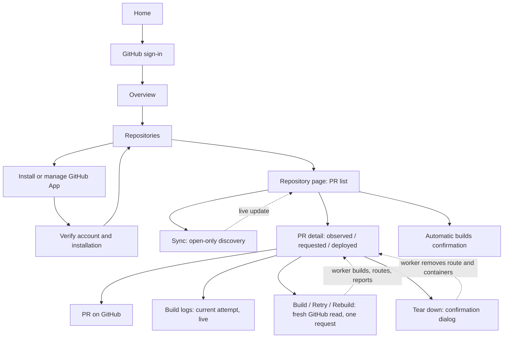
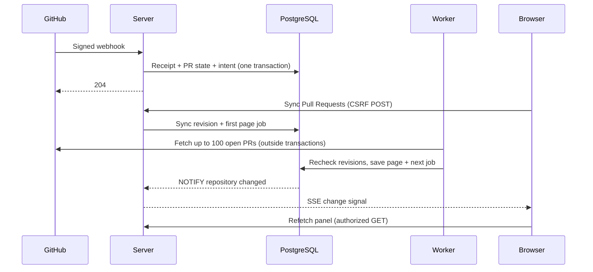

# 03 · User guide

A walk through the working screens: sign in, connect repositories, track pull
requests, choose a build policy, build and tear down previews, manage secrets and
read build logs. Setup commands are in [02-development-setup.md](02-development-setup.md);
what a worker needs before it can build is in [21](21-mvp-operations.md). The screens
show real saved state only.

## Before you start

- PostgreSQL running and migrated (`make migrate-up`).
- `make dev` (or `make run-server`) in one terminal, `make run-worker` in another.
- Sign-in needs OAuth values and `SESSION_SECRET`. Linking repositories needs the
  five GitHub App settings; discovery workers need App ID and private-key path;
  webhooks need `GITHUB_WEBHOOK_SECRET`. See [04](04-github-sign-in-and-app.md).
- Repository secrets need `SECRETS_ENCRYPTION_KEYS` and `SECRETS_ACTIVE_KEY_VERSION`
  on the server and the worker ([02](02-development-setup.md), [07](07-repository-secrets.md)).
- Building previews needs a worker started with the App settings, Docker, a preview
  domain and a running router ([21](21-mvp-operations.md)). Without one, build
  controls are replaced by a sentence saying so.

## Moving around

- The sidebar groups **Workspace** (Overview, Repositories), **Delivery** (Builds,
  Environments) and **System** (Developer tools).
- Medium screens collapse the sidebar to icons; phones use the menu button.
- **Ctrl K** (**⌘K** on macOS) or the header search opens the command palette. Type
  to filter pages, repository filters and account actions; arrow keys and Enter
  choose, Esc closes. **Log out…** still asks for confirmation.
- The sun/moon button switches light and dark themes. The choice is stored in this
  browser; without a choice Previa follows the operating system.
- Pages are bookmarkable. Back/Forward and reload keep the current page and filters.
  Without JavaScript, links, GET forms and native confirmation dialogs still work.

## Sign in and connect repositories

1. On Home, click **Get started with GitHub** and authorize. You land on **Overview**:
   real installation/repository/access counts, delivery counts (waiting or queued,
   building, live previews, failed requests), a setup checklist derived from those
   counts and a pipeline view showing which stages a running worker provides
   (**Connected**) and which have no worker (**Not running**).
2. Open **Repositories** and click **Install on a repo** (later **Manage
   connections**). On GitHub, choose the account and repositories.
3. Complete GitHub's redirect and App user authorization with the **same account**.
   Previa verifies your access to that installation before linking it.
4. Repositories appear as cards (up to three columns, one on phones) with name,
   owner and access badge. Tabs filter **Available** (default), **Unavailable**
   (access removed or installation suspended; history kept) and **All**. Search
   updates after a short pause; the toolbar stays pinned while you scroll. Pages hold
   ten repositories; pagination appears only when needed.

Linking never starts a build. Verified linking also queues a first open-only PR
discovery for each newly accessible repository.

## Track pull requests

1. Select a repository card to open its page: a breadcrumb (owner / repository),
   **Last synced**, the current build mode and the PR list.
2. **Sync Pull Requests** queues another open-only discovery. It fetches metadata
   only and never starts builds. Repeated clicks while syncing coalesce. Instead of
   spinning forever, the status says **Waiting for a worker** when no worker is
   running (with a box explaining how to start one) and **Sync stalled** when a sync
   has not finished within 5 minutes, at which point Sync starts a fresh one.
3. With the worker running, progress, webhook changes and mergeability results
   appear by themselves. A green **Live** dot beside Last synced means the page is
   receiving updates; nothing is polled.
4. The list defaults to **Open**, with **Closed**, **Merged** and **All** tabs, and
   searches title, number, author or branch. Ten PRs per page. On phones each row
   becomes a labelled card.
5. Open PR states:

   | State | Meaning | Can it build? |
   | --- | --- | --- |
   | **Open** | GitHub reports the PR as mergeable. | Yes. |
   | **Checking** | GitHub has not finished computing mergeability. | No; wait or sync again (if no worker is running, start one). |
   | **Unknown** | GitHub never answered after 8 checks, so Previa stopped asking. | No; **Sync Pull Requests** asks again. |
   | **Conflicts** | The PR conflicts with its base branch. | No; resolve and push a new commit. |

   Closed and merged PRs appear only if Previa tracked them while they were open.
   **Refresh required** means conflicting observations arrived at the same instant;
   sync again to get an authoritative snapshot.
   The list's **Latest request** column notes when a request was for an earlier
   commit, and **Preview** links straight to each live preview. A repository that
   was never synced shows a **Sync Pull Requests** button in place of the empty
   list.
6. Select a PR for its detail page. At the top, one status panel says what is
   happening (**Preview is live**, **Building …**, **Build failed**, **Blocked by
   merge conflicts**, **No preview yet**, …) and holds the preview address with
   **Copy**, **Open preview** and every action. A failed build quotes the last lines
   of its output there. Below, three cards track things separately:
   - **Latest commit:** the head GitHub reports (linked to GitHub) and whether it
     can build (**Ready to build**, **Checking mergeability**, **Has merge
     conflicts**).
   - **Build request:** authorized work, its captured commit, its state
     (**Waiting** with the time it becomes eligible, **Queued**, **Running**,
     **Succeeded**, **Failed** with a short reason and a link to the log), or why it
     waits (capacity, disk space); who asked (or **Automatic build**), when it
     started and finished, and how long it took. A note says when it was for an
     earlier commit.
   - **Deployed preview:** what a preview actually serves, its status as last
     recorded (**Publishing**, **Running**, **Failed** when its container went missing,
     **Removing**, **Removed**), when it was published and when it expires. It can
     lag the latest commit; a note says so.

   Times read like "3 minutes ago"; hover for the exact UTC time. **No build
   requested yet** and **Nothing deployed** mean what they say. **Build logs** opens
   the PR's log page (below). **View on GitHub** opens the real PR. The actions are
   described in [Build and tear down previews](#build-and-tear-down-previews).
7. The back link (**<repository> pull requests**), the breadcrumb and
   **Repositories** return to the previous list with its search, tab and page
   preserved.

## Choose a build policy

The **Automatic builds** switch (off or on) and **Sync Pull Requests** appear only
on a repository's PR list, never on PR details.

- **Manual** (default): PR events update tracking but never authorize a build.
- **Automatic**: each relevant new commit sets a five-minute quiet deadline; another
  push resets it. Enabling Automatic does not build existing PRs.
- Turning Automatic on asks for confirmation in a modal over the page. Cancel, Close
  or Escape leaves it off. Turning it off saves Manual immediately and cancels
  unstarted automatic work, but keeps running work and existing previews.
- Closing or merging a PR supersedes outstanding work and records teardown intent
  in either mode. Suspending or uninstalling the GitHub App, or removing a repository
  from it, tears down that repository's previews too; restoring access does not
  rebuild them by itself.

## Build and tear down previews

On an open pull request's detail page the owner sees at most one build button,
chosen from the current request:

| Button | When | What it does |
| --- | --- | --- |
| **Build latest commit** | No current request, or it was cancelled or superseded | Requests a build of the commit GitHub reports now. |
| **Build now** | An Automatic request is waiting for its quiet period | Builds it without waiting. |
| **Retry build** | The current request failed | A new attempt of the same commit. Transient errors are retried automatically before a request counts as failed; after that, nothing retries it until you do. |
| **Rebuild preview** | The current request succeeded | Builds the same commit again; the serving preview stays until the new one is healthy. |

- Before recording anything Previa reads the PR from GitHub again, and the worker
  reads it once more before building. A newer commit is built instead of the stale
  one; a closed PR, removed access or a GitHub outage refuses the request and says
  so. Nothing builds on the dashboard's server.
- Clicking twice, or two tabs submitting the same form, records one request. A form
  rendered before the build changed (it finished, failed, or a new commit arrived) is
  refused with **Reload and try again**.
- There is no bulk build: each PR is built from its own page, or by Automatic mode.
- A queued request shows no second button. Its progress appears on the page, on
  **Builds**, in **Build logs** and on the pull request on GitHub.
- When the build cannot run now, the button stays visible but disabled, and a
  notice beside it gives the reason and the fix: GitHub access removed (restore it
  with **Manage connections**), Checking or Conflicts (resolve and push), **no worker
  that can build previews is running** (start one), **the running worker cannot
  build previews: it has no preview domain** (set `PREVIEW_BASE_DOMAIN` on the
  worker), or **Builds are paused by the operator** (an incident switch; queued
  requests show **Builds paused** and start when builds resume). A closed or merged
  PR shows no build button. Requests made while the worker is stopped (Automatic or
  teardown) wait and run when it starts.
- A failed build or rebuild never replaces a working preview: the old one keeps
  serving and the page shows both.

**Tear down preview** (an open PR with a preview) opens a confirmation dialog over
the page; Cancel, Close or Escape changes nothing. Confirming stops the preview,
cancels unfinished work and removes its containers. The address stays reserved:
build again to bring it back. While a build runs and nothing is deployed yet, the
same control reads **Cancel build** and only stops the build. On **Environments**,
each published preview has its own **Tear down** with the same dialog. Only the
repository's owner can tear down, and closing or merging the PR tears down
automatically.

**Preview addresses.** Each PR gets one HTTPS address for its whole life, such as
`https://pr-42-k2j4ld-7xq9m2fa.preview.example.com`, kept across rebuilds, teardown and
reopening. Opening the address of a preview that does not exist (never published,
closed, torn down, expired or revoked) shows **Preview not found or expired** on the
dashboard's site.

**On the pull request** ([13](13-pr-feedback.md)), Previa keeps
one comment up to date and adds a check run per build request: queued, waiting for
capacity or disk space, building, ready (with the address and when it expires,
48 hours after the latest publication by default), failed with a short reason,
removed or expired. An expired preview comes back at the same address with the next
commit on an Automatic repository, or when you request a build
([14](14-housekeeping-and-capacity.md)).

Direct POSTs get the same checks: HTTP 409 with the reason for a closed PR, Checking,
Conflicts, Refresh required or a changed request, HTTP 503 when no worker can build
or GitHub cannot confirm the PR. A refused request records nothing.

## Manage repository secrets

Each repository page has two tabs: **Pull requests** and **Secrets**. Secrets are
environment variables your previews receive when their container starts.

1. Open a repository, then **Secrets**.
2. In **Add or replace secrets**, enter a **Name** (letters, digits and
   underscores, such as `STRIPE_KEY`) and a **Value** on each line; **Add another
   line** adds more, × removes one. Pasting several `NAME=value` lines into a name
   fills one line each, like a bulk edit. Then **Save N secrets**: all are saved
   together, or none if one is invalid. Values are encrypted immediately; from then
   on only names and update times are shown.
3. Or open **Paste or import a .env file**: paste `.env` text or **Choose a .env
   file…** (read in your browser), then save it as is or **Move into lines above to
   review**. Blank lines and `#` comments are ignored; quotes are optional; a
   double-quoted value may span lines.
4. A name that already exists says **Replaces the stored value**. **Replace** on a
   row starts a line with that name; the current value is never shown.
5. **Delete** asks for confirmation in a dialog; Cancel or Escape keeps the secret.
   To remove several, tick them (or the header checkbox) and use **Delete
   selected**, which confirms once and lists the names.

Good to know:

- Pull requests from **forks** never receive secrets, in either build mode.
- A secret overrides a variable with the same name in `.previewrc.yaml`.
- Use **preview-only credentials** (sandbox keys, test databases). Previews run pull
  request code.
- Values of 4 or more characters are redacted from logs; that cannot stop code that
  receives a value from sending it elsewhere.
- Up to 100 secrets per repository. If GitHub access to the repository was removed
  you can delete secrets but not add or replace them. If the server has no
  encryption keys, the tab says so and only lists existing names.

## Read build logs

Open **Build logs** from a PR's detail page, or **Logs** on any row of **Builds** or
**Environments**. The page belongs to that PR and shows only its **current** build
attempt; a new attempt replaces it.

- The status line states only recorded facts: **No build requested**, **Waiting**
  (Automatic quiet period, with the time it becomes eligible), **Queued**, **Running**,
  or how the attempt ended. If the stored output belongs to an earlier attempt than
  the current request, a notice says so and names its commit.
- The newest 500 lines appear first. While a build runs, new lines stream in and the
  view follows them as long as you stay at the bottom; scroll up to read and it stops
  following (**Follow output** turns it back on). The indicator shows **Live**,
  **Reconnecting…**, **Paused while hidden** or that live updates are unavailable.
- When a new attempt starts, the page clears and shows the new output from its first
  line.
- **Earlier lines** and **Later lines** page through long logs; **Refresh** reloads.
  These work without JavaScript. Each line number links to that line.
- Lines that look like errors are tinted red. **Copy** copies the lines shown;
  **Download** saves the attempt's whole output as `<repository>-pr-<number>-build.log`.
- Notices explain gaps instead of hiding them: **Logs truncated** (an attempt keeps at
  most 5 MiB / 20,000 lines; later lines are counted, not stored), lines that could
  not be stored, and logs that **expired** (kept 14 days after an attempt finishes).
- Output is shown as plain text, never as markup, and repository secrets and Previa
  credentials are replaced with `[redacted]` before anything is stored
  ([08](08-build-logs.md)).

## Other screens

| Screen | What it shows |
| --- | --- |
| Overview | A getting-started checklist until setup is done; live previews, building, waiting and failed counts; the five newest live previews (Open, Copy) and build requests; the pipeline with what each running worker provides (first, with the fix, when nothing can build); repository, open PR, installation and access counts. |
| Builds | The current or latest request per PR across your repositories, most recent first: the PR title, the requested commit (and the latest one when they differ), waiting/queued/building/outcome, why it waits or failed, when it became eligible, started or finished and how long it took, and a **Logs** link. Not an attempt history: a new request replaces the row. |
| Environments | Each preview, most recently published first: the PR title, status (Building, Publishing, Running, Failed, Removing), the deployed commit (marked when earlier than the latest), **Open preview** with **Copy**, when it was published and expires, **Logs** and, for published previews, **Tear down**. |
| Repositories | One card per repository with its open pull requests, live previews, build mode and last sync. |
| Developer tools | Queue diagnostic: submit a ping and watch the worker process it. A production server (`APP_ENV=production`) does not offer it and the page says so. |
| Session | Your GitHub identity; reached from the account menu. |

Empty Builds/Environments views are normal: only real records appear. Logging out
uses **Account menu → Log out → Confirm logout**; your GitHub session is unaffected.

## Flows

