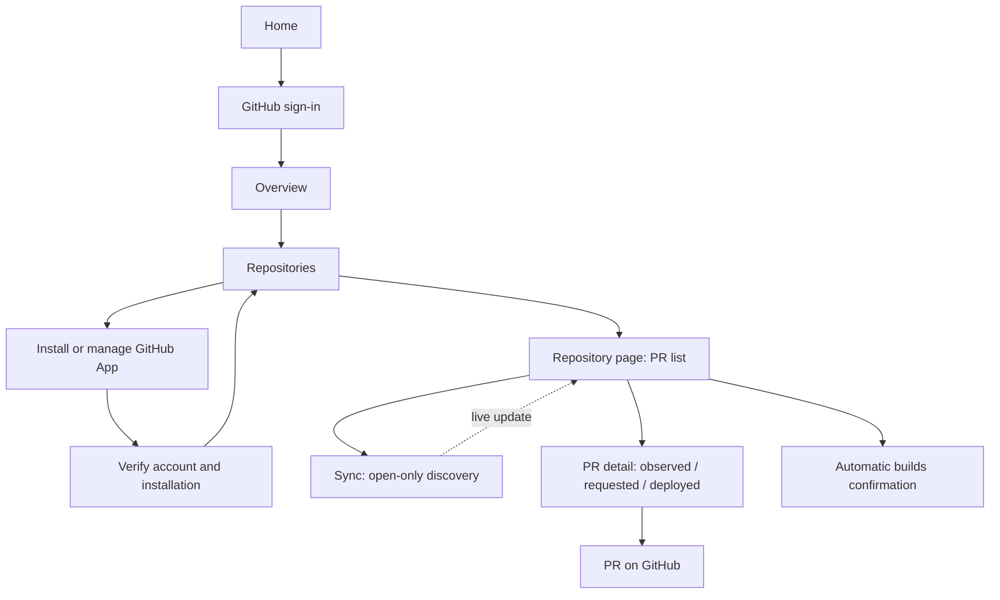
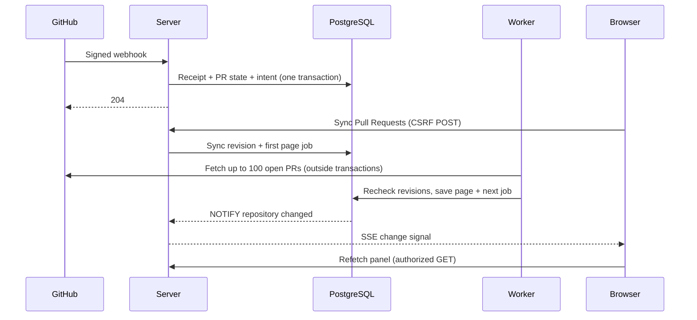

# 03 · User guide

A walk through the working screens: sign in, connect repositories, track pull
requests and choose a build policy. Setup commands are in
[02-development-setup.md](02-development-setup.md). Building and serving previews
is not available yet; the screens show real saved state only.

## Before you start

- PostgreSQL running and migrated (`make migrate-up`).
- `make dev` (or `make run-server`) in one terminal, `make run-worker` in another.
- Sign-in needs OAuth values and `SESSION_SECRET`. Linking repositories needs the
  five GitHub App settings; discovery workers need App ID and private-key path;
  webhooks need `GITHUB_WEBHOOK_SECRET`. See [04](04-github-sign-in-and-app.md).

## Moving around

- The sidebar groups **Workspace** (Overview, Repositories), **Delivery** (Builds,
  Environments) and **System** (Developer tools). **Coming next** items (live logs,
  secrets, preview URLs) are labels, not links.
- Medium screens collapse the sidebar to icons; phones use the menu button.
- **Ctrl K** (**⌘K** on macOS) or the header search opens the command palette. Type
  to filter pages, repository filters and account actions; arrow keys and Enter
  choose, Esc closes. **Log out…** still asks for confirmation.
- The sun/moon button switches light and dark themes. The choice is stored in this
  browser; without a choice Previa follows the operating system.
- Pages are bookmarkable. Back/Forward and reload keep the current page and filters.
  Without JavaScript, links, GET forms and native confirmation dialogs still work.

## Sign in and connect repositories

1. On Home, click **Get started with GitHub** and authorize. You land on **Overview**:
   real installation/repository/access counts, a setup checklist derived from those
   counts and a pipeline view showing which stages are connected.
2. Open **Repositories** and click **Install on a repo** (later **Manage
   connections**). On GitHub, choose the account and repositories.
3. Complete GitHub's redirect and App user authorization with the **same account**.
   Previa verifies your access to that installation before linking it.
4. Repositories appear as cards (up to three columns, one on phones) with name,
   owner and access badge. Tabs filter **Available** (default), **Unavailable**
   (access removed or installation suspended; history kept) and **All**. Search
   updates after a short pause; the toolbar stays pinned while you scroll. Pages hold
   ten repositories; pagination appears only when needed.

Linking never starts a build. Verified linking also queues a first open-only PR
discovery for each newly accessible repository.

## Track pull requests

1. Select a repository card to open its page: a breadcrumb (owner / repository),
   **Last synced**, the current build mode and the PR list.
2. **Sync Pull Requests** queues another open-only discovery. It fetches metadata
   only and never starts builds. Repeated clicks while syncing coalesce.
3. With the worker running, progress, webhook changes and mergeability results
   appear by themselves. A green **Live** dot beside Last synced means the page is
   receiving updates; nothing is polled.
4. The list defaults to **Open**, with **Closed**, **Merged** and **All** tabs, and
   searches title, number, author or branch. Ten PRs per page. On phones each row
   becomes a labelled card.
5. Open PR states:

   | State | Meaning | Can it build? |
   | --- | --- | --- |
   | **Open** | GitHub reports the PR as mergeable. | Yes, once execution exists. |
   | **Checking** | GitHub has not finished computing mergeability. | No; wait or sync again. |
   | **Conflicts** | The PR conflicts with its base branch. | No; resolve and push a new commit. |

   Closed and merged PRs appear only if Previa tracked them while they were open.
   **Refresh required** means conflicting observations arrived at the same instant;
   sync again to get an authoritative snapshot.
6. Select a PR for its detail page, which tracks three things separately:
   - **Latest observed commit:** the head GitHub reports.
   - **Current build request:** authorized work, its captured commit and any deadline.
   - **Deployed preview:** what a preview actually serves. It can lag the latest commit.

   **Not requested** means no build intent exists; **Not deployed** means no
   environment exists. Placeholders for live logs, preview URL/health and teardown
   are labelled **Soon**. **View on GitHub** opens the real PR.
7. **Back to pull requests**, the breadcrumb and **Repositories** return to the
   previous list with its search, tab and page preserved.

## Choose a build policy

The **Enable Automatic Builds** switch and **Sync Pull Requests** appear only on a
repository's PR list, never on PR details.

- **Manual** (default): PR events update tracking but never authorize a build.
- **Automatic**: each relevant new commit sets a five-minute quiet deadline; another
  push resets it. Enabling Automatic does not build existing PRs.
- Turning Automatic on asks for confirmation in a modal over the page. Cancel, Close
  or Escape leaves it off. Turning it off saves Manual immediately and cancels
  unstarted automatic work, but keeps running work and existing previews.
- Closing or merging a PR supersedes outstanding work and records teardown intent
  in either mode.

**Build latest commit is disabled.** It needs exact-SHA source fetching, image
builds, isolated containers, routing and cleanup first ([13-roadmap.md](13-roadmap.md)).
Direct POSTs are refused too: HTTP 409 with the reason for Checking, Conflicts or
Refresh required PRs, otherwise HTTP 503 "not available yet". No intent is created.

## Other screens

| Screen | What it shows |
| --- | --- |
| Builds | Current/latest authorized build requests across your repositories, with captured commits and deadlines. Not an attempt history. |
| Environments | Persisted deployment state and deployed commit per PR. URLs, health and teardown arrive with execution. |
| Developer tools | Queue diagnostic: submit a ping and watch the worker process it. |
| Session | Your GitHub identity; reached from the account menu. |

Empty Builds/Environments views are normal: only real records appear. Logging out
uses **Account menu → Log out → Confirm logout**; your GitHub session is unaffected.

## Flows

