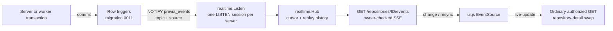

# 14 · Realtime updates (Server-Sent Events)

Open repository and PR pages update when committed state changes, without
polling. This document explains the pipeline and how to extend it.

## Why not polling

Pages previously re-rendered every three seconds for as long as they were open,
whether or not anything changed. That cost a request and several queries per tab
every three seconds and still lagged real changes. GitHub was never polled by the
dashboard; worker-side mergeability checks are separate, event-triggered and
bounded (see [05](05-webhooks-and-pr-discovery.md#mergeability)).

## Pipeline

- **Triggers** on `repos`, `pull_requests`, `pr_syncs`, `build_intents`,
  `environments` and installation status changes raise
  `{"topic":"repository:<id>","source":"<table>"}`. NOTIFY is delivered only after
  commit; rolled-back work and no-op updates stay silent, and identical payloads
  in one transaction collapse to one. No code path can forget to publish.
- **Listener** (`internal/platform/realtime/listener.go`) holds a dedicated
  connection (LISTEN is session state), reconnects with capped backoff and calls
  `Hub.Resync` after every LISTEN, because notifications sent while nobody
  listened are lost.
- **Hub** fans events out by topic. Each event advances a cursor
  (`<instance>.<seq>`); the hub keeps the last 1024 topics so a subscriber can
  resume. Bursts coalesce into one pending event per subscriber; a resync is never
  downgraded. A cursor from another process, from the future, or older than the
  history produces a resync.
- **Stream** (`realtime.Stream`) writes `retry`, then `ready` (or a catch-up
  event), then `change`/`resync` frames whose `id` is the cursor. It lifts the
  server's 30-second write deadline for that response, heartbeats every 25 seconds,
  and ends after five minutes so the browser reconnects through authentication.
  `Hub.Close` is registered with `http.Server.RegisterOnShutdown`, so graceful
  shutdown does not wait for open streams.
- **Browser** (`initLiveUpdates` in `web/static/js/ui.js`) opens one EventSource
  per page. Every `change`/`resync` triggers the hidden `[data-live-refresh]`
  element, which refetches `#repository-detail` with the current URL's filters.
  Hidden tabs close their stream and resume from the last event id when visible.
  Refreshes are deferred, not dropped, while PR search is focused or the policy
  confirmation is open. `<html data-live-state>` drives the Live indicator.

## Correctness: no missed changes

1. The page handler reads `Hub.Cursor()` **before** loading the state it renders
   and embeds it as `?since=` in the stream URL.
2. Any commit not visible to that render happens after the cursor was read, so its
   notification arrives with a later sequence number.
3. On subscribe, the hub compares `since` with its history and sends a catch-up
   `change` (or `resync`) as the first frame when something was missed.
4. Automatic reconnects send `Last-Event-ID`; visibility reconnects send
   `?since=<last id>`. Both resume through the same check.

A spurious refresh is possible (for example, a change already included in the
render); a missed one is not, short of the history window overflowing, which
degrades to a resync.

## Security

The stream carries topics only. The endpoint runs behind the normal session and
`RequireUser` middleware and checks repository ownership before subscribing;
other repositories return 404. Browsers obtain data only through the existing
ownership-scoped GET handlers.

## Operating it

- Apply migration 11 with `make migrate-up`. Without it pages still work but
  refresh only on navigation or your own actions.
- Proxies must not buffer `text/event-stream` (Previa sends `X-Accel-Buffering:
  no` and `Cache-Control: no-cache, no-transform`) and should tolerate 30 seconds
  of idleness.
- Browsers limit HTTP/1.1 to six connections per origin; hidden tabs release
  their stream. Serving over HTTP/2 (for example behind TLS-terminating Traefik)
  removes the limit.
- NOTIFY serializes committing transactions that raise it. That is negligible at
  dashboard write rates; revisit if write volume grows by orders of magnitude.
- Running several server instances is supported: each listens independently, and
  a cursor from another instance simply triggers one resync refresh.

## Extending it

- **Another page or feature:** add a trigger (or call `previa_notify_repository`)
  that emits a topic the owner defines, read `Hub.Cursor()` before rendering,
  expose an ownership-checked endpoint that calls `Hub.Subscribe` and
  `realtime.Stream`, and give the page a `data-live-events` URL plus a
  `data-live-refresh` element.
- **Records with their own positions** (as build logs do): use `realtime.NewSSE`
  directly, make your record position the event id, replay rows after
  `Last-Event-ID` from PostgreSQL, and use hub subscriptions only as wake-ups.

## Build log streams

Build logs ([08](08-build-logs.md)) are the first feature to stream records rather
than invalidation signals. They reuse this pipeline as follows:

- Migration 13 adds a row trigger on `build_log_streams` that raises
  `buildlog:<environment id>` on every append, reset, finish and prune. The log
  stream subscribes to it and to its repository topic (intent and environment
  changes); both only wake the handler.
- Event ids are `<epoch>.<next sequence>`, not hub cursors. A cursor from another
  epoch means a new attempt replaced the logs: the stream sends `reset` and replays
  the current attempt from sequence 0. Lines are read in frames of at most 200 with
  short queries; no transaction or pool connection is held per viewer.
- `realtime.SSE.WriteTimeout` bounds each frame (10 seconds for logs), so a client
  that stops reading is dropped. `realtime.Limiter` caps log streams at 256 per
  server and 8 per user. The repository stream keeps its earlier behaviour.
