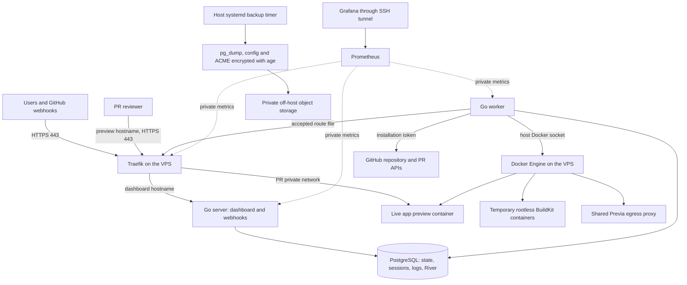

# 24 · Production deployment

Previa currently deploys to **one dedicated Linux VPS running Docker Engine and
Docker Compose**. PostgreSQL, the Go HTTP server, the Go worker, Traefik,
Prometheus and Grafana run there. The worker creates build containers and live
preview containers on that same Docker host. Encrypted backups go to storage
outside the VPS.

This follows [README §4.9](../README.md#49-infrastructure-and-deployment),
[DESIGN](../DESIGN.md), and the actual files in `deploy/production`. It describes
what exists, the manual steps an operator must perform, and the additions needed
if you choose a different database or automated deployment. **A commit to `main`
does not deploy Previa. A release tag publishes artifacts; the operator deploys
them.**

The [release report](25-release-report.md) records local evidence and pending live
checks. It does not establish that a real production host is already running.
Examples below use reserved example domains and illustrative version tags;
replace them with your domains and an existing, tested release. Run commands one
step at a time and stop when a check fails.

## Contents

- [Deployment platform and external services](#deployment-platform-and-external-services)
- [What runs](#what-runs)
- [Fresh host setup](#fresh-host-setup)
- [First start, with staged certificates](#first-start-with-staged-certificates)
- [Verify the deployment](#verify-the-deployment)
- [Monitor live traffic, jobs and containers](#monitor-live-traffic-jobs-and-containers)
- [Backups and restore](#backups-and-restore)
- [Upgrades and rollback](#upgrades-and-rollback)
- [CI and releases](#ci-and-releases)
- [Local staging smoke test](#local-staging-smoke-test)
- [Security notes](#security-notes)
- [Files behind these instructions](#files-behind-these-instructions)

## Deployment platform and external services

### The deployment to use for this implementation

A concrete starting arrangement is a **Hetzner Cloud VPS**, **Cloudflare DNS**,
and a private **Amazon S3 bucket** for backups. These are operator choices, not
provider dependencies hardcoded in Previa: a comparable Linux VPS, a DNS provider
supported by Traefik's lego client, and an rclone-supported storage service also
work. This guide uses that arrangement to make the setup specific.

| Piece | Where it lives | Why it is needed |
| --- | --- | --- |
| VPS | A dedicated Hetzner VM, or equivalent | Provides a persistent Linux host, Docker socket, disk, private Docker networks, and public ports 80/443. |
| Production PostgreSQL | `postgres` container on the VPS; Docker volume `previa_postgres` | Stores application state, sessions, encrypted repository secrets, build logs, durable operations, and River jobs. |
| Dashboard and API | `server` container on the VPS | Serves the UI, sign-in, repository controls, signed webhooks and live updates. |
| Background processing | `worker` container on the VPS | Runs River queues and creates builds, previews, routes, reports and cleanup. |
| Public routing and certificates | `router` container on the VPS | Traefik terminates HTTPS and forwards each hostname to its correct backend. |
| DNS | Cloudflare account and authoritative zones | Dashboard and wildcard preview records point to the VPS; the router uses a scoped token for DNS-01 certificate challenges. |
| GitHub integration | Separate GitHub OAuth App and GitHub App | OAuth signs people in; the App grants repository access, receives webhooks and posts PR feedback. |
| Release artifacts | GitHub Releases and GitHub Container Registry (GHCR) | Stores versioned binaries and the three Previa images. GitHub runners build them, then finish. |
| Backup destination | Private S3 bucket outside the VPS | Holds encrypted database, configuration and certificate backups that survive loss of the host. |
| Monitoring | Prometheus and Grafana on the VPS | Scrapes metrics, evaluates alert rules and provides the Previa dashboard. |
| Alert delivery | Operator-configured Alertmanager and receiver | Sends firing alerts to your email, chat or incident service; this is not supplied as a running service by the base Compose file. |
| Backup encryption key | Private age identity in offline recovery storage | Decrypts backups during a restore; only its public recipient is needed on the VPS. |

There is no separate frontend deployment: templates and static browser assets are
compiled/generated and embedded into `previa-server`. Production does not need a
Node server, Vercel, Netlify or Air. There is no Redis service for Previa's queue:
River uses the same PostgreSQL database. There is no Kubernetes cluster, remote
BuildKit service, or production Terraform configuration in the repository.

Provider setup reference: [Hetzner's server creation guide](https://docs.hetzner.com/cloud/servers/getting-started/creating-a-server/).
Choose by CPU, RAM, disk and location rather than copying an old plan name or
price. Account for the VPS, public IP, domains, backup storage, transfer and any
external alert service in the operating budget.

### Are we using Fly.io? Can its database be used?

**The supplied deployment does not use Fly.io.** It has no `fly.toml`, Fly release
command, Fly Machines runtime adapter, or Fly deployment workflow. The worker
uses the VPS's Docker Engine API and socket to create sibling containers and
networks, and controls Traefik through that same daemon. Deploying the Go server
alone with `fly launch` would leave those dependencies and the preview pipeline
unconfigured. A deployment of the whole system on Fly would require a separately
designed and tested runtime/networking arrangement; it is not a command-line
substitution for this Compose stack.

Fly offers [Managed Postgres](https://docs.fly.io/postgres) with managed backups
and availability. Its documented connection path is inside the Fly organization's
private network; external access needs the documented proxy or WireGuard setup.
A Fly private database hostname is not automatically reachable from a Hetzner
VPS or its Docker networks. See [Fly's connection guide](https://docs.fly.io/postgres/create-and-connect).

The Go connection configuration accepts a PostgreSQL URL, so using managed
PostgreSQL is a possible future operational change. It is **not supported merely
by replacing `DATABASE_URL` in the current stack**:

1. Provision a compatible PostgreSQL service close to the VPS, with durable
   connectivity, credentials and verified TLS. For Fly, establish and supervise
   the private network connection; a developer's temporary local proxy is not a
   production dependency you can leave unattended.
2. Verify migrations, River, connection lifetimes, advisory locks and PostgreSQL
   `LISTEN/NOTIFY` on the chosen endpoint. The server uses a dedicated LISTEN
   connection. Do not assume a transaction-pooling URL provides session semantics;
   choose an appropriate direct or session-compatible connection and test it.
3. Change Compose's local `postgres` dependencies and the migration lifecycle.
   Otherwise it still creates and waits for an unused local database.
4. Replace the database portions of backup and restore. `backup.sh` explicitly
   dumps `dc exec postgres ... -d previa`; `restore.sh` explicitly drops and
   recreates that local database. They do not follow an external `DATABASE_URL`.
5. Define the provider's backup retention, restore/PITR procedure, database roles,
   upgrade compatibility, recovery objective and monitoring. Continue backing up
   `/etc/previa` and ACME state separately; a managed DB backup contains neither.
6. Rehearse a complete restore and a rollback before switching live traffic.

Those changes are not implemented by this documentation update. For the commands
below, use the provided **PostgreSQL 17 Compose service**. PostgreSQL for each
*previewed application* is a different matter: automatic per-PR databases,
Redis, setup commands and extra app processes remain planned features in the
[roadmap](26-roadmap.md). Previa's own production database is never a database
that an untrusted preview may connect to.

## What runs

### Traffic and execution paths



A dashboard request passes through Traefik to the Go server. A request to a
published preview passes through Traefik directly to that app's container; the Go
server and worker do not sit in that preview request path. A webhook records
state/authorized work in PostgreSQL and returns; River executes the work later.

### Compose services

All these services run on the **same VPS**. Images from the current Compose file
are pinned by digest; the version names below identify them. Keep the pinned
references in that file when following the guide.

| Service | Image / executable | Lifetime and responsibilities | Public exposure |
| --- | --- | --- | --- |
| `postgres` | `postgres:17.11-alpine` | Persistent PostgreSQL 17 database; healthchecked; stores data in `previa_postgres`. | No host port; `postgres:5432` on the control network only. |
| `migrate` | Previa server image, `previa-migrate up` | One-shot Goose migrations followed by River migrations. Exit 0 is success. Server/worker wait for it. | None. |
| `server` | `previa-server:<release>` | Persistent Go HTTP process. Has no Docker socket. Read-only root, UID 65532, temporary `/tmp`. | Internal HTTP `8080`; reached publicly through Traefik. Health/metrics `9090` stay private. |
| `worker` | `previa-worker:<release>` | Persistent Go River worker, not an HTTP app serving users. Only service with the Docker socket; has source and routing storage. | Health/metrics `9091` stay private. |
| `router-config` | Pinned Traefik image, shell command | One-shot writes `previa-dashboard.yml` before the router starts. Exit 0 is success. | None; no network. |
| `router` | `traefik:v3.7.13`, container `previa-router` | Persistent HTTPS proxy; watches dashboard and preview route files; renews certificates. No Docker socket. | Host TCP `80` and `443`; metrics `8082` on control network; API/ping `8080` on its own loopback. |
| `egress` | `previa-egress:<release>` | Image staging service under profile `images`. Use it to **pull or build the image**, not to run the production proxy. | Do not start this Compose service. |
| `prometheus` | `prom/prometheus:v3.5.0` | Optional `observability` profile; scrape/evaluation every 30 seconds, 30-day local metrics retention. | `prometheus:9090` private; no host port. |
| `grafana` | `grafana/grafana:12.1.1` | Optional `observability` profile; provisioned Prometheus datasource and Previa dashboard. | Host `127.0.0.1:3000`, accessed over SSH. |

The `server`, `worker` and `egress` release images come from the multi-stage
[Dockerfile](../Dockerfile). Runtime images contain static Go binaries; server and
worker use distroless images without a shell. Use their `healthcheck` and
`check-config` commands, not `docker exec ... sh`. The server image also contains
`previa-migrate` and `previa-secrets-reencrypt`; the worker image contains
`previa-route-sync` and `previa-housekeeping`. These maintenance commands are
run on demand, not deployed as additional always-running processes.

### Containers created by the worker

These are **sibling containers on the host's Docker daemon**, not nested
containers inside `worker`. They do not appear in `dc ps`, because Compose did
not create them. Use `docker ps` and their labels to inspect them.

| Object | Created by / lifetime | What it does |
| --- | --- | --- |
| `previa-egress` container and network | Worker startup; shared and persistent | Runs the Previa proxy and readiness prober. Attached to build/preview networks; permits proxy traffic to public addresses and blocks private/control-plane/metadata addresses. Requires its image to be downloaded beforehand. |
| Rootless BuildKit builder | A build attempt; removed afterwards | Fetches public base images/dependencies through the proxy, executes Dockerfile steps, builds the preview image. Its cache may persist in a labelled Docker volume. |
| Build network | A build attempt; removed afterwards | Internal bridge network containing the builder and attached egress proxy. |
| Preview image | A successful Dockerfile build | Kept in the VPS's Docker image store, not uploaded to GHCR by the PR build pipeline. |
| App preview container | A successful build; lives until replacement, teardown or expiry | Runs the app with bounded CPU/memory/PIDs, its configured internal port and appropriate repository secrets. No Docker socket or published host ports. |
| PR preview network | That PR's preview lifecycle | Internal bridge shared by that PR's candidates, Traefik and the egress proxy. Other PRs and the control plane are not attached. |

The preview config `.previewrc.yaml` points at a Dockerfile and the app's internal
port. It is not a file for deploying Previa's own control plane. A preview must
pass readiness before a route is published. A successful rebuild switches the
accepted route to the new candidate; a failed rebuild leaves the old serving
preview in place. Close/merge and explicit teardown remove routes/resources
through durable operations. Expiry and housekeeping provide additional cleanup.

### Persistent storage and networks

| Location | Contents | Included in the shipped backup? |
| --- | --- | --- |
| `/opt/previa` | Checkout of the exact release; scripts, Compose and monitoring definitions | Recover from GitHub/release artifacts. Keep this path stable: the systemd backup service references it. |
| `/etc/previa/previa.env` | Production settings and generated/application credentials | Yes, encrypted configuration archive. |
| `/etc/previa/github-app.pem` | GitHub App private key | Yes, encrypted configuration archive. |
| `/etc/previa/dns-credential` | DNS API token | Yes, encrypted configuration archive. |
| `/var/lib/previa/router` | `previa-dashboard.yml` and worker's `previa-routes.yml` | No; regenerated from config and accepted database routes. |
| `/var/lib/previa/backup/last-success` | Backup success timestamp read by the server | No; the next complete backup recreates it. |
| Docker volume `previa_postgres` | PostgreSQL data files | Logical database dump, not a raw copy of the live volume. |
| Docker volume `previa_acme` | Let's Encrypt accounts, keys and certificates | Yes, encrypted ACME archive. |
| Docker volume `previa_sources` | Temporary exact-commit source workspaces | No; refetched from GitHub. |
| Labelled build cache volumes and local preview images | Rebuildable build artifacts | No. |
| `previa_prometheus`, `previa_grafana` volumes | Metrics history and Grafana state | No; datasource/dashboard provisioning can be recreated, but local history/customizations are lost unless separately backed up. |
| Root's rclone and Docker login configuration | Storage credentials and optional private-registry login | Not by default: these live outside `/etc/previa`. Store recovery copies separately. |

Docker volumes normally live under the daemon's data root (`/var/lib/docker` on
the expected host). Confirm with `docker info --format '{{.DockerRootDir}}'`;
do not assume they live inside `/opt/previa` or on GitHub. Keeping volumes across a
container recreation preserves their data; deleting the VPS or its disk does not.

Compose uses project name `previa`, control network `previa_control`, subnet
`172.31.250.0/24`, router address `172.31.250.10` and server address
`172.31.250.20`. Verify this subnet does not conflict with the VPS's private
network/VPN. These addresses also occur in the dashboard route and trusted-proxy
configuration; changing only the subnet is insufficient.

## Fresh host setup

### Step 1 — Choose the host and release

Use a dedicated Debian 12 or Ubuntu 24.04 Linux host with systemd, a public IPv4
address and persistent SSD storage. Both `linux/amd64` and `linux/arm64` Previa
release images are built; verify the apps you preview have compatible base images.
For the first deployment, Ubuntu 24.04 on amd64 is a straightforward choice.

The previous 4 vCPU / 8 GiB RAM / 80 GiB disk baseline is a lower bound, not a
promise that all defaults fit. In particular, **two default builds can each use
4 GiB**, while previews default to a budget of 60% of host memory. PostgreSQL,
monitoring, Docker and Linux need memory too. Explicitly budget them together.

A conservative first-host example is **8 vCPU, 16 GiB RAM, 160 GiB disk**, with
one 2 GiB build at a time and a 4 GiB total preview memory budget. These are
starting allocations inferred from the implemented resource limits; measure your
own Dockerfiles before raising concurrency. See the settings in Step 5.

In the provider console, create the server, attach your SSH public key, and allow
SSH from your administration IP plus TCP 80/443 from the internet. Keep the
provider's rescue/console access available. `setup.sh` configures UFW for standard
OpenSSH; if you use a custom SSH port, arrange the appropriate firewall rule
before running it. Docker's published ports have their own firewall rules, so
also rely on the provider firewall and the narrow Compose port bindings.

Use a separate staging VPS for first deployment, restores and upgrade drills.
Choose a release only after checking the [CI and releases](#ci-and-releases)
section and the current [smoke-test limitation](#local-staging-smoke-test).

### Step 2 — Set up domains, DNS and the DNS token

For example, own `example.com` for the dashboard and a separate registrable domain
`example.net` for untrusted previews. Set up their authoritative DNS first:

| Record | Value | Previa setting |
| --- | --- | --- |
| `A previa.example.com` | VPS public IPv4 | `APP_BASE_URL=https://previa.example.com`, `PREVIA_DASHBOARD_HOST=previa.example.com` |
| `A *.preview.example.net` | Same VPS public IPv4 | `PREVIEW_BASE_DOMAIN=preview.example.net` |

The wildcard covers `<generated-label>.preview.example.net`, not the base domain
itself. An additional base-domain A record is optional. Only add AAAA records if
you actually configure and verify the corresponding public IPv6 path.

For Cloudflare, add each zone, complete the registrar's nameserver change, then
create the records as **DNS only**. Direct access is the tested routing model;
the dashboard's TLS-ALPN-01 challenge needs the internet to reach Traefik on 443.
Cloudflare proxying or another TLS-terminating load balancer requires a separate
certificate/proxy design and is not covered by copying these records unchanged.

Create a Cloudflare API token with `Zone / DNS / Edit` and `Zone / Zone / Read`,
scoped to the preview zone. One token with both permissions is supported by the
[lego Cloudflare provider](https://go-acme.github.io/lego/dns/cloudflare/).
Keep the token in a password manager until Step 4 installs it on the server.
Set `ACME_DNS_PROVIDER=cloudflare` and
`ACME_DNS_CREDENTIAL_VARIABLE=CF_DNS_API_TOKEN`; do not put `_FILE` in that
setting, because Compose appends it. Other providers require their corresponding
lego credential variable and possibly additional configuration.

Confirm DNS from your workstation before certificate issuance:

```sh
dig +short previa.example.com A
dig +short any-label.preview.example.net A
```

Both should resolve to the VPS IP. `dig` can be installed through your OS's DNS
utilities package. Also check restrictive CAA records if certificate issuance
fails: they must permit the chosen certificate authority.

### Step 3 — Install the checkout and prepare the host

**On your workstation**, SSH to the server:

```sh
ssh ops@YOUR_SERVER_IP
```

**On the VPS**, enter an administrative shell. The remaining VPS examples run as
root so file modes, Docker and systemd commands are consistent:

```sh
sudo -i
apt-get update
apt-get install -y git

git clone https://github.com/ajaykathwate/Previa.git /opt/previa
cd /opt/previa
git fetch --tags origin
PREVIA_RELEASE=v0.1.0
# Replace the example above with the tested tag you actually published.
git checkout --detach "$PREVIA_RELEASE"

deploy/production/setup.sh
systemctl stop previa-backup.timer
```

For a private repository, authenticate the checkout through an appropriate
read-only credential, without embedding a token in the clone URL. Use a clean
release checkout rather than editing application source on the production host.

`setup.sh` installs Docker Engine/Compose/Buildx when Docker is absent, age,
rclone, OpenSSL and UFW; enables Docker at boot; creates the state directories;
and creates `/etc/previa/previa.env` only if it does not exist. If Docker already
exists, verify its Compose and Buildx plugins yourself:

```sh
docker version
docker compose version
docker buildx version
systemctl is-enabled docker
stat -c '%g' /var/run/docker.sock
```

It generates database, session, webhook, repository-encryption and Grafana
secrets and fills `DOCKER_GID` from the socket. It also installs/enables the backup
timer immediately. The explicit stop above prevents scheduled failures while
you are still configuring storage and the application. Re-enable it after the
first successful backup. Re-running setup does not regenerate an existing env
file, but does update its Docker group and credential file permissions.

### Step 4 — Register GitHub integrations and install credential files

Create separate production registrations instead of changing working local
callbacks accidentally. The dashboard uses a GitHub **OAuth App**, while repo
access uses a GitHub **App**; their client IDs/secrets are different.

1. In GitHub **Settings → Developer settings → OAuth Apps → New OAuth App**, use
   `https://previa.example.com` as the homepage and
   `https://previa.example.com/auth/github/callback` as the authorization callback.
   Copy the OAuth client ID and create a client secret.
2. In **GitHub Apps → New GitHub App**, use the same homepage. Set setup URL
   `https://previa.example.com/installations/callback`, enable **Redirect on
   update**, and set callback URL
   `https://previa.example.com/installations/authorize/callback`. Leave **Request
   user authorization during installation** unchecked: Previa starts that flow.
3. Grant repository permissions **Contents: read**, **Pull requests: write**,
   **Checks: write**; Metadata read is automatic. Subscribe to **Pull request**.
   GitHub also delivers installation lifecycle events used by the implementation.
4. Set webhook URL `https://previa.example.com/webhooks/github`. Copy the generated
   `GITHUB_WEBHOOK_SECRET` from the host's env file into the App's webhook secret
   field. Keep verification enabled. Webhooks with staging-CA certificates will
   not be a successful live proof; verify deliveries after production TLS works.
5. Save the App ID, App slug, App client ID and newly generated App client secret.
   Generate and download an App private key. Install the App on a disposable test
   repository first; sign-in alone does not grant that repository access.

See [04 · GitHub sign-in and App installation](04-github-sign-in-and-app.md)
for the distinction and permission rationale.

Upload the private key from your **workstation** to your SSH user's home:

```sh
scp /path/to/downloaded-app-key.pem ops@YOUR_SERVER_IP:github-app.pem
```

Then, as root on the **VPS**, install it and create the DNS-token file:

```sh
install -o 65532 -g 65532 -m 0600 /home/ops/github-app.pem /etc/previa/github-app.pem
rm /home/ops/github-app.pem
install -o root -g root -m 0600 /dev/null /etc/previa/dns-credential
nano /etc/previa/dns-credential
```

Adjust `/home/ops` to your SSH user's actual home directory. Paste only the DNS
token into the DNS file. Do not place these files in the repository. The App key
is a real PEM file, not a PEM string in an environment variable. It must be owned
by UID 65532 and mode 600 because the non-root server and worker read it; the DNS
token is read by the router and stays root-owned, mode 600. `/etc/previa` itself
is root-owned, mode 700. Compose bind-mounts the individual credential files.

### Step 5 — Put production environment variables in the correct file

Edit the file created by setup:

```sh
nano /etc/previa/previa.env
chmod 600 /etc/previa/previa.env
```

**This is the production env file.** The repository's `.env.example` and local
`.env` are for development. Neither the Go binaries nor a checkout automatically
load `.env`; production Compose explicitly supplies
`/etc/previa/previa.env`. You do not need to export all its secrets in your shell
or add them to GitHub Actions secrets.

Keep one unquoted `NAME=value` entry per setting. The backup script reads its
settings as literal text, so quoted values that Compose alone would understand
would break the shared format. The generated secret formats are suitable for
this file. For additional settings and validation see
[configuration setup](../technical-docs/config-setup.md) and
[development setup](02-development-setup.md); those files are references, not
additional production env files to copy.

| Settings in `previa.env` | What to set / where the value comes from |
| --- | --- |
| `PREVIA_VERSION` | Exact tested tag, e.g. `v0.1.0`; it must match the checkout and all three images. |
| `PREVIA_SERVER_IMAGE`, `PREVIA_WORKER_IMAGE`, `PREVIA_EGRESS_IMAGE` | For published images: `ghcr.io/ajaykathwate/previa-server`, `ghcr.io/ajaykathwate/previa-worker`, `ghcr.io/ajaykathwate/previa-egress`. These are image names **without tags**; Compose adds `:${PREVIA_VERSION}`. Use your actual lowercase owner if it changes. Leave absent for local-image builds. |
| `DOCKER_GID` | Generated from the host Docker socket. Not the worker's UID. |
| `POSTGRES_PASSWORD` | Generated by setup. Used when the database volume is initialized. |
| `DATABASE_URL` | Setup writes `postgres://previa:<generated-password>@postgres:5432/previa?sslmode=disable`. `postgres` is a private Compose hostname, not `localhost`. Keep the password consistent. |
| `APP_BASE_URL` | `https://previa.example.com`; an origin, without an extra path. |
| `PREVIA_DASHBOARD_HOST` | `previa.example.com`; no scheme or port for this deployment. Must match `APP_BASE_URL`'s hostname. |
| `SESSION_SECRET` | Generated random hex value; retain across restarts unless intentionally rotating. |
| `GITHUB_OAUTH_CLIENT_ID`, `GITHUB_OAUTH_CLIENT_SECRET` | OAuth App credentials from Step 4; dashboard sign-in. |
| `GITHUB_APP_ID`, `GITHUB_APP_SLUG` | Numeric App ID and slug from the GitHub App page. |
| `GITHUB_APP_CLIENT_ID`, `GITHUB_APP_CLIENT_SECRET` | GitHub App credentials, used for installation authorization; not the OAuth App credentials. |
| `GITHUB_APP_PRIVATE_KEY_FILE` | Host path `/etc/previa/github-app.pem`; this tells Compose which file to mount. |
| `GITHUB_WEBHOOK_SECRET` | Generated secret, also set identically in GitHub's webhook configuration. |
| `SECRETS_ENCRYPTION_KEYS` | Generated `1:<base64-encoded-32-byte-key>`. Multiple rotation versions use commas: `1:<key>,2:<key>`. Back up every needed version offline. |
| `SECRETS_ACTIVE_KEY_VERSION` | `1` initially; the version used to encrypt new repository secrets. |
| `PREVIEW_BASE_DOMAIN` | `preview.example.net`; lowercase DNS name, no scheme or wildcard. |
| `ROUTER_ENTRYPOINT`, `ROUTER_API_ADDRESS` | Retain `websecure` and `127.0.0.1:8080`. This loopback is inside the router container. |
| `ACME_EMAIL` | A monitored operator email for the certificate account. |
| `ACME_DNS_PROVIDER`, `ACME_DNS_CREDENTIAL_VARIABLE` | `cloudflare` and `CF_DNS_API_TOKEN` for this example. |
| `ACME_DNS_CREDENTIAL_FILE` | Host path `/etc/previa/dns-credential`. Compose passes `CF_DNS_API_TOKEN_FILE=/run/secrets/dns_credential` to the router. |
| `ACME_CA_SERVER` | Let's Encrypt staging initially; switch to production only after staging issuance succeeds. |
| `ACME_DNS_RESOLVERS` | Optional; default `1.1.1.1:53,8.8.8.8:53`. Resolver reachability matters for DNS-01. |
| `BACKUP_AGE_RECIPIENT` | Public `age1...` recipient generated on your recovery workstation, as described below. |
| `BACKUP_REMOTE` | For the S3 example: `previa-backups:YOUR_BUCKET/production`; `previa-backups` is an rclone remote name. |
| `BACKUP_RETENTION_DAYS` | `30` initially; choose according to your recovery requirements. |
| `BACKUP_FAILURE_WEBHOOK` | Optional receiver URL accepting the script's JSON `text` message. This only reports backup failures; it is not the whole Prometheus alert system. |
| `GRAFANA_ADMIN_PASSWORD` | Generated password; initial Grafana admin login. |
| `LOG_LEVEL` | `info`; use `debug` temporarily during a diagnosed incident, then restore. |

Compose sets these application values itself; retain them unless you deliberately
change the deployment topology:

| Container setting | Provided value / purpose |
| --- | --- |
| `APP_ENV` | `production` on server and worker. |
| `HTTP_ADDR`, `INTERNAL_ADDR` | Server `0.0.0.0:8080`, `0.0.0.0:9090`; listens on its container interfaces, not host-published ports. |
| `WORKER_INTERNAL_ADDR` | Worker `0.0.0.0:9091`. |
| `TRUSTED_PROXIES` | `172.31.250.10`, the router's private address. |
| `GITHUB_APP_PRIVATE_KEY_PATH` | `/run/secrets/github_app_key` **inside** server/worker; different from host `GITHUB_APP_PRIVATE_KEY_FILE`. |
| `SOURCE_WORKSPACE_ROOT` | `/var/lib/previa/sources`, mounted source volume. |
| `ROUTER_DYNAMIC_DIR`, `ROUTER_CONTAINER` | `/var/lib/previa/router`, `previa-router`. |
| `EGRESS_IMAGE` | The selected egress image name plus the release tag. |
| `BACKUP_STATUS_FILE` | Server reads `/var/lib/previa/backup/last-success`. |

The current shared `env_file` gives server, worker and migrate access to the same
file's values, although each Go config loader consumes only its own fields. This
is not a deployment with per-service secrets-manager isolation. Compose's explicit
`environment` entries override `env_file` entries; exported shell variables can
also override values used in Compose interpolation. Use a clean administrative
shell, edit the file deliberately, and avoid competing exported overrides.

For the 8 vCPU / 16 GiB example, edit or add these entries once each:

```dotenv
MAX_CONCURRENT_BUILDS=1
BUILD_TIMEOUT=12m
BUILD_CPUS=2
BUILD_MEMORY=2GiB
BUILD_PIDS=2048
BUILD_DISK_BUDGET=20GiB
BUILD_MAX_IMAGE_SIZE=4GiB
BUILD_MIN_FREE_DISK=15GiB
BUILD_CACHE_BUDGET=20GiB
PREVIEW_MEMORY_BUDGET=4GiB
PREVIEW_CPU_BUDGET=3
PREVIEW_MAX_PER_REPOSITORY=3
ENV_TTL_HOURS=48
BUILDS_PAUSED=false
```

Each build runs in a separate builder container, so the worker's own 1 GiB limit
is not the build's memory limit. Likewise, preview limits are separate from the
server's limit. The usual repository `standard` tier is 1 vCPU / 1 GiB; the total
preview budgets can admit fewer previews than the per-repository cap. Allow room
for a replacement candidate while its old preview is still serving.

Other implemented optional controls retain their defaults unless you need them:

| Setting | Default / effect |
| --- | --- |
| `BUILDKIT_IMAGE` | Pinned rootless BuildKit image from `internal/platform/config/builder.go`; pulled on the first build if absent. |
| `PREVIEW_ALLOW_ROOT`, `PREVIEW_WRITABLE_ROOTFS` | `false`, `false`; compatibility switches chosen by the operator, not the PR. |
| `PREVIEW_TMPFS_SIZE`, `PREVIEW_PIDS` | `256MiB`, `512`; temporary writable space and process cap per preview. |
| `PREVIEW_STARTUP_TIMEOUT` | `120s`; deadline for initial readiness. |
| `PREVIEW_OCI_RUNTIME` | Empty: Docker's default runtime. `runsc` requires separately installing/configuring gVisor on the host. |
| `HOUSEKEEPING_DRY_RUN` | `false`; `true` observes deletion decisions without executing housekeeping deletions. |
| `HOUSEKEEPING_GRACE` | `15m` before unreferenced resources count as orphans. |
| `PREVIA_ENV_FILE` | Optional alternate host env-file path for container `env_file` and scripts. If changed, also pass that path to Compose `--env-file` and the backup systemd service. |
| `PREVIA_ROUTER_DIR` | Host bind directory, default `/var/lib/previa/router`; different from the worker's container path. |
| `PREVIA_BACKUP_STATUS_DIR` | Host bind directory, default `/var/lib/previa/backup`; keep backup writer and server mount consistent. |

Changing `POSTGRES_PASSWORD` in this file does **not** change the password in an
already initialized PostgreSQL volume. Password rotation needs a database role
password change too; use an interactive `psql` session and `\password previa`,
then update the URL and env together. Changing settings requires container
recreation: `dc restart` alone does not load a changed env file. Instructions for
safe recreation and key rotation appear below.

### Step 6 — Prepare backups before treating the host as production

Follow [Backups and restore](#backups-and-restore) to generate your age key, create
an off-host bucket, configure **root's** rclone credentials, and fill the backup
settings. Keep the timer stopped until the database/router are running and a
manual backup succeeds. Store the recovery identity and repository-encryption
keyring outside the VPS. Also retain the storage account recovery credentials;
they are required if the original host disappears.

## First start, with staged certificates

### Step 7 — Define the production commands and obtain images

Run this on the VPS, in the root shell. Recreate these functions after opening a
new SSH session; they are shell helpers, not installed commands:

```sh
cd /opt/previa
dc() {
  docker compose -p previa \
    -f /opt/previa/deploy/production/compose.yml \
    --env-file /etc/previa/previa.env --profile observability "$@"
}
probe() {
  docker run --rm --network previa_control curlimages/curl:8.15.0 \
    -fsS --max-time 15 "$@"
}
```

The `observability` profile is deliberately present on every normal `dc` command
in this guide. The `images` profile is used only while pulling/building images;
**do not enable it on `up`**, because the worker creates the real `previa-egress`
container itself.

For **published GHCR images**, uncomment/set the three `PREVIA_*_IMAGE` names in
`previa.env`, set the matching `PREVIA_VERSION`, then:

```sh
dc config --quiet
dc --profile images pull
```

`config --quiet` validates Compose without printing interpolated secrets. A normal
`dc config` dump contains secrets and should not be pasted into an issue.
For public GHCR packages, pulling normally needs no login. For private packages,
use an authorized token with package read access:

```sh
docker login ghcr.io -u YOUR_GITHUB_USERNAME
```

Enter the token at the password prompt rather than putting it in a command or
URL. The host's registry login is different from Previa's OAuth/App credentials.
A token used only to pull images is not needed inside application containers.

Alternatively, **build the exact checked-out source manually on the host**, with
the `PREVIA_*_IMAGE` overrides absent and `PREVIA_VERSION` set to your chosen tag:

```sh
dc config --quiet
dc --profile images build server worker egress
```

Docker runs the pinned Go/template/CSS build stages; Go/Node do not need to be
installed directly on the VPS. A binary release archive alone does not contain
the full source/Dockerfile needed for this build path. With an archive, use the
published images and retain its Compose/scripts/monitoring layout instead.

Check the environment before starting services:

```sh
dc run --rm --no-deps server check-config
dc run --rm --no-deps worker check-config
```

Both should print `configuration is valid` and exit 0. This validates config and
file checks; it does not prove GitHub access, successful certificate issuance,
valid encrypted repository data, database migrations or a complete preview.
Those are separate startup/live checks below.

### Step 8 — Start with Let's Encrypt staging

Retain the staging URL in the env file:

```dotenv
ACME_CA_SERVER=https://acme-staging-v02.api.letsencrypt.org/directory
```

Start the stack:

```sh
dc up -d --wait --wait-timeout 180
dc ps -a
dc logs --tail 100 migrate router-config
dc logs --since 10m router
curl -ksS -D - -o /dev/null https://previa.example.com/
curl -ksS -D - -o /dev/null https://any-label.preview.example.net/
```

Expected behavior:

1. PostgreSQL initializes its persistent volume and becomes healthy.
2. `migrate` applies this release's embedded Goose schema and River schema, then
   exits successfully. The code reviewed here requires **Goose 19**; the release's
   migration status reports the River count as well.
3. `router-config` writes the dashboard route and exits 0; Traefik starts and
   watches the route directory.
4. Server starts only after migrations succeed. Worker starts after migrations
   and router health, ensures the egress proxy exists, synchronizes the accepted
   route table, starts River and records its capabilities.
5. Prometheus and Grafana start because this guide enabled `observability`.
6. Traefik issues the wildcard preview certificate through DNS-01 and the
   dashboard certificate through TLS-ALPN-01. Check both certificates; a green
   container health check alone is not proof of ACME success.

Staging certificates are deliberately untrusted by normal browsers/clients.
`curl -k` is only for this staging check. The unknown preview hostname should
redirect to the dashboard's unavailable page; a redirect or Traefik default
certificate alone does not prove the wildcard certificate was issued. Inspect
the TLS certificate shown by your client and the router's ACME logs.

### Step 9 — Switch to trusted production certificates

Once both staging issuances work, change the env entry to:

```dotenv
ACME_CA_SERVER=https://acme-v02.api.letsencrypt.org/directory
```

For this **first staging-to-production conversion only**, remove the disposable
staging ACME state so Traefik obtains production certificates:

```sh
dc stop router
dc rm -f router
docker volume rm previa_acme
dc up -d --wait --wait-timeout 180
curl -fsS -D - -o /dev/null https://previa.example.com/
curl -sS -D - -o /dev/null https://any-label.preview.example.net/
```

The router stop briefly interrupts dashboard and preview routing. The volume
removal deletes the staging account/certificates; do not reuse this procedure
for routine upgrades or production certificate renewal. If staging data must be
retained, archive it before this step. Never remove `previa_postgres` here.

A normal client should now accept both certificates without `-k`. Resolve any DNS,
firewall, DNS-token or ACME errors before enabling real GitHub webhook traffic or
calling the service live. Traefik subsequently renews certificates itself; keep
the credential and ACME volume available.

## Verify the deployment

### Step 10 — Check each process and the complete user flow

On the VPS:

```sh
dc ps -a
probe http://server:9090/readyz
probe http://worker:9091/readyz
dc exec -T server /usr/local/bin/previa-server healthcheck
dc exec -T worker /usr/local/bin/previa-worker healthcheck
dc run --rm --no-deps migrate status
docker ps --filter label=io.previa.managed=true
```

Server readiness should report `ready` and the intended version. Worker readiness
must also show **discovery, execution, routing, reporting and housekeeping enabled**
for a full deployment, and `paused=false`. A deliberately paused worker may be
healthy while `execution=false`; a partially configured worker can also be ready
for fewer capabilities. Check capability values rather than accepting HTTP 200
as proof that it can build.

`migrate` and `router-config` being `Exited (0)` is expected. An exit code other
than 0 needs investigation. The egress container appears in `docker ps`, not
`dc ps`. It must exist before accepting real builds.

Then, from an external browser and GitHub:

1. Open `https://previa.example.com` with trusted TLS. Sign in through GitHub.
2. Install/link the GitHub App on a disposable repository you own. Wait for PR
   discovery to complete; the Overview should show the required pipeline stages
   connected.
3. On that repository, commit a compatible Dockerfile and `.previewrc.yaml`.
   The app must listen on `0.0.0.0` at its declared internal port, tolerate the
   non-root/read-only runtime, and pass its health check. See
   [source/configuration](06-source-and-configuration.md) and
   [preview runtime](10-preview-runtime.md).
4. Open a pull request. In the App's **Advanced → Recent deliveries**, verify
   the signed delivery succeeds. A bad signature usually means the webhook secret
   differs; a TLS error means the public certificate path is not ready.
5. Repositories default to **Manual**. Select **Build latest commit**; opening
   a PR or pushing a commit by itself does not authorize a manual-mode build.
6. Watch the real build log and status. Confirm one living PR comment and an
   exact-commit check run, then open the preview link from another machine.
7. Push a changed commit and build it manually. Confirm the preview updates.
   Verify a deliberately failed rebuild keeps the older successful preview.
8. If you want Automatic, enable it for this repository: eligible head changes
   build after **five quiet minutes**, not immediately after every push. Test a
   burst of changes and ensure only the latest eligible commit is published.
9. Tear down from the PR page, then test close/merge cleanup. The URL should
   become unavailable and the owned containers/networks should be cleaned up.
10. Take an encrypted backup, confirm off-host storage, rehearse a restore on a
    different disposable host, and verify actual alert delivery.

The host/runtime recovery and live hosted GitHub/DNS checks remain deployment
acceptance steps; local passing tests cannot substitute for them.

## Monitor live traffic, jobs and containers

### What keeps services running after you disconnect?

`dc up -d` leaves containers running under Docker; your SSH shell is not their
parent supervisor. Docker is enabled at boot. Persistent Compose services use
`restart: unless-stopped`; one-shot setup/migration services use `restart: no`.
If a persistent process exits, Docker restarts it unless it was deliberately
stopped. **A health check turning unhealthy does not itself restart a running
process in this plain Compose setup.** Investigate its readiness and logs.
See [Docker restart policy behavior](https://docs.docker.com/engine/containers/start-containers-automatically/).

Preview containers have a different policy: **on failure, at most three
restarts**. They are not promised to restart automatically on a Docker-daemon
restart. After a host reboot, inspect them and the dashboard; missing/dead
previews are reconciled and may need an owner rebuild. Do not apply
`restart: unless-stopped` to all previews as an undocumented lifecycle change.
Builders are disposable and recover through durable build jobs. The shared egress
container uses `unless-stopped` and is also ensured on worker startup.

A worker shutdown drains jobs for 30 seconds, then cancels remaining work within
its bounded shutdown; durable work resumes/reconciles when the worker returns.
This is recovery, not a guarantee that a process restarts at the exact Dockerfile
instruction it was running. Existing healthy previews may continue serving during
a worker/server restart if Traefik and the preview containers remain running.

### Open Grafana and check metric collection

On your **workstation**:

```sh
ssh -N -L 3000:127.0.0.1:3000 ops@YOUR_SERVER_IP
```

Open `http://localhost:3000`, sign in as `admin` with the generated
`GRAFANA_ADMIN_PASSWORD`, and open the **Previa** dashboard (UID `previa`). The
provisioned datasource uses `http://prometheus:9090` on the private network.
If you change Grafana's initial admin-password env value after its database was
initialized, do not assume it rotates the stored password; manage that through
Grafana's account/password controls.

On the **VPS**, allow at least one scrape interval, then check:

```sh
probe http://prometheus:9090/-/ready
probe http://grafana:3000/api/health
probe http://prometheus:9090/api/v1/targets
probe -G --data-urlencode 'query=up' http://prometheus:9090/api/v1/query
probe http://prometheus:9090/api/v1/rules
probe http://prometheus:9090/api/v1/alerts
```

The three configured scrape jobs are `previa-server`, `previa-worker`, and
`traefik`; each should have `up=1`. Prometheus is not published on a host port.
Use its API through the private-network probe or Grafana Explore. Internal health
listeners and Traefik's control API are not public dashboards to expose.

| What to watch | Existing signals / where to look | What it tells you |
| --- | --- | --- |
| User-facing Previa traffic | Grafana HTTP panels; `previa_http_requests_total`, HTTP duration, ingress rejections and SSE streams | Request rates, error ratio, latency, refused requests and active streams in the Go server. |
| Traffic to actual preview apps | Traefik metrics at `router:8082/metrics`, queried in Grafana Explore | Requests traverse Traefik straight to the app, so Go-server HTTP counts do not count preview visits. Inspect Traefik service labels for dashboard versus preview backends. |
| Build progress and failures | Previa PR page/logs; Grafana builds and failure-code panels | Which attempt is running, why it failed, and whether a candidate became healthy. |
| Time to preview | `previa_request_to_preview_seconds` and dashboard p50/p95 | Time from eligibility to serving, excluding Automatic's initial quiet-period delay. |
| Background queue backlog | `previa_queue_jobs`, `previa_queue_oldest_available_seconds`, queue wait p95 | Queues growing, oldest due work waiting, distinction between scheduled work and a stalled queue. |
| Job execution | `previa_jobs_total`, `previa_job_duration_seconds`, correlated worker logs | Success, failure, snoozes and cancellations by job kind. A capacity/disk/paused wait is not necessarily a build failure. |
| Worker availability | `previa_workers_live`, `previa_worker_capability`, worker `/readyz`, Overview | Whether a worker is alive and capable of discovery, building, routing, reporting and cleanup. |
| Durable publication and teardown | `previa_operations`, `previa_environments`, operation logs | Route changes, GitHub reports and cleanup waiting/retrying independently of a build. |
| Capacity and housekeeping | Build waiting reasons, housekeeping action counts, `previa_build_disk_free_bytes` | Admission limits, cleanup behavior, free disk **at the last build check**, not a continuous host disk monitor. |
| GitHub and webhooks | Request/rate-limit metrics, webhook delivery outcomes, GitHub delivery screen | API failures, token/permission problems, exhausted API budget and signature failures. |
| Backup health | `previa_backup_last_success_timestamp_seconds`, systemd status and S3 objects | Whether the entire encrypted backup and retention pass succeeded. |
| TLS | `traefik_tls_certs_not_after`, router ACME logs, external HTTPS check | Upcoming expiry, failed renewal and public certificate acceptance. |
| Database | `dc ps postgres`, readiness, PostgreSQL logs and read-only SQL checks | Connectivity/schema, active connections, volume disk pressure. A PostgreSQL exporter is not included. |

For preview traffic, inspect available service labels and use queries such as:

```promql
sum by (service) (rate(traefik_service_requests_total[5m]))
histogram_quantile(0.95, sum by (le, service) (rate(traefik_service_request_duration_seconds_bucket[5m])))
sum by (queue, state) (previa_queue_jobs)
max by (queue) (previa_queue_oldest_available_seconds)
```

The supplied Grafana dashboard primarily tracks the Previa pipeline and server;
it does not automatically create a per-preview application dashboard. Preview
apps' own business metrics, continuous host metrics, PostgreSQL query metrics,
central log storage, tracing, and external uptime checks are separate integrations.
Traefik's current production config has **access logs disabled**; `dc logs router`
shows operational logs, not a complete visitor request log. Retain private backend
metrics access and review series/storage growth if monitoring many preview routes.

### Inspect logs, containers and PostgreSQL

Run these on the VPS:

```sh
dc ps -a
dc logs --since 30m --tail 200 server worker router postgres
dc logs -f --tail 100 worker
docker ps -a --filter label=io.previa.managed=true
docker stats --no-stream
docker system df
df -h /var/lib/docker /var/lib/previa
journalctl -u docker --since '30 minutes ago'
```

`docker stats` includes dynamic builders/previews; `dc ps` does not. For one app
container, select its ID from the labelled inventory, then use
`docker logs --since 10m <container-id>` and `docker inspect` restricted to the
fields you need. Full container inspection contains environment values and can
expose repository secrets. Previa's build-log stream applies redaction, but an
app's arbitrary raw stdout from `docker logs` is not guaranteed to be redacted.

Control-plane logging uses structured JSON and correlation fields such as
`job_id`, `job_kind`, `pr_id`, `generation`, `revision`, `sha` and `operation_id`.
The logged `pr_id` is the internal database PR ID, not necessarily GitHub's PR
number. Use the PR page and recorded context to correlate the correct attempt.
Compose rotates most core service logs at 20 MB × 5 files; preview stdout uses
10 MB × 2 files. Build logs in PostgreSQL have 14-day retention, pruned hourly.
Egress and builder log configuration does not inherit Compose's core-service
rotation, so include those objects in host disk observations as well.

Read-only job and DB inspection, without dumping job payloads or secret tables:

```sh
dc exec -T postgres psql -U previa -d previa -c \
  "SELECT queue, state, count(*) FROM river_job GROUP BY queue, state ORDER BY queue, state;"
dc exec -T postgres psql -U previa -d previa -c \
  "SELECT id, kind, queue, state, attempt, max_attempts, scheduled_at, attempted_at FROM river_job WHERE state IN ('available','scheduled','retryable','running') ORDER BY scheduled_at LIMIT 30;"
dc exec -T postgres psql -U previa -d previa -c \
  "SELECT kind, state, count(*) FROM environment_operations GROUP BY kind, state ORDER BY kind, state;"
dc exec -T postgres psql -U previa -d previa -c \
  "SELECT application_name, state, count(*) FROM pg_stat_activity WHERE datname = 'previa' GROUP BY application_name, state;"
dc exec -T postgres psql -U previa -d previa -c \
  "SELECT pg_size_pretty(pg_database_size('previa'));"
```

River and durable operations handle retries; do not manually delete job/operation
rows to make a dashboard look clear. The production developer queue-ping tools
are deliberately disabled. Diagnose actual workloads through these metrics,
logs and read-only state instead.

### What scheduled work is live?

These run inside the worker through River, not in separate cron containers:

| Work | Current schedule / trigger |
| --- | --- |
| Authorized builds | Owner request, or Automatic eligibility after five quiet minutes. Separate bounded build queue. |
| PR discovery / mergeability | Installation/sync/webhook-driven jobs with bounded retries. |
| Route activation/removal, reports, artifact cleanup | Durable operations in separate route/report/cleanup queues. |
| Recovery of lost wake-ups and expired leases | Every minute, and at River leader startup. |
| Container/image/network reconciliation | Every five minutes, and at leader startup. |
| PR reconciliation | Every 15 minutes, and at leader startup; this is not the planned full installation-state reconciler. |
| Preview expiry | Every ten minutes; `ENV_TTL_HOURS=48` by default after latest publication, `0` disables TTL expiry. |
| Cache/workspace pruning | Hourly, with emergency pruning at most every five minutes when builds wait for disk. |
| Build log retention | Hourly; retains completed-attempt logs for 14 days. |
| Database/config/ACME backup | Host systemd timer; independent of River, described below. |
| TLS renewal | Traefik ACME; independent of River. |

### Make alerts reach a person

The repository loads **24 alert rules**, including server/worker availability,
queue delays, build failures, capacity, webhook errors, certificate expiry and
backup staleness. Prometheus evaluates them, but the stock `prometheus.yml`
comments out the Alertmanager target. Grafana charts or a firing Prometheus rule
are not proof that a notification was delivered.

Use an existing reachable Alertmanager, or deploy one separately. The following
is an **optional host configuration**, not a service already shipped in Compose.
Select an Alertmanager image version/digest you have tested and an actual receiver
before running it; consult the [official receiver configuration](https://prometheus.io/docs/alerting/latest/configuration/).

1. Create `/etc/previa/alertmanager.yml`. For a receiver that accepts Alertmanager
   webhook JSON, a minimal configuration is:

   ```yaml
   route:
     receiver: operations
     group_by: [alertname]
     group_wait: 30s
     group_interval: 5m
     repeat_interval: 4h
   receivers:
     - name: operations
       webhook_configs:
         - url: https://YOUR_ALERT_RECEIVER/alertmanager
           send_resolved: true
   ```

   A Slack/Discord/email receiver needs its native Alertmanager configuration,
   not this generic webhook payload. Keep receiver credentials in the protected
   config or mounted credential files; `/etc/previa` is backed up encrypted.
2. Make that file readable by the non-root user of the example container:

   ```sh
   chown 65534:65534 /etc/previa/alertmanager.yml
   chmod 600 /etc/previa/alertmanager.yml
   PREVIA_ALERTMANAGER_IMAGE='prom/alertmanager:<tested-tag>@sha256:<verified-digest>'
   # Replace both placeholders above with an actual verified image reference.
   docker run -d --name previa-alertmanager --restart unless-stopped \
     --network previa_control --user 65534:65534 \
     --read-only --cap-drop ALL --security-opt no-new-privileges:true \
     -v /etc/previa/alertmanager.yml:/etc/alertmanager/alertmanager.yml:ro \
     -v previa_alertmanager:/alertmanager \
     "$PREVIA_ALERTMANAGER_IMAGE" \
     --config.file=/etc/alertmanager/alertmanager.yml \
     --storage.path=/alertmanager --web.listen-address=:9093
   ```

   There is no published host port. Check container logs/readiness and the
   writable volume permissions for the selected image.
3. Copy `/opt/previa/deploy/observability/prometheus.yml` to
   `/etc/previa/prometheus.yml`. Enable its commented `alerting` block with target
   `previa-alertmanager:9093`, preserving the existing rule and scrape sections:

   ```yaml
   alerting:
     alertmanagers:
       - static_configs:
           - targets: ["previa-alertmanager:9093"]
   ```

4. Create `/etc/previa/observability.override.yml` to mount that host-specific
   Prometheus file, leaving the repository unchanged:

   ```yaml
   services:
     prometheus:
       volumes:
         - /etc/previa/prometheus.yml:/etc/prometheus/prometheus.yml:ro
   ```

   Prometheus's config must be readable inside its container, for example mode
   644 with no secrets embedded in that file. Redefine `dc` with the override for
   subsequent operations on this host:

   ```sh
   dc() {
     docker compose -p previa \
       -f /opt/previa/deploy/production/compose.yml \
       -f /etc/previa/observability.override.yml \
       --env-file /etc/previa/previa.env --profile observability "$@"
   }
   dc up -d --force-recreate --no-deps prometheus
   probe http://previa-alertmanager:9093/-/ready
   probe http://prometheus:9090/api/v1/alertmanagers
   ```

   If you already use an external Alertmanager, use its private reachable
   address instead and omit the container. Keep the override documented for a
   restore. The base backup/restore scripts still use their own base Compose
   command; this monitoring-only override does not change PostgreSQL.
5. Send a synthetic alert through the selected Alertmanager and verify receipt
   and resolution in the actual receiver. For the private container example:

   ```sh
   probe -H 'Content-Type: application/json' \
     -d '[{"labels":{"alertname":"PreviaNotificationTest","severity":"info"},"annotations":{"summary":"Previa alert delivery test"}}]' \
     http://previa-alertmanager:9093/api/v2/alerts
   ```

   Allow the configured grouping delay, check the notification, then confirm it
   resolves. This tests Alertmanager-to-receiver delivery; separately verify that
   Prometheus discovers Alertmanager and that a real test rule reaches it on
   staging. Do not stop live services merely to test a notification.

Add an independent external HTTPS uptime check for the dashboard and a chosen
preview, and host resource monitoring through your provider or a separately
configured exporter. Prometheus and Alertmanager on the same failed VPS cannot
report that whole-host outage. PostgreSQL/node/container exporters and Loki are
not currently in the supplied stack; deployment of those is an additional choice.

Use [22 · Observability](22-observability-and-hardening.md) for metric details and
[23 · Incident runbook](23-incident-runbook.md) to respond to a firing alert.

## Backups and restore

### What database are we backing up, and where is it?

The production database is **the `previa` database inside the VPS's `postgres`
Compose service**, persisted in `previa_postgres`. It is not on Fly, GitHub, your
laptop, or in the S3 bucket. S3 stores encrypted copies of a PostgreSQL logical
backup, not a live database service.

The backup includes application tables and River's job/state tables from one
consistent `pg_dump` snapshot. PostgreSQL continues serving while this dump runs.
Build containers, app filesystems, build caches and local images are not a second
source of durable application state; they are not copied by this backup.

### Step B1 — Generate a recovery key outside the VPS

On a **recovery workstation**, with age installed, outside the repository:

```sh
umask 077
mkdir -p ~/previa-recovery
age-keygen -o ~/previa-recovery/backup.agekey
age-keygen -y ~/previa-recovery/backup.agekey
```

Copy the printed **public recipient** (`age1...`) into the VPS's
`BACKUP_AGE_RECIPIENT` setting. Save the private `backup.agekey` in protected offline
recovery storage and keep a second recovery copy. The private identity is not
needed for normal backups and should not remain on the production VPS.

Separately escrow the complete repository keyring (`SECRETS_ENCRYPTION_KEYS`),
GitHub/DNS recovery credentials and production configuration. The age identity
opens the backup archives; the repository keyring opens the AES-GCM values inside
the database. They serve different purposes. Losing either can make part of the
restore unusable. Retain old key versions and identities while retained backups
still require them.

### Step B2 — Create a private off-host S3 bucket and storage credential

For the concrete S3 example:

1. Create a dedicated bucket, such as `YOUR_BUCKET`, in an appropriate region.
   Keep public access blocked. Use a `production/` prefix for this host and a
   separate staging prefix/bucket for drills.
2. Create a scoped IAM identity/credential for that bucket/prefix. It needs to
   list objects, upload backups, read them for verification/restore, and delete
   expired objects for the script's retention pass. Include the multipart/ACL
   operations required by your rclone configuration; verify the exact policy with
   a real upload/read/delete test. Do not grant blanket access to unrelated data.
3. Pre-create the bucket and configure rclone's `no_check_bucket=true` if you do
   not grant bucket-creation/check permissions. Follow the
   [rclone S3 permissions/configuration reference](https://rclone.org/s3/#s3-permissions).
4. Keep account recovery and a restore credential available offline. Root's
   rclone configuration is not automatically in the `/etc/previa` archive.
5. If using bucket versioning or object lock, define lifecycle rules for older
   object versions too. The script deletes current named objects; that does not
   necessarily reclaim historical versions. Object-lock policies that prevent
   its retention deletion will cause the backup run to fail until the policy and
   retention strategy are made compatible.

The same script supports other [rclone S3-compatible providers](https://rclone.org/s3/)
and other rclone remotes. An absolute `BACKUP_REMOTE=/some/directory` also works
for a local drill, but a directory on this VPS's disk does not survive loss of
that disk and is not an off-host production backup.

### Step B3 — Configure rclone as the backup service's user

On the **VPS as root**:

```sh
rclone config
rclone config file
```

Create a remote named **`previa-backups`**, choose the S3 backend and AWS provider,
enter the access key/secret interactively, and set the bucket's region. Use the
appropriate endpoint/provider if you selected another S3-compatible service.
Choose private ACL behavior and the bucket-check policy from B2.

The default root configuration is normally
`/root/.config/rclone/rclone.conf`; the `config file` command confirms its actual
path. Protect it with mode 600. Configuring rclone only as your SSH user leaves
root's systemd backup service without that remote. Do not put the storage key in
Previa's repository secrets UI or a committed Compose file.

Set these values in `/etc/previa/previa.env`:

```dotenv
BACKUP_AGE_RECIPIENT=age1YOUR_REAL_PUBLIC_RECIPIENT
BACKUP_REMOTE=previa-backups:YOUR_BUCKET/production
BACKUP_RETENTION_DAYS=30
```

Verify access on a disposable object in that prefix:

```sh
printf 'Previa backup access check\n' > /var/lib/previa/backup/access-check.txt
rclone copyto /var/lib/previa/backup/access-check.txt previa-backups:YOUR_BUCKET/production/access-check.txt
rclone cat previa-backups:YOUR_BUCKET/production/access-check.txt
rclone deletefile previa-backups:YOUR_BUCKET/production/access-check.txt
rm /var/lib/previa/backup/access-check.txt
```

Confirm upload, read and deletion succeed. This is a connectivity/permission test,
not yet a backup/restore proof.

### Step B4 — Take a real backup and enable the schedule

With the production PostgreSQL service and router running:

```sh
systemctl start previa-backup.service
systemctl status previa-backup.service --no-pager
journalctl -u previa-backup.service -n 50 --no-pager
rclone lsf previa-backups:YOUR_BUCKET/production
cat /var/lib/previa/backup/last-success
probe http://server:9090/metrics
```

A successful run stores **three files with the same UTC timestamp**, for example:

```text
previa-20261006T023000Z.dump.age
previa-acme-20261006T023000Z.tar.gz.age
previa-config-20261006T023000Z.tar.gz.age
```

`backup.sh` performs these operations in order:

1. Runs `pg_dump -U previa -d previa --format=custom --compress=6 --no-owner
   --no-privileges` in the PostgreSQL container and streams it into age encryption.
2. Archives `previa_acme` through the router image and encrypts the archive.
3. Archives `/etc/previa` and encrypts it, including its env file, App key, DNS
   token and any optional host-specific monitoring configuration stored there.
4. Copies the encrypted files to the remote. It removes encrypted copies older
   than the configured retention period.
5. Only after all steps succeed, writes `last-success` atomically. The server
   exports that file's modification time as
   `previa_backup_last_success_timestamp_seconds`.

Only encrypted files are uploaded. A failed run can leave partial files on the
remote; do not assume one `.dump.age` file means the entire three-file set
completed. Check matching artifacts, service success, timestamp and a restore.
The settings/ACME archives are not transactionally frozen at the exact database
snapshot instant; avoid rotating credentials/config while making a recovery set.

After the first complete backup succeeds:

```sh
systemctl enable --now previa-backup.timer
systemctl list-timers --all previa-backup.timer
systemctl cat previa-backup.timer
```

The installed timer starts at **02:30 UTC**, with up to **15 minutes randomized
delay**: **08:00–08:15 IST**. `Persistent=true` makes a missed scheduled run eligible
after the host returns; it does not produce backups while the machine is down.
To change the schedule, use `systemctl edit previa-backup.timer`, add a `[Timer]`
section that first clears `OnCalendar=` and then sets your new calendar expression,
reload systemd and restart the timer. Validate it with `systemd-analyze calendar`
and a fresh manual backup. A later full `setup.sh` writes the base units again,
so keep custom schedules in a systemd drop-in.

### Backup failure, retention and recovery objectives

`PreviaBackupStale` fires when the last complete backup is over 26 hours old;
`PreviaBackupNeverRecorded` covers a missing timestamp after its grace period.
Those notifications still require configured alert delivery. Optional
`BACKUP_FAILURE_WEBHOOK` receives the script's failure message even without
Alertmanager, provided the host and outbound connectivity are still alive.

If a run fails:

```sh
systemctl status previa-backup.service --no-pager
journalctl -u previa-backup.service -n 100 --no-pager
```

Check PostgreSQL/router availability, bucket permissions, root's rclone remote,
token expiry, age recipient and retention-deletion failures. Fix the cause, then
run `systemctl start previa-backup.service` again. Do not manually touch
`last-success` to silence an alert.

With successful nightly backups, the recovery point can be roughly **one day
old**, plus schedule jitter and backup duration; failures make that window longer.
Everything committed after the chosen dump's snapshot is lost in a database
restore. This setup does not archive WAL and does not provide continuous PITR.
For a smaller data-loss window, increase the tested backup frequency or design a
managed/PITR database deployment and revise backup/restore accordingly.

The historical small local drill took about 1 second to back up and 21 seconds to
restore. Those are test observations, not a production recovery-time guarantee.
Production recovery also includes finding keys, provisioning a new host,
downloading backups, DNS propagation and rebuilding previews. Measure it on your
actual database and off-host remote.

### Step B5 — Restore the database on an existing host

This is a **destructive database restore**, not an application restart. It
replaces current rows, jobs and sessions with the selected backup. Confirm the
intended recovery point and preserve a fresh backup of readable current state
before replacing it. Use a maintenance window and stop the backup timer/service
so it does not race recovery.

1. Choose the release that should run after recovery, and obtain its matching
   checkout/images. The restore script runs **that checkout's migrations**. For
   a schema rollback, select the previous release before running restore; do not
   restore a pre-upgrade dump with the unwanted new release's migration binary.
2. Put `BUILDS_PAUSED=true` in `/etc/previa/previa.env`. It must be one persistent
   entry, not only an ephemeral shell override. The script starts paused too,
   but later Compose commands would otherwise resume according to the file.
3. Stop the timer/service and retrieve the chosen encrypted set into a root-only
   directory. Example timestamp; substitute a real completed backup:

   ```sh
   systemctl stop previa-backup.timer
   systemctl stop previa-backup.service
   install -d -m 0700 /root/previa-restore
   PREVIA_BACKUP_STAMP=20261006T023000Z
   rclone copy previa-backups:YOUR_BUCKET/production /root/previa-restore \
     --include "*${PREVIA_BACKUP_STAMP}*"
   ```

4. Temporarily install the age identity from offline recovery storage as
   `/root/previa-restore/backup.agekey`, mode 600. Confirm the database dump and,
   when needed, matching config/ACME archives are present.
5. Stop app processes and the router, then move the existing generated preview
   route file out of Traefik's watched directory before restoring:

   ```sh
   dc stop server worker router
   if [ -f /var/lib/previa/router/previa-routes.yml ]; then
     mv /var/lib/previa/router/previa-routes.yml \
       /root/previa-restore/previa-routes-before-restore.yml
   fi
   ```

   Use your configured host router directory if it differs. Leave the dashboard
   route file intact. Route-file writes are deliberately monotonic: the current
   code refuses to replace a newer on-disk route version with an older restored
   database version. `restore.sh` does not reset this file, so omitting this
   preparation can leave stale preview routes after a successful DB restore.
   Keep the saved file outside the watched directory; Traefik loads every YAML
   file in that directory. The worker can now generate the restored table afresh.
6. If the current configuration/keyring remains valid for this dump, run the
   database restore:

   ```sh
   cd /opt/previa
   deploy/production/restore.sh \
     --identity /root/previa-restore/backup.agekey --yes \
     "/root/previa-restore/previa-${PREVIA_BACKUP_STAMP}.dump.age"
   ```

The script decrypts into a private temporary directory, stops server and worker,
ensures PostgreSQL is running, terminates connections to `previa`, drops/recreates
that database, runs `pg_restore`, applies the selected release's Goose/River
migrations, and starts worker/server with builds paused. It stops on an error;
inspect the failure before attempting to start everything again.

**It restores only the database dump.** It does not restore `/etc/previa`, ACME
files, Docker images, preview containers, metrics or rclone credentials. If you
need settings/certificates or have lost the whole host, follow B6 too.

After the restore:

```sh
probe http://server:9090/readyz
probe http://worker:9091/readyz
dc run --rm --no-deps migrate status
dc logs --since 10m worker
docker ps -a --filter label=io.previa.managed=true
```

The worker rewrites accepted route state and runs recovery/resource
reconciliation. Old database rows and the containers currently present may
differ; missing previews become unavailable and orphans may be cleaned after the
grace period. For investigation on an existing Docker host, use
`HOUSEKEEPING_DRY_RUN=true` before starting recovery, review the inventory, then
turn it off deliberately. A fresh host has no backed-up preview containers;
rebuild its previews from authorized owner requests after the control plane is
healthy. Do not promise restoration of a preview app's ephemeral filesystem data.

Once readiness, routes, permissions and repository-secret decryption are verified,
set `BUILDS_PAUSED=false` (and disable any temporary housekeeping dry run), then:

```sh
dc up -d --force-recreate --no-deps worker
probe http://worker:9091/readyz
systemctl start previa-backup.service
systemctl start previa-backup.timer
```

Confirm the new backup succeeds, restore the temporary age identity to offline
custody, and remove temporary decrypted files/private keys from the host. Retain
the original encrypted recovery set according to your retention policy.

### Step B6 — Recover configuration/certificates or replace the whole VPS

For a lost host, create a new dedicated VPS and install the **chosen recovery
release** at `/opt/previa` using Fresh host setup. Keep traffic/DNS directed to the
new host only when its intended recovery behavior has been checked. Configure
root's rclone access again from separately stored recovery credentials.

Before starting app processes, retrieve/decrypt the matching archives in a
root-only directory. Stop server, worker and router if they exist:

```sh
dc stop server worker router
age -d -i /root/previa-restore/backup.agekey \
  -o /root/previa-restore/config.tar.gz \
  "/root/previa-restore/previa-config-${PREVIA_BACKUP_STAMP}.tar.gz.age"
# Inspect filenames privately; extracting replaces the current settings.
tar -tzf /root/previa-restore/config.tar.gz
tar -xzf /root/previa-restore/config.tar.gz -C /etc/previa
```

Review the restored env without publishing its values. Retain all encryption key
versions required by the database. Update any expired GitHub/DNS/storage
credentials, domains that changed, selected release/image names and
`DOCKER_GID` for the replacement host. Re-running `setup.sh` can fix directory/key
modes and Docker group, but it enables the timer again: stop it until recovery is
complete and reapply `BUILDS_PAUSED=true` before app startup.

On a **fresh** PostgreSQL volume, the restored `POSTGRES_PASSWORD` initializes the
role correctly. On an **existing** database volume, the env file alone does not
reset that role password; align it deliberately before expecting the application
URL to connect. Also recreate any expired private-registry login.

Restore ACME only into the correct host's certificate volume, with the router
stopped. For the provided pinned router image:

```sh
age -d -i /root/previa-restore/backup.agekey \
  -o /root/previa-restore/acme.tar.gz \
  "/root/previa-restore/previa-acme-${PREVIA_BACKUP_STAMP}.tar.gz.age"
docker volume create previa_acme
docker run --rm --network none -i --entrypoint tar \
  -v previa_acme:/acme \
  traefik:v3.7.13@sha256:24841fe2de7304c149343d877d2923b4c8800a38ba015dea9174c23b20e344a0 \
  -C /acme -xzf - < /root/previa-restore/acme.tar.gz
```

Use the router image from your chosen release if it differs. Preserve ACME's
restrictive file permissions. Do not delete production ACME state as part of
routine recovery; restoring a staging archive with a production env setting is
not a substitute for valid production issuance.

Pull/build all three release images, run the two `check-config` commands, and
start the database/router prerequisites:

```sh
dc up -d --wait postgres router
```

Then follow B5's route-file preparation and database restore command. On a fresh
host there may be no preview route file to move; on an existing host that step
removes the old route version. Bring back monitoring with
`dc up -d --wait` **while the file still says `BUILDS_PAUSED=true`**, and restore
any optional monitoring override/Alertmanager service. Validate internal readiness,
external HTTPS, GitHub delivery, repository-secret decryption and a real test
preview. Change the dashboard/wildcard DNS records to the new public IP and
confirm the public path; account for DNS caches and any IP-scoped credentials.
Rebuild missing previews, resume intentionally, and make a new complete backup.

Rehearse this on isolated staging infrastructure. A copied production database
still names production installations/PRs: `BUILDS_PAUSED` does **not** mute GitHub
reporting or teardown. Use disposable GitHub registrations/repositories and test
domains, or an isolated drill such as the smoke harness with the App disabled;
do not let a restore rehearsal report to real production PRs accidentally.

## Upgrades and rollback

### What an upgrade changes

A Previa upgrade changes the selected checkout, three versioned images and,
possibly, application/River migrations and Compose configuration. Pulling images
alone does not replace running containers. `dc up` reconciles their definitions;
`dc restart` only restarts their existing definitions. Changing only a GitHub
release or pushing code to GitHub does nothing to the running VPS.

This is a single-host deployment with one server, worker and router. It does not
provide a rolling multi-server deployment or automatic traffic failover. Plan a
maintenance window for restarts, schema changes and especially router/egress work.
Healthy existing previews can survive a core server/worker upgrade, but a router
restart interrupts their request path and an egress restart can interrupt their
outbound dependency calls.

### Step U1 — Prepare and record the previous release

Before touching the host:

1. Confirm the candidate commit passed CI and the release notes describe schema,
   configuration, third-party image and runtime changes. Test the exact candidate
   and an upgrade/restore on staging. A successful release workflow alone does
   not certify these checks.
2. Record the current checkout commit/tag, server/worker readiness versions,
   actual running image names/digests, schema versions and any host override.
   Keep the previous images available; do not prune them until the rollback
   window has ended.
3. Confirm you can retrieve/decrypt backups and have the old release artifacts.
   Decide whether this release supports image rollback on the newer schema or
   requires a database restore.
4. Notify your operators of the intended maintenance and choose a recovery point.

On the VPS, capture non-secret version/state information:

```sh
cd /opt/previa
git rev-parse HEAD
git describe --tags --exact-match
dc images
probe http://server:9090/readyz
probe http://worker:9091/readyz
dc run --rm --no-deps migrate status
docker inspect --format '{{.Config.Image}} {{.Image}}' previa-egress
```

Keep a protected copy of the current env/config as well as its encrypted backup,
but avoid posting those values with the non-secret deployment notes.

### Step U2 — Pause new builds, drain and make a fresh backup

Set `BUILDS_PAUSED=true` in `/etc/previa/previa.env`, then:

```sh
dc up -d --force-recreate --no-deps worker
probe http://worker:9091/readyz
systemctl start previa-backup.service
systemctl status previa-backup.service --no-pager
journalctl -u previa-backup.service -n 30 --no-pager
```

Confirm the worker is paused, running builds drained/cancelled, and all three
fresh encrypted backup artifacts reached off-host storage. New build requests
wait while paused; cleanup, routing, reports and housekeeping keep running.
For a migration that needs an entirely quiet database, stop server/worker after
the backup and before migrating, as rehearsed on staging. Pausing builds alone
is not a database write freeze.

### Step U3 — Select, validate and start the candidate

Fetch/check out the intended release. Example only; use your actual tested tag:

```sh
cd /opt/previa
git fetch --tags origin
PREVIA_NEXT_RELEASE=v0.2.0
git checkout --detach "$PREVIA_NEXT_RELEASE"
nano /etc/previa/previa.env
```

Set `PREVIA_VERSION` to that same tag. Apply documented required settings while
retaining the database password, encryption keyring, session secret and
production ACME state. Keep `BUILDS_PAUSED=true` during validation.

For published images:

```sh
dc config --quiet
dc --profile images pull
dc run --rm --no-deps server check-config
dc run --rm --no-deps worker check-config
```

For a manual source deployment, replace the pull command with
`dc --profile images build server worker egress` from the chosen checkout.
Then, once the running PostgreSQL is healthy, run an explicit migration gate:

```sh
dc run --rm --no-deps migrate
dc up -d --wait --wait-timeout 180
probe http://server:9090/readyz
probe http://worker:9091/readyz
dc run --rm --no-deps migrate status
```

The regular `up` also honors Compose's migration dependency; repeating `up`
migrations is idempotent. If the migration fails, do not resume builds or assume
all pending migrations are undone. Earlier migrations may already have committed.
Inspect the migration logs/status and choose the rollback path below.

These commands upgrade Previa; they are not a PostgreSQL **major-version upgrade**
procedure. The supplied service is PostgreSQL 17. A future database-major change
needs its own tested dump/restore or `pg_upgrade` plan and compatible clients,
not simply a replacement image tag on the old data directory.

### Step U4 — Account for the separately managed egress proxy

**Important lifecycle detail:** the worker's `Gateway.Ensure` reuses an existing
`previa-egress` container by name. Updating `EGRESS_IMAGE` or pulling its new tag
is not a check/replacement of that running container's image. Compare:

```sh
docker inspect --format '{{.Config.Image}} {{.Image}}' previa-egress
```

If the existing proxy remains compatible and the release does not require its
replacement, record the intentional version difference. If the egress binary
changed and must be upgraded, use a separate, rehearsed maintenance procedure:

1. Keep new builds paused and wait until no builder is running. Stop the worker
   so it cannot race proxy creation while you inspect/remove the old proxy.
2. Save the proxy's network names and **IPv4 addresses** privately:

   ```sh
   docker inspect --format '{{json .NetworkSettings.Networks}}' previa-egress \
     > /root/previa-egress-networks-before.json
   ```

3. Confirm the selected new egress image is present locally. Remove only the old
   `previa-egress` container, then start the worker paused so its startup creates
   the proxy from the selected image. Do not remove the preview networks/images.
4. Reattach it to each surviving preview network using the recorded IP where
   required. Preview containers already contain their proxy's IP in environment
   variables; assigning a different address does not rewrite those variables.
   The relevant manual Docker operation is:

   ```sh
   docker network connect --ip SAVED_IPV4_ADDRESS SAVED_PREVIEW_NETWORK previa-egress
   ```

   Substitute the recorded address/name and verify that address is available.
   If the new proxy was attached at a different address, stop work and deliberately
   reconcile that attachment; do not blindly issue duplicate connections.
   Alternatively, tear down/rebuild affected previews during the maintenance
   window so their new runtime environment uses the new endpoint.
5. Verify the proxy image, preview readiness, outbound access and isolation, then
   resume builds. Include the same proxy/network plan if later rolling back it.

This is not an automatic zero-downtime proxy rollout. The shared container and
hardcoded host topology also mean that blindly scaling workers onto another VPS
is not supported by this deployment; the roadmap's multi-host runtime work needs
its own architecture and tests.

### Step U5 — Resume only after live checks pass

Verify public HTTPS, sign-in, GitHub delivery, a disposable build, PR feedback,
monitoring and cleanup. Check that existing preview routes still work. Then set
`BUILDS_PAUSED=false` and recreate the worker:

```sh
dc up -d --force-recreate --no-deps worker
probe http://worker:9091/readyz
systemctl start previa-backup.service
```

Record the deployed commit/tag, actual image versions, schema, checks, backup
stamp and any remaining limitations. Keep the previous release and pre-upgrade
backup until you no longer need that rollback path.

### If something goes wrong: choose the recovery action

| Failure | First action | Does it need database restoration? |
| --- | --- | --- |
| Mistyped env value, wrong key permissions or unreachable registry | Keep builds paused, inspect logs and `check-config`, correct config/files and recreate the affected service. | Usually no. |
| New application binary is broken, schema is compatible with the previous release | Revert checkout and image tag, keep the current database and keys, recreate server/worker and verify. | No, if compatibility has been verified. |
| New schema/data change cannot be read safely by previous binaries | Select the previous release and restore the pre-upgrade encrypted backup. | Yes; writes after that recovery point are lost. |
| Database corruption or accidental deletion | Preserve evidence/readable state, choose a known completed backup and use B5/B6. | Yes. |
| Host lost or compromised | Provision a replacement host, rotate affected credentials and use B6. | Restore on the replacement host. |
| One preview app has a bad change | Its failed rebuild normally keeps the old preview; rebuild an appropriate commit through the authorized app workflow. | Not a reason to roll back Previa's database. |
| Docker disk/memory exhausted | Pause builds, inspect capacity, use controlled teardown/pruning and adjust limits. | Usually no; see the incident runbook before deleting data. |
| Traefik DNS/certificate failure | Check public DNS, port 443, token permissions and ACME logs; repair the routing/certificate path. | Usually no; preserve production ACME state. |

### Application/image rollback, preserving the database

Production migrations run **forward only**. `previa-migrate` accepts `up` and
`status`, not `down`. `database.CheckSchema` refuses an older schema but accepts a
newer one; this version check does not prove every older binary understands every
new schema. The repository's intended compatibility window is the previous
release, and must be verified in release notes/tests for the actual candidate.

While builds remain paused, return to the previously recorded checkout/tag and
set `PREVIA_VERSION` back to that tag. Example:

```sh
cd /opt/previa
PREVIA_PREVIOUS_RELEASE=v0.1.0
git checkout --detach "$PREVIA_PREVIOUS_RELEASE"
nano /etc/previa/previa.env
# Set PREVIA_VERSION to the previous tag; keep BUILDS_PAUSED=true.
dc --profile images pull
dc run --rm --no-deps server check-config
dc run --rm --no-deps worker check-config
dc up -d --wait --wait-timeout 180
probe http://server:9090/readyz
probe http://worker:9091/readyz
```

Use previous local images/builds instead if this host did not deploy from GHCR.
Restoring the previous checkout also restores its Compose/config definitions;
check your host-specific overlay remains compatible. Keep encryption key versions
needed for data written since the upgrade rather than blindly restoring an old
keyring. The newer compatible schema stays in place. Handle an upgraded egress
proxy separately if its compatibility requires reverting it too.

Once external HTTPS, current state and a test preview work, resume builds using
U5. There is no automatic rollback controller in this repository.

### Schema/data rollback using the pre-upgrade backup

1. Keep `BUILDS_PAUSED=true`; stop accepting writes as required by your incident
   plan. Preserve logs and a fresh readable-state backup if possible.
2. Select the **previous** release checkout/images and its compatible settings.
   Confirm the pre-upgrade backup timestamp and that offline keys open it.
3. Restore that database using B5, and matching config/ACME state using B6 only
   where needed. The selected old migration executable will bring that dump to
   the old release, rather than reapplying the unwanted new migration.
4. Verify restored schema, repository secrets, routes, real GitHub access and
   reconciliation. Expect previews/rows created after the dump to differ or be
   absent, and expect lost writes after the snapshot.
5. Rebuild missing previews, resume deliberately, take a fresh full backup and
   record the loss/recovery point.

Do not use development `make migrate-down` as a production rollback substitute.
Database restoration and binary rollback have different data-loss consequences.
Use [23 · Incident runbook](23-incident-runbook.md) for diagnosis before selecting
one of them.

### Preserve preview networks when recreating Traefik

Docker connections added by the worker to `previa-router` are not in Compose's
static `networks: control` definition. A plain router restart retains them, but
**recreating** its container loses the extra preview-network attachments. Startup
route synchronization writes YAML; it does not automatically reattach all accepted
preview networks. Router health can be green while those backends are unreachable.

Before a router recreation on a host with live previews, pause builds, stop the
worker to prevent concurrent network changes, and save the router's network list:

```sh
dc stop worker
docker inspect --format '{{json .NetworkSettings.Networks}}' previa-router \
  > /root/previa-router-networks-before.json
dc up -d --force-recreate --no-deps --wait router
```

For every saved preview network that still exists, reattach the new router:

```sh
docker network connect SAVED_PREVIEW_NETWORK previa-router
```

Substitute each real network name from the saved inventory. Do not reattach
`previa_control`, which Compose already attached. The router's preview-side IP
need not match its old value; its control-side static IP must still match the
trusted-proxy/dashboard configuration. Verify each surviving preview externally,
then restart the worker with the persistent pause setting still enabled and
resume deliberately after checks. If the original router container is already
gone, inspect surviving managed preview networks and the accepted route table
to reconstruct the required attachments. A fresh host instead needs its missing
previews rebuilt.

This procedure applies to router image/config changes, DNS-token mount refreshes
and rollback/restore operations that recreate the router. The first staging-to-
production conversion happens before real previews are built, so it has no live
preview attachments to preserve.

### Configuration and credential changes between releases

For an env-only change with no schema dependency, validate config and use
`dc up -d --force-recreate --no-deps server worker` as appropriate for the affected
processes. Replacing a mounted credential file can change its inode; recreate the
consumers so the bind mount opens the new file. Do not rely on `restart` to refresh
changed env values or a replaced credential mount.

- **GitHub App key:** generate/install the new key with UID 65532 and mode 600,
  recreate server/worker, verify GitHub calls, then retire the old App key.
- **Webhook secret:** change the host setting and App webhook secret together,
  recreate server, then redeliver any deliveries that failed during the change.
- **OAuth/session secret:** update and recreate server; verify sign-in. Changing
  session-related secrets may require users to authenticate again.
- **DNS token:** replace its protected file and recreate router during the planned
  routing interruption, preserving preview network attachments as above; verify
  issuance/renewal behavior without deleting ACME.
- **Repository encryption keys:** add a new version, make it active on both
  server/worker, recreate them, and run the maintenance command:

  ```sh
  dc run --rm --no-deps --entrypoint /usr/local/bin/previa-secrets-reencrypt server
  ```

  Retain old key versions until re-encryption reports no current values using
  them, **and** retain a recovery copy for older backups. Take a fresh backup after
  rotation. See [07 · Repository secrets](07-repository-secrets.md).

## CI and releases

### Exactly which events trigger what?

| Event | Workflow / result | Deploys to the VPS? |
| --- | --- | --- |
| Push/merge a commit into `main` | `CI` runs validation, test jobs and temporary runner image builds/scans. | **No.** |
| Open/update a pull request | `CI` runs; fork PRs do not run its privileged real-Docker suite. | **No.** |
| Run `CI` manually in Actions | `workflow_dispatch` runs the same validation workflow. | **No.** |
| Push a tag matching `v*.*.*`, such as `v0.1.0` | `Release` builds release archives/SBOMs and then pushes all three versioned multiarch images to GHCR. | **No.** |
| Publish the draft GitHub Release | Makes the release page/assets visible according to GitHub release behavior. | **No.** |
| Re-run a failed Release workflow job | Retries the selected publication steps. | **No.** |
| Operator changes the VPS checkout/env and runs pull/build plus `dc up` | Uses the selected release on the VPS. | **Yes, manually.** |
| Push to a repository being previewed by a running Previa instance | Previa webhook policy: Manual waits for an owner request; Automatic waits five quiet minutes. | May update a **PR preview**, not Previa's own server deployment. |

`CI`'s push filter is specifically `branches: [main]`, not every branch/tag.
The tag-driven `Release` workflow does **not** depend on a successful `CI`
workflow, and creating a tag is not a substitute for running CI on its exact
commit. There is no workflow that SSHes into the VPS, changes its env file,
executes its Compose commands, or automatically restores a failed rollout.

### Set up GitHub before the first release

1. Ensure Actions is enabled and `.github/workflows/ci.yml` and `release.yml` are
   present on the repository's default branch. Open a PR or push `main`, then
   inspect all results in **Actions**.
2. Configure main-branch protections/rulesets with the required CI checks your
   repository exposes. Review skipped fork-only checks rather than treating a
   skipped real-Docker job as a successful integration proof.
3. Create the GitHub environment named **`release`**, configure allowed release
   tags and required reviewers where your GitHub plan/repository visibility
   supports them. The workflow's `environment: release` alone does not configure
   an approval gate. See [GitHub environment protection](https://docs.github.com/en/actions/how-tos/deploy/configure-and-manage-deployments/manage-environments).
4. Confirm the workflow can use its declared job permissions. It uses the
   automatically supplied **`GITHUB_TOKEN`** for Releases/packages/attestations;
   there is no repository-specific PAT or live production credential required
   by the checked-in workflows.
5. Decide whether GHCR packages are public or private. Public source does not mean
   every package is automatically public. Check package access after publication;
   configure the VPS's read credential if private.
6. Validate the exact release candidate and document migration/rollback behavior,
   configuration changes and the pending live checks. Resolve the smoke-test
   schema mismatch below before calling its current CI job green.

Keep **production** OAuth/App secrets, database password, DNS token, repository
keyring and backup identity out of these workflows. The workflows use disposable
PostgreSQL settings and do not deploy the production env file. A future deployment
workflow would need its own explicit host access credentials and authorization;
that is not part of the current CI.

### What CI actually checks

The `checks` job verifies modules are tidy, generates assets/templates/sqlc code,
builds, runs `go vet`/golangci-lint and govulncheck, migrates disposable PostgreSQL,
runs race-enabled Go tests, and checks Prometheus alert rules and dashboard queries.
A separate browser job installs isolated Playwright tooling and runs UI regressions.
The image job builds server/worker/egress images on the runner and scans the
server and worker with Trivy for fixable HIGH/CRITICAL vulnerabilities. These CI
image builds are not pushed to the production registry by `ci.yml`.

The `real-docker` job runs builder, runtime, routing, housekeeping, complete
pipeline and production-stack smoke suites. It runs on pushes/manual runs and
same-repository PRs, not on fork PRs, and needs the checks job. Those tests use
runner Docker resources and disposable data, not the production VPS.

### Publish a versioned release

From your workstation, on a tested commit that has been pushed to GitHub:

```sh
git switch main
git pull --ff-only origin main
git status
git rev-parse HEAD
# Confirm this exact commit passed CI before tagging it.
PREVIA_RELEASE=v0.1.0
git tag -a "$PREVIA_RELEASE" -m "Previa $PREVIA_RELEASE"
git push origin "$PREVIA_RELEASE"
```

Use a new version that does not already exist. In **Actions → Release**, approve
the environment jobs if protection requires it, then verify completion:

- GoReleaser creates a **draft** release with Linux amd64/arm64 command archives,
  docs/deploy files, SHA-256 checksums and SBOMs. The commands include server,
  worker, migrate, route-sync, housekeeping, secrets-reencrypt and egress.
- After the binary job, the image matrix pushes
  `ghcr.io/<actual-owner>/previa-server:<tag>`, `previa-worker:<tag>` and
  `previa-egress:<tag>` for `linux/amd64` and `linux/arm64`, with provenance/SBOM
  attestations. The owner is derived from the GitHub repository owner, not from
  the differently spelled historical Go module import path.
- Images are pushed even while the GitHub Release is still a draft. A maintainer
  inspects assets, checksums, notes and image tags and deliberately publishes
  the draft. Nothing then changes on the VPS until manual deployment.

A first version such as `v0.1.0-rc.1` is still a matching tag pattern; use it if
publishing a staging candidate. Verify candidate handling and release notes rather
than presenting an RC as production acceptance.

### Deploy manually, with or without the release workflow

**From a published release:** SSH to the VPS, use Fresh host setup for a new host
or U1–U5 for an existing host, select the same tag/checkout, edit the protected env,
pull the images, validate, migrate, start paused, perform live checks and resume.
Only the host needs production secrets. **Publishing first and deploying later
is the current intended workflow.**

**Without publishing images:** check out the reviewed/tested source on the VPS,
choose an explicit version identifier in its env, and build:

```sh
dc --profile images build server worker egress
```

Then use the same config/migration/start/verification gates. For an existing host,
still take a backup and retain the prior local images/checkout before replacement.
A tag name is not enough to verify a locally built image: record its source commit
and actual digest. Do not build from uncommitted production edits.

**Manually run CI:** use GitHub **Actions → CI → Run workflow** and select the
appropriate branch. This does not deploy. Release has no `workflow_dispatch`
trigger in its checked-in YAML; its normal entry point is a pushed matching tag.
A failed existing run can be retried in Actions after diagnosing it.

### If automatic deployment is wanted later

It needs a new, explicitly designed deployment workflow or supervised deployment
agent. No such code is added here. Its necessary behavior would be to select a
verified release, serialize deployments to this one host, enforce any desired
approval/environment gate, authenticate to the host/registry, take and verify a
fresh backup, apply version/config, validate/migrate, recreate services, verify
internal and external health, resume deliberately and report the result. It also
needs an explicit distinction between compatible image rollback and destructive
schema recovery; automatically restoring old data on any failed health check is
not the current behavior.

Put any future SSH/deployment token into that deployment environment's protected
secrets, with host identity verification and scoped access. That future token is
different from the built-in `GITHUB_TOKEN` and from Previa's GitHub App key.
Until such a workflow is implemented/tested, every production rollout is manual.

## Local staging smoke test

On a **development/staging machine**, with Docker and age available:

```sh
make release-images PREVIA_VERSION=YOUR_TEST_TAG
make prod-smoke PREVIA_VERSION=YOUR_TEST_TAG
```

The harness uses the production Compose file plus `compose.smoke.yml`, project
`previa-smoke`, isolated temporary state, loopback ports `18080/18443`, Grafana
`13000`, fake/disabled GitHub configuration and an unreachable ACME endpoint. It
rehearses startup, security headers, private listeners, metrics, graceful stops,
core-image upgrade/rollback and encrypted database backup/restore. It is not a
hosted GitHub or real Let's Encrypt test. It also does not prove rolling out a
changed egress proxy to surviving real previews.

`SMOKE_OLD_DUMP` can name an older `pg_dump -Fc` file for the older-schema restore
drill. `SMOKE_KEEP=1` retains the isolated stack for inspection rather than normal
cleanup. Use disposable data and a separate host; the harness is not a production
backup or acceptance substitute.

**Current gate to fix separately:** the tracked `smoke.sh` asserts Goose schema
**18** in multiple checks, while `internal/platform/database/schema.go` and the
current migration set require **19**. Its old 43/43 result in the release report
is historical, from the earlier schema. A fresh run against the current build
can fail at those assertions, and CI includes this script. This documentation-only
change does not repair it. Resolve and rerun that gate in an authorized code task
before claiming the current production-stack suite passes.

## Security notes

- Use a host dedicated to Previa. The worker's Docker socket is root-equivalent
  access by design; the server, router, builders and previews are not given that
  socket. Do not share the daemon with unrelated sensitive workloads.
- Keep ports 5432, 8080, 8082, 9090/9091, Prometheus and Alertmanager private.
  Grafana's host binding stays loopback. Only SSH and Traefik 80/443 are required
  inbound on this host; preview container ports are never published individually.
- Untrusted previews run on their own networks, with non-root/read-only defaults,
  bounded resources and public-address-only proxy egress. Rootless BuildKit has
  its own documented namespace/security-profile requirements; it is not granted
  a privileged Docker socket. Validate build isolation on the actual host kernel.
- Keep previews on a separate registrable domain. Previa uses host-only secure
  session cookies; do not put the dashboard beneath the wildcard preview domain.
- Add repository secrets through the authenticated **repository Secrets** UI,
  not the production control-plane env file. They are encrypted in PostgreSQL,
  injected only into authorized preview runtimes, withheld from fork sources and
  not provided as Dockerfile build secrets. Do not reuse production DB/App/DNS
  credentials as a preview application's credentials.
- Current public-only proxy egress does not implement owner-approved private or
  raw TCP database access for preview apps. A managed DB URL added as a preview
  secret does not automatically make that protocol/network reachable. Backend
  previews and controlled outbound connections remain roadmap work.
- Restrict GitHub/App and DNS access to their intended repositories/zones. Keep
  key files and the env file out of Git, CI output and full inspection dumps.
  Admin Docker access can still read container environments; file modes do not
  turn the Docker administrator into an untrusted user.
- Keep OS/Docker/provider credentials maintained, review image vulnerability
  results and retain recovery access. Host-level availability and a full restore
  drill are operational responsibilities, not guarantees provided by Compose.
- Do not run `dc down -v`, remove the PostgreSQL volume, or broadly prune all
  Docker objects to resolve a live incident. Use the incident runbook, controlled
  teardown and instance-labelled cleanup. Pause builds before capacity recovery.

## Files behind these instructions

| Source | Behavior checked for this runbook |
| --- | --- |
| [README](../README.md), [DESIGN](../DESIGN.md) | Single-VPS architecture, PostgreSQL/River, runtime isolation and scope. |
| [Production Compose](../deploy/production/compose.yml) | Services, profiles, health dependencies, mounts, ports, resources and pinned images. |
| [Production env template](../deploy/production/previa.env.example), [config loaders](../internal/platform/config/config.go) | Required/generated settings, defaults, file checks and production validation. |
| [Setup script](../deploy/production/setup.sh) | Packages, directory ownership, generated secrets, Docker group and backup timer. |
| [Dockerfile](../Dockerfile), [GoReleaser](../.goreleaser.yaml) | Embedded presentation, image targets, static commands and release archives. |
| [Server](../internal/app/server.go), [worker](../internal/app/worker.go), [pipeline](../internal/app/pipeline.go) | Webhooks/queue production, actual execution dependencies, capabilities, startup and shutdown. |
| [Runtime hardening](../internal/runtime/hardening.go), [builder](../internal/builds/sandbox.go), [egress lifecycle](../internal/platform/egress/gateway.go) | Dynamic Docker objects, restart policies, resource boundaries and proxy reuse. |
| [Routing](../internal/routing/controller.go), [housekeeping schedules](../internal/housekeeping/settings.go) | Accepted routes, reconciliation/expiry/pruning and recovery. |
| [Metrics](../internal/platform/metrics/metrics.go), [state collection](../internal/app/observe.go), [River observations](../internal/platform/queue/observe.go) | Traffic/build/job counters, queue state, capability and backup gauges. |
| [Prometheus](../deploy/observability/prometheus.yml), [alerts](../deploy/observability/alerts.yml), [Grafana](../deploy/observability/grafana/dashboards/previa.json) | Actual scrape targets, missing alert-delivery configuration and provisioned panels. |
| [Backup](../deploy/production/backup.sh), [restore](../deploy/production/restore.sh) | Local PostgreSQL target, encrypted artifacts, retention, destructive restore and paused startup. |
| [Migration runner](../internal/app/migrate.go), [schema requirement](../internal/platform/database/schema.go) | Forward-only embedded migrations and the current schema gate. |
| [CI](../.github/workflows/ci.yml), [Release](../.github/workflows/release.yml) | Exact triggers, jobs, tokens, draft artifacts and absence of deployment automation. |
| [Smoke harness](../deploy/production/smoke.sh), [release report](25-release-report.md) | Historical local evidence, current assertion mismatch and live acceptance work. |

For daily actions use [21 · Operating the MVP](21-mvp-operations.md); for response
to failures use [23 · Incident runbook](23-incident-runbook.md). This runbook expands
the implemented deployment; it does not change its architecture, add deployment
code, or claim that any external infrastructure has been provisioned.
