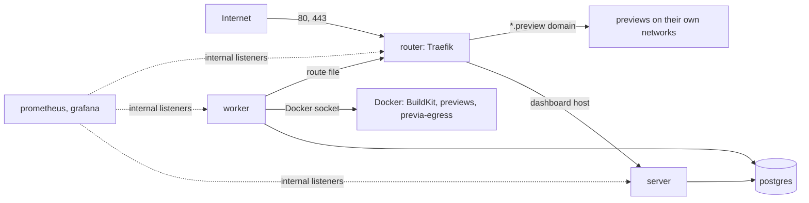

# 24 · Production deployment

How to run Previa on one host as README §4.9 decided: a VPS running Docker, the
control plane in Docker Compose, a wildcard DNS record for previews. It covers
the release images, the host's prerequisites and setup, GitHub and DNS, the
settings, the first start with staged certificates, verification, backups and
restore, upgrades and rollback, CI and releases, and the local staging smoke test
that exercises all of it. Operating it day to day is in
[21](21-mvp-operations.md), [22](22-observability-and-hardening.md) and
[23](23-incident-runbook.md). Nothing in this repository deploys by itself:
publishing images and running them on a real host need an operator with
authority over that host and domain.

## What runs



| Service | Image | Notes |
| --- | --- | --- |
| `postgres` | `postgres:17.11-alpine` (pinned digest) | Volume `postgres`; not published. |
| `migrate` | `previa-server` | Runs `previa-migrate up` (embedded Goose migrations, then River's) and exits; the server and worker wait for it. |
| `server` | `previa-server` | Dashboard, webhooks; no Docker socket; read-only root; reached only through the router. |
| `worker` | `previa-worker` | The only service with the Docker socket (its group is `DOCKER_GID`); source workspaces on volume `sources`; writes `previa-routes.yml`. |
| `router-config` | Traefik image | Writes the dashboard's route into the route directory on every start, then exits. |
| `router` | `traefik:v3.7.13` (pinned) | Ports 80 and 443; previews' wildcard certificate over DNS-01, the dashboard's over TLS-ALPN-01; ACME state on volume `acme`; metrics on the control network only. |
| `egress` | `previa-egress` | Profile `images`: built or pulled with the release, started by the worker. |
| `prometheus`, `grafana` | pinned | Profile `observability`; Grafana on `127.0.0.1:3000` only. |

Release images come from the multi-stage `Dockerfile`: a pinned Go image generates
templates and CSS (Tailwind pinned by checksum) and cross-compiles every command;
the runtime images are distroless, run as UID 65532 and carry a health check
(`previa-server healthcheck`, `previa-worker healthcheck`). Builds are
reproducible: a clean rebuild produced bit-for-bit identical binaries.

```sh
make release-images PREVIA_VERSION=v0.1.0   # previa-server, previa-worker, previa-egress
```

## Fresh host setup

**Host:** Debian 12 or Ubuntu 24.04, 4 vCPU and 8 GiB RAM or more, 80 GiB or more of
disk for Docker (builds need `BUILD_MIN_FREE_DISK`, 15 GiB, free beyond running
builds' budgets), a public IPv4 address. Only SSH, 80 and 443 are open.

**DNS:**

| Record | Points at |
| --- | --- |
| `A previa.example.com` (the dashboard, `APP_BASE_URL`) | the host |
| `A *.preview.example.net` (`PREVIEW_BASE_DOMAIN`, ideally a separate registrable domain) | the host |

A DNS provider API token that can create TXT records in the preview zone (lego's
provider name in `ACME_DNS_PROVIDER`, its variable in `ACME_DNS_CREDENTIAL_VARIABLE`).

**GitHub** ([04](04-github-sign-in-and-app.md)), with the production host instead of
`localhost:8080`:

- OAuth App callback: `https://previa.example.com/auth/github/callback`.
- GitHub App: setup URL `https://previa.example.com/installations/callback` (redirect
  on update), callback URL `https://previa.example.com/installations/authorize/callback`,
  webhook URL `https://previa.example.com/webhooks/github` with a secret, events
  **Pull request**; permissions Contents read, Pull requests write, Checks write
  (Metadata read is automatic).

**Then, on the host, as root, from the release checkout (for example `/opt/previa`):**

```sh
deploy/production/setup.sh
```

It installs Docker Engine (from Docker's repository), age and rclone; enables the
firewall (SSH, 80, 443); creates `/etc/previa` (700), `/var/lib/previa/router`
(owned by 65532) and `/var/lib/previa/backup`; writes `/etc/previa/previa.env`
from `deploy/production/previa.env.example` with generated database, session,
webhook, repository-secrets and Grafana secrets (never overwriting an existing
file); fills in `DOCKER_GID`; and installs the nightly `previa-backup.timer`.
It is idempotent. `shellcheck` passes on every script in `deploy/production`.

**Settings and credential files:**

| File | Owner and mode | Holds |
| --- | --- | --- |
| `/etc/previa/previa.env` | root, 600 | Every setting ([02](02-development-setup.md) lists them). It feeds both Compose interpolation and the containers. Values must be unquoted. |
| `/etc/previa/github-app.pem` | 65532, 600 | The App's private key (read by the server and worker containers; production mode refuses group or other permissions). |
| `/etc/previa/dns-credential` | root, 600 | The DNS token (read by the router through lego's `_FILE` variable). |

Fill in the domains, `APP_BASE_URL`, `PREVIA_DASHBOARD_HOST` (its host), the OAuth
and App values, `PREVIEW_BASE_DOMAIN`, the `ACME_*` settings, and
`BACKUP_AGE_RECIPIENT`/`BACKUP_REMOTE`. Copy `SECRETS_ENCRYPTION_KEYS` and the
age private key to offline storage now: without them a restore cannot decrypt
repository secrets or the backups. `previa-server check-config` and
`previa-worker check-config` validate the file before anything starts:

```sh
dc() { docker compose -f deploy/production/compose.yml --env-file /etc/previa/previa.env "$@"; }
dc --profile images build    # from this checkout; or set PREVIA_*_IMAGE to the published
                             # ghcr.io images and run: dc --profile images pull
dc run --rm --no-deps server check-config
dc run --rm --no-deps worker check-config
```

## First start, with staged certificates

`ACME_CA_SERVER` defaults to Let's Encrypt **staging**.

```sh
dc --profile observability up -d --wait
dc logs router | grep -i acme          # both certificates issued by the staging CA
curl -kI https://previa.example.com/   # 200, with Strict-Transport-Security
```

Once staging issued both certificates, switch to production: set
`ACME_CA_SERVER=https://acme-v02.api.letsencrypt.org/directory`, then

```sh
dc rm -sf router && docker volume rm previa_acme && dc up -d --wait
```

## Verify the deployment

```sh
probe() { docker run --rm --network previa_control curlimages/curl:8.15.0 -fsS "$@"; }
probe http://server:9090/readyz    # {"status":"ready",...,"version":"v0.1.0"}
probe http://worker:9091/readyz    # capabilities: execution, routing, reporting, housekeeping, discovery all true
```

Then in a browser: sign in, link a repository, open a pull request, **Build latest
commit**; the Overview shows every stage **Connected**, the PR gets one comment and
a check run, and `https://<label>.preview.example.net` serves the preview with a
valid certificate. Tear it down from the PR page. Grafana: `ssh -L 3000:127.0.0.1:3000
host`, then `http://localhost:3000` (admin and `GRAFANA_ADMIN_PASSWORD`).
Alerts need an Alertmanager: add one to the Compose file or point
`deploy/observability/prometheus.yml` at an existing one.

## Backups and restore

`deploy/production/backup.sh` (nightly at 02:30 UTC through `previa-backup.timer`):

1. `pg_dump` of the database in custom format (one consistent snapshot);
2. the router's ACME state (account key and certificates);
3. `/etc/previa` (settings, the repository-secrets keyring and the App key).

Each file is encrypted with **age** to `BACKUP_AGE_RECIPIENT` before it leaves the
host, uploaded to `BACKUP_REMOTE` (an rclone remote, or an absolute directory),
and copies older than `BACKUP_RETENTION_DAYS` (30) are deleted. Only after all of
that succeeded does it update `/var/lib/previa/backup/last-success`, which the
server exports as `previa_backup_last_success_timestamp_seconds`;
PreviaBackupStale alerts after 26 hours and a failure also posts to
`BACKUP_FAILURE_WEBHOOK`. Nothing in a backup is readable without the age private
key, which stays offline.

**Restore** (`deploy/production/restore.sh`), into the same or a fresh host after
setup and the settings are in place:

```sh
deploy/production/restore.sh --identity /path/to/age-key.txt --yes previa-20261005T023000Z.dump.age
```

It stops the server and worker, replaces the database from the dump, runs the
migration step (a backup from an older release is brought up to this schema),
starts the worker with `BUILDS_PAUSED=true`, and starts the server. On start the
worker rewrites the route file from the restored table, and housekeeping's
recovery and resource passes reconcile the restored rows with the containers that
actually exist (lost wake-ups recreated, previews whose containers are gone
recorded, orphans cleaned after the grace period). Check `/readyz` and the
Overview, then resume builds with `dc up -d worker`. To restore settings or ACME
state as well, decrypt those files with `age -d -i key` and put them back
before starting.

| | Measured in the local drill |
| --- | --- |
| Backup duration | about 1 s for a small database (it grows with the database) |
| Restore duration (stop, restore, migrate, start paused) | 21 s; the same for a dump two migrations older |
| Data-loss window | everything written after the last backup: at most 24 hours with the nightly schedule. Previews themselves are not data: they are rebuilt from their commits. |

Rehearse a restore on disposable infrastructure before relying on it, and after
every change to the schedule or the remote.

## Upgrades and rollback

**Compatibility boundaries.** Migrations only move forward in production
(`previa-migrate` has no `down`). Every migration is additive and backward
compatible with the previous release's binaries; a release whose migrations are
not says so in its notes and can only be rolled back by restoring. A binary
refuses to start against a schema older than it was built for, and accepts a
newer one.

**Upgrade:**

```sh
systemctl start previa-backup.service                  # a fresh backup first
sed -i 's/^PREVIA_VERSION=.*/PREVIA_VERSION=v0.2.0/' /etc/previa/previa.env
dc --profile images pull     # published images; or `dc --profile images build` from the new checkout
dc up -d --wait              # migrate runs first; server and worker restart; running builds resume
probe http://server:9090/readyz
```

**Rollback:** set the previous `PREVIA_VERSION` and `dc up -d --wait` (the newer,
compatible schema stays). If the release notes say its migrations are not
backward compatible, restore the backup taken before the upgrade instead.

Both directions are rehearsed by the smoke test below.

## CI and releases

- `.github/workflows/ci.yml` on every push and pull request: tidy modules,
  generated code current, build, `go vet` and golangci-lint, govulncheck,
  migrations, the race-enabled test suite against PostgreSQL, alert and dashboard
  checks; browser regressions; release images built and scanned by Trivy (fixable
  HIGH/CRITICAL fail the build). The real Docker, BuildKit, Traefik and end-to-end
  suites plus the production smoke test run only for code already in the
  repository: pull requests from forks never get the runner's Docker daemon, and
  CI uses no secrets.
- `.github/workflows/release.yml` on a `v*.*.*` tag, in the protected `release`
  environment (configure required reviewers): GoReleaser builds the binaries,
  archives (with docs and deploy files), checksums and SBOMs into a **draft**
  release; multi-architecture images (linux/amd64, linux/arm64) with provenance and
  SBOM attestations go to `ghcr.io/<owner>/previa-{server,worker,egress}`. A
  maintainer publishes the draft; nothing deploys automatically.
- Validated locally: actionlint passes on both workflows; `goreleaser check`
  passes and a snapshot build succeeds.

## Local staging smoke test

`make prod-smoke PREVIA_VERSION=<tag>` (after `make release-images`) runs the
production Compose file with `compose.smoke.yml` under the project `previa-smoke`
and removes everything afterwards. Only what a workstation lacks changes: ports
move to 127.0.0.1:18080/18443 (Grafana 13000), the ACME server is unreachable so
certificates are Traefik's default (issuance is proven by `make test-routing`),
and the GitHub App is off. Install `age` for the backup drill; set
`SMOKE_OLD_DUMP` to a `pg_dump -Fc` file from an older release to also rehearse
restoring and upgrading it; `SMOKE_KEEP=1` leaves the stack for inspection on
failure. It checks, in order:

- every service healthy in about 20 s, migrations applied once, the route file
  written;
- through the router over HTTPS: the dashboard, its security headers (nonce CSP,
  HSTS, framing refused), a spoofed `X-Forwarded-Host` replaced by the trusted
  router, unknown preview hosts sent to the unavailable page, sign-in rate
  limited, internal listeners not published;
- inside the control network: server and worker readiness with version and
  capabilities, build info and state gauges, Prometheus scraping all three
  targets, 24 alert rules loaded, the Grafana dashboard provisioned;
- hardening: UID 65532, read-only roots, no capabilities, no Docker socket in the
  server, PostgreSQL not published;
- a server restart and a graceful worker stop (drained, exit 0) and start;
- an upgrade to a new image tag and a rollback;
- the backup and restore drill: encrypted backup, the server exporting its time,
  restore with migration and a paused worker, rows from before the backup back
  and rows written after it gone (the data-loss window), and optionally an
  older-schema dump restored and upgraded.

The run for this release passed all 43 checks, including restoring a dump at
migration 16 and upgrading it to 18 ([25](25-release-report.md)).

## Security notes

- The worker's Docker socket is root-equivalent on the host. This is the accepted
  design (only the worker builds and runs previews); keep the host dedicated to
  Previa and the worker's image from this repository.
- Previews run hardened, without the socket, on their own networks, with egress
  only through `previa-egress` ([10](10-preview-runtime.md)). gVisor
  (`PREVIEW_OCI_RUNTIME=runsc`) adds a kernel boundary if the threat model needs it.
- The internal listeners, Prometheus and the router's metrics are on the control
  network; previews cannot reach them. Grafana listens on loopback only.
- The dashboard's session cookie is host-only and `__Host-`; keep previews on a
  separate registrable domain.
