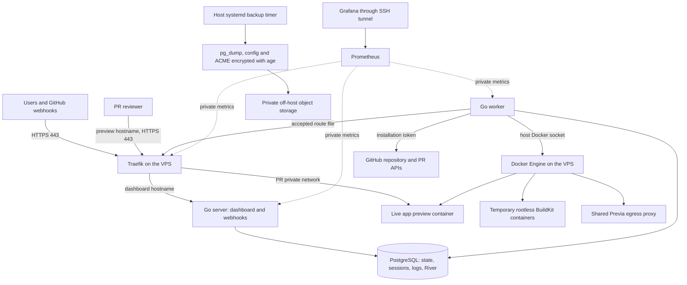

# 25 · Production deployment

Use **one OVHcloud VPS (model VPS-2) running Ubuntu 24.04, Docker Engine and
Docker Compose**, **PostgreSQL 17 in Docker on that VPS**, **Cloudflare R2 for
encrypted off-server backups**, and **Cloudflare DNS** for the dashboard and
preview domains. The Go server, Go worker, Traefik, Prometheus and Grafana run on
the VPS. The worker creates build containers and live PR preview containers
on that same Docker host. This is the production arrangement described throughout
this guide; infrastructure has not been provisioned by writing these instructions.
It costs about €7 a month (excluding VAT) plus domains while traffic is low;
[Choosing a host and keeping costs low](#choosing-a-host-and-keeping-costs-low)
explains the choice and how the steps translate to other providers.

Rent the VPS once. **A new PR creates Docker containers, not a new server or a
separate VM.** The application runs unattended after SSH disconnects. R2 holds
backup files; the live PostgreSQL database stays on the VPS.

This follows [README §4.9](../README.md#49-infrastructure-and-deployment),
[DESIGN](../DESIGN.md), and the actual files in `deploy/production`. It describes
what exists, the manual steps an operator must perform, and the additions needed
if you choose a different database or automated deployment. **A commit to `main`
does not deploy Previa. A release tag publishes artifacts; the operator deploys
them.**

The [release report](26-release-report.md) records local evidence and pending live
checks. It does not establish that a real production host is already running.
Examples below use reserved example domains and illustrative version tags;
replace them with your domains and an existing, tested release. Run commands one
step at a time and stop when a check fails.

## Contents

- [Deployment platform and external services](#deployment-platform-and-external-services)
- [Choosing a host and keeping costs low](#choosing-a-host-and-keeping-costs-low)
- [Account safety: abuse reports](#account-safety-abuse-reports)
- [OVHcloud account, VPS, firewall and SSH setup](#fresh-host-setup)
- [What runs](#what-runs)
- [First start, with staged certificates](#first-start-with-staged-certificates)
- [Verify the deployment](#verify-the-deployment)
- [Monitor live traffic, jobs and containers](#monitor-live-traffic-jobs-and-containers)
- [Host CPU, memory and disk](#watch-the-hosts-cpu-memory-and-disk)
- [External uptime checks](#configure-an-external-uptime-check-for-https-and-certificates)
- [Backups and restore](#backups-and-restore)
- [OVHcloud backups and snapshots](#step-b7--optional-ovhcloud-backups-and-snapshots)
- [Upgrades and rollback](#upgrades-and-rollback)
- [VPS upgrades, billing and ongoing operations](#ovhcloud-capacity-billing-and-ongoing-operations)
- [CI and releases](#ci-and-releases)
- [Local staging smoke test](#local-staging-smoke-test)
- [Security notes](#security-notes)
- [Files behind these instructions](#files-behind-these-instructions)

For the first deployment, complete Steps 0–6, including backup-key/R2 setup
B1–B3; then run Steps 7–10. B4 needs the running PostgreSQL/router and makes the
first actual backup. Configure host checks, uptime checks and application
notifications, rehearse
B5/B6 on isolated staging, then accept live traffic. Later releases use U1–U5
and the rollback paths, rather than repeating the first-time certificate reset.

## Deployment platform and external services

### The deployment to use for this implementation

The selected arrangement is **an OVHcloud VPS + Docker Compose + local PostgreSQL
+ Cloudflare R2**, with Cloudflare as authoritative DNS. OVHcloud supplies the
Linux server; Cloudflare supplies DNS and off-site backup storage; Previa manages
Docker previews. This preserves the single-VPS design in README/DESIGN and uses
the existing production scripts without adding a new runtime.

| Piece | Where it lives | Why it is needed |
| --- | --- | --- |
| VPS | One OVHcloud VPS dedicated to Previa: VPS-2 (4 vCores, 8 GB RAM, 75 GB NVMe) | Provides a persistent Linux host, Docker socket, local disk, private Docker networks, and public ports 80/443. Dedicated to Previa means do not colocate unrelated sensitive workloads; upgrade the model according to measured load. |
| Production PostgreSQL | `postgres` container on the VPS; Docker volume `previa_postgres` | Stores application state, sessions, encrypted repository secrets, build logs, durable operations, and River jobs. |
| Dashboard and API | `server` container on the VPS | Serves the UI, sign-in, repository controls, signed webhooks and live updates. |
| Background processing | `worker` container on the VPS | Runs River queues and creates builds, previews, routes, reports and cleanup. |
| Public routing and certificates | `router` container on the VPS | Traefik terminates HTTPS and forwards each hostname to its correct backend. |
| DNS | Cloudflare account and authoritative zones | Dashboard and wildcard preview records point to the VPS; the router uses a scoped token for DNS-01 certificate challenges. |
| GitHub integration | Separate GitHub OAuth App and GitHub App | OAuth signs people in; the App grants repository access, receives webhooks and posts PR feedback. |
| Release artifacts | GitHub Releases and GitHub Container Registry (GHCR) | Stores versioned binaries and the three Previa images. GitHub runners build them, then finish. |
| Backup destination | Private Cloudflare R2 bucket, outside the VPS and outside OVHcloud | Holds encrypted database, configuration and certificate archives through the S3-compatible API; survives loss of the VPS, and of the OVHcloud account. |
| Monitoring | Prometheus and Grafana on the VPS | Scrapes metrics, evaluates alert rules and provides the Previa dashboard. |
| Host resources | `free`, `df` and `docker stats` on the VPS | Overall CPU, memory and disk use, independently of Previa's application metrics. OVHcloud sends no alerts about them. |
| Public uptime | An external uptime service and its notification | Checks HTTPS from outside the VPS, including when monitoring containers on it are unavailable. |
| Alert delivery | Operator-configured Alertmanager and receiver | Sends firing alerts to your email, chat or incident service; this is not supplied as a running service by the base Compose file. |
| Backup encryption key | Private age identity in offline recovery storage | Decrypts backups during a restore; only its public recipient is needed on the VPS. |

There is no separate frontend deployment: templates and static browser assets are
compiled/generated and embedded into `previa-server`. Production does not need a
Node server, Vercel, Netlify or Air. There is no Redis service for Previa's queue:
River uses the same PostgreSQL database. There is no Kubernetes cluster, remote
BuildKit service, or production Terraform configuration in the repository.

Provider references: [OVHcloud VPS](https://www.ovhcloud.com/en-ie/vps/),
[getting started with a VPS](https://docs.ovhcloud.com/en/guides/bare-metal-cloud/virtual-private-servers/starting-with-a-vps)
and [Cloudflare R2](https://developers.cloudflare.com/r2/). Prices change
(OVHcloud raised VPS prices in 2026), so check current ones rather than copying a
figure from this guide. Budget for the VPS subscription, optional OVHcloud backup
options, R2 storage beyond its free allowance, an uptime service, domains and
alert receivers. Containers share the rented VPS; they consume its capacity
rather than creating a per-PR VM bill.

### Docker previews, the VPS and the deployment boundary

An **OVHcloud VPS is the one rented Linux VM**. A **Docker image** packages the
app, and a **Docker container** runs that image as isolated processes sharing the
VPS's kernel. Previa creates one serving app container per PR, plus temporary
builders and replacement candidates. The total can briefly exceed the number of
active PRs during builds and swaps.

The production worker controls the VPS's Docker daemon through its socket.
Preview containers are siblings of server/worker/PostgreSQL, not children nested
inside the worker container. They receive separate private networks and limits;
only Traefik publishes HTTP/HTTPS. All visits to a preview consume this VPS's
CPU/network resources.

Use one **OVHcloud VPS** for this guide. Kubernetes, a provider container
registry, a load balancer and a VM per preview are not parts of the supplied
deployment. Published platform images remain in GHCR; built PR images remain on
this Docker host. CPU/RAM growth requires upgrading the VPS model or a separately
implemented multi-host architecture.

### Why PostgreSQL on the VPS, not a managed database?

The chosen production DB is the Compose **PostgreSQL 17 service**, not a managed
database. Compose starts it, migrations target it, and the shipped backup/restore
scripts operate on it. OVHcloud hosts the VPS, while you maintain PostgreSQL
updates, storage, backups and recovery. Do not create a managed database just to
follow these commands.

A managed PostgreSQL service can reduce database operations later, but adopting it
needs a separately implemented and tested deployment change. Changing
`DATABASE_URL` alone leaves the current Compose dependencies and scripts targeting
the local DB.

If choosing that future architecture, the required work is:

1. Create a compatible database close to the VPS, in the same region. Restrict
   access to the VPS's address, require TLS with the provider's CA, and verify
   TLS/hostname checks from server, worker and migration containers.
2. Verify migrations, River, connection lifetimes, advisory locks and PostgreSQL
   `LISTEN/NOTIFY` on the chosen endpoint. The server uses a dedicated LISTEN
   connection. Do not assume a transaction-pooling URL provides session semantics;
   choose an appropriate direct or session-compatible connection and test it.
3. Change Compose's local `postgres` dependencies and the migration lifecycle.
   Otherwise it still creates and waits for an unused local database.
4. Replace the database portions of backup and restore. `backup.sh` explicitly
   dumps `dc exec postgres ... -d previa`; `restore.sh` explicitly drops and
   recreates that local database. They do not follow an external `DATABASE_URL`.
5. Define the provider's backup retention, restore/PITR procedure, database roles,
   upgrade compatibility, recovery objective and monitoring. Continue backing up
   `/etc/previa` and ACME state separately; a managed DB backup contains neither.
6. Rehearse a complete restore and a rollback before switching live traffic.

Those changes are not implemented by this documentation update. A managed
database is a separate resource, with a separate bill and recovery procedure;
replacing the VPS does not perform a managed-DB restore. For the commands below,
use the provided **PostgreSQL 17 Compose service**. PostgreSQL for each
*previewed application* is a different matter: backend previews
([11](11-backend-previews.md)) start a fresh PostgreSQL and Redis per candidate as
sibling containers on that PR's own internal network, inside the preview budget.
Previa's own production database is never a database that an untrusted preview may
connect to.

### What to create, and where to configure it

| Item | Exact configuration location | How it connects to Previa |
| --- | --- | --- |
| Account, VPS model, location, image and SSH public key | OVHcloud website and [Control Panel](https://www.ovh.com/manager/) | Supplies the host; source/scripts are installed at `/opt/previa` over SSH. |
| Firewall | `setup.sh`'s UFW on the VPS; optionally Control Panel → **Network → Public IP Addresses → Configure Edge Network Firewall** | Allows inbound SSH/80/443 only. This is separate from Docker's per-PR isolation. |
| Host checks | `free`, `df` and `docker stats` on the VPS | CPU, memory and disk use; OVHcloud sends no resource alerts. |
| External HTTPS checks | An external uptime service | Checks the public dashboard and a maintained preview from outside the host. |
| Private backup bucket and API token | Cloudflare → **R2 Object Storage** | Root's `rclone` uploads encrypted archives using a token scoped to the bucket. |
| Dashboard and wildcard preview records | Cloudflare authoritative zones | Both resolve to the VPS's public IPv4. |
| DNS certificate credential | Cloudflare token settings, then `/etc/previa/dns-credential` on the VPS | Traefik mounts it as a file for DNS-01. |
| OAuth App and GitHub App | GitHub → Settings → Developer settings | Their IDs/secrets go in `/etc/previa/previa.env`; App PEM goes in `/etc/previa/github-app.pem`. |
| Application/release/runtime settings | `/etc/previa/previa.env` on the VPS | Compose reads this explicitly; there is no provider panel for application settings to populate. |
| Backup storage key/secret | Root's protected rclone configuration on the VPS | Not Go application settings; retain a recovery copy separately. |
| Backup private age identity | Offline recovery storage | Temporarily brought to a recovery host only when decrypting. |
| User repositories' preview secrets | Previa → repository → Secrets | Encrypted in PostgreSQL; distinct from the platform's production credentials. |
| Release environment and package access | GitHub repository Settings / Actions / Packages | Protects artifact publication; does not provision or update the VPS. |

The manual Control Panel route requires no OVHcloud API credentials in Previa or
GitHub Actions. The R2 token, your SSH private key, the Cloudflare DNS token and
GitHub App credentials have different purposes and are not interchangeable; keep
the R2 token and the DNS token separate even though both come from Cloudflare.
Only a future OVHcloud API automation needs scoped provider credentials.

## Choosing a host and keeping costs low

This guide uses OVHcloud: the lowest price found for a reliable 8 GB host, with
unlimited traffic, a daily backup and anti-DDoS protection included. This section
records why, what any host must provide, and how the steps translate if you choose
another provider.

### What the host must provide

Previa cannot run on a platform-as-a-service (Render, Railway, Heroku, Fly.io apps,
Cloud Run): the worker needs a Docker daemon it
controls, private Docker networks, rootless BuildKit builders and Traefik on ports
80 and 443. Any provider that rents a plain Linux VM works:

| Requirement | Why |
| --- | --- |
| Ubuntu 24.04 or Debian 12 with root access (directly or through `sudo`) | `setup.sh` supports these and installs Docker Engine. |
| x86-64 (arm64 also works) | All images are published for both. On arm64, users' Dockerfiles also build for arm64, which a few apps do not support, and CI does not test arm64 hosts. |
| A public IPv4 with inbound 80 and 443 (and 22 for you) | HTTPS for the dashboard and previews, GitHub's webhooks, and the dashboard certificate's TLS-ALPN-01 challenge. |
| Unprivileged user namespaces | Rootless image builds; `setup.sh` enables them on Ubuntu 24.04. |
| At least 4 vCPU, 8 GiB RAM and 75 GiB disk | One build at a time plus a few previews, with the [starter settings](#starter-settings-for-a-small-host). |
| Off-host storage for backups | This guide uses Cloudflare R2; any S3-compatible bucket works through rclone. |
| DNS with an API that [lego](https://go-acme.github.io/lego/dns/) supports | The wildcard preview certificate (DNS-01). Cloudflare's free plan works. |

### Providers compared

Monthly prices for the plans nearest 4 vCPU / 8 GiB, checked in October 2026,
excluding VAT. Providers change prices and plans, so check before you buy.

| Provider | Plan | vCPU / RAM / disk | Price | Notes |
| --- | --- | --- | ---: | --- |
| [OVHcloud](https://www.ovhcloud.com/en-ie/vps/) | VPS-2 | 4 / 8 GB / 75 GB NVMe | €7.21 | **This guide's host.** Unlimited traffic, a daily backup and anti-DDoS included. Monthly subscription. European locations at this price; others are priced separately. |
| OVHcloud | VPS-3 | 6 / 12 GB / 100 GB | €10.40 | The first upgrade when builds queue or previews wait. |
| OVHcloud | VPS-4 | 8 / 24 GB / 200 GB | €19.96 | For real traffic. |
| OVHcloud | VPS-1 | 2 / 4 GB / 40 GB | €3.81 | Only to try Previa out: see [Minimum host](#minimum-host). |
| Contabo | Cloud VPS 10 | 4 / 8 GB / 75 GB | about €4.50 | Cheapest, but slower and weaker on uptime and support in independent tests. |
| [Vultr](https://www.vultr.com/pricing/) | Regular, 8 GB | 4 / 8 GB / 160 GB | $40 | More regions; polished, but about five times the price. |
| Akamai (Linode) | Shared, 8 GB | 4 / 8 GB / 160 GB | $48 | Mainstream, but about six times the price. |
| Oracle Cloud | Always Free, Ampere A1 | 2 Arm OCPU / 12 GB (free-tier accounts, since June 2026) | $0 | **Not recommended.** Oracle may reclaim an Always Free instance whose CPU, network and memory use stay under 20% for 7 days, which describes a Previa nobody uses yet. |

**This guide's setup:** OVHcloud VPS-2, Cloudflare's free DNS, and Cloudflare R2
for backups (free up to 10 GB): about **€7 a month** plus two domains at roughly
$10–15 a year each. Upgrade to a VPS-3 or VPS-4 when builds queue or previews wait
for capacity. Every host acts on abuse reports, so [Account safety](#account-safety-abuse-reports)
matters more than the choice of host.

### On another provider

Everything from [Step 3](#step-3--install-the-checkout-and-prepare-the-host) on is
provider-neutral: `setup.sh`, Compose, certificates, backups through rclone,
upgrades and restores. Only the provider's console steps differ:

| In this guide (OVHcloud) | On another provider |
| --- | --- |
| Order a VPS-2 (Step 1); log in as `ubuntu` | Create a VM that meets the requirements above, with your SSH key. Many providers' Ubuntu images log in as `root`; create the `ops` user from there the same way. |
| UFW, optionally the Edge Network Firewall | UFW as here, plus the provider's firewall if it has one (usually stateful) with inbound SSH/80/443 only. |
| Update DNS when replacing the VPS | The same, or a provider address that survives replacing the VM (often called a reserved, floating or primary IP). |
| R2 bucket and token (B2, B3) | Unchanged: R2 works with any host. Or the provider's S3-compatible storage through rclone. |
| Host checks and an external uptime check | The same checks, plus the provider's monitoring if it offers any. |
| Included daily backup and snapshot (B7) | The provider's backups and snapshots, if offered and at its price. |
| Upgrade the model | The provider's resize; plan an outage the same way. |

### Starter settings for a small host

These are the settings for this guide's VPS-2 (4 vCores / 8 GB / 75 GB) while
traffic is low. Set them in `/etc/previa/previa.env` at Step 5:

```dotenv
MAX_CONCURRENT_BUILDS=1
BUILD_CPUS=2
BUILD_MEMORY=2GiB
BUILD_DISK_BUDGET=10GiB
BUILD_MAX_IMAGE_SIZE=2GiB
BUILD_MIN_FREE_DISK=10GiB
BUILD_CACHE_BUDGET=10GiB
PREVIEW_MEMORY_BUDGET=4GiB
PREVIEW_CPU_BUDGET=4
PREVIEW_MAX_PER_REPOSITORY=2
ENV_TTL_HOURS=24
# A server shared by several accounts:
BUILDS_PER_ACCOUNT=1
PREVIEW_MAX_PER_ACCOUNT=4
BUILD_MINUTES_PER_ACCOUNT_DAY=120
PREVIEW_IDLE_SLEEP=3h
```

These are in `deploy/production/previa.env.example`. At start, the worker compares
them with the host and logs `capacity settings exceed this host` with what does not
fit (memory for builds, previews and about 1 GiB for Previa; CPUs; Docker's disk).

- **Previews:** a replacement must fit beside the preview it replaces. 4 GiB holds
  one backend preview with PostgreSQL and Redis (about 1.75 GiB) and its
  replacement, or a few web previews. When the budget is full, new work waits
  instead of failing, so a small host is slow, not broken.
- **Builds:** one 2 GiB build at a time. Raise `BUILD_MEMORY` if large frontend
  builds run out of memory.
- **Sharing:** one build at a time per account, four previews and two build hours
  a day each, and waiting builds take turns by account, so one busy user cannot
  hold the server ([17](17-build-scheduling.md#fair-sharing-between-accounts)). Set
  them to `0` when the server is yours alone.
- **Idle previews** sleep after 3 hours without a visit and wake on the next one
  in seconds, which frees most of their memory
  ([10](10-preview-runtime.md#idle-previews-sleep)).
- **Docker logs:** each preview container keeps at most 2 × 5 MB of output; a
  backend preview with services and processes keeps about 50 MB at most.
- **Control plane:** PostgreSQL, the server, the worker and the router have 4 GiB
  of limits between them but use about 1 GiB while idle. Leave out the
  `observability` profile (Prometheus and Grafana, up to 1.5 GiB) on this host:
  use the [Step 7](#step-7--define-the-production-commands-and-obtain-images) `dc`
  without it, and rely on the backup-failure webhook and an external uptime check
  until you add it.
- **Swap:** add a 4 GiB swap file as a cushion against short memory peaks:

  ```sh
  fallocate -l 4G /swapfile && chmod 600 /swapfile
  mkswap /swapfile && swapon /swapfile
  echo '/swapfile none swap sw 0 0' >> /etc/fstab
  ```

Watch `free -h`, `docker stats` and the waiting reasons on **Builds**; when previews
or builds wait often, upgrade to a VPS-3 or VPS-4 and use the larger settings in
Step 5.

### Minimum host

A 2 vCore / 4 GB / 40 GB host (OVHcloud VPS-1) can run Previa for small apps, such
as static sites and light APIs whose previews use `resource_tier: small`. Use the
starter settings with `BUILD_MEMORY=1536MiB`, `PREVIEW_MEMORY_BUDGET=1GiB`,
`PREVIEW_CPU_BUDGET=1`, `BUILD_DISK_BUDGET=5GiB`, `BUILD_MAX_IMAGE_SIZE=1GiB`,
`BUILD_MIN_FREE_DISK=5GiB` and `BUILD_CACHE_BUDGET=5GiB`. Typical Node.js builds
and backend previews with services do not fit; treat it as a trial host.

### Paying nothing while it is unused

An OVHcloud VPS is a monthly subscription: it is billed whether it runs or not,
and stops costing only when you terminate it in the Control Panel (check the
termination date it shows). To pause Previa for months, take a final R2 backup,
terminate the VPS, and later order a new one and restore it with
[Step B6](#step-b6--recover-configurationcertificates-or-replace-the-whole-vps);
its address will change, so update both DNS records. Running Previa on a machine
at home behind a tunnel is not supported as shipped: the dashboard certificate
and GitHub's webhooks need inbound HTTPS to the router.

### Account safety: abuse reports

Previa builds code from pull requests and serves it publicly from your VPS. If a
preview hosts a phishing page or malware, or its app floods other sites through
the egress proxy, the abuse reports go to your host, about your server. Every
host acts on them: it forwards the report, expects an answer by a deadline, and
can block the address or end the contract when abuse is unanswered or repeated.
Keep that from happening:

- Pull requests from forks never build by themselves, even on **Automatic**: they
  wait until you click **Build**
  ([16](16-build-policy-and-intents.md#behaviour-rules)). Click it only after
  reading the changes. Forks never get secrets or outbound connections, but once
  built they get a public preview (or switch on **Private previews**).
- Consider `BUILD_EGRESS=registries`: builds then reach only package and image
  registries ([09](09-image-builds.md#build-traffic-and-the-registries-only-mode)).
  `PreviaBuildHeavyUpload` alerts on a build that uploads a lot.
- Keep `ENV_TTL_HOURS` short so a bad preview does not stay up for long, and tear
  down anything suspicious at once (PR page → **Tear down preview**).
- Use an email address on the host account that you read every day, and answer
  abuse notices before their deadline: say that the content was a pull-request
  preview and that it has been removed.
- Keep previews on their own registrable domain (as Step 2 does), so a
  blocklisted preview domain does not take the dashboard with it.
- While you investigate repeated abuse, stop new builds with `BUILDS_PAUSED=true`
  ([24](24-incident-runbook.md#execution-kill-switch)).

## What runs

### Traffic and execution paths



A dashboard request passes through Traefik to the Go server. A request to a
published preview passes through Traefik directly to that app's container; the Go
server and worker do not sit in that preview request path. A webhook records
state/authorized work in PostgreSQL and returns; River executes the work later.

### Compose services

All these services run on the **same OVHcloud VPS**. Third-party
infrastructure images in the current Compose file are pinned by digest; the
version names below identify them. Keep those pinned references. Previa's own
images use the selected release tag; record their resolved digests during an
upgrade so the exact previous artifacts can be identified.

| Service | Image / executable | Lifetime and responsibilities | Public exposure |
| --- | --- | --- | --- |
| `postgres` | `postgres:17.11-alpine` | Persistent PostgreSQL 17 database; healthchecked; stores data in `previa_postgres`. | No host port; `postgres:5432` on the control network only. |
| `migrate` | Previa server image, `previa-migrate up` | One-shot Goose migrations followed by River migrations. Exit 0 is success. Server/worker wait for it. | None. |
| `server` | `previa-server:<release>` | Persistent Go HTTP process. Has no Docker socket. Read-only root, UID 65532, temporary `/tmp`. | Internal HTTP `8080`; reached publicly through Traefik. Health/metrics `9090` stay private. |
| `worker` | `previa-worker:<release>` | Persistent Go River worker, not an HTTP app serving users. Only service with the Docker socket; has source and routing storage. | Health/metrics `9091` stay private. |
| `router-config` | Pinned Traefik image, shell command | One-shot writes `previa-dashboard.yml` before the router starts. Exit 0 is success. | None; no network. |
| `router` | `traefik:v3.7.13`, container `previa-router` | Persistent HTTPS proxy; watches dashboard and preview route files; renews certificates. No Docker socket. | Host TCP `80` and `443`; metrics `8082` on control network; API/ping `8080` on its own loopback. |
| `egress` | `previa-egress:<release>` | Image staging service under profile `images`. Use it to **pull or build the image**, not to run the production proxy. | Do not start this Compose service. |
| `prometheus` | `prom/prometheus:v3.5.0` | Optional `observability` profile; scrape/evaluation every 30 seconds, 30-day local metrics retention. | `prometheus:9090` private; no host port. |
| `grafana` | `grafana/grafana:12.1.1` | Optional `observability` profile; provisioned Prometheus datasource and Previa dashboard. | Host `127.0.0.1:3000`, accessed over SSH. |

The `server`, `worker` and `egress` release images come from the multi-stage
[Dockerfile](../Dockerfile). Runtime images contain static Go binaries; server and
worker use distroless images without a shell. Use their `healthcheck` and
`check-config` commands, not `docker exec ... sh`. The server image also contains
`previa-migrate` and `previa-secrets-reencrypt`; the worker image contains
`previa-route-sync` and `previa-housekeeping`. These maintenance commands are
run on demand, not deployed as additional always-running processes.

### Containers created by the worker

These are **sibling containers on the host's Docker daemon**, not nested
containers inside `worker`. They do not appear in `dc ps`, because Compose did
not create them. Use `docker ps` and their labels to inspect them.

| Object | Created by / lifetime | What it does |
| --- | --- | --- |
| `previa-egress` container and network | Worker startup; shared and persistent | Runs the Previa proxy and readiness prober. Attached to build/preview networks; permits proxy traffic to public addresses, forwards owner-approved outbound connections, and blocks private/control-plane/metadata addresses. Requires its image to be downloaded beforehand; the worker replaces it when that image changes (see U4). |
| Rootless BuildKit builder | A build attempt; removed afterwards | Fetches public base images/dependencies through the proxy, executes Dockerfile steps, builds the preview image. Its cache may persist in a labelled Docker volume. |
| Build network | A build attempt; removed afterwards | Internal bridge network containing the builder and attached egress proxy. |
| Preview image | A successful Dockerfile build | Kept in the VPS's Docker image store, not uploaded to GHCR by the PR build pipeline. |
| App preview container | A successful build; lives until replacement, teardown or expiry | Runs the app with bounded CPU/memory/PIDs, its configured internal port and appropriate repository secrets. No Docker socket or published host ports. |
| PR preview network | That PR's preview lifecycle | Internal bridge shared by that PR's candidates, Traefik and the egress proxy. Other PRs and the control plane are not attached. |
| Backend preview services | Each candidate of a PR whose `.previewrc.yaml` declares `services`; removed with it | A fresh PostgreSQL and/or Redis per candidate, data on tmpfs (lost on rebuild), generated credentials. Never restarted: a crashed service fails that candidate. |
| Setup and process containers | Each candidate that declares `setup` or `processes` | The app's image running the setup command once before the app starts, and up to three extra processes (such as a queue worker) beside it. |
| PR services network | That PR's backend previews | Internal bridge joined only by the PR's candidates and their services: no egress proxy, no router. |

The preview config `.previewrc.yaml` points at a Dockerfile and the app's internal
port. It is not a file for deploying Previa's own control plane. A preview must
pass readiness before a route is published. A successful rebuild switches the
accepted route to the new candidate; a failed rebuild leaves the old serving
preview in place. Close/merge and explicit teardown remove routes/resources
through durable operations. Expiry and housekeeping provide additional cleanup.

### Persistent storage and networks

| Location | Contents | Included in the shipped backup? |
| --- | --- | --- |
| `/opt/previa` | Checkout of the exact release; scripts, Compose and monitoring definitions | Recover from GitHub/release artifacts. Keep this path stable: the systemd backup service references it. |
| `/etc/previa/previa.env` | Production settings and generated/application credentials | Yes, encrypted configuration archive. |
| `/etc/previa/github-app.pem` | GitHub App private key | Yes, encrypted configuration archive. |
| `/etc/previa/dns-credential` | DNS API token | Yes, encrypted configuration archive. |
| `/var/lib/previa/router` | `previa-dashboard.yml` and worker's `previa-routes.yml` | No; regenerated from config and accepted database routes. |
| `/var/lib/previa/backup/last-success` | Backup success timestamp read by the server | No; the next complete backup recreates it. |
| Docker volume `previa_postgres` | PostgreSQL data files | Logical database dump, not a raw copy of the live volume. |
| Docker volume `previa_acme` | Let's Encrypt accounts, keys and certificates | Yes, encrypted ACME archive. |
| Docker volume `previa_sources` | Temporary exact-commit source workspaces | No; refetched from GitHub. |
| Docker volume `previa_baselines` | Encrypted test-data baselines (`PREVIEW_BASELINE_DIR`, [32](32-persistent-test-data.md)) | No: derived data, rebuilt from each repository's baseline branch on the next refresh. Their records are in the database; a missing file is marked missing and rebuilt. |
| Labelled build cache volumes and local preview images | Rebuildable build artifacts | No. |
| `previa_prometheus`, `previa_grafana` volumes | Metrics history and Grafana state | No; datasource/dashboard provisioning can be recreated, but local history/customizations are lost unless separately backed up. |
| Root's rclone and Docker login configuration | Storage credentials and optional private-registry login | Not by default: these live outside `/etc/previa`. Store recovery copies separately. |

Docker volumes normally live under the daemon's data root (`/var/lib/docker` on
the expected host). Confirm with `docker info --format '{{.DockerRootDir}}'`;
do not assume they live inside `/opt/previa` or on GitHub. Keeping volumes across a
container recreation preserves their data; deleting the VPS or its disk does not.

Compose uses project name `previa`, control network `previa_control`, subnet
`172.31.250.0/24`, router address `172.31.250.10` and server address
`172.31.250.20`. Verify this subnet does not conflict with the VPS's private
network/VPN. These addresses also occur in the dashboard route and trusted-proxy
configuration; changing only the subnet is insufficient.

## Fresh host setup

### Step 0 — Prepare the OVHcloud account and record deployment inputs

1. Create an OVHcloud account on the website for your region (the European site
   prices in euros). OVHcloud may ask for identity documents before activating
   services; allow time for that. Turn on two-factor authentication in the
   [Control Panel](https://www.ovh.com/manager/) and keep its recovery codes. Use a
   separate VPS for staging, first-deployment and restore drills.
2. Have an SSH key on your administration workstation; the private key stays on
   your workstation. For a new key, use an unused output filename and a
   passphrase:

   ```sh
   ssh-keygen -t ed25519 -a 100 -f ~/.ssh/previa_ovh_ed25519 -C previa-admin
   cat ~/.ssh/previa_ovh_ed25519.pub
   ```

3. Have access to the dashboard domain and a separate preview domain, a
   Cloudflare account for their DNS and for R2, GitHub App/OAuth settings, the
   repository and a tested release. Domains are purchased through a registrar;
   ordering a VPS does not register a domain or configure GitHub.
4. Record the following **non-secret** inventory in your operations notes.
   Keep secret values separately in a password manager/recovery store:

   | Input | Example / what to record |
   | --- | --- |
   | VPS | Service name (`vps-xxxxxxxx.vps.ovh.net`), model (`VPS-2`) and the name you give it, such as `previa-prod-01` |
   | Location | Actual datacenter, such as Gravelines, Frankfurt or Warsaw |
   | Public endpoint | Actual public IPv4 |
   | Admin source | Your current public administration IP/CIDR for SSH rules |
   | Dashboard | `previa.example.com` |
   | Preview domain | `preview.example.net`; wildcard `*.preview.example.net` |
   | Backup bucket | R2 bucket name, represented below by `YOUR_BUCKET` |
   | R2 endpoint | `https://<ACCOUNT_ID>.r2.cloudflarestorage.com` for your Cloudflare account |
   | Release | Existing tested tag and exact Git commit; never assume an example tag exists |
   | Receiver/recovery contacts | Monitored email, alert destination and recovery owner |

Use the same concrete values throughout this guide. `YOUR_BUCKET`,
`YOUR_SERVER_IP`, domain names and version examples are placeholders.
Never substitute an R2 URL for the database hostname.

### Step 1 — Choose the host and release

On the OVHcloud website, open **VPS**, choose **VPS-2** and configure the order with
these choices; labels can change, the actual values are what matter.

| Order choice | Value / reason |
| --- | --- |
| Model | **VPS-2** (4 vCores, 8 GB RAM, 75 GB NVMe). |
| Location | The datacenter nearest your users. European locations (Gravelines, Roubaix and Strasbourg in France, Frankfurt, Warsaw, London) have this guide's price; Beauharnois, Vint Hill, Hillsboro, Singapore, Sydney and Mumbai are priced separately. Keep PostgreSQL, the worker and previews on this one VPS. |
| Image | **Ubuntu 24.04**, the plain distribution without preinstalled applications. `setup.sh` prepares it. |
| SSH key | The public key from Step 0, if the order asks for one; otherwise OVHcloud emails a password for the `ubuntu` user and the first login below adds the key. |
| Backup | The included daily backup is enough; the paid options are optional. It does not replace Previa's encrypted backups; see B7. |
| Commitment | Monthly to start; a longer commitment costs less once you know you will keep it. |
| Quantity | **One** VPS. Previa creates Docker preview containers on it. |

After delivery, give the VPS a recognizable name in the Control Panel, and set the
account's contact email to one you read every day: abuse notices and billing go
there (see [Account safety](#account-safety-abuse-reports)).

The VPS-2 with the [starter settings](#starter-settings-for-a-small-host) runs one
build at a time and a few previews while traffic is low. The template's defaults
do not fit it: **two default builds can each use 4 GiB**, while previews default
to a budget of 60% of host memory. PostgreSQL, monitoring, Docker and Linux need
memory too. Explicitly budget them together. When builds queue or previews wait
for capacity, upgrade to a **VPS-3 (6 vCores, 12 GB, 100 GB)** or **VPS-4
(8 vCores, 24 GB, 200 GB)** and use the larger settings in Step 5. These are
operator starting allocations, not a benchmark or promise of a specific request
rate.

The Compose ceilings are separately 2 GiB for PostgreSQL, 512 MiB server,
1 GiB worker, 512 MiB router, 1 GiB Prometheus and 512 MiB Grafana. Also leave
capacity for Linux, Docker, egress, image builds, buffers and filesystem cache.
Container memory limits are ceilings rather than a reservation of that entire
amount. Inspect actual usage before raising `MAX_CONCURRENT_BUILDS` or preview
budgets. The CPU/memory admission counts declared preview limits, not only
instantaneous utilization. See Step 5.

Keep Docker data on the VPS's own disk initially. R2 is not a filesystem for
PostgreSQL/Docker. An additional disk is optional and requires an explicit
mount/data-root/backup design; the shipped setup does not move Docker data to it.

#### Firewalls: UFW, and optionally OVHcloud's Edge Network Firewall

`setup.sh` turns on UFW with only SSH, 80 and 443 open, and Compose publishes only
80 and 443 (Grafana stays on loopback), so that is the VPS's boundary.
OVHcloud's anti-DDoS protection is always on.

OVHcloud's **Edge Network Firewall** is optional. It filters inbound traffic only,
holds up to 20 rules per IP, turns itself on during a detected attack, and is
**stateless**: replies to the VPS's own connections must be allowed explicitly.
If you enable it (Control Panel → **Network → Public IP Addresses** → the IPv4's
**…** menu → **Configure Edge Network Firewall**), use these rules:

| Priority | Action | Rule |
| ---: | --- | --- |
| 0 | Authorize | TCP with the **established** option: replies to the VPS's own connections (GitHub, registries, R2, certificates). |
| 1 | Authorize | TCP, destination port 22, from your administration IP/CIDR. |
| 2 | Authorize | TCP, destination port 80. |
| 3 | Authorize | TCP, destination port 443. GitHub webhooks and reviewers must reach it. |
| 4 | Authorize | UDP, source port 53: DNS replies. |
| 5 | Authorize | UDP, source port 123: time-sync replies. |
| 6 | Authorize | ICMP. |
| 19 | Refuse | All IPv4 traffic. |

Do not open inbound DB, internal API or monitoring ports: 5432, 8080, 8082,
9090/9091, 9093 and 3000 are not public services in this deployment. Keep UFW as
well; OVHcloud recommends a local firewall even with the Edge Network Firewall.
If your admin IP changes, update the SSH rule (or use rescue mode) before
expecting SSH to work.
[Edge Network Firewall](https://docs.ovhcloud.com/en/guides/bare-metal-cloud/dedicated-servers/firewall-network).

`setup.sh`'s UFW allows standard OpenSSH. If using a custom SSH port, arrange the
matching UFW (and Edge Network Firewall) rules before running it. Docker's
published ports use its own firewall chains, which is why Compose publishes only
80 and 443. These firewalls protect the VPS boundary; they do not implement
Previa's per-PR Docker network isolation.

#### First SSH login and the administrator account

OVHcloud's Ubuntu image has a `sudo` user named `ubuntu` and refuses SSH logins as
`root`. If the order did not take your key, first install it with the emailed
password, from your workstation:

```sh
ssh-copy-id -i ~/.ssh/previa_ovh_ed25519.pub ubuntu@YOUR_SERVER_IP
```

Then log in and create the `ops` account the rest of this guide uses:

```sh
ssh -i ~/.ssh/previa_ovh_ed25519 ubuntu@YOUR_SERVER_IP
sudo adduser ops
sudo usermod -aG sudo ops
sudo install -d -o ops -g ops -m 0700 /home/ops/.ssh
sudo install -o ops -g ops -m 0600 /home/ubuntu/.ssh/authorized_keys /home/ops/.ssh/authorized_keys
```

Verify the host fingerprint on first connection. Before closing that session,
open a second workstation terminal and verify:

```sh
ssh -i ~/.ssh/previa_ovh_ed25519 ops@YOUR_SERVER_IP
sudo -v
```

Then make sure SSH accepts keys only:

```sh
sudo sshd -T | grep -E '^(passwordauthentication|permitrootlogin) '
```

**Expected:** `passwordauthentication no` and `permitrootlogin no` (or
`without-password`). If password login is still on, add a file
`/etc/ssh/sshd_config.d/90-previa.conf` containing `PasswordAuthentication no`,
then `sudo systemctl reload ssh` and test a new key login before closing the
session.

The `ops` account needs the password configured by `adduser` for `sudo`.
Later SSH/SCP examples assume this key is selected by your SSH agent or local
SSH configuration; add `-i ~/.ssh/previa_ovh_ed25519` when necessary. Keep
OVHcloud's rescue mode (Control Panel → the VPS → **Boot** → **…**) available as
the recovery path.

Use a separate staging VPS for first deployment, restores and upgrade drills.
Choose a release only after checking the [CI and releases](#ci-and-releases)
section and the [local staging smoke test](#local-staging-smoke-test).

### Step 2 — Set up domains, DNS and the DNS token

For example, own `example.com` for the dashboard and a separate registrable domain
`example.net` for untrusted previews. Set up their authoritative DNS first:

| Record | Value | Previa setting |
| --- | --- | --- |
| `A previa.example.com` | VPS public IPv4 | `APP_BASE_URL=https://previa.example.com`, `PREVIA_DASHBOARD_HOST=previa.example.com` |
| `A *.preview.example.net` | Same VPS public IPv4 | `PREVIEW_BASE_DOMAIN=preview.example.net` |

The wildcard covers `<generated-label>.preview.example.net`, not the base domain
itself. An additional base-domain A record is optional. Only add AAAA records if
you actually configure and verify the corresponding public IPv6 path.

For Cloudflare, add each zone, complete the registrar's nameserver change, then
create the records as **DNS only**. Direct access is the tested routing model;
the dashboard's TLS-ALPN-01 challenge needs the internet to reach Traefik on 443.
Cloudflare proxying or another TLS-terminating load balancer requires a separate
certificate/proxy design and is not covered by copying these records unchanged.

Create a Cloudflare API token with `Zone / DNS / Edit` and `Zone / Zone / Read`,
scoped to the preview zone. One token with both permissions is supported by the
[lego Cloudflare provider](https://go-acme.github.io/lego/dns/cloudflare/).
Keep the token in a password manager until Step 4 installs it on the server.
Set `ACME_DNS_PROVIDER=cloudflare` and
`ACME_DNS_CREDENTIAL_VARIABLE=CF_DNS_API_TOKEN`; do not put `_FILE` in that
setting, because Compose appends it. Other providers require their corresponding
lego credential variable and possibly additional configuration.

Confirm DNS from your workstation before certificate issuance:

```sh
dig +short previa.example.com A
dig +short any-label.preview.example.net A
```

Both should resolve to the VPS IP. `dig` can be installed through your OS's DNS
utilities package. Also check restrictive CAA records if certificate issuance
fails: they must permit the chosen certificate authority.

### Step 3 — Install the checkout and prepare the host

**On your workstation**, SSH to the server:

```sh
ssh ops@YOUR_SERVER_IP
```

**On the VPS**, enter an administrative shell. The remaining VPS examples run as
root so file modes, Docker and systemd commands are consistent:

```sh
sudo -i
apt-get update
apt-get install -y git nano

git clone https://github.com/ajaykathwate/Previa.git /opt/previa
cd /opt/previa
git fetch --tags origin
PREVIA_RELEASE=v0.1.0
# Replace the example above with the tested tag you actually published.
git checkout --detach "$PREVIA_RELEASE"

deploy/production/setup.sh
systemctl stop previa-backup.timer
```

For a private repository, authenticate the checkout through an appropriate
read-only credential, without embedding a token in the clone URL. Use a clean
release checkout rather than editing application source on the production host.

`setup.sh` installs Docker Engine/Compose/Buildx when Docker is absent, age,
rclone, OpenSSL and UFW; enables Docker at boot; allows the user namespaces that
rootless builds need; creates the state directories; and creates
`/etc/previa/previa.env` only if it does not exist. If Docker already
exists, verify its Compose and Buildx plugins yourself:

```sh
docker version
docker compose version
docker buildx version
systemctl is-enabled docker
stat -c '%g' /var/run/docker.sock
```

It generates database, session, webhook, repository-encryption and Grafana
secrets and fills `DOCKER_GID` from the socket. It also installs/enables the backup
timer immediately. The explicit stop above prevents scheduled failures while
you are still configuring storage and the application. Re-enable it after the
first successful backup. Re-running setup does not regenerate an existing env
file, but does update its Docker group and credential file permissions.

Ubuntu 24.04 restricts unprivileged user namespaces, which the
[rootless builder needs](https://github.com/moby/buildkit/blob/master/docs/rootless.md#ubuntu-2404-or-later);
without them every preview build fails. `setup.sh` writes
`/etc/sysctl.d/90-previa-rootless.conf`, which sets
`kernel.apparmor_restrict_unprivileged_userns=0` now and at every boot. Debian 12
has no such restriction and needs nothing. Check it:

```sh
sysctl kernel.apparmor_restrict_unprivileged_userns
```

**Expected:** `kernel.apparmor_restrict_unprivileged_userns = 0` on Ubuntu 24.04;
on Debian 12 the key does not exist, which is fine.
This changes the dedicated Docker host's handling of unprivileged user
namespaces used by the rootless builder. Container capability, network and
resource policies are configured separately by Previa. Rehearse a real preview
build on staging after configuring the host.

### Step 4 — Register GitHub integrations and install credential files

Create separate production registrations instead of changing working local
callbacks accidentally. The dashboard uses a GitHub **OAuth App**, while repo
access uses a GitHub **App**; their client IDs/secrets are different.

1. In GitHub **Settings → Developer settings → OAuth Apps → New OAuth App**, use
   `https://previa.example.com` as the homepage and
   `https://previa.example.com/auth/github/callback` as the authorization callback.
   Copy the OAuth client ID and create a client secret.
2. In **GitHub Apps → New GitHub App**, use the same homepage. Set setup URL
   `https://previa.example.com/installations/callback`, enable **Redirect on
   update**, and set callback URL
   `https://previa.example.com/installations/authorize/callback`. Leave **Request
   user authorization during installation** unchecked: Previa starts that flow.
3. Grant repository permissions **Contents: read**, **Pull requests: write**,
   **Checks: write**; Metadata read is automatic. Subscribe to **Pull request**.
   GitHub also delivers installation lifecycle events used by the implementation.
4. Set webhook URL `https://previa.example.com/webhooks/github`. Copy the generated
   `GITHUB_WEBHOOK_SECRET` from the host's env file into the App's webhook secret
   field. Keep verification enabled. Webhooks with staging-CA certificates will
   not be a successful live proof; verify deliveries after production TLS works.
5. Save the App ID, App slug, App client ID and newly generated App client secret.
   Generate and download an App private key. Install the App on a disposable test
   repository first; sign-in alone does not grant that repository access.

See [04 · GitHub sign-in and App installation](04-github-sign-in-and-app.md)
for the distinction and permission rationale.

Upload the private key from your **workstation** to your SSH user's home:

```sh
scp /path/to/downloaded-app-key.pem ops@YOUR_SERVER_IP:github-app.pem
```

Then, as root on the **VPS**, install it and create the DNS-token file:

```sh
install -o 65532 -g 65532 -m 0600 /home/ops/github-app.pem /etc/previa/github-app.pem
rm /home/ops/github-app.pem
install -o root -g root -m 0600 /dev/null /etc/previa/dns-credential
nano /etc/previa/dns-credential
```

Adjust `/home/ops` to your SSH user's actual home directory. Paste only the DNS
token into the DNS file. Do not place these files in the repository. The App key
is a real PEM file, not a PEM string in an environment variable. It must be owned
by UID 65532 and mode 600 because the non-root server and worker read it; the DNS
token is read by the router and stays root-owned, mode 600. `/etc/previa` itself
is root-owned, mode 700. Compose bind-mounts the individual credential files.

### Step 5 — Put production environment variables in the correct file

Edit the file created by setup:

```sh
nano /etc/previa/previa.env
chmod 600 /etc/previa/previa.env
```

**This is the production env file.** The repository's `.env.example` and local
`.env` are for development. Neither the Go binaries nor a checkout automatically
load `.env`; production Compose explicitly supplies
`/etc/previa/previa.env`. You do not need to export all its secrets in your shell
or add them to GitHub Actions secrets.

Keep one unquoted `NAME=value` entry per setting. The backup script reads its
settings as literal text, so quoted values that Compose alone would understand
would break the shared format. The generated secret formats are suitable for
this file. For additional settings and validation see
[configuration setup](../technical-docs/config-setup.md) and
[development setup](02-development-setup.md); those files are references, not
additional production env files to copy.

| Settings in `previa.env` | What to set / where the value comes from |
| --- | --- |
| `PREVIA_VERSION` | Exact tested tag, e.g. `v0.1.0`; it must match the checkout and all three images. |
| `PREVIA_SERVER_IMAGE`, `PREVIA_WORKER_IMAGE`, `PREVIA_EGRESS_IMAGE` | For published images: `ghcr.io/ajaykathwate/previa-server`, `ghcr.io/ajaykathwate/previa-worker`, `ghcr.io/ajaykathwate/previa-egress`. These are image names **without tags**; Compose adds `:${PREVIA_VERSION}`. Use your actual lowercase owner if it changes. Leave absent for local-image builds. |
| `DOCKER_GID` | Generated from the host Docker socket. Not the worker's UID. |
| `POSTGRES_PASSWORD` | Generated by setup. Used when the database volume is initialized. |
| `DATABASE_URL` | Setup writes `postgres://previa:<generated-password>@postgres:5432/previa?sslmode=disable`. `postgres` is a private Compose hostname, not `localhost`. Keep the password consistent. |
| `APP_BASE_URL` | `https://previa.example.com`; an origin, without an extra path. |
| `PREVIA_DASHBOARD_HOST` | `previa.example.com`; no scheme or port for this deployment. Must match `APP_BASE_URL`'s hostname. |
| `SESSION_SECRET` | Generated random hex value; retain across restarts unless intentionally rotating. |
| `GITHUB_OAUTH_CLIENT_ID`, `GITHUB_OAUTH_CLIENT_SECRET` | OAuth App credentials from Step 4; dashboard sign-in. |
| `GITHUB_APP_ID`, `GITHUB_APP_SLUG` | Numeric App ID and slug from the GitHub App page. |
| `GITHUB_APP_CLIENT_ID`, `GITHUB_APP_CLIENT_SECRET` | GitHub App credentials, used for installation authorization; not the OAuth App credentials. |
| `GITHUB_APP_PRIVATE_KEY_FILE` | Host path `/etc/previa/github-app.pem`; this tells Compose which file to mount. |
| `GITHUB_WEBHOOK_SECRET` | Generated secret, also set identically in GitHub's webhook configuration. |
| `SECRETS_ENCRYPTION_KEYS` | Generated `1:<base64-encoded-32-byte-key>`. Multiple rotation versions use commas: `1:<key>,2:<key>`. Back up every needed version offline. |
| `SECRETS_ACTIVE_KEY_VERSION` | `1` initially; the version used to encrypt new repository secrets. |
| `PREVIEW_BASE_DOMAIN` | `preview.example.net`; lowercase DNS name, no scheme or wildcard. |
| `ROUTER_ENTRYPOINT`, `ROUTER_API_ADDRESS` | Retain `websecure` and `127.0.0.1:8080`. This loopback is inside the router container. |
| `ACME_EMAIL` | A monitored operator email for the certificate account. |
| `ACME_DNS_PROVIDER`, `ACME_DNS_CREDENTIAL_VARIABLE` | `cloudflare` and `CF_DNS_API_TOKEN` for this example. |
| `ACME_DNS_CREDENTIAL_FILE` | Host path `/etc/previa/dns-credential`. Compose passes `CF_DNS_API_TOKEN_FILE=/run/secrets/dns_credential` to the router. |
| `ACME_CA_SERVER` | Let's Encrypt staging initially; switch to production only after staging issuance succeeds. |
| `ACME_DNS_RESOLVERS` | Optional; default `1.1.1.1:53,8.8.8.8:53`. Resolver reachability matters for DNS-01. |
| `BACKUP_AGE_RECIPIENT` | Public `age1...` recipient generated on your recovery workstation, as described below. |
| `BACKUP_REMOTE` | `previa-backups:YOUR_BUCKET/production`; `previa-backups` is the root-owned Cloudflare R2 rclone remote, `YOUR_BUCKET` is the actual bucket, and `production` is an object-key prefix. It is not an HTTPS endpoint. |
| `BACKUP_RETENTION_DAYS` | `30` initially; choose according to your recovery requirements. |
| `BACKUP_FAILURE_WEBHOOK` | Optional receiver URL accepting the script's JSON `text` message. This only reports backup failures; it is not the whole Prometheus alert system. |
| `GRAFANA_ADMIN_PASSWORD` | Generated password; initial Grafana admin login. |
| `LOG_LEVEL` | `info`; use `debug` temporarily during a diagnosed incident, then restore. |

#### Credential checklist: what is generated, supplied and kept offline

| Credential | Obtain it from | Production location / scope |
| --- | --- | --- |
| SSH private key | Your workstation's key generation | Workstation/SSH agent only; the VPS receives the public key. |
| Database password | `setup.sh` generates it | `POSTGRES_PASSWORD` and password portion of `DATABASE_URL` in `previa.env`. Not the R2 secret. |
| Session secret | `setup.sh` generates it | `SESSION_SECRET` in `previa.env`. |
| Webhook signing secret | `setup.sh` generates it | `GITHUB_WEBHOOK_SECRET` in `previa.env` and the same value in GitHub App webhook settings. |
| OAuth client ID/secret | GitHub OAuth App | `GITHUB_OAUTH_CLIENT_ID` and `GITHUB_OAUTH_CLIENT_SECRET` in `previa.env`. |
| App client ID/secret and App ID | GitHub App | `GITHUB_APP_CLIENT_ID`, `GITHUB_APP_CLIENT_SECRET` and `GITHUB_APP_ID` in `previa.env`. |
| App signing PEM | GitHub App private-key generation | `/etc/previa/github-app.pem`, UID 65532, mode 600. |
| Repository-secret encryption keyring | `setup.sh` generates the initial version | `SECRETS_ENCRYPTION_KEYS` in `previa.env` and a protected offline recovery copy. |
| DNS certificate token | Scoped Cloudflare API token | `/etc/previa/dns-credential`, root-owned, mode 600. |
| R2 access key and secret | Cloudflare → R2 → **Manage API tokens** | Root's protected rclone config; scoped to the production backup bucket. Separate recovery copy. |
| age public backup recipient | Recovery workstation `age-keygen` | `BACKUP_AGE_RECIPIENT` in `previa.env`; public value can remain on host. |
| age private recovery identity | Same recovery-key generation | Offline; not needed by the nightly service. |
| Grafana admin password | `setup.sh` generates it | `GRAFANA_ADMIN_PASSWORD` in `previa.env`; initialize/manage Grafana account separately. |
| GHCR pull credential | Authorized GitHub package-read credential, only if images are private | Root's Docker login configuration. It is not the GitHub App token. |
| Alert receiver secret | Selected notification service | Protected host Alertmanager config/file, if the receiver needs it. |

No OVHcloud API credentials are required for this manual deployment.
Do not add production secrets to provisioning scripts or order notes, the Git checkout,
GitHub issue bodies, Docker build arguments or Actions secrets just to run the
existing workflows. Those workflows publish artifacts and use their own
`GITHUB_TOKEN`. Application env values belong on the server as above.

Compose sets these application values itself; retain them unless you deliberately
change the deployment topology:

| Container setting | Provided value / purpose |
| --- | --- |
| `APP_ENV` | `production` on server and worker. |
| `HTTP_ADDR`, `INTERNAL_ADDR` | Server `0.0.0.0:8080`, `0.0.0.0:9090`; listens on its container interfaces, not host-published ports. |
| `WORKER_INTERNAL_ADDR` | Worker `0.0.0.0:9091`. |
| `TRUSTED_PROXIES` | `172.31.250.10`, the router's private address. |
| `GITHUB_APP_PRIVATE_KEY_PATH` | `/run/secrets/github_app_key` **inside** server/worker; different from host `GITHUB_APP_PRIVATE_KEY_FILE`. |
| `SOURCE_WORKSPACE_ROOT` | `/var/lib/previa/sources`, mounted source volume. |
| `ROUTER_DYNAMIC_DIR`, `ROUTER_CONTAINER` | `/var/lib/previa/router`, `previa-router`. |
| `EGRESS_IMAGE` | The selected egress image name plus the release tag. |
| `BACKUP_STATUS_FILE` | Server reads `/var/lib/previa/backup/last-success`. |

The current shared `env_file` gives server, worker and migrate access to the same
file's values, although each Go config loader consumes only its own fields. This
is not a deployment with per-service secrets-manager isolation. Compose's explicit
`environment` entries override `env_file` entries; exported shell variables can
also override values used in Compose interpolation. Use a clean administrative
shell, edit the file deliberately, and avoid competing exported overrides.

On the VPS-2, use the [starter settings](#starter-settings-for-a-small-host).
On a VPS-3 (6 vCores / 12 GB / 100 GB), keep them but raise
`PREVIEW_MEMORY_BUDGET=6GiB`, `PREVIEW_CPU_BUDGET=5` and `BUILD_CACHE_BUDGET=20GiB`.
On a VPS-4 (8 vCores / 24 GB / 200 GB), edit or add these entries once each; they
replace the env template's defaults, and the observability profile fits:

```dotenv
MAX_CONCURRENT_BUILDS=2
BUILD_TIMEOUT=12m
BUILD_CPUS=2
BUILD_MEMORY=3GiB
BUILD_PIDS=2048
BUILD_DISK_BUDGET=20GiB
BUILD_MAX_IMAGE_SIZE=4GiB
BUILD_MIN_FREE_DISK=15GiB
BUILD_CACHE_BUDGET=40GiB
PREVIEW_MEMORY_BUDGET=10GiB
PREVIEW_CPU_BUDGET=6
PREVIEW_MAX_PER_REPOSITORY=3
ENV_TTL_HOURS=48
BUILDS_PAUSED=false
```

Two 3 GiB builds and a 10 GiB preview budget leave about 8 GiB for PostgreSQL,
monitoring, Docker and Linux. 10 GiB holds two backend previews with their
services and a replacement, or many web previews.

Each build runs in a separate builder container, so the worker's own 1 GiB limit
is not the build's memory limit. Likewise, preview limits are separate from the
server's limit. The usual repository `standard` tier is 1 vCPU / 1 GiB; the total
preview budgets can admit fewer previews than the per-repository cap. Allow room
for a replacement candidate while its old preview is still serving.

Other implemented optional controls retain their defaults unless you need them:

| Setting | Default / effect |
| --- | --- |
| `BUILDKIT_IMAGE` | Pinned rootless BuildKit image from `internal/platform/config/builder.go`; pulled on the first build if absent. |
| `PREVIEW_ALLOW_ROOT`, `PREVIEW_WRITABLE_ROOTFS` | `false`, `false`; compatibility switches chosen by the operator, not the PR. |
| `PREVIEW_TMPFS_SIZE`, `PREVIEW_PIDS` | `256MiB`, `512`; temporary writable space and process cap per preview. |
| `PREVIEW_STARTUP_TIMEOUT` | `120s`; deadline for initial readiness. |
| `PREVIEW_OCI_RUNTIME` | Empty: Docker's default runtime. `runsc` requires separately installing/configuring gVisor on the host. |
| `PREVIEW_SERVICE_CATALOG` | Empty: Previa's pinned PostgreSQL 17/16 and Redis 8/7 images are offered to backend previews; `none` offers none. Entries are `kind:version=image@sha256:digest` ([11](11-backend-previews.md)). |
| `PREVIEW_SETUP_TIMEOUT` | `5m` (10s–30m); limit of a backend preview's setup command, and of its seed command. |
| `PREVIEW_BASELINE_DIR` | Set by the compose file to `/var/lib/previa/baselines` (the `baselines` volume); encrypted test-data baselines, which need `SECRETS_ENCRYPTION_KEYS` ([32](32-persistent-test-data.md)). |
| `PREVIEW_BASELINE_MAX_SIZE`, `PREVIEW_DATA_COPY_TIMEOUT`, `PREVIEW_BASELINE_MIN_INTERVAL` | `64MiB`, `2m`, `1h`; the compressed size limit of one baseline dump, the limit of one test-data copy or restore, and the least time between automatic baseline refreshes of one repository. |
| `PREVIEW_OUTBOUND_PORTS` | `5432,3306,6379,6380,27017,5671,5672,9092,1433`; the ports owners may approve on the **Outbound** tab; `none` turns approved outbound connections off. The server and the worker both read it, which the shared env file guarantees. |
| `HOUSEKEEPING_DRY_RUN` | `false`; `true` observes deletion decisions without executing housekeeping deletions. |
| `HOUSEKEEPING_GRACE` | `15m` before unreferenced resources count as orphans. |
| `PREVIA_ENV_FILE` | Optional alternate host env-file path for container `env_file` and scripts. If changed, also pass that path to Compose `--env-file` and the backup systemd service. |
| `PREVIA_ROUTER_DIR` | Host bind directory, default `/var/lib/previa/router`; different from the worker's container path. |
| `PREVIA_BACKUP_STATUS_DIR` | Host bind directory, default `/var/lib/previa/backup`; keep backup writer and server mount consistent. |

Changing `POSTGRES_PASSWORD` in this file does **not** change the password in an
already initialized PostgreSQL volume. Password rotation needs a database role
password change too; use an interactive `psql` session and `\password previa`,
then update the URL and env together. Changing settings requires container
recreation: `dc restart` alone does not load a changed env file. Instructions for
safe recreation and key rotation appear below.

### Step 6 — Prepare backups before treating the host as production

Follow [Backups and restore](#backups-and-restore) to generate your age key, create
an off-host bucket, configure **root's** rclone credentials, and fill the backup
settings. Keep the timer stopped until the database/router are running and a
manual backup succeeds. Store the recovery identity and repository-encryption
keyring outside the VPS. Also retain the storage account recovery credentials;
they are required if the original host disappears.

## First start, with staged certificates

### Step 7 — Define the production commands and obtain images

Run this on the VPS, in the root shell. Recreate these functions after opening a
new SSH session; they are shell helpers, not installed commands:

```sh
cd /opt/previa
# VPS-2 (starter settings): without Prometheus and Grafana.
dc() {
  docker compose -p previa \
    -f /opt/previa/deploy/production/compose.yml \
    --env-file /etc/previa/previa.env "$@"
}
# VPS-3 or VPS-4: define dc like this instead, to run Prometheus and Grafana.
# dc() {
#   docker compose -p previa \
#     -f /opt/previa/deploy/production/compose.yml \
#     --env-file /etc/previa/previa.env --profile observability "$@"
# }
probe() {
  docker run --rm --network previa_control \
    curlimages/curl:8.15.0@sha256:4026b29997dc7c823b51c164b71e2b51e0fd95cce4601f78202c513d97da2922 \
    -fsS --max-time 15 "$@"
}
```

Pick one `dc` and use it for every command on this host, so Compose always sees
the same services; the monitoring steps below that use Prometheus or Grafana
need the `observability` profile. `probe` uses the curl image pinned by digest,
as the smoke test does. The `images` profile is used only while pulling/building
images; **do not enable it on `up`**, because the worker creates the real
`previa-egress` container itself.

For **published GHCR images**, uncomment/set the three `PREVIA_*_IMAGE` names in
`previa.env`, set the matching `PREVIA_VERSION`, then:

```sh
dc config --quiet
dc --profile images pull
```

`config --quiet` validates Compose without printing interpolated secrets. A normal
`dc config` dump contains secrets and should not be pasted into an issue.
For public GHCR packages, pulling normally needs no login. For private packages,
use an authorized token with package read access:

```sh
docker login ghcr.io -u YOUR_GITHUB_USERNAME
```

Enter the token at the password prompt rather than putting it in a command or
URL. The host's registry login is different from Previa's OAuth/App credentials.
A token used only to pull images is not needed inside application containers.

Alternatively, **build the exact checked-out source manually on the host**, with
the `PREVIA_*_IMAGE` overrides absent and `PREVIA_VERSION` set to your chosen tag:

```sh
dc config --quiet
dc --profile images build server worker egress
```

Docker runs the pinned Go/template/CSS build stages; Go/Node do not need to be
installed directly on the VPS. A binary release archive alone does not contain
the full source/Dockerfile needed for this build path. With an archive, use the
published images and retain its Compose/scripts/monitoring layout instead.

Check the environment before starting services:

```sh
dc run --rm --no-deps server check-config
dc run --rm --no-deps worker check-config
```

Both should print `configuration is valid` and exit 0. This validates config and
file checks; it does not prove GitHub access, successful certificate issuance,
valid encrypted repository data, database migrations or a complete preview.
Those are separate startup/live checks below.

### Step 8 — Start with Let's Encrypt staging

Retain the staging URL in the env file:

```dotenv
ACME_CA_SERVER=https://acme-staging-v02.api.letsencrypt.org/directory
```

Start the stack:

```sh
dc up -d --wait --wait-timeout 180
dc ps -a
dc logs --tail 100 migrate router-config
dc logs --since 10m router
curl -ksS -D - -o /dev/null https://previa.example.com/
curl -ksS -D - -o /dev/null https://any-label.preview.example.net/
```

Expected behavior:

1. PostgreSQL initializes its persistent volume and becomes healthy.
2. `migrate` applies this release's embedded Goose schema and River schema, then
   exits successfully. The code reviewed here requires **Goose 20**; the release's
   migration status reports the River count as well.
3. `router-config` writes the dashboard route and exits 0; Traefik starts and
   watches the route directory.
4. Server starts only after migrations succeed. Worker starts after migrations
   and router health, ensures the egress proxy exists, synchronizes the accepted
   route table, starts River and records its capabilities.
5. Prometheus and Grafana start too if your `dc` enables the `observability` profile.
6. Traefik issues the wildcard preview certificate through DNS-01 and the
   dashboard certificate through TLS-ALPN-01. Check both certificates; a green
   container health check alone is not proof of ACME success.

Staging certificates are deliberately untrusted by normal browsers/clients.
`curl -k` is only for this staging check. The unknown preview hostname should
redirect to the dashboard's unavailable page; a redirect or Traefik default
certificate alone does not prove the wildcard certificate was issued. Inspect
the TLS certificate shown by your client and the router's ACME logs.

### Step 9 — Switch to trusted production certificates

Once both staging issuances work, change the env entry to:

```dotenv
ACME_CA_SERVER=https://acme-v02.api.letsencrypt.org/directory
```

For this **first staging-to-production conversion only**, remove the disposable
staging ACME state so Traefik obtains production certificates:

```sh
dc stop router
dc rm -f router
docker volume rm previa_acme
dc up -d --wait --wait-timeout 180
curl -fsS -D - -o /dev/null https://previa.example.com/
curl -sS -D - -o /dev/null https://any-label.preview.example.net/
```

The router stop briefly interrupts dashboard and preview routing. The volume
removal deletes the staging account/certificates; do not reuse this procedure
for routine upgrades or production certificate renewal. If staging data must be
retained, archive it before this step. Never remove `previa_postgres` here.

A normal client should now accept both certificates without `-k`. Resolve any DNS,
firewall, DNS-token or ACME errors before enabling real GitHub webhook traffic or
calling the service live. Traefik subsequently renews certificates itself; keep
the credential and ACME volume available.

## Verify the deployment

### Step 10 — Check each process and the complete user flow

On the VPS:

```sh
dc ps -a
probe http://server:9090/readyz
probe http://worker:9091/readyz
dc exec -T server /usr/local/bin/previa-server healthcheck
dc exec -T worker /usr/local/bin/previa-worker healthcheck
dc run --rm --no-deps migrate status
docker ps --filter label=io.previa.managed=true
```

Server readiness should report `ready` and the intended version. Worker readiness
must also show **discovery, execution, routing, reporting and housekeeping enabled**
for a full deployment, and `paused=false`. A deliberately paused worker may be
healthy while `execution=false`; a partially configured worker can also be ready
for fewer capabilities. Check capability values rather than accepting HTTP 200
as proof that it can build.

`migrate` and `router-config` being `Exited (0)` is expected. An exit code other
than 0 needs investigation. The egress container appears in `docker ps`, not
`dc ps`. It must exist before accepting real builds.

Then, from an external browser and GitHub:

1. Open `https://previa.example.com` with trusted TLS. Sign in through GitHub.
2. Install/link the GitHub App on a disposable repository you own. Wait for PR
   discovery to complete; the Overview should show the required pipeline stages
   connected.
3. On that repository, commit a compatible Dockerfile and `.previewrc.yaml`.
   The app must listen on `0.0.0.0` at its declared internal port, tolerate the
   non-root/read-only runtime, and pass its health check. See
   [source/configuration](06-source-and-configuration.md) and
   [preview runtime](10-preview-runtime.md).
4. Open a pull request. In the App's **Advanced → Recent deliveries**, verify
   the signed delivery succeeds. A bad signature usually means the webhook secret
   differs; a TLS error means the public certificate path is not ready.
5. Repositories default to **Manual**. Select **Build latest commit**; opening
   a PR or pushing a commit by itself does not authorize a manual-mode build.
6. Watch the real build log and status. Confirm one living PR comment and an
   exact-commit check run, then open the preview link from another machine.
7. Push a changed commit and build it manually. Confirm the preview updates.
   Verify a deliberately failed rebuild keeps the older successful preview.
8. If you want Automatic, enable it for this repository: eligible head changes
   build after **five quiet minutes**, not immediately after every push. Test a
   burst of changes and ensure only the latest eligible commit is published.
9. If your apps need a database, cache, migrations or a worker, open a PR whose
   `.previewrc.yaml` declares `services`, `setup` and `processes`
   ([11](11-backend-previews.md)). Confirm the build log shows each service
   ready, the setup output and the processes starting, and that the PR page's
   **Runs with** matches. To let previews reach an external system, approve its
   `host:port` on the repository's **Outbound** tab and rebuild.
10. Tear down from the PR page, then test close/merge cleanup. The URL should
   become unavailable and the owned containers/networks should be cleaned up.
11. Take an encrypted backup, confirm off-host storage, rehearse a restore on a
    different disposable host, and verify actual alert delivery.

The host/runtime recovery and live hosted GitHub/DNS checks remain deployment
acceptance steps; local passing tests cannot substitute for them.

## Monitor live traffic, jobs and containers

### What keeps services running after you disconnect?

`dc up -d` leaves containers running under Docker; your SSH shell is not their
parent supervisor. Docker is enabled at boot. Persistent Compose services use
`restart: unless-stopped`; one-shot setup/migration services use `restart: no`.
If a persistent process exits, Docker restarts it unless it was deliberately
stopped. **A health check turning unhealthy does not itself restart a running
process in this plain Compose setup.** Investigate its readiness and logs.
See [Docker restart policy behavior](https://docs.docker.com/engine/containers/start-containers-automatically/).

Preview app containers and their declared processes have a different policy:
**on failure, at most three restarts**. Backend preview services and setup
containers are never restarted; a crashed service fails its candidate. They are not promised to restart automatically on a Docker-daemon
restart. After a host reboot, inspect them and the dashboard; missing/dead
previews are reconciled and may need an owner rebuild. Do not apply
`restart: unless-stopped` to all previews as an undocumented lifecycle change.
Builders are disposable and recover through durable build jobs. The shared egress
container uses `unless-stopped` and is also ensured on worker startup.

A worker shutdown drains jobs for 30 seconds, then cancels remaining work within
its bounded shutdown; durable work resumes/reconciles when the worker returns.
This is recovery, not a guarantee that a process restarts at the exact Dockerfile
instruction it was running. Existing healthy previews may continue serving during
a worker/server restart if Traefik and the preview containers remain running.

### Open Grafana and check metric collection

This needs the `observability` profile (see Step 7). On your **workstation**:

```sh
ssh -N -L 3000:127.0.0.1:3000 ops@YOUR_SERVER_IP
```

Open `http://localhost:3000`, sign in as `admin` with the generated
`GRAFANA_ADMIN_PASSWORD`, and open the **Previa** dashboard (UID `previa`). The
provisioned datasource uses `http://prometheus:9090` on the private network.
If you change Grafana's initial admin-password env value after its database was
initialized, do not assume it rotates the stored password; manage that through
Grafana's account/password controls.

On the **VPS**, allow at least one scrape interval, then check:

```sh
probe http://prometheus:9090/-/ready
probe http://grafana:3000/api/health
probe http://prometheus:9090/api/v1/targets
probe -G --data-urlencode 'query=up' http://prometheus:9090/api/v1/query
probe http://prometheus:9090/api/v1/rules
probe http://prometheus:9090/api/v1/alerts
```

The three configured scrape jobs are `previa-server`, `previa-worker`, and
`traefik`; each should have `up=1`. Prometheus is not published on a host port.
Use its API through the private-network probe or Grafana Explore. Internal health
listeners and Traefik's control API are not public dashboards to expose.

| What to watch | Existing signals / where to look | What it tells you |
| --- | --- | --- |
| User-facing Previa traffic | Grafana HTTP panels; `previa_http_requests_total`, HTTP duration, ingress rejections and SSE streams | Request rates, error ratio, latency, refused requests and active streams in the Go server. |
| Traffic to actual preview apps | Traefik metrics at `router:8082/metrics`, queried in Grafana Explore | Requests traverse Traefik straight to the app, so Go-server HTTP counts do not count preview visits. Inspect Traefik service labels for dashboard versus preview backends. |
| Build progress and failures | Previa PR page/logs; Grafana builds and failure-code panels | Which attempt is running, why it failed, and whether a candidate became healthy. |
| Time to preview | `previa_request_to_preview_seconds` and dashboard p50/p95 | Time from eligibility to serving, excluding Automatic's initial quiet-period delay. |
| Background queue backlog | `previa_queue_jobs`, `previa_queue_oldest_available_seconds`, queue wait p95 | Queues growing, oldest due work waiting, distinction between scheduled work and a stalled queue. |
| Job execution | `previa_jobs_total`, `previa_job_duration_seconds`, correlated worker logs | Success, failure, snoozes and cancellations by job kind. A capacity/disk/paused wait is not necessarily a build failure. |
| Worker availability | `previa_workers_live`, `previa_worker_capability`, worker `/readyz`, Overview | Whether a worker is alive and capable of discovery, building, routing, reporting and cleanup. |
| Durable publication and teardown | `previa_operations`, `previa_environments`, operation logs | Route changes, GitHub reports and cleanup waiting/retrying independently of a build. |
| Capacity and housekeeping | Build waiting reasons, housekeeping action counts, `previa_build_disk_free_bytes` | Admission limits, cleanup behavior, free disk **at the last build check**, not a continuous host disk monitor. |
| Outbound connections from previews | `previa_egress_connections_total{outcome}`, `previa_egress_bytes_total` | Approved outbound connections opened, refused or failed, and the bytes they carried. |
| GitHub and webhooks | Request/rate-limit metrics, webhook delivery outcomes, GitHub delivery screen | API failures, token/permission problems, exhausted API budget and signature failures. |
| Backup health | `previa_backup_last_success_timestamp_seconds`, systemd status and R2 objects | Whether the entire encrypted backup and retention pass succeeded. |
| TLS | `traefik_tls_certs_not_after`, router ACME logs, external HTTPS check | Upcoming expiry, failed renewal and public certificate acceptance. |
| Database | `dc ps postgres`, readiness, PostgreSQL logs and read-only SQL checks | Connectivity/schema, active connections, volume disk pressure. A PostgreSQL exporter is not included. |

For preview traffic, inspect available service labels and use queries such as:

```promql
sum by (service) (rate(traefik_service_requests_total[5m]))
histogram_quantile(0.95, sum by (le, service) (rate(traefik_service_request_duration_seconds_bucket[5m])))
sum by (queue, state) (previa_queue_jobs)
max by (queue) (previa_queue_oldest_available_seconds)
```

The supplied Grafana dashboard primarily tracks the Previa pipeline and server;
it does not automatically create a per-preview application dashboard. Preview
apps' own business metrics, continuous host metrics, PostgreSQL query metrics,
central log storage, tracing, and external uptime checks are separate integrations.
Traefik's current production config has **access logs disabled**; `dc logs router`
shows operational logs, not a complete visitor request log. Retain private backend
metrics access and review series/storage growth if monitoring many preview routes.

### Watch the host's CPU, memory and disk

OVHcloud sends no alerts about the VPS's CPU, memory or disk use, and the supplied
stack has no host exporter. Previa's own metrics explain which builds, jobs, routes and
operations are waiting or failing, and build admission refuses to start below
`BUILD_MIN_FREE_DISK`; neither watches the whole host continuously.

Check the host at least weekly, and whenever builds or previews wait:

```sh
free -h
df -h / /var/lib/docker
docker stats --no-stream
docker system df
```

Initial **operator thresholds**, not provider defaults or workload guarantees:

| Signal | Act when | Response |
| --- | --- | --- |
| CPU (`top`, `docker stats`) | Above 85% for long stretches | Compare running builds/previews with `docker stats`; reduce concurrency or rescale after measurement. |
| Memory (`free -h`) | Available memory below 15%, or swap in steady use | Inspect PostgreSQL, builders and previews; retain headroom for the OS and replacement candidates. |
| Root disk (`df -h`) | Above 75% used | Inspect Docker images/cache, DB/log growth and backup temporary space before the build disk gate is reached. |
| Root disk, urgent | Above 85% used | Pause new builds and follow controlled capacity recovery; do not broadly prune live objects. |

For continuous host alerts, add a node exporter to the observability profile with
memory and disk alert rules; that is an additional choice, not part of the
supplied stack. If your Docker data root is moved to an additional disk later, watch
that disk's free space too.

Host figures do not tell you which PR URL was visited or which River job failed.
Use Traefik metrics for preview HTTP traffic, Previa metrics and logs for the
pipeline, and `docker stats` for individual containers.

### Configure an external uptime check for HTTPS and certificates

OVHcloud does not check your HTTPS endpoints from outside, so use an external uptime service;
several have free plans, but check their terms. After trusted production TLS is
working, create an **HTTPS** check for `https://previa.example.com/`, probing from
more than one region if offered, named `previa-production-dashboard`. Confirm that
this public unauthenticated URL actually returns 2xx; uptime services count other
responses as failures. Do not expose internal `/livez`, `/readyz` or `/metrics`
just to create this check.

Configure alerts and recipients:

| Alert | Example operator choice |
| --- | --- |
| Downtime | Notify after 2 minutes of failed checks. |
| Latency | Notify above 2,000 ms for 5 minutes, where offered; tune after normal traffic is measured. |
| Certificate expiry | Notify when fewer than 14 days remain, where offered. |

Latency alerts do not replace downtime alerts. Set the monitored email/chat
destination explicitly and verify a notification with a staging check; creating
a check alone does not configure every notification.

Add an HTTPS check for an actual maintained test-preview URL to exercise the
preview routing path. Its app should have a stable 2xx public endpoint. Update
or disable that check when the PR closes, the preview expires or its URL changes;
intentional lifecycle cleanup is not a production outage. Rootless builds,
queues and GitHub feedback still need their application alerts even when this
URL is reachable.

The uptime service runs outside the server and can detect its public path failing
while local Prometheus/Grafana/Alertmanager are down. A successful dashboard check
does not establish that PostgreSQL, the worker and every PR preview are healthy.

### Inspect logs, containers and PostgreSQL

Run these on the VPS:

```sh
dc ps -a
dc logs --since 30m --tail 200 server worker router postgres
dc logs -f --tail 100 worker
docker ps -a --filter label=io.previa.managed=true
docker stats --no-stream
docker system df
df -h /var/lib/docker /var/lib/previa
journalctl -u docker --since '30 minutes ago'
```

`docker stats` includes dynamic builders/previews; `dc ps` does not. For one app
container, select its ID from the labelled inventory, then use
`docker logs --since 10m <container-id>` and `docker inspect` restricted to the
fields you need. Full container inspection contains environment values and can
expose repository secrets. Previa's build-log stream applies redaction, but an
app's arbitrary raw stdout from `docker logs` is not guaranteed to be redacted.

Control-plane logging uses structured JSON and correlation fields such as
`job_id`, `job_kind`, `pr_id`, `generation`, `revision`, `sha` and `operation_id`.
The logged `pr_id` is the internal database PR ID, not necessarily GitHub's PR
number. Use the PR page and recorded context to correlate the correct attempt.
Compose rotates most core service logs at 20 MB × 5 files; preview stdout uses
10 MB × 2 files. Build logs in PostgreSQL have 14-day retention, pruned hourly.
Egress and builder log configuration does not inherit Compose's core-service
rotation, so include those objects in host disk observations as well.

Read-only job and DB inspection, without dumping job payloads or secret tables:

```sh
dc exec -T postgres psql -U previa -d previa -c \
  "SELECT queue, state, count(*) FROM river_job GROUP BY queue, state ORDER BY queue, state;"
dc exec -T postgres psql -U previa -d previa -c \
  "SELECT id, kind, queue, state, attempt, max_attempts, scheduled_at, attempted_at FROM river_job WHERE state IN ('available','scheduled','retryable','running') ORDER BY scheduled_at LIMIT 30;"
dc exec -T postgres psql -U previa -d previa -c \
  "SELECT kind, state, count(*) FROM environment_operations GROUP BY kind, state ORDER BY kind, state;"
dc exec -T postgres psql -U previa -d previa -c \
  "SELECT application_name, state, count(*) FROM pg_stat_activity WHERE datname = 'previa' GROUP BY application_name, state;"
dc exec -T postgres psql -U previa -d previa -c \
  "SELECT pg_size_pretty(pg_database_size('previa'));"
```

River and durable operations handle retries; do not manually delete job/operation
rows to make a dashboard look clear. The production developer queue-ping tools
are deliberately disabled. Diagnose actual workloads through these metrics,
logs and read-only state instead.

### What scheduled work is live?

These run inside the worker through River, not in separate cron containers:

| Work | Current schedule / trigger |
| --- | --- |
| Authorized builds | Owner request, or Automatic eligibility after five quiet minutes. Separate bounded build queue. |
| PR discovery / mergeability | Installation/sync/webhook-driven jobs with bounded retries. |
| Route activation/removal, reports, artifact cleanup | Durable operations in separate route/report/cleanup queues. |
| Recovery of lost wake-ups and expired leases | Every minute, and at River leader startup. |
| Container/image/network reconciliation | Every five minutes, and at leader startup. |
| PR reconciliation | Every 15 minutes, and at leader startup; this is not the planned full installation-state reconciler. |
| Preview expiry | Every ten minutes; `ENV_TTL_HOURS=48` by default after latest publication, `0` disables TTL expiry. |
| Cache/workspace pruning | Hourly, with emergency pruning at most every five minutes when builds wait for disk. |
| Build log retention | Hourly; retains completed-attempt logs for 14 days. |
| Approved outbound connections | Every minute and after every change on the **Outbound** tab; rewrites the egress proxy's approvals, so a removal takes effect within a minute. |
| Database/config/ACME backup | Host systemd timer; independent of River, described below. |
| TLS renewal | Traefik ACME; independent of River. |

### Make alerts reach a person

This needs Prometheus, so the `observability` profile. Without it (the VPS-2's
starter setup), rely on `BACKUP_FAILURE_WEBHOOK` and the external uptime checks
until you add the profile.

The repository loads **24 alert rules**, including server/worker availability,
queue delays, build failures, capacity, webhook errors, certificate expiry and
backup staleness. Prometheus evaluates them, but the stock `prometheus.yml`
comments out the Alertmanager target. Grafana charts or a firing Prometheus rule
are not proof that a notification was delivered.

Use an existing reachable Alertmanager, or deploy one separately. The following
is an **optional host configuration**, not a service already shipped in Compose.
Select an Alertmanager image version/digest you have tested and an actual receiver
before running it; consult the [official receiver configuration](https://prometheus.io/docs/alerting/latest/configuration/).

1. Create `/etc/previa/alertmanager.yml`. For a receiver that accepts Alertmanager
   webhook JSON, a minimal configuration is:

   ```yaml
   route:
     receiver: operations
     group_by: [alertname]
     group_wait: 30s
     group_interval: 5m
     repeat_interval: 4h
   receivers:
     - name: operations
       webhook_configs:
         - url: https://YOUR_ALERT_RECEIVER/alertmanager
           send_resolved: true
   ```

   A Slack/Discord/email receiver needs its native Alertmanager configuration,
   not this generic webhook payload. Keep receiver credentials in the protected
   config or mounted credential files; `/etc/previa` is backed up encrypted.
2. Make that file readable by the non-root user of the example container:

   ```sh
   chown 65534:65534 /etc/previa/alertmanager.yml
   chmod 600 /etc/previa/alertmanager.yml
   PREVIA_ALERTMANAGER_IMAGE='prom/alertmanager:<tested-tag>@sha256:<verified-digest>'
   # Replace both placeholders above with an actual verified image reference.
   docker run -d --name previa-alertmanager --restart unless-stopped \
     --network previa_control --user 65534:65534 \
     --read-only --cap-drop ALL --security-opt no-new-privileges:true \
     -v /etc/previa/alertmanager.yml:/etc/alertmanager/alertmanager.yml:ro \
     -v previa_alertmanager:/alertmanager \
     "$PREVIA_ALERTMANAGER_IMAGE" \
     --config.file=/etc/alertmanager/alertmanager.yml \
     --storage.path=/alertmanager --web.listen-address=:9093
   ```

   There is no published host port. Check container logs/readiness and the
   writable volume permissions for the selected image.
3. Copy `/opt/previa/deploy/observability/prometheus.yml` to
   `/etc/previa/prometheus.yml`. Enable its commented `alerting` block with target
   `previa-alertmanager:9093`, preserving the existing rule and scrape sections:

   ```yaml
   alerting:
     alertmanagers:
       - static_configs:
           - targets: ["previa-alertmanager:9093"]
   ```

4. Create `/etc/previa/observability.override.yml` to mount that host-specific
   Prometheus file, leaving the repository unchanged:

   ```yaml
   services:
     prometheus:
       volumes:
         - /etc/previa/prometheus.yml:/etc/prometheus/prometheus.yml:ro
   ```

   Prometheus's config must be readable inside its container, for example mode
   644 with no secrets embedded in that file. Redefine `dc` with the override for
   subsequent operations on this host:

   ```sh
   dc() {
     docker compose -p previa \
       -f /opt/previa/deploy/production/compose.yml \
       -f /etc/previa/observability.override.yml \
       --env-file /etc/previa/previa.env --profile observability "$@"
   }
   dc up -d --force-recreate --no-deps prometheus
   probe http://previa-alertmanager:9093/-/ready
   probe http://prometheus:9090/api/v1/alertmanagers
   ```

   If you already use an external Alertmanager, use its private reachable
   address instead and omit the container. Keep the override documented for a
   restore. The base backup/restore scripts still use their own base Compose
   command; this monitoring-only override does not change PostgreSQL.
5. Send a synthetic alert through the selected Alertmanager and verify receipt
   and resolution in the actual receiver. For the private container example:

   ```sh
   probe -H 'Content-Type: application/json' \
     -d '[{"labels":{"alertname":"PreviaNotificationTest","severity":"info"},"annotations":{"summary":"Previa alert delivery test"}}]' \
     http://previa-alertmanager:9093/api/v2/alerts
   ```

   Allow the configured grouping delay, check the notification, then confirm it
   resolves. This tests Alertmanager-to-receiver delivery; separately verify that
   Prometheus discovers Alertmanager and that a real test rule reaches it on
   staging. Do not stop live services merely to test a notification.

Use the external uptime check and host checks above alongside actual
Alertmanager delivery. Prometheus and Alertmanager on the same failed VPS cannot
report that whole-host outage. PostgreSQL/node/container exporters and Loki are
not currently in the supplied stack; deployment of those is an additional choice.

Use [23 · Observability](23-observability-and-hardening.md) for metric details and
[24 · Incident runbook](24-incident-runbook.md) to respond to a firing alert.

## Backups and restore

### What database are we backing up, and where is it?

The production database is **the `previa` database inside the VPS's
`postgres` Compose service**, persisted in `previa_postgres` on the VPS's
disk. It is not a managed database or a database in R2. R2 stores encrypted
copies of PostgreSQL logical backups, configuration and ACME archives. Uploading a dump there does not create another running database.

The backup includes application tables and River's job/state tables from one
consistent `pg_dump` snapshot. PostgreSQL continues serving while this dump runs.
Build containers, app filesystems, build caches and local images are not a second
source of durable application state; they are not copied by this backup.

### Step B1 — Generate a recovery key outside the VPS

On a **recovery workstation**, with age installed, outside the repository:

```sh
umask 077
mkdir -p ~/previa-recovery
age-keygen -o ~/previa-recovery/backup.agekey
age-keygen -y ~/previa-recovery/backup.agekey
```

Copy the printed **public recipient** (`age1...`) into the VPS's
`BACKUP_AGE_RECIPIENT` setting. Save the private `backup.agekey` in protected offline
recovery storage and keep a second recovery copy. The private identity is not
needed for normal backups and should not remain on the production VPS.

Separately escrow the complete repository keyring (`SECRETS_ENCRYPTION_KEYS`),
GitHub/DNS recovery credentials and production configuration. The age identity
opens the backup archives; the repository keyring opens the AES-GCM values inside
the database. They serve different purposes. Losing either can make part of the
restore unusable. Retain old key versions and identities while retained backups
still require them.

### Step B2 — Create a private Cloudflare R2 bucket and API token

In the Cloudflare dashboard (the account that holds your DNS is fine), open **R2
Object Storage**. If R2 is not enabled on the account yet, Cloudflare asks you to
enable it first, which can require a payment method even while you stay within
the free allowance.

1. **Create bucket**, named `YOUR_BUCKET` (for example `previa-production-backups`).
   Give a location hint near the VPS (Western Europe for a European datacenter)
   or leave it automatic. Keep public access disabled, which is the
   default; do not connect a custom domain or a public development URL to it.
2. Open **Manage API tokens → Create API token**. Choose the permission **Object
   Read & Write**, apply it to **this bucket only**, and name it
   `previa-production-backups`. Save the **Access Key ID** and **Secret Access
   Key** when shown (they are shown once) and keep a protected recovery copy.
   Note the S3 endpoint for your account:
   `https://<ACCOUNT_ID>.r2.cloudflarestorage.com`.

Object Read & Write covers the upload, read, list and delete operations that
verification, restore and retention use, without access to other buckets. Labels
can change in the dashboard; see [Cloudflare R2](https://developers.cloudflare.com/r2/).

The bucket lives outside the VPS and outside OVHcloud, and is billed
separately: storage up to 10 GB a month is free, and R2 charges no egress fees,
so downloading archives for a restore costs nothing. PostgreSQL data files remain
on the server.

Tokens are scoped to a bucket, not to the `production/` prefix. Use a different
bucket and token for staging if those operators should not access production
archives.

Use `no_check_bucket=true` in rclone because the bucket already exists and this
token cannot create or list other buckets. Avoid `rclone lsd previa-backups:` as
the permission test; list the selected bucket/prefix instead.

The script deletes backup objects after `BACKUP_RETENTION_DAYS`. An R2 lifecycle
rule that deletes objects sooner, or a bucket lock that prevents deletion,
conflicts with that: the first loses backups early, the second makes the
retention pass fail. Encryption protects archive contents, not deletion by a
credential with delete permission; a separately controlled second copy requires
its own backup/recovery procedure.

An absolute `BACKUP_REMOTE=/some/directory` works for a local drill, but a
directory on this server's disk is not an off-server production backup.

### Step B3 — Configure rclone as the backup service's user

On the **VPS as root**:

```sh
rclone config
rclone config file
```

In the interactive editor, select options by their names rather than copying
version-dependent menu numbers:

| rclone field | Value |
| --- | --- |
| Remote name | `previa-backups` |
| Storage/backend | `s3`, the S3-compatible backend |
| Provider | `Cloudflare` |
| Environment/runtime authentication | `false`; enter the R2 access key and secret interactively |
| Access key / secret access key | Values created in B2; never your Cloudflare password or the DNS token |
| Region | `auto` |
| Endpoint | `https://<ACCOUNT_ID>.r2.cloudflarestorage.com`; no bucket or prefix |
| ACL | `private` |
| Advanced `no_check_bucket` | `true`; pre-created bucket with a bucket-scoped token |

The protected config should have this shape; these credential values are
placeholders, not usable keys:

```ini
[previa-backups]
type = s3
provider = Cloudflare
env_auth = false
access_key_id = YOUR_R2_ACCESS_KEY_ID
secret_access_key = YOUR_R2_SECRET_ACCESS_KEY
region = auto
endpoint = https://YOUR_ACCOUNT_ID.r2.cloudflarestorage.com
acl = private
no_check_bucket = true
```

R2's region is always `auto`, and the endpoint belongs to the account, not the
bucket. [rclone's Cloudflare R2 configuration](https://rclone.org/s3/#cloudflare-r2).

The default root configuration is normally
`/root/.config/rclone/rclone.conf`; the `config file` command confirms its actual
path. Protect it with mode 600. Configuring rclone only as your SSH user leaves
root's systemd backup service without that remote. Do not put the storage key in
Previa's repository secrets UI or a committed Compose file.

For the normal confirmed path:

```sh
chown root:root /root/.config/rclone/rclone.conf
chmod 600 /root/.config/rclone/rclone.conf
rclone lsf previa-backups:YOUR_BUCKET/production
```

An empty listing before the first backup is normal. A forbidden/signature error
is not: verify bucket scope, endpoint and credentials. The service runs without
your interactive shell exports; a remote only configured for `ops` or through
a temporary `RCLONE_CONFIG` export does not configure root's timer service.
Do not enable interactive config-password prompts for an unattended service
without separately provisioning its unlock mechanism.

Set these values in `/etc/previa/previa.env`:

```dotenv
BACKUP_AGE_RECIPIENT=age1YOUR_REAL_PUBLIC_RECIPIENT
BACKUP_REMOTE=previa-backups:YOUR_BUCKET/production
BACKUP_RETENTION_DAYS=30
```

Verify access on a disposable object in that prefix:

```sh
printf 'Previa backup access check\n' > /var/lib/previa/backup/access-check.txt
rclone copyto /var/lib/previa/backup/access-check.txt previa-backups:YOUR_BUCKET/production/access-check.txt
rclone cat previa-backups:YOUR_BUCKET/production/access-check.txt
rclone deletefile previa-backups:YOUR_BUCKET/production/access-check.txt
rm /var/lib/previa/backup/access-check.txt
```

Confirm upload, read and deletion succeed. This is a connectivity/permission test,
not yet a backup/restore proof.

### Step B4 — Take a real backup and enable the schedule

With the production PostgreSQL service and router running:

```sh
systemctl start previa-backup.service
systemctl status previa-backup.service --no-pager
journalctl -u previa-backup.service -n 50 --no-pager
rclone lsf previa-backups:YOUR_BUCKET/production
cat /var/lib/previa/backup/last-success
probe http://server:9090/metrics
```

A successful run stores **three files with the same UTC timestamp**, for example:

```text
previa-20261006T023000Z.dump.age
previa-acme-20261006T023000Z.tar.gz.age
previa-config-20261006T023000Z.tar.gz.age
```

`backup.sh` performs these operations in order:

1. Runs `pg_dump -U previa -d previa --format=custom --compress=6 --no-owner
   --no-privileges` in the PostgreSQL container and streams it into age encryption.
2. Archives `previa_acme` through the router image and encrypts the archive.
3. Archives `/etc/previa` and encrypts it, including its env file, App key, DNS
   token and any optional host-specific monitoring configuration stored there.
4. Copies the encrypted files to the remote. It removes encrypted copies older
   than the configured retention period.
5. Only after all steps succeed, writes `last-success` atomically. The server
   exports that file's modification time as
   `previa_backup_last_success_timestamp_seconds`.

Only encrypted files are uploaded. A failed run can leave partial files on the
remote; do not assume one `.dump.age` file means the entire three-file set
completed. Check matching artifacts, service success, timestamp and a restore.
The settings/ACME archives are not transactionally frozen at the exact database
snapshot instant; avoid rotating credentials/config while making a recovery set.

After the first complete backup succeeds:

```sh
systemctl enable --now previa-backup.timer
systemctl list-timers --all previa-backup.timer
systemctl cat previa-backup.timer
```

The installed timer starts at **02:30 UTC**, with up to **15 minutes randomized
delay**: **08:00–08:15 IST**. `Persistent=true` makes a missed scheduled run eligible
after the host returns; it does not produce backups while the machine is down.
To change the schedule, use `systemctl edit previa-backup.timer`, add a `[Timer]`
section that first clears `OnCalendar=` and then sets your new calendar expression,
reload systemd and restart the timer. Validate it with `systemd-analyze calendar`
and a fresh manual backup. A later full `setup.sh` writes the base units again,
so keep custom schedules in a systemd drop-in.

### Backup failure, retention and recovery objectives

`PreviaBackupStale` fires when the last complete backup is over 26 hours old;
`PreviaBackupNeverRecorded` covers a missing timestamp after its grace period.
Those notifications still require configured alert delivery. Optional
`BACKUP_FAILURE_WEBHOOK` receives the script's failure message even without
Alertmanager, provided the host and outbound connectivity are still alive.

If a run fails:

```sh
systemctl status previa-backup.service --no-pager
journalctl -u previa-backup.service -n 100 --no-pager
```

Check PostgreSQL/router availability, bucket permissions, root's rclone remote,
token expiry, age recipient and retention-deletion failures. Fix the cause, then
run `systemctl start previa-backup.service` again. Do not manually touch
`last-success` to silence an alert.

With successful nightly backups, the recovery point can be roughly **one day
old**, plus schedule jitter and backup duration; failures make that window longer.
Everything committed after the chosen dump's snapshot is lost in a database
restore. This setup does not archive WAL and does not provide continuous PITR.
For a smaller data-loss window, increase the tested backup frequency or design a
managed/PITR database deployment and revise backup/restore accordingly.

**How long deleted data lives.** Previa deletes history on schedule: finished
build logs after `BUILD_LOG_RETENTION_DAYS` (14 days by default; owners can delete
an attempt's logs at once), webhook delivery records and finished operations after
30 days, and closed or merged pull requests with everything recorded about them 90
days after closing ([15](15-housekeeping-and-capacity.md#retention-of-records)).
Each backup still holds what existed when it was taken, so deleted data is fully
gone once the backups that hold it expire (`BACKUP_RETENTION_DAYS`, 30 days by
default). Say "within 30 days of deletion" when you describe it to users.

The historical small local drill took about 1 second to back up and 21 seconds to
restore. Those are test observations, not a production recovery-time guarantee.
Production recovery also includes finding keys, provisioning a new host,
downloading backups, DNS propagation and rebuilding previews. Measure it on your
actual database and off-host remote.

### Step B5 — Restore the database on an existing host

This is a **destructive database restore**, not an application restart. It
replaces current rows, jobs and sessions with the selected backup. Confirm the
intended recovery point and preserve a fresh backup of readable current state
before replacing it. Use a maintenance window and stop the backup timer/service
so it does not race recovery.

1. Choose the release that should run after recovery, and obtain its matching
   checkout/images. The restore script runs **that checkout's migrations**. For
   a schema rollback, select the previous release before running restore; do not
   restore a pre-upgrade dump with the unwanted new release's migration binary.
2. Put `BUILDS_PAUSED=true` in `/etc/previa/previa.env`. It must be one persistent
   entry, not only an ephemeral shell override. The script starts paused too,
   but later Compose commands would otherwise resume according to the file.
3. Stop the timer/service and retrieve the chosen encrypted set into a root-only
   directory. Example timestamp; substitute a real completed backup:

   ```sh
   systemctl stop previa-backup.timer
   systemctl stop previa-backup.service
   install -d -m 0700 /root/previa-restore
   PREVIA_BACKUP_STAMP=20261006T023000Z
   rclone copy previa-backups:YOUR_BUCKET/production /root/previa-restore \
     --include "*${PREVIA_BACKUP_STAMP}*"
   ```

4. Temporarily install the age identity from offline recovery storage as
   `/root/previa-restore/backup.agekey`, mode 600. Confirm the database dump and,
   when needed, matching config/ACME archives are present.
5. Stop app processes and the router, then move the existing generated preview
   route file out of Traefik's watched directory before restoring:

   ```sh
   dc stop server worker router
   if [ -f /var/lib/previa/router/previa-routes.yml ]; then
     mv /var/lib/previa/router/previa-routes.yml \
       /root/previa-restore/previa-routes-before-restore.yml
   fi
   ```

   Use your configured host router directory if it differs. Leave the dashboard
   route file intact. Route-file writes are deliberately monotonic: the current
   code refuses to replace a newer on-disk route version with an older restored
   database version. `restore.sh` does not reset this file, so omitting this
   preparation can leave stale preview routes after a successful DB restore.
   Keep the saved file outside the watched directory; Traefik loads every YAML
   file in that directory. The worker can now generate the restored table afresh.
6. If the current configuration/keyring remains valid for this dump, run the
   database restore:

   ```sh
   cd /opt/previa
   deploy/production/restore.sh \
     --identity /root/previa-restore/backup.agekey --yes \
     "/root/previa-restore/previa-${PREVIA_BACKUP_STAMP}.dump.age"
   ```

The script decrypts into a private temporary directory, stops server and worker,
ensures PostgreSQL is running, terminates connections to `previa`, drops/recreates
that database, runs `pg_restore`, applies the selected release's Goose/River
migrations, and starts worker/server with builds paused. It stops on an error;
inspect the failure before attempting to start everything again.

**It restores only the database dump.** It does not restore `/etc/previa`, ACME
files, Docker images, preview containers, metrics or rclone credentials. If you
need settings/certificates or have lost the whole host, follow B6 too.

After the restore:

```sh
probe http://server:9090/readyz
probe http://worker:9091/readyz
dc run --rm --no-deps migrate status
dc logs --since 10m worker
docker ps -a --filter label=io.previa.managed=true
```

The worker rewrites accepted route state and runs recovery/resource
reconciliation. Old database rows and the containers currently present may
differ; missing previews become unavailable and orphans may be cleaned after the
grace period. For investigation on an existing Docker host, use
`HOUSEKEEPING_DRY_RUN=true` before starting recovery, review the inventory, then
turn it off deliberately. A fresh host has no backed-up preview containers;
rebuild its previews from authorized owner requests after the control plane is
healthy. Do not promise restoration of a preview app's ephemeral filesystem data.

Once readiness, routes, permissions and repository-secret decryption are verified,
set `BUILDS_PAUSED=false` (and disable any temporary housekeeping dry run), then:

```sh
dc up -d --force-recreate --no-deps worker
probe http://worker:9091/readyz
systemctl start previa-backup.service
systemctl start previa-backup.timer
```

Confirm the new backup succeeds, restore the temporary age identity to offline
custody, and remove temporary decrypted files/private keys from the host. Retain
the original encrypted recovery set according to your retention policy.

### Step B6 — Recover configuration/certificates or replace the whole VPS

For a lost host, order a new **OVHcloud VPS** with a plain supported OS
and install the **chosen recovery release** at `/opt/previa` using Steps 0–3.
This primary recovery path uses the logical R2 archives, not an assumption
that a provider disk snapshot contains the latest PostgreSQL state.

Record the replacement's ID/IP, attach the firewall, verify SSH and disk
capacity, and keep the backup timer stopped. The replacement has a new IPv4;
DNS moves to it only at the cutover below.
Recover root's rclone access from offline credentials; this config was not in
the default archive. The bucket and its endpoint stay the same even though
the server changed.

Define `dc` and `probe` from Step 7 in this new root SSH session. Retrieve the
exact matching encrypted set using B5's download step, and temporarily stage
the offline age identity using B5's key-installation step. Do not run the first
deployment's application startup or certificate reset during this recovery.

If the old server still exists, stop/isolate its server, worker and router
before starting a replacement against the restored production identity. Two
independent copies of the database/worker must not process and report work for
the same production GitHub registrations. A provider outage does not prove the
old machine can never return.

Before starting app processes, retrieve/decrypt the matching archives in a
root-only directory. Stop server, worker and router if they exist:

```sh
dc stop server worker router
age -d -i /root/previa-restore/backup.agekey \
  -o /root/previa-restore/config.tar.gz \
  "/root/previa-restore/previa-config-${PREVIA_BACKUP_STAMP}.tar.gz.age"
# Inspect filenames privately; extracting replaces the current settings.
tar -tzf /root/previa-restore/config.tar.gz
tar -xzf /root/previa-restore/config.tar.gz -C /etc/previa
```

Review the restored env without publishing its values. Retain all encryption key
versions required by the database. Update any expired GitHub/DNS/storage
credentials, domains that changed, selected release/image names and
`DOCKER_GID` for the replacement host. Re-running `setup.sh` can fix directory/key
modes and Docker group, but it enables the timer again: stop it until recovery is
complete and reapply `BUILDS_PAUSED=true` before app startup.

On a **fresh** PostgreSQL volume, the restored `POSTGRES_PASSWORD` initializes the
role correctly. On an **existing** database volume, the env file alone does not
reset that role password; align it deliberately before expecting the application
URL to connect. Also recreate any expired private-registry login.

Restore ACME only into the correct host's certificate volume, with the router
stopped. For the provided pinned router image:

```sh
age -d -i /root/previa-restore/backup.agekey \
  -o /root/previa-restore/acme.tar.gz \
  "/root/previa-restore/previa-acme-${PREVIA_BACKUP_STAMP}.tar.gz.age"
docker volume create previa_acme
docker run --rm --network none -i --entrypoint tar \
  -v previa_acme:/acme \
  traefik:v3.7.13@sha256:24841fe2de7304c149343d877d2923b4c8800a38ba015dea9174c23b20e344a0 \
  -C /acme -xzf - < /root/previa-restore/acme.tar.gz
```

Use the router image from your chosen release if it differs. Preserve ACME's
restrictive file permissions. Do not delete production ACME state as part of
routine recovery; restoring a staging archive with a production env setting is
not a substitute for valid production issuance.

Pull/build all three release images, run the two `check-config` commands, and
start the database/router prerequisites:

```sh
dc up -d --wait postgres router
```

Then follow B5's route-file preparation and database restore command. On a fresh
host there may be no preview route file to move; on an existing host that step
removes the old route version. Bring back monitoring with
`dc up -d --wait` **while the file still says `BUILDS_PAUSED=true`**, and restore
any optional monitoring override/Alertmanager service. Validate internal readiness,
external HTTPS, GitHub delivery, repository-secret decryption and a real test
preview. For a replacement server, finish the public cutover deliberately:

1. With valid restored certificates, test the new server before changing DNS,
   from your workstation:

   ```sh
   curl --resolve previa.example.com:443:YOUR_NEW_SERVER_IPV4 \
     -fsS -D - -o /dev/null https://previa.example.com/
   ```

   This preserves the hostname/TLS check while selecting the new IP. If the
   certificate is expired/missing, validate private readiness first and complete
   production issuance after DNS reaches the new host; TLS-ALPN cannot validate
   a new dashboard host that the public DNS still sends elsewhere.
2. For ordinary public IPv4, change **both** Cloudflare dashboard and wildcard
   A records to the new address; lowering their TTL a day ahead makes the
   switch quicker.
3. Verify `dig` from outside, normal HTTPS without `-k`, GitHub callback/webhook
   delivery, preview routing and the external uptime checks. The GitHub registrations can
   retain their URLs when hostnames stay the same. Account for cached DNS and
   any external allowlist that used the old outbound IP.
4. Rebuild missing previews through authorized requests, resume deliberately and
   take a complete new R2 backup. Enable the timer and verify the uptime checks
   and the firewall cover the replacement server.
5. Keep the retired host stopped while validating recovery. Preserve needed
   evidence/backups before deleting it; inspect separately billed resources
   such as the old VPS's subscription and its backup options; terminate them
   only after the recovery is verified.

The live DB still has private hostname `postgres`; replacing the server does not
require changing it into a public IP or an R2 URL. Data after the selected
dump is not recovered by changing DNS.

Rehearse this on isolated staging infrastructure. A copied production database
still names production installations/PRs: `BUILDS_PAUSED` does **not** mute GitHub
reporting or teardown. Use disposable GitHub registrations/repositories and test
domains, or an isolated drill such as the smoke harness with the App disabled;
do not let a restore rehearsal report to real production PRs accidentally.

### Step B7 — Optional OVHcloud backups and snapshots

There are three different backup/recovery objects:

| Object | Contents / storage | Intended use |
| --- | --- | --- |
| Previa's encrypted archives | Logical PostgreSQL dump, `/etc/previa`, ACME; private R2 bucket | The primary database/config recovery workflow in B1–B6. |
| OVHcloud automated backup | A daily image of the VPS, included (the last 24 hours); a paid option keeps 7 days. In the Control Panel's **Backup** section | An additional OS/disk recovery option with OVHcloud's own schedule and retention. |
| OVHcloud snapshot | A manual image you take deliberately (**Backup → Snapshot**); check the option's price and limits | An additional maintenance checkpoint; it is not the previous application release or continuous DB recovery. |

Confirm in the Control Panel that the automated backup runs and note its time.
Its cadence is independent of `previa-backup.timer`. It does not upload the three
`*.age` files to R2 or update Previa's backup-success metric, and with only the
last 24 hours kept it cannot take you back further.

For a deliberate maintenance snapshot:

1. Follow U1/U2: record the release/digests, pause builds, drain work and complete
   a fresh encrypted R2 backup. Record its timestamp and chosen recovery
   release outside the VPS.
2. Stop the backup timer/service and the Compose services, so the snapshot does
   not capture active DB writes or an unexpectedly running worker:

   ```sh
   systemctl disable --now previa-backup.timer
   systemctl stop previa-backup.service
   dc stop
   ```

   This is a maintenance outage. Dynamic preview containers keep running; a
   snapshot is not a guarantee that their ephemeral state will be restored or
   served correctly.
3. In the Control Panel's **Backup** section, take a snapshot and wait until it
   completes. Record its time.
4. Confirm `BUILDS_PAUSED=true`, start the stack with `dc up -d --wait`, verify
   routing/resources/readiness, rebuild missing previews if necessary, then
   resume through U5. Run a fresh backup and enable the timer again.

Snapshots and automated backups contain host credentials and an earlier copy of
the DB. Restrict access to the OVHcloud account. Restoring one can start old
services/settings and rewind *all* captured disk state. A disk image does not
prove application-level consistency or restore of the latest DB transaction.

If using a disk image during recovery, restore it only with the old services
prevented from reaching production integrations: stop them, select the intended
configuration/release and pause builds before anything starts. Do not restore an
arbitrary image over the healthy live VPS as an image rollback. For actual DB
recovery, prefer the latest completed encrypted dump and B5/B6's
schema/keyring/route reconciliation. Test image recovery separately before
relying on it.

OVHcloud backups and snapshots do not supply WAL-based PITR for this self-hosted
DB. Because R2 is with a different provider, the encrypted archives survive the
loss of both the VPS and the OVHcloud account. Keep the offline identities and
the Cloudflare account's recovery codes current, and add a separately controlled
copy if losing the Cloudflare account must be covered too.

## Upgrades and rollback

### What an upgrade changes

A Previa upgrade changes the selected checkout, three versioned images and,
possibly, application/River migrations and Compose configuration. Pulling images
alone does not replace running containers. `dc up` reconciles their definitions;
`dc restart` only restarts their existing definitions. Changing only a GitHub
release or pushing code to GitHub does nothing to the running VPS.

This is a single-host deployment with one server, worker and router. It does not
provide a rolling multi-server deployment or automatic traffic failover. Plan a
maintenance window for restarts, schema changes and especially router/egress work.
Healthy existing previews can survive a core server/worker upgrade, but a router
restart interrupts their request path and an egress restart can interrupt their
outbound dependency calls.

Migration 0030 is a coordinated authorization cutover: drain/stop the old worker
and stop the old server before applying it, then start workspace-aware binaries.
Do not serve traffic with old installer-only authorization after teams are enabled.
Once team records exist, its Down migration refuses lossy rollback; use a forward
fix or a rehearsed pre-upgrade restore with previous binaries. A solo rollback
before team records exist preserves newly recorded consumption. See
[shared workspace cutover](02-development-setup.md#shared-workspace-cutover).

### Step U1 — Prepare and record the previous release

Before touching the host:

1. Confirm the candidate commit passed CI and the release notes describe schema,
   configuration, third-party image and runtime changes. Test the exact candidate
   and an upgrade/restore on staging. A successful release workflow alone does
   not certify these checks.
2. Record the current checkout commit/tag, server/worker readiness versions,
   actual running image names/digests, schema versions and any host override.
   Keep the previous images available; do not prune them until the rollback
   window has ended.
3. Confirm you can retrieve/decrypt backups and have the old release artifacts.
   Decide whether this release supports image rollback on the newer schema or
   requires a database restore.
4. Notify your operators of the intended maintenance and choose a recovery point.

On the VPS, capture non-secret version/state information:

```sh
cd /opt/previa
git rev-parse HEAD
git describe --tags --exact-match
dc images
probe http://server:9090/readyz
probe http://worker:9091/readyz
dc run --rm --no-deps migrate status
docker inspect --format '{{.Config.Image}} {{.Image}}' previa-egress
```

Keep a protected copy of the current env/config as well as its encrypted backup,
but avoid posting those values with the non-secret deployment notes.

### Step U2 — Pause new builds, drain and make a fresh backup

Set `BUILDS_PAUSED=true` in `/etc/previa/previa.env`, then:

```sh
dc up -d --force-recreate --no-deps worker
probe http://worker:9091/readyz
systemctl start previa-backup.service
systemctl status previa-backup.service --no-pager
journalctl -u previa-backup.service -n 30 --no-pager
```

Confirm the worker is paused, running builds drained/cancelled, and all three
fresh encrypted backup artifacts reached off-host storage. New build requests
wait while paused; cleanup, routing, reports and housekeeping keep running.
For a migration that needs an entirely quiet database, stop server/worker after
the backup and before migrating, as rehearsed on staging. Pausing builds alone
is not a database write freeze.

### Step U3 — Select, validate and start the candidate

Fetch/check out the intended release. Example only; use your actual tested tag:

```sh
cd /opt/previa
git fetch --tags origin
PREVIA_NEXT_RELEASE=v0.2.0
git checkout --detach "$PREVIA_NEXT_RELEASE"
nano /etc/previa/previa.env
```

Set `PREVIA_VERSION` to that same tag. Apply documented required settings while
retaining the database password, encryption keyring, session secret and
production ACME state. Keep `BUILDS_PAUSED=true` during validation.

For published images:

```sh
dc config --quiet
dc --profile images pull
dc run --rm --no-deps server check-config
dc run --rm --no-deps worker check-config
```

For a manual source deployment, replace the pull command with
`dc --profile images build server worker egress` from the chosen checkout.
Then, once the running PostgreSQL is healthy, run an explicit migration gate:

```sh
dc run --rm --no-deps migrate
dc up -d --wait --wait-timeout 180
probe http://server:9090/readyz
probe http://worker:9091/readyz
dc run --rm --no-deps migrate status
```

The regular `up` also honors Compose's migration dependency; repeating `up`
migrations is idempotent. If the migration fails, do not resume builds or assume
all pending migrations are undone. Earlier migrations may already have committed.
Inspect the migration logs/status and choose the rollback path below.

These commands upgrade Previa; they are not a PostgreSQL **major-version upgrade**
procedure. The supplied service is PostgreSQL 17. A future database-major change
needs its own tested dump/restore or `pg_upgrade` plan and compatible clients,
not simply a replacement image tag on the old data directory.

### Step U4 — Check the egress proxy after the upgrade

The worker keeps one shared `previa-egress` container. When it starts with an
`EGRESS_IMAGE` whose content differs from the image the running proxy was created
from, it **replaces the proxy itself**: it removes the old container, creates one
from the new image and reconnects it to the same build and preview networks. Every
release builds a new egress image (the version is compiled in), so expect this on
each upgrade. Check it after U3:

```sh
docker inspect --format '{{.Config.Image}} {{.Created}}' previa-egress
```

**Expected:** the new release's egress image, created at the upgrade.

The new proxy can get different addresses on the preview networks. Previews that
were running before the upgrade keep the old proxy address in their environment
and `/etc/hosts`, so their **outbound** requests (calls to external APIs and
approved outbound connections) fail until they are rebuilt. Inbound traffic is
unaffected: visitors reach previews through Traefik, not the proxy. During the
maintenance window, rebuild the live previews whose apps call external services
(PR page → **Rebuild preview**), or accept that their outbound calls fail until
their next build. Readiness probes and new builds use the new proxy at once.

If the worker cannot start the proxy, it exits with `prepare worker: start the
egress proxy …` and Docker keeps restarting it, so nothing runs (builds, routing,
reports and cleanup) until you fix the cause, usually a missing egress image:
pull it with `dc --profile images pull`, then `dc up -d --wait worker`. The shared container and
fixed host topology also mean that scaling workers onto another VPS is not
supported by this deployment; multi-host runtime work needs its own architecture
and tests.

### Step U5 — Resume only after live checks pass

Verify public HTTPS, sign-in, GitHub delivery, a disposable build, PR feedback,
monitoring and cleanup. Check that existing preview routes still work. Then set
`BUILDS_PAUSED=false` and recreate the worker:

```sh
dc up -d --force-recreate --no-deps worker
probe http://worker:9091/readyz
systemctl start previa-backup.service
```

Record the deployed commit/tag, actual image versions, schema, checks, backup
stamp and any remaining limitations. Keep the previous release and pre-upgrade
backup until you no longer need that rollback path.

### If something goes wrong: choose the recovery action

| Failure | First action | Does it need database restoration? |
| --- | --- | --- |
| Mistyped env value, wrong key permissions or unreachable registry | Keep builds paused, inspect logs and `check-config`, correct config/files and recreate the affected service. | Usually no. |
| New application binary is broken, schema is compatible with the previous release | Revert checkout and image tag, keep the current database and keys, recreate server/worker and verify. | No, if compatibility has been verified. |
| New schema/data change cannot be read safely by previous binaries | Select the previous release and restore the pre-upgrade encrypted backup. | Yes; writes after that recovery point are lost. |
| Database corruption or accidental deletion | Preserve evidence/readable state, choose a known completed backup and use B5/B6. | Yes. |
| Host lost or compromised | Provision a replacement host, rotate affected credentials and use B6. | Restore on the replacement host. |
| One preview app has a bad change | Its failed rebuild normally keeps the old preview; rebuild an appropriate commit through the authorized app workflow. | Not a reason to roll back Previa's database. |
| Docker disk/memory exhausted | Pause builds, inspect capacity, use controlled teardown/pruning and adjust limits. | Usually no; see the incident runbook before deleting data. |
| Traefik DNS/certificate failure | Check public DNS, port 443, token permissions and ACME logs; repair the routing/certificate path. | Usually no; preserve production ACME state. |

### Application/image rollback, preserving the database

Production migrations run **forward only**. `previa-migrate` accepts `up` and
`status`, not `down`. `database.CheckSchema` refuses an older schema but accepts a
newer one; this version check does not prove every older binary understands every
new schema. The repository's intended compatibility window is the previous
release, and must be verified in release notes/tests for the actual candidate.

While builds remain paused, return to the previously recorded checkout/tag and
set `PREVIA_VERSION` back to that tag. Example:

```sh
cd /opt/previa
PREVIA_PREVIOUS_RELEASE=v0.1.0
git checkout --detach "$PREVIA_PREVIOUS_RELEASE"
nano /etc/previa/previa.env
# Set PREVIA_VERSION to the previous tag; keep BUILDS_PAUSED=true.
dc --profile images pull
dc run --rm --no-deps server check-config
dc run --rm --no-deps worker check-config
dc up -d --wait --wait-timeout 180
probe http://server:9090/readyz
probe http://worker:9091/readyz
```

Use previous local images/builds instead if this host did not deploy from GHCR.
Restoring the previous checkout also restores its Compose/config definitions;
check your host-specific overlay remains compatible. Keep encryption key versions
needed for data written since the upgrade rather than blindly restoring an old
keyring. The newer compatible schema stays in place. Handle an upgraded egress
proxy separately if its compatibility requires reverting it too.

Once external HTTPS, current state and a test preview work, resume builds using
U5. There is no automatic rollback controller in this repository.

### Schema/data rollback using the pre-upgrade backup

1. Keep `BUILDS_PAUSED=true`; stop accepting writes as required by your incident
   plan. Preserve logs and a fresh readable-state backup if possible.
2. Select the **previous** release checkout/images and its compatible settings.
   Confirm the pre-upgrade backup timestamp and that offline keys open it.
3. Restore that database using B5, and matching config/ACME state using B6 only
   where needed. The selected old migration executable will bring that dump to
   the old release, rather than reapplying the unwanted new migration.
4. Verify restored schema, repository secrets, routes, real GitHub access and
   reconciliation. Expect previews/rows created after the dump to differ or be
   absent, and expect lost writes after the snapshot.
5. Rebuild missing previews, resume deliberately, take a fresh full backup and
   record the loss/recovery point.

Do not use development `make migrate-down` as a production rollback substitute.
Database restoration and binary rollback have different data-loss consequences.
Use [24 · Incident runbook](24-incident-runbook.md) for diagnosis before selecting
one of them.

### Preserve preview networks when recreating Traefik

Docker connections added by the worker to `previa-router` are not in Compose's
static `networks: control` definition. A plain router restart retains them, but
**recreating** its container loses the extra preview-network attachments. Startup
route synchronization writes YAML; it does not automatically reattach all accepted
preview networks. Router health can be green while those backends are unreachable.

Before a router recreation on a host with live previews, pause builds, stop the
worker to prevent concurrent network changes, and save the router's network list:

```sh
dc stop worker
docker inspect --format '{{json .NetworkSettings.Networks}}' previa-router \
  > /root/previa-router-networks-before.json
dc up -d --force-recreate --no-deps --wait router
```

For every saved preview network that still exists, reattach the new router:

```sh
docker network connect SAVED_PREVIEW_NETWORK previa-router
```

Substitute each real network name from the saved inventory. Do not reattach
`previa_control`, which Compose already attached. The router's preview-side IP
need not match its old value; its control-side static IP must still match the
trusted-proxy/dashboard configuration. Verify each surviving preview externally,
then restart the worker with the persistent pause setting still enabled and
resume deliberately after checks. If the original router container is already
gone, inspect surviving managed preview networks and the accepted route table
to reconstruct the required attachments. A fresh host instead needs its missing
previews rebuilt.

This procedure applies to router image/config changes, DNS-token mount refreshes
and rollback/restore operations that recreate the router. The first staging-to-
production conversion happens before real previews are built, so it has no live
preview attachments to preserve.

### Configuration and credential changes between releases

For an env-only change with no schema dependency, validate config and use
`dc up -d --force-recreate --no-deps server worker` as appropriate for the affected
processes. Replacing a mounted credential file can change its inode; recreate the
consumers so the bind mount opens the new file. Do not rely on `restart` to refresh
changed env values or a replaced credential mount.

- **GitHub App key:** generate/install the new key with UID 65532 and mode 600,
  recreate server/worker, verify GitHub calls, then retire the old App key.
- **Webhook secret:** change the host setting and App webhook secret together,
  recreate server, then redeliver any deliveries that failed during the change.
- **OAuth/session secret:** update and recreate server; verify sign-in. Changing
  session-related secrets may require users to authenticate again.
- **DNS token:** replace its protected file and recreate router during the planned
  routing interruption, preserving preview network attachments as above; verify
  issuance/renewal behavior without deleting ACME.
- **R2 backup token:** create a replacement token scoped to the same bucket,
  update root's `rclone config` interactively, test listing/upload/read/delete,
  then run a full backup and verify its timestamp/artifacts. Only then delete
  the old token in Cloudflare (**R2 → Manage API tokens**) and update offline
  recovery credentials. This
  does not require recreating server/worker; it changes the backup client's
  authentication. Revoke a compromised key immediately and diagnose any gap.
- **Repository encryption keys:** add a new version, make it active on both
  server/worker, recreate them, and run the maintenance command:

  ```sh
  dc run --rm --no-deps --entrypoint /usr/local/bin/previa-secrets-reencrypt server
  ```

  Retain old key versions until re-encryption reports no current values using
  them, **and** retain a recovery copy for older backups. Take a fresh backup after
  rotation. See [07 · Repository secrets](07-repository-secrets.md).

## OVHcloud capacity, billing and ongoing operations

### When to upgrade the server

Upgrade when the queue says so, not before. `PreviaCapacityOutgrown` fires when
builds waited for a slot, preview memory or disk over a quarter of the last day;
Grafana's queue panels and `previa_build_requests{waiting=…}` show the same. Try
the cheap levers first: `PREVIEW_IDLE_SLEEP`, a shorter `ENV_TTL_HOURS`, and the
per-account limits. Moving from a VPS-2 to a VPS-3 costs about €3 more a month for
50% more CPU and memory (prices as of this guide); raise the budgets with it
(Step 5).

### Upgrade the VPS when measured demand needs it

First distinguish the constraint: queue concurrency, configured preview budget,
host CPU/RAM, disk free space and a slow Dockerfile are different bottlenecks.
Look at `free -h`, `docker stats`, Grafana queue/build panels and waiting reasons.
Raising concurrency without resources can make every build slower or exhaust
memory.

For a planned upgrade:

1. Use U1/U2 to record the release/config, pause and drain builds, and complete
   a new encrypted R2 backup. Retain the tested recovery path. An optional
   pre-maintenance snapshot uses B7.
2. In the Control Panel, open the VPS → **Home → Your configuration** and choose
   the upgrade to a higher model (VPS-3 or VPS-4). OVHcloud applies it at once
   and keeps the data and the IPv4 address; still plan for a short interruption.
   Upgrades are one-way: going back to a smaller model means ordering a new VPS
   and moving to it with B6.
3. Reconnect, redefine the production helpers and inspect `docker info`,
   `free -h` and `df -h / /var/lib/docker`. If the disk did not grow, expand the
   partition following OVHcloud's guide. Keep `BUILDS_PAUSED=true` until checks
   pass.
4. Check `dc ps`, the PostgreSQL schema, both processes' readiness,
   router/network attachments, egress and each surviving preview. If the VPS
   restarted, run `dc up -d --wait`; a restart does not promise that on-failure
   previews come back, so rebuild unavailable previews through their authorized
   workflow.
5. To use the new capacity, deliberately edit `BUILD_MEMORY`,
   `MAX_CONCURRENT_BUILDS`, `PREVIEW_MEMORY_BUDGET`, `PREVIEW_CPU_BUDGET` and the
   per-repository cap (Step 5 has settings for a VPS-3 and VPS-4), leaving
   host/replacement headroom. Upgrading alone does not change them. Validate and
   recreate the worker, then resume through U5 and take a new backup.

A second VPS does not automatically share this host's Docker images, accepted
routes, preview networks or disk inventory. Do not put servers behind a load
balancer or deploy extra workers on other Docker hosts as though the current code
implements a distributed preview runtime.

### Track the resources that remain billed

| Resource | Why it is present / what to review |
| --- | --- |
| VPS | A monthly subscription, billed whether the VPS runs or not, until you terminate it in the Control Panel. Its price includes the IPv4 address, unlimited traffic and the daily backup. |
| Backup and snapshot options | Optional paid options (7-day automated backup, snapshot); review them after their recovery window ends. |
| Additional disks or IP addresses | Optional, billed separately. Review them when retiring a VPS. |
| R2 | Encrypted archives: free up to 10 GB of storage a month, no egress fees; beyond that, billed per GB and per operation. |
| Uptime service | Its plan and notification configuration. |
| Domains / GitHub packages / notification service | Separate services with their own access and usage rules. |

Check current [OVHcloud VPS prices](https://www.ovhcloud.com/en-ie/vps/) and
[R2 pricing](https://developers.cloudflare.com/r2/pricing/) for the selected model
and location; the figures in this guide were checked in October 2026. Creating
another Docker preview draws from the existing VPS; its storage/traffic still
contributes to usage.

### Maintain the host and prove recovery

Keep Ubuntu, Docker, pinned infrastructure images and Previa releases maintained.
Use a tested maintenance window for kernel/Docker restarts, with a backup and
the reboot checks above. Test rootless BuildKit and isolation on staging after
relevant kernel/runtime updates.

Review failed jobs, disk/cache growth, active preview lifetimes, certificate
renewal, complete backup timestamps and alert recipients routinely. Rehearse an
R2 restore on a separate, isolated VPS and record the actual recovery
time/data-loss window. Keep operator SSH/account recovery and offline encryption
identities current. Compose restart policies do not provide automatic failover
when this single server fails.

## CI and releases

CI validates and never deploys; a tag publishes a release; an operator deploys it
by hand. Nothing in GitHub Actions reaches the VPS.

| Event | Result | Deploys to the VPS? |
| --- | --- | --- |
| Open or update a pull request into `master`, merge it (a push to `master`), or **Actions → CI → Run workflow** | `CI` generates, builds, lints, scans and tests; fork pull requests skip the privileged real-Docker suite. | No |
| Push to `main` or any other branch | Nothing runs: `master` is the release branch, and work reaches it through pull requests. | No |
| Push a tag matching `v*.*.*` (for example `v0.1.0` or `v0.1.0-rc.1`) on a commit in `master` | `Release` drafts a GitHub Release (command archives, checksums, SBOMs) and pushes the three multi-arch images to GHCR. A tag on any other commit stops before anything is built. | No |
| The operator selects a release on the host and follows [Upgrades and rollback](#upgrades-and-rollback) (or Fresh host setup) | The host runs that release. | **Yes, manually** |

- `Release` does not wait for `CI`: tag only a commit on `master` whose CI run passed.
- Images are pushed while the release is still a draft; a maintainer reviews and
  publishes the draft, and nothing changes on the host until it is deployed.
- Production secrets (OAuth and App keys, database password, DNS token, keyring,
  backup identity) never enter the workflows; they use the built-in `GITHUB_TOKEN`
  and a disposable PostgreSQL.
- Before the first release: enable Actions, make `master` the default branch and
  protect it (pull requests only, CI checks required, no force pushes; on a
  private repository GitHub enforces this only on a paid plan), create the
  `release` environment with reviewers, and decide whether the GHCR
  packages are public (a private one needs a read credential on the host).

Block by block: [CI in action](../technical-docs/ci-in-action.md) (each job, how to
use the pipeline and
[what a passing run establishes](../technical-docs/ci-in-action.md#10-what-a-passing-run-establishes))
and [CD in action](../technical-docs/cd-in-action.md) (the Release workflow,
GoReleaser and the Dockerfile,
[how to publish a release](../technical-docs/cd-in-action.md#8-how-to-publish-a-release),
[how it reaches the host](../technical-docs/cd-in-action.md#9-how-a-release-reaches-the-host),
[which credentials go where](../technical-docs/cd-in-action.md#11-which-credentials-go-where)
and [what a future automatic deployment would need](../technical-docs/cd-in-action.md#12-automation-boundaries-and-troubleshooting)).

## Local staging smoke test

On a **development/staging machine**, with Docker and age available:

```sh
make release-images PREVIA_VERSION=YOUR_TEST_TAG
make prod-smoke PREVIA_VERSION=YOUR_TEST_TAG
```

The harness uses the production Compose file plus `compose.smoke.yml`, project
`previa-smoke`, isolated temporary state, loopback ports `18080/18443`, Grafana
`13000`, fake/disabled GitHub configuration and an unreachable ACME endpoint. It
rehearses startup, security headers, private listeners, metrics, graceful stops,
core-image upgrade/rollback and encrypted database backup/restore. It is not a
hosted GitHub or real Let's Encrypt test. It also does not prove rolling out a
changed egress proxy to surviving real previews.

`SMOKE_OLD_DUMP` can name an older `pg_dump -Fc` file for the older-schema restore
drill. `SMOKE_KEEP=1` retains the isolated stack for inspection rather than normal
cleanup. Use disposable data and a separate host; the harness is not a production
backup or acceptance substitute.

The tracked `smoke.sh` asserts Goose schema **20** after initial migration,
upgrade and an optional older-backup restore, matching
`internal/platform/database/schema.go` and the current migration set. When adding
a migration, update those three expectations alongside the application's schema
requirement.

**Expected:** `smoke test passed: 40 checks` (43 with `SMOKE_OLD_DUMP`, 33 without
`age`). Run it against the exact candidate images before treating its gate as
passed; an earlier result recorded in the release report does not cover a newer
candidate.

## Security notes

- Use a host dedicated to Previa. The worker's Docker socket is root-equivalent
  access by design; the server, router, builders and previews are not given that
  socket. Do not share the daemon with unrelated sensitive workloads.
- Keep ports 5432, 8080, 8082, 9090/9091, Prometheus and Alertmanager private.
  Grafana's host binding stays loopback. Only SSH and Traefik 80/443 are required
  inbound on this host; preview container ports are never published individually.
- Untrusted previews run on their own networks, with non-root/read-only defaults,
  bounded resources and public-address-only proxy egress. Rootless BuildKit has
  its own documented namespace/security-profile requirements; it is not granted
  a privileged Docker socket. Validate build isolation on the actual host kernel.
- Previews serve untrusted code publicly from this host; follow
  [Account safety](#account-safety-abuse-reports) so abuse reports about a preview
  do not cost you the host account.
- Keep previews on a separate registrable domain. Previa uses host-only secure
  session cookies; do not put the dashboard beneath the wildcard preview domain.
- Add repository secrets through the authenticated **repository Secrets** UI,
  not the production control-plane env file. They are encrypted in PostgreSQL,
  injected only into authorized preview runtimes, withheld from fork sources and
  not provided as Dockerfile build secrets. Do not reuse production DB/App/DNS
  credentials as a preview application's credentials.
- Preview egress reaches public addresses only. Beyond HTTP(S), a repository
  owner can approve up to 10 outbound `host:port` destinations on the ports
  `PREVIEW_OUTBOUND_PORTS` allows (for example an external test database); names
  must resolve to public addresses, IP addresses and private targets are refused,
  and forks get none ([11](11-backend-previews.md)). A database URL added as a
  preview secret is not reachable unless its destination is approved.
- Restrict GitHub/App and DNS access to their intended repositories/zones. Keep
  key files and the env file out of Git, CI output and full inspection dumps.
  Admin Docker access can still read container environments; file modes do not
  turn the Docker administrator into an untrusted user.
- Keep OS/Docker/provider credentials maintained, review image vulnerability
  results and retain recovery access. Host-level availability and a full restore
  drill are operational responsibilities, not guarantees provided by Compose.
- Do not run `dc down -v`, remove the PostgreSQL volume, or broadly prune all
  Docker objects to resolve a live incident. Use the incident runbook, controlled
  teardown and instance-labelled cleanup. Pause builds before capacity recovery.

## Files behind these instructions

| Source | Behavior checked for this runbook |
| --- | --- |
| [README](../README.md), [DESIGN](../DESIGN.md) | Single-VPS architecture, PostgreSQL/River, runtime isolation and scope. |
| [Production Compose](../deploy/production/compose.yml) | Services, profiles, health dependencies, mounts, ports, resources and pinned images. |
| [Production env template](../deploy/production/previa.env.example), [config loaders](../internal/platform/config/config.go) | Required/generated settings, defaults, file checks and production validation. |
| [Setup script](../deploy/production/setup.sh) | Packages, directory ownership, generated secrets, Docker group and backup timer. |
| [Dockerfile](../Dockerfile), [GoReleaser](../.goreleaser.yaml) | Embedded presentation, image targets, static commands and release archives. |
| [Server](../internal/app/server.go), [worker](../internal/app/worker.go), [pipeline](../internal/app/pipeline.go) | Webhooks/queue production, actual execution dependencies, capabilities, startup and shutdown. |
| [Runtime hardening](../internal/runtime/hardening.go), [builder](../internal/builds/sandbox.go), [egress lifecycle](../internal/platform/egress/gateway.go) | Dynamic Docker objects, restart policies, resource boundaries, and proxy reuse and replacement. |
| [Routing](../internal/routing/controller.go), [housekeeping schedules](../internal/housekeeping/settings.go) | Accepted routes, reconciliation/expiry/pruning and recovery. |
| [Backend preview services](../internal/runtime/services.go), [outbound approvals](../internal/outbound/) | Per-candidate PostgreSQL/Redis, setup and processes; approved outbound connections and their refresh. |
| [Metrics](../internal/platform/metrics/metrics.go), [state collection](../internal/app/observe.go), [River observations](../internal/platform/queue/observe.go) | Traffic/build/job counters, queue state, capability and backup gauges. |
| [Prometheus](../deploy/observability/prometheus.yml), [alerts](../deploy/observability/alerts.yml), [Grafana](../deploy/observability/grafana/dashboards/previa.json) | Actual scrape targets, missing alert-delivery configuration and provisioned panels. |
| [Backup](../deploy/production/backup.sh), [restore](../deploy/production/restore.sh) | Local PostgreSQL target, encrypted artifacts, retention, destructive restore and paused startup. |
| [Migration runner](../internal/app/migrate.go), [schema requirement](../internal/platform/database/schema.go) | Forward-only embedded migrations and the current schema gate. |
| [CI](../.github/workflows/ci.yml), [Release](../.github/workflows/release.yml) | Exact triggers, jobs, tokens, draft artifacts and absence of deployment automation. |
| [Smoke harness](../deploy/production/smoke.sh), [release report](26-release-report.md) | Candidate rehearsal, historical local evidence and live acceptance work. |

For daily actions use [22 · Operating the MVP](22-mvp-operations.md); for response
to failures use [24 · Incident runbook](24-incident-runbook.md). This runbook expands
the implemented deployment; it does not change its architecture, add deployment
code, or claim that any external infrastructure has been provisioned.
