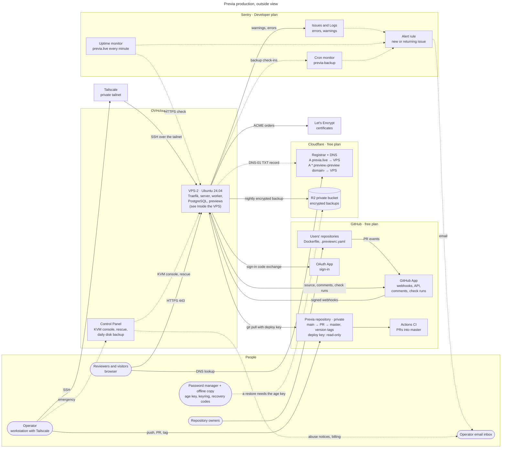
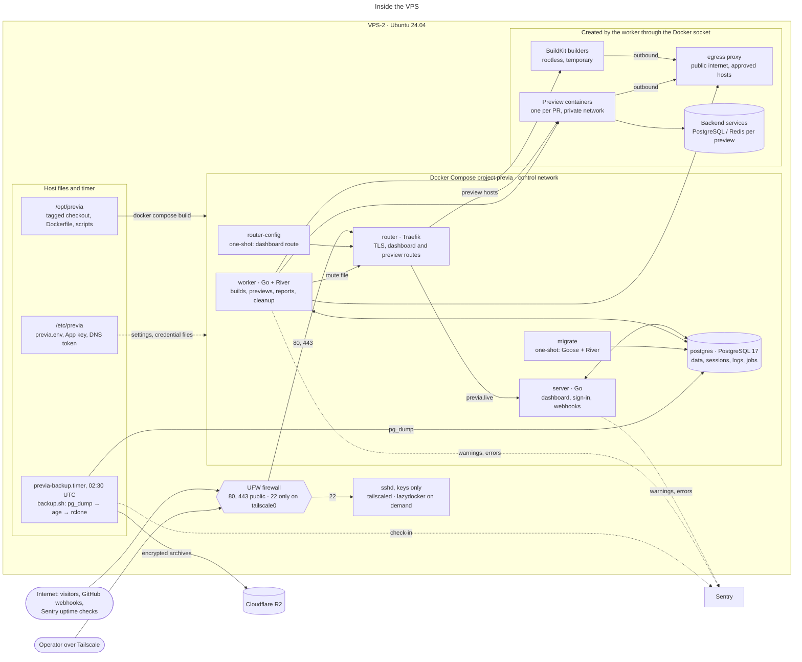
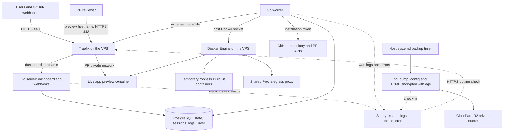
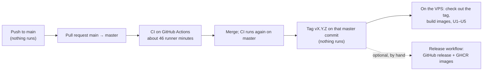

# 25 · Production deployment

Previa runs on **one OVHcloud VPS (model VPS-2) with Ubuntu 24.04, Docker Engine
and Docker Compose**. PostgreSQL 17 runs in Docker on that VPS, beside the Go
server, the Go worker and Traefik; the worker builds and runs every PR preview as
Docker containers on the same host. Around the server: **Cloudflare** holds the
domains (`previa.live` for the landing page and dashboard, a separate domain for
previews), their DNS and the encrypted backups (R2); **GitHub** holds the code,
runs CI and provides sign-in, webhooks and PR feedback; **Sentry** (free plan)
watches errors, uptime and the nightly backup and emails you; **Tailscale** (free
plan) carries SSH, so port 22 is closed to the internet; **lazydocker** shows
containers and logs once you are logged in. It costs about **€8 a month plus VAT**
(the VPS and the preview domain), plus `previa.live`'s renewal.

This is the final production arrangement: the rest of this guide sets it up
step by step, explains why each piece is there, and how to operate, back up,
restore and upgrade it. Writing it provisioned nothing; the
[release report](26-release-report.md) records what has been proven so far.
**A commit to `main` or `master` does not deploy Previa, and neither does a
tag: the operator checks out a tag on the server and builds it there.**

Run commands one step at a time and stop when a check fails. `previa.live` is the
real dashboard domain; `preview.example.net` stands for the preview domain until
it is bought, and `YOUR_…` values are placeholders.

## Contents

- [The final deployment at a glance](#the-final-deployment-at-a-glance):
  [what you need and why](#what-you-need-and-why),
  [how it all connects](#how-it-all-connects),
  [cost](#what-it-costs),
  [performance and capacity](#performance-and-capacity),
  [what is left out](#what-this-deployment-leaves-out-on-purpose) and
  [the whole deployment step by step](#the-whole-deployment-step-by-step)
- [Deployment platform and external services](#deployment-platform-and-external-services)
- [Choosing a host and keeping costs low](#choosing-a-host-and-keeping-costs-low)
- [Account safety: abuse reports](#account-safety-abuse-reports)
- [What runs](#what-runs)
- [Fresh host setup](#fresh-host-setup): OVHcloud, domains, checkout, Tailscale, GitHub, settings
- [First start, with staged certificates](#first-start-with-staged-certificates)
- [Verify the deployment](#verify-the-deployment)
- [Monitoring with Sentry](#monitoring-with-sentry)
- [Logs, SSH and day-to-day checks](#logs-ssh-and-day-to-day-checks)
- [Backups and restore](#backups-and-restore), and
  [rehearsing recovery before launch](#rehearse-recovery-before-launch)
- [Upgrades and rollback](#upgrades-and-rollback)
- [VPS upgrades, billing and ongoing operations](#ovhcloud-capacity-billing-and-ongoing-operations)
- [CI and releases](#ci-and-releases)
- [Local staging smoke test](#local-staging-smoke-test)
- [Security notes](#security-notes)
- [Files behind these instructions](#files-behind-these-instructions)

## The final deployment at a glance

### What you need and why

Four accounts (OVHcloud, Cloudflare, GitHub, Sentry), one free Tailscale account
for SSH, and one server.

| # | Component | What it does for Previa | Where it lives | Cost / month |
| ---: | --- | --- | --- | ---: |
| 1 | **OVHcloud VPS-2** (4 vCores, 8 GB RAM, 75 GB NVMe, Ubuntu 24.04) | The one server: runs the control plane and every build and preview. Includes the IPv4 address, unlimited traffic (European locations), anti-DDoS and a daily disk backup kept 24 hours. | OVHcloud, a European datacenter | €7.21 |
| 2 | **Docker Engine + Compose** (installed by `setup.sh`) | Runs Previa's containers; the worker uses its socket to build and run previews. | The VPS | €0 |
| 3 | **Previa's containers**: `postgres`, `server`, `worker`, `router` (plus the one-shot `migrate` and `router-config`) | Database and job queue (River) · dashboard, sign-in and GitHub webhooks · builds, previews, routes, reports and cleanup · HTTPS and every preview URL (Traefik). One command starts them; Docker restarts them if they crash. | The VPS, built there from the tagged checkout | €0 |
| 4 | **Let's Encrypt** | Free HTTPS certificates; the router obtains and renews them itself. | Public certificate authority | €0 |
| 5 | **Cloudflare DNS** (free plan) | Points `previa.live` and `*.preview.<preview domain>` at the VPS; the router's scoped token proves the preview domain for the wildcard certificate. | Cloudflare | €0 |
| 6 | **Two domains**: `previa.live` (owned) and a preview domain (to buy, Cloudflare Registrar) | Landing page and dashboard on `previa.live`; untrusted previews on a domain of their own, so an abusive preview cannot get `previa.live` blocklisted or suspended. | Cloudflare | about €0.80 for a .com, plus `previa.live`'s renewal |
| 7 | **Cloudflare R2** | Stores the nightly age-encrypted backup (database, `/etc/previa`, certificates) off the server and outside OVHcloud. | Cloudflare | €0 up to 10 GB |
| 8 | **GitHub OAuth App + GitHub App** | Sign-in; repository access, webhooks, PR comments and check runs. | GitHub | €0 |
| 9 | **GitHub Actions** (CI only) | Tests every pull request into `master` before it can be released. | GitHub-hosted runners | €0 (2,000 minutes) |
| 10 | **Deploy key** (read-only SSH key on the repository) | Lets the server clone and pull the private repository. | GitHub repository settings; `/root/.ssh` on the VPS | €0 |
| 11 | **Tailscale** (Personal plan) | SSH reaches the server only over your private tailnet; port 22 is closed to the internet, and a changing home IP never locks you out. | Your workstation and the VPS | €0 |
| 12 | **Sentry** (Developer plan) | Emails you about new errors from the server and worker, about the dashboard being down (uptime check every minute), and about a backup that failed or did not run; keeps searchable warning and error logs. | sentry.io | €0 |
| 13 | **lazydocker** (installed by `setup.sh`) | One terminal screen with every container, including previews, their live logs and CPU/memory. Runs only while you use it. | The VPS | €0 |
| 14 | **A password manager** | Recovery copies of the generated secrets, the repository-secrets keyring, the backup's age private key (also kept offline) and every account's recovery codes. | Your choice | €0 |

### How it all connects

Two diagrams: the services and accounts around the server, then what runs inside
it. Paste either into [mermaid.live](https://mermaid.live) to explore it. Solid
arrows carry traffic or data; dotted arrows are configuration, checks and alerts.





What the arrows mean, in words:

- **A visitor** looks up the name in Cloudflare DNS and reaches the VPS on 443.
  Traefik sends `previa.live` to the Go server and each preview host straight to
  that PR's container; the server and worker are not in a preview's request path.
- **GitHub** delivers signed webhooks to the server through Traefik; the worker
  uses the GitHub App's installation token to fetch source and post the PR comment
  and check run. Sign-in goes through the OAuth App.
- **The worker** is the only container with the Docker socket. It creates the
  builders, previews, their private networks, backend services and the shared
  egress proxy, and writes the route file Traefik reads.
- **Monitoring** leaves the server: errors and warnings go to Sentry as they
  happen; Sentry checks `https://previa.live` from outside every minute; the
  nightly backup checks in with Sentry's cron monitor. One Sentry alert rule emails
  you about all three.
- **You** reach the server only over Tailscale (or OVHcloud's console in an
  emergency), deploy by checking out a tag and building it there, and keep the
  backup's private key offline.

### What it costs

Prices checked in October 2026, before VAT; providers change them, so check before
buying.

| Item | Provider and plan | Per month | What raises it |
| --- | --- | ---: | --- |
| VPS-2, European location | OVHcloud | €7.21 | Upgrading to VPS-3 (€10.40, 6 vCores / 12 GB / 100 GB) or VPS-4 (€19.96, 8 / 24 GB / 200 GB) when builds or previews wait. Mumbai, Singapore and US locations cost about $8.50; Asia-Pacific ones include 1 TB of traffic a month, then 10 Mbps. |
| Preview domain | Cloudflare Registrar, at cost | about €0.80 (about $10–11 a year for a .com) | A pricier ending. Avoid cheap, often-abused endings such as `.xyz` or `.top`: company web filters block them. |
| `previa.live` | Already owned | Its renewal | — |
| DNS | Cloudflare free | €0 | — |
| Backups | Cloudflare R2 | €0 up to 10 GB-month | $0.015 per GB-month beyond; downloads (restores) are free. |
| Certificates | Let's Encrypt | €0 | — |
| Code, CI, sign-in, App, deploy key | GitHub Free | €0 | Over 2,000 Actions minutes in a month (a CI run used about 46 runner minutes on 2026-10-15, so about 43 runs): CI stops, or bills if you set a budget. See [CI and releases](#ci-and-releases). |
| Monitoring and alerts | Sentry Developer | €0 | Beyond 5,000 errors or 5 GB of logs a month, Sentry drops events for the rest of the month instead of billing. |
| SSH | Tailscale Personal | €0 | More than 6 users. |
| Docker, Traefik, PostgreSQL, rclone, age, lazydocker | Open source | €0 | — |
| **Total** | | **about €8 + VAT/GST** | plus `previa.live`'s renewal |

The VPS is billed monthly whether it runs or not, until terminated
([Paying nothing while it is unused](#paying-nothing-while-it-is-unused)). A new PR
creates containers on this VPS, never another server.

### Performance and capacity

These are the configured limits of the [starter settings](#starter-settings-for-a-small-host)
and the measured or documented behavior; there is no production load measurement
yet.

| Area | What to expect on a VPS-2 |
| --- | --- |
| Control plane | PostgreSQL, server, worker and router use about 1 GiB while idle; their ceilings are 2 GiB, 512 MiB, 1 GiB and 512 MiB. |
| Builds | One at a time (`MAX_CONCURRENT_BUILDS=1`), each with 2 CPUs, 2 GiB of memory, 10 GiB of disk, a 2 GiB image limit and a 12-minute timeout. Others queue, taking turns by account. Automatic builds start after five quiet minutes; a manual build starts as soon as the slot is free. |
| Previews | 4 GiB and 4 CPUs between them: one backend preview with PostgreSQL and Redis (about 1.75 GiB) and its replacement, or a few web previews (the usual `standard` tier is 1 vCPU / 1 GiB). At most 2 per repository and 4 per account; each expires 24 hours after its last publication. |
| Idle previews | Stop after 3 hours without a visit, freeing their memory, and wake on the next visit in seconds. |
| Preview requests | Go from Traefik straight to the app's container; their speed is the app's own plus the network. |
| Fair sharing | Every workspace's free plan: 300 build minutes per calendar month (UTC), one build at a time and two preview slots ([33](33-usage-and-free-plan.md)). The server-wide ceilings add one build at a time and 120 build minutes a day per account. |
| When full | New work waits with a reason on the Builds page (*Waiting for capacity*, *Waiting for disk space*) instead of failing; a disk shortage also triggers an immediate cleanup. |
| Monitoring | A dashboard outage is reported after 3 failed checks a minute apart (about 3 minutes); a new kind of error is emailed when it first happens; a missed backup after about 25 hours. |
| Recovery | Nightly backups: up to about one day of data can be lost. A small local drill took 1 second to back up and 21 seconds to restore; production recovery also includes a new server, keys and DNS ([recovery objectives](#backup-failure-retention-and-recovery-objectives)). |
| When to upgrade | Builds or previews often wait, available memory stays under 15%, or the disk stays above 75%: move to a VPS-3 and raise the budgets ([When to upgrade the server](#when-to-upgrade-the-server)). |

### What this deployment leaves out on purpose

| Not used | Why not now | When to revisit |
| --- | --- | --- |
| Prometheus, Grafana, Alertmanager | Up to 1.5 GiB of an 8 GB server, and their alerts reach nobody without more setup. Sentry covers errors, uptime and backups; `docker stats`, `df` and the Builds page cover capacity. The `observability` Compose profile and its 27 alert rules stay in the repository, unused. | With active users who need history graphs: Grafana Cloud's free tier (an agent on the server) rather than running them on it. |
| A separate uptime service or chat webhook | Sentry's uptime monitor and email do it. | — |
| GitHub Container Registry, GoReleaser releases | The server builds its images from the tagged checkout: no registry token, no publish step. The Release workflow stays, manual-only. | A second host, or published downloads. |
| Terraform | One server, created once in the Control Panel; `setup.sh` prepares it. | Several servers. |
| A staging server | Before launch the production VPS is the rehearsal machine; afterwards, a server rented by the hour for a drill. | — |
| Managed PostgreSQL, Redis | The local PostgreSQL is free and fastest; River needs no Redis. | Measured database load or a smaller data-loss window. |
| Cloudflare proxying (orange cloud) | The wildcard preview records must stay DNS-only and the dashboard's certificate needs direct access on 443. | — |
| gVisor | Untested in this repository; off for invited early-access users. | Before opening sign-up to the public. |
| GitHub Pro, OVHcloud's paid backup options | Not needed by one developer; R2 holds the real backups. | A second person who can push. |

### The whole deployment, step by step

Each step links to its detailed instructions below.

1. **Accounts (once).** OVHcloud with two-factor authentication
   ([Step 0](#step-0--prepare-the-ovhcloud-account-and-record-deployment-inputs));
   Cloudflare with `previa.live` and the new preview domain
   ([Step 2](#step-2--set-up-domains-dns-and-the-dns-token)); Sentry with a
   `previa` project ([S1](#step-s1--create-the-sentry-project-and-copy-its-dsn));
   Tailscale on your workstation ([Step 3](#move-ssh-to-tailscale)); a password
   manager.
2. **Rent and secure the server.** Order the VPS-2, log in, create `ops` and
   keep SSH key-only ([Step 1](#step-1--choose-the-host-and-release)).
3. **Domains and DNS.** Point `previa.live` and `*.preview.<preview domain>` at
   the VPS and create the DNS token ([Step 2](#step-2--set-up-domains-dns-and-the-dns-token)).
4. **Code and host.** Add the deploy key, clone and check out the release tag,
   run `setup.sh`, then move SSH to Tailscale and close port 22
   ([Step 3](#step-3--install-the-checkout-and-prepare-the-host)).
5. **GitHub registrations and credential files** ([Step 4](#step-4--register-github-integrations-and-install-credential-files)).
6. **Settings** in `/etc/previa/previa.env`, including `SENTRY_DSN`
   ([Step 5](#step-5--put-production-environment-variables-in-the-correct-file)).
7. **Backups**: the offline age key, the R2 bucket and rclone
   ([Step 6](#step-6--prepare-backups-before-treating-the-host-as-production), B1–B3).
8. **Build and start** with Let's Encrypt staging certificates, then production
   ones ([Steps 7–9](#step-7--define-the-production-commands-and-build-the-images)).
9. **Verify** every process and the whole user flow ([Step 10](#step-10--check-each-process-and-the-complete-user-flow)),
   take the first backup and enable the timer ([B4](#step-b4--take-a-real-backup-and-enable-the-schedule)).
10. **Monitoring**: the uptime monitor, the alert rule and a test error
    ([S2–S4](#monitoring-with-sentry)).
11. **Rehearse before launch**: a full restore onto the reinstalled VPS and an
    upgrade and rollback ([Rehearse recovery before launch](#rehearse-recovery-before-launch)).
12. **Launch**, then operate: [logs and checks](#logs-ssh-and-day-to-day-checks),
    [upgrades](#upgrades-and-rollback) (U1–U5) and
    [capacity](#ovhcloud-capacity-billing-and-ongoing-operations).

## Deployment platform and external services

This section explains the boundaries behind that table: what the VPS does and does
not do, why the database stays on it, and where each item is configured.
Provider references: [OVHcloud VPS](https://www.ovhcloud.com/en-ie/vps/),
[getting started with a VPS](https://docs.ovhcloud.com/en/guides/bare-metal-cloud/virtual-private-servers/starting-with-a-vps),
[Cloudflare R2](https://developers.cloudflare.com/r2/),
[Sentry](https://docs.sentry.io/) and [Tailscale](https://tailscale.com/kb).

### Docker previews, the VPS and the deployment boundary

An **OVHcloud VPS is the one rented Linux VM**. A **Docker image** packages the
app, and a **Docker container** runs that image as isolated processes sharing the
VPS's kernel. Previa creates one serving app container per PR, plus temporary
builders and replacement candidates. The total can briefly exceed the number of
active PRs during builds and swaps.

The production worker controls the VPS's Docker daemon through its socket.
Preview containers are siblings of server/worker/PostgreSQL, not children nested
inside the worker container. They receive separate private networks and limits;
only Traefik publishes HTTP/HTTPS. All visits to a preview consume this VPS's
CPU/network resources.

Use one **OVHcloud VPS** for this guide. Kubernetes, a provider container
registry, a load balancer and a VM per preview are not parts of the supplied
deployment. Previa's own images are built on this host from the tagged checkout,
and built PR images stay on this Docker host too. CPU/RAM growth requires upgrading the VPS model or a separately
implemented multi-host architecture.

### Why PostgreSQL on the VPS, not a managed database?

The chosen production DB is the Compose **PostgreSQL 17 service**, not a managed
database. Compose starts it, migrations target it, and the shipped backup/restore
scripts operate on it. OVHcloud hosts the VPS, while you maintain PostgreSQL
updates, storage, backups and recovery. Do not create a managed database just to
follow these commands.

A managed PostgreSQL service can reduce database operations later, but adopting it
needs a separately implemented and tested deployment change. Changing
`DATABASE_URL` alone leaves the current Compose dependencies and scripts targeting
the local DB.

If choosing that future architecture, the required work is:

1. Create a compatible database close to the VPS, in the same region. Restrict
   access to the VPS's address, require TLS with the provider's CA, and verify
   TLS/hostname checks from server, worker and migration containers.
2. Verify migrations, River, connection lifetimes, advisory locks and PostgreSQL
   `LISTEN/NOTIFY` on the chosen endpoint. The server uses a dedicated LISTEN
   connection. Do not assume a transaction-pooling URL provides session semantics;
   choose an appropriate direct or session-compatible connection and test it.
3. Change Compose's local `postgres` dependencies and the migration lifecycle.
   Otherwise it still creates and waits for an unused local database.
4. Replace the database portions of backup and restore. `backup.sh` explicitly
   dumps `dc exec postgres ... -d previa`; `restore.sh` explicitly drops and
   recreates that local database. They do not follow an external `DATABASE_URL`.
5. Define the provider's backup retention, restore/PITR procedure, database roles,
   upgrade compatibility, recovery objective and monitoring. Continue backing up
   `/etc/previa` and ACME state separately; a managed DB backup contains neither.
6. Rehearse a complete restore and a rollback before switching live traffic.

Those changes are not implemented by this documentation update. A managed
database is a separate resource, with a separate bill and recovery procedure;
replacing the VPS does not perform a managed-DB restore. For the commands below,
use the provided **PostgreSQL 17 Compose service**. PostgreSQL for each
*previewed application* is a different matter: backend previews
([11](11-backend-previews.md)) start a fresh PostgreSQL and Redis per candidate as
sibling containers on that PR's own internal network, inside the preview budget.
Previa's own production database is never a database that an untrusted preview may
connect to.

### What to create, and where to configure it

| Item | Exact configuration location | How it connects to Previa |
| --- | --- | --- |
| Account, VPS model, location, image and SSH public key | OVHcloud website and [Control Panel](https://www.ovh.com/manager/) | Supplies the host; source/scripts are installed at `/opt/previa` over SSH. |
| Firewall | `setup.sh`'s UFW on the VPS; optionally Control Panel → **Network → Public IP Addresses → Configure Edge Network Firewall** | Allows inbound 80/443, and SSH only on the Tailscale interface once [moved](#move-ssh-to-tailscale). This is separate from Docker's per-PR isolation. |
| SSH access | Tailscale admin console (the VPS joins your tailnet); your workstation's Tailscale app | SSH to the VPS's tailnet name; port 22 is closed to the internet. OVHcloud's KVM console and rescue mode stay as the emergency path. |
| Code on the server | GitHub repository → **Settings → Deploy keys**; `/root/.ssh` on the VPS | A read-only key lets the VPS clone and pull the private repository. |
| Host checks | `free`, `df`, `docker stats` and `lazydocker` on the VPS | CPU, memory and disk use; OVHcloud sends no resource alerts. |
| Errors, uptime and backup alerts | Sentry project `previa`; its DSN in `/etc/previa/previa.env` | Server and worker report errors and warnings; Sentry checks `https://previa.live` and receives the backup's check-ins, and emails you ([Monitoring with Sentry](#monitoring-with-sentry)). |
| Private backup bucket and API token | Cloudflare → **R2 Object Storage** | Root's `rclone` uploads encrypted archives using a token scoped to the bucket. |
| Dashboard and wildcard preview records | Cloudflare zones `previa.live` and the preview domain | Both resolve to the VPS's public IPv4. |
| DNS certificate credential | Cloudflare token settings, then `/etc/previa/dns-credential` on the VPS | Traefik mounts it as a file for DNS-01. |
| OAuth App and GitHub App | GitHub → Settings → Developer settings | Their IDs/secrets go in `/etc/previa/previa.env`; App PEM goes in `/etc/previa/github-app.pem`. |
| Application/release/runtime settings | `/etc/previa/previa.env` on the VPS | Compose reads this explicitly; there is no provider panel for application settings to populate. |
| Backup storage key/secret | Root's protected rclone configuration on the VPS | Not Go application settings; retain a recovery copy separately. |
| Backup private age identity | Offline recovery storage | Temporarily brought to a recovery host only when decrypting. |
| User repositories' preview secrets | Previa → repository → Secrets | Encrypted in PostgreSQL; distinct from the platform's production credentials. |
| CI | GitHub repository → **Actions** | Tests pull requests into `master`; never touches the VPS. |

The manual Control Panel route requires no OVHcloud API credentials in Previa or
GitHub Actions. The R2 token, your SSH private key, the deploy key, the Cloudflare
DNS token, the Sentry DSN and the GitHub App credentials have different purposes
and are not interchangeable; keep the R2 token and the DNS token separate even
though both come from Cloudflare.
Only a future OVHcloud API automation needs scoped provider credentials.

## Choosing a host and keeping costs low

This guide uses OVHcloud: the lowest price found for a reliable 8 GB host, with
unlimited traffic, a daily backup and anti-DDoS protection included. This section
records why, what any host must provide, and how the steps translate if you choose
another provider.

### What the host must provide

Previa cannot run on a platform-as-a-service (Render, Railway, Heroku, Fly.io apps,
Cloud Run): the worker needs a Docker daemon it
controls, private Docker networks, rootless BuildKit builders and Traefik on ports
80 and 443. Any provider that rents a plain Linux VM works:

| Requirement | Why |
| --- | --- |
| Ubuntu 24.04 or Debian 12 with root access (directly or through `sudo`) | `setup.sh` supports these and installs Docker Engine. |
| x86-64 (arm64 also works) | All images are published for both. On arm64, users' Dockerfiles also build for arm64, which a few apps do not support, and CI does not test arm64 hosts. |
| A public IPv4 with inbound 80 and 443 (and 22 for you) | HTTPS for the dashboard and previews, GitHub's webhooks, and the dashboard certificate's TLS-ALPN-01 challenge. |
| Unprivileged user namespaces | Rootless image builds; `setup.sh` enables them on Ubuntu 24.04. |
| At least 4 vCPU, 8 GiB RAM and 75 GiB disk | One build at a time plus a few previews, with the [starter settings](#starter-settings-for-a-small-host). |
| Off-host storage for backups | This guide uses Cloudflare R2; any S3-compatible bucket works through rclone. |
| DNS with an API that [lego](https://go-acme.github.io/lego/dns/) supports | The wildcard preview certificate (DNS-01). Cloudflare's free plan works. |

### Providers compared

Monthly prices for the plans nearest 4 vCPU / 8 GiB, checked in October 2026,
excluding VAT. Providers change prices and plans, so check before you buy.

| Provider | Plan | vCPU / RAM / disk | Price | Notes |
| --- | --- | --- | ---: | --- |
| [OVHcloud](https://www.ovhcloud.com/en-ie/vps/) | VPS-2 | 4 / 8 GB / 75 GB NVMe | €7.21 | **This guide's host.** Unlimited traffic, a daily backup and anti-DDoS included. Monthly subscription. European locations at this price; others are priced separately. |
| OVHcloud | VPS-3 | 6 / 12 GB / 100 GB | €10.40 | The first upgrade when builds queue or previews wait. |
| OVHcloud | VPS-4 | 8 / 24 GB / 200 GB | €19.96 | For real traffic. |
| OVHcloud | VPS-1 | 2 / 4 GB / 40 GB | €3.81 | Only to try Previa out: see [Minimum host](#minimum-host). |
| Hetzner | CX33 | 4 / 8 GB / 80 GB | about €8.49, plus its IPv4 | Hourly billing and a polished API, but dearer than the VPS-2 since its June 2026 increase; strict on abuse reports about publicly served untrusted code. Good for an hour-long drill server. |
| netcup | VPS 1000 G12 | 4 / 8 GB / 256 GB | about €8.70 (€10.37 with German VAT) | Three times the disk, but fair-use CPU throttles long builds. The fallback if disk becomes the limit. |
| Contabo | Cloud VPS 10 | 4 / 8 GB / 75 GB | about €4.50 | Cheapest, but slower and weaker on uptime and support in independent tests. |
| [Vultr](https://www.vultr.com/pricing/) | Regular, 8 GB | 4 / 8 GB / 160 GB | $40 | More regions; polished, but about five times the price. |
| Akamai (Linode) | Shared, 8 GB | 4 / 8 GB / 160 GB | $48 | Mainstream, but about six times the price. |
| Oracle Cloud | Always Free, Ampere A1 | 2 Arm OCPU / 12 GB (free-tier accounts, since June 2026) | $0 | **Not recommended.** Oracle may reclaim an Always Free instance whose CPU, network and memory use stay under 20% for 7 days, which describes a Previa nobody uses yet. |

**This guide's setup:** OVHcloud VPS-2, Cloudflare's free DNS, and Cloudflare R2
for backups (free up to 10 GB): about **€7.21 a month**, plus the preview domain
(about $10–11 a year for a .com) and `previa.live`'s renewal; the full breakdown is
in [What it costs](#what-it-costs). Upgrade to a VPS-3 or VPS-4 when builds queue
or previews wait for capacity. Every host acts on abuse reports, so [Account safety](#account-safety-abuse-reports)
matters more than the choice of host.

### On another provider

Everything from [Step 3](#step-3--install-the-checkout-and-prepare-the-host) on is
provider-neutral: `setup.sh`, Compose, certificates, backups through rclone,
upgrades and restores. Only the provider's console steps differ:

| In this guide (OVHcloud) | On another provider |
| --- | --- |
| Order a VPS-2 (Step 1); log in as `ubuntu` | Create a VM that meets the requirements above, with your SSH key. Many providers' Ubuntu images log in as `root`; create the `ops` user from there the same way. |
| UFW and Tailscale, optionally the Edge Network Firewall | UFW and Tailscale as here, plus the provider's firewall if it has one (usually stateful) with inbound 80/443 only once SSH runs over Tailscale. |
| Update DNS when replacing the VPS | The same, or a provider address that survives replacing the VM (often called a reserved, floating or primary IP). |
| R2 bucket and token (B2, B3) | Unchanged: R2 works with any host. Or the provider's S3-compatible storage through rclone. |
| Host checks and the Sentry monitors | The same checks and monitors, plus the provider's monitoring if it offers any. |
| Included daily backup and snapshot (B7) | The provider's backups and snapshots, if offered and at its price. |
| Upgrade the model | The provider's resize; plan an outage the same way. |

### Starter settings for a small host

These are the settings for this guide's VPS-2 (4 vCores / 8 GB / 75 GB) while
traffic is low. Set them in `/etc/previa/previa.env` at Step 5:

```dotenv
MAX_CONCURRENT_BUILDS=1
BUILD_CPUS=2
BUILD_MEMORY=2GiB
BUILD_DISK_BUDGET=10GiB
BUILD_MAX_IMAGE_SIZE=2GiB
BUILD_MIN_FREE_DISK=10GiB
BUILD_CACHE_BUDGET=10GiB
PREVIEW_MEMORY_BUDGET=4GiB
PREVIEW_CPU_BUDGET=4
PREVIEW_MAX_PER_REPOSITORY=2
ENV_TTL_HOURS=24
# A server shared by several accounts:
BUILDS_PER_ACCOUNT=1
PREVIEW_MAX_PER_ACCOUNT=4
BUILD_MINUTES_PER_ACCOUNT_DAY=120
PREVIEW_IDLE_SLEEP=3h
```

These are in `deploy/production/previa.env.example`. At start, the worker compares
them with the host and logs `capacity settings exceed this host` with what does not
fit (memory for builds, previews and about 1 GiB for Previa; CPUs; Docker's disk).

- **Previews:** a replacement must fit beside the preview it replaces. 4 GiB holds
  one backend preview with PostgreSQL and Redis (about 1.75 GiB) and its
  replacement, or a few web previews. When the budget is full, new work waits
  instead of failing, so a small host is slow, not broken.
- **Builds:** one 2 GiB build at a time. Raise `BUILD_MEMORY` if large frontend
  builds run out of memory.
- **Sharing:** one build at a time per account, four previews and two build hours
  a day each, and waiting builds take turns by account, so one busy user cannot
  hold the server ([17](17-build-scheduling.md#fair-sharing-between-accounts)). Set
  them to `0` when the server is yours alone.
- **Idle previews** sleep after 3 hours without a visit and wake on the next one
  in seconds, which frees most of their memory
  ([10](10-preview-runtime.md#idle-previews-sleep)).
- **Docker logs:** each preview container keeps at most 2 × 5 MB of output; a
  backend preview with services and processes keeps about 50 MB at most.
- **Control plane:** PostgreSQL, the server, the worker and the router have 4 GiB
  of limits between them but use about 1 GiB while idle. This deployment does not
  run the optional `observability` profile (Prometheus and Grafana, up to 1.5 GiB):
  the [Step 7](#step-7--define-the-production-commands-and-build-the-images) `dc`
  leaves it out, and [Sentry](#monitoring-with-sentry) watches errors, uptime and
  backups from outside.
- **Swap:** add a 4 GiB swap file as a cushion against short memory peaks:

  ```sh
  fallocate -l 4G /swapfile && chmod 600 /swapfile
  mkswap /swapfile && swapon /swapfile
  echo '/swapfile none swap sw 0 0' >> /etc/fstab
  ```

Watch `free -h`, `docker stats` and the waiting reasons on **Builds**; when previews
or builds wait often, upgrade to a VPS-3 or VPS-4 and use the larger settings in
Step 5.

### Minimum host

A 2 vCore / 4 GB / 40 GB host (OVHcloud VPS-1) can run Previa for small apps, such
as static sites and light APIs whose previews use `resource_tier: small`. Use the
starter settings with `BUILD_MEMORY=1536MiB`, `PREVIEW_MEMORY_BUDGET=1GiB`,
`PREVIEW_CPU_BUDGET=1`, `BUILD_DISK_BUDGET=5GiB`, `BUILD_MAX_IMAGE_SIZE=1GiB`,
`BUILD_MIN_FREE_DISK=5GiB` and `BUILD_CACHE_BUDGET=5GiB`. Typical Node.js builds
and backend previews with services do not fit; treat it as a trial host.

### Paying nothing while it is unused

An OVHcloud VPS is a monthly subscription: it is billed whether it runs or not,
and stops costing only when you terminate it in the Control Panel (check the
termination date it shows). To pause Previa for months, take a final R2 backup,
terminate the VPS, and later order a new one and restore it with
[Step B6](#step-b6--recover-configurationcertificates-or-replace-the-whole-vps);
its address will change, so update both DNS records. Running Previa on a machine
at home behind a tunnel is not supported as shipped: the dashboard certificate
and GitHub's webhooks need inbound HTTPS to the router.

### Account safety: abuse reports

Previa builds code from pull requests and serves it publicly from your VPS. If a
preview hosts a phishing page or malware, or its app floods other sites through
the egress proxy, the abuse reports go to your host, about your server. Every
host acts on them: it forwards the report, expects an answer by a deadline, and
can block the address or end the contract when abuse is unanswered or repeated.
Keep that from happening:

- Pull requests from forks never build by themselves, even on **Automatic**: they
  wait until you click **Build**
  ([16](16-build-policy-and-intents.md#behaviour-rules)). Click it only after
  reading the changes. Forks never get secrets or outbound connections, but once
  built they get a public preview (or switch on **Private previews**).
- Consider `BUILD_EGRESS=registries`: builds then reach only package and image
  registries ([09](09-image-builds.md#build-traffic-and-the-registries-only-mode)).
  `PreviaBuildHeavyUpload` alerts on a build that uploads a lot.
- Keep `ENV_TTL_HOURS` short so a bad preview does not stay up for long, and tear
  down anything suspicious at once (PR page → **Tear down preview**).
- Use an email address on the host account that you read every day, and answer
  abuse notices before their deadline: say that the content was a pull-request
  preview and that it has been removed.
- Keep previews on their own registrable domain (as Step 2 does), so a
  blocklisted preview domain does not take the dashboard with it.
- While you investigate repeated abuse, stop new builds with `BUILDS_PAUSED=true`
  ([24](24-incident-runbook.md#execution-kill-switch)).

## What runs

### Traffic and execution paths



A dashboard request passes through Traefik to the Go server. A request to a
published preview passes through Traefik directly to that app's container; the Go
server and worker do not sit in that preview request path. A webhook records
state/authorized work in PostgreSQL and returns; River executes the work later.

### Compose services

All these services run on the **same OVHcloud VPS**. Third-party
infrastructure images in the current Compose file are pinned by digest; the
version names below identify them. Keep those pinned references. Previa's own
images use the selected release tag; record their resolved digests during an
upgrade so the exact previous artifacts can be identified.

| Service | Image / executable | Lifetime and responsibilities | Public exposure |
| --- | --- | --- | --- |
| `postgres` | `postgres:17.11-alpine` | Persistent PostgreSQL 17 database; healthchecked; stores data in `previa_postgres`. | No host port; `postgres:5432` on the control network only. |
| `migrate` | Previa server image, `previa-migrate up` | One-shot Goose migrations followed by River migrations. Exit 0 is success. Server/worker wait for it. | None. |
| `server` | `previa-server:<release>` | Persistent Go HTTP process. Has no Docker socket. Read-only root, UID 65532, temporary `/tmp`. | Internal HTTP `8080`; reached publicly through Traefik. Health/metrics `9090` stay private. |
| `worker` | `previa-worker:<release>` | Persistent Go River worker, not an HTTP app serving users. Only service with the Docker socket; has source and routing storage. | Health/metrics `9091` stay private. |
| `router-config` | Pinned Traefik image, shell command | One-shot writes `previa-dashboard.yml` before the router starts. Exit 0 is success. | None; no network. |
| `router` | `traefik:v3.7.13`, container `previa-router` | Persistent HTTPS proxy; watches dashboard and preview route files; renews certificates. No Docker socket. | Host TCP `80` and `443`; metrics `8082` on control network; API/ping `8080` on its own loopback. |
| `egress` | `previa-egress:<release>` | Image staging service under profile `images`. Use it to **build the image**, not to run the production proxy. | Do not start this Compose service. |
| `prometheus`, `grafana` | `prom/prometheus:v3.5.0`, `grafana/grafana:12.1.1` | Optional `observability` profile, **not run by this deployment** ([what is left out](#what-this-deployment-leaves-out-on-purpose)). | Would stay private (Grafana on host `127.0.0.1:3000`). |

The `server`, `worker` and `egress` images are built on the VPS from the
multi-stage [Dockerfile](../Dockerfile) of the checked-out tag (Step 7). Runtime images contain static Go binaries; server and
worker use distroless images without a shell. Use their `healthcheck` and
`check-config` commands, not `docker exec ... sh`. The server image also contains
`previa-migrate` and `previa-secrets-reencrypt`; the worker image contains
`previa-route-sync` and `previa-housekeeping`. These maintenance commands are
run on demand, not deployed as additional always-running processes.
Every build here names its target (`server`, `worker`, `egress`). `server` is the
Dockerfile's last stage only so that a build without a target, as a Previa preview
of this repository runs ([`.previewrc.yaml`](../.previewrc.yaml)), yields the dashboard;
the stage order does not change any release image.

### Containers created by the worker

These are **sibling containers on the host's Docker daemon**, not nested
containers inside `worker`. They do not appear in `dc ps`, because Compose did
not create them. Use `docker ps` and their labels to inspect them.

| Object | Created by / lifetime | What it does |
| --- | --- | --- |
| `previa-egress` container and network | Worker startup; shared and persistent | Runs the Previa proxy and readiness prober. Attached to build/preview networks; permits proxy traffic to public addresses, forwards owner-approved outbound connections, and blocks private/control-plane/metadata addresses. Requires its image to be downloaded beforehand; the worker replaces it when that image changes (see U4). |
| Rootless BuildKit builder | A build attempt; removed afterwards | Fetches public base images/dependencies through the proxy, executes Dockerfile steps, builds the preview image. Its cache may persist in a labelled Docker volume. |
| Build network | A build attempt; removed afterwards | Internal bridge network containing the builder and attached egress proxy. |
| Preview image | A successful Dockerfile build | Kept in the VPS's Docker image store, not uploaded to GHCR by the PR build pipeline. |
| App preview container | A successful build; lives until replacement, teardown or expiry | Runs the app with bounded CPU/memory/PIDs, its configured internal port and appropriate repository secrets. No Docker socket or published host ports. |
| PR preview network | That PR's preview lifecycle | Internal bridge shared by that PR's candidates, Traefik and the egress proxy. Other PRs and the control plane are not attached. |
| Backend preview services | Each candidate of a PR whose `.previewrc.yaml` declares `services`; removed with it | A fresh PostgreSQL and/or Redis per candidate, data on tmpfs (lost on rebuild), generated credentials. Never restarted: a crashed service fails that candidate. |
| Setup and process containers | Each candidate that declares `setup` or `processes` | The app's image running the setup command once before the app starts, and up to three extra processes (such as a queue worker) beside it. |
| PR services network | That PR's backend previews | Internal bridge joined only by the PR's candidates and their services: no egress proxy, no router. |

The preview config `.previewrc.yaml` points at a Dockerfile and the app's internal
port. It is not a file for deploying Previa's own control plane. A preview must
pass readiness before a route is published. A successful rebuild switches the
accepted route to the new candidate; a failed rebuild leaves the old serving
preview in place. Close/merge and explicit teardown remove routes/resources
through durable operations. Expiry and housekeeping provide additional cleanup.

### Persistent storage and networks

| Location | Contents | Included in the shipped backup? |
| --- | --- | --- |
| `/opt/previa` | Checkout of the exact release tag; scripts, Compose and the Dockerfile the images are built from | Recover by cloning from GitHub with a deploy key. Keep this path stable: the systemd backup service references it. |
| `/etc/previa/previa.env` | Production settings and generated/application credentials | Yes, encrypted configuration archive. |
| `/etc/previa/github-app.pem` | GitHub App private key | Yes, encrypted configuration archive. |
| `/etc/previa/dns-credential` | DNS API token | Yes, encrypted configuration archive. |
| `/var/lib/previa/router` | `previa-dashboard.yml` and worker's `previa-routes.yml` | No; regenerated from config and accepted database routes. |
| `/var/lib/previa/backup/last-success` | Backup success timestamp read by the server | No; the next complete backup recreates it. |
| Docker volume `previa_postgres` | PostgreSQL data files | Logical database dump, not a raw copy of the live volume. |
| Docker volume `previa_acme` | Let's Encrypt accounts, keys and certificates | Yes, encrypted ACME archive. |
| Docker volume `previa_sources` | Temporary exact-commit source workspaces | No; refetched from GitHub. |
| Docker volume `previa_baselines` | Encrypted test-data baselines (`PREVIEW_BASELINE_DIR`, [32](32-persistent-test-data.md)) | No: derived data, rebuilt from each repository's baseline branch on the next refresh. Their records are in the database; a missing file is marked missing and rebuilt. |
| Labelled build cache volumes and local preview images | Rebuildable build artifacts | No. |
| Local Docker images `previa-server`, `previa-worker`, `previa-egress` | One set per built version; the previous set is the rollback path | No; rebuilt from the tagged checkout. |
| Root's rclone configuration, `/root/.ssh` deploy key, Tailscale state | Storage credentials, the read-only repository key, the server's tailnet identity | Not by default: these live outside `/etc/previa`. Keep the R2 key's recovery copy; a deploy key and the tailnet login are simply recreated on a new host. |

Docker volumes normally live under the daemon's data root (`/var/lib/docker` on
the expected host). Confirm with `docker info --format '{{.DockerRootDir}}'`;
do not assume they live inside `/opt/previa` or on GitHub. Keeping volumes across a
container recreation preserves their data; deleting the VPS or its disk does not.

Compose uses project name `previa`, control network `previa_control`, subnet
`172.31.250.0/24`, router address `172.31.250.10` and server address
`172.31.250.20`. Verify this subnet does not conflict with the VPS's private
network/VPN. These addresses also occur in the dashboard route and trusted-proxy
configuration; changing only the subnet is insufficient.

## Fresh host setup

### Step 0 — Prepare the OVHcloud account and record deployment inputs

1. Create an OVHcloud account on the website for your region (the European site
   prices in euros). OVHcloud may ask for identity documents before activating
   services; allow time for that. Turn on two-factor authentication in the
   [Control Panel](https://www.ovh.com/manager/) and keep its recovery codes. There
   is no separate staging VPS: until launch this VPS is the rehearsal machine
   ([Rehearse recovery before launch](#rehearse-recovery-before-launch)).
2. Have an SSH key on your administration workstation; the private key stays on
   your workstation. For a new key, use an unused output filename and a
   passphrase:

   ```sh
   ssh-keygen -t ed25519 -a 100 -f ~/.ssh/previa_ovh_ed25519 -C previa-admin
   cat ~/.ssh/previa_ovh_ed25519.pub
   ```

3. Have the other accounts ready, each with two-factor authentication and its
   recovery codes in your password manager: **Cloudflare** (the `previa.live` zone
   already exists; buy the preview domain in Step 2; R2 in B2), **GitHub** (the
   repository, and the OAuth App and GitHub App of Step 4), **Sentry**
   ([S1](#step-s1--create-the-sentry-project-and-copy-its-dsn)) and **Tailscale**
   (Step 3). Ordering a VPS does not register a domain or configure GitHub.
4. Record the following **non-secret** inventory in your operations notes.
   Keep secret values separately in a password manager/recovery store:

   | Input | Example / what to record |
   | --- | --- |
   | VPS | Service name (`vps-xxxxxxxx.vps.ovh.net`), model (`VPS-2`) and the name you give it, such as `previa-prod-01` |
   | Location | Actual datacenter, such as Gravelines, Frankfurt or Warsaw |
   | Public endpoint | Actual public IPv4 |
   | SSH name | The VPS's Tailscale machine name, such as `previa-prod-01`, and your `ops` user |
   | Dashboard | `previa.live` |
   | Preview domain | The domain bought in Step 2, here `example.net`: `PREVIEW_BASE_DOMAIN=preview.example.net`, wildcard `*.preview.example.net` |
   | Sentry | Organization, data region (EU or US) and project `previa` |
   | Backup bucket | R2 bucket name, represented below by `YOUR_BUCKET` |
   | R2 endpoint | `https://<ACCOUNT_ID>.r2.cloudflarestorage.com` for your Cloudflare account |
   | Release | Existing tested tag and exact Git commit; never assume an example tag exists |
   | Recovery contacts | The monitored email address that receives Sentry alerts, abuse notices and certificate notices, and who holds the recovery keys |

Use the same concrete values throughout this guide. `YOUR_BUCKET`,
`YOUR_SERVER_IP`, `example.net` and version examples are placeholders.
Never substitute an R2 URL for the database hostname.

### Step 1 — Choose the host and release

On the OVHcloud website, open **VPS**, choose **VPS-2** and configure the order with
these choices; labels can change, the actual values are what matter.

| Order choice | Value / reason |
| --- | --- |
| Model | **VPS-2** (4 vCores, 8 GB RAM, 75 GB NVMe). |
| Location | The datacenter nearest your users. European locations (Gravelines, Roubaix and Strasbourg in France, Frankfurt, Warsaw, London) have this guide's price; Beauharnois, Vint Hill, Hillsboro, Singapore, Sydney and Mumbai are priced separately. Keep PostgreSQL, the worker and previews on this one VPS. |
| Image | **Ubuntu 24.04**, the plain distribution without preinstalled applications. `setup.sh` prepares it. |
| SSH key | The public key from Step 0, if the order asks for one; otherwise OVHcloud emails a password for the `ubuntu` user and the first login below adds the key. |
| Backup | The included daily backup is enough; the paid options are optional. It does not replace Previa's encrypted backups; see B7. |
| Commitment | Monthly to start; a longer commitment costs less once you know you will keep it. |
| Quantity | **One** VPS. Previa creates Docker preview containers on it. |

After delivery, give the VPS a recognizable name in the Control Panel, and set the
account's contact email to one you read every day: abuse notices and billing go
there (see [Account safety](#account-safety-abuse-reports)).

The VPS-2 with the [starter settings](#starter-settings-for-a-small-host) runs one
build at a time and a few previews while traffic is low. The template's defaults
do not fit it: **two default builds can each use 4 GiB**, while previews default
to a budget of 60% of host memory. PostgreSQL, monitoring, Docker and Linux need
memory too. Explicitly budget them together. When builds queue or previews wait
for capacity, upgrade to a **VPS-3 (6 vCores, 12 GB, 100 GB)** or **VPS-4
(8 vCores, 24 GB, 200 GB)** and use the larger settings in Step 5. These are
operator starting allocations, not a benchmark or promise of a specific request
rate.

The Compose ceilings are separately 2 GiB for PostgreSQL, 512 MiB server,
1 GiB worker and 512 MiB router (the unused observability profile would add
1 GiB Prometheus and 512 MiB Grafana). Also leave
capacity for Linux, Docker, egress, image builds, buffers and filesystem cache.
Container memory limits are ceilings rather than a reservation of that entire
amount. Inspect actual usage before raising `MAX_CONCURRENT_BUILDS` or preview
budgets. The CPU/memory admission counts declared preview limits, not only
instantaneous utilization. See Step 5.

Keep Docker data on the VPS's own disk initially. R2 is not a filesystem for
PostgreSQL/Docker. An additional disk is optional and requires an explicit
mount/data-root/backup design; the shipped setup does not move Docker data to it.

#### Firewalls: UFW, and optionally OVHcloud's Edge Network Firewall

`setup.sh` turns on UFW with only SSH, 80 and 443 open, and Compose publishes only
80 and 443, so that is the VPS's boundary. In Step 3 SSH moves to Tailscale and
port 22 closes to the internet, leaving **only 80 and 443 public**. OVHcloud's
anti-DDoS protection is always on.

OVHcloud's **Edge Network Firewall** is optional. It filters inbound traffic only,
holds up to 20 rules per IP, turns itself on during a detected attack, and is
**stateless**: replies to the VPS's own connections must be allowed explicitly.
If you enable it (Control Panel → **Network → Public IP Addresses** → the IPv4's
**…** menu → **Configure Edge Network Firewall**), use these rules:

| Priority | Action | Rule |
| ---: | --- | --- |
| 0 | Authorize | TCP with the **established** option: replies to the VPS's own connections (GitHub, registries, R2, certificates, Sentry, Tailscale). |
| 1 | Authorize | UDP, destination port 41641: direct Tailscale connections (without it Tailscale relays SSH, a little slower). |
| 2 | Authorize | TCP, destination port 80. |
| 3 | Authorize | TCP, destination port 443. GitHub webhooks and reviewers must reach it. |
| 4 | Authorize | UDP, source port 53: DNS replies. |
| 5 | Authorize | UDP, source port 123: time-sync replies. |
| 6 | Authorize | ICMP. |
| 19 | Refuse | All IPv4 traffic. |

Do not open inbound DB, internal API or monitoring ports: 5432, 8080, 8082,
9090/9091, 9093 and 3000 are not public services in this deployment. Keep UFW as
well; OVHcloud recommends a local firewall even with the Edge Network Firewall.
Do not add an Edge rule for port 22: SSH arrives inside Tailscale's encrypted
connection, so the server is reachable from wherever you are signed in to
Tailscale, whatever your home IP.
[Edge Network Firewall](https://docs.ovhcloud.com/en/guides/bare-metal-cloud/dedicated-servers/firewall-network).

Until Step 3, `setup.sh`'s UFW allows standard OpenSSH from anywhere (key-only, as
set below); once the SSH rule on `tailscale0` exists, rerunning `setup.sh` keeps
SSH on Tailscale only. If using a custom SSH port, arrange the matching UFW rules
before running it. Docker's
published ports use its own firewall chains, which is why Compose publishes only
80 and 443. These firewalls protect the VPS boundary; they do not implement
Previa's per-PR Docker network isolation.

#### First SSH login and the administrator account

OVHcloud's Ubuntu image has a `sudo` user named `ubuntu` and refuses SSH logins as
`root`. If the order did not take your key, first install it with the emailed
password, from your workstation:

```sh
ssh-copy-id -i ~/.ssh/previa_ovh_ed25519.pub ubuntu@YOUR_SERVER_IP
```

Then log in and create the `ops` account the rest of this guide uses:

```sh
ssh -i ~/.ssh/previa_ovh_ed25519 ubuntu@YOUR_SERVER_IP
sudo adduser ops
sudo usermod -aG sudo ops
sudo install -d -o ops -g ops -m 0700 /home/ops/.ssh
sudo install -o ops -g ops -m 0600 /home/ubuntu/.ssh/authorized_keys /home/ops/.ssh/authorized_keys
```

Verify the host fingerprint on first connection. Before closing that session,
open a second workstation terminal and verify:

```sh
ssh -i ~/.ssh/previa_ovh_ed25519 ops@YOUR_SERVER_IP
sudo -v
```

Then make sure SSH accepts keys only:

```sh
sudo sshd -T | grep -E '^(passwordauthentication|permitrootlogin) '
```

**Expected:** `passwordauthentication no` and `permitrootlogin no` (or
`without-password`). If password login is still on, add a file
`/etc/ssh/sshd_config.d/90-previa.conf` containing `PasswordAuthentication no`,
then `sudo systemctl reload ssh` and test a new key login before closing the
session.

The `ops` account needs the password configured by `adduser` for `sudo`; the same
password logs in on OVHcloud's **KVM** console (Control Panel → the VPS → **KVM**),
the browser terminal that works even when SSH and Tailscale do not. Keep it in
your password manager. Rescue mode (Control Panel → the VPS → **Boot** → **…**) is
the last resort. Later SSH/SCP examples assume this key is selected by your SSH
agent or local SSH configuration; add `-i ~/.ssh/previa_ovh_ed25519` when
necessary. Until Step 3 they use the public IP; afterwards, the Tailscale name.

Choose the release tag only after checking the [CI and releases](#ci-and-releases)
section and the [local staging smoke test](#local-staging-smoke-test).

### Step 2 — Set up domains, DNS and the DNS token

`previa.live` serves the landing page and the dashboard. Previews run untrusted
code from pull requests, so they get a **separate registrable domain**. Previa
would also run with previews under `previa.live` (its login cookies are
`__Host-` cookies a preview cannot plant, and the server only logs a warning),
but a domain of their own protects the brand domain:

| Risk if previews shared `previa.live` | What happens |
| --- | --- |
| A preview hosts phishing or malware | Blocklists and company filters often block the whole domain, taking the landing page and dashboard with it. |
| Someone reports a preview to the registrar | The registrar can suspend the whole domain. |
| The router's DNS token | It would be able to edit every `previa.live` record; scoped to the preview zone it can touch only preview records. |
| Browser protections | Previews and dashboard would count as the same site, so `SameSite` cookies no longer separate them (Previa's CSRF tokens still protect forms). |

GitHub does the same with `githubusercontent.com`. Moving previews to their own
domain later changes every preview URL, so do it now:

1. **Buy the preview domain.** In Cloudflare, open **Domain Registration →
   Register Domains**, search for a name and buy it (at cost, renewing
   automatically). A `.com` costs about $10–11 a year; avoid often-abused endings
   such as `.xyz` or `.top`. Cloudflare creates its DNS zone in your account. This
   guide writes it as `example.net`.
2. **Check `previa.live`'s zone.** Open its **DNS → Records** and note any existing
   record for `previa.live` itself (an old landing page or parking record): it is
   replaced below. Leave unrelated records (mail, verification) alone.
3. **Create the two records**, both **DNS only** (grey cloud):

   | Record | Value | Previa setting |
   | --- | --- | --- |
   | `A previa.live` | VPS public IPv4 | `APP_BASE_URL=https://previa.live`, `PREVIA_DASHBOARD_HOST=previa.live` |
   | `A *.preview.example.net` | Same VPS public IPv4 | `PREVIEW_BASE_DOMAIN=preview.example.net` |

   The wildcard covers `<generated-label>.preview.example.net`, not
   `preview.example.net` itself. Only add AAAA records if you configure and verify
   the server's public IPv6 path. The server answers only `previa.live`: do not
   point `www.previa.live` at the VPS (it would get 421); if you want it, use a
   Cloudflare redirect rule to `https://previa.live`.

Direct access is the tested routing model; the dashboard's TLS-ALPN-01 challenge
needs the internet to reach Traefik on 443. Cloudflare proxying or another
TLS-terminating load balancer requires a separate certificate/proxy design and is
not covered by copying these records unchanged.

4. **Create the DNS token** for the wildcard certificate: **My Profile → API
   Tokens → Create Token → Create Custom Token**, permissions `Zone / DNS / Edit`
   and `Zone / Zone / Read`, zone resources **Include → Specific zone →
   `example.net`** (the preview zone only; the dashboard certificate needs no
   token). One token with both permissions is supported by the
   [lego Cloudflare provider](https://go-acme.github.io/lego/dns/cloudflare/).
   Keep it in your password manager until Step 4 installs it on the server.

Set `ACME_DNS_PROVIDER=cloudflare` and
`ACME_DNS_CREDENTIAL_VARIABLE=CF_DNS_API_TOKEN`; do not put `_FILE` in that
setting, because Compose appends it. Other providers require their corresponding
lego credential variable and possibly additional configuration.

Confirm DNS from your workstation before certificate issuance:

```sh
dig +short previa.live A
dig +short any-label.preview.example.net A
```

Both should print the VPS IP. `dig` can be installed through your OS's DNS
utilities package. Also check restrictive CAA records if certificate issuance
fails: they must permit Let's Encrypt (`letsencrypt.org`).

### Step 3 — Install the checkout and prepare the host

**On your workstation**, SSH to the server (for the last time over its public IP):

```sh
ssh ops@YOUR_SERVER_IP
```

**On the VPS**, enter an administrative shell. The remaining VPS examples run as
root so file modes, Docker and systemd commands are consistent:

```sh
sudo -i
apt-get update
apt-get install -y git nano
```

#### Give the server read access to the repository

The repository is private, so the server gets its own **deploy key**: an SSH key
that can only read this one repository. As root on the VPS:

```sh
install -d -m 0700 /root/.ssh
ssh-keygen -t ed25519 -N '' -C previa-prod-01-deploy -f /root/.ssh/previa_deploy
cat /root/.ssh/previa_deploy.pub
cat >> /root/.ssh/config <<'CONFIG'
Host github.com
  IdentityFile /root/.ssh/previa_deploy
  IdentitiesOnly yes
CONFIG
chmod 600 /root/.ssh/config
```

In GitHub, open the repository → **Settings → Deploy keys → Add deploy key**,
title it `previa-prod-01`, paste the printed public key and leave **Allow write
access** unchecked. Then, on the VPS:

```sh
ssh -T git@github.com
```

On the first connection, compare the host key fingerprint with
[GitHub's published fingerprints](https://docs.github.com/en/authentication/keeping-your-account-and-data-secure/githubs-ssh-key-fingerprints)
(Ed25519: `SHA256:+DiY3wvvV6TuJJhbpZisF/zLDA0zPMSvHdkr4UvCOqU`) before answering
`yes`. **Expected:** `Hi ajaykathwate/Previa! You've successfully authenticated,
but GitHub does not provide shell access.` The key is not backed up; a new server
simply gets a new one, and you delete the old one in GitHub.

#### Check out the release and prepare the host

```sh
git clone git@github.com:ajaykathwate/Previa.git /opt/previa
cd /opt/previa
git fetch --tags origin
PREVIA_RELEASE=v0.1.0
# Replace the example above with the tag you created on a master commit whose CI passed.
git checkout --detach "$PREVIA_RELEASE"

deploy/production/setup.sh
systemctl stop previa-backup.timer
```

Use a clean release checkout rather than editing application source on the
production host: Step 7 builds the images from exactly this tree.

`setup.sh` installs Docker Engine/Compose/Buildx when Docker is absent, age,
rclone, OpenSSL, UFW, Tailscale and lazydocker (a pinned release, checked against
its SHA-256); enables Docker at boot; allows the user namespaces that rootless
builds need; creates the state directories; and creates `/etc/previa/previa.env`
only if it does not exist. If Docker already exists, verify its Compose and Buildx
plugins yourself:

```sh
docker version
docker compose version
docker buildx version
systemctl is-enabled docker
stat -c '%g' /var/run/docker.sock
```

It generates database, session, webhook and repository-encryption secrets (and a
Grafana password the unused observability profile would need) and fills
`DOCKER_GID` from the socket. It also installs/enables the backup timer
immediately. The explicit stop above prevents scheduled failures while you are
still configuring storage and the application. Re-enable it after the first
successful backup. Re-running setup does not regenerate an existing env file, but
does update its Docker group and credential file permissions.

Ubuntu 24.04 restricts unprivileged user namespaces, which the
[rootless builder needs](https://github.com/moby/buildkit/blob/master/docs/rootless.md#ubuntu-2404-or-later);
without them every preview build fails. `setup.sh` writes
`/etc/sysctl.d/90-previa-rootless.conf`, which sets
`kernel.apparmor_restrict_unprivileged_userns=0` now and at every boot. Debian 12
has no such restriction and needs nothing. Check it:

```sh
sysctl kernel.apparmor_restrict_unprivileged_userns
```

**Expected:** `kernel.apparmor_restrict_unprivileged_userns = 0` on Ubuntu 24.04;
on Debian 12 the key does not exist, which is fine.
This changes the dedicated Docker host's handling of unprivileged user
namespaces used by the rootless builder. Container capability, network and
resource policies are configured separately by Previa. Step 10 proves a real
preview build on this host.

#### Move SSH to Tailscale

[Tailscale](https://tailscale.com/kb) puts your workstation and the server on a
private network (a *tailnet*); SSH then travels inside it and port 22 closes to
the internet. The free Personal plan covers up to 6 users. Do these in order and
keep your current SSH session open until the last check passes.

1. **Your workstation:** create a Tailscale account (sign in with GitHub or
   Google) and install the Tailscale app on the computer you SSH from. On Windows
   with WSL, install the Windows app; if `ssh` inside WSL cannot reach the server's
   tailnet name in step 4, also install Tailscale inside WSL.
2. **The VPS** (root; `setup.sh` installed Tailscale):

   ```sh
   tailscale up --hostname=previa-prod-01
   ```

   Open the printed login URL, sign in with the same account and approve the
   machine. Then `tailscale status` lists `previa-prod-01` and your workstation.
3. **Stop the key from expiring:** in the [Tailscale admin console](https://login.tailscale.com/admin/machines),
   open **Machines**, then `previa-prod-01`'s **…** menu → **Disable key expiry**.
   Otherwise the server leaves the tailnet after 180 days and SSH stops.
4. **Prove SSH over the tailnet, from a new workstation terminal:**

   ```sh
   ssh ops@previa-prod-01
   sudo -v
   ```

   `previa-prod-01` resolves through Tailscale's MagicDNS (or use the address
   `tailscale ip -4` prints on the VPS, `100.x.y.z`). Add a `Host previa` entry
   to `~/.ssh/config` with `HostName previa-prod-01`, `User ops` and your key to
   shorten later commands. Do not continue until this works.
5. **Close port 22 to the internet** (root on the VPS):

   ```sh
   ufw allow in on tailscale0 to any port 22 proto tcp
   ufw delete allow OpenSSH
   ufw status verbose
   ```

   **Expected:** `22/tcp on tailscale0 ALLOW IN Anywhere` (and its v6 twin),
   `80/tcp` and `443/tcp` allowed, and no `OpenSSH` rule. Rerunning `setup.sh`
   keeps it that way.
6. **Check from outside the tailnet** (for example a phone hotspot with Tailscale
   off): `nc -vz -w 5 YOUR_SERVER_IP 22` must time out, while
   `ssh ops@previa-prod-01` still works from your workstation.

From now on every SSH or `scp` command in this guide uses `previa-prod-01` (or
your `Host previa` alias) instead of `YOUR_SERVER_IP`. If Tailscale is ever down
or misconfigured, use the OVHcloud **KVM** console with the `ops` password
([Step 1](#first-ssh-login-and-the-administrator-account)), then
`tailscale up` again or, temporarily, `ufw allow OpenSSH`.

### Step 4 — Register GitHub integrations and install credential files

Create separate production registrations instead of changing working local
callbacks accidentally. The dashboard uses a GitHub **OAuth App**, while repo
access uses a GitHub **App**; their client IDs/secrets are different.

1. In GitHub **Settings → Developer settings → OAuth Apps → New OAuth App**, use
   `https://previa.live` as the homepage and
   `https://previa.live/auth/github/callback` as the authorization callback.
   Copy the OAuth client ID and create a client secret.
2. In **GitHub Apps → New GitHub App**, use the same homepage. Set setup URL
   `https://previa.live/installations/callback`, enable **Redirect on
   update**, and set callback URL
   `https://previa.live/installations/authorize/callback`. Leave **Request
   user authorization during installation** unchecked: Previa starts that flow.
3. Grant repository permissions **Contents: read**, **Pull requests: write**,
   **Checks: write**; Metadata read is automatic. Subscribe to **Pull request**.
   GitHub also delivers installation lifecycle events used by the implementation.
4. Set webhook URL `https://previa.live/webhooks/github`. Copy the generated
   `GITHUB_WEBHOOK_SECRET` from the host's env file into the App's webhook secret
   field. Keep verification enabled. Webhooks with staging-CA certificates will
   not be a successful live proof; verify deliveries after production TLS works.
5. Save the App ID, App slug, App client ID and newly generated App client secret.
   Generate and download an App private key. Install the App on a disposable test
   repository first; sign-in alone does not grant that repository access.

See [04 · GitHub sign-in and App installation](04-github-sign-in-and-app.md)
for the distinction and permission rationale.

Upload the private key from your **workstation** to your SSH user's home:

```sh
scp /path/to/downloaded-app-key.pem ops@previa-prod-01:github-app.pem
```

Then, as root on the **VPS**, install it and create the DNS-token file:

```sh
install -o 65532 -g 65532 -m 0600 /home/ops/github-app.pem /etc/previa/github-app.pem
rm /home/ops/github-app.pem
install -o root -g root -m 0600 /dev/null /etc/previa/dns-credential
nano /etc/previa/dns-credential
```

Adjust `/home/ops` to your SSH user's actual home directory. Paste only the DNS
token into the DNS file. Do not place these files in the repository. The App key
is a real PEM file, not a PEM string in an environment variable. It must be owned
by UID 65532 and mode 600 because the non-root server and worker read it; the DNS
token is read by the router and stays root-owned, mode 600. `/etc/previa` itself
is root-owned, mode 700. Compose bind-mounts the individual credential files.

### Step 5 — Put production environment variables in the correct file

Edit the file created by setup:

```sh
nano /etc/previa/previa.env
chmod 600 /etc/previa/previa.env
```

**This is the production env file.** The repository's `.env.example` and local
`.env` are for development. Neither the Go binaries nor a checkout automatically
load `.env`; production Compose explicitly supplies
`/etc/previa/previa.env`. You do not need to export all its secrets in your shell
or add them to GitHub Actions secrets.

Keep one unquoted `NAME=value` entry per setting. The backup script reads its
settings as literal text, so quoted values that Compose alone would understand
would break the shared format. The generated secret formats are suitable for
this file. For additional settings and validation see
[configuration setup](../technical-docs/config-setup.md) and
[development setup](02-development-setup.md); those files are references, not
additional production env files to copy.

| Settings in `previa.env` | What to set / where the value comes from |
| --- | --- |
| `PREVIA_VERSION` | The tag checked out in `/opt/previa`, e.g. `v0.1.0`. Step 7 builds the three images with this tag and Compose runs them. |
| `PREVIA_SERVER_IMAGE`, `PREVIA_WORKER_IMAGE`, `PREVIA_EGRESS_IMAGE` | **Leave absent**: the images are built on the server as `previa-server`, `previa-worker` and `previa-egress`. Only if you ever pull images published by the optional Release workflow instead: `ghcr.io/ajaykathwate/previa-server` and so on, names without tags. |
| `DOCKER_GID` | Generated from the host Docker socket. Not the worker's UID. |
| `POSTGRES_PASSWORD` | Generated by setup. Used when the database volume is initialized. |
| `DATABASE_URL` | Setup writes `postgres://previa:<generated-password>@postgres:5432/previa?sslmode=disable`. `postgres` is a private Compose hostname, not `localhost`. Keep the password consistent. |
| `APP_BASE_URL` | `https://previa.live`; an origin, without an extra path. |
| `PREVIA_DASHBOARD_HOST` | `previa.live`; no scheme or port for this deployment. Must match `APP_BASE_URL`'s hostname. |
| `SESSION_SECRET` | Generated random hex value; retain across restarts unless intentionally rotating. |
| `GITHUB_OAUTH_CLIENT_ID`, `GITHUB_OAUTH_CLIENT_SECRET` | OAuth App credentials from Step 4; dashboard sign-in. |
| `GITHUB_APP_ID`, `GITHUB_APP_SLUG` | Numeric App ID and slug from the GitHub App page. |
| `GITHUB_APP_CLIENT_ID`, `GITHUB_APP_CLIENT_SECRET` | GitHub App credentials, used for installation authorization; not the OAuth App credentials. |
| `GITHUB_APP_PRIVATE_KEY_FILE` | Host path `/etc/previa/github-app.pem`; this tells Compose which file to mount. |
| `GITHUB_WEBHOOK_SECRET` | Generated secret, also set identically in GitHub's webhook configuration. |
| `SECRETS_ENCRYPTION_KEYS` | Generated `1:<base64-encoded-32-byte-key>`. Multiple rotation versions use commas: `1:<key>,2:<key>`. Back up every needed version offline. |
| `SECRETS_ACTIVE_KEY_VERSION` | `1` initially; the version used to encrypt new repository secrets. |
| `PREVIEW_BASE_DOMAIN` | `preview.` plus the preview domain from Step 2, here `preview.example.net`; lowercase DNS name, no scheme or wildcard. |
| `ROUTER_ENTRYPOINT`, `ROUTER_API_ADDRESS` | Retain `websecure` and `127.0.0.1:8080`. This loopback is inside the router container. |
| `ACME_EMAIL` | A monitored operator email for the certificate account. |
| `ACME_DNS_PROVIDER`, `ACME_DNS_CREDENTIAL_VARIABLE` | `cloudflare` and `CF_DNS_API_TOKEN` for this example. |
| `ACME_DNS_CREDENTIAL_FILE` | Host path `/etc/previa/dns-credential`. Compose passes `CF_DNS_API_TOKEN_FILE=/run/secrets/dns_credential` to the router. |
| `ACME_CA_SERVER` | Let's Encrypt staging initially; switch to production only after staging issuance succeeds. |
| `ACME_DNS_RESOLVERS` | Optional; default `1.1.1.1:53,8.8.8.8:53`. Resolver reachability matters for DNS-01. |
| `BACKUP_AGE_RECIPIENT` | Public `age1...` recipient generated on your recovery workstation, as described below. |
| `BACKUP_REMOTE` | `previa-backups:YOUR_BUCKET/production`; `previa-backups` is the root-owned Cloudflare R2 rclone remote, `YOUR_BUCKET` is the actual bucket, and `production` is an object-key prefix. It is not an HTTPS endpoint. |
| `BACKUP_RETENTION_DAYS` | `30` initially; choose according to your recovery requirements. |
| `SENTRY_DSN` | The `previa` project's DSN from [S1](#step-s1--create-the-sentry-project-and-copy-its-dsn). The server and worker report warnings and errors to it, and `backup.sh` derives its cron check-in URL from it. Empty turns all of that off. |
| `GRAFANA_ADMIN_PASSWORD` | Generated; used only if the optional observability profile is ever enabled. |
| `LOG_LEVEL` | `info`; use `debug` temporarily during a diagnosed incident, then restore. Sentry receives warnings and errors whatever this says. |

#### Credential checklist: what is generated, supplied and kept offline

| Credential | Obtain it from | Production location / scope |
| --- | --- | --- |
| SSH private key | Your workstation's key generation | Workstation/SSH agent only; the VPS receives the public key, and SSH reaches it over Tailscale. |
| `ops` password | `adduser` in Step 1 | Your password manager; needed for `sudo` and the OVHcloud KVM console. |
| Deploy key | `ssh-keygen` on the VPS (Step 3) | `/root/.ssh/previa_deploy`, read-only on this one repository. Not backed up: a new host gets a new key, and the old one is deleted in GitHub. |
| Tailscale login | Your Tailscale account (two-factor authentication) | The VPS joins once with `tailscale up`; its key expiry is disabled. A new host joins again. |
| Sentry DSN | Sentry → project `previa` → **Client Keys (DSN)** | `SENTRY_DSN` in `previa.env`. It only lets clients send events to that project; keep it out of public places anyway. |
| Database password | `setup.sh` generates it | `POSTGRES_PASSWORD` and password portion of `DATABASE_URL` in `previa.env`. Not the R2 secret. |
| Session secret | `setup.sh` generates it | `SESSION_SECRET` in `previa.env`. |
| Webhook signing secret | `setup.sh` generates it | `GITHUB_WEBHOOK_SECRET` in `previa.env` and the same value in GitHub App webhook settings. |
| OAuth client ID/secret | GitHub OAuth App | `GITHUB_OAUTH_CLIENT_ID` and `GITHUB_OAUTH_CLIENT_SECRET` in `previa.env`. |
| App client ID/secret and App ID | GitHub App | `GITHUB_APP_CLIENT_ID`, `GITHUB_APP_CLIENT_SECRET` and `GITHUB_APP_ID` in `previa.env`. |
| App signing PEM | GitHub App private-key generation | `/etc/previa/github-app.pem`, UID 65532, mode 600. |
| Repository-secret encryption keyring | `setup.sh` generates the initial version | `SECRETS_ENCRYPTION_KEYS` in `previa.env` and a protected offline recovery copy. |
| DNS certificate token | Scoped Cloudflare API token | `/etc/previa/dns-credential`, root-owned, mode 600. |
| R2 access key and secret | Cloudflare → R2 → **Manage API tokens** | Root's protected rclone config; scoped to the production backup bucket. Separate recovery copy. |
| age public backup recipient | Recovery workstation `age-keygen` | `BACKUP_AGE_RECIPIENT` in `previa.env`; public value can remain on host. |
| age private recovery identity | Same recovery-key generation | Offline; not needed by the nightly service. |
| Grafana admin password | `setup.sh` generates it | `GRAFANA_ADMIN_PASSWORD` in `previa.env`; unused unless the optional observability profile runs. |
| Account recovery codes | OVHcloud, Cloudflare, GitHub, Sentry and Tailscale | Your password manager. Losing the Cloudflare account would lose both DNS and the backups. |

No OVHcloud API credentials are required for this manual deployment.
Do not add production secrets to provisioning scripts or order notes, the Git checkout,
GitHub issue bodies, Docker build arguments or Actions secrets just to run the
existing workflows. Those workflows publish artifacts and use their own
`GITHUB_TOKEN`. Application env values belong on the server as above.

Compose sets these application values itself; retain them unless you deliberately
change the deployment topology:

| Container setting | Provided value / purpose |
| --- | --- |
| `APP_ENV` | `production` on server and worker. |
| `HTTP_ADDR`, `INTERNAL_ADDR` | Server `0.0.0.0:8080`, `0.0.0.0:9090`; listens on its container interfaces, not host-published ports. |
| `WORKER_INTERNAL_ADDR` | Worker `0.0.0.0:9091`. |
| `TRUSTED_PROXIES` | `172.31.250.10`, the router's private address. |
| `GITHUB_APP_PRIVATE_KEY_PATH` | `/run/secrets/github_app_key` **inside** server/worker; different from host `GITHUB_APP_PRIVATE_KEY_FILE`. |
| `SOURCE_WORKSPACE_ROOT` | `/var/lib/previa/sources`, mounted source volume. |
| `ROUTER_DYNAMIC_DIR`, `ROUTER_CONTAINER` | `/var/lib/previa/router`, `previa-router`. |
| `EGRESS_IMAGE` | The selected egress image name plus the release tag. |
| `BACKUP_STATUS_FILE` | Server reads `/var/lib/previa/backup/last-success`. |

The current shared `env_file` gives server, worker and migrate access to the same
file's values, although each Go config loader consumes only its own fields. This
is not a deployment with per-service secrets-manager isolation. Compose's explicit
`environment` entries override `env_file` entries; exported shell variables can
also override values used in Compose interpolation. Use a clean administrative
shell, edit the file deliberately, and avoid competing exported overrides.

On the VPS-2, use the [starter settings](#starter-settings-for-a-small-host).
On a VPS-3 (6 vCores / 12 GB / 100 GB), keep them but raise
`PREVIEW_MEMORY_BUDGET=6GiB`, `PREVIEW_CPU_BUDGET=5` and `BUILD_CACHE_BUDGET=20GiB`.
On a VPS-4 (8 vCores / 24 GB / 200 GB), edit or add these entries once each; they
replace the env template's defaults:

```dotenv
MAX_CONCURRENT_BUILDS=2
BUILD_TIMEOUT=12m
BUILD_CPUS=2
BUILD_MEMORY=3GiB
BUILD_PIDS=2048
BUILD_DISK_BUDGET=20GiB
BUILD_MAX_IMAGE_SIZE=4GiB
BUILD_MIN_FREE_DISK=15GiB
BUILD_CACHE_BUDGET=40GiB
PREVIEW_MEMORY_BUDGET=10GiB
PREVIEW_CPU_BUDGET=6
PREVIEW_MAX_PER_REPOSITORY=3
ENV_TTL_HOURS=48
BUILDS_PAUSED=false
```

Two 3 GiB builds and a 10 GiB preview budget leave about 8 GiB for PostgreSQL,
Docker and Linux. 10 GiB holds two backend previews with their
services and a replacement, or many web previews.

Each build runs in a separate builder container, so the worker's own 1 GiB limit
is not the build's memory limit. Likewise, preview limits are separate from the
server's limit. The usual repository `standard` tier is 1 vCPU / 1 GiB; the total
preview budgets can admit fewer previews than the per-repository cap. Allow room
for a replacement candidate while its old preview is still serving.

Other implemented optional controls retain their defaults unless you need them:

| Setting | Default / effect |
| --- | --- |
| `BUILDKIT_IMAGE` | Pinned rootless BuildKit image from `internal/platform/config/builder.go`; pulled on the first build if absent. |
| `PREVIEW_ALLOW_ROOT`, `PREVIEW_WRITABLE_ROOTFS` | `false`, `false`; compatibility switches chosen by the operator, not the PR. |
| `PREVIEW_TMPFS_SIZE`, `PREVIEW_PIDS` | `256MiB`, `512`; temporary writable space and process cap per preview. |
| `PREVIEW_STARTUP_TIMEOUT` | `120s`; deadline for initial readiness. |
| `PREVIEW_OCI_RUNTIME` | Empty: Docker's default runtime. `runsc` requires separately installing/configuring gVisor on the host. |
| `PREVIEW_SERVICE_CATALOG` | Empty: Previa's pinned PostgreSQL 17/16 and Redis 8/7 images are offered to backend previews; `none` offers none. Entries are `kind:version=image@sha256:digest` ([11](11-backend-previews.md)). |
| `PREVIEW_SETUP_TIMEOUT` | `5m` (10s–30m); limit of a backend preview's setup command, and of its seed command. |
| `PREVIEW_BASELINE_DIR` | Set by the compose file to `/var/lib/previa/baselines` (the `baselines` volume); encrypted test-data baselines, which need `SECRETS_ENCRYPTION_KEYS` ([32](32-persistent-test-data.md)). |
| `PREVIEW_BASELINE_MAX_SIZE`, `PREVIEW_DATA_COPY_TIMEOUT`, `PREVIEW_BASELINE_MIN_INTERVAL` | `64MiB`, `2m`, `1h`; the compressed size limit of one baseline dump, the limit of one test-data copy or restore, and the least time between automatic baseline refreshes of one repository. |
| `PREVIEW_OUTBOUND_PORTS` | `5432,3306,6379,6380,27017,5671,5672,9092,1433`; the ports owners may approve on the **Outbound** tab; `none` turns approved outbound connections off. The server and the worker both read it, which the shared env file guarantees. |
| `HOUSEKEEPING_DRY_RUN` | `false`; `true` observes deletion decisions without executing housekeeping deletions. |
| `HOUSEKEEPING_GRACE` | `15m` before unreferenced resources count as orphans. |
| `PREVIA_ENV_FILE` | Optional alternate host env-file path for container `env_file` and scripts. If changed, also pass that path to Compose `--env-file` and the backup systemd service. |
| `PREVIA_ROUTER_DIR` | Host bind directory, default `/var/lib/previa/router`; different from the worker's container path. |
| `PREVIA_BACKUP_STATUS_DIR` | Host bind directory, default `/var/lib/previa/backup`; keep backup writer and server mount consistent. |

Changing `POSTGRES_PASSWORD` in this file does **not** change the password in an
already initialized PostgreSQL volume. Password rotation needs a database role
password change too; use an interactive `psql` session and `\password previa`,
then update the URL and env together. Changing settings requires container
recreation: `dc restart` alone does not load a changed env file. Instructions for
safe recreation and key rotation appear below.

### Step 6 — Prepare backups before treating the host as production

Follow [Backups and restore](#backups-and-restore) to generate your age key, create
an off-host bucket, configure **root's** rclone credentials, and fill the backup
settings. Keep the timer stopped until the database/router are running and a
manual backup succeeds. Store the recovery identity and repository-encryption
keyring outside the VPS. Also retain the storage account recovery credentials;
they are required if the original host disappears.

## First start, with staged certificates

### Step 7 — Define the production commands and build the images

Run this on the VPS, in the root shell. Recreate these functions after opening a
new SSH session (or add them to root's `~/.bashrc`); they are shell helpers, not
installed commands:

```sh
cd /opt/previa
dc() {
  docker compose -p previa \
    -f /opt/previa/deploy/production/compose.yml \
    --env-file /etc/previa/previa.env "$@"
}
probe() {
  docker run --rm --network previa_control \
    curlimages/curl:8.15.0@sha256:4026b29997dc7c823b51c164b71e2b51e0fd95cce4601f78202c513d97da2922 \
    -fsS --max-time 15 "$@"
}
```

Use this `dc` for every command on this host, so Compose always sees the same
services. It leaves out the optional `observability` profile, which this
deployment does not run. `probe` uses the curl image pinned by digest, as the
smoke test does. The `images` profile is used only while building images; **do
not enable it on `up`**, because the worker creates the real `previa-egress`
container itself.

**Build the three images from the checked-out tag**, with the `PREVIA_*_IMAGE`
settings absent and `PREVIA_VERSION` set to that tag:

```sh
dc config --quiet
dc --profile images build server worker egress
docker image ls 'previa-*'
```

Docker runs the pinned Go/template/CSS build stages; Go and Node are not installed
on the VPS. The first build downloads the build images and Go modules and takes a
few minutes; later builds reuse Docker's cache. **Expected:** `previa-server`,
`previa-worker` and `previa-egress`, each tagged with `PREVIA_VERSION`. Earlier
versions' images stay on the host until you remove them: they are the rollback
path ([Application/image rollback](#applicationimage-rollback-preserving-the-database)).
`config --quiet` validates Compose without printing interpolated secrets. A normal
`dc config` dump contains secrets and should not be pasted into an issue.

Only if you ever deploy images published by the optional Release workflow
instead (see [CI and releases](#ci-and-releases)): set the three
`PREVIA_*_IMAGE` names to the GHCR repositories, log in with a token that can
read packages if they are private (`docker login ghcr.io -u YOUR_GITHUB_USERNAME`,
typing the token at the prompt), and run `dc --profile images pull` instead of
`build`.

Check the environment before starting services:

```sh
dc run --rm --no-deps server check-config
dc run --rm --no-deps worker check-config
```

Both should print `configuration is valid` and exit 0. With early access on (the
default), the server's check fails until `SUPPORT_OPERATOR_GITHUB_IDS` holds your
numeric GitHub user ID, because otherwise nobody could approve new workspaces. This validates config,
`SENTRY_DSN`'s format and file checks; it does not prove GitHub access,
successful certificate issuance, valid encrypted repository data, database
migrations or a complete preview. Those are separate startup/live checks below.

### Step 8 — Start with Let's Encrypt staging

Retain the staging URL in the env file:

```dotenv
ACME_CA_SERVER=https://acme-staging-v02.api.letsencrypt.org/directory
```

Start the stack:

```sh
dc up -d --wait --wait-timeout 180
dc ps -a
dc logs --tail 100 migrate router-config
dc logs --since 10m router
curl -ksS -D - -o /dev/null https://previa.live/
curl -ksS -D - -o /dev/null https://any-label.preview.example.net/
```

Expected behavior:

1. PostgreSQL initializes its persistent volume and becomes healthy.
2. `migrate` applies this release's embedded Goose schema and River schema, then
   exits successfully. The code reviewed here requires **Goose 20**; the release's
   migration status reports the River count as well.
3. `router-config` writes the dashboard route and exits 0; Traefik starts and
   watches the route directory.
4. Server starts only after migrations succeed. Worker starts after migrations
   and router health, ensures the egress proxy exists, synchronizes the accepted
   route table, starts River and records its capabilities.
5. Traefik issues the wildcard preview certificate through DNS-01 and the
   dashboard certificate through TLS-ALPN-01. Check both certificates; a green
   container health check alone is not proof of ACME success.

Staging certificates are deliberately untrusted by normal browsers/clients.
`curl -k` is only for this staging check. The unknown preview hostname should
redirect to the dashboard's unavailable page; a redirect or Traefik default
certificate alone does not prove the wildcard certificate was issued. Inspect
the TLS certificate shown by your client and the router's ACME logs.

### Step 9 — Switch to trusted production certificates

Once both staging issuances work, change the env entry to:

```dotenv
ACME_CA_SERVER=https://acme-v02.api.letsencrypt.org/directory
```

For this **first staging-to-production conversion only**, remove the disposable
staging ACME state so Traefik obtains production certificates:

```sh
dc stop router
dc rm -f router
docker volume rm previa_acme
dc up -d --wait --wait-timeout 180
curl -fsS -D - -o /dev/null https://previa.live/
curl -sS -D - -o /dev/null https://any-label.preview.example.net/
```

The router stop briefly interrupts dashboard and preview routing. The volume
removal deletes the staging account/certificates; do not reuse this procedure
for routine upgrades or production certificate renewal. If staging data must be
retained, archive it before this step. Never remove `previa_postgres` here.

A normal client should now accept both certificates without `-k`. Resolve any DNS,
firewall, DNS-token or ACME errors before enabling real GitHub webhook traffic or
calling the service live. Traefik subsequently renews certificates itself; keep
the credential and ACME volume available.

## Verify the deployment

### Step 10 — Check each process and the complete user flow

On the VPS:

```sh
dc ps -a
probe http://server:9090/readyz
probe http://worker:9091/readyz
dc exec -T server /usr/local/bin/previa-server healthcheck
dc exec -T worker /usr/local/bin/previa-worker healthcheck
dc run --rm --no-deps migrate status
docker ps --filter label=io.previa.managed=true
```

Server readiness should report `ready` and the intended version. Worker readiness
must also show **discovery, execution, routing, reporting and housekeeping enabled**
for a full deployment, and `paused=false`. A deliberately paused worker may be
healthy while `execution=false`; a partially configured worker can also be ready
for fewer capabilities. Check capability values rather than accepting HTTP 200
as proof that it can build.

`migrate` and `router-config` being `Exited (0)` is expected. An exit code other
than 0 needs investigation. The egress container appears in `docker ps`, not
`dc ps`. It must exist before accepting real builds.

Then, from an external browser and GitHub:

1. Open `https://previa.live` with trusted TLS. Sign in through GitHub.
2. Install/link the GitHub App on a disposable repository you own. Wait for PR
   discovery to complete; the Overview should show the required pipeline stages
   connected.
3. On that repository, commit a compatible Dockerfile and `.previewrc.yaml`.
   The app must listen on `0.0.0.0` at its declared internal port, tolerate the
   non-root/read-only runtime, and pass its health check. See
   [source/configuration](06-source-and-configuration.md) and
   [preview runtime](10-preview-runtime.md).
4. Open a pull request. In the App's **Advanced → Recent deliveries**, verify
   the signed delivery succeeds. A bad signature usually means the webhook secret
   differs; a TLS error means the public certificate path is not ready.
5. Repositories default to **Manual**. Select **Build latest commit**; opening
   a PR or pushing a commit by itself does not authorize a manual-mode build.
6. Watch the real build log and status. Confirm one living PR comment and an
   exact-commit check run, then open the preview link from another machine.
7. Push a changed commit and build it manually. Confirm the preview updates.
   Verify a deliberately failed rebuild keeps the older successful preview.
8. If you want Automatic, enable it for this repository: eligible head changes
   build after **five quiet minutes**, not immediately after every push. Test a
   burst of changes and ensure only the latest eligible commit is published.
9. If your apps need a database, cache, migrations or a worker, open a PR whose
   `.previewrc.yaml` declares `services`, `setup` and `processes`
   ([11](11-backend-previews.md)). Confirm the build log shows each service
   ready, the setup output and the processes starting, and that the PR page's
   **Runs with** matches. To let previews reach an external system, approve its
   `host:port` on the repository's **Outbound** tab and rebuild.
10. Tear down from the PR page, then test close/merge cleanup. The URL should
   become unavailable and the owned containers/networks should be cleaned up.
11. Take the first encrypted backup and enable the timer (B4), set up Sentry's
    monitors and prove an alert email arrives (S2–S4), then rehearse recovery
    ([before launch](#rehearse-recovery-before-launch)).

The host/runtime recovery and live hosted GitHub/DNS checks remain deployment
acceptance steps; local passing tests cannot substitute for them.

## Monitoring with Sentry

Sentry's free Developer plan is the deployment's only monitoring service. It sits
outside the VPS, so it also reports when the VPS itself is down, and it emails you:

| What can go wrong | How Sentry learns about it | What you receive |
| --- | --- | --- |
| The server or worker logs an error (a failed job, a GitHub or Docker failure, a handler panic) | The process sends every error-level record as an event; Sentry groups them into issues by message ([`internal/platform/errortracking`](../internal/platform/errortracking/errortracking.go)) | An email when a new issue appears, or a resolved one returns |
| Warnings and errors you want to read back | The same records go to **Logs** | Searchable logs, kept by Sentry's plan |
| The dashboard is down, its certificate is invalid, or the VPS is unreachable | The uptime monitor requests `https://previa.live` every minute from several regions | An email after 3 failed checks in a row (about 3 minutes) |
| The nightly backup fails, or does not run at all (stopped timer, dead host) | `backup.sh` checks in with the cron monitor `previa-backup`: in progress, then ok or error | An email on an error check-in, or when none arrives within a day plus an hour |

Everything reaching Sentry passed through Previa's logging redaction first
(secret-looking keys, tokens, keys and URL passwords removed, [23](23-observability-and-hardening.md)).
A preview app's own output never goes there: it is your users' app and can contain
their secrets, so it stays on the server (`docker logs`, lazydocker). Free-plan
limits: 5,000 errors and 5 GB of logs a month, 1 uptime monitor, 1 cron monitor,
1 user, email alerts; beyond the limits Sentry drops events until the month
resets rather than billing. Sentry's menus change from time to time; the steps
name what to find.

### Step S1 — Create the Sentry project and copy its DSN

Do this before Step 5, which needs the DSN.

1. Sign up at [sentry.io](https://sentry.io) on the free **Developer** plan, with
   two-factor authentication. When asked for the **data storage location**, choose
   the EU (Frankfurt) for a European VPS, or the US; it cannot be changed later.
2. Create a project: platform **Go**, name `previa`. If it offers alert defaults,
   keep "alert me on high-priority issues"; S4 adds the rule that covers everything.
3. Open **Settings → Projects → previa → Client Keys (DSN)** and copy the DSN, of
   the form `https://<key>@o<org>.ingest.<region>.sentry.io/<project>`. It goes in
   `SENTRY_DSN` in Step 5, one line, unquoted.

### Step S2 — Prove errors reach Sentry

After Step 9, on the VPS:

```sh
dc run --rm --no-deps server sentry-test
dc logs --since 10m server worker | grep -c 'error reporting is off'
```

**Expected:** `sent a test error to Sentry: it appears under Issues as "Sentry
test from previa-server"`, and `0` from the second command (a malformed DSN would
make the processes log that line and run without reporting; `check-config` refuses
it first). Within a minute **Issues** shows the test issue with
`process=server`, `environment=production` and the release tag. Resolve it once
S4's email has arrived.

### Step S3 — Watch the dashboard from outside

Open **Uptime Monitors** (under Insights or Monitors, depending on the menu) and
add one monitor:

| Field | Value |
| --- | --- |
| URL | `https://previa.live/` (the public landing page answers 200; never expose `/livez`, `/readyz` or `/metrics` for this) |
| Method | `GET` |
| Interval | 1 minute |
| Environment | `production` |
| Name | `previa.live dashboard` |

Sentry follows redirects and counts anything but a 2xx answer, a timeout or a DNS
failure as a failed check; three in a row open an issue, one success resolves it.
A certificate that expired because renewal failed also fails the check. The free
plan has one uptime monitor, so preview hosts are not checked separately: their
routing is proven by Step 10 and every real build, and their wildcard certificate
by the [monthly check](#monthly-checks).

### Step S4 — Make every alert reach your inbox

Sentry creates uptime and cron issues, but it emails you only through an alert
rule. In **Alerts**, create one **issue alert** for project `previa`:

- **When:** a new issue is created, or an issue changes from resolved to
  unresolved;
- **Filter:** none (all issue categories: errors, uptime and crons);
- **Then:** send a notification by email to you;
- **Name:** `previa: email me about every new issue`.

Then check each path once:

1. The S2 test issue's email arrives (resend it with `sentry-test` if the rule was
   created afterwards).
2. After B4's first backup, **Crons** lists `previa-backup` with an OK check-in.
   `backup.sh` created it with a one-day interval, a 60-minute margin and a
   60-minute maximum runtime, so a changed timer schedule needs no change in
   Sentry.
3. The uptime monitor shows passing checks. To prove its email, edit its URL to
   `https://previa.live/does-not-exist` for a few minutes, wait for the email, then
   restore the URL.

Keep the email address that receives these in daily use: the same inbox gets
OVHcloud's abuse notices and Let's Encrypt's.

## Logs, SSH and day-to-day checks

### Log in

```sh
ssh ops@previa-prod-01      # over Tailscale; or your "Host previa" alias
sudo -i
cd /opt/previa
```

Then define `dc` and `probe` (Step 7). If SSH fails, check that Tailscale is
connected on your workstation (`tailscale status`); if the server itself left the
tailnet, use the OVHcloud KVM console with the `ops` password.

### lazydocker: containers and logs on one screen

`setup.sh` installed [lazydocker](https://github.com/jesseduffield/lazydocker). As
root, run `lazydocker`: the left side lists Compose services and every other
container, including builders and previews; the right side shows the selected
container's logs, CPU/memory and configuration. Arrow keys move, `[` and `]` switch
tabs, `x` opens the actions menu, `q` quits. It runs only while open and changes
nothing by itself. Its configuration tab shows container environments, which can
include repository secrets: do not share your screen while it is open, and
stop or remove Previa's containers only through the procedures in this guide.

### What keeps services running after you disconnect?

`dc up -d` leaves containers running under Docker; your SSH shell is not their
parent supervisor. Docker is enabled at boot. Persistent Compose services use
`restart: unless-stopped`; one-shot setup/migration services use `restart: no`.
If a persistent process exits, Docker restarts it unless it was deliberately
stopped. **A health check turning unhealthy does not itself restart a running
process in this plain Compose setup.** Investigate its readiness and logs.
See [Docker restart policy behavior](https://docs.docker.com/engine/containers/start-containers-automatically/).

Preview app containers and their declared processes have a different policy:
**on failure, at most three restarts**. Backend preview services and setup
containers are never restarted; a crashed service fails its candidate. They are not promised to restart automatically on a Docker-daemon
restart. After a host reboot, inspect them and the dashboard; missing/dead
previews are reconciled and may need an owner rebuild. Do not apply
`restart: unless-stopped` to all previews as an undocumented lifecycle change.
Builders are disposable and recover through durable build jobs. The shared egress
container uses `unless-stopped` and is also ensured on worker startup.

A worker shutdown drains jobs for 30 seconds, then cancels remaining work within
its bounded shutdown; durable work resumes/reconciles when the worker returns.
This is recovery, not a guarantee that a process restarts at the exact Dockerfile
instruction it was running. Existing healthy previews may continue serving during
a worker/server restart if Traefik and the preview containers remain running.

### Watch the host's CPU, memory and disk

Neither OVHcloud nor Sentry alerts about the VPS's CPU, memory or disk use. Previa
protects its own disk: a build waits (*Waiting for disk space*) below
`BUILD_MIN_FREE_DISK` and triggers an immediate cleanup, and hourly housekeeping
prunes caches and untagged images. The whole host is your weekly check, and a
check whenever builds or previews wait:

```sh
free -h
df -h / /var/lib/docker
docker stats --no-stream
docker system df
```

`lazydocker` shows the same per-container CPU and memory live.

Initial **operator thresholds**, not provider defaults or workload guarantees:

| Signal | Act when | Response |
| --- | --- | --- |
| CPU (`top`, `docker stats`) | Above 85% for long stretches | Compare running builds/previews with `docker stats`; reduce concurrency or rescale after measurement. |
| Memory (`free -h`) | Available memory below 15%, or swap in steady use | Inspect PostgreSQL, builders and previews; retain headroom for the OS and replacement candidates. |
| Root disk (`df -h`) | Above 75% used | Inspect Docker images/cache, DB/log growth and backup temporary space before the build disk gate is reached. |
| Root disk, urgent | Above 85% used | Pause new builds and follow controlled capacity recovery; do not broadly prune live objects. |

Continuous host alerts are a later addition (Grafana Cloud's free tier with its
agent, see [what is left out](#what-this-deployment-leaves-out-on-purpose)). If your
Docker data root is moved to an additional disk later, watch that disk's free space
too.

### Inspect logs, containers and PostgreSQL

Run these on the VPS (or open `lazydocker` for the same containers and logs):

```sh
dc ps -a
dc logs --since 30m --tail 200 server worker router postgres
dc logs -f --tail 100 worker
docker ps -a --filter label=io.previa.managed=true
docker stats --no-stream
docker system df
df -h /var/lib/docker /var/lib/previa
journalctl -u docker --since '30 minutes ago'
```

`docker stats` includes dynamic builders/previews; `dc ps` does not. For one app
container, select its ID from the labelled inventory, then use
`docker logs --since 10m <container-id>` and `docker inspect` restricted to the
fields you need. Full container inspection contains environment values and can
expose repository secrets. Previa's build-log stream applies redaction, but an
app's arbitrary raw stdout from `docker logs` is not guaranteed to be redacted.

Control-plane logging uses structured JSON and correlation fields such as
`job_id`, `job_kind`, `pr_id`, `generation`, `revision`, `sha` and `operation_id`.
The logged `pr_id` is the internal database PR ID, not necessarily GitHub's PR
number. Use the PR page and recorded context to correlate the correct attempt.
Compose rotates most core service logs at 20 MB × 5 files; preview stdout uses
10 MB × 2 files. Build logs in PostgreSQL have 14-day retention, pruned hourly.
Egress and builder log configuration does not inherit Compose's core-service
rotation, so include those objects in host disk observations as well.

Read-only job and DB inspection, without dumping job payloads or secret tables:

```sh
dc exec -T postgres psql -U previa -d previa -c \
  "SELECT queue, state, count(*) FROM river_job GROUP BY queue, state ORDER BY queue, state;"
dc exec -T postgres psql -U previa -d previa -c \
  "SELECT id, kind, queue, state, attempt, max_attempts, scheduled_at, attempted_at FROM river_job WHERE state IN ('available','scheduled','retryable','running') ORDER BY scheduled_at LIMIT 30;"
dc exec -T postgres psql -U previa -d previa -c \
  "SELECT kind, state, count(*) FROM environment_operations GROUP BY kind, state ORDER BY kind, state;"
dc exec -T postgres psql -U previa -d previa -c \
  "SELECT application_name, state, count(*) FROM pg_stat_activity WHERE datname = 'previa' GROUP BY application_name, state;"
dc exec -T postgres psql -U previa -d previa -c \
  "SELECT pg_size_pretty(pg_database_size('previa'));"
```

River and durable operations handle retries; do not manually delete job/operation
rows to make a dashboard look clear. The production developer queue-ping tools
are deliberately disabled. Diagnose actual workloads through these logs, Sentry
and read-only state instead.

### Where to look for each kind of problem

| Question | Where to look |
| --- | --- |
| Is Previa up for users? | Sentry's uptime monitor; `curl -fsS -o /dev/null -w '%{http_code}\n' https://previa.live/` from anywhere |
| What broke, and since when? | Sentry **Issues**: the message, `process` tag and correlation fields (`job_kind`, `pr_id`, `operation_id`…); then `dc logs --since …` around that time, or Sentry **Logs** |
| Why is a build waiting or failing? | The PR page and **Builds** (waiting reason, build log); `dc logs worker` |
| Is the job queue stuck? | The read-only SQL above (`river_job` by queue and state) |
| Are previews running, and visited? | The PR page (status, *Last opened*); `docker ps --filter label=io.previa.managed=true`; lazydocker |
| Is the server short of memory, disk or CPU? | `free -h`, `df -h`, `docker stats`, `docker system df` ([thresholds](#watch-the-hosts-cpu-memory-and-disk)) |
| Did last night's backup work? | Sentry **Crons** → `previa-backup`; `systemctl status previa-backup.service`; `cat /var/lib/previa/backup/last-success` |
| Are certificates valid? | The uptime monitor (dashboard); `dc logs router \| grep -i acme`; a preview's padlock in a browser |
| Are GitHub webhooks arriving? | GitHub App → **Advanced → Recent deliveries**; `dc logs server` |
| Can the worker build? | `probe http://worker:9091/readyz` (capabilities, `paused`); the dashboard's Overview |

The server and worker still serve Prometheus-format metrics privately
(`probe http://server:9090/metrics`, `probe http://worker:9091/metrics`) for an
ad-hoc look; [23](23-observability-and-hardening.md) lists them. Traefik's access
log is off, so `dc logs router` shows operational events, not every visit.

### Monthly checks

Sentry covers outages, errors and backups as they happen. These take a few minutes
once a month (a calendar reminder works):

```sh
# The preview wildcard certificate: Sentry's one uptime monitor checks only the dashboard.
echo | openssl s_client -connect any-label.preview.example.net:443 \
  -servername any-label.preview.example.net 2>/dev/null | openssl x509 -noout -enddate
dc logs --since 720h router | grep -ci 'acme.*error'
# Backups really arrive: about BACKUP_RETENTION_DAYS × 3 files.
rclone lsf previa-backups:YOUR_BUCKET/production | wc -l
# Disk, memory, images and caches.
df -h / /var/lib/docker; free -h; docker system df
# Operating-system security updates.
systemctl is-enabled unattended-upgrades; ls /var/run/reboot-required 2>/dev/null
```

**Expected:** a `notAfter` date more than 30 days away (Traefik renews 30 days
before expiry), no ACME errors, the backup count steady, disk below 75%, Ubuntu's
automatic security updates `enabled`, and no `reboot-required` file (if there is
one, reboot in a maintenance window with the reboot checks of
[What keeps services running](#what-keeps-services-running-after-you-disconnect)).
Also glance at Sentry's and GitHub Actions' usage against their free limits, and
remove old Previa images after a release's rollback window (U5).

### What scheduled work is live?

These run inside the worker through River, not in separate cron containers:

| Work | Current schedule / trigger |
| --- | --- |
| Authorized builds | Owner request, or Automatic eligibility after five quiet minutes. Separate bounded build queue. |
| PR discovery / mergeability | Installation/sync/webhook-driven jobs with bounded retries. |
| Route activation/removal, reports, artifact cleanup | Durable operations in separate route/report/cleanup queues. |
| Recovery of lost wake-ups and expired leases | Every minute, and at River leader startup. |
| Container/image/network reconciliation | Every five minutes, and at leader startup. |
| PR reconciliation | Every 15 minutes, and at leader startup; this is not the planned full installation-state reconciler. |
| Preview expiry | Every ten minutes; `ENV_TTL_HOURS=48` by default after latest publication, `0` disables TTL expiry. |
| Cache/workspace pruning | Hourly, with emergency pruning at most every five minutes when builds wait for disk. |
| Build log retention | Hourly; retains completed-attempt logs for 14 days. |
| Approved outbound connections | Every minute and after every change on the **Outbound** tab; rewrites the egress proxy's approvals, so a removal takes effect within a minute. |
| Database/config/ACME backup | Host systemd timer; independent of River, described below. |
| TLS renewal | Traefik ACME; independent of River. |

## Backups and restore

### What database are we backing up, and where is it?

The production database is **the `previa` database inside the VPS's
`postgres` Compose service**, persisted in `previa_postgres` on the VPS's
disk. It is not a managed database or a database in R2. R2 stores encrypted
copies of PostgreSQL logical backups, configuration and ACME archives. Uploading a dump there does not create another running database.

The backup includes application tables and River's job/state tables from one
consistent `pg_dump` snapshot. PostgreSQL continues serving while this dump runs.
Build containers, app filesystems, build caches and local images are not a second
source of durable application state; they are not copied by this backup.

### Step B1 — Generate a recovery key outside the VPS

On a **recovery workstation**, with age installed, outside the repository:

```sh
umask 077
mkdir -p ~/previa-recovery
age-keygen -o ~/previa-recovery/backup.agekey
age-keygen -y ~/previa-recovery/backup.agekey
```

Copy the printed **public recipient** (`age1...`) into the VPS's
`BACKUP_AGE_RECIPIENT` setting. Save the private `backup.agekey` in protected offline
recovery storage and keep a second recovery copy. The private identity is not
needed for normal backups and should not remain on the production VPS.

Separately escrow the complete repository keyring (`SECRETS_ENCRYPTION_KEYS`),
GitHub/DNS recovery credentials and production configuration. The age identity
opens the backup archives; the repository keyring opens the AES-GCM values inside
the database. They serve different purposes. Losing either can make part of the
restore unusable. Retain old key versions and identities while retained backups
still require them.

### Step B2 — Create a private Cloudflare R2 bucket and API token

In the Cloudflare dashboard (the account that holds your DNS is fine), open **R2
Object Storage**. If R2 is not enabled on the account yet, Cloudflare asks you to
enable it first, which can require a payment method even while you stay within
the free allowance.

1. **Create bucket**, named `YOUR_BUCKET` (for example `previa-production-backups`).
   Give a location hint near the VPS (Western Europe for a European datacenter)
   or leave it automatic. Keep public access disabled, which is the
   default; do not connect a custom domain or a public development URL to it.
2. Open **Manage API tokens → Create API token**. Choose the permission **Object
   Read & Write**, apply it to **this bucket only**, and name it
   `previa-production-backups`. Save the **Access Key ID** and **Secret Access
   Key** when shown (they are shown once) and keep a protected recovery copy.
   Note the S3 endpoint for your account:
   `https://<ACCOUNT_ID>.r2.cloudflarestorage.com`.

Object Read & Write covers the upload, read, list and delete operations that
verification, restore and retention use, without access to other buckets. Labels
can change in the dashboard; see [Cloudflare R2](https://developers.cloudflare.com/r2/).

The bucket lives outside the VPS and outside OVHcloud, and is billed
separately: storage up to 10 GB a month is free, and R2 charges no egress fees,
so downloading archives for a restore costs nothing. PostgreSQL data files remain
on the server.

Tokens are scoped to a bucket, not to the `production/` prefix. Use a different
bucket and token for staging if those operators should not access production
archives.

Use `no_check_bucket=true` in rclone because the bucket already exists and this
token cannot create or list other buckets. Avoid `rclone lsd previa-backups:` as
the permission test; list the selected bucket/prefix instead.

The script deletes backup objects after `BACKUP_RETENTION_DAYS`. An R2 lifecycle
rule that deletes objects sooner, or a bucket lock that prevents deletion,
conflicts with that: the first loses backups early, the second makes the
retention pass fail. Encryption protects archive contents, not deletion by a
credential with delete permission; a separately controlled second copy requires
its own backup/recovery procedure.

An absolute `BACKUP_REMOTE=/some/directory` works for a local drill, but a
directory on this server's disk is not an off-server production backup.

### Step B3 — Configure rclone as the backup service's user

On the **VPS as root**:

```sh
rclone config
rclone config file
```

In the interactive editor, select options by their names rather than copying
version-dependent menu numbers:

| rclone field | Value |
| --- | --- |
| Remote name | `previa-backups` |
| Storage/backend | `s3`, the S3-compatible backend |
| Provider | `Cloudflare` |
| Environment/runtime authentication | `false`; enter the R2 access key and secret interactively |
| Access key / secret access key | Values created in B2; never your Cloudflare password or the DNS token |
| Region | `auto` |
| Endpoint | `https://<ACCOUNT_ID>.r2.cloudflarestorage.com`; no bucket or prefix |
| ACL | `private` |
| Advanced `no_check_bucket` | `true`; pre-created bucket with a bucket-scoped token |

The protected config should have this shape; these credential values are
placeholders, not usable keys:

```ini
[previa-backups]
type = s3
provider = Cloudflare
env_auth = false
access_key_id = YOUR_R2_ACCESS_KEY_ID
secret_access_key = YOUR_R2_SECRET_ACCESS_KEY
region = auto
endpoint = https://YOUR_ACCOUNT_ID.r2.cloudflarestorage.com
acl = private
no_check_bucket = true
```

R2's region is always `auto`, and the endpoint belongs to the account, not the
bucket. [rclone's Cloudflare R2 configuration](https://rclone.org/s3/#cloudflare-r2).

The default root configuration is normally
`/root/.config/rclone/rclone.conf`; the `config file` command confirms its actual
path. Protect it with mode 600. Configuring rclone only as your SSH user leaves
root's systemd backup service without that remote. Do not put the storage key in
Previa's repository secrets UI or a committed Compose file.

For the normal confirmed path:

```sh
chown root:root /root/.config/rclone/rclone.conf
chmod 600 /root/.config/rclone/rclone.conf
rclone lsf previa-backups:YOUR_BUCKET/production
```

An empty listing before the first backup is normal. A forbidden/signature error
is not: verify bucket scope, endpoint and credentials. The service runs without
your interactive shell exports; a remote only configured for `ops` or through
a temporary `RCLONE_CONFIG` export does not configure root's timer service.
Do not enable interactive config-password prompts for an unattended service
without separately provisioning its unlock mechanism.

Set these values in `/etc/previa/previa.env`:

```dotenv
BACKUP_AGE_RECIPIENT=age1YOUR_REAL_PUBLIC_RECIPIENT
BACKUP_REMOTE=previa-backups:YOUR_BUCKET/production
BACKUP_RETENTION_DAYS=30
```

Verify access on a disposable object in that prefix:

```sh
printf 'Previa backup access check\n' > /var/lib/previa/backup/access-check.txt
rclone copyto /var/lib/previa/backup/access-check.txt previa-backups:YOUR_BUCKET/production/access-check.txt
rclone cat previa-backups:YOUR_BUCKET/production/access-check.txt
rclone deletefile previa-backups:YOUR_BUCKET/production/access-check.txt
rm /var/lib/previa/backup/access-check.txt
```

Confirm upload, read and deletion succeed. This is a connectivity/permission test,
not yet a backup/restore proof.

### Step B4 — Take a real backup and enable the schedule

F4 also requires `previa-deletion-journal.timer` (installed by `setup.sh`). It
uploads an age-encrypted, identifier-only `deletion-journal/latest.json.age` through
the same off-host backup channel every minute, independently of nightly dumps.
Only a successful upload acknowledges deletion completion. Keep
`DELETION_JOURNAL_RETENTION_DAYS` (90 by default) longer than
`BACKUP_RETENTION_DAYS` (30), and do not apply a bucket lifecycle rule that removes
the latest journal object. The 1 MiB default plaintext bound fails closed rather
than silently dropping revocations. Check the service before accepting users:

```sh
systemctl start previa-deletion-journal.service
systemctl status previa-deletion-journal.service --no-pager
systemctl enable --now previa-deletion-journal.timer
rclone lsf previa-backups:YOUR_BUCKET/production/deletion-journal
```

Expected: `latest.json.age`. Full backups now mark a snapshot boundary and
require a subsequent journal upload. A directory on the same host remains only
a local drill destination. See [34](34-accounts-support-and-deletion.md).

With the production PostgreSQL service and router running:

```sh
systemctl start previa-backup.service
systemctl status previa-backup.service --no-pager
journalctl -u previa-backup.service -n 50 --no-pager
rclone lsf previa-backups:YOUR_BUCKET/production
cat /var/lib/previa/backup/last-success
probe http://server:9090/metrics
```

A successful run stores **three files with the same UTC timestamp**, for example:

```text
previa-20261006T023000Z.dump.age
previa-acme-20261006T023000Z.tar.gz.age
previa-config-20261006T023000Z.tar.gz.age
```

`backup.sh` performs these operations in order:

1. Runs `pg_dump -U previa -d previa --format=custom --compress=6 --no-owner
   --no-privileges` in the PostgreSQL container and streams it into age encryption.
2. Archives `previa_acme` through the router image and encrypts the archive.
3. Archives `/etc/previa` and encrypts it, including its env file, App key, DNS
   token and any optional host-specific monitoring configuration stored there.
4. Copies the encrypted files to the remote. It removes encrypted copies older
   than the configured retention period.
5. Only after all steps succeed, writes `last-success` atomically. The server
   exports that file's modification time as
   `previa_backup_last_success_timestamp_seconds`.
6. With `SENTRY_DSN` set, it checks in with Sentry's cron monitor `previa-backup`:
   *in progress* when it starts (creating the monitor on the first run), then *ok*
   after step 5 or *error* on any failure. A check-in that cannot be sent is
   reported in the service log and never fails the backup.

Only encrypted files are uploaded. A failed run can leave partial files on the
remote; do not assume one `.dump.age` file means the entire three-file set
completed. Check matching artifacts, service success, timestamp and a restore.
The settings/ACME archives are not transactionally frozen at the exact database
snapshot instant; avoid rotating credentials/config while making a recovery set.

After the first complete backup succeeds:

```sh
systemctl enable --now previa-backup.timer
systemctl list-timers --all previa-backup.timer
systemctl cat previa-backup.timer
```

The installed timer starts at **02:30 UTC**, with up to **15 minutes randomized
delay**: **08:00–08:15 IST**. `Persistent=true` makes a missed scheduled run eligible
after the host returns; it does not produce backups while the machine is down.
To change the schedule, use `systemctl edit previa-backup.timer`, add a `[Timer]`
section that first clears `OnCalendar=` and then sets your new calendar expression,
reload systemd and restart the timer. Validate it with `systemd-analyze calendar`
and a fresh manual backup. A later full `setup.sh` writes the base units again,
so keep custom schedules in a systemd drop-in.

### Backup failure, retention and recovery objectives

Sentry's cron monitor `previa-backup` emails you (through S4's alert rule) when a
run checks in *error*, and when no run checks in within a day plus the 60-minute
margin, which also covers a disabled timer, a stopped server or a host that cannot
reach the internet. It cannot tell a run that wrote all three archives from one
that wrote them to the wrong place, so look at the bucket after configuration
changes.

If a run fails:

```sh
systemctl status previa-backup.service --no-pager
journalctl -u previa-backup.service -n 100 --no-pager
```

Check PostgreSQL/router availability, bucket permissions, root's rclone remote,
token expiry, age recipient and retention-deletion failures. Fix the cause, then
run `systemctl start previa-backup.service` again. Do not manually touch
`last-success` to silence an alert.

With successful nightly backups, the recovery point can be roughly **one day
old**, plus schedule jitter and backup duration; failures make that window longer.
Everything committed after the chosen dump's snapshot is lost in a database
restore. This setup does not archive WAL and does not provide continuous PITR.
For a smaller data-loss window, increase the tested backup frequency or design a
managed/PITR database deployment and revise backup/restore accordingly.

**How long deleted data lives.** Previa deletes history on schedule: finished
build logs after `BUILD_LOG_RETENTION_DAYS` (14 days by default; owners can delete
an attempt's logs at once), webhook delivery records and finished operations after
30 days, and closed or merged pull requests with everything recorded about them 90
days after closing ([15](15-housekeeping-and-capacity.md#retention-of-records)).
Each backup still holds what existed when it was taken, so deleted data is fully
gone once the backups that hold it expire (`BACKUP_RETENTION_DAYS`, 30 days by
default). Say "within 30 days of deletion" when you describe it to users.

The historical small local drill took about 1 second to back up and 21 seconds to
restore. Those are test observations, not a production recovery-time guarantee.
Production recovery also includes finding keys, provisioning a new host,
downloading backups, DNS propagation and rebuilding previews. Measure it on your
actual database and off-host remote.

### Step B5 — Restore the database on an existing host

**F4 restore boundary:** use a journal-aware release. A pre-F4 backup without the
journal's instance identity cannot pass this procedure, and old binaries must
never bypass newer revocations. Stop `previa-deletion-journal.timer` and its
service with the nightly backup timer during maintenance. Keep its independent
latest remote object; the copy inside an old database dump is insufficient.
`restore.sh` locks that publisher channel, stops server/worker/router, retrieves
and decrypts the latest journal, checks version/instance/time/size and replays it
after migration, before serving. Missing, foreign, malformed or stale journals
leave recovery stopped. Do not manually start around that failure.

This is a **destructive database restore**, not an application restart. It
replaces current rows, jobs and sessions with the selected backup. Confirm the
intended recovery point and preserve a fresh backup of readable current state
before replacing it. Use a maintenance window and stop the backup timer/service
so it does not race recovery.

1. Choose the release that should run after recovery, and obtain its matching
   checkout/images. The restore script runs **that checkout's migrations**. For
   a schema rollback, select the previous release before running restore; do not
   restore a pre-upgrade dump with the unwanted new release's migration binary.
2. Put `BUILDS_PAUSED=true` in `/etc/previa/previa.env`. It must be one persistent
   entry, not only an ephemeral shell override. The script starts paused too,
   but later Compose commands would otherwise resume according to the file.
3. Stop the timer/service and retrieve the chosen encrypted set into a root-only
   directory. Example timestamp; substitute a real completed backup:

   ```sh
   systemctl stop previa-backup.timer
   systemctl stop previa-backup.service
   install -d -m 0700 /root/previa-restore
   PREVIA_BACKUP_STAMP=20261006T023000Z
   rclone copy previa-backups:YOUR_BUCKET/production /root/previa-restore \
     --include "*${PREVIA_BACKUP_STAMP}*"
   ```

4. Temporarily install the age identity from offline recovery storage as
   `/root/previa-restore/backup.agekey`, mode 600. Confirm the database dump and,
   when needed, matching config/ACME archives are present.
5. Stop app processes and the router, then move the existing generated preview
   route file out of Traefik's watched directory before restoring:

   ```sh
   dc stop server worker router
   if [ -f /var/lib/previa/router/previa-routes.yml ]; then
     mv /var/lib/previa/router/previa-routes.yml \
       /root/previa-restore/previa-routes-before-restore.yml
   fi
   ```

   Use your configured host router directory if it differs. Leave the dashboard
   route file intact. Route-file writes are deliberately monotonic: the current
   code refuses to replace a newer on-disk route version with an older restored
   database version. `restore.sh` now removes this generated file while the
   router is stopped; saving it here is optional diagnostic evidence.
   Keep the saved file outside the watched directory; Traefik loads every YAML
   file in that directory. The worker can now generate the restored table afresh.
6. If the current configuration/keyring remains valid for this dump, run the
   database restore:

   ```sh
   cd /opt/previa
   deploy/production/restore.sh \
     --identity /root/previa-restore/backup.agekey --yes \
     "/root/previa-restore/previa-${PREVIA_BACKUP_STAMP}.dump.age"
   ```

The script decrypts into a private temporary directory, stops server, worker and router,
ensures PostgreSQL is running, terminates connections to `previa`, drops/recreates
that database, runs `pg_restore`, applies the selected release's Goose/River
migrations, verifies/replays the independent deletion journal, clears the old
generated preview route table and starts worker/server with builds paused. It stops on an error;
inspect the failure before attempting to start everything again.

**It restores only the database dump.** It does not restore `/etc/previa`, ACME
files, Docker images, preview containers, metrics or rclone credentials. If you
need settings/certificates or have lost the whole host, follow B6 too.

After the restore:

```sh
probe http://server:9090/readyz
probe http://worker:9091/readyz
dc run --rm --no-deps migrate status
dc logs --since 10m worker
docker ps -a --filter label=io.previa.managed=true
```

The worker rewrites accepted route state and runs recovery/resource
reconciliation. Old database rows and the containers currently present may
differ; missing previews become unavailable and orphans may be cleaned after the
grace period. For investigation on an existing Docker host, use
`HOUSEKEEPING_DRY_RUN=true` before starting recovery, review the inventory, then
turn it off deliberately. A fresh host has no backed-up preview containers;
rebuild its previews from authorized owner requests after the control plane is
healthy. Do not promise restoration of a preview app's ephemeral filesystem data.

Once readiness, routes, permissions and repository-secret decryption are verified,
set `BUILDS_PAUSED=false` (and disable any temporary housekeeping dry run), then:

```sh
dc up -d --force-recreate --no-deps worker
probe http://worker:9091/readyz
systemctl start previa-backup.service
systemctl start previa-backup.timer
```

Confirm the new backup succeeds, restore the temporary age identity to offline
custody, and remove temporary decrypted files/private keys from the host. Retain
the original encrypted recovery set according to your retention policy.

### Step B6 — Recover configuration/certificates or replace the whole VPS

Recover the backup-channel credentials and offline age identity too, so B5 can
fetch the independent latest deletion journal from R2. A host image or old dump
cannot override later account/membership/workspace/provider revocations. Keep
public traffic and workers stopped until journal replay succeeds; then let the
paused worker reconstruct routes from the fenced database. Re-enable both
backup and deletion-journal timers after verification.

For a lost host, order a new **OVHcloud VPS** with a plain supported OS
and install the **chosen recovery release** at `/opt/previa` using Steps 0–3.
This primary recovery path uses the logical R2 archives, not an assumption
that a provider disk snapshot contains the latest PostgreSQL state.

Record the replacement's ID/IP, join it to Tailscale and close port 22
(Step 3), verify SSH and disk capacity, and keep the backup timer stopped. The replacement has a new IPv4;
DNS moves to it only at the cutover below. Remove the old server from your
tailnet and its deploy key from GitHub once it is retired.
Recover root's rclone access from offline credentials; this config was not in
the default archive. The bucket and its endpoint stay the same even though
the server changed.

Define `dc` and `probe` from Step 7 in this new root SSH session. Retrieve the
exact matching encrypted set using B5's download step, and temporarily stage
the offline age identity using B5's key-installation step. Do not run the first
deployment's application startup or certificate reset during this recovery.

If the old server still exists, stop/isolate its server, worker and router
before starting a replacement against the restored production identity. Two
independent copies of the database/worker must not process and report work for
the same production GitHub registrations. A provider outage does not prove the
old machine can never return.

Before starting app processes, retrieve/decrypt the matching archives in a
root-only directory. Stop server, worker and router if they exist:

```sh
dc stop server worker router
age -d -i /root/previa-restore/backup.agekey \
  -o /root/previa-restore/config.tar.gz \
  "/root/previa-restore/previa-config-${PREVIA_BACKUP_STAMP}.tar.gz.age"
# Inspect filenames privately; extracting replaces the current settings.
tar -tzf /root/previa-restore/config.tar.gz
tar -xzf /root/previa-restore/config.tar.gz -C /etc/previa
```

Review the restored env without publishing its values. Retain all encryption key
versions required by the database. Update any expired GitHub/DNS/storage
credentials, domains that changed, selected release/image names and
`DOCKER_GID` for the replacement host. Re-running `setup.sh` can fix directory/key
modes and Docker group, but it enables the timer again: stop it until recovery is
complete and reapply `BUILDS_PAUSED=true` before app startup.

On a **fresh** PostgreSQL volume, the restored `POSTGRES_PASSWORD` initializes the
role correctly. On an **existing** database volume, the env file alone does not
reset that role password; align it deliberately before expecting the application
URL to connect. Also recreate any expired private-registry login.

Restore ACME only into the correct host's certificate volume, with the router
stopped. For the provided pinned router image:

```sh
age -d -i /root/previa-restore/backup.agekey \
  -o /root/previa-restore/acme.tar.gz \
  "/root/previa-restore/previa-acme-${PREVIA_BACKUP_STAMP}.tar.gz.age"
docker volume create previa_acme
docker run --rm --network none -i --entrypoint tar \
  -v previa_acme:/acme \
  traefik:v3.7.13@sha256:24841fe2de7304c149343d877d2923b4c8800a38ba015dea9174c23b20e344a0 \
  -C /acme -xzf - < /root/previa-restore/acme.tar.gz
```

Use the router image from your chosen release if it differs. Preserve ACME's
restrictive file permissions. Do not delete production ACME state as part of
routine recovery; restoring a staging archive with a production env setting is
not a substitute for valid production issuance.

Build all three images from the recovery release's checkout (Step 7), run the two
`check-config` commands, and start the database/router prerequisites:

```sh
dc up -d --wait postgres router
```

Then follow B5's route-file preparation and database restore command. On a fresh
host there may be no preview route file to move; on an existing host that step
removes the old route version. Bring back the stack with
`dc up -d --wait` **while the file still says `BUILDS_PAUSED=true`**. Validate internal readiness,
external HTTPS, GitHub delivery, repository-secret decryption and a real test
preview. For a replacement server, finish the public cutover deliberately:

1. With valid restored certificates, test the new server before changing DNS,
   from your workstation:

   ```sh
   curl --resolve previa.live:443:YOUR_NEW_SERVER_IPV4 \
     -fsS -D - -o /dev/null https://previa.live/
   ```

   This preserves the hostname/TLS check while selecting the new IP. If the
   certificate is expired/missing, validate private readiness first and complete
   production issuance after DNS reaches the new host; TLS-ALPN cannot validate
   a new dashboard host that the public DNS still sends elsewhere.
2. For ordinary public IPv4, change **both** Cloudflare dashboard and wildcard
   A records to the new address; lowering their TTL a day ahead makes the
   switch quicker.
3. Verify `dig` from outside, normal HTTPS without `-k`, GitHub callback/webhook
   delivery, preview routing and Sentry's uptime monitor. The GitHub registrations can
   retain their URLs when hostnames stay the same. Account for cached DNS and
   any external allowlist that used the old outbound IP.
4. Rebuild missing previews through authorized requests, resume deliberately and
   take a complete new R2 backup. Enable the timer and confirm Sentry's uptime
   and cron monitors are green for the replacement server.
5. Keep the retired host stopped while validating recovery. Preserve needed
   evidence/backups before deleting it; inspect separately billed resources
   such as the old VPS's subscription and its backup options; terminate them
   only after the recovery is verified.

The live DB still has private hostname `postgres`; replacing the server does not
require changing it into a public IP or an R2 URL. Data after the selected
dump is not recovered by changing DNS.

Rehearse this before launch on the production VPS itself
([Rehearse recovery before launch](#rehearse-recovery-before-launch)). After
launch, a copied production database still names production installations/PRs:
`BUILDS_PAUSED` does **not** mute GitHub reporting or teardown. Rehearse then on a
server rented by the hour with disposable GitHub registrations/repositories and
test domains, or an isolated drill such as the smoke harness with the App
disabled; do not let a restore rehearsal report to real production PRs.

### Step B7 — Optional OVHcloud backups and snapshots

There are three different backup/recovery objects:

| Object | Contents / storage | Intended use |
| --- | --- | --- |
| Previa's encrypted archives | Logical PostgreSQL dump, `/etc/previa`, ACME; private R2 bucket | The primary database/config recovery workflow in B1–B6. |
| OVHcloud automated backup | A daily image of the VPS, included (the last 24 hours); a paid option keeps 7 days. In the Control Panel's **Backup** section | An additional OS/disk recovery option with OVHcloud's own schedule and retention. |
| OVHcloud snapshot | A manual image you take deliberately (**Backup → Snapshot**); check the option's price and limits | An additional maintenance checkpoint; it is not the previous application release or continuous DB recovery. |

Confirm in the Control Panel that the automated backup runs and note its time.
Its cadence is independent of `previa-backup.timer`. It does not upload the three
`*.age` files to R2 or update Previa's backup-success metric, and with only the
last 24 hours kept it cannot take you back further.

For a deliberate maintenance snapshot:

1. Follow U1/U2: record the release/digests, pause builds, drain work and complete
   a fresh encrypted R2 backup. Record its timestamp and chosen recovery
   release outside the VPS.
2. Stop the backup timer/service and the Compose services, so the snapshot does
   not capture active DB writes or an unexpectedly running worker:

   ```sh
   systemctl disable --now previa-backup.timer
   systemctl stop previa-backup.service
   dc stop
   ```

   This is a maintenance outage. Dynamic preview containers keep running; a
   snapshot is not a guarantee that their ephemeral state will be restored or
   served correctly.
3. In the Control Panel's **Backup** section, take a snapshot and wait until it
   completes. Record its time.
4. Confirm `BUILDS_PAUSED=true`, start the stack with `dc up -d --wait`, verify
   routing/resources/readiness, rebuild missing previews if necessary, then
   resume through U5. Run a fresh backup and enable the timer again.

Snapshots and automated backups contain host credentials and an earlier copy of
the DB. Restrict access to the OVHcloud account. Restoring one can start old
services/settings and rewind *all* captured disk state. A disk image does not
prove application-level consistency or restore of the latest DB transaction.

If using a disk image during recovery, restore it only with the old services
prevented from reaching production integrations: stop them, select the intended
configuration/release and pause builds before anything starts. Do not restore an
arbitrary image over the healthy live VPS as an image rollback. For actual DB
recovery, prefer the latest completed encrypted dump and B5/B6's
schema/keyring/route reconciliation. Test image recovery separately before
relying on it.

OVHcloud backups and snapshots do not supply WAL-based PITR for this self-hosted
DB. Because R2 is with a different provider, the encrypted archives survive the
loss of both the VPS and the OVHcloud account. Keep the offline identities and
the Cloudflare account's recovery codes current, and add a separately controlled
copy if losing the Cloudflare account must be covered too.

### Rehearse recovery before launch

A backup you have never restored is a guess. Until the first real user signs in,
the production VPS holds only your test data, so it is the place to rehearse: no
second server and no extra cost. Do this after Step 10, B4 and S2–S4.

1. **Make something worth restoring.** Keep the disposable test repository from
   Step 10 connected, with a repository secret and a built preview. Note what you
   expect back: your sign-in, the workspace, the repository, the secret's name.
2. **Back up.** `systemctl start previa-backup.service`, then note the timestamp of
   the three new files (`rclone lsf previa-backups:YOUR_BUCKET/production`).
   Sentry's `previa-backup` monitor shows the OK check-in.
3. **Have the recovery material at hand, not on the server:** the age private key,
   the R2 access key and secret, and this guide.
4. **Wipe the server.** In the Control Panel, open the VPS and choose **Reinstall
   my VPS** with Ubuntu 24.04 and your SSH key. The disk is erased; the IPv4
   address and subscription stay, so DNS needs no change. On your workstation,
   forget the old host key (`ssh-keygen -R YOUR_SERVER_IP`,
   `ssh-keygen -R previa-prod-01`); in the Tailscale admin console remove the old
   `previa-prod-01`; in GitHub delete the old deploy key.
5. **Recover with [B6](#step-b6--recover-configurationcertificates-or-replace-the-whole-vps)**
   exactly as for a lost host: Steps 1 and 3 (the `ops` user, a new deploy key, the
   same release tag, `setup.sh`, Tailscale), root's rclone remote from your copy,
   the matching encrypted set, the configuration and ACME archives, Step 7's image
   build, then the database restore with B5's command. Builds stay paused.
6. **Check what came back:** sign-in, the workspace and repository, the secret
   listed on its Secrets tab (proof the keyring was restored), the dashboard's
   certificate without a new issuance, a rebuilt preview after resuming, and
   Sentry's uptime and cron monitors green after the next backup. Write down how
   long it took from step 4: that is your real recovery time.
7. **Rehearse an upgrade and a rollback** on the same host: create a new tag on a
   `master` commit whose CI passed, follow U1–U5, then return to the previous tag
   with [Application/image rollback](#applicationimage-rollback-preserving-the-database).
8. **Decide on gVisor** (MVP-TODO item 19), only if you want it before launch:
   install gVisor's `runsc`, set `PREVIEW_OCI_RUNTIME=runsc`, recreate the worker
   and rebuild the test previews; any app that fails stays a reason to leave it
   off.

After launch, the production VPS holds real data, so rehearse on a server rented
by the hour instead (a Hetzner CX33 costs a few cents for a few hours, see
[Providers compared](#providers-compared)), with disposable GitHub registrations
and test domains, and delete it afterwards.

## Upgrades and rollback

### What an upgrade changes

A Previa upgrade changes the selected checkout, builds three new versioned images
from it and, possibly, applies application/River migrations and Compose
configuration. Building images alone does not replace running containers. `dc up` reconciles their definitions;
`dc restart` only restarts their existing definitions. Changing only a GitHub
release or pushing code to GitHub does nothing to the running VPS.

This is a single-host deployment with one server, worker and router. It does not
provide a rolling multi-server deployment or automatic traffic failover. Plan a
maintenance window for restarts, schema changes and especially router/egress work.
Healthy existing previews can survive a core server/worker upgrade, but a router
restart interrupts their request path and an egress restart can interrupt their
outbound dependency calls.

Migration 0030 is a coordinated authorization cutover: drain/stop the old worker
and stop the old server before applying it, then start workspace-aware binaries.
Do not serve traffic with old installer-only authorization after teams are enabled.
Once team records exist, its Down migration refuses lossy rollback; use a forward
fix or a rehearsed pre-upgrade restore with previous binaries. A solo rollback
before team records exist preserves newly recorded consumption. See
[shared workspace cutover](02-development-setup.md#shared-workspace-cutover).

### Step U1 — Prepare and record the previous release

Before touching the host:

1. Confirm the candidate is a tag on a `master` commit whose CI passed, and that
   its notes describe schema, configuration, third-party image and runtime
   changes. Run [`make prod-smoke`](#local-staging-smoke-test) against it on your
   machine. Before launch, the upgrade itself is rehearsed on this VPS; after
   launch, rehearse risky schema changes on a server rented by the hour.
2. Record the current checkout commit/tag, server/worker readiness versions,
   actual running image names/digests, schema versions and any host override.
   Keep the previous images available; do not prune them until the rollback
   window has ended.
3. Confirm you can retrieve/decrypt backups and that the running version's images
   are still on the host (`docker image ls 'previa-*'`). Decide whether this
   release supports image rollback on the newer schema or requires a database
   restore.
4. Notify your operators of the intended maintenance and choose a recovery point.

On the VPS, capture non-secret version/state information:

```sh
cd /opt/previa
git rev-parse HEAD
git describe --tags --exact-match
dc images
probe http://server:9090/readyz
probe http://worker:9091/readyz
dc run --rm --no-deps migrate status
docker inspect --format '{{.Config.Image}} {{.Image}}' previa-egress
```

Keep a protected copy of the current env/config as well as its encrypted backup,
but avoid posting those values with the non-secret deployment notes.

### Step U2 — Pause new builds, drain and make a fresh backup

Set `BUILDS_PAUSED=true` in `/etc/previa/previa.env`, then:

```sh
dc up -d --force-recreate --no-deps worker
probe http://worker:9091/readyz
systemctl start previa-backup.service
systemctl status previa-backup.service --no-pager
journalctl -u previa-backup.service -n 30 --no-pager
```

Confirm the worker is paused, running builds drained/cancelled, and all three
fresh encrypted backup artifacts reached off-host storage. New build requests
wait while paused; cleanup, routing, reports and housekeeping keep running.
For a migration that needs an entirely quiet database, stop server/worker after
the backup and before migrating, as rehearsed on staging. Pausing builds alone
is not a database write freeze.

### Step U3 — Select, validate and start the candidate

Fetch/check out the intended release. Example only; use your actual tested tag:

```sh
cd /opt/previa
git fetch --tags origin
PREVIA_NEXT_RELEASE=v0.2.0
git checkout --detach "$PREVIA_NEXT_RELEASE"
nano /etc/previa/previa.env
```

Set `PREVIA_VERSION` to that same tag. Apply documented required settings while
retaining the database password, encryption keyring, session secret and
production ACME state. Keep `BUILDS_PAUSED=true` during validation.

Build the new images from the checked-out tag and validate the configuration:

```sh
dc config --quiet
dc --profile images build server worker egress
dc run --rm --no-deps server check-config
dc run --rm --no-deps worker check-config
```

The build runs on the VPS beside the live services; builds are paused (U2), so it
does not compete with preview builds. The previous version's images stay tagged
for rollback. Then, once the running PostgreSQL is healthy, run an explicit
migration gate:

```sh
dc run --rm --no-deps migrate
dc up -d --wait --wait-timeout 180
probe http://server:9090/readyz
probe http://worker:9091/readyz
dc run --rm --no-deps migrate status
```

The regular `up` also honors Compose's migration dependency; repeating `up`
migrations is idempotent. If the migration fails, do not resume builds or assume
all pending migrations are undone. Earlier migrations may already have committed.
Inspect the migration logs/status and choose the rollback path below.

These commands upgrade Previa; they are not a PostgreSQL **major-version upgrade**
procedure. The supplied service is PostgreSQL 17. A future database-major change
needs its own tested dump/restore or `pg_upgrade` plan and compatible clients,
not simply a replacement image tag on the old data directory.

### Step U4 — Check the egress proxy after the upgrade

The worker keeps one shared `previa-egress` container. When it starts with an
`EGRESS_IMAGE` whose content differs from the image the running proxy was created
from, it **replaces the proxy itself**: it removes the old container, creates one
from the new image and reconnects it to the same build and preview networks. Every
release builds a new egress image (the version is compiled in), so expect this on
each upgrade. Check it after U3:

```sh
docker inspect --format '{{.Config.Image}} {{.Created}}' previa-egress
```

**Expected:** the new release's egress image, created at the upgrade.

The new proxy can get different addresses on the preview networks. Previews that
were running before the upgrade keep the old proxy address in their environment
and `/etc/hosts`, so their **outbound** requests (calls to external APIs and
approved outbound connections) fail until they are rebuilt. Inbound traffic is
unaffected: visitors reach previews through Traefik, not the proxy. During the
maintenance window, rebuild the live previews whose apps call external services
(PR page → **Rebuild preview**), or accept that their outbound calls fail until
their next build. Readiness probes and new builds use the new proxy at once.

If the worker cannot start the proxy, it exits with `prepare worker: start the
egress proxy …` and Docker keeps restarting it, so nothing runs (builds, routing,
reports and cleanup) until you fix the cause, usually a missing egress image:
build it with `dc --profile images build egress`, then `dc up -d --wait worker`. The shared container and
fixed host topology also mean that scaling workers onto another VPS is not
supported by this deployment; multi-host runtime work needs its own architecture
and tests.

### Step U5 — Resume only after live checks pass

Verify public HTTPS, sign-in, GitHub delivery, a disposable build, PR feedback,
cleanup, and that Sentry shows no new issues from the new release. Check that existing preview routes still work. Then set
`BUILDS_PAUSED=false` and recreate the worker:

```sh
dc up -d --force-recreate --no-deps worker
probe http://worker:9091/readyz
systemctl start previa-backup.service
```

Record the deployed commit/tag, actual image versions, schema, checks, backup
stamp and any remaining limitations. Keep the previous release's images and the
pre-upgrade backup until you no longer need that rollback path; then remove the
old images (`docker image rm previa-server:OLD_TAG previa-worker:OLD_TAG
previa-egress:OLD_TAG`; Docker refuses to remove an image a container still uses).

### If something goes wrong: choose the recovery action

| Failure | First action | Does it need database restoration? |
| --- | --- | --- |
| Mistyped env value, wrong key permissions or a failed image build | Keep builds paused, inspect logs and `check-config`, correct config/files and recreate the affected service. | Usually no. |
| New application binary is broken, schema is compatible with the previous release | Revert checkout and image tag, keep the current database and keys, recreate server/worker and verify. | No, if compatibility has been verified. |
| New schema/data change cannot be read safely by previous binaries | Select the previous release and restore the pre-upgrade encrypted backup. | Yes; writes after that recovery point are lost. |
| Database corruption or accidental deletion | Preserve evidence/readable state, choose a known completed backup and use B5/B6. | Yes. |
| Host lost or compromised | Provision a replacement host, rotate affected credentials and use B6. | Restore on the replacement host. |
| One preview app has a bad change | Its failed rebuild normally keeps the old preview; rebuild an appropriate commit through the authorized app workflow. | Not a reason to roll back Previa's database. |
| Docker disk/memory exhausted | Pause builds, inspect capacity, use controlled teardown/pruning and adjust limits. | Usually no; see the incident runbook before deleting data. |
| Traefik DNS/certificate failure | Check public DNS, port 443, token permissions and ACME logs; repair the routing/certificate path. | Usually no; preserve production ACME state. |

### Application/image rollback, preserving the database

Production migrations run **forward only**. `previa-migrate` accepts `up` and
`status`, not `down`. `database.CheckSchema` refuses an older schema but accepts a
newer one; this version check does not prove every older binary understands every
new schema. The repository's intended compatibility window is the previous
release, and must be verified in release notes/tests for the actual candidate.

While builds remain paused, return to the previously recorded checkout/tag and
set `PREVIA_VERSION` back to that tag. Example:

```sh
cd /opt/previa
PREVIA_PREVIOUS_RELEASE=v0.1.0
git checkout --detach "$PREVIA_PREVIOUS_RELEASE"
nano /etc/previa/previa.env
# Set PREVIA_VERSION to the previous tag; keep BUILDS_PAUSED=true.
docker image ls 'previa-*'   # the previous tag's three images are still here
dc run --rm --no-deps server check-config
dc run --rm --no-deps worker check-config
dc up -d --wait --wait-timeout 180
probe http://server:9090/readyz
probe http://worker:9091/readyz
```

If the previous images were already removed, rebuild them from this checkout with
`dc --profile images build server worker egress` first. Restoring the previous
checkout also restores its Compose/config definitions;
check your host-specific overlay remains compatible. Keep encryption key versions
needed for data written since the upgrade rather than blindly restoring an old
keyring. The newer compatible schema stays in place. Handle an upgraded egress
proxy separately if its compatibility requires reverting it too.

Once external HTTPS, current state and a test preview work, resume builds using
U5. There is no automatic rollback controller in this repository.

### Schema/data rollback using the pre-upgrade backup

1. Keep `BUILDS_PAUSED=true`; stop accepting writes as required by your incident
   plan. Preserve logs and a fresh readable-state backup if possible.
2. Select the **previous** release checkout/images and its compatible settings.
   Confirm the pre-upgrade backup timestamp and that offline keys open it.
3. Restore that database using B5, and matching config/ACME state using B6 only
   where needed. The selected old migration executable will bring that dump to
   the old release, rather than reapplying the unwanted new migration.
4. Verify restored schema, repository secrets, routes, real GitHub access and
   reconciliation. Expect previews/rows created after the dump to differ or be
   absent, and expect lost writes after the snapshot.
5. Rebuild missing previews, resume deliberately, take a fresh full backup and
   record the loss/recovery point.

Do not use development `make migrate-down` as a production rollback substitute.
Database restoration and binary rollback have different data-loss consequences.
Use [24 · Incident runbook](24-incident-runbook.md) for diagnosis before selecting
one of them.

### Preserve preview networks when recreating Traefik

Docker connections added by the worker to `previa-router` are not in Compose's
static `networks: control` definition. A plain router restart retains them, but
**recreating** its container loses the extra preview-network attachments. Startup
route synchronization writes YAML; it does not automatically reattach all accepted
preview networks. Router health can be green while those backends are unreachable.

Before a router recreation on a host with live previews, pause builds, stop the
worker to prevent concurrent network changes, and save the router's network list:

```sh
dc stop worker
docker inspect --format '{{json .NetworkSettings.Networks}}' previa-router \
  > /root/previa-router-networks-before.json
dc up -d --force-recreate --no-deps --wait router
```

For every saved preview network that still exists, reattach the new router:

```sh
docker network connect SAVED_PREVIEW_NETWORK previa-router
```

Substitute each real network name from the saved inventory. Do not reattach
`previa_control`, which Compose already attached. The router's preview-side IP
need not match its old value; its control-side static IP must still match the
trusted-proxy/dashboard configuration. Verify each surviving preview externally,
then restart the worker with the persistent pause setting still enabled and
resume deliberately after checks. If the original router container is already
gone, inspect surviving managed preview networks and the accepted route table
to reconstruct the required attachments. A fresh host instead needs its missing
previews rebuilt.

This procedure applies to router image/config changes, DNS-token mount refreshes
and rollback/restore operations that recreate the router. The first staging-to-
production conversion happens before real previews are built, so it has no live
preview attachments to preserve.

### Configuration and credential changes between releases

For an env-only change with no schema dependency, validate config and use
`dc up -d --force-recreate --no-deps server worker` as appropriate for the affected
processes. Replacing a mounted credential file can change its inode; recreate the
consumers so the bind mount opens the new file. Do not rely on `restart` to refresh
changed env values or a replaced credential mount.

- **GitHub App key:** generate/install the new key with UID 65532 and mode 600,
  recreate server/worker, verify GitHub calls, then retire the old App key.
- **Webhook secret:** change the host setting and App webhook secret together,
  recreate server, then redeliver any deliveries that failed during the change.
- **OAuth/session secret:** update and recreate server; verify sign-in. Changing
  session-related secrets may require users to authenticate again.
- **DNS token:** replace its protected file and recreate router during the planned
  routing interruption, preserving preview network attachments as above; verify
  issuance/renewal behavior without deleting ACME.
- **R2 backup token:** create a replacement token scoped to the same bucket,
  update root's `rclone config` interactively, test listing/upload/read/delete,
  then run a full backup and verify its timestamp/artifacts. Only then delete
  the old token in Cloudflare (**R2 → Manage API tokens**) and update offline
  recovery credentials. This
  does not require recreating server/worker; it changes the backup client's
  authentication. Revoke a compromised key immediately and diagnose any gap.
- **Repository encryption keys:** add a new version, make it active on both
  server/worker, recreate them, and run the maintenance command:

  ```sh
  dc run --rm --no-deps --entrypoint /usr/local/bin/previa-secrets-reencrypt server
  ```

  Retain old key versions until re-encryption reports no current values using
  them, **and** retain a recovery copy for older backups. Take a fresh backup after
  rotation. See [07 · Repository secrets](07-repository-secrets.md).

## OVHcloud capacity, billing and ongoing operations

### When to upgrade the server

Upgrade when the queue says so, not before. The **Builds** page shows why each
request waits (a build slot, preview memory or disk); when requests wait for a
large part of the day, day after day, the server is too small. The server's
private metrics count them too:
`probe http://server:9090/metrics | grep previa_build_requests`. Try the cheap
levers first: `PREVIEW_IDLE_SLEEP`, a shorter `ENV_TTL_HOURS`, and the
per-account limits. Moving from a VPS-2 to a VPS-3 costs about €3 more a month for
50% more CPU and memory (prices as of this guide); raise the budgets with it
(Step 5).

### Upgrade the VPS when measured demand needs it

First distinguish the constraint: queue concurrency, configured preview budget,
host CPU/RAM, disk free space and a slow Dockerfile are different bottlenecks.
Look at `free -h`, `docker stats` and the Builds page's waiting reasons.
Raising concurrency without resources can make every build slower or exhaust
memory.

For a planned upgrade:

1. Use U1/U2 to record the release/config, pause and drain builds, and complete
   a new encrypted R2 backup. Retain the tested recovery path. An optional
   pre-maintenance snapshot uses B7.
2. In the Control Panel, open the VPS → **Home → Your configuration** and choose
   the upgrade to a higher model (VPS-3 or VPS-4). OVHcloud applies it at once
   and keeps the data and the IPv4 address; still plan for a short interruption.
   Upgrades are one-way: going back to a smaller model means ordering a new VPS
   and moving to it with B6.
3. Reconnect, redefine the production helpers and inspect `docker info`,
   `free -h` and `df -h / /var/lib/docker`. If the disk did not grow, expand the
   partition following OVHcloud's guide. Keep `BUILDS_PAUSED=true` until checks
   pass.
4. Check `dc ps`, the PostgreSQL schema, both processes' readiness,
   router/network attachments, egress and each surviving preview. If the VPS
   restarted, run `dc up -d --wait`; a restart does not promise that on-failure
   previews come back, so rebuild unavailable previews through their authorized
   workflow.
5. To use the new capacity, deliberately edit `BUILD_MEMORY`,
   `MAX_CONCURRENT_BUILDS`, `PREVIEW_MEMORY_BUDGET`, `PREVIEW_CPU_BUDGET` and the
   per-repository cap (Step 5 has settings for a VPS-3 and VPS-4), leaving
   host/replacement headroom. Upgrading alone does not change them. Validate and
   recreate the worker, then resume through U5 and take a new backup.

A second VPS does not automatically share this host's Docker images, accepted
routes, preview networks or disk inventory. Do not put servers behind a load
balancer or deploy extra workers on other Docker hosts as though the current code
implements a distributed preview runtime.

### Track the resources that remain billed

| Resource | Why it is present / what to review |
| --- | --- |
| VPS | A monthly subscription, billed whether the VPS runs or not, until you terminate it in the Control Panel. Its price includes the IPv4 address, unlimited traffic and the daily backup. |
| Backup and snapshot options | Optional paid options (7-day automated backup, snapshot); review them after their recovery window ends. |
| Additional disks or IP addresses | Optional, billed separately. Review them when retiring a VPS. |
| R2 | Encrypted archives: free up to 10 GB of storage a month, no egress fees; beyond that, billed per GB and per operation. |
| Domains | `previa.live` and the preview domain renew yearly; Cloudflare Registrar renews at cost. |
| Sentry | Free Developer plan; its usage page shows how close the month is to 5,000 errors and 5 GB of logs. |
| GitHub Actions | 2,000 free minutes a month for the private repository; **Settings → Billing and plans** shows usage. |
| Tailscale | Free Personal plan, up to 6 users. |

Check current [OVHcloud VPS prices](https://www.ovhcloud.com/en-ie/vps/) and
[R2 pricing](https://developers.cloudflare.com/r2/pricing/) for the selected model
and location; the figures in this guide were checked in October 2026. Creating
another Docker preview draws from the existing VPS; its storage/traffic still
contributes to usage.

### Maintain the host and prove recovery

Keep Ubuntu, Docker, pinned infrastructure images and Previa releases maintained.
Use a maintenance window for kernel/Docker restarts, with a backup and the reboot
checks above. After a kernel or Docker update, build a preview of the Step 10 test
repository before resuming normal work: it proves rootless BuildKit and isolation
still work.

Review failed jobs, disk/cache growth, active preview lifetimes, certificate
renewal, complete backup timestamps and Sentry's alert email routinely. Rehearse
an R2 restore at least once a year on a server rented by the hour
([Rehearse recovery before launch](#rehearse-recovery-before-launch)) and record
the actual recovery time/data-loss window. Keep operator SSH/account recovery and offline encryption
identities current. Compose restart policies do not provide automatic failover
when this single server fails.

## CI and releases

CI validates and never deploys; a version tag marks a release; the operator
deploys it by checking it out and building it on the server (U1–U5). Nothing in
GitHub Actions reaches the VPS.



| Event | Result | Deploys to the VPS? |
| --- | --- | --- |
| Open or update a pull request into `master`, merge it (a push to `master`), or **Actions → CI → Run workflow** | `CI` generates, builds, lints, scans and tests; fork pull requests skip the privileged real-Docker suite. A change to documentation only (`*.md`, `docs/`, `technical-docs/`, `test-docs/`) runs nothing. | No |
| Push to `main` or any other branch | Nothing runs: `master` is the release branch, and work reaches it through pull requests. | No |
| Push a tag `vX.Y.Z` | Nothing runs. The tag names the version the server builds. | No |
| **Actions → Release → Run workflow** from a version tag on `master` (optional) | `Release` drafts a GitHub Release (command archives, checksums, SBOMs) and pushes the three multi-arch images to GHCR. Run from anything but a version tag on `master`, it stops before building. | No |
| The operator checks out the tag on the VPS and follows [Upgrades and rollback](#upgrades-and-rollback) (or Fresh host setup) | The host builds and runs that release. | **Yes, manually** |

**Runner minutes.** A private repository on GitHub's free plan has 2,000 Actions
minutes a month. One CI run used about 46 runner minutes on 2026-10-15 (7, 14, 4
and 21 minutes for its four jobs), so about 43 runs fit in a month. While a
`main` → `master` pull request is open, every push to `main` starts a new run (the
older one is cancelled, but its minutes are spent), so open that pull request when
the work is ready to release. When the minutes run out, CI stops until the next
month unless you set a budget.

**Tagging a release** (the owner, on a workstation):

```sh
git switch master
git pull --ff-only origin master
git log -1 --format='%H %s'     # the commit whose CI run passed
git tag -a v0.1.0 -m "Previa v0.1.0"
git push origin v0.1.0
```

Use a new, unused version each time; never move a tag that a server has built.

- Production secrets (OAuth and App keys, database password, DNS token, keyring,
  backup identity, Sentry DSN) never enter the workflows; they use the built-in
  `GITHUB_TOKEN` and a disposable PostgreSQL.
- Before the first release: enable Actions and make `master` the default branch.
  Branch protection ("pull requests only, CI required") is enforced on a private
  repository only on a paid plan; on the free plan it is a habit, not a rule. The
  `release` environment matters only for the optional Release workflow.

Block by block: [CI in action](../technical-docs/ci-in-action.md) (each job, how to
use the pipeline and
[what a passing run establishes](../technical-docs/ci-in-action.md#10-what-a-passing-run-establishes))
and [CD in action](../technical-docs/cd-in-action.md) (tags, building on the host,
the optional Release workflow, GoReleaser and the Dockerfile,
[how a release reaches the host](../technical-docs/cd-in-action.md#9-how-a-release-reaches-the-host)
and [which credentials go where](../technical-docs/cd-in-action.md#11-which-credentials-go-where)).

## Local staging smoke test

On a **development/staging machine**, with Docker and age available:

```sh
make release-images PREVIA_VERSION=YOUR_TEST_TAG
make prod-smoke PREVIA_VERSION=YOUR_TEST_TAG
```

The harness uses the production Compose file plus `compose.smoke.yml`, project
`previa-smoke`, isolated temporary state, loopback ports `18080/18443`, Grafana
`13000`, fake/disabled GitHub configuration and an unreachable ACME endpoint. It
rehearses startup, security headers, private listeners, metrics, graceful stops,
core-image upgrade/rollback and encrypted database backup/restore. It is not a
hosted GitHub or real Let's Encrypt test. It also does not prove rolling out a
changed egress proxy to surviving real previews. It still starts the optional
`observability` profile, so that profile keeps working for a later move, although
production does not run it; it sends nothing to Sentry (no `SENTRY_DSN`).

`SMOKE_OLD_DUMP` can name an older `pg_dump -Fc` file from the same instance,
with F4 journal identity (migration 43+), for the older-schema restore
drill. `SMOKE_KEEP=1` retains the isolated stack for inspection rather than normal
cleanup. Use disposable data and a separate host; the harness is not a production
backup or acceptance substitute.

`smoke.sh` reads the required Goose schema from
`internal/platform/database/schema.go` and the alert count from
`deploy/observability/alerts.yml`, and asserts that schema after the initial
migration, the upgrade and an optional older-backup restore.

**Expected:** `smoke test passed: 45 checks` (48 with `SMOKE_OLD_DUMP`, 33 without
`age`). Run it against the exact candidate images before treating its gate as
passed; an earlier result recorded in the release report does not cover a newer
candidate.

## Security notes

- Use a host dedicated to Previa. The worker's Docker socket is root-equivalent
  access by design; the server, router, builders and previews are not given that
  socket. Do not share the daemon with unrelated sensitive workloads.
- Keep ports 5432, 8080, 8082 and 9090/9091 private. Only Traefik's 80/443 are
  open to the internet; SSH is reachable only over Tailscale, with keys only, and
  OVHcloud's KVM console is the emergency path. Preview container ports are never
  published individually.
- Untrusted previews run on their own networks, with non-root/read-only defaults,
  bounded resources and public-address-only proxy egress. Rootless BuildKit has
  its own documented namespace/security-profile requirements; it is not granted
  a privileged Docker socket. Validate build isolation on the actual host kernel.
- Previews serve untrusted code publicly from this host; follow
  [Account safety](#account-safety-abuse-reports) so abuse reports about a preview
  do not cost you the host account.
- Keep previews on their own registrable domain, apart from `previa.live`
  ([Step 2](#step-2--set-up-domains-dns-and-the-dns-token)). Previa uses host-only
  `__Host-` session cookies; do not put the dashboard beneath the wildcard preview
  domain.
- Sentry receives only the control plane's redacted warnings and errors, never a
  preview's output. The deploy key reads one repository and cannot push; the
  Cloudflare DNS token edits only the preview zone; the R2 token reaches only the
  backup bucket.
- Add repository secrets through the authenticated **repository Secrets** UI,
  not the production control-plane env file. They are encrypted in PostgreSQL,
  injected only into authorized preview runtimes, withheld from fork sources and
  not provided as Dockerfile build secrets. Do not reuse production DB/App/DNS
  credentials as a preview application's credentials.
- Preview egress reaches public addresses only. Beyond HTTP(S), a repository
  owner can approve up to 10 outbound `host:port` destinations on the ports
  `PREVIEW_OUTBOUND_PORTS` allows (for example an external test database); names
  must resolve to public addresses, IP addresses and private targets are refused,
  and forks get none ([11](11-backend-previews.md)). A database URL added as a
  preview secret is not reachable unless its destination is approved.
- Restrict GitHub/App and DNS access to their intended repositories/zones. Keep
  key files and the env file out of Git, CI output and full inspection dumps.
  Admin Docker access can still read container environments; file modes do not
  turn the Docker administrator into an untrusted user.
- Keep OS/Docker/provider credentials maintained, review image vulnerability
  results and retain recovery access. Host-level availability and a full restore
  drill are operational responsibilities, not guarantees provided by Compose.
- Do not run `dc down -v`, remove the PostgreSQL volume, or broadly prune all
  Docker objects to resolve a live incident. Use the incident runbook, controlled
  teardown and instance-labelled cleanup. Pause builds before capacity recovery.

## Files behind these instructions

| Source | Behavior checked for this runbook |
| --- | --- |
| [README](../README.md), [DESIGN](../DESIGN.md) | Single-VPS architecture, PostgreSQL/River, runtime isolation and scope. |
| [Production Compose](../deploy/production/compose.yml) | Services, profiles, health dependencies, mounts, ports, resources and pinned images. |
| [Production env template](../deploy/production/previa.env.example), [config loaders](../internal/platform/config/config.go) | Required/generated settings, defaults, file checks and production validation. |
| [Setup script](../deploy/production/setup.sh) | Packages (Docker, Tailscale, pinned lazydocker), the SSH rule that stays on Tailscale, directory ownership, generated secrets, Docker group and backup timer. |
| [Dockerfile](../Dockerfile), [GoReleaser](../.goreleaser.yaml) | Embedded presentation, the image targets the server builds, static commands and the optional release archives. |
| [Server](../internal/app/server.go), [worker](../internal/app/worker.go), [pipeline](../internal/app/pipeline.go) | Webhooks/queue production, actual execution dependencies, capabilities, startup and shutdown. |
| [Runtime hardening](../internal/runtime/hardening.go), [builder](../internal/builds/sandbox.go), [egress lifecycle](../internal/platform/egress/gateway.go) | Dynamic Docker objects, restart policies, resource boundaries, and proxy reuse and replacement. |
| [Routing](../internal/routing/controller.go), [housekeeping schedules](../internal/housekeeping/settings.go) | Accepted routes, reconciliation/expiry/pruning and recovery. |
| [Backend preview services](../internal/runtime/services.go), [outbound approvals](../internal/outbound/) | Per-candidate PostgreSQL/Redis, setup and processes; approved outbound connections and their refresh. |
| [Error reporting](../internal/platform/errortracking/errortracking.go), [server](../cmd/server/main.go) and [worker](../cmd/worker/main.go) entry points, [logging](../internal/platform/logging/logging.go) | Redacted warnings and errors to Sentry, `check-config`'s DSN check, `sentry-test`. |
| [Metrics](../internal/platform/metrics/metrics.go), [state collection](../internal/app/observe.go), [River observations](../internal/platform/queue/observe.go) | Traffic/build/job counters, queue state, capability and backup gauges, served privately. |
| [Prometheus](../deploy/observability/prometheus.yml), [alerts](../deploy/observability/alerts.yml), [Grafana](../deploy/observability/grafana/dashboards/previa.json) | The optional observability profile this deployment does not run. |
| [Backup](../deploy/production/backup.sh), [restore](../deploy/production/restore.sh) | Local PostgreSQL target, encrypted artifacts, retention, Sentry check-ins, destructive restore and paused startup. |
| [Migration runner](../internal/app/migrate.go), [schema requirement](../internal/platform/database/schema.go) | Forward-only embedded migrations and the current schema gate. |
| [CI](../.github/workflows/ci.yml), [Release](../.github/workflows/release.yml) | Exact triggers (documentation-only changes skipped; Release manual from a tag), jobs, tokens, draft artifacts and absence of deployment automation. |
| [Smoke harness](../deploy/production/smoke.sh), [release report](26-release-report.md) | Candidate rehearsal, historical local evidence and live acceptance work. |

For daily actions use [22 · Operating the MVP](22-mvp-operations.md); for response
to failures use [24 · Incident runbook](24-incident-runbook.md). This runbook
describes the final production arrangement and the code and scripts behind it; it
does not claim that any external infrastructure has been provisioned.
