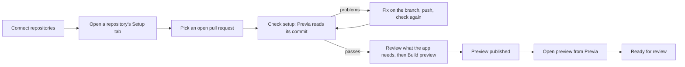

# 29 · Guided onboarding

A repository's **Setup** tab takes a team from a connected repository to a preview
someone has opened, for one open pull request, in five steps. It is Feature 2 of
[README-MVP-PRODUCT-EXPANSION.md](../README-MVP-PRODUCT-EXPANSION.md#5-feature-2-minimal-guided-onboarding):
a short, repository-specific path, not a framework detector, project generator or
code-writing assistant. Experienced users never have to use it: the Pull requests
tab builds exactly as before, and a repository that already has a working preview
shows every step done without running anything.

## User flow

After an Owner or Admin connects code, the Repositories page says to open a
repository's Setup tab, and the Overview's next steps link straight to it. The tab
picks the pull request setup last continued on (anyone's latest check), else the
most recently updated open one; a menu of links switches to another. Leaving and
coming back resumes from saved state, signed out or after a restart.

## The five steps

| Step | Done when (always derived from current records) | Shows and offers |
| --- | --- | --- |
| **Connect the repository** | The server has the GitHub App, the installation is active and the repository accessible | Managers: a link to unavailable repositories to restore access. Developers: which Owners/Admins to ask. |
| **Check the configuration** | A completed check of the head commit passed against the services on offer now, or the head commit already built | **Check setup** (a CSRF-protected request to a worker), its progress, problems with the key and line and the fix, a failed attempt with the last completed result kept for reference |
| **Review what the app needs** | A build of the head commit was requested | **Build preview**, or the reason it cannot start (merge conflicts, no build capacity), shown disabled beside it |
| **Publish a preview** | The head commit is live | Queued, building (with the build log), publishing, or the failure in the pull request page's words with **Retry build** |
| **Open it from Previa** | Someone opened that deployment through Previa's **Open preview** action | **Open preview**; then *Opened by you/name*, and What's next |

A step after an unfinished one waits for it. Each step has one primary action. Next
to the checklist, **What the app needs** lists what the checked commit declares:
port, health check, build context, Dockerfile, size, services, setup command,
processes, docs path, the *names* of `env` entries (never values) and the build
deadline. Its **Secrets** part lists stored secret names for Owners and Admins, and
for Developers names the people who manage secrets instead of offering an editor
they cannot use. Forks are told they get no secrets or outbound connections.

When the preview has been opened, **What's next** links to the pull request and,
for managers, to Members to invite a Reviewer. **Request review** is shown disabled
and labelled: review requests in Previa are not available yet (Feature 3).

## Setup checks

**Check setup** records a request for the head commit the page showed (a newer
commit refuses it with a notice) and queues a `repository_setup_check` job; the
page updates by itself through the repository's live stream when it finishes.

A worker with the GitHub App runs it in a few GitHub API reads, never downloading
the repository archive:

1. Resolve the repository by its immutable GitHub ID (a rename cannot redirect it).
2. Read `.previewrc.yaml` at the exact commit, with every response size-bounded.
   A 404 counts as *missing* only after the commit itself proves readable;
   otherwise access was lost.
3. Parse it with the build's own parser (`repoconfig.ParseFor`) against the
   services and build deadline the running build workers advertise, or Previa's
   default catalog when none runs: the same rule the Starter kits use.
4. Find the Dockerfile inside the build context, and the context itself when the
   Dockerfile is missing.
5. Apply the build's submodule rule (`source.SubmodulesInContext`) to the root
   `.gitmodules`.

What only a real start can show is labelled **Checked during the build**: that the
app starts, listens on its port, answers its health check, and that setup commands
and services work. A passing check is not a promise that the image compiles; a
failed build still gets the existing diagnosis.

The stored result holds only safe facts (names, paths, numbers and the parser's own
messages). A missing configuration suggests the **Own Dockerfile** Starter kit when
a root Dockerfile exists, otherwise the Starter kits; parser problems link to the
Starter kits editor, which checks an edited file the same way.

## Opening a preview from Previa

Every **Open preview** action for people who can build (the PR page, the PR list,
Previews, Builds and the Overview) goes to
`/repositories/{id}/pull-requests/{pr}/open`. Previa records who opened which
deployed commit, then answers 303 to the preview with `Referrer-Policy:
no-referrer`. Only navigations that start on Previa (`Sec-Fetch-Site` same-origin
or none) count; links from other sites and speculative prefetches still open the
preview but record nothing, and the prefetch rules exclude the route. Reviewers keep
direct links, since their navigation never opens repository pages. Addresses and
**Copy** stay the preview's own URL. A new commit starts the step again: the opened
record belongs to a deployed commit.

## The Overview and where new members start

The Overview's checklist follows the person's role. Owners and Admins see *Connect
a repository*; Developers see *Get access to a repository*, naming the Owners and
Admins to ask. Then *Check a pull request's setup*, *Publish a preview* and *Open it
from Previa*, each done from workspace-wide records (a team that already has a
usable preview sees no checklist). Only the next step carries its action, which
opens the Setup tab of the repository where setup continues.

Accepting an invitation now lands where the role starts, in the joined workspace:
Reviewers on **Previews** (the previews shared with them, until Feature 4's review
queue exists), everyone else on the Overview's next steps; a *Welcome to …* toast confirms the
join.

## Decisions

| Decision | Choice | Why |
| --- | --- | --- |
| Where it lives | A **Setup** tab beside Pull requests (Owner, Admin, Developer) | The repository page is where setup happens; no separate wizard, nothing forced on working repositories. |
| What is stored | Only the latest check per pull request and preview opens | Connection, validity and deployment are derived on every view, so nothing claims a step done after it stopped being true. |
| How checks run | A River job on any worker with the App, bounded queue (2), 45 s per attempt | The spec's bounded remote preparation; survives navigation; no Docker needed. |
| What checks read | A few contents-API reads at the exact commit | Cheap enough to run on request; the spec forbids fetching the whole archive for a page view. |
| Limits | One check of a commit at a time, 20 s between requests for one pull request, 60 per workspace and hour | Protects the App's GitHub rate limit from rechecks and scripts. |
| Freshness | A result names its commit and platform fingerprint (services, build deadline, check rules); a new commit or changed platform asks for another check. It reads as fresh for 15 minutes | A commit cannot change, so age alone never invalidates it; the page shows when it was checked. |
| Build gate | The tab's **Build preview** appears only after a passing check of the head commit; the PR page stays ungated | The guided path checks first; the expert path is unchanged. |
| Build action | The existing Build endpoint with `return=setup` | No second build path; refusals come back to the checklist with a fixed notice code. |
| Hosted wording | Production pages say *Build capacity is temporarily unavailable* and *Setup checks are delayed*; development pages name the worker setting | Operator detail stays private on hosted pages. |

**Deviations from the specification, flagged:** the record is per pull request
(`repository_setup_checks.pull_request_id`, its repository derived), not per
repository, so each pull request resumes its own check. *Application prerequisites
acknowledged* is acknowledged by building (no extra button or stored boolean).
Feature 2 was implemented before Features 3 and 4 at the owner's request
(README-MVP §11.2 lists it in step F): Request review is labelled not yet available,
and Reviewers land on Previews rather than a review queue.

## Data, jobs and fences

| Record | Holds |
| --- | --- |
| `repository_setup_checks` | One row per pull request: request revision, head SHA and generation, state (queued, running, complete, failed), failure code, requester and times; the last completed result (SHA, JSON, checked time, expiry, platform fingerprint), kept when a later attempt fails |
| `preview_opens` | Per person and pull request: the deployed commit opened and when |
| `setup_check_budgets` | Per workspace: the current hour's window and checks used |

Every query checks access with `workspace_repository_access`: `operate` for the tab
and checks, `read` for opening. A request records the check and its job in one
transaction. The worker claims a request under lock, reads GitHub with no
transaction open, then records the result only if the request revision, head commit,
generation, open state, repository access and active installation are all
unchanged; otherwise it records why (`stale_commit`, `pull_request_closed`,
`access_unavailable`). Known GitHub failures (`rate_limited`, `github_unavailable`,
`github_error`, `app_unavailable`) are recorded for people to retry; anything else is
retried by River and recorded on the last attempt. Triggers on both tables wake the
repository's live pages, and a live refresh waits while a menu on the page is open.

## Edge cases

| Case | Behaviour |
| --- | --- |
| No open pull request | Explains that previews are of pull requests, shows the last sync, and offers **Sync pull requests** (which returns to the tab). No synthetic data or branch previews. |
| Commit pushed while checking | The result is discarded and the step says the commit changed; the new head is *not checked yet*, with the earlier result named. |
| Missing secrets | Managers see stored names and a link to add some; Developers see whom to ask. Previa never claims to know which secrets an app reads. |
| GitHub rate limit or outage | The attempt shows its reason and time; the last completed result is shown as such, never as current success; **Try again** retries. |
| Check passes, build fails | The publish step shows the real diagnosis title and **Retry build**; the PR page has the details. |
| No build capacity | Build is shown disabled with the reason (hosted: *Build capacity is temporarily unavailable*). |
| Access revoked or repository disconnected | The connection step turns into a problem; a check finishing meanwhile records nothing. |
| A check nobody picks up | After two minutes it says the check did not finish and offers **Check again**. |

## Code and tests

| Path | Role |
| --- | --- |
| `internal/onboarding` | Routes, handler, service (pages, check requests, opens, journey), step derivation, GitHub reads, checks, worker |
| `web/pages/onboarding` | The Setup tab templates and display model |
| `web/styles/onboarding.css` | Checklist, picker and facts styles |
| `db/migrations/0038_repository_setup.sql` | The three tables and their realtime triggers |
| `internal/app/onboarding.go` | Platform fingerprint, secrets adapter, server and worker wiring |

Unit tests cover the checks over an in-memory tree, the GitHub reader against a fake
API, and every state of every step. PostgreSQL tests cover access by role,
resumption, the cooldown and allowance, the worker's fences, failures that keep the
last result, opens, the Overview journey, the realtime trigger and the HTTP routes
with real sessions, CSRF and public IDs. `make test-setup-browser` drives the whole
journey in Chromium ([02](02-development-setup.md#browser-regression-checks-optional)).
