# 30 · Native review and feedback

Every pull request has a **review page** where the people who build it write testing
instructions and every member who may see its preview records findings, discusses
them and resolves them, without leaving Previa. It is Feature 3 of
[README-MVP-PRODUCT-EXPANSION.md](../README-MVP-PRODUCT-EXPANSION.md#6-feature-3-native-preview-review-and-feedback),
together with delivery step B (§11.2): immutable references to each deployment, and
bounded activity records. Review requests, assignments and decisions are Feature 4
and are labelled as not available yet.

## User flow

```mermaid
flowchart LR
  A[Preview published] --> B[Developer opens the PR's Review tab]
  B --> C[Writes testing instructions]
  C --> D[Shares the review link]
  D --> E[Reviewer opens it, signs in]
  E --> F[Opens the preview, follows the steps]
  F --> G[Records a finding against the deployment shown]
  G --> H[Developer replies, pushes a fix]
  H --> I[New deployment published]
  I --> J[Reviewer verifies, resolves the finding]
```

Example: Ravi tests `/checkout` on Deployment 1, finds that an empty address crashes
it and records a finding with the page and the request that failed. Maya replies and
pushes a fix; Deployment 2 goes live. Ravi checks it and resolves the finding, which
says *Resolved by Ravi on Deployment 2*; the finding itself still says it was
recorded on Deployment 1.

## The review page

`/repositories/{repo}/pull-requests/{number}/review`, with public IDs like every
repository address. Owners, Admins and Developers with a grant reach it from the
pull request page's **Preview | Review** switch (the Review label counts open
findings); Reviewers from **Review** on Previews, from the review link, or from a
pull request link (which redirects them here). One compact page, no tabs:

- **Header:** title, repository and number, state, author, branch, live-update
  indicator, **Copy review link** and **View on GitHub**.
- **How to test** (main column): summary, numbered steps, expected result and
  optional start and docs pages, which open inside the preview. People who can
  build edit them in place; others read them.
- **Findings** (main column): Open / Resolved / All with counts, search, author and
  deployment filters, the new-finding form and the conversations, 50 per page,
  newest first.
- **Preview** (side): the newest deployment (*Deployment N* and its commit), its
  state (Live, Asleep, Previous deployment, Expired, Removed, Not deployed), when it
  was published and expires, whether a newer commit is being built or failed,
  **Open preview** and **Open docs**.
- **From GitHub** (side): the pull request description, escaped and labelled as
  imported; it never overwrites the instructions.

On a phone the Preview card comes first, so **Open preview** is one tap away.

## Instructions

Summary (one line, 500 characters), steps (one per line, at most 30 of 500
characters), expected result, a start page and a docs page. Pages are paths inside
the preview such as `/checkout?step=2`: absolute or protocol-relative addresses,
backslashes, control characters and query parameters that carry credentials
(`token`, `password`, `secret`, `api_key`, `session`, `auth`, `signature`, …) are
refused. All fields together are limited to 32 KB. Saving compares the revision the
editor opened: if someone saved meanwhile, the form shows their version beside the
draft and **Save mine instead** replaces it on purpose. Every save is a timeline
event. Instructions belong to Previa; repository configuration cannot change them.

## Findings

| Action | Who | Behaviour |
| --- | --- | --- |
| Record a finding | Anyone with preview access | Text (required), optional page path and reproduction details (a request and expected response, shown as code). Recorded against the deployment the page showed. |
| Reply | Anyone with preview access | Chronological; records the deployment shown when it differs from the finding's. |
| Edit | The message's author | In place; shows *Edited*; compares revision; never changes the deployment. |
| Remove | The author | Confirmed in a modal. Text, page and details are erased; a tombstone says who removed it. Removing an unanswered opening message removes the finding. |
| Remove as moderator | Owner, Admin, Developer | Anyone's message or a whole finding, with a reason (spam or off-topic, abusive, secrets or personal data, posted by mistake), shown on the tombstone. |
| Resolve / Reopen | The finding's author, or anyone who can build | Compares revision; a repeat is harmless. Resolving records the deployment only while the preview serves it. |
| Link | Anyone | **Copy link** in a finding's menu; clicking a finding's header opens its own page with every reply. Links require sign-in and access. |

Search is literal and case-insensitive over current text, page paths and details;
removed text is not searchable. *All* includes removed findings as tombstones. A
list shows each finding's opening message and its three latest replies; its own page
shows the rest.

## Deployments and the version shown

A **publication** is recorded when route activation makes a candidate the serving
preview, in that same transaction: not when a build finishes, not when a candidate
is prepared. Each pull request numbers them (*Deployment 1, 2, …*). A new commit or a
Rebuild of the same commit is a new deployment, because data, secrets or
configuration may differ; a failed update records none and the previous deployment
keeps serving and stays reviewable as itself. Each records SHA, generation,
revision, candidate and the effective configuration hash. Previews already live when
migration 0039 ran are backfilled with their deployed fence and say *Present at
migration*.

The new-finding form names the deployment it records against. If a newer one was
published before the server accepts the finding, the page returns with the draft
and asks: **Record against Deployment N** (the newest) or **Keep Deployment M** (the
one being tested). It never relabels silently. A live page that notices the new
deployment says so and keeps unsent drafts on the deployment they were written
against. Previa does not claim to know which bytes another browser tab showed.

## Access

| | Owner, Admin | Developer (granted) | Reviewer (granted) | Others |
| --- | --- | --- | --- | --- |
| Read the review page | ✓ | ✓ | ✓ | 404 |
| Record, reply, edit and remove own | ✓ | ✓ | ✓ | — |
| Resolve or reopen | any finding | any finding | own findings | — |
| Write instructions, moderate | ✓ | ✓ | — | — |

The workspace guard lets Reviewers use only the review page and its forms, the
repository's change stream and Open preview on repository paths; logs, output,
builds, secrets and settings stay closed, and forged requests get 404. Every query
checks `workspace_repository_access` again (preview for feedback, operate for
instructions and moderation). A write locks the pull request (key share), then the
writer's active membership (share), then the pull request's counters: removing a
member waits for a write in flight and every later write sees the removal. A removed
member's words stay, attributed as *former member*; they can no longer read or
change anything. Closed or merged pull requests are read-only except removal, so
authors and moderators can still take text back.

## Live updates and drafts

Triggers on the review tables notify the repository's realtime topic, so the page
(and the pull request page's count) refresh through the ordinary GET. While someone
types in a review form, a refresh waits and a note says new activity appears when
they leave the field; other unsent drafts, open edit forms and their hidden
deployment and revision are carried across the refresh. Without JavaScript every
action is a form post that redirects back to the same list and finding; edit and
remove use `?edit=` and `?remove=` with an in-page confirmation.

## GitHub

The living PR comment gains one line: **Review in Previa** (with **Build log** when a
preview exists), *sign in to Previa*. No review text, status, counts or people go to
GitHub. Projecting review status needs a repository sharing policy (delivery step
E), so review changes do not bump report versions today.

## Limits

| Limit | Value |
| --- | --- |
| Message text, reproduction details | 8 KB each |
| Instructions, all fields | 32 KB |
| Findings per pull request | 500 |
| Messages per pull request | 5,000 (opening messages included) |
| Messages per finding | 200 |
| Review changes per member | 300 per hour, across pull requests; repeats do not count |

Removing content never gives allowance back. A refusal says which limit applies and,
for the hourly allowance, when it resets; the draft is kept.

## Decisions

| Decision | Choice | Why |
| --- | --- | --- |
| Page shape | One review page beside the pull request page, switched with Preview \| Review | The spec's Review/Feedback/Activity tabs would split instructions, deployment and findings; the team's compact one-page pattern keeps them side by side. |
| Version identity | Per-PR deployment numbers, recorded at route activation | Matches what was actually served; same-SHA rebuilds stay distinct. |
| Storage | Current text plus edit and removal metadata | No unbounded edit history; removal erases. |
| GitHub | A link only | Private feedback stays in Previa until a sharing policy exists. |
| Activity | Recorded now, shown in Feature 4 | Step B must precede the review page; the timeline view belongs to review status. |

**Deviations from the specification, flagged:** no Review/Feedback/Activity tabs
(above); the GitHub projection is link-only until step E; the activity timeline has
no view yet (events are recorded and pruned); a per-finding cap of 200 messages and
an hourly allowance of 300 review changes per member were added to bound rendering
and churn.

## Data and activity

| Record | Holds |
| --- | --- |
| `preview_publications` | Per activation: pull request, repository, workspace (provenance), sequence, SHA, generation, revision, candidate, configuration hash, activation time, backfilled flag |
| `preview_components.config_hash` | The effective configuration the candidate was built with |
| `pr_review_instructions` | One per pull request: the fields, revision, who and when |
| `preview_feedback_threads` | Number, recorded deployment, author, state and revision, who changed it, the resolver's live deployment, moderation reason, idempotency key |
| `preview_feedback_messages` | Position, author, deployment shown, text, page and details (opening message), revision, edited, removed by and reason |
| `pr_review_counters` | Findings and messages ever written; numbering and limits |
| `review_write_budgets` | Per member: the current hour and changes used |
| `activity_events`, `activity_pruned` | Timeline events and the newest pruned time per pull request |

`internal/activity` records events in the caller's transaction (dedup key per
change) and an hourly River job (`activity_prune`, any worker) keeps 90 days and the
newest 5,000 per pull request, moving the pruned marker. Events carry numbers, never
text. Review state never depends on events. Everything cascades when housekeeping
deletes a retired pull request.

## Edge cases

| Case | Behaviour |
| --- | --- |
| Double click or resubmission | Same finding or reply (idempotency key per form). |
| Two editors | The second gets a conflict with their draft and the saved version. |
| Deployment published mid-draft | Version choice, draft kept; never relabelled. |
| Preview expired or removed | Findings stay readable and writable while the pull request is open; resolving records no deployment. |
| Failed update | The previous deployment stays current and labelled as such. |
| Script-looking or unusual text | Escaped; invalid UTF-8, control characters and direction overrides are refused. |
| Forged IDs or another workspace | 404; numeric IDs are refused on changes. |
| Finding removed meanwhile | A reply or resolve explains it; a live draft for it reports it could not be kept. |
| Limits reached | Honest refusal with the limit; the draft stays. |

## Code and tests

| Path | Role |
| --- | --- |
| `internal/reviews` | Handler, service, writes, limits, SQL |
| `internal/activity` | Recorder and retention job |
| `internal/environments/publications.go` | Publication record at activation |
| `web/pages/reviews`, `web/components/pull_request_tabs.templ` | Page and the Preview \| Review switch |
| `web/styles/reviews.css`, `web/static/js/ui.js` (`initReviews`) | Layout; edit toggles, removal modal, drafts across refreshes |
| `db/migrations/0039_reviews.sql` | Tables, backfill and realtime triggers |
| `internal/app/reviews.go` | Wiring and the activity adapters |

PostgreSQL tests cover access by role and workspace, the whole conversation, removal
and moderation, version conflicts, instructions and their conflicts, closed pull
requests, removed members, limits and the allowance, filters, search and pages,
cascade deletion and the realtime signal; HTTP tests cover every form without
JavaScript, conflicts, CSRF and forged IDs; publication tests drive real activation;
activity tests cover dedup and pruning. `make test-review-browser` drives the page in
Chromium ([02](02-development-setup.md#browser-regression-checks-optional)).
