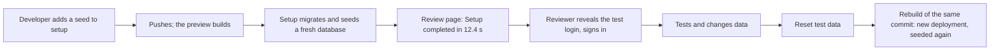

# 31 · Ready-to-test sample data

A preview with an empty database, or one nobody can sign in to, cannot be reviewed.
Previa already gives every preview its own fresh managed databases and runs the
repository's `setup` command once per deployment. This feature turns that into a
complete workflow:

- the repository seeds its own synthetic data in `setup`;
- the review page says how setup went for the deployment under review;
- **Reset test data** starts again from the seed;
- **Test access** gives reviewers a preview-only login through Previa.

Two reference journeys prove this end to end on real Docker. It is Feature 5 of
[README-MVP-PRODUCT-EXPANSION.md](../README-MVP-PRODUCT-EXPANSION.md#8-feature-5-ready-to-test-sample-data).

Previa never invents data for an application, never changes its source and never
connects to a preview's database itself. Seeds are the repository's own code, run
inside its own image with the preview's own credentials.

## User flow



Example: `acme/shop` seeds two synthetic orders and the preview-only account
`reviewer@preview.test`. Ravi opens the review, reveals the password, signs in and
adds an order while testing a discount. To check the fix from a clean state he asks
for **Reset test data**; when Deployment 2 is live the shop has its two seeded
orders again. Ravi's findings stay attached to Deployment 1.

## Seeding with `seed` (or `setup`)

`setup` is an argv list run once per candidate, after its managed services are
ready and before it can be published ([11](11-backend-previews.md)). Seed data goes
into its own `seed` key, which runs after `setup` only when the databases start
empty:

```yaml
services:
  postgres: 17
setup: ["bin/rails", "db:migrate"]
seed: ["bin/rails", "runner", "db/preview_seed.rb"]
```

Without Test data every database starts empty, so `seed` runs for every
candidate. With Test data ([32](32-persistent-test-data.md)) a candidate may start
from a copy of kept or baseline data instead; `setup` then runs on that data and
`seed` is skipped, so data is never seeded twice. A seed can also stay part of
`setup` (for example `sh -c "…migrate && …seed"`), as before persistent test data;
it must then be repeatable.

Rules that make a seed work in previews:

- **Synthetic and small.** Invented customers, orders and accounts, never copies of
  production data or production credentials.
- **Repeatable.** Insert what is missing (`ON CONFLICT DO NOTHING`,
  `find_or_create_by!`, `get_or_create`), so running it twice is harmless.
- **Fails loudly.** A seed that cannot run must exit non-zero: the update then fails
  with *setup failed* and the earlier deployment keeps serving.
- **Preview-only logins.** Create a limited account whose password comes from a
  repository secret (below), never an administrator of anything real.

Starter kits write migrations as `setup` and seed data as `seed` for each stack:

- Prisma's `migrate deploy` and `db seed`;
- Knex's `migrate:latest` and `seed:run`;
- Django's `migrate` and `loaddata preview`;
- Alembic's `upgrade head` and `python -m app.seed`;
- Rails' `db:migrate` and `db:seed`;
- Laravel's `migrate --force` and `db:seed --force`;
- a Go binary's own `migrate` and `seed` subcommands.

Spring apps get a note on a preview-only Flyway location instead. The kit's notes
and its *Seed data for reviewers* answer repeat these rules.

Without Test data every candidate starts from an empty database, so the seed runs
for every new commit, Rebuild and Reset. With Test data, new commits and Rebuilds
keep the pull request's data, and Reset offers the repository baseline or empty
databases and the seed ([32](32-persistent-test-data.md#reset-test-data)).

## Setup on the review page

The **Preview** card describes the deployment being reviewed:

| Shown | When |
| --- | --- |
| **Setup:** Completed in 12.4 s | The serving deployment declared `setup`, and it finished |
| **Setup:** No setup declared | It declared none |
| **Test data:** Fresh from setup for each deployment… | It runs managed databases. A refresh or idle sleep keeps the data; a new commit, Rebuild or Reset replaces it. With Test data on ([32](32-persistent-test-data.md)) the line says where this deployment's data started: *Kept from the previous version*, *Reset to the repository baseline* or *Fresh seeded data* |
| *The newest commit … failed in its setup command, so this is the previous deployment.* | A newer commit's setup failed; the earlier deployment and its data keep serving |

The facts belong to the deployment that serves (the newest publication), never to a
failed newer attempt. Setup output stays in the build log, which Reviewers cannot
open. Previa reports that setup *completed*, not that data was seeded: only the
application knows what its seed created.

## Reset test data

Owners, Admins and Developers with a grant see **Reset test data** on the Preview
card when a Rebuild would apply now:

- the pull request is open and buildable;
- its latest commit built successfully and is the one serving;
- nothing is building or being torn down;
- the deployment declared setup or runs managed databases.

The button opens a confirmation over the page. It names the commit and explains
three things: what starts fresh (empty databases that the setup command seeds
again), that the current preview keeps serving until the replacement is live, and
that findings stay with the current deployment.

Confirming posts the pull request's normal Build action as a Rebuild with
`reset=true`. The usual checks apply: GitHub verification, build policy,
capacity, fences and cleanup. The page then returns with *Reset requested…*. A
`preview.reset_requested` event is recorded in the same transaction as the request.
When the new deployment is live, the review page shows it (for example *Deployment 2*)
and the data is seeded again.

If the request no longer applies, the page explains and nothing is reset:

- the build changed meanwhile;
- the pull request was closed;
- building is blocked;
- GitHub could not confirm the pull request.

## Test access

The **Test access** card tells reviewers how to sign in to the repository's
previews. It sits beside the Preview card on every review page of the repository.

| Who | Can |
| --- | --- |
| Owners and Admins | Add, change and remove it (**Edit**, in place, with a toast) |
| Everyone with preview access (Developers and Reviewers with a grant, Owners, Admins) | See the account; **Reveal** the password |

- **Account:** an email or username, shown to everyone with access (with a copy
  button). Up to 300 characters, one line.
- **Password or token:** write-only. It is sealed with the platform's secret keys
  (AES-256-GCM) and bound to this repository and to its purpose, so it cannot be
  opened as a repository secret or for another repository. The form never shows it
  again: leave the field empty to keep it, tick *Remove the stored password* to
  delete it, or clear both fields to remove test access. Up to 512 bytes of
  printable text on one line.
- **Reveal** is a CSRF-protected POST answered with `Cache-Control: no-store`. With
  JavaScript, the value appears in place for two minutes with a copy button. Live
  refreshes keep it, unless test access changed meanwhile. Without JavaScript, the
  page comes back with the value shown. Reloading drops it.
- **Each reveal is recorded:** who and when (*Last revealed by Ravi · just now*), a
  `review.test_access_revealed` event, and one unit of the hourly review allowance.
  Saves record `review.test_access_updated` with only *changed / kept / removed*.
  The value never reaches a page fragment, the live stream, GitHub, logs or
  activity.
- **Live updates:** saving wakes open review pages. A reveal does not, so revealing
  never refreshes anyone's page, including your own.
- **No encryption keys:** if `SECRETS_ENCRYPTION_KEYS` is not set, only the account
  can be stored, and the form says so.
- **Removed members** lose Reveal immediately, like every review action.

Test access is shared test-login material, not a way to read repository secrets.
Its value must be one the seed actually creates: in the reference journey the seed
reads the repository secret `TEST_LOGIN_PASSWORD`, and the owner stores the same
password as test access. Because the value is kept across rebuilds, the seed must
recreate the same account on every deployment.

**Forks get no repository secrets.** Their seed cannot create the account, and should
say so in the app (the reference shows *Test login unavailable in this preview*).
Reviewers are never asked to work around that.

**Key rotation:** `make secrets-reencrypt` re-encrypts test access after repository
secrets and prints a separate `Test access:` line
([02 §8](02-development-setup.md#8-rotate-the-secrets-key)).

## Reference journeys

Both run through the worker's real pipeline:

- a fake GitHub over TLS;
- BuildKit builds of the repository's own Dockerfile;
- hardened previews with managed PostgreSQL 17;
- Traefik with HTTPS.

The app is `internal/app/testdata/reference`, a small Go binary with two modes. The
test is `TestRealReferenceJourneys`. The copies below are what a customer would
commit.

### Journey 1: an HTTP API with SQL data (`shop`)

`.previewrc.yaml`:

```yaml
port: 8080
resource_tier: small
health_check_path: /health
services:
  postgres: 17
setup: [reference, shop, setup]
docs_path: /docs
```

`Dockerfile`:

```dockerfile
FROM alpine:3.22
COPY --chmod=0755 reference /usr/local/bin/reference
CMD ["reference", "shop", "serve"]
```

The seed (`reference shop setup`), repeatable:

```sql
CREATE TABLE IF NOT EXISTS orders (id SERIAL PRIMARY KEY, customer TEXT NOT NULL UNIQUE,
  total_cents INTEGER NOT NULL, source TEXT NOT NULL);
INSERT INTO orders (customer, total_cents, source)
VALUES ('Preview customer A', 1250, 'seed'), ('Preview customer B', 4999, 'seed')
ON CONFLICT (customer) DO NOTHING;
```

- **Secrets:** none.
- **Expected records:** `GET /orders` lists *Preview customer A* (1250) and
  *Preview customer B* (4999), both from `seed`. `/docs` describes the API. The
  build log says `shop: migrated and seeded 2 orders`.
- **Steps:**
  1. Open the preview and `GET /orders`: two orders.
  2. `POST /orders` with `customer=Tester order`: a third order.
  3. **Reset test data**: once Deployment 2 is live, `GET /orders` lists the two
     seeded orders again.
  4. Push a commit whose seed fails (the test sets `SEED_FAIL=1`): the update fails
     with *setup failed*, the log names the failing seed, and Deployment 2 keeps
     serving its two orders.

### Journey 2: a web app with a test login (`notes`)

`.previewrc.yaml`:

```yaml
port: 8080
resource_tier: small
health_check_path: /health
services:
  postgres: 17
setup: [reference, notes, setup]
```

The `Dockerfile` is the shop's with `CMD ["reference", "notes", "serve"]`.

- **Secret:** the repository secret `TEST_LOGIN_PASSWORD` (Settings → Secrets), a
  random preview-only password.
- **Seed (`reference notes setup`):** creates `accounts` and `notes`, inserts three
  notes, and, when `TEST_LOGIN_PASSWORD` is set, upserts the account
  `reviewer@preview.test` with a hash of that password. Without it, it prints
  `TEST_LOGIN_PASSWORD is not set, so this preview has no test login`.
- **Test access:** account `reviewer@preview.test`, password the same value as the
  secret.
- **Expected records:** three notes, one preview-only account. The build log says
  `notes: seeded 3 notes and the preview-only account reviewer@preview.test` and
  never contains the password.
- **Steps:**
  1. On the review page, **Reveal** the password and copy it.
  2. Open the preview's `/login` and sign in as `reviewer@preview.test`: *Signed in
     as reviewer@preview.test* and three notes. A wrong password is refused.
  3. Open the same app from a fork: `/login` says *Test login unavailable in this
     preview*.

### Cleanup

Closing the pull requests tears every preview down. No container, image, network or
volume of any of them remains, and the failed seed's candidate was already removed
while the earlier deployment served.

### Tested

On 16 October 2026, with this change (schema version 40) on Docker Engine 29.8.1
(x86_64), Traefik v3.7.13, managed PostgreSQL 17 and `alpine:3.22`. Run it again
with:

```sh
make test-reference      # about 2 minutes after the first run; needs Docker and TEST_DATABASE_URL
```

## Verification

| What | Evidence |
| --- | --- |
| Both journeys on real Docker: seeded data, a tester's change undone by Reset (a new deployment of the same commit, the timeline event), a failed seed keeping the earlier deployment and cleaning the failed candidate, setup time recorded and shown, the revealed test access signing in, a wrong password refused, a fork without a test login, teardown leaving nothing | `TestRealReferenceJourneys` |
| Test access sealed (never stored or shown in clear), revisioned saves, Owners and Admins only, reveal by members with preview access, outsiders refused, bound to its repository and purpose, removal, the timeline, input limits | `TestTestAccessIsSealedAndRevealedOnRequest` |
| Account-only test access without encryption keys | `TestTestAccessWithoutEncryptionKeepsTheAccountOnly` |
| Key rotation of test access, and through `secrets-reencrypt` | `TestTestAccessFollowsKeyRotation`, `TestReencryptionCoversTestAccess` |
| Saves wake live pages; reveals do not | `TestTestAccessSavesWakeLivePagesButRevealsDoNot` |
| Forms with and without JavaScript: save, a refused password never echoed, Reviewers cannot save, CSRF, JSON and page reveals with `no-store` | `TestTestAccessSavesAndRevealsWithAndWithoutJavaScript` |
| Setup facts of the serving deployment (also after a failed update) and when Reset is offered | `TestTheReviewShowsSetupAndOffersReset` |
| Reset only with Rebuild, recorded once in the request's transaction, nothing requested when it cannot be recorded | `TestResetTestDataIsARebuildRecordedInItsTransaction` |
| The Build action returns to the review page with *Reset requested* or a notice | `TestResetFromTheReviewPageReturnsThere` |
| Setup duration recorded per candidate, clamped | `TestRecordComponentsKeepsOnlyServedRows` |
| Browser: setup facts, the Reset modal opening in place, test access added in place, revealed, kept across a live refresh, no JavaScript | `make test-review-browser` |

## Limits and what is deferred

- Test access is one value per repository, carried across rebuilds. Binding a value
  to one deployment, for seeds that generate new credentials, is deferred.
- A third reference journey (an app with a background process) is deferred.
- While a build runs, the review page says the commit is being built rather than
  showing a separate *Setup declared* state.
- Persistent test data (a repository baseline and kept PR data) is
  [Feature 5B](../README-MVP-PRODUCT-EXPANSION.md#8b-feature-5b-persistent-test-data).
