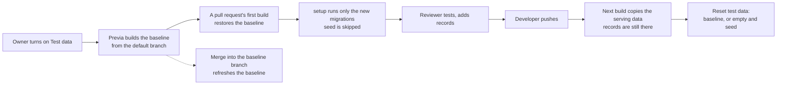
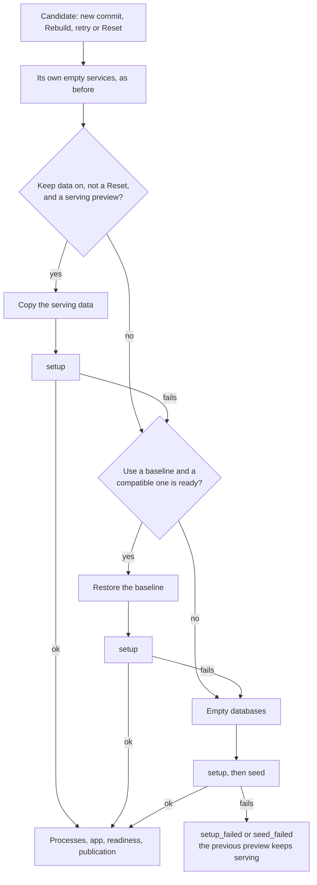

# 32 · Persistent test data

[31](31-test-data.md) makes a preview usable by seeding every candidate's empty
databases. Three problems remained:

- a reviewer's records disappeared with every push;
- every candidate of every pull request ran the full seed again;
- pull request migrations only ever met empty tables.

Persistent test data **shares copies of data, never a live database**:

- **A repository baseline.** Previa builds one branch with the repository's own
  migrations and `seed`, and stores an encrypted dump. Each pull request's first
  candidate restores its own copy.
- **Kept pull request data.** A pull request's next candidate starts from a copy of
  its serving preview's databases.
- **Reset test data.** It starts again from the baseline, or from empty databases
  and the seed.

It is Feature 5B of
[README-MVP-PRODUCT-EXPANSION.md](../README-MVP-PRODUCT-EXPANSION.md#8b-feature-5b-persistent-test-data).

The rule that keeps it safe:

- **Data moves in two directions only:** from the baseline branch to a pull
  request, and from a pull request to that same pull request's next candidate.
- **It never moves anywhere else:** not between pull requests, not into the
  baseline, not from a fork anywhere, not out of Previa.
- **Every candidate stays isolated:** it keeps its own service containers,
  credentials, network and tmpfs.

## User flow



Example, `acme/shop` (Rails, PostgreSQL 17):

```yaml
services: { postgres: 17, redis: 7 }
setup: ["bin/rails", "db:migrate"]   # every candidate: bring the schema up to date
seed:  ["bin/rails", "db:seed"]      # empty database only
```

1. **The Owner turns on Test data.** Previa builds `main@a1b2c3` without secrets,
   runs `db:migrate` then `db:seed`, and stores an encrypted dump.
2. **The first build of pull request #42** restores that copy. `db:migrate` applies
   only the new migration, to tables that already hold rows, and `seed` does not
   run.
3. **A tester adds records; a new commit keeps them.** The next build copies the
   serving data, and the PR page says *Started from: Previous build (d4e5f6)*.
4. **A merge into `main` refreshes the baseline** for later pull requests.

## Turning it on: the Test data tab

Every repository has a **Test data** tab next to **Setup**. Owners, Admins and
Developers with a repository grant can open it; Reviewers cannot.

| Setting | Default | Who changes it |
| --- | --- | --- |
| Test data | Off | Owner, Admin |
| Keep data between builds | On | Owner, Admin |
| Use a baseline | On | Owner, Admin |
| Baseline branch | The repository's GitHub default branch | Owner, Admin |
| Refresh automatically | On | Owner, Admin |

- **Saving.** Each switch saves in place and returns with a toast. Settings can be
  prepared while Test data is off, and repository YAML can never set them.
- **Conflicts.** Forms carry the settings revision, so a stale form says the
  settings changed meanwhile and changes nothing.
- **Turning on** confirms in a modal: Previa builds the baseline now, and that
  build uses build minutes.
- **Turning off** confirms in a modal and **deletes the repository's baselines**.
  Builds then start with empty databases and the seed, and running previews keep
  their data until their next build.
- **Turning only *Use a baseline* off** cancels a waiting refresh but keeps the
  baselines, unused.
- **The baseline branch decides** what every pull request starts with, forks
  included, so choose one only trusted maintainers can push to. The tab says so.
  Git's branch rules apply: no spaces, `..`, `~^:?*[\`, `@{`, `.lock` and so on.
- **Status.** Developers see the same tab without its controls, except **Refresh
  baseline**.

The tab shows:

- the current baseline of each SQL service: database, branch and commit, build
  time and size;
- whether the branch moved since the baseline;
- the five latest refreshes, with their trigger, result, safe failure category,
  duration and a **Build log** link;
- **Refresh baseline**, for Owners, Admins and Developers, confirmed in a modal
  that says it uses build minutes;
- **Delete** for the baseline (Owner or Admin), confirmed in a modal.

Live updates refresh the tab when a refresh starts, waits, finishes or the
settings change.

When the workers offer no PostgreSQL or MySQL, or no worker can store baselines
because `SECRETS_ENCRYPTION_KEYS` is not set, the tab says so. In the second case
kept data still works.

## The `seed` key

| Key | Type | Rules |
| --- | --- | --- |
| `seed` | list of strings (argv) | Same limits as `setup`: program first, at most 64 arguments and 4 KiB, no NUL bytes. Replaces the image's entrypoint and command. Requires a PostgreSQL or MySQL service. Part of the configuration hash. |

`seed` runs after `setup` **only when the databases start empty**, and in baseline
builds, within `PREVIEW_SETUP_TIMEOUT`. With `seed` declared, `setup` must be safe
to run again on a database that already has data. Migrations are; most seeds are
not. Starter kits write the split for each stack:

| Stack | `setup` | `seed` |
| --- | --- | --- |
| Next.js / Node.js | Prisma `migrate deploy`, Knex `migrate:latest`, `npm run migrate` | Prisma `db seed`, Knex `seed:run`, `npm run seed` |
| Django | `manage.py migrate --noinput` | `manage.py loaddata preview` |
| FastAPI | `alembic upgrade head` | `python -m app.seed` |
| Rails | `rails db:migrate` (or `db:prepare`) | `rails db:seed` |
| Go | `/app/server migrate` | `/app/server seed` |
| Laravel | `artisan migrate --force` | `artisan db:seed --force` |

Repositories without `seed` still work. `setup` runs on copied data too; if it
seeds in a way that cannot repeat, the copied attempt fails and the fallback
reaches the empty database. The result is the same as before, only slower, and
the PR page suggests moving the seeding into `seed`.

## Starting data for every candidate



1. **Sources are tried in order:** kept data, then the baseline, then empty.
   - The order is decided per SQL service, so an added service starts from the
     baseline or empty while the others keep their data.
   - Data moves only into the same or a newer version of the same kind (16 → 17
     works, 17 → 16 does not).
   - Redis is never copied; it always starts empty, so queues and caches never
     cross builds.
2. **`setup` runs after every source; `seed` only on the empty attempt.**
3. **Fallback on copied data.** A failed setup (non-zero exit or timeout) or copy
   records the reason, restarts the candidate's database containers from the same
   specification (their tmpfs starts empty again) and tries the next source.
   - At most two fallbacks happen.
   - The empty attempt is authoritative: its failure is the build's
     `setup_failed` or `seed_failed`, and the earlier preview keeps serving.
4. **Only setup and copy failures fall back.** An app that fails its readiness
   check fails the build normally, and the failure suggests Reset test data.
5. **The candidate records** where it started (kept: the source commit and
   deployment; baseline: branch, commit and build time; empty), every fallback and
   its reason, and the Setup and Seed timings. It never records data.

Copy problems are recorded as:

| Reason | Meaning |
| --- | --- |
| `copy_failed` | the dump from the serving preview failed or timed out |
| `restore_failed` | the restore failed, or the baseline file could not be read |
| `too_large` | the database ran out of its tmpfs |
| `version_incompatible` | the copy came from a newer version |
| `setup_failed` | setup failed on the copied data |

How the data moves:

- **Inside the service containers.** The dump and the restore run inside the
  service containers, as the containers' own users and credentials:
  - PostgreSQL: `pg_dump --format=custom`, restored with `pg_restore
    --single-transaction --exit-on-error`;
  - MySQL: `mysqldump --single-transaction --routines --triggers --events`.
- **Streamed, never stored for kept data.** Kept data streams from one exec to the
  other through the worker: no disk file, and no network path between candidates.
- **Bounded output.** Dump and restore output is never logged; the build log
  records only sources, sizes and durations.
- **Time limit.** Each dump-and-restore is bounded by `PREVIEW_DATA_COPY_TIMEOUT`.

## Repository baseline

### Which branch

The baseline follows **the repository's GitHub default branch**, whatever it is
called. Previa reads it from the repository API at every refresh, so a renamed or
changed default branch is followed. An Owner or Admin may choose another existing
branch instead. There is one baseline per repository: pull requests to other
branches use it too and fall back when it does not fit.

### How a refresh builds it

1. **Resolve the branch head** with the installation's token. A missing branch
   fails with `branch_not_found`.
2. **Prepare and validate** the commit's `.previewrc.yaml` with the worker's
   catalog. A baseline needs `seed` and a PostgreSQL or MySQL service; otherwise
   the refresh fails with `config_invalid` and says what to add.
3. **Build the image** with the normal builder, limits and redacted log.
   - It gets **no repository secrets** and has its own build cache scope, so
     forks can receive the result.
   - It is admitted like a pull request build: it takes a build slot
     (`MAX_CONCURRENT_BUILDS`) and counts toward the workspace's running builds
     and daily build minutes.
4. **Start every requested service** with generated credentials on an internal
   network of its own: no egress proxy, no outbound connection, no route.
   - The host's preview budget must hold the services plus `setup` and `seed`.
   - YAML `env` applies; repository secrets do not.
5. **Run `setup`, then `seed`**, each within `PREVIEW_SETUP_TIMEOUT`. No app
   starts.
6. **Capture each PostgreSQL and MySQL database.** The dump runs inside the
   service container and streams to the worker, which writes it:
   - gzip-compressed and encrypted with the platform keyring;
   - bound to the repository and to the purpose `previa:baseline:<key>`;
   - size-limited (`PREVIEW_BASELINE_MAX_SIZE`, after compression);
   - checksummed (SHA-256 of the stored file).
7. **Record the result in one transaction.** The new dumps become current and the
   previous ones are retired; their files are deleted an hour later, once no
   candidate can still be restoring them.
8. **Remove everything the refresh created.** Its containers, network and image
   carry a baseline label, so housekeeping and crash recovery find them.

The whole refresh is bounded by `BUILD_TIMEOUT`. Its log has the same writer, caps
and redaction as a pull request's build log. Owners, Admins and Developers with a
grant read it from the tab, with a download link.

### Triggers

| Trigger | When | Spaced |
| --- | --- | --- |
| Test data turned on (or *Use a baseline* turned back on) | Settings save | No |
| Baseline branch changed, with automatic refresh | Settings save | No |
| Pull request merged into the baseline branch | The `pull_request` `closed` webhook with `merged`, in the same transaction as the pull request's state change | Yes |
| Daily check | Each repository's branch head is looked at once a day; a refresh is requested when it moved past the baseline and the latest refresh did not already try that commit | Yes |
| Baseline unusable | A missing or corrupt file (marked missing at once), or a catalog that no longer offers its version | Yes |
| Refresh baseline | Owner, Admin or Developer with a grant | No |

With *Refresh automatically* off, only the first build, a branch or baseline
change and the button create baselines. The tab then shows when the branch moved.
Turning Test data on is the Owner's authorization for automatic baseline builds;
it does not authorize pull request builds, and Manual build policy is unchanged.

### Coalescing, ordering and waits

- **Coalescing.** One refresh waits and one runs per repository. Requests made
  while one waits join it; a request made while one runs becomes the single
  follow-up, which resolves the branch head when it starts.
- **Ordering.** Every refresh has an increasing sequence number. A result becomes
  current only if it is newer than the current baseline. A result is discarded
  with its files when Test data or the baseline was turned off, or another branch
  was chosen, while it ran.
- **Spacing.** Automatic refreshes of one repository start at least
  `PREVIEW_BASELINE_MIN_INTERVAL` apart. Refreshes a person asks for start at
  once.
- **Waits.** A refresh without a free build slot waits (*Waiting for a free build
  slot*), as it does while the workspace runs its allowance of builds. One whose
  workspace used today's build minutes waits until 00:00 UTC. A refresh that could
  not run (GitHub or the worker unavailable) retries every two minutes, up to ten
  times, then fails as `unavailable`.
- **Paused builds.** With `BUILDS_PAUSED`, refreshes wait like builds.

Failure categories:

| Category | Meaning |
| --- | --- |
| `branch_not_found` | the branch does not exist |
| `config_invalid` | the configuration lacks `seed` or a SQL service |
| `build_failed` | the image build failed or the refresh ran out of `BUILD_TIMEOUT` |
| `service_failed` | a database did not start |
| `setup_failed` / `seed_failed` | the command failed or timed out |
| `capture_failed` / `capture_too_large` | the dump could not be taken, or exceeds `PREVIEW_BASELINE_MAX_SIZE` |
| `unavailable` | Previa could not run it |

Any failure keeps the previous baseline current and affects no pull request build.

## Kept pull request data

When *Keep data between builds* is on and the build is not a Reset, a new
candidate copies **that pull request's serving preview**:

- **The source is the preview that serves now.** It may be asleep: sleeping
  previews keep their services running. After a failed update it is the earlier
  deployment that still serves.
- **No snapshot of later writes.** The copy is taken just before the new
  candidate's `setup`, from a consistent snapshot. Writes made in the old preview
  while the new candidate prepares are not included; the PR page says so.
- **Nothing to keep, nothing copied.** If nothing serves (never published,
  expired, torn down), there is nothing to keep and the baseline is used.
- **Forks keep their own data.** Kept data never leaves its pull request.
- **Previa stores no copy.** Kept data lives only in candidates' tmpfs and ends
  with the preview: expiry, teardown, close and merge delete it.

## Reset test data

The confirmation on the review page ([31](31-test-data.md#reset-test-data)) gains a
choice when Test data uses a ready baseline:

| Choice | Starts from |
| --- | --- |
| Repository baseline `main@a1b2c3` (default) | The current baseline, then `setup` |
| Empty database | Empty services, then `setup` and `seed` |

- **The same Rebuild.** Reset is still a Rebuild of the serving commit, with the
  same verification, permissions, quotas, policy, fences and cleanup.
- **The source is checked and recorded.** The server accepts only `baseline` or
  `empty`; without a choice a Reset starts empty, so a Reset never keeps data. The
  `preview.reset_requested` activity event records the source.
- **Only this pull request.** A Reset never touches other pull requests or the
  baseline.
- **A normal Rebuild keeps data.** Reset is the way to start clean.

## What people see

With Test data off nothing below appears: builds behave exactly as
[31](31-test-data.md) describes, with every database empty.

| Where | What |
| --- | --- |
| PR page, *Runs with* | `PostgreSQL 17 · setup ran · seed ran`, and *Data is kept between builds; Reset test data on the review page starts clean.* (or *Data does not survive a rebuild.* without kept data) |
| PR page, *Test data* | *Started from: Repository baseline (main@a1b2c3).*, every fallback reason (*The previous build's data did not work with this branch (setup failed).*), and for kept data that later writes are not included |
| PR page, failure | A seed failure has its own diagnosis; an app that fails on kept data is pointed to Reset test data |
| Review page, *Test data* | *Kept from the previous version…*, *Reset to the repository baseline…* or *Fresh seeded data…* |
| GitHub comment (Ready) | `Test data: kept from previous build.` (or `repository baseline`, `empty database and seed`); never rows, sizes or credentials |
| Test data tab | Baselines, refreshes, settings, refresh build logs |

## Data and access rules

- **No secrets or outbound approvals in baseline builds**, so baselines can be
  restored into forks.
- **Files are protected.** Baseline files are encrypted, readable only by the
  worker (mode 0600 in a 0700 directory), never downloadable and never shown as
  rows. A file that fails to decrypt or whose checksum differs is marked missing,
  and a refresh is requested.
- **Who may do what.** Owners and Admins change settings, turn Test data off and
  delete baselines. Owners, Admins and Developers with a grant refresh baselines,
  read refresh logs and reset test data. Reviewers see only the source line.
- **Activity is recorded** for operators: settings changes, baseline refreshes,
  failures and deletions.
- **Disconnection cleans up.** Disconnecting a repository or deleting a workspace
  deletes its settings, refreshes and baseline records. Cleanup removes their
  files.
- **What baselines come from.** Only the repository's own `seed`. Uploading
  dumps, capturing a preview's data into the baseline, copying databases reached
  through outbound connections and production data are all excluded.

## Operating it

| Variable | Process | Default | Meaning |
| --- | --- | --- | --- |
| `PREVIEW_BASELINE_DIR` | worker | `previa-baselines` in the system temporary directory | Where encrypted baseline files are written (an absolute, clean path) |
| `PREVIEW_BASELINE_MAX_SIZE` | worker | `64MiB` | Compressed size limit per service dump (1 MiB–4 GiB) |
| `PREVIEW_DATA_COPY_TIMEOUT` | worker | `2m` | Limit for one dump-and-restore (10 s–30 min) |
| `PREVIEW_BASELINE_MIN_INTERVAL` | worker | `1h` | Least time between automatic refreshes of one repository (1 min–24 h) |

- **Keys.** Baselines need `SECRETS_ENCRYPTION_KEYS` on the worker, the same keys
  as repository secrets. Without them the worker announces no baseline storage,
  keeps refresh jobs waiting and restores no baseline; kept data still works.
- **Storage.** Production should mount a persistent directory
  ([25](25-production-deployment.md)). A temporary directory works, but a lost
  file is rebuilt after its next use fails.
- **Derived data.** Baselines are rebuilt from their branch, so backups exclude
  them, and the control-plane database holds only their metadata. Several workers
  would need shared storage; this release runs one worker for them.
- **River jobs.**
  - Refreshes run on the build queue as `baseline_refresh`, one job per
    repository.
  - The `test_data` queue runs a dispatcher every minute (it replaces lost jobs),
    the freshness check hourly (up to 50 branch heads each time, each repository
    once a day) and cleanup hourly.
  - Cleanup removes retired files after an hour, files no baseline records after
    six hours, and leftovers of refreshes that are not running after ten minutes.
    It keeps each repository's 20 latest refreshes and their logs.
- **Worker capability.** The worker's capability row has `baselines`; the Test
  data tab reads it.

## Edge cases and recovery

- **A pull request branched before the baseline's newest migration.** `setup` on
  the baseline may fail; the fallback to empty and seed is shown with its reason.
- **An edited migration that already ran on kept data** is considered applied by
  the migration tool. Previa cannot detect a stale schema; the PR page and Reset
  point to a clean start.
- **A serving database that is unhealthy, a failing dump, or a copy over the
  limit** moves on to the baseline. The serving preview is only read.
- **A missing or corrupt baseline file** is marked missing and a refresh is
  requested (with automatic refresh). Candidates fall back meanwhile.
- **A deleted or renamed branch.** With the default branch, the new default is
  followed. With a chosen branch, the refresh fails with `branch_not_found`, and
  the daily check records it, until an Owner picks another.
- **A worker crash during a refresh.** The refresh stays running; the next run of
  its job takes it over after removing its labelled leftovers, and cleanup removes
  anything left. A candidate interrupted mid-copy is cleaned like any failed
  candidate.
- **A settings change during a build.** The candidate uses the settings read when
  its build started; the next build uses the new ones.
- **Seeds that generate random values.** Everyone starts from the same baseline
  snapshot, which makes pull requests comparable.

## How it is verified

- **Configuration** (`internal/repoconfig`): `seed` parsing, limits, the
  database requirement and the reserved name.
- **Streams and storage**: streamed encryption (`internal/secrets/stream_test.go`);
  storage encryption, binding, checksum and the size limit
  (`internal/sampledata/storage_test.go`).
- **Data mechanics on real Docker** (`TestRealRuntimeCopiesTestData`, `make
  test-runtime`): PostgreSQL 16 → 17 and MySQL 8.4 copy, restart emptying a
  database, capture then restore, and refused input.
- **Unit tests**: source order, version rules, fallback records and restore
  classification (`internal/runtime/data_test.go`).
- **Database tests** (`internal/sampledata`):
  - the first baseline, coalescing and the sequence fence;
  - failures keeping the previous baseline;
  - capacity and quota waits, retries and spacing;
  - takeover after a crash, turning off mid-build and paused builds;
  - settings permissions, conflicts and consequences;
  - Delete and Turn off, merges into the baseline branch, unusable baselines;
  - branch rules, freshness, cleanup and the dispatcher;
  - the tab's HTTP behaviour.
- **Other packages**: baseline logs (`internal/buildlogs`), the PR page and the
  Reset source (`internal/pullrequests`), the review page (`internal/reviews`),
  the comment line (`internal/reporting`) and path permissions
  (`internal/workspaces`).
- **The journey on real Docker** (`TestRealTestDataJourneys`, `make
  test-test-data`, PostgreSQL):
  - the baseline built from the default branch and stored encrypted;
  - a first build restoring it with only its own migration;
  - a tester's order surviving a new commit and a Rebuild, which the comment
    reports, while a parallel pull request never sees it;
  - Reset to the baseline and to empty and seed;
  - an incompatible history falling back to empty and seed;
  - a broken migration failing as `setup_failed` while the earlier deployment
    serves;
  - a fork starting from the baseline;
  - a merge webhook refreshing the baseline;
  - teardown leaving nothing behind.

MySQL is proven at the runtime level (copy, capture and restore on MySQL 8.4)
rather than in a second web journey.
