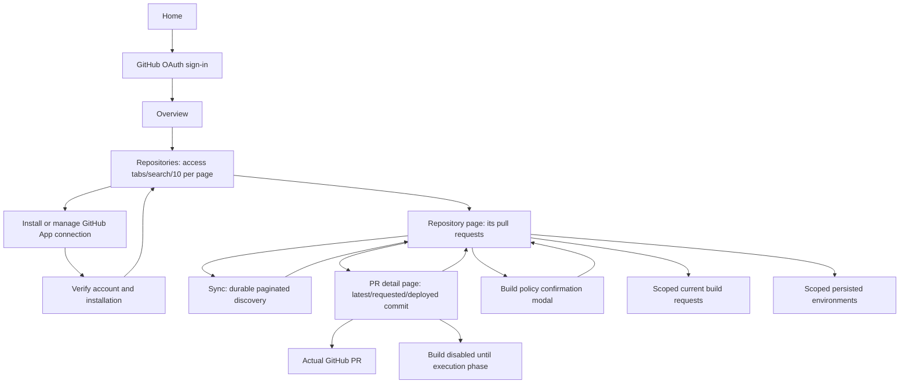
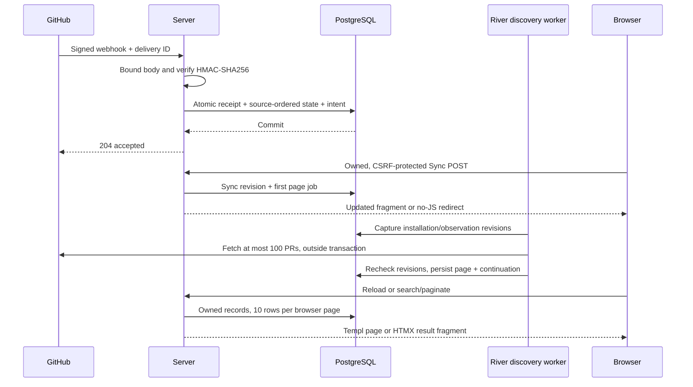

# Previa: features and user flow

Previa connects GitHub repositories, tracks pull requests and manages the intent
to create temporary previews. This guide covers the working control-plane screens.
For installation/configuration commands, use [DEVELOPMENT_SETUP.md](DEVELOPMENT_SETUP.md).

## Start the application

- Start PostgreSQL and apply schema updates:

  ```sh
  docker compose -f deploy/docker-compose.yml up -d --wait postgres
  make migrate-up
  ```

- In separate terminals, start the server and worker:

  ```sh
  make dev
  ```

  ```sh
  make run-worker
  ```

- Open `http://localhost:8080`. Both processes should report a successful database
  health check. Run targets load `.env`; manual `set -a` steps are unnecessary.
- Dashboard login needs OAuth credentials and `SESSION_SECRET`. Repository linking
  needs the five GitHub App settings; PR discovery workers need only App ID and PEM
  path. Signed deliveries also need server-only `GITHUB_WEBHOOK_SECRET`.

## Sign in and connect a repository

1. On Home, click **Get started with GitHub**. Authorize dashboard sign-in; you arrive
   at **Overview** with installation/repository counts from your own workspace.
2. Open **Repositories**. Click **Install on a repo** in the header; on GitHub choose
   the account and repositories to grant the App access.
3. Finish the setup redirect and GitHub App user authorization. Previa verifies the
   signed-in account's access and the installation before linking it.
4. The repository list defaults to **Available**. **Unavailable** retains previously
   linked repositories whose access was removed/suspended; **All** includes both.
5. Use name search; results update after a short typing pause. Clearing search shows
   all matching records in the selected tab. Repositories appear as compact cards,
   two columns on desktop and one on mobile. Each card shows its name, owner and
   access badge; clicking anywhere on it opens the PR list. Pages contain up to ten
   records; pagination appears only for multiple pages. Small collections size to
   their content, and larger collections scroll in the main content area.
6. **Manage connections** opens the Previa GitHub App installation flow for your
   account. Use it to connect another installation or update selected repositories,
   then complete verification again. Keeping this action after linking is intentional.

## Discover and browse pull requests

1. Repositories shows only the source list. Select one to open its dedicated
   repository page with its PRs, sync state and build policy.
2. Click **Sync Pull Requests** for initial discovery or to refresh known state.
   This queues metadata discovery; it does not start builds.
3. Keep the configured worker running. Queued/syncing progress updates automatically
   every three seconds on that page. Last synced shows the latest successful
   completion beneath the clickable owner/repository title. Each API page continues durably
   until the list finishes. If refresh fails, existing records remain visible;
   check App permissions/worker configuration and retry.
4. The list defaults to **Open**, with **Closed**, **Merged** and **All** tabs. Search
   title, PR number, author or branch. Each page contains ten PRs; clearing search
   restores the selected state filter. Search and pagination also work with ordinary
   GET forms when JavaScript is disabled.
5. Click a PR to open its dedicated detail page. **Back to pull requests**
   restores the search, state and page you were browsing. Review:
   - **Latest observed commit**: current GitHub head known to Previa.
   - **Current build request**: authorized work and its captured commit/deadline.
   - **Deployed preview**: persisted deployment state and deployed commit.
6. **Not requested** means that no build intent exists. **Not deployed** means that
   no environment exists. Connecting/discovering PRs never creates an empty environment.
7. A **Refresh required** notice means conflicting source observations were handled
   conservatively; refresh to obtain a current authoritative GitHub snapshot.
8. The title adds the selected PR number/title. Click the repository breadcrumb
   or **Back to pull requests** to return to its list. **Repositories** or the
   owner breadcrumb returns to the directory. **View on GitHub** opens the actual
   PR. Builds and Environments remain in the sidebar.

Pages are bookmarkable at `/repositories/123` and
`/repositories/123/pull-requests/7`. Browser Back/Forward and reload retain the
current page. Repository filters use `q`, `access`, `page`; PR filters use `pr_q`,
`pr_state`, `pr_page`. Breadcrumbs preserve these filters when returning to a list.
Search/filter controls share a row on desktop and stack on tablet/mobile. Each
page uses the full content area. With JavaScript disabled, ordinary page links,
GET forms and native modal confirmation remain usable. Old query-based selection
URLs redirect to dedicated pages after ownership checks.

## Choose a repository build policy

1. **Enable Automatic Builds** is off by default in Manual mode. Its switch and
   **Sync Pull Requests** appear only on the repository's PR list page. Use
   **Back to pull requests** from an individual PR to reach them.
2. A confirmation modal opens over the current page. Click **Enable automatic**
   to save in place; Cancel, Close or Escape leaves it off. Turning the switch off
   directly saves Manual. Failed saves keep the existing mode and allow retry.
3. **Manual** is the default: PR events update tracking but do not automatically
   authorize builds.
4. **Automatic** applies to subsequent relevant PR events. Each new commit resets
   the five-minute quiet deadline. Enabling it does not request builds for existing PRs.
5. Switching to Manual cancels unstarted automatic work. It preserves running work
   and existing deployments; it does not request teardown.
6. Closed/merged PRs supersede outstanding builds and record teardown intent in
   either mode. External cleanup completes only when runtime adapters are connected.

**Build latest commit is disabled in this phase.** Real execution still needs
exact-SHA source/config preparation, Docker build/runtime, fork/secrets enforcement,
fenced routing/publication and cleanup adapters. Direct POSTs also reject the action;
no unsupported build is submitted. A future enabled action must first verify current
upstream state and atomically fence that observation against concurrent events.

## Other workspace screens

| Screen | What to use it for |
| --- | --- |
| Overview | Your real installation/repository/access summary and links to workspace pages. |
| Repositories | Connections, access filters and entry point to repository/PR details. |
| Builds | Actual current/latest authorized intent, commit and deadline across your repositories. This is not an attempt-history archive. |
| Environments | Actual persisted deployment status and deployed SHA. Routing URLs, runtime health, live logs and manual teardown remain part of the execution phase. |
| Developer tools | Queue diagnostics: submit a ping; the separate River worker processes it. |

An empty Builds/Environments view is normal when no real record exists. These pages
never display fabricated activity, health or preview URLs. Removed access is labeled;
only the installation owner can see records or change policy/refresh state.

## Webhooks and logout

- Configure the App webhook following [WEBHOOKS_AND_PR_DISCOVERY.md](WEBHOOKS_AND_PR_DISCOVERY.md).
  Authentic opened/reopened/synchronize/closed events update tracking; comments and
  reviews do not trigger builds. Existing PRs still require discovery.
- For a local signature check, run `make test-webhook`; expect HTTP 204. This sends
  a harmless signed ping event, not a build request.
- Use the account menu → **Log out** → confirmation modal. Cancel keeps the current
  session; Confirm returns to Home. GitHub's own session remains independent.

## Browser flow




