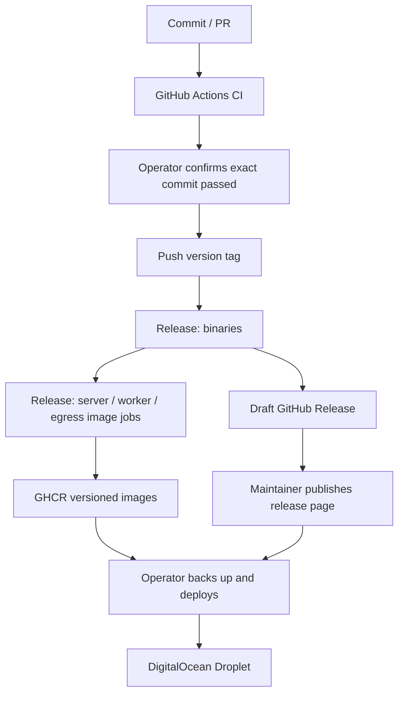

# CD in action: how Previa becomes a production release

Previa currently has **automated release publishing and manual production
deployment**. GitHub Actions builds versioned binaries and Docker images.
An operator then installs the selected version on the DigitalOcean Droplet.
There is no checked-in workflow that SSHes into that host, deploys on every
commit, or automatically rolls back a failed deployment.

This guide explains [release.yml](../.github/workflows/release.yml),
[.goreleaser.yaml](../.goreleaser.yaml), the [Dockerfile](../Dockerfile), and the
connection to the existing deployment scripts. It describes the checked-in
behavior reviewed on **2026-10-06**, not proof that a particular GitHub Release
or live server has been verified.

Read [CI in action](ci-in-action.md) for the checks before publishing.
Use [25 · Production deployment](../docs/25-production-deployment.md) for the full
DigitalOcean account, Droplet, DNS, secrets, monitoring, Spaces and recovery
runbook. The commands below explain that existing process; they do not provision
anything by being documented.

## Contents

- [CI, delivery, deployment and live previews](#1-the-four-different-activities)
- [Machines, services and artifacts](#2-where-everything-lives)
- [Release workflow settings](#3-the-release-workflow-level-blocks)
- [The binaries job](#4-the-binaries-job)
- [GoReleaser configuration](#5-goreleaseryaml-block-by-block)
- [The images job](#6-the-images-job)
- [Dockerfile and build context](#7-the-dockerfile-and-dockerignore)
- [Publish a release, step by step](#8-how-to-publish-a-release)
- [Deploy to DigitalOcean manually](#9-how-the-release-reaches-digitalocean)
- [Backups and rollback](#10-backups-failures-and-rollback)
- [Secrets and configuration locations](#11-which-credentials-go-where)
- [Automatic deployment and troubleshooting](#12-automation-boundaries-and-troubleshooting)

## 1. The four different activities

| Activity | Meaning | Current implementation |
| --- | --- | --- |
| Continuous integration | Validate a proposed change | `ci.yml` runs generation, build, lint, vulnerability and test jobs |
| Release delivery | Produce and publish a named installable version | `release.yml` publishes binaries and container images from a version tag |
| Production deployment | Change the version running for users | Operator performs the Droplet runbook and verification |
| PR preview deployment | Build/run an app from a connected repository | The deployed Previa worker manages Docker previews on that Droplet |

CD can mean continuous delivery or continuous deployment. This project's current
automation covers artifact delivery. It does not implement automatic production
deployment. A successful release job says the publication steps succeeded;
production remains at its previously selected version until the operator deploys.



The review-to-tag arrow is an **operator responsibility**, not an implemented
dependency between the CI and Release workflows. The separate `Release`
workflow has no `needs` relationship to CI, and does not rerun the full CI suite.

## 2. Where everything lives

| Resource | Location | Responsibility |
| --- | --- | --- |
| Release build jobs | GitHub-hosted `ubuntu-24.04` runners | Compile/package/publish, then finish |
| Release archives and checksums | GitHub Releases | Downloadable executables and selected deployment documentation/files |
| Platform Docker images | GitHub Container Registry, `ghcr.io` | Stores images for the host to pull |
| Production platform | One DigitalOcean Droplet, Ubuntu + Docker Compose | Runs server, worker, Traefik, PostgreSQL and optional monitoring |
| Production database | Docker `postgres` service, volume `previa_postgres` on the Droplet | Application state, sessions, repository secrets and River jobs |
| Live app previews/builders | Docker containers created by the worker on the same Droplet | PR runtime and temporary app builds |
| Encrypted backup archives | Private DigitalOcean Spaces bucket | Off-host DB/config/certificate recovery |
| Public DNS | Cloudflare authoritative zones | Points dashboard/wildcard names to the chosen host address |

GitHub's runner VMs are temporary build machines. You do not configure them
through DigitalOcean. [Runner infrastructure](https://docs.github.com/en/actions/concepts/runners/github-hosted-runners).
The workflow has no DigitalOcean Container Registry, App Platform integration or
`doctl` provisioning command. GHCR is image storage; it does not run the app.

The host pulls **Previa platform images** from GHCR. The worker builds **users'
PR images** locally on the host. Those PR images are not published by this
release workflow, and each PR does not create another Droplet.

## 3. The Release workflow-level blocks

### 3.1 Header comments and name

```yaml
name: Release
```

This gives the workflow its Actions sidebar label. The file's comments describe
release publishing and an intended protected environment. Comments do not
configure GitHub settings or approval rules; the actual environment setup is
explained below.

### 3.2 Tag event

```yaml
on:
  push:
    tags: ["v*.*.*"]
```

A pushed tag matching this pattern requests the Release workflow. A local
`git tag` alone does not send an event to GitHub; it must be pushed.

| Example event | Starts this workflow? |
| --- | --- |
| Push `v0.2.0` | Yes |
| Push `v0.2.0-rc.1` | Matches the pattern; GoReleaser handles prerelease status |
| Push another commit to `main` | No |
| Open/update a PR | No |
| Publish the draft release page | No new run; there is no `release: published` trigger |
| Select a manual workflow dispatch | Not available in this YAML; no `workflow_dispatch` |

The pattern is a glob, not complete semantic-version validation. Use a new,
valid version and let packaging validate it. There is no restriction in this
block saying the tag must point to `main` or a commit that passed CI.

### 3.3 Default permissions and Go selection

```yaml
permissions:
  contents: read

env:
  GOTOOLCHAIN: local
```

Read-only repository contents access is the workflow default. Publication jobs
explicitly request their write permissions below.

`GOTOOLCHAIN=local` uses the job's installed Go toolchain. `setup-go` reads the
required version from `go.mod`, currently **1.26.8**. It is unrelated to the
application's version tag such as `v0.2.0`.

There is no workflow `concurrency` block. Multiple tags can request separate
release runs; nothing here serializes production deployment.

## 4. The binaries job

### 4.1 Runner, environment and publication permissions

```yaml
binaries:
  runs-on: ubuntu-24.04
  environment: release
  permissions:
    contents: write
```

`binaries` is the job ID used by the image job's `needs: binaries` dependency.
It uses a GitHub-hosted Ubuntu runner. No explicit `timeout-minutes` is declared
in this release job; GitHub's platform limits still apply.

`contents: write` authorizes the job token to create/update the GitHub Release
and its assets. It does not give the job access to the production database or
DigitalOcean host.

`environment: release` associates the job with the GitHub environment named
`release`. Configure **Settings → Environments → release** with allowed tag rules
and required reviewers when your GitHub plan/repository supports them.
The YAML alone creates no reviewer approval requirement.
[Environment behavior and configuration](https://docs.github.com/en/actions/how-tos/deploy/configure-and-manage-deployments/manage-environments).

A GitHub environment is deployment metadata/protection/secrets configuration;
it is not a running VPS or a replacement for `/etc/previa/previa.env`.

### 4.2 Checkout with history

```yaml
- uses: actions/checkout@v4
  with:
    fetch-depth: 0
    persist-credentials: false
```

Checkout fetches the tagged source. `fetch-depth: 0` also fetches history/tags
needed by release versioning/changelog tooling. The CI checkout is shallow by
default, whereas this binary release checkout explicitly requests history.
`persist-credentials: false` avoids leaving checkout credentials in Git config.
[Checkout inputs](https://github.com/actions/checkout/tree/v4).

### 4.3 Install Go and the SBOM tool

```yaml
- uses: actions/setup-go@v5
  with:
    go-version-file: go.mod
- uses: anchore/sbom-action/download-syft@v0
```

Go setup prepares the toolchain specified by the repository. The Syft download
Action supplies the component-inventory tool used by GoReleaser's SBOM phase.
An SBOM is a software bill of materials: a list of components/dependencies
associated with the published artifact.

### 4.4 Execute GoReleaser

```yaml
- uses: goreleaser/goreleaser-action@v6
  with:
    distribution: goreleaser
    version: "~> v2"
    args: release --clean
  env:
    GITHUB_TOKEN: ${{ secrets.GITHUB_TOKEN }}
```

| Field | Effect |
| --- | --- |
| `distribution: goreleaser` | Selects the GoReleaser distribution |
| `version: "~> v2"` | Selects the configured v2 version range, not Previa's release number |
| `args: release --clean` | Runs the release pipeline and cleans its output directory first |
| Step `GITHUB_TOKEN` | Supplies the automatically generated job token for GitHub publication |

The command reads the root `.goreleaser.yaml`. Its `--clean` applies to generated
release output on the runner; it does not clean the Droplet, database or Spaces.
The Action version `@v6`, GoReleaser v2, Go 1.26.8 and Previa's `v0.2.0` tag
identify four different things.

This workflow requires no manually created production GitHub App token or
DigitalOcean secret for publication. The token's permissions come from the job.
[GoReleaser Action](https://github.com/goreleaser/goreleaser-action),
[GitHub token](https://docs.github.com/en/actions/concepts/security/github_token).

## 5. .goreleaser.yaml block by block

### 5.1 Configuration format and project name

```yaml
version: 2
project_name: previa
```

`version: 2` is the GoReleaser configuration format. `project_name` supplies the
artifact naming prefix. Neither sets the application's runtime version; that
comes from the tag.

### 5.2 Before-build hooks

```yaml
before:
  hooks:
    - sh deploy/install-tailwind.sh bin/tailwindcss-v4.1.18
    - bin/tailwindcss-v4.1.18 -i web/styles/app.css -o web/static/css/app.css --minify
    - go tool -modfile=tools/go.mod templ generate -path web
```

The hooks install the pinned/checksummed Tailwind executable, generate/minify CSS,
and generate template Go code. The application embeds those presentation assets
in its binaries. There is no separately published frontend server.

These hooks do **not** run the full `make generate` SQL-generation/drift check
from CI. The release builds use committed SQL access code; verify CI before
tagging rather than assuming Release repeats every validation.

### 5.3 Shared Go build settings

```yaml
builds:
  - &build
    id: server
    main: ./cmd/server
    binary: previa-server
    env: [CGO_ENABLED=0]
    goos: [linux]
    goarch: [amd64, arm64]
    flags: [-trimpath]
    ldflags:
      - -s -w -X github.com/ajaykathwatee/previa/internal/platform/version.Version={{ .Tag }}
    mod_timestamp: "{{ .CommitTimestamp }}"
```

| Setting | Meaning |
| --- | --- |
| `&build` | YAML anchor naming these shared build settings |
| `id: server` | Identifies this build entry to GoReleaser |
| `main` | Go command package to compile |
| `binary` | Output executable name |
| `CGO_ENABLED=0` | Disables CGo for these builds |
| `goos: [linux]` | Produces Linux executables |
| `goarch` | Produces AMD64 and ARM64 variants |
| `-trimpath` | Removes source/build-machine path information from compiled output |
| `-s -w` | Removes symbol/debug information, reducing executable size |
| `-X ...Version={{ .Tag }}` | Sets Previa's reported version to the release tag |
| `mod_timestamp` | Uses the source commit timestamp for the binary file timestamp |

`{{ .Tag }}` and `{{ .CommitTimestamp }}` are **GoReleaser templates**.
They are different from GitHub's `${{ ... }}` expression syntax and a shell's
`$VARIABLE`. The historical Go module owner in the linker path contains
`ajaykathwatee`; do not casually replace it with the GitHub account spelling.
[GoReleaser Go builds](https://goreleaser.com/customization/builds/builders/go/).

### 5.4 Commands inheriting the shared settings

Each following entry starts with `<<: *build`. That YAML merge reuses the common
settings, then overrides its `id`, `main` and `binary`:

| ID | Go package | Executable / role |
| --- | --- | --- |
| `server` | `./cmd/server` | `previa-server`: dashboard, HTTP API, webhooks and live updates |
| `worker` | `./cmd/worker` | `previa-worker`: River jobs and preview orchestration |
| `migrate` | `./cmd/migrate` | `previa-migrate`: embedded Goose/River migrations |
| `route-sync` | `./cmd/route-sync` | `previa-route-sync`: synchronize accepted routing state |
| `housekeeping` | `./cmd/housekeeping` | `previa-housekeeping`: maintenance/cleanup command |
| `secrets-reencrypt` | `./cmd/secrets-reencrypt` | `previa-secrets-reencrypt`: repository-secret rotation |
| `egress` | `./cmd/egress` | `previa-egress`: outbound proxy and readiness probing |

Publishing all seven executables does not mean seven long-running host services.
The Compose deployment runs persistent server/worker processes, uses migrate
as a one-shot command, and invokes maintenance tools when appropriate.

### 5.5 Archives and included files

```yaml
archives:
  - formats: [tar.gz]
    name_template: "{{ .ProjectName }}_{{ .Version }}_{{ .Os }}_{{ .Arch }}"
    files:
      - README.md
      - docs/**/*
      - deploy/production/**/*
      - deploy/observability/**/*
```

This packages the Linux architecture-specific executables in compressed archives,
named from the project/version/OS/architecture. For example, a version can produce
`previa_0.2.0_linux_amd64.tar.gz` and its ARM64 counterpart.

The listed documentation, production scripts/Compose files and monitoring files
accompany the executables. A release archive is not the full Git source checkout
or root Dockerfile context. `technical-docs/**/*` is not among these extra-file
patterns, so these two guides are available in the repository rather than
automatically included as extra archive files.

### 5.6 Checksums and component inventories

```yaml
checksum:
  name_template: checksums.txt
  algorithm: sha256

sboms:
  - artifacts: archive
```

`checksums.txt` records SHA-256 checksums for release artifacts so downloads can
be compared with the expected files. The SBOM phase uses Syft to inventory the
archives. Checksums/inventories support verification; they are not deployment
health checks or an automatic guarantee of safe application behavior.

### 5.7 Changelog

```yaml
changelog:
  use: github
  sort: asc
```

GoReleaser uses GitHub-backed changelog generation with ascending order.
Review the generated notes and add the release's actual migration/configuration,
compatibility and recovery information. These fields do not run tests or decide
whether the release is production-ready.

### 5.8 Publication destination, draft and prerelease handling

```yaml
release:
  github:
    owner: '{{ envOrDefault "GITHUB_REPOSITORY_OWNER" "ajaykathwatee" }}'
    name: previa
  draft: true
  prerelease: auto
```

The owner is taken from the runner's GitHub repository-owner environment when
available, with the historical module owner as fallback. The repository name
is configured as `previa`; if the project is moved/renamed, review this setting.

`draft: true` leaves the GitHub Release awaiting a maintainer's publication.
`prerelease: auto` derives prerelease handling from the version.
[GoReleaser release settings](https://goreleaser.com/customization/publish/scm/).

A draft release does not stop the following image jobs. Once this job succeeds,
they can publish GHCR images even before you publish the release page.

## 6. The images job

### 6.1 Runner, environment, dependency and permissions

```yaml
images:
  runs-on: ubuntu-24.04
  environment: release
  needs: binaries
  permissions:
    contents: read
    packages: write
    id-token: write
    attestations: write
```

`needs: binaries` waits for binary publication to succeed. It does not transfer
the earlier workspace or wait for CI. Each image job checks out source again.

| Permission | Purpose |
| --- | --- |
| `contents: read` | Read repository source |
| `packages: write` | Publish images to GHCR |
| `id-token: write` | Obtain the OIDC identity used for build attestations |
| `attestations: write` | Publish GitHub artifact attestations |

These permissions concern GitHub publication. The OIDC permission is not a
DigitalOcean token or an SSH key. The same `release` environment applies here,
with whatever protection rules you configured; approval of the binaries phase
does not encode a bypass of all later environment checks.

### 6.2 Matrix: three image jobs

```yaml
strategy:
  matrix:
    target: [server, worker, egress]
```

GitHub expands this into jobs with `matrix.target` set to each listed target.
They can build independently after `binaries` succeeds. There is no declared
`fail-fast: false` or special partial-publication recovery.

A failure can leave some images published while others are missing or cancelled.
An archive plus one image is not a complete release. Verify all three targets
and both supported architectures before deployment.

### 6.3 Checkout, QEMU and Buildx

After checkout with `persist-credentials: false`:

```yaml
- uses: docker/setup-qemu-action@v3
- uses: docker/setup-buildx-action@v3
```

QEMU makes CPU emulation available for multi-platform builds; Buildx prepares
Docker's builder. The current Dockerfile runs its build stage on `BUILDPLATFORM`
and cross-compiles Go for `TARGETARCH`, so its Go compilation does not depend on
running target executables under QEMU. QEMU is nevertheless configured.
[QEMU Action](https://github.com/docker/setup-qemu-action).

### 6.4 Authenticate to GHCR

```yaml
- uses: docker/login-action@v3
  with:
    registry: ghcr.io
    username: ${{ github.actor }}
    password: ${{ secrets.GITHUB_TOKEN }}
```

The runner's Docker client logs into GitHub Container Registry using the run's
actor and the job token. The image namespace is the repository owner, not
necessarily that actor's username.

This does not log Docker into GHCR on your Droplet. Private package pulls require
separate host authentication.

### 6.5 Build, push and attach image metadata

```yaml
- name: Build and push previa-${{ matrix.target }}
  id: push
  uses: docker/build-push-action@v6
  with:
    context: .
    target: ${{ matrix.target }}
    platforms: linux/amd64,linux/arm64
    build-args: VERSION=${{ github.ref_name }}
    tags: ghcr.io/${{ github.repository_owner }}/previa-${{ matrix.target }}:${{ github.ref_name }}
    provenance: mode=max
    sbom: true
    push: true
```

| Input | Effect |
| --- | --- |
| `name` | Shows the concrete matrix target in Actions |
| `id: push` | Names this step so later steps can reference its outputs |
| `context: .` | Uses the checked-out workspace as build context |
| `target` | Selects the server, worker or egress final Dockerfile stage |
| `platforms` | Publishes AMD64 and ARM64 variants |
| `build-args` | Supplies the tag as the binary's version |
| `tags` | Sets image owner, name and explicit release tag |
| `provenance: mode=max` | Requests detailed BuildKit provenance metadata |
| `sbom: true` | Requests image component inventories |
| `push: true` | Uploads the outputs to GHCR |

For tag `v0.2.0` under `ajaykathwate`:

```text
ghcr.io/ajaykathwate/previa-server:v0.2.0
ghcr.io/ajaykathwate/previa-worker:v0.2.0
ghcr.io/ajaykathwate/previa-egress:v0.2.0
```

There is no `latest` tag in this workflow. Use the actual owner and review
registry naming/access if the repository moves. Docker can select the matching
architecture from the published image index.
[Build/push Action inputs](https://github.com/docker/build-push-action).

CI uses `--load` with local `:ci` tags; Release uses `push: true` with versioned
GHCR tags. They are different build/publish paths.

### 6.6 GitHub build-provenance attestation

```yaml
- uses: actions/attest-build-provenance@v2
  with:
    subject-name: ghcr.io/${{ github.repository_owner }}/previa-${{ matrix.target }}
    subject-digest: ${{ steps.push.outputs.digest }}
    push-to-registry: true
```

The subject name identifies the image repository. The digest comes from the
preceding push step and identifies the exact published output. The final option
publishes the attestation through the registry workflow.

This records build origin/identity separately from BuildKit's provenance/SBOM
options. The binaries job has no equivalent GitHub attestation step for archives.
Consumers must verify/evaluate provenance for it to inform trust. It does not
prove vulnerability-free code, live health or database compatibility. The current
Droplet commands do not enforce automatic attestation verification.
[Artifact attestations](https://docs.github.com/en/actions/concepts/security/artifact-attestations).

## 7. The Dockerfile and .dockerignore

### 7.1 Pinned image arguments

The Dockerfile declares `GO_IMAGE` and `RUNTIME_IMAGE` with digest-pinned
defaults: Go 1.26.8 on Debian Bookworm for compilation, and nonroot distroless
static Debian 12 for server/worker runtime. A digest identifies image content;
the descriptive version tag alone is not the same pin.

`ARG` supplies build configuration, not production secrets. The Tailwind
checksum and Go module checksums supply additional build-input checks.

### 7.2 Build stage and dependency layer

```dockerfile
FROM --platform=$BUILDPLATFORM ${GO_IMAGE} AS build
ARG TARGETOS=linux TARGETARCH
WORKDIR /src
ENV CGO_ENABLED=0 GOTOOLCHAIN=local GOFLAGS=-trimpath
COPY go.mod go.sum ./
COPY tools/go.mod tools/go.sum tools/
RUN --mount=type=cache,target=/go/pkg/mod go mod download
COPY . .
ARG VERSION=dev
```

1. Compile on the build machine's own platform.
2. Accept the target OS/architecture for cross-compilation.
3. Work in `/src` and disable CGo/toolchain switching.
4. Copy dependency manifests before source to allow reuse of dependency layers.
5. Download modules using a BuildKit cache mount.
6. Copy source after applying `.dockerignore`.
7. Read `VERSION`, overridden by CI/release.

These caches belong to the builder. They do not transfer its Docker data to the
DigitalOcean host.

### 7.3 Compilation heredoc

The next `RUN ... <<BUILD` block uses module/Go-build cache mounts, enables
`set -eu`, installs Tailwind, generates CSS/templates, creates output directories,
and loops over the seven Go command packages.

It sets `GOOS`/`GOARCH`, embeds `VERSION` through linker flags and writes
`/out/bin/previa-<command>`. `-buildvcs=false` avoids requiring VCS metadata inside
the build context, where `.git` is excluded.

`/out/state/sources` and `/out/state/router` are empty directories prepared for
the nonroot worker. They do not contain production state.

### 7.4 Server target

The server stage copies `previa-server`, `previa-migrate` and
`previa-secrets-reencrypt` into `/usr/local/bin` and runs as UID/GID 65532.

| Instruction | Role |
| --- | --- |
| `EXPOSE 8080 9090` | Documents listener ports; does not publish host ports |
| `ENV HTTP_ADDR ... INTERNAL_ADDR ... APP_ENV=production` | Sets default listener/environment values |
| `HEALTHCHECK ... previa-server healthcheck` | Runs application probes at the configured interval, timeout and start period |
| `ENTRYPOINT ... previa-server` | Starts the server unless a caller overrides the entrypoint |

Compose uses this image with an overridden command for the one-shot migration
service. Production secrets arrive through runtime configuration/mounts.

### 7.5 Worker target

The worker stage copies `previa-worker`, `previa-route-sync` and
`previa-housekeeping`. It copies the state directories with
`--chown=65532:65532` and runs as that nonroot user.

It sets the internal listener to `0.0.0.0:9091`, production environment, source
workspace and router directory. Its healthcheck calls `previa-worker healthcheck`;
its entrypoint starts the worker. `EXPOSE 9091` does not publish that port.

Compose separately supplies the Docker socket, networks, volumes and limits.
The image alone does not create those runtime dependencies.

### 7.6 Egress target

The egress stage uses `FROM scratch`, copies only `/previa-egress`, runs as
UID/GID 65532, declares port 3128, and sets the executable as entrypoint with
`serve` as its default command.

The worker creates the live `previa-egress` container through Docker.
Compose's `egress` service under profile `images` stages/pulls/builds the image;
do not enable that profile on normal `up` commands.

### 7.7 Build-context exclusions

[.dockerignore](../.dockerignore) excludes:

- VCS/editor metadata, local binaries, release output, temporary and coverage data.
- Generated templates and CSS, regenerated inside the build.
- Browser `node_modules` and artifacts.
- Local `.env` variants, with an exception allowing `.env.example`.
- PEM/key files and matching local DNS-credential files.

The runtime still needs protected host configuration and credentials.
An image is not a backup of the production database.

## 8. How to publish a release

### 8.1 Prepare GitHub once

1. Enable Actions and allow the referenced Actions under repository policy.
2. Keep workflows/supporting files committed on the default branch.
3. Configure branch rules requiring the intended CI checks.
4. Configure environment `release` with allowed tags and desired reviewers
   where your plan supports them.
5. Ensure jobs can use their declared publication permissions.
6. After publication, review GHCR visibility/repository access. Public source
   alone does not establish that packages are public.

No production SSH key, OAuth secret, App PEM, Spaces key or DigitalOcean token
is consumed by these publication jobs. `GITHUB_TOKEN` is supplied automatically.

### 8.2 Select and tag the exact candidate

On your workstation with a reviewed clean checkout:

```sh
git switch main
git pull --ff-only origin main
git status
git rev-parse HEAD
```

Confirm the exact commit passed CI/staging. A PR run may have tested a temporary
merge SHA; inspect the final candidate's `main` run. Review migration/rollback
compatibility and the smoke-test coverage in
[CI in action](ci-in-action.md#75-production-stack-smoke-test).

Then create/push a new unused version. Example only:

```sh
PREVIA_RELEASE=v0.2.0
git tag -a "$PREVIA_RELEASE" -m "Previa $PREVIA_RELEASE"
git push origin "$PREVIA_RELEASE"
```

Creating the tag labels the local commit. Pushing starts Release on GitHub,
without changing the DigitalOcean server.

### 8.3 Inspect publication and publish the draft

1. Open **Actions → Release** and verify tag/commit.
2. Approve environment jobs if configured protection requests it.
3. Inspect the binary job and all three image matrix jobs.
4. Verify archives, checksums, SBOMs and all image tags/platforms.
5. Open **Releases**, review the draft's notes/assets and publish it deliberately.
6. Record source commit, tag and image digests for deployment.

Do not move/reuse a published tag to quietly replace a version. Inspect partial
publication before retrying; select a new version if source/release contents
must change. Nothing here makes partial publication atomic.

## 9. How the release reaches DigitalOcean

### 9.1 First deployment versus later upgrades

For a new host, follow the production guide's Steps 0–10. They create/prepare
the Droplet, firewall/admin access, checkout, GitHub integrations, credentials,
DNS, backup client and staging-to-production certificates. An image pull alone
does not create those prerequisites.

This guide's upgrade example assumes:

- The existing deployment lives at `/opt/previa`.
- The protected production env is `/etc/previa/previa.env`.
- PostgreSQL/router and backup configuration already work.
- The selected release passed staging, and recovery keys/artifacts are available.
- Commands run in an administrative root shell during the planned maintenance.

Example version/domain values must be replaced. Run one step at a time and stop
on failed verification.

### 9.2 Connect and define the production helpers

On your workstation:

```sh
ssh ops@YOUR_SERVER_IP
```

Use the dedicated SSH key/agent configured by the host guide. On the Droplet:

```sh
sudo -i
cd /opt/previa
dc() {
  docker compose -p previa \
    -f /opt/previa/deploy/production/compose.yml \
    --env-file /etc/previa/previa.env --profile observability "$@"
}
probe() {
  docker run --rm --network previa_control curlimages/curl:8.15.0 \
    -fsS --max-time 15 "$@"
}
```

`dc` explicitly chooses the production project, Compose file, env file and
monitoring profile. `probe` reaches the private health listeners through the
control network. These functions exist only in this shell; redefine them after
reconnecting.

### 9.3 Record the old version and pause builds

Before selecting the new checkout/images:

```sh
git rev-parse HEAD
git describe --tags --exact-match
dc images
probe http://server:9090/readyz
probe http://worker:9091/readyz
dc run --rm --no-deps migrate status
docker inspect --format '{{.Config.Image}} {{.Image}}' previa-egress
```

Record the commit/tag, schema, actual image IDs/digests and host overrides.
Retain old artifacts and a protected configuration copy.

Edit the env file:

```sh
nano /etc/previa/previa.env
```

Set its single `BUILDS_PAUSED` entry to `true`, then load that setting:

```sh
dc up -d --force-recreate --no-deps worker
probe http://worker:9091/readyz
```

Verify the paused capability and that existing builds drained/cancelled.
Pausing new builds does not stop cleanup, routing, reporting or every DB write.
Plan a quiet maintenance window where the release's migrations require it.

### 9.4 Make and verify a fresh Spaces backup

```sh
systemctl start previa-backup.service
systemctl status previa-backup.service --no-pager
journalctl -u previa-backup.service -n 30 --no-pager
```

The host's backup script dumps PostgreSQL, archives configuration/ACME state,
encrypts them with age, and uploads through root's rclone configuration to Spaces.
Confirm all three encrypted artifacts and the success timestamp, not merely that
the service was started. Keep the backup timestamp and offline age identity
available before changing versions.

This backup uses the Droplet's existing configuration. The Release workflow does
not run it and does not know the Spaces secret.

### 9.5 Select matching checkout, version and image names

```sh
git fetch --tags origin
PREVIA_NEXT_RELEASE=v0.2.0
git checkout --detach "$PREVIA_NEXT_RELEASE"
nano /etc/previa/previa.env
```

For a GHCR deployment, the relevant entries have this shape:

```dotenv
PREVIA_VERSION=v0.2.0
PREVIA_SERVER_IMAGE=ghcr.io/ajaykathwate/previa-server
PREVIA_WORKER_IMAGE=ghcr.io/ajaykathwate/previa-worker
PREVIA_EGRESS_IMAGE=ghcr.io/ajaykathwate/previa-egress
BUILDS_PAUSED=true
```

Use the actual tested tag/owner. Image-name values omit the tag because Compose
adds `PREVIA_VERSION`. Keep the password, encryption keyring, session secret,
valid certificates and other production settings. Apply required release config
changes deliberately.

The source checkout matters even when pulling images: it selects the matching
Compose, scripts and monitoring configuration. Changing only a release page
or env version does not recreate the running containers.

### 9.6 Pull and validate

For private GHCR packages, authenticate root's Docker client on the host:

```sh
docker login ghcr.io -u YOUR_GITHUB_USERNAME
```

Enter an authorized package-read credential at the prompt. Public package pulls
normally need no login. This host credential is different from the runner's
temporary publication token.

Then:

```sh
dc config --quiet
dc --profile images pull
dc run --rm --no-deps server check-config
dc run --rm --no-deps worker check-config
```

`config --quiet` validates Compose without printing interpolated secrets.
The `images` profile includes the egress image for pulling, but must not be
enabled on normal startup. The two app commands should print
`configuration is valid`; this does not prove actual GitHub/DNS/DB access.

For a source-built deployment, omit the three image-name overrides and replace
the pull step with `dc --profile images build server worker egress` from the
selected clean checkout. The root Dockerfile performs compilation; Go/Node do
not need to be installed directly on the production host for this path.

### 9.7 Migration gate and service replacement

With PostgreSQL healthy and the release's maintenance conditions met:

```sh
dc run --rm --no-deps migrate
dc up -d --wait --wait-timeout 180
probe http://server:9090/readyz
probe http://worker:9091/readyz
dc run --rm --no-deps migrate status
```

The migrate image command runs forward Goose/River migrations. Compose's normal
dependency also requires migration completion before server/worker start.
`up` reconciles definitions/images; `restart` alone does not load changed env
values or select the new image definition.

Stop if migration/startup fails. Earlier migrations may have committed even if
a later one fails. A version switch is not proof those changes were undone.

Two existing runtime details require special handling:

1. **Egress:** the worker reuses `previa-egress` by name. Pulling a new egress
   image does not automatically replace that container. Follow production U4
   when replacement is required, preserving/reconciling its network addresses.
2. **Traefik:** recreating `previa-router` loses dynamically added preview-network
   attachments. Preserve and reconnect them through the production guide's
   router procedure. An internally healthy router can still lack access to
   live preview backends.

Review whether the candidate will recreate the router/egress before applying it.
Do not promise uninterrupted traffic from this single-host replacement.

### 9.8 Live verification, resume and deployment record

Before resuming, check real HTTPS, sign-in, GitHub webhooks/access, monitoring,
existing preview URLs, a disposable preview build and PR feedback. Internal
readiness alone does not exercise all of those external paths.

Set `BUILDS_PAUSED=false` in the env file only after checks pass:

```sh
dc up -d --force-recreate --no-deps worker
probe http://worker:9091/readyz
systemctl start previa-backup.service
```

Verify the new backup and expected worker capability. Record source commit,
release, actual image versions, schema, checks and recovery checkpoint.
Keep previous images/backups through the rollback window.

The Droplet runs Docker services after the SSH session ends. CI runners do not
keep production running; Docker restart policies and host operations do.
An automatic server restart does not fetch/deploy the newest GitHub commit.

## 10. Backups, failures and rollback

### 10.1 Three different recovery mechanisms

| Mechanism | Location / purpose | Relationship to Release |
| --- | --- | --- |
| Nightly/manual encrypted logical backup | Spaces: PostgreSQL dump, config and ACME archives | Existing host timer/script, independent of release publication |
| Optional Droplet backup/snapshot | DigitalOcean disk image | Extra host recovery, not an app version switch |
| Previous platform images/checkout | GHCR/local images and Git source | Select old executable/configuration definitions |

The default logical schedule is `previa-backup.timer` at 02:30 UTC with up to
15 minutes randomized delay; inspect the actual installed timer.
Spaces stores archives, not a second running database. PostgreSQL stays on the
Droplet. A release archive or Docker image does not contain live production rows.

### 10.2 Failed release versus failed deployment

If GitHub publication fails, inspect that run and partial artifacts. The current
production server stays at its existing version because no deploy step ran.

If a manual rollout fails, keep builds paused and choose a recovery action based
on whether configuration, executable compatibility, schema/data or the host failed.
No controller automatically picks/restores a backup for you.

### 10.3 Compatible application/image rollback

If the previous executable is verified compatible with the current database:

1. Keep builds paused and preserve failure logs/state.
2. Select the previously recorded checkout and `PREVIA_VERSION`.
3. Pull/use the recorded previous images and validate config.
4. Reconcile services, readiness and public paths.
5. Handle egress/router attachment changes separately where required.
6. Resume only after verification.

The existing DB and encryption key versions needed for newer writes remain.
`previa-migrate` supports forward migration/status, not production `down`.
Accepting a newer schema number does not prove an older binary understands all
changed tables/data.

### 10.4 Schema/data recovery

When old binaries cannot safely use the new schema, select the old recovery
release and follow production **B5/B6** with the pre-upgrade encrypted dump.
The restore script drops/recreates the selected local database, restores rows,
runs the selected checkout's migrations and starts server/worker with builds paused.

Writes after the selected dump are lost. Config/ACME restoration is separate.
The runbook also moves the generated preview route file out of Traefik's watched
directory before restore: the current writer refuses to replace a newer on-disk
route version with an older restored DB version.

For host loss, prepare a replacement Droplet, recover config/certificates/DB
from Spaces and offline keys, isolate the old host, verify the replacement and
cut over DNS or its Reserved IP. Rebuild missing previews; their ephemeral
filesystems and containers are not in the database backup.

Use the [full backup/restore steps](../docs/25-production-deployment.md#backups-and-restore)
and [rollback procedures](../docs/25-production-deployment.md#upgrades-and-rollback)
for these destructive recovery operations.

## 11. Which credentials go where?

| Credential/configuration | Exact place | Used by |
| --- | --- | --- |
| Publication `GITHUB_TOKEN` | Automatically supplied to workflow jobs | GitHub Release, GHCR login and attestations |
| `release` environment rules | GitHub repository Settings → Environments | Approval/tag protection |
| Production env | `/etc/previa/previa.env` on the Droplet, protected mode 600 | Compose/application settings and backup settings |
| GitHub OAuth/App IDs and secrets | Production env | Dashboard sign-in and App authorization |
| GitHub App signing PEM | `/etc/previa/github-app.pem`, UID 65532/mode 600 | Server/worker bind mounts |
| Cloudflare DNS token | `/etc/previa/dns-credential`, root/mode 600 | Traefik DNS-01 |
| PostgreSQL password and URL | Production env; initialized DB role must agree | Local PostgreSQL/server/worker/migrations |
| Repository-secret encryption keyring | Production env plus protected offline recovery copy | Encrypt/decrypt repository secrets |
| Spaces key/secret | Root's protected rclone config, normally `/root/.config/rclone/rclone.conf` | Backup uploads, retention and restores |
| Public age recipient | `BACKUP_AGE_RECIPIENT` in production env | Backup encryption |
| Private age identity | Offline recovery storage | Backup decryption during recovery |
| Administrative SSH private key | Workstation/agent | Manual host administration |
| Private GHCR pull credential | Root's protected Docker login config on host, if needed | Host image pulls |
| DigitalOcean API token | Not required by this manual deployment/publication | Only future provider automation if implemented |

The backup env includes the Spaces rclone destination, such as
`BACKUP_REMOTE=previa-backups:YOUR_BUCKET/production`, not its access secret or
the live DB location. A Droplet has no application-env panel that replaces the
host file. Production binaries do not automatically discover a repository `.env`;
Compose supplies the selected env explicitly.

Application configuration is not added to GitHub Actions secrets just because
Actions publishes images. The current workflows do not deploy that configuration.
Use [configuration setup](config-setup.md) and the
[production credential inventory](../docs/25-production-deployment.md#credential-checklist-what-is-generated-supplied-and-kept-offline)
for generation, permissions and rotation.

## 12. Automation boundaries and troubleshooting

### 12.1 What happens automatically today

| Event/action | Result |
| --- | --- |
| Qualifying commit/PR | CI validates the change on GitHub runners |
| Push version tag | Release packages/publishes artifacts, subject to configured environment rules |
| Publish draft page | Makes the release page/assets available according to GitHub release behavior |
| Operator pulls + migrates + `dc up` | Changes production deliberately |
| Connected repository's preview request | Previa worker builds/runs Docker app previews according to policy |
| Host backup timer | Writes encrypted recovery archives to Spaces |

There is no automatic production deployment on `main` or tags and no automatic
production rollback. Repository preview automation still follows Manual versus
Automatic policy; Automatic waits five quiet minutes before an eligible build.
It does not update Previa's own host binary.

### 12.2 What a future deployment workflow would need

This is **not implemented** by either YAML file or this guide. A future design
would need to:

1. Select a verified exact release and serialize deployments to this host.
2. Apply the intended approval gate and verify host identity.
3. Authenticate with a dedicated deployment account, SSH key and registry access.
4. Take/verify a fresh Spaces backup and preserve previous artifacts.
5. Apply version/config, validate, migrate, replace and verify.
6. Preserve/reconcile egress and router network lifecycle.
7. Resume only after internal and external checks and report the result.
8. Distinguish compatible image rollback from destructive DB restore.

Those future deployment credentials would belong in a protected deployment
environment/secret store. They are not the current publication token.
An SSH firewall limited to your workstation will not automatically admit hosted
runner traffic; authorized connectivity must be designed. A DigitalOcean API
token is only needed if automation actually manages provider resources.

Do not install a self-hosted runner on the production Droplet merely to follow
these workflows: the checked-in runners already use GitHub-hosted machines.
That would be a separate operational/privilege design.

### 12.3 Diagnose the failed stage

| Symptom | What to inspect |
| --- | --- |
| No Release run after a tag | Was the tag pushed, does it match, and are Actions/workflow permissions enabled? |
| Job waiting for approval | The actual `release` environment protection, reviewer and tag rules |
| GoReleaser fails | Tag/version, generated assets, compilation, repository destination and token permissions |
| One image missing | All matrix results and partial publication; do not deploy an incomplete set |
| GHCR push denied | `packages: write` and package/repository authorization |
| Host pull denied | Package visibility and the host's separate registry read credential |
| New release published but old server still runs | No deploy step has run, or running containers were not reconciled |
| Migration/startup fails on host | First migration/config/health error; pause and choose a tested recovery path |
| Router healthy but preview fails | Dynamic network attachments and accepted route/backend state |
| Egress still reports old image | Name-based reuse; apply the separate proxy upgrade procedure |
| Backup fails | Root's rclone config, bucket scope/endpoint, age recipient, dump/archive and retention logs |

### 12.4 Files to open when behavior changes

| File | What it controls |
| --- | --- |
| [release.yml](../.github/workflows/release.yml) | Triggers, publication jobs, matrix, registry/authentication and attestations |
| [.goreleaser.yaml](../.goreleaser.yaml) | Binaries, hooks, archive contents, checksums, SBOMs and draft release |
| [Dockerfile](../Dockerfile) / [.dockerignore](../.dockerignore) | Image build inputs, executable packaging and image defaults |
| [production Compose](../deploy/production/compose.yml) | Running platform topology, migration dependencies, limits, networks and mounts |
| [production env example](../deploy/production/previa.env.example) | Documented runtime/backup settings |
| [setup.sh](../deploy/production/setup.sh) | Existing host preparation and backup unit installation |
| [backup.sh](../deploy/production/backup.sh) / [restore.sh](../deploy/production/restore.sh) | Encrypted logical backup and destructive DB recovery |
| [smoke.sh](../deploy/production/smoke.sh) | Disposable stack rehearsal and coverage described by the CI guide |
| [production deployment](../docs/25-production-deployment.md) | Full DigitalOcean operational procedure |

The code/configuration and those runbooks take precedence when versions change.
Adding these guides does not change either workflow, runtime topology or
deployment authorization.
