# Class diagram

Previa's Go packages, their main types and how they connect, as Mermaid code.
Copy everything inside a code block (from the first `---` to the last line)
into the **Code** panel of [mermaid.live](https://mermaid.live) to view, zoom
and rearrange it. GitHub and VS Code (with a Mermaid extension) also render the
blocks in place.

Three diagrams, from the widest to the most focused:

1. **Every package**: all 75 types in 17 packages.
2. **The worker's build and preview pipeline**: how a build request becomes a
   healthy, routed preview.
3. **The server's request handling**: sign-in, repositories, webhooks, pull
   request pages, Build/Retry/Rebuild/Tear down, secrets and logs.

## How to read them

| Notation | Meaning |
| --- | --- |
| `namespace environments` | One Go package under `internal/` (`platform` groups `internal/platform/*`). |
| A box | A struct (or, for `«package»`, a package's main functions). `+name Type` lines are fields; `+Name(args) results` lines are methods. Pointers (`*`) are omitted for readability. |
| `«interface»` | An interface, declared by the package that **uses** it (Go's consumer-defined interfaces), so features never import each other's concrete types. |
| `A ..\|> B` (dotted line, hollow triangle) | A implements B. Every one of these is checked by the compiler where `internal/app/pipeline.go` and `internal/app/server.go` wire them. |
| `A --> B` (solid arrow) | A uses or holds B. |
| Yellow notes | The rules a class enforces (admission order, fences, outbox, hardening). |

Types and signatures were taken from `go doc` on the current code; the
presentation layer (`web/pages`, `web/components`, `web/layouts`) only receives
display data and is left out. Related: [database-schema-diagram.md](database-schema-diagram.md),
[tech-stack.md](tech-stack.md), [../docs/01-system-overview.md](../docs/01-system-overview.md).

## 1. Every package

```mermaid
---
title: "Previa class diagram: every package"
---
classDiagram
  direction LR
  namespace app {
    class app_app["app"] {
      <<entry points>>
      +RunServer(ctx, logger) error
      +RunWorker(ctx, logger) error
      +RunMigrations(ctx, args, out) error
      +registerServerState(pool, repo, workers, backupFile, logger)
    }
    class app_pipeline["pipeline"] {
      <<worker composition>>
      +capabilities workers.Capabilities
      +register []func(river.Config)
      +startup []func(ctx) error
      +unavailable []string
      +checks []httpx.Check
      +buildPipeline(ctx, pipelineInput) (pipeline, error)
      +addDiscovery(sync)
      +addExecution(ctx, in) error
    }
    class app_GitHubApp["GitHubApp"] {
      <<interface>>
      +InstallationClient(id) (github.Client, error)
      +App(ctx) (github.App, error)
    }
  }
  namespace auth {
    class auth_Handler["Handler"] {
      +sessions scs.SessionManager
      +provider identityProvider
      +Mount(r)
      +LoadUser(next) http.Handler
      +CSRF(next) http.Handler
      +CSRFToken(ctx) string
      +UserIDs(ctx) (int64, int64, bool)
    }
    class auth_Repository["Repository"] {
      +UpsertUser(ctx, Identity) (User, error)
      +GetUser(ctx, id) (User, error)
    }
  }
  namespace installations {
    class installations_Handler["Handler"] {
      +Mount(r, requireUser)
      +WithNavigator(n) Handler
    }
    class installations_Service["Service"] {
      +Link(ctx, code, userID, githubUserID, installationID) error
      +HandleEvent(ctx, event) error
      +Page(ctx, userID, filter) (RepositoryPage, error)
      +Summary(ctx, userID) (WorkspaceSummary, error)
    }
    class installations_Repository["Repository"] {
      +Link(...) error
      +ApplyEventTx(ctx, tx, LifecycleChange) error
      +SetBuildMode(ctx, userID, repoID, mode) (BuildPolicy, error)
      +WithReports(ReportRecorder) Repository
    }
    class installations_BuildPolicyService["BuildPolicyService"] {
      +Get(ctx, userID, repoID) (BuildPolicy, error)
      +Set(ctx, userID, repoID, mode) (BuildPolicy, error)
    }
    class installations_ReportRecorder["ReportRecorder"] {
      <<interface>>
      +RecordReportTx(ctx, tx, pullRequestID) error
    }
  }
  namespace webhooks {
    class webhooks_Handler["Handler"] {
      +secret []byte
      +ServeHTTP(w, r)
    }
    class webhooks_DeliveryService["DeliveryService"] {
      +observer pullrequests.Observer
      +Process(ctx, id, kind, hash, event) error
    }
  }
  namespace dashboard {
    class dashboard_handler["handler"] {
      +devTools bool
      +home / dashboard / protected / tools pages
      +MountWithSummary(r, users, requireUser, Options)
      +MountPing(r, pings, requireUser, logger)
    }
  }
  namespace pullrequests {
    class pullrequests_Handler["Handler"] {
      +repo Repository
      +sync Refresher
      +live LiveEvents
      +actions Actions
      +Mount(r, requireUser)
      +WithActions(Actions) Handler
      +WithLiveUpdates(LiveEvents) Handler
      +build(w, r) / teardown(w, r)
    }
    class pullrequests_Actions["Actions"] {
      <<struct>>
      +Builds Builds
      +Verifier Verifier
      +Teardowns Teardowns
      +Capabilities Capabilities
      +PreviewBaseDomain string
    }
    class pullrequests_Repository["Repository"] {
      +Page(ctx, userID, repoID, Filter)
      +Detail(ctx, userID, repoID, number)
      +Activity(ctx, userID, page, environments)
      +Delivery(ctx, userID)
    }
    class pullrequests_SyncService["SyncService"] {
      +source Source
      +observers []Observer
      +Request(ctx, userID, repoID) error
      +RunPage(ctx, SyncArgs) error
      +CheckMergeability(ctx, MergeabilityArgs) error
      +VerifyUpstream(ctx, prID) (UpstreamSnapshot, error)
    }
    class pullrequests_GitHubSource["GitHubSource"] {
      +Page(ctx, inst, repo, page) ([]Observation, int32, error)
      +Inspect(...) (Upstream, error)
    }
    class pullrequests_Builds["Builds"] {
      <<interface>>
      +RequestBuild(ctx, IntentCommand) (IntentOutcome, error)
    }
    class pullrequests_Verifier["Verifier"] {
      <<interface>>
      +VerifyUpstream(ctx, prID) (UpstreamSnapshot, error)
    }
    class pullrequests_Teardowns["Teardowns"] {
      <<interface>>
      +RequestTeardown(ctx, prID, reason) (bool, error)
    }
    class pullrequests_Capabilities["Capabilities"] {
      <<interface>>
      +Current(ctx) (workers.Capabilities, error)
    }
    class pullrequests_Source["Source"] {
      <<interface>>
      +Page(ctx, inst, repo, page) ([]Observation, int32, error)
    }
    class pullrequests_Observer["Observer"] {
      <<interface>>
      +ObserveTx(ctx, tx, Request) (Request, error)
    }
  }
  namespace secrets {
    class secrets_Service["Service"] {
      +keys Keyring
      +Put / Delete / List(ctx, userID, repoID, ...)
      +Configured() bool
    }
    class secrets_Provider["Provider"] {
      +keys Keyring
      +ForContainer(ctx, repoID, Source, yamlEnv) (ContainerEnv, error)
    }
    class secrets_Keyring["Keyring"] {
      +keys map[int32]cipher.AEAD
      +active int32
      +Seal(repoID, name, value) ([]byte, int32, error)
      +Open(repoID, name, version, sealed) ([]byte, error)
    }
    class secrets_Redactor["Redactor"] {
      +Redact(data) []byte
      +Writer(dst) RedactingWriter
    }
  }
  namespace buildlogs {
    class buildlogs_Handler["Handler"] {
      +log page and SSE stream
      +WithLiveUpdates(hub, StreamOptions)
    }
    class buildlogs_Store["Store"] {
      +Open(ctx, Binding, redactor, Limits) (Writer, error)
      +Finish(ctx, environmentID, epoch) error
      +Stream(ctx, environmentID) (Stream, error)
      +Prune(ctx, cutoff) (PruneReport, error)
    }
    class buildlogs_Writer["Writer"] {
      +binding Binding (environment, epoch)
      +redactor secrets.Redactor
      +limits Limits
      +Write(p) (int, error)
      +System(message)
      +Close(ctx) error
    }
  }
  namespace environments {
    class environments_Request["Request"] {
      <<value>>
      +PullRequestID int64
      +Generation int64
      +Revision int64
      +HeadSHA string
      +State string
    }
    class environments_Service["Service"] {
      +repo Repository
      +runtime Runtime
      +verifier UpstreamVerifier
      +headroom Headroom
      +logs BuildLogs
      +paused bool
      +Build(ctx, Request) error
      +Teardown(ctx, Request) error
      +Paused() Service
      +WithVerifier / WithHeadroom / WithBuildLogs
    }
    class environments_Broker["Broker"] {
      +enabled bool (execution)
      +requests bool (server)
      +NewRequestBroker / NewExecutionBroker
      +RequestBuild(ctx, IntentCommand) (IntentOutcome, error)
      +ObserveTx(ctx, tx, Request) (Request, error)
      +Dispatch(ctx, WakeArgs) error
      +RecordReportTx(ctx, tx, prID) error
      +RecoverScheduling(ctx, batch) (int, error)
    }
    class environments_Repository["Repository"] {
      +hostnames HostnameAllocator
      +reports bool
      +lifetime time.Duration
      +buildSlots int
      +Apply(ctx, Request, Result) (bool, error)
      +Snapshot(ctx, prID) (Snapshot, error)
      +RequestTeardown(ctx, prID, reason) (bool, error)
      +AcceptRoute / AcceptRouteRemoval / MarkRouteServed
      +RouteTable(ctx) / RouteState(ctx, prID)
      +ScheduleResourceCleanup(ctx, Request, []Resource)
      +Stats(ctx) (Stats, error)
    }
    class environments_OperationWorker["OperationWorker"] {
      <<River worker>>
      +executor OperationExecutor
      +lease time.Duration
      +timeouts map[OperationKind]time.Duration
      +Work(ctx, river.Job[OperationArgs]) error
      +Process(ctx, opID, owner, attempt, max) error
    }
    class environments_BuildWorker_TeardownWorker_WakeWorker["BuildWorker / TeardownWorker / WakeWorker"] {
      <<River workers>>
      +Work(ctx, job) error
      +Timeout(job) time.Duration
    }
    class environments_Reconciler["Reconciler"] {
      +Inventory(ctx) (InventoryPass, error)
      +WithGrace / WithDryRun / WithRoutes
    }
    class environments_TeardownSweeper["TeardownSweeper"] {
      +RunOnce(ctx) (TeardownSweep, error)
    }
    class environments_Runtime["Runtime"] {
      <<interface>>
      +Build(ctx, Request, Attempt) (Artifact, error)
      +Resources(ctx, prID) ([]Resource, error)
    }
    class environments_UpstreamVerifier["UpstreamVerifier"] {
      <<interface>>
      +VerifyUpstream(ctx, prID) (UpstreamSnapshot, error)
    }
    class environments_Headroom["Headroom"] {
      <<interface>>
      +Admit(ctx, Request) error
    }
    class environments_BuildLogs["BuildLogs"] {
      <<interface>>
      +Finish(ctx, environmentID, epoch) error
    }
    class environments_OperationExecutor["OperationExecutor"] {
      <<interface>>
      +Execute(ctx, Operation) error
    }
    class environments_ResourceInventory["ResourceInventory"] {
      <<interface>>
      +Resources(ctx, prID) ([]Resource, error)
    }
  }
  namespace runtime {
    class runtime_Runtime["Runtime"] {
      +builder Builder
      +sources Sources
      +secrets Secrets
      +targets Targets
      +egress egress.Gateway
      +admission Locker
      +logs LogOpener
      +policy Policy
      +Build(ctx, Request, Attempt) (Artifact, error)
      +Admit(ctx, Request) error
      +Resources(ctx, prID) ([]Resource, error)
      +Endpoint(ctx, Expected) (Endpoint, error)
      +CleanupExecutor() OperationExecutor
    }
    class runtime_TargetStore["TargetStore"] {
      +Current(ctx, Request) (Target, error)
      +BaseRepository(ctx, prID) (int64, error)
    }
    class runtime_Builder["Builder"] {
      <<interface>>
      +Build(ctx, builds.Job) (builds.Image, error)
    }
    class runtime_Sources["Sources"] {
      <<interface>>
      +Prepare(ctx, source.Request) (Prepared, error)
      +Release(Prepared) error
    }
    class runtime_Secrets["Secrets"] {
      <<interface>>
      +ForContainer(ctx, repoID, Source, yamlEnv) (ContainerEnv, error)
    }
    class runtime_Targets["Targets"] {
      <<interface>>
      +Current(ctx, Request) (Target, error)
      +BaseRepository(ctx, prID) (int64, error)
    }
  }
  namespace builds {
    class builds_Builder["Builder"] {
      +cfg Config
      +egress egress.Gateway
      +docker client.Client
      +Build(ctx, Job) (Image, error)
      +Caches(ctx) ([]Cache, error)
      +DanglingImages(ctx) ([]string, error)
      +RemoveCache / RemoveDanglingImage
    }
  }
  namespace source {
    class source_Preparer["Preparer"] {
      +archives ArchiveSource
      +workspaces Workspaces
      +limits Limits
      +Prepare(ctx, Request) (Prepared, error)
      +Release(Prepared) error
    }
    class source_GitHubArchives["GitHubArchives"] {
      +Open(ctx, Request) (io.ReadCloser, int64, error)
    }
    class source_Workspaces["Workspaces"] {
      +root string
      +List() ([]WorkspaceInfo, error)
      +Remove(WorkspaceInfo) error
    }
  }
  namespace routing {
    class routing_Controller["Controller"] {
      +fence Fence
      +router Router
      +file File
      +backends Backends
      +Execute(ctx, Operation) error
      +Sync(ctx) error
    }
    class routing_File["File"] {
      +dir string
      +Version() (int64, error)
      +Write(version, content) (bool, error)
    }
    class routing_Traefik["Traefik"] {
      +container string
      +api string
      +Attach(ctx, networkID) error
      +Router(ctx, name) (Observed, error)
    }
    class routing_Fence["Fence"] {
      <<interface>>
      +AcceptRoute(ctx, op, target) (RouteDecision, error)
      +AcceptRouteRemoval(ctx, op) (RouteDecision, error)
      +MarkRouteServed(ctx, envID, gen, rev) (bool, error)
      +RouteTable(ctx) / RouteState(ctx, prID)
    }
    class routing_Router["Router"] {
      <<interface>>
      +Attach(ctx, networkID) error
      +Router(ctx, name) (Observed, error)
    }
  }
  namespace reporting {
    class reporting_Reporter["Reporter"] {
      +github GitHub
      +Lease time.Duration
      +Execute(ctx, Operation) error
      +Sync(ctx, prID, owner) error
    }
    class reporting_GitHubAPI["GitHubAPI"] {
      +appID int64
      +slug string
      +comments and check runs (go-github)
    }
    class reporting_GitHub["GitHub"] {
      <<interface>>
      +Create/Get/Update/FindComment(...)
      +Create/Update/FindCheckRun(...)
      +Repository(ctx, inst, repoID) (Repo, error)
    }
  }
  namespace housekeeping {
    class housekeeping_Housekeeper["Housekeeper"] {
      +Recovery Recovery
      +Resources Resources
      +PullRequests PullRequests
      +Expiry Expiry
      +Prune Prune
      +Register(river.Config)
      +Recover(ctx) error
    }
    class housekeeping_Recovery_Resources_PullRequests_Expiry_Prune["Recovery / Resources / PullRequests / Expiry / Prune"] {
      <<periodic passes>>
      +RunOnce(ctx) (Pass, error)
    }
  }
  namespace platform {
    class platform_config["config"] {
      <<package>>
      +ServerConfig
      +WorkerConfig
      +EnvironmentConfig (APP_ENV)
      +LoadServer() / LoadWorker() / LoadShared()
    }
    class platform_database["database"] {
      <<package>>
      +SchemaVersion = 18
      +NewPool(ctx, cfg)
      +CheckSchema(ctx, pool) error
      +InTransaction(ctx, pool, fn)
      +Instance(ctx, pool) (string, error)
    }
    class platform_queue["queue"] {
      <<package (River)>>
      +NewProducer(pool, logger)
      +NewWorker(pool, cfg, logger, regs...)
      +observeJobs (middleware)
      +Stats(ctx, pool) ([]QueueStat, error)
    }
    class platform_workers_Heartbeat["workers.Heartbeat"] {
      +caps Capabilities
      +Start(ctx, pool, caps, logger)
      +Fresh() error
      +Stop(ctx) error
    }
    class platform_workers_Reader["workers.Reader"] {
      +Current(ctx) (Capabilities, error)
      +Live(ctx) (Capabilities, int64, error)
    }
    class platform_githubapp_Client["githubapp.Client"] {
      +App(ctx) (github.App, error)
      +InstallationClient(id) (github.Client, error)
      +Invalidate(id)
    }
    class platform_egress_Gateway["egress.Gateway"] {
      +image string
      +Ensure(ctx) (string, error)
      +Attach / Detach(ctx, networkID)
      +Probe(ctx, target, path, timeout) error
    }
    class platform_realtime_Hub["realtime.Hub"] {
      +Publish(topic, source)
      +Subscribe(topic, since) Subscription
      +Close()
    }
    class platform_httpx["httpx"] {
      <<package>>
      +New(logger, Options) chi.Mux
      +Internal(checks, info) http.Handler
      +ServeInternal / Probe
      +RateLimit / LimitConcurrency
    }
    class platform_logging_metrics_version["logging / metrics / version"] {
      <<packages>>
      +logging.New / With / RedactString
      +metrics.Registry / RegisterState
      +version.Version
    }
  }

  %% Implementations: the consumer package defines the interface
  runtime_Runtime ..|> environments_Runtime
  runtime_Runtime ..|> environments_Headroom
  runtime_Runtime ..|> environments_ResourceInventory
  runtime_Runtime ..|> environments_OperationExecutor : CleanupExecutor()
  builds_Builder ..|> runtime_Builder
  source_Preparer ..|> runtime_Sources
  secrets_Provider ..|> runtime_Secrets
  runtime_TargetStore ..|> runtime_Targets
  buildlogs_Store ..|> environments_BuildLogs
  routing_Controller ..|> environments_OperationExecutor : routes
  reporting_Reporter ..|> environments_OperationExecutor : reports
  reporting_GitHubAPI ..|> reporting_GitHub
  routing_Traefik ..|> routing_Router
  environments_Repository ..|> routing_Fence
  environments_Repository ..|> pullrequests_Teardowns
  pullrequests_SyncService ..|> environments_UpstreamVerifier
  pullrequests_SyncService ..|> pullrequests_Verifier
  environments_Broker ..|> pullrequests_Builds
  environments_Broker ..|> pullrequests_Observer
  environments_Broker ..|> installations_ReportRecorder
  platform_workers_Reader ..|> pullrequests_Capabilities
  pullrequests_GitHubSource ..|> pullrequests_Source
  platform_githubapp_Client ..|> app_GitHubApp

  %% Uses and holds
  app_app --> app_pipeline : worker
  app_pipeline --> environments_Service : creates
  app_pipeline --> environments_Broker : creates
  environments_Service --> environments_Repository
  environments_Service --> environments_Runtime
  environments_Service --> environments_UpstreamVerifier
  environments_Broker --> environments_Service
  environments_OperationWorker --> environments_OperationExecutor
  pullrequests_Handler --> pullrequests_Actions
  pullrequests_Handler --> pullrequests_Repository
  pullrequests_Actions --> pullrequests_Builds
  pullrequests_SyncService --> pullrequests_Source
  pullrequests_SyncService --> pullrequests_Observer
  webhooks_Handler --> webhooks_DeliveryService
  webhooks_DeliveryService --> pullrequests_Observer
  installations_Handler --> installations_Service
  installations_Service --> installations_Repository
  installations_Service --> platform_githubapp_Client
  auth_Handler --> auth_Repository
  runtime_Runtime --> runtime_Builder
  runtime_Runtime --> runtime_Sources
  runtime_Runtime --> runtime_Secrets
  runtime_Runtime --> platform_egress_Gateway
  builds_Builder --> platform_egress_Gateway
  source_Preparer --> source_GitHubArchives
  source_Preparer --> source_Workspaces
  source_GitHubArchives --> platform_githubapp_Client
  routing_Controller --> routing_Fence
  routing_Controller --> routing_Router
  routing_Controller --> routing_File
  reporting_Reporter --> reporting_GitHub
  reporting_GitHubAPI --> platform_githubapp_Client
  housekeeping_Housekeeper --> housekeeping_Recovery_Resources_PullRequests_Expiry_Prune
  housekeeping_Housekeeper --> environments_Reconciler
  housekeeping_Housekeeper --> environments_TeardownSweeper
  secrets_Service --> secrets_Keyring
  secrets_Provider --> secrets_Keyring
  buildlogs_Handler --> buildlogs_Store
  buildlogs_Handler --> platform_realtime_Hub : live
  pullrequests_Handler --> platform_realtime_Hub : live

  %% Notes on the classes that carry the main rules
  note for app_pipeline "Composes the worker from validated settings only:\nno GitHub App: log retention only;\nno PREVIEW_BASE_DOMAIN: PR discovery only;\notherwise builds, routes, reports, cleanup, housekeeping.\nMissing pieces are logged and published as capabilities."
  note for webhooks_Handler "Verifies X-Hub-Signature-256; at most 32 deliveries at once;\ndelivery receipts make redeliveries no-ops."
  note for pullrequests_Actions "Build endpoint order: owner, open PR, mergeability,\nlive worker, fresh GitHub read, idempotent request\nwith expected revision. Teardown: owner, CSRF, modal."
  note for secrets_Keyring "AES-256-GCM with versioned keys (SECRETS_ENCRYPTION_KEYS).\nForks never receive repository secrets."
  note for environments_Service "Build order: request still current, builds paused?,\nfresh GitHub read (outside locks), host headroom,\natomic claim of a build slot, runtime Build, Apply result.\nA worker shutdown mid-build is no failure (job snoozed)."
  note for environments_Broker "Server: NewRequestBroker records requests and wake-ups,\nnever executes. Worker: NewExecutionBroker dispatches\nbuild and teardown jobs when wake-ups fire."
  note for environments_Repository "Every result write locks the PR row and checks generation\nand revision, so stale or duplicate work can never win."
  note for environments_OperationWorker "Durable outbox: activate route, remove route, report,\ncleanup. Leased, retried, fenced by generation and revision."
  note for runtime_Runtime "Hardened previews: UID 65532, read-only root, no capabilities,\nown network, egress only through previa-egress;\nsecrets decided after a fresh access and fork recheck."
  note for routing_Controller "Accepts a route behind the PostgreSQL fence, writes the\nforward-only route file, waits until Traefik serves it."
  note for reporting_Reporter "One leased reporter per PR renders the latest state:\none living comment, one check run per commit and revision."
  note for housekeeping_Housekeeper "Periodic River jobs: recovery every minute, resources 5m,\nPR reconciliation 15m, expiry 10m, pruning hourly."
  note for platform_workers_Heartbeat "Publishes this worker's capabilities every 30 s (stale after 90 s).\nThe server refuses builds while no live worker can build."
  note "How to read: one namespace per Go package under internal/.\nDotted arrow with hollow head = implements an interface.\nSolid arrow = uses or holds. Interfaces are defined by the consumer.\nServer side: auth, installations, webhooks, pullrequests, secrets,\nbuildlogs, dashboard. Worker side: environments, runtime, builds,\nsource, routing, reporting, housekeeping (wired in app pipeline)."
```

## 2. The worker's build and preview pipeline

```mermaid
---
title: "Previa worker: the build and preview pipeline"
---
classDiagram
  direction LR
  namespace app {
    class app_pipeline["pipeline"] {
      <<worker composition>>
      +capabilities workers.Capabilities
      +register []func(river.Config)
      +startup []func(ctx) error
      +unavailable []string
      +checks []httpx.Check
      +buildPipeline(ctx, pipelineInput) (pipeline, error)
      +addDiscovery(sync)
      +addExecution(ctx, in) error
    }
  }
  namespace pullrequests {
    class pullrequests_SyncService["SyncService"] {
      +source Source
      +observers []Observer
      +Request(ctx, userID, repoID) error
      +RunPage(ctx, SyncArgs) error
      +CheckMergeability(ctx, MergeabilityArgs) error
      +VerifyUpstream(ctx, prID) (UpstreamSnapshot, error)
    }
  }
  namespace secrets {
    class secrets_Provider["Provider"] {
      +keys Keyring
      +ForContainer(ctx, repoID, Source, yamlEnv) (ContainerEnv, error)
    }
  }
  namespace buildlogs {
    class buildlogs_Store["Store"] {
      +Open(ctx, Binding, redactor, Limits) (Writer, error)
      +Finish(ctx, environmentID, epoch) error
      +Stream(ctx, environmentID) (Stream, error)
      +Prune(ctx, cutoff) (PruneReport, error)
    }
  }
  namespace environments {
    class environments_Request["Request"] {
      <<value>>
      +PullRequestID int64
      +Generation int64
      +Revision int64
      +HeadSHA string
      +State string
    }
    class environments_Service["Service"] {
      +repo Repository
      +runtime Runtime
      +verifier UpstreamVerifier
      +headroom Headroom
      +logs BuildLogs
      +paused bool
      +Build(ctx, Request) error
      +Teardown(ctx, Request) error
      +Paused() Service
      +WithVerifier / WithHeadroom / WithBuildLogs
    }
    class environments_Broker["Broker"] {
      +enabled bool (execution)
      +requests bool (server)
      +NewRequestBroker / NewExecutionBroker
      +RequestBuild(ctx, IntentCommand) (IntentOutcome, error)
      +ObserveTx(ctx, tx, Request) (Request, error)
      +Dispatch(ctx, WakeArgs) error
      +RecordReportTx(ctx, tx, prID) error
      +RecoverScheduling(ctx, batch) (int, error)
    }
    class environments_Repository["Repository"] {
      +hostnames HostnameAllocator
      +reports bool
      +lifetime time.Duration
      +buildSlots int
      +Apply(ctx, Request, Result) (bool, error)
      +Snapshot(ctx, prID) (Snapshot, error)
      +RequestTeardown(ctx, prID, reason) (bool, error)
      +AcceptRoute / AcceptRouteRemoval / MarkRouteServed
      +RouteTable(ctx) / RouteState(ctx, prID)
      +ScheduleResourceCleanup(ctx, Request, []Resource)
      +Stats(ctx) (Stats, error)
    }
    class environments_OperationWorker["OperationWorker"] {
      <<River worker>>
      +executor OperationExecutor
      +lease time.Duration
      +timeouts map[OperationKind]time.Duration
      +Work(ctx, river.Job[OperationArgs]) error
      +Process(ctx, opID, owner, attempt, max) error
    }
    class environments_Runtime["Runtime"] {
      <<interface>>
      +Build(ctx, Request, Attempt) (Artifact, error)
      +Resources(ctx, prID) ([]Resource, error)
    }
    class environments_UpstreamVerifier["UpstreamVerifier"] {
      <<interface>>
      +VerifyUpstream(ctx, prID) (UpstreamSnapshot, error)
    }
    class environments_Headroom["Headroom"] {
      <<interface>>
      +Admit(ctx, Request) error
    }
    class environments_BuildLogs["BuildLogs"] {
      <<interface>>
      +Finish(ctx, environmentID, epoch) error
    }
    class environments_OperationExecutor["OperationExecutor"] {
      <<interface>>
      +Execute(ctx, Operation) error
    }
    class environments_ResourceInventory["ResourceInventory"] {
      <<interface>>
      +Resources(ctx, prID) ([]Resource, error)
    }
  }
  namespace runtime {
    class runtime_Runtime["Runtime"] {
      +builder Builder
      +sources Sources
      +secrets Secrets
      +targets Targets
      +egress egress.Gateway
      +admission Locker
      +logs LogOpener
      +policy Policy
      +Build(ctx, Request, Attempt) (Artifact, error)
      +Admit(ctx, Request) error
      +Resources(ctx, prID) ([]Resource, error)
      +Endpoint(ctx, Expected) (Endpoint, error)
      +CleanupExecutor() OperationExecutor
    }
    class runtime_TargetStore["TargetStore"] {
      +Current(ctx, Request) (Target, error)
      +BaseRepository(ctx, prID) (int64, error)
    }
    class runtime_Builder["Builder"] {
      <<interface>>
      +Build(ctx, builds.Job) (builds.Image, error)
    }
    class runtime_Sources["Sources"] {
      <<interface>>
      +Prepare(ctx, source.Request) (Prepared, error)
      +Release(Prepared) error
    }
    class runtime_Secrets["Secrets"] {
      <<interface>>
      +ForContainer(ctx, repoID, Source, yamlEnv) (ContainerEnv, error)
    }
    class runtime_Targets["Targets"] {
      <<interface>>
      +Current(ctx, Request) (Target, error)
      +BaseRepository(ctx, prID) (int64, error)
    }
  }
  namespace builds {
    class builds_Builder["Builder"] {
      +cfg Config
      +egress egress.Gateway
      +docker client.Client
      +Build(ctx, Job) (Image, error)
      +Caches(ctx) ([]Cache, error)
      +DanglingImages(ctx) ([]string, error)
      +RemoveCache / RemoveDanglingImage
    }
  }
  namespace source {
    class source_Preparer["Preparer"] {
      +archives ArchiveSource
      +workspaces Workspaces
      +limits Limits
      +Prepare(ctx, Request) (Prepared, error)
      +Release(Prepared) error
    }
  }
  namespace routing {
    class routing_Controller["Controller"] {
      +fence Fence
      +router Router
      +file File
      +backends Backends
      +Execute(ctx, Operation) error
      +Sync(ctx) error
    }
    class routing_Fence["Fence"] {
      <<interface>>
      +AcceptRoute(ctx, op, target) (RouteDecision, error)
      +AcceptRouteRemoval(ctx, op) (RouteDecision, error)
      +MarkRouteServed(ctx, envID, gen, rev) (bool, error)
      +RouteTable(ctx) / RouteState(ctx, prID)
    }
  }
  namespace reporting {
    class reporting_Reporter["Reporter"] {
      +github GitHub
      +Lease time.Duration
      +Execute(ctx, Operation) error
      +Sync(ctx, prID, owner) error
    }
  }
  namespace platform {
    class platform_egress_Gateway["egress.Gateway"] {
      +image string
      +Ensure(ctx) (string, error)
      +Attach / Detach(ctx, networkID)
      +Probe(ctx, target, path, timeout) error
    }
  }

  %% Implementations: the consumer package defines the interface
  runtime_Runtime ..|> environments_Runtime
  runtime_Runtime ..|> environments_Headroom
  runtime_Runtime ..|> environments_ResourceInventory
  runtime_Runtime ..|> environments_OperationExecutor : CleanupExecutor()
  builds_Builder ..|> runtime_Builder
  source_Preparer ..|> runtime_Sources
  secrets_Provider ..|> runtime_Secrets
  runtime_TargetStore ..|> runtime_Targets
  buildlogs_Store ..|> environments_BuildLogs
  routing_Controller ..|> environments_OperationExecutor : routes
  reporting_Reporter ..|> environments_OperationExecutor : reports
  environments_Repository ..|> routing_Fence
  pullrequests_SyncService ..|> environments_UpstreamVerifier

  %% Uses and holds
  app_pipeline --> environments_Service : creates
  app_pipeline --> environments_Broker : creates
  environments_Service --> environments_Repository
  environments_Service --> environments_Runtime
  environments_Service --> environments_UpstreamVerifier
  environments_Broker --> environments_Service
  environments_OperationWorker --> environments_OperationExecutor
  runtime_Runtime --> runtime_Builder
  runtime_Runtime --> runtime_Sources
  runtime_Runtime --> runtime_Secrets
  runtime_Runtime --> platform_egress_Gateway
  builds_Builder --> platform_egress_Gateway
  routing_Controller --> routing_Fence

  %% Notes on the classes that carry the main rules
  note for app_pipeline "Composes the worker from validated settings only:\nno GitHub App: log retention only;\nno PREVIEW_BASE_DOMAIN: PR discovery only;\notherwise builds, routes, reports, cleanup, housekeeping.\nMissing pieces are logged and published as capabilities."
  note for environments_Service "Build order: request still current, builds paused?,\nfresh GitHub read (outside locks), host headroom,\natomic claim of a build slot, runtime Build, Apply result.\nA worker shutdown mid-build is no failure (job snoozed)."
  note for environments_Broker "Server: NewRequestBroker records requests and wake-ups,\nnever executes. Worker: NewExecutionBroker dispatches\nbuild and teardown jobs when wake-ups fire."
  note for environments_Repository "Every result write locks the PR row and checks generation\nand revision, so stale or duplicate work can never win."
  note for environments_OperationWorker "Durable outbox: activate route, remove route, report,\ncleanup. Leased, retried, fenced by generation and revision."
  note for runtime_Runtime "Hardened previews: UID 65532, read-only root, no capabilities,\nown network, egress only through previa-egress;\nsecrets decided after a fresh access and fork recheck."
  note for routing_Controller "Accepts a route behind the PostgreSQL fence, writes the\nforward-only route file, waits until Traefik serves it."
  note for reporting_Reporter "One leased reporter per PR renders the latest state:\none living comment, one check run per commit and revision."
  note "How to read: one namespace per Go package under internal/.\nDotted arrow with hollow head = implements an interface.\nSolid arrow = uses or holds. Interfaces are defined by the consumer.\nServer side: auth, installations, webhooks, pullrequests, secrets,\nbuildlogs, dashboard. Worker side: environments, runtime, builds,\nsource, routing, reporting, housekeeping (wired in app pipeline)."
```



## 3. The server's request handling

```mermaid
---
title: "Previa server: request handling"
---
classDiagram
  direction LR
  namespace app {
    class app_app["app"] {
      <<entry points>>
      +RunServer(ctx, logger) error
      +RunWorker(ctx, logger) error
      +RunMigrations(ctx, args, out) error
      +registerServerState(pool, repo, workers, backupFile, logger)
    }
  }
  namespace auth {
    class auth_Handler["Handler"] {
      +sessions scs.SessionManager
      +provider identityProvider
      +Mount(r)
      +LoadUser(next) http.Handler
      +CSRF(next) http.Handler
      +CSRFToken(ctx) string
      +UserIDs(ctx) (int64, int64, bool)
    }
    class auth_Repository["Repository"] {
      +UpsertUser(ctx, Identity) (User, error)
      +GetUser(ctx, id) (User, error)
    }
  }
  namespace installations {
    class installations_Handler["Handler"] {
      +Mount(r, requireUser)
      +WithNavigator(n) Handler
    }
    class installations_Service["Service"] {
      +Link(ctx, code, userID, githubUserID, installationID) error
      +HandleEvent(ctx, event) error
      +Page(ctx, userID, filter) (RepositoryPage, error)
      +Summary(ctx, userID) (WorkspaceSummary, error)
    }
    class installations_Repository["Repository"] {
      +Link(...) error
      +ApplyEventTx(ctx, tx, LifecycleChange) error
      +SetBuildMode(ctx, userID, repoID, mode) (BuildPolicy, error)
      +WithReports(ReportRecorder) Repository
    }
    class installations_ReportRecorder["ReportRecorder"] {
      <<interface>>
      +RecordReportTx(ctx, tx, pullRequestID) error
    }
  }
  namespace webhooks {
    class webhooks_Handler["Handler"] {
      +secret []byte
      +ServeHTTP(w, r)
    }
    class webhooks_DeliveryService["DeliveryService"] {
      +observer pullrequests.Observer
      +Process(ctx, id, kind, hash, event) error
    }
  }
  namespace pullrequests {
    class pullrequests_Handler["Handler"] {
      +repo Repository
      +sync Refresher
      +live LiveEvents
      +actions Actions
      +Mount(r, requireUser)
      +WithActions(Actions) Handler
      +WithLiveUpdates(LiveEvents) Handler
      +build(w, r) / teardown(w, r)
    }
    class pullrequests_Actions["Actions"] {
      <<struct>>
      +Builds Builds
      +Verifier Verifier
      +Teardowns Teardowns
      +Capabilities Capabilities
      +PreviewBaseDomain string
    }
    class pullrequests_Repository["Repository"] {
      +Page(ctx, userID, repoID, Filter)
      +Detail(ctx, userID, repoID, number)
      +Activity(ctx, userID, page, environments)
      +Delivery(ctx, userID)
    }
    class pullrequests_SyncService["SyncService"] {
      +source Source
      +observers []Observer
      +Request(ctx, userID, repoID) error
      +RunPage(ctx, SyncArgs) error
      +CheckMergeability(ctx, MergeabilityArgs) error
      +VerifyUpstream(ctx, prID) (UpstreamSnapshot, error)
    }
    class pullrequests_Builds["Builds"] {
      <<interface>>
      +RequestBuild(ctx, IntentCommand) (IntentOutcome, error)
    }
    class pullrequests_Verifier["Verifier"] {
      <<interface>>
      +VerifyUpstream(ctx, prID) (UpstreamSnapshot, error)
    }
    class pullrequests_Teardowns["Teardowns"] {
      <<interface>>
      +RequestTeardown(ctx, prID, reason) (bool, error)
    }
    class pullrequests_Capabilities["Capabilities"] {
      <<interface>>
      +Current(ctx) (workers.Capabilities, error)
    }
    class pullrequests_Observer["Observer"] {
      <<interface>>
      +ObserveTx(ctx, tx, Request) (Request, error)
    }
  }
  namespace secrets {
    class secrets_Service["Service"] {
      +keys Keyring
      +Put / Delete / List(ctx, userID, repoID, ...)
      +Configured() bool
    }
    class secrets_Keyring["Keyring"] {
      +keys map[int32]cipher.AEAD
      +active int32
      +Seal(repoID, name, value) ([]byte, int32, error)
      +Open(repoID, name, version, sealed) ([]byte, error)
    }
  }
  namespace buildlogs {
    class buildlogs_Handler["Handler"] {
      +log page and SSE stream
      +WithLiveUpdates(hub, StreamOptions)
    }
    class buildlogs_Store["Store"] {
      +Open(ctx, Binding, redactor, Limits) (Writer, error)
      +Finish(ctx, environmentID, epoch) error
      +Stream(ctx, environmentID) (Stream, error)
      +Prune(ctx, cutoff) (PruneReport, error)
    }
  }
  namespace environments {
    class environments_Broker["Broker"] {
      +enabled bool (execution)
      +requests bool (server)
      +NewRequestBroker / NewExecutionBroker
      +RequestBuild(ctx, IntentCommand) (IntentOutcome, error)
      +ObserveTx(ctx, tx, Request) (Request, error)
      +Dispatch(ctx, WakeArgs) error
      +RecordReportTx(ctx, tx, prID) error
      +RecoverScheduling(ctx, batch) (int, error)
    }
    class environments_Repository["Repository"] {
      +hostnames HostnameAllocator
      +reports bool
      +lifetime time.Duration
      +buildSlots int
      +Apply(ctx, Request, Result) (bool, error)
      +Snapshot(ctx, prID) (Snapshot, error)
      +RequestTeardown(ctx, prID, reason) (bool, error)
      +AcceptRoute / AcceptRouteRemoval / MarkRouteServed
      +RouteTable(ctx) / RouteState(ctx, prID)
      +ScheduleResourceCleanup(ctx, Request, []Resource)
      +Stats(ctx) (Stats, error)
    }
  }
  namespace platform {
    class platform_workers_Reader["workers.Reader"] {
      +Current(ctx) (Capabilities, error)
      +Live(ctx) (Capabilities, int64, error)
    }
    class platform_githubapp_Client["githubapp.Client"] {
      +App(ctx) (github.App, error)
      +InstallationClient(id) (github.Client, error)
      +Invalidate(id)
    }
    class platform_realtime_Hub["realtime.Hub"] {
      +Publish(topic, source)
      +Subscribe(topic, since) Subscription
      +Close()
    }
  }

  %% Implementations: the consumer package defines the interface
  environments_Repository ..|> pullrequests_Teardowns
  pullrequests_SyncService ..|> pullrequests_Verifier
  environments_Broker ..|> pullrequests_Builds
  environments_Broker ..|> pullrequests_Observer
  environments_Broker ..|> installations_ReportRecorder
  platform_workers_Reader ..|> pullrequests_Capabilities

  %% Uses and holds
  pullrequests_Handler --> pullrequests_Actions
  pullrequests_Handler --> pullrequests_Repository
  pullrequests_Actions --> pullrequests_Builds
  pullrequests_SyncService --> pullrequests_Observer
  webhooks_Handler --> webhooks_DeliveryService
  webhooks_DeliveryService --> pullrequests_Observer
  installations_Handler --> installations_Service
  installations_Service --> installations_Repository
  installations_Service --> platform_githubapp_Client
  auth_Handler --> auth_Repository
  secrets_Service --> secrets_Keyring
  buildlogs_Handler --> buildlogs_Store
  buildlogs_Handler --> platform_realtime_Hub : live
  pullrequests_Handler --> platform_realtime_Hub : live

  %% Notes on the classes that carry the main rules
  note for webhooks_Handler "Verifies X-Hub-Signature-256; at most 32 deliveries at once;\ndelivery receipts make redeliveries no-ops."
  note for pullrequests_Actions "Build endpoint order: owner, open PR, mergeability,\nlive worker, fresh GitHub read, idempotent request\nwith expected revision. Teardown: owner, CSRF, modal."
  note for secrets_Keyring "AES-256-GCM with versioned keys (SECRETS_ENCRYPTION_KEYS).\nForks never receive repository secrets."
  note for environments_Broker "Server: NewRequestBroker records requests and wake-ups,\nnever executes. Worker: NewExecutionBroker dispatches\nbuild and teardown jobs when wake-ups fire."
  note for environments_Repository "Every result write locks the PR row and checks generation\nand revision, so stale or duplicate work can never win."
  note "How to read: one namespace per Go package under internal/.\nDotted arrow with hollow head = implements an interface.\nSolid arrow = uses or holds. Interfaces are defined by the consumer.\nServer side: auth, installations, webhooks, pullrequests, secrets,\nbuildlogs, dashboard. Worker side: environments, runtime, builds,\nsource, routing, reporting, housekeeping (wired in app pipeline)."
```


