# Database schema diagram

Every table, column and foreign key in Previa's PostgreSQL database after all
migrations (Goose `0001`–`0018`, River `001`–`007`), as a Mermaid
entity-relationship diagram generated from a freshly migrated database. Copy
everything inside the code block (from the first `---` to the last line) into
the **Code** panel of [mermaid.live](https://mermaid.live) to view and zoom it.

Column-by-column details (nullability, defaults, CHECK constraints, indexes,
triggers) are in [database-schema.md](database-schema.md).

## How to read it

| Notation | Meaning |
| --- | --- |
| `PK`, `FK`, `UK` | Primary key, foreign key, unique column. |
| Text in quotes after a column | A note on what the column means or which values it allows (rendered in the diagram). |
| `%%` lines in the code | Notes for readers of the code: each table's purpose and the areas (identity, GitHub, pull requests, builds, previews, routing, logs, secrets, feedback, housekeeping, platform, library). Mermaid does not draw them. |
| `A \|\|--o\| B` | Each B row belongs to exactly one A row; an A row has zero or one B row. |
| `A \|\|--o{ B` | Each B row belongs to exactly one A row; an A row has zero or many B rows. |
| Label on a line | The foreign-key column(s) in the child table. |
| Tables without lines | `sessions` (SCS library), `goose_db_version` (Goose), `river_*` (River), and `platform_instance`, `route_table`, `worker_capabilities`, `webhook_deliveries` stand alone by design. River's job arguments carry PR IDs, generations and revisions without foreign keys. |

## Diagram

```mermaid
---
title: "Previa database schema (Goose 0001-0020, River 001-007)"
---
erDiagram

  %% ===== Identity =====
  %% users: People who signed in with GitHub: their numeric GitHub ID, login and avatar. Everything an owner sees is scoped through installations they own.
  users {
    bigint id PK
    bigint github_id UK
    text username
    timestamptz created_at
    text avatar_url
  }
  %% sessions: Server-side dashboard sessions (SCS pgxstore format). The browser holds only an opaque __Host- cookie; the token is stored hashed. Owned by the SCS library.
  sessions {
    text token PK "Hashed session token"
    bytea data
    timestamptz expiry
  }

  %% ===== GitHub =====
  %% installations: GitHub App installations linked to an owner after verified linking. status (active, suspended, inactive) and revision order lifecycle events; cleanup_pending marks a revocation whose teardown is not finished.
  installations {
    bigint id PK
    bigint github_installation_id UK
    bigint owner_user_id FK
    timestamptz created_at
    text status "active, suspended or inactive"
    text account_login
    bigint revision
    timestamptz source_updated_at
    boolean cleanup_pending "Revocation teardown still to finish"
  }
  %% installation_repository_events: Per installation and repository, the newest add/remove event seen (removed, source_updated_at), so an older webhook can never undo a newer revocation.
  installation_repository_events {
    bigint installation_id PK, FK
    bigint github_repo_id PK
    timestamptz source_updated_at
    boolean removed
  }
  %% repos: Repositories an installation grants. accessible is the current access, build_mode is the owner's Manual/Automatic policy, observation_version fences discovery against lifecycle changes.
  repos {
    bigint id PK
    bigint installation_id FK
    text full_name UK
    text default_config_hash
    timestamptz created_at
    bigint github_repo_id
    boolean accessible "False after access is removed; history is kept"
    text build_mode "manual (default) or automatic"
    bigint observation_version
  }
  %% webhook_deliveries: One receipt per GitHub delivery ID with a hash of the payload (never the payload), so redeliveries are no-ops and a reused ID with different contents is refused.
  webhook_deliveries {
    text delivery_id PK
    text event_type
    text payload_hash "SHA-256 of the body; the payload itself is not stored"
    timestamptz received_at
  }

  %% ===== Pull requests =====
  %% pr_syncs: Per repository, the state of the latest open-PR discovery run: its revision, next page, how many PRs were fetched and a short message for the dashboard.
  pr_syncs {
    bigint repo_id PK, FK
    bigint revision
    text state "queued, syncing, complete or failed"
    integer next_page
    integer fetched
    timestamptz requested_at
    timestamptz completed_at
    timestamptz last_success_at
    text message
  }
  %% pull_requests: Every tracked pull request as GitHub last reported it: head commit, state, mergeability, fork data, the living comment's ID. generation advances on each relevant observation and fences stale work; the teardown columns record requested and completed teardowns.
  pull_requests {
    bigint id PK
    bigint repo_id FK
    integer number
    text head_sha
    text state "open, closed or merged"
    bigint github_comment_id "The living PR comment"
    timestamptz created_at
    bigint generation "Advanced by each relevant observation; every job and result carries it"
    bigint teardown_completed_generation "The close/teardown handoff that finished"
    text title
    text author
    text head_branch
    text html_url
    bigint head_repo_id
    boolean is_fork "Forks never receive repository secrets"
    timestamptz source_updated_at
    boolean needs_refresh "Conflicting observations at the same instant: sync again"
    boolean mergeable
    text mergeable_state
    text build_status "open, checking or conflicts (the mergeability gate)"
    bigint teardown_requested_generation "A local teardown (owner, expiry, revocation) at this generation"
    text teardown_reason "requested, expired or revoked"
    timestamptz mergeability_unresolved_at "The bounded mergeability check gave up (migration 0019), cleared by a new observation or check"
  }

  %% ===== Builds =====
  %% build_intents: The one current build request per PR (Manual click, Automatic deadline, Retry, Rebuild): the captured generation and commit, its revision, idempotency key, state, eligibility time (available_at) and why it waits (waiting_reason: capacity, disk or paused).
  build_intents {
    bigint pull_request_id PK, FK
    bigint revision "Bumped by Retry and Rebuild without a new commit"
    bigint base_revision
    bigint generation
    text head_sha
    text source "manual or automatic"
    text request_action "build, retry, rebuild (owner) or automatic"
    bigint requested_by FK
    text idempotency_key "One per rendered form: double clicks record one request"
    text state "pending, queued, running, succeeded, failed, cancelled, superseded"
    timestamptz available_at "When it may build (after Automatic's five quiet minutes)"
    timestamptz requested_at
    timestamptz started_at
    timestamptz completed_at
    timestamptz updated_at
    bigint waiting_revision
    text waiting_reason "capacity, disk or paused while it waits"
  }

  %% ===== Previews =====
  %% environments: One lifetime preview per PR: its stable hostname label (subdomain), status, the active artifact (container, image, commit, applied generation and revision), a pending candidate during a swap, expiry and the last failure category.
  environments {
    bigint id PK
    bigint pull_request_id FK, UK
    text container_id
    text image_tag
    text subdomain UK "Stable hostname label pr-<n>-<repo>-<token>, kept for the PR's life"
    text status "queued, building, publishing, running, failed, tearing_down, torn_down"
    timestamptz created_at
    timestamptz last_active_at
    timestamptz expires_at "Set at each publication (ENV_TTL_HOURS); cleared by teardown"
    bigint applied_generation
    text head_sha
    text pending_container_id "The candidate of a swap until the router serves it"
    text pending_image_tag
    bigint pending_generation
    text pending_head_sha
    bigint applied_revision
    bigint pending_revision
    bigint teardown_generation
    text last_error_code "Safe failure category shown to owners and on GitHub"
  }
  %% environment_operations: The durable outbox of external side effects: activate a route, remove a route, report to GitHub, clean up an artifact. Each has an idempotency key, a lease, attempts and a retry time, so work survives crashes.
  environment_operations {
    bigint id PK
    bigint pull_request_id FK
    bigint generation
    text kind "activate_route, remove_route, report_status, cleanup_artifact"
    text idempotency_key UK
    jsonb payload
    text state "pending, running, retryable, succeeded, superseded, failed"
    integer attempts
    timestamptz available_at
    text lease_owner "The worker holding it; expired leases are recovered"
    timestamptz lease_expires_at
    text last_error_code
    timestamptz created_at
    timestamptz updated_at
    timestamptz completed_at
    bigint revision
  }

  %% ===== Routing =====
  %% environment_routes: The route controller's fence: per environment, the accepted route version (target container, network, port) and the version the router confirmed it serves. Removals stay as tombstones.
  environment_routes {
    bigint environment_id PK, FK
    bigint pull_request_id FK, UK
    bigint generation
    bigint revision
    text state "active or removed (tombstone)"
    text container_id
    text image_tag
    text backend
    integer port
    text network_id
    bigint table_version "The route table version that accepted this route"
    bigint operation_id
    timestamptz accepted_at
    bigint served_generation "What the router confirmed it serves"
    bigint served_revision
    text served_container_id
    text served_image_tag
    timestamptz served_at
    jsonb unconfirmed_targets
  }
  %% route_table: A singleton counter that orders route table versions; the router's file only ever moves forward.
  route_table {
    boolean singleton PK
    bigint version
  }

  %% ===== Logs =====
  %% build_log_streams: Per environment, the current build attempt's log stream: epoch (bumped at each admission so stale writers are fenced), counters, truncation and loss, and retention timestamps.
  build_log_streams {
    bigint environment_id PK, FK
    bigint epoch "Bumped at each admission; fences stale writers and browser cursors"
    bigint generation
    bigint revision
    text head_sha
    text state "open or finished"
    bigint next_sequence
    bigint stored_bytes
    boolean truncated
    bigint omitted_lines
    bigint lost_lines
    timestamptz opened_at
    timestamptz finished_at
    timestamptz pruned_at
    timestamptz updated_at
  }
  %% build_logs: The current attempt's output lines (epoch, sequence, kind), redacted before they are stored and pruned 14 days after the attempt finishes.
  build_logs {
    bigint id PK
    bigint environment_id FK
    bigint sequence
    text line
    timestamptz created_at
    bigint epoch
    text kind "output or system"
  }

  %% ===== Secrets =====
  %% env_secrets: Repository secrets: name, AES-256-GCM ciphertext (nonce and ciphertext, bound to repository, name and key version) and the key version. Values are never stored in clear.
  env_secrets {
    bigint id PK
    bigint repo_id FK
    text key
    bytea encrypted_value "nonce || AES-256-GCM ciphertext"
    timestamptz created_at
    integer key_version "Keyring version that sealed it (rotation)"
    timestamptz updated_at
  }

  %% ===== Feedback =====
  %% pull_request_reports: PR feedback state: the wanted and reported report versions, digests of what GitHub shows, the current check run (commit, revision, ID), the reporter's lease and the last error category.
  pull_request_reports {
    bigint pull_request_id PK, FK
    bigint wanted_version "Bumped by every reportable change; the reporter catches up"
    bigint reported_version
    text comment_digest
    text check_head_sha
    bigint check_revision
    bigint check_run_id "One check run per (commit, revision)"
    boolean check_open
    text check_digest
    text lease_owner
    timestamptz lease_expires_at
    text last_error_code
    timestamptz reported_at
    timestamptz updated_at
  }

  %% ===== Housekeeping =====
  %% pr_reconciliations: When housekeeping last confirmed a live PR with GitHub, and the outcome, so each PR is reconciled at most every 15 minutes.
  pr_reconciliations {
    bigint pull_request_id PK, FK
    timestamptz reconciled_at
    text outcome
  }

  %% ===== Platform =====
  %% platform_instance: A singleton random identity for this database. Every Docker object Previa creates carries it, so housekeeping never touches another installation's objects on a shared host.
  platform_instance {
    boolean singleton PK
    text instance
    timestamptz created_at
  }
  %% worker_capabilities: One row per running worker: what it can do (execution, routing, reporting, housekeeping, discovery), whether builds are paused, and its heartbeat (seen_at, every 30 s; stale after 90 s).
  worker_capabilities {
    text worker_id PK
    boolean execution
    boolean routing
    boolean reporting
    boolean housekeeping
    boolean discovery
    timestamptz started_at
    timestamptz seen_at
    boolean paused "BUILDS_PAUSED on that worker (migration 0018)"
    text_array services "Managed services it offers (migration 0020)"
  }
  preview_components {
    bigint pull_request_id PK,FK "The PR"
    bigint generation PK
    bigint revision PK
    jsonb services "Managed services (kind, version), never credentials"
    boolean setup "A setup command ran"
    jsonb processes "Process names"
    text docs_path "Docs path on the preview host"
    integer outbound "Approved destinations given to it"
    boolean outbound_withheld "Withheld: a fork"
    timestamptz recorded_at
  }
  repository_destinations {
    bigint id PK
    bigint repo_id FK "Approved for this repository"
    text host "DNS name, never an address"
    integer port "One destination per port"
    bigint created_by FK
    timestamptz created_at
  }

  %% ===== Library =====
  %% goose_db_version: Goose's migration history. The newest row per version_id decides whether that migration is applied; processes require version 20.
  goose_db_version {
    integer id PK
    bigint version_id
    boolean is_applied
    timestamp tstamp
  }
  %% river_job: River's jobs: kind, arguments, queue, state, attempts, schedule and errors. Build, teardown, wake-up, route, report, cleanup, discovery, housekeeping and log-prune jobs all live here.
  river_job {
    bigint id PK
    river_job_state state
    smallint attempt
    smallint max_attempts
    timestamptz attempted_at
    timestamptz created_at
    timestamptz finalized_at
    timestamptz scheduled_at
    smallint priority
    jsonb args
    _text attempted_by
    _jsonb errors
    text kind
    jsonb metadata
    text queue
    _varchar tags
    bytea unique_key
    bit unique_states
  }
  %% river_leader: River's leader election (one process runs periodic jobs and maintenance).
  river_leader {
    timestamptz elected_at
    timestamptz expires_at
    text leader_id
    text name PK
  }
  %% river_migration: River's own schema version (migrated by previa-migrate or make river-migrate-up).
  river_migration {
    text line PK
    bigint version PK
    timestamptz created_at
  }
  %% river_queue: River's queue metadata (pause state, update times).
  river_queue {
    text name PK
    timestamptz created_at
    jsonb metadata
    timestamptz paused_at
    timestamptz updated_at
  }
  %% river_notification: River's internal notification bookkeeping.
  river_notification {
    bigint id PK
    timestamptz created_at
    text payload
    text topic
  }

  %% ===== Relationships (foreign keys) =====
  %% ||--o| : parent has zero or one child row; ||--o{ : zero or many
  pull_requests ||--o| build_intents : "pull_request_id"
  users ||--o{ build_intents : "requested_by"
  environments ||--o| build_log_streams : "environment_id"
  environments ||--o{ build_logs : "environment_id"
  repos ||--o{ env_secrets : "repo_id"
  repos ||--o{ repository_destinations : "repo_id"
  users ||--o{ repository_destinations : "created_by"
  pull_requests ||--o{ preview_components : "pull_request_id"
  pull_requests ||--o{ environment_operations : "pull_request_id"
  environments ||--o| environment_routes : "environment_id"
  pull_requests ||--o| environment_routes : "pull_request_id"
  pull_requests ||--o| environments : "pull_request_id"
  installations ||--o{ installation_repository_events : "installation_id to installations.github_installation_id"
  users ||--o{ installations : "owner_user_id"
  pull_requests ||--o| pr_reconciliations : "pull_request_id"
  repos ||--o| pr_syncs : "repo_id"
  pull_requests ||--o| pull_request_reports : "pull_request_id"
  repos ||--o{ pull_requests : "repo_id"
  installations ||--o{ repos : "installation_id"

  %% Not foreign keys, but how rows relate in practice:
  %% - environment_operations.payload and build_log_streams carry generation/revision fences
  %% - river_job.args name the pull_request_id, generation and revision of build, teardown,
  %%   wake-up and operation jobs; river_job has no foreign keys by design
  %% - worker_capabilities, platform_instance and route_table stand alone
```

