# Database schema

The complete PostgreSQL schema of Previa after every migration (Goose `0001`–`0020`, River `001`–`007`), generated from a freshly migrated database, so it matches what `previa-migrate up` / `make migrate-up` create. The full annotated diagram, as Mermaid code to paste into [mermaid.live](https://mermaid.live), is [database-schema-diagram.md](database-schema-diagram.md). Migrations: [`db/migrations/`](../db/migrations/); each feature's queries: `internal/<feature>/*queries.sql` (sqlc generates `internal/<feature>/dbgen`).

**26 tables** (19 owned by Previa, the rest by Goose, SCS and River), 235 columns, 153 constraints, 57 indexes, 7 triggers.

## How the data fits together

- An **owner** (`users`) links GitHub App **installations**, which grant **repos**. Webhooks and discovery record **pull_requests**; a webhook is accepted once (`webhook_deliveries`).
- A Build click or an Automatic deadline writes the PR's one **build_intents** row. The worker admits it, builds and runs a candidate, and records it on the PR's one **environments** row.
- Everything external goes through **environment_operations** (the outbox): routes (fenced by **environment_routes** and **route_table**), GitHub reports (**pull_request_reports**) and cleanup.
- Build output lands in **build_logs** under the current **build_log_streams** epoch. Owner secrets live encrypted in **env_secrets**. A ready backend candidate's managed services, setup, processes and docs path are recorded in **preview_components**; owner-approved outbound connections live in **repository_destinations**.
- Housekeeping uses **pr_reconciliations** and **platform_instance**; the dashboard reads **worker_capabilities**. Jobs are **river_job** rows.
- Seven triggers (`*_realtime`) send `NOTIFY previa_events` on changes to `repos`, `pull_requests`, `pr_syncs`, `build_intents`, `environments`, `installations` and `build_log_streams`; the server turns them into live page updates.

## Entity-relationship diagram

```mermaid
erDiagram
    pull_requests ||--o| build_intents : "pull_request_id"
    users ||--o{ build_intents : "requested_by"
    environments ||--o| build_log_streams : "environment_id"
    environments ||--o{ build_logs : "environment_id"
    repos ||--o{ env_secrets : "repo_id"
    repos ||--o{ repository_destinations : "repo_id"
    users ||--o{ repository_destinations : "created_by"
    pull_requests ||--o{ preview_components : "pull_request_id"
    pull_requests ||--o{ environment_operations : "pull_request_id"
    environments ||--o| environment_routes : "environment_id"
    pull_requests ||--o| environment_routes : "pull_request_id"
    pull_requests ||--o| environments : "pull_request_id"
    installations ||--o{ installation_repository_events : "installation_id"
    users ||--o{ installations : "owner_user_id"
    pull_requests ||--o| pr_reconciliations : "pull_request_id"
    repos ||--o| pr_syncs : "repo_id"
    pull_requests ||--o| pull_request_reports : "pull_request_id"
    repos ||--o{ pull_requests : "repo_id"
    installations ||--o{ repos : "installation_id"
    users {
        bigint id PK
        bigint github_id
        text username
        timestamptz created_at
        text avatar_url
    }
    sessions {
        text token PK
        bytea data
        timestamptz expiry
    }
    installations {
        bigint id PK
        bigint github_installation_id
        bigint owner_user_id FK
        timestamptz created_at
        text status
        text account_login
        bigint revision
        timestamptz source_updated_at
        boolean cleanup_pending
    }
    installation_repository_events {
        bigint installation_id PK,FK
        bigint github_repo_id PK
        timestamptz source_updated_at
        boolean removed
    }
    repos {
        bigint id PK
        bigint installation_id FK
        text full_name
        text default_config_hash
        timestamptz created_at
        bigint github_repo_id
        boolean accessible
        text build_mode
        bigint observation_version
    }
    webhook_deliveries {
        text delivery_id PK
        text event_type
        text payload_hash
        timestamptz received_at
    }
    pr_syncs {
        bigint repo_id PK,FK
        bigint revision
        text state
        integer next_page
        integer fetched
        timestamptz requested_at
        timestamptz completed_at
        timestamptz last_success_at
        text message
    }
    pull_requests {
        bigint id PK
        bigint repo_id FK
        integer number
        text head_sha
        text state
        bigint github_comment_id
        timestamptz created_at
        bigint generation
        bigint teardown_completed_generation
        text title
        text author
        text head_branch
        text html_url
        bigint head_repo_id
        boolean is_fork
        timestamptz source_updated_at
        boolean needs_refresh
        boolean mergeable
        text mergeable_state
        text build_status
        bigint teardown_requested_generation
        text teardown_reason
        timestamptz mergeability_unresolved_at
    }
    build_intents {
        bigint pull_request_id PK,FK
        bigint revision
        bigint base_revision
        bigint generation
        text head_sha
        text source
        text request_action
        bigint requested_by FK
        text idempotency_key
        text state
        timestamptz available_at
        timestamptz requested_at
        timestamptz started_at
        timestamptz completed_at
        timestamptz updated_at
        bigint waiting_revision
        text waiting_reason
    }
    environments {
        bigint id PK
        bigint pull_request_id FK
        text container_id
        text image_tag
        text subdomain
        text status
        timestamptz created_at
        timestamptz last_active_at
        timestamptz expires_at
        bigint applied_generation
        text head_sha
        text pending_container_id
        text pending_image_tag
        bigint pending_generation
        text pending_head_sha
        bigint applied_revision
        bigint pending_revision
        bigint teardown_generation
        text last_error_code
    }
    environment_operations {
        bigint id PK
        bigint pull_request_id FK
        bigint generation
        text kind
        text idempotency_key
        jsonb payload
        text state
        integer attempts
        timestamptz available_at
        text lease_owner
        timestamptz lease_expires_at
        text last_error_code
        timestamptz created_at
        timestamptz updated_at
        timestamptz completed_at
        bigint revision
    }
    environment_routes {
        bigint environment_id PK,FK
        bigint pull_request_id FK
        bigint generation
        bigint revision
        text state
        text container_id
        text image_tag
        text backend
        integer port
        text network_id
        bigint table_version
        bigint operation_id
        timestamptz accepted_at
        bigint served_generation
        bigint served_revision
        text served_container_id
        text served_image_tag
        timestamptz served_at
        jsonb unconfirmed_targets
    }
    route_table {
        boolean singleton PK
        bigint version
    }
    build_log_streams {
        bigint environment_id PK,FK
        bigint epoch
        bigint generation
        bigint revision
        text head_sha
        text state
        bigint next_sequence
        bigint stored_bytes
        boolean truncated
        bigint omitted_lines
        bigint lost_lines
        timestamptz opened_at
        timestamptz finished_at
        timestamptz pruned_at
        timestamptz updated_at
    }
    build_logs {
        bigint id PK
        bigint environment_id FK
        bigint sequence
        text line
        timestamptz created_at
        bigint epoch
        text kind
    }
    env_secrets {
        bigint id PK
        bigint repo_id FK
        text key
        bytea encrypted_value
        timestamptz created_at
        integer key_version
        timestamptz updated_at
    }
    pull_request_reports {
        bigint pull_request_id PK,FK
        bigint wanted_version
        bigint reported_version
        text comment_digest
        text check_head_sha
        bigint check_revision
        bigint check_run_id
        boolean check_open
        text check_digest
        text lease_owner
        timestamptz lease_expires_at
        text last_error_code
        timestamptz reported_at
        timestamptz updated_at
    }
    pr_reconciliations {
        bigint pull_request_id PK,FK
        timestamptz reconciled_at
        text outcome
    }
    platform_instance {
        boolean singleton PK
        text instance
        timestamptz created_at
    }
    worker_capabilities {
        text worker_id PK
        boolean execution
        boolean routing
        boolean reporting
        boolean housekeeping
        boolean discovery
        timestamptz started_at
        timestamptz seen_at
        boolean paused
        text_array services
    }
    preview_components {
        bigint pull_request_id PK,FK
        bigint generation PK
        bigint revision PK
        jsonb services
        boolean setup
        jsonb processes
        text docs_path
        integer outbound
        boolean outbound_withheld
        timestamptz recorded_at
    }
    repository_destinations {
        bigint id PK
        bigint repo_id FK
        text host
        integer port
        bigint created_by FK
        timestamptz created_at
    }
```

## Tables

| Area | Tables |
| --- | --- |
| Identity | [`users`](#users), [`sessions`](#sessions) |
| GitHub | [`installations`](#installations), [`installation_repository_events`](#installation_repository_events), [`repos`](#repos), [`webhook_deliveries`](#webhook_deliveries) |
| Pull requests | [`pr_syncs`](#pr_syncs), [`pull_requests`](#pull_requests) |
| Builds | [`build_intents`](#build_intents) |
| Previews | [`environments`](#environments), [`environment_operations`](#environment_operations) |
| Routing | [`environment_routes`](#environment_routes), [`route_table`](#route_table) |
| Logs | [`build_log_streams`](#build_log_streams), [`build_logs`](#build_logs) |
| Secrets | [`env_secrets`](#env_secrets) |
| Backend previews | [`preview_components`](#preview_components), [`repository_destinations`](#repository_destinations) |
| Feedback | [`pull_request_reports`](#pull_request_reports) |
| Housekeeping | [`pr_reconciliations`](#pr_reconciliations) |
| Platform | [`platform_instance`](#platform_instance), [`worker_capabilities`](#worker_capabilities) |
| Library | [`goose_db_version`](#goose_db_version), [`river_job`](#river_job), [`river_leader`](#river_leader), [`river_migration`](#river_migration), [`river_queue`](#river_queue), [`river_notification`](#river_notification) |

### users

*Identity.* People who signed in with GitHub: their numeric GitHub ID, login and avatar. Everything an owner sees is scoped through installations they own.

| Column | Type | Null | Default | Notes |
| --- | --- | --- | --- | --- |
| `id` | bigint | no |  | PK |
| `github_id` | bigint | no |  |  |
| `username` | text | no |  |  |
| `created_at` | timestamptz | no | `now()` |  |
| `avatar_url` | text | no | `''::text` |  |

**Constraints**

- check `users_github_id_check`: `CHECK ((github_id > 0))`
- check `users_username_check`: `CHECK ((username <> ''::text))`
- unique `users_github_id_key`: `UNIQUE (github_id)`

### sessions

*Identity.* Server-side dashboard sessions (SCS `pgxstore` format). The browser holds only an opaque `__Host-` cookie; the token is stored hashed. Owned by the SCS library.

| Column | Type | Null | Default | Notes |
| --- | --- | --- | --- | --- |
| `token` | text | no |  | PK; Hashed session token. |
| `data` | bytea | no |  |  |
| `expiry` | timestamptz | no |  |  |

**Indexes**

- `sessions_expiry_idx`: `btree (expiry)`

### installations

*GitHub.* GitHub App installations linked to an owner after verified linking. `status` (active, suspended, inactive) and `revision` order lifecycle events; `cleanup_pending` marks a revocation whose teardown is not finished.

| Column | Type | Null | Default | Notes |
| --- | --- | --- | --- | --- |
| `id` | bigint | no |  | PK |
| `github_installation_id` | bigint | no |  |  |
| `owner_user_id` | bigint | yes |  | FK → `users.id` |
| `created_at` | timestamptz | no | `now()` |  |
| `status` | text | no | `'active'::text` |  |
| `account_login` | text | no | `''::text` |  |
| `revision` | bigint | no | `0` |  |
| `source_updated_at` | timestamptz | yes |  |  |
| `cleanup_pending` | boolean | no | `false` | Revocation teardown still to finish. |

**Constraints**

- check `installations_github_installation_id_check`: `CHECK ((github_installation_id > 0))`
- check `installations_revision_check`: `CHECK ((revision >= 0))`
- check `installations_status_check`: `CHECK ((status = ANY (ARRAY['active'::text, 'suspended'::text, 'inactive'::text])))`
- unique `installations_github_installation_id_key`: `UNIQUE (github_installation_id)`

**Indexes**

- `installations_owner`: `btree (owner_user_id)`

**Trigger** `installations_realtime`: AFTER UPDATE, sends `NOTIFY previa_events`.

### installation_repository_events

*GitHub.* Per installation and repository, the newest add/remove event seen (`removed`, `source_updated_at`), so an older webhook can never undo a newer revocation.

| Column | Type | Null | Default | Notes |
| --- | --- | --- | --- | --- |
| `installation_id` | bigint | no |  | PK; FK → `installations.github_installation_id` |
| `github_repo_id` | bigint | no |  | PK |
| `source_updated_at` | timestamptz | no |  |  |
| `removed` | boolean | no |  |  |

### repos

*GitHub.* Repositories an installation grants. `accessible` is the current access, `build_mode` is the owner's Manual/Automatic policy, `observation_version` fences discovery against lifecycle changes.

| Column | Type | Null | Default | Notes |
| --- | --- | --- | --- | --- |
| `id` | bigint | no |  | PK |
| `installation_id` | bigint | no |  | FK → `installations.id` |
| `full_name` | text | no |  |  |
| `default_config_hash` | text | yes |  |  |
| `created_at` | timestamptz | no | `now()` |  |
| `github_repo_id` | bigint | yes |  |  |
| `accessible` | boolean | no | `true` | False after access is removed; history is kept. |
| `build_mode` | text | no | `'manual'::text` | manual (default) or automatic. |
| `observation_version` | bigint | no | `0` |  |

**Constraints**

- check `repos_build_mode_check`: `CHECK ((build_mode = ANY (ARRAY['manual'::text, 'automatic'::text])))`
- check `repos_full_name_check`: `CHECK ((full_name <> ''::text))`
- check `repos_github_repo_id_check`: `CHECK ((github_repo_id > 0))`
- unique `repos_full_name_key`: `UNIQUE (full_name)`

**Indexes**

- `repos_github_repo_id`: `btree (github_repo_id) WHERE (github_repo_id IS NOT NULL)`

**Trigger** `repos_realtime`: AFTER DELETE OR UPDATE OR INSERT, sends `NOTIFY previa_events`.

### webhook_deliveries

*GitHub.* One receipt per GitHub delivery ID with a hash of the payload (never the payload), so redeliveries are no-ops and a reused ID with different contents is refused.

| Column | Type | Null | Default | Notes |
| --- | --- | --- | --- | --- |
| `delivery_id` | text | no |  | PK |
| `event_type` | text | no |  |  |
| `payload_hash` | text | no |  | SHA-256 of the body; the payload itself is not stored. |
| `received_at` | timestamptz | no | `clock_timestamp()` |  |

**Constraints**

- check `webhook_deliveries_delivery_id_check`: `CHECK (((length(delivery_id) >= 1) AND (length(delivery_id) <= 128)))`

### pr_syncs

*Pull requests.* Per repository, the state of the latest open-PR discovery run: its revision, next page, how many PRs were fetched and a short message for the dashboard.

| Column | Type | Null | Default | Notes |
| --- | --- | --- | --- | --- |
| `repo_id` | bigint | no |  | PK; FK → `repos.id` |
| `revision` | bigint | no | `1` |  |
| `state` | text | no |  |  |
| `next_page` | integer | no | `1` |  |
| `fetched` | integer | no | `0` |  |
| `requested_at` | timestamptz | no | `clock_timestamp()` |  |
| `completed_at` | timestamptz | yes |  |  |
| `last_success_at` | timestamptz | yes |  |  |
| `message` | text | no | `''::text` |  |

**Constraints**

- check `pr_syncs_next_page_check`: `CHECK ((next_page > 0))`
- check `pr_syncs_state_check`: `CHECK ((state = ANY (ARRAY['queued'::text, 'syncing'::text, 'complete'::text, 'failed'::text])))`

**Trigger** `pr_syncs_realtime`: AFTER INSERT OR DELETE OR UPDATE, sends `NOTIFY previa_events`.

### pull_requests

*Pull requests.* Every tracked pull request as GitHub last reported it: head commit, state, mergeability, fork data, the living comment's ID. `generation` advances on each relevant observation and fences stale work; the teardown columns record requested and completed teardowns.

| Column | Type | Null | Default | Notes |
| --- | --- | --- | --- | --- |
| `id` | bigint | no |  | PK |
| `repo_id` | bigint | no |  | FK → `repos.id` |
| `number` | integer | no |  |  |
| `head_sha` | text | no |  |  |
| `state` | text | no | `'open'::text` |  |
| `github_comment_id` | bigint | yes |  | The living PR comment. |
| `created_at` | timestamptz | no | `now()` |  |
| `generation` | bigint | no | `0` | Advanced by each relevant observation; every job and result carries it. |
| `teardown_completed_generation` | bigint | no | `'-1'::integer` | The close/teardown handoff that finished. |
| `title` | text | no | `''::text` |  |
| `author` | text | no | `''::text` |  |
| `head_branch` | text | no | `''::text` |  |
| `html_url` | text | no | `''::text` |  |
| `head_repo_id` | bigint | yes |  |  |
| `is_fork` | boolean | no | `false` | Forks never receive repository secrets. |
| `source_updated_at` | timestamptz | yes |  |  |
| `needs_refresh` | boolean | no | `false` | Conflicting observations at the same instant: sync again. |
| `mergeable` | boolean | yes |  |  |
| `mergeable_state` | text | no | `''::text` |  |
| `build_status` | text | no | `'checking'::text` | open, checking or conflicts (the mergeability gate). |
| `teardown_requested_generation` | bigint | no | `'-1'::integer` | A local teardown (owner, expiry, revocation) at this generation. |
| `teardown_reason` | text | yes |  | requested, expired or revoked. |
| `mergeability_unresolved_at` | timestamptz | yes |  | When the bounded mergeability check gave up without an answer from GitHub (migration 0019); the dashboard then says so and offers Sync. Cleared by a new observation or a new check. |

**Constraints**

- check `pull_requests_build_status_check`: `CHECK ((build_status = ANY (ARRAY['open'::text, 'checking'::text, 'conflicts'::text])))`
- check `pull_requests_generation_check`: `CHECK ((generation >= 0))`
- check `pull_requests_github_comment_id_check`: `CHECK ((github_comment_id > 0))`
- check `pull_requests_head_sha_check`: `CHECK ((head_sha <> ''::text))`
- check `pull_requests_number_check`: `CHECK ((number > 0))`
- check `pull_requests_state_check`: `CHECK ((state = ANY (ARRAY['open'::text, 'closed'::text, 'merged'::text])))`
- check `pull_requests_teardown_completed_generation_check`: `CHECK ((teardown_completed_generation >= '-1'::integer))`
- check `pull_requests_teardown_reason_check`: `CHECK ((teardown_reason = ANY (ARRAY['revoked'::text, 'requested'::text, 'expired'::text])))`
- check `pull_requests_teardown_requested_generation_check`: `CHECK ((teardown_requested_generation >= '-1'::integer))`
- unique `pull_requests_repo_number_key`: `UNIQUE (repo_id, number)`

**Indexes**

- `pull_requests_repo_state`: `btree (repo_id, state, number DESC)`
- `pull_requests_unstarted_teardown`: `btree (id) WHERE ((teardown_requested_generation = generation) AND (teardown_completed_generation < generation))`

**Trigger** `pull_requests_realtime`: AFTER INSERT OR UPDATE OR DELETE, sends `NOTIFY previa_events`.

### build_intents

*Builds.* The one current build request per PR (Manual click, Automatic deadline, Retry, Rebuild): the captured generation and commit, its `revision`, idempotency key, state, eligibility time (`available_at`) and why it waits (`waiting_reason`: capacity, disk or paused).

| Column | Type | Null | Default | Notes |
| --- | --- | --- | --- | --- |
| `pull_request_id` | bigint | no |  | PK; FK → `pull_requests.id` |
| `revision` | bigint | no |  | Bumped by Retry and Rebuild without a new commit. |
| `base_revision` | bigint | no |  |  |
| `generation` | bigint | no |  |  |
| `head_sha` | text | no |  |  |
| `source` | text | no |  | manual or automatic. |
| `request_action` | text | no |  | build, retry, rebuild (owner) or automatic. |
| `requested_by` | bigint | yes |  | FK → `users.id` |
| `idempotency_key` | text | no |  | One per rendered form: double clicks record one request. |
| `state` | text | no |  |  |
| `available_at` | timestamptz | no |  | When it may build (after Automatic's five quiet minutes). |
| `requested_at` | timestamptz | no | `clock_timestamp()` |  |
| `started_at` | timestamptz | yes |  |  |
| `completed_at` | timestamptz | yes |  |  |
| `updated_at` | timestamptz | no | `clock_timestamp()` |  |
| `waiting_revision` | bigint | yes |  |  |
| `waiting_reason` | text | yes |  | capacity, disk or paused while it waits. |

**Constraints**

- check `build_intents_actor_check`: `CHECK ((((source = 'manual'::text) AND (requested_by IS NOT NULL) AND (request_action <> 'automatic'::text)) OR ((source = 'automatic'::text) AND (requested_by IS NULL) AND (request_action = 'automatic'::text))))`
- check `build_intents_base_revision_check`: `CHECK ((base_revision >= 0))`
- check `build_intents_completion_check`: `CHECK ((((state = ANY (ARRAY['pending'::text, 'queued'::text, 'running'::text])) AND (completed_at IS NULL)) OR ((state = ANY (ARRAY['succeeded'::text, 'failed'::text, 'cancelled'::text, 'superseded'::text])) AND (completed_at IS NOT NULL))))`
- check `build_intents_generation_check`: `CHECK ((generation >= 0))`
- check `build_intents_head_sha_check`: `CHECK ((head_sha <> ''::text))`
- check `build_intents_idempotency_key_check`: `CHECK (((length(idempotency_key) >= 1) AND (length(idempotency_key) <= 128)))`
- check `build_intents_request_action_check`: `CHECK ((request_action = ANY (ARRAY['build'::text, 'retry'::text, 'rebuild'::text, 'automatic'::text])))`
- check `build_intents_revision_check`: `CHECK ((revision > 0))`
- check `build_intents_revision_successor_check`: `CHECK ((revision = (base_revision + 1)))`
- check `build_intents_source_check`: `CHECK ((source = ANY (ARRAY['manual'::text, 'automatic'::text])))`
- check `build_intents_started_check`: `CHECK ((((state = ANY (ARRAY['pending'::text, 'queued'::text])) AND (started_at IS NULL)) OR ((state = ANY (ARRAY['running'::text, 'succeeded'::text, 'failed'::text])) AND (started_at IS NOT NULL)) OR (state = ANY (ARRAY['cancelled'::text, 'superseded'::text]))))`
- check `build_intents_state_check`: `CHECK ((state = ANY (ARRAY['pending'::text, 'queued'::text, 'running'::text, 'succeeded'::text, 'failed'::text, 'cancelled'::text, 'superseded'::text])))`
- check `build_intents_waiting`: `CHECK (((waiting_revision IS NULL) = (waiting_reason IS NULL)))`
- check `build_intents_waiting_reason_check`: `CHECK ((waiting_reason = ANY (ARRAY['capacity'::text, 'disk'::text, 'paused'::text])))`

**Indexes**

- `build_intents_due`: `btree (available_at, pull_request_id) WHERE (state = 'pending'::text)`

**Trigger** `build_intents_realtime`: AFTER INSERT OR UPDATE OR DELETE, sends `NOTIFY previa_events`.

### environments

*Previews.* One lifetime preview per PR: its stable hostname label (`subdomain`), status, the active artifact (container, image, commit, applied generation and revision), a pending candidate during a swap, expiry and the last failure category.

| Column | Type | Null | Default | Notes |
| --- | --- | --- | --- | --- |
| `id` | bigint | no |  | PK |
| `pull_request_id` | bigint | no |  | FK → `pull_requests.id` |
| `container_id` | text | yes |  |  |
| `image_tag` | text | yes |  |  |
| `subdomain` | text | no |  | Stable hostname label pr-<n>-<repo>-<token>, kept for the PR's life. |
| `status` | text | no | `'queued'::text` | queued, building, publishing, running, failed, tearing_down, torn_down. |
| `created_at` | timestamptz | no | `now()` |  |
| `last_active_at` | timestamptz | no | `now()` |  |
| `expires_at` | timestamptz | yes |  | Set at each publication (ENV_TTL_HOURS); cleared by teardown. |
| `applied_generation` | bigint | no | `0` |  |
| `head_sha` | text | yes |  |  |
| `pending_container_id` | text | yes |  | The candidate of a swap until the router serves it. |
| `pending_image_tag` | text | yes |  |  |
| `pending_generation` | bigint | yes |  |  |
| `pending_head_sha` | text | yes |  |  |
| `applied_revision` | bigint | no | `0` |  |
| `pending_revision` | bigint | yes |  |  |
| `teardown_generation` | bigint | yes |  |  |
| `last_error_code` | text | yes |  | Safe failure category shown to owners and on GitHub. |

**Constraints**

- check `environments_applied_generation_check`: `CHECK ((applied_generation >= 0))`
- check `environments_applied_revision_check`: `CHECK ((applied_revision >= 0))`
- check `environments_expiry_check`: `CHECK ((expires_at > created_at))`
- check `environments_last_error_code_check`: `CHECK ((last_error_code ~ '^[a-z0-9_]{1,64}$'::text))`
- check `environments_pending_generation_check`: `CHECK ((pending_generation >= 0))`
- check `environments_pending_revision_check`: `CHECK ((pending_revision >= 0))`
- check `environments_status_check`: `CHECK ((status = ANY (ARRAY['queued'::text, 'building'::text, 'publishing'::text, 'running'::text, 'failed'::text, 'tearing_down'::text, 'torn_down'::text])))`
- check `environments_subdomain_check`: `CHECK ((subdomain <> ''::text))`
- check `environments_subdomain_label`: `CHECK ((subdomain ~ '^[a-z0-9]([a-z0-9-]{0,61}[a-z0-9])?$'::text))`
- check `environments_teardown_generation_check`: `CHECK ((teardown_generation >= 0))`
- unique `environments_pull_request_key`: `UNIQUE (pull_request_id)`
- unique `environments_subdomain_key`: `UNIQUE (subdomain)`

**Indexes**

- `environments_active_expiry`: `btree (expires_at) WHERE (status <> 'torn_down'::text)`

**Trigger** `environments_realtime`: AFTER UPDATE OR INSERT OR DELETE, sends `NOTIFY previa_events`.

### environment_operations

*Previews.* The durable outbox of external side effects: activate a route, remove a route, report to GitHub, clean up an artifact. Each has an idempotency key, a lease, attempts and a retry time, so work survives crashes.

| Column | Type | Null | Default | Notes |
| --- | --- | --- | --- | --- |
| `id` | bigint | no |  | PK |
| `pull_request_id` | bigint | no |  | FK → `pull_requests.id` |
| `generation` | bigint | no |  |  |
| `kind` | text | no |  | activate_route, remove_route, report_status, cleanup_artifact. |
| `idempotency_key` | text | no |  |  |
| `payload` | jsonb | no |  |  |
| `state` | text | no | `'pending'::text` | pending, running, retryable, succeeded, superseded, failed. |
| `attempts` | integer | no | `0` |  |
| `available_at` | timestamptz | no | `now()` |  |
| `lease_owner` | text | yes |  | The worker holding it; expired leases are recovered. |
| `lease_expires_at` | timestamptz | yes |  |  |
| `last_error_code` | text | yes |  |  |
| `created_at` | timestamptz | no | `now()` |  |
| `updated_at` | timestamptz | no | `now()` |  |
| `completed_at` | timestamptz | yes |  |  |
| `revision` | bigint | no | `0` |  |

**Constraints**

- check `environment_operations_attempts_check`: `CHECK ((attempts >= 0))`
- check `environment_operations_generation_check`: `CHECK ((generation >= 0))`
- check `environment_operations_idempotency_key_check`: `CHECK ((idempotency_key <> ''::text))`
- check `environment_operations_kind_check`: `CHECK ((kind = ANY (ARRAY['activate_route'::text, 'remove_route'::text, 'report_status'::text, 'cleanup_artifact'::text])))`
- check `environment_operations_lease_check`: `CHECK ((((lease_owner IS NULL) AND (lease_expires_at IS NULL)) OR ((lease_owner IS NOT NULL) AND (lease_expires_at IS NOT NULL))))`
- check `environment_operations_revision_check`: `CHECK ((revision >= 0))`
- check `environment_operations_state_check`: `CHECK ((state = ANY (ARRAY['pending'::text, 'running'::text, 'retryable'::text, 'succeeded'::text, 'superseded'::text, 'failed'::text])))`
- unique `environment_operations_idempotency_key_key`: `UNIQUE (idempotency_key)`

**Indexes**

- `environment_operations_due`: `btree (available_at, id) WHERE (state = ANY (ARRAY['pending'::text, 'retryable'::text]))`
- `environment_operations_pr_generation`: `btree (pull_request_id, generation, id)`

### environment_routes

*Routing.* The route controller's fence: per environment, the accepted route version (target container, network, port) and the version the router confirmed it serves. Removals stay as tombstones.

| Column | Type | Null | Default | Notes |
| --- | --- | --- | --- | --- |
| `environment_id` | bigint | no |  | PK; FK → `environments.id` |
| `pull_request_id` | bigint | no |  | FK → `pull_requests.id` |
| `generation` | bigint | no |  |  |
| `revision` | bigint | no |  |  |
| `state` | text | no |  |  |
| `container_id` | text | yes |  |  |
| `image_tag` | text | yes |  |  |
| `backend` | text | yes |  |  |
| `port` | integer | yes |  |  |
| `network_id` | text | yes |  |  |
| `table_version` | bigint | no |  | The route table version that accepted this route. |
| `operation_id` | bigint | yes |  |  |
| `accepted_at` | timestamptz | no | `clock_timestamp()` |  |
| `served_generation` | bigint | yes |  | What the router confirmed it serves. |
| `served_revision` | bigint | yes |  |  |
| `served_container_id` | text | yes |  |  |
| `served_image_tag` | text | yes |  |  |
| `served_at` | timestamptz | yes |  |  |
| `unconfirmed_targets` | jsonb | no | `'[]'::jsonb` |  |

**Constraints**

- check `environment_routes_generation_check`: `CHECK ((generation >= 0))`
- check `environment_routes_port_check`: `CHECK (((port >= 1) AND (port <= 65535)))`
- check `environment_routes_revision_check`: `CHECK ((revision >= 0))`
- check `environment_routes_served`: `CHECK (((served_generation IS NULL) = (served_revision IS NULL)))`
- check `environment_routes_state_check`: `CHECK ((state = ANY (ARRAY['active'::text, 'removed'::text])))`
- check `environment_routes_table_version_check`: `CHECK ((table_version > 0))`
- check `environment_routes_target`: `CHECK ((((state = 'active'::text) AND (container_id IS NOT NULL) AND (image_tag IS NOT NULL) AND (backend IS NOT NULL) AND (port IS NOT NULL) AND (network_id IS NOT NULL)) OR ((state = 'removed'::text) AND (container_id IS NULL) AND (image_tag IS NULL) AND (backend IS NULL) AND (port IS NULL) AND (network_id IS NULL))))`
- check `environment_routes_unconfirmed_targets_check`: `CHECK ((jsonb_typeof(unconfirmed_targets) = 'array'::text))`
- unique `environment_routes_pull_request_id_key`: `UNIQUE (pull_request_id)`

### route_table

*Routing.* A singleton counter that orders route table versions; the router's file only ever moves forward.

| Column | Type | Null | Default | Notes |
| --- | --- | --- | --- | --- |
| `singleton` | boolean | no | `true` | PK |
| `version` | bigint | no | `0` |  |

**Constraints**

- check `route_table_singleton_check`: `CHECK (singleton)`
- check `route_table_version_check`: `CHECK ((version >= 0))`

### build_log_streams

*Logs.* Per environment, the current build attempt's log stream: `epoch` (bumped at each admission so stale writers are fenced), counters, truncation and loss, and retention timestamps.

| Column | Type | Null | Default | Notes |
| --- | --- | --- | --- | --- |
| `environment_id` | bigint | no |  | PK; FK → `environments.id` |
| `epoch` | bigint | no |  | Bumped at each admission; fences stale writers and browser cursors. |
| `generation` | bigint | no |  |  |
| `revision` | bigint | no |  |  |
| `head_sha` | text | no |  |  |
| `state` | text | no | `'open'::text` |  |
| `next_sequence` | bigint | no | `0` |  |
| `stored_bytes` | bigint | no | `0` |  |
| `truncated` | boolean | no | `false` |  |
| `omitted_lines` | bigint | no | `0` |  |
| `lost_lines` | bigint | no | `0` |  |
| `opened_at` | timestamptz | no | `clock_timestamp()` |  |
| `finished_at` | timestamptz | yes |  |  |
| `pruned_at` | timestamptz | yes |  |  |
| `updated_at` | timestamptz | no | `clock_timestamp()` |  |

**Constraints**

- check `build_log_streams_epoch_check`: `CHECK ((epoch > 0))`
- check `build_log_streams_finished_check`: `CHECK (((state = 'finished'::text) = (finished_at IS NOT NULL)))`
- check `build_log_streams_generation_check`: `CHECK ((generation >= 0))`
- check `build_log_streams_head_sha_check`: `CHECK ((head_sha <> ''::text))`
- check `build_log_streams_lost_lines_check`: `CHECK ((lost_lines >= 0))`
- check `build_log_streams_next_sequence_check`: `CHECK ((next_sequence >= 0))`
- check `build_log_streams_omitted_lines_check`: `CHECK ((omitted_lines >= 0))`
- check `build_log_streams_revision_check`: `CHECK ((revision > 0))`
- check `build_log_streams_state_check`: `CHECK ((state = ANY (ARRAY['open'::text, 'finished'::text])))`
- check `build_log_streams_stored_bytes_check`: `CHECK ((stored_bytes >= 0))`

**Indexes**

- `build_log_streams_retention`: `btree (COALESCE(finished_at, opened_at)) WHERE (pruned_at IS NULL)`

**Trigger** `build_log_streams_realtime`: AFTER UPDATE OR INSERT, sends `NOTIFY previa_events`.

### build_logs

*Logs.* The current attempt's output lines (`epoch`, `sequence`, `kind`), redacted before they are stored and pruned 14 days after the attempt finishes.

| Column | Type | Null | Default | Notes |
| --- | --- | --- | --- | --- |
| `id` | bigint | no |  | PK |
| `environment_id` | bigint | no |  | FK → `environments.id` |
| `sequence` | bigint | no |  |  |
| `line` | text | no |  |  |
| `created_at` | timestamptz | no | `now()` |  |
| `epoch` | bigint | no |  |  |
| `kind` | text | no | `'output'::text` |  |

**Constraints**

- check `build_logs_epoch_check`: `CHECK ((epoch >= 0))`
- check `build_logs_kind_check`: `CHECK ((kind = ANY (ARRAY['output'::text, 'system'::text])))`
- check `build_logs_line_size`: `CHECK ((octet_length(line) <= 16384))`
- check `build_logs_sequence_check`: `CHECK ((sequence >= 0))`
- unique `build_logs_environment_epoch_sequence_key`: `UNIQUE (environment_id, epoch, sequence)`

### env_secrets

*Secrets.* Repository secrets: name, AES-256-GCM ciphertext (nonce and ciphertext, bound to repository, name and key version) and the key version. Values are never stored in clear.

| Column | Type | Null | Default | Notes |
| --- | --- | --- | --- | --- |
| `id` | bigint | no |  | PK |
| `repo_id` | bigint | no |  | FK → `repos.id` |
| `key` | text | no |  |  |
| `encrypted_value` | bytea | no |  | nonce || AES-256-GCM ciphertext. |
| `created_at` | timestamptz | no | `now()` |  |
| `key_version` | integer | no |  | Keyring version that sealed it (rotation). |
| `updated_at` | timestamptz | no | `now()` |  |

**Constraints**

- check `env_secrets_encrypted_value_check`: `CHECK ((octet_length(encrypted_value) > 0))`
- check `env_secrets_key_check`: `CHECK ((key <> ''::text))`
- check `env_secrets_key_name`: `CHECK ((key ~ '^[A-Za-z_][A-Za-z0-9_]{0,127}$'::text))`
- check `env_secrets_key_version_check`: `CHECK ((key_version > 0))`
- check `env_secrets_value_size`: `CHECK (((octet_length(encrypted_value) >= 29) AND (octet_length(encrypted_value) <= 32796)))`
- unique `env_secrets_repo_key_key`: `UNIQUE (repo_id, key)`

**Indexes**

- `env_secrets_key_version`: `btree (key_version, id)`

### pull_request_reports

*Feedback.* PR feedback state: the wanted and reported report versions, digests of what GitHub shows, the current check run (commit, revision, ID), the reporter's lease and the last error category.

| Column | Type | Null | Default | Notes |
| --- | --- | --- | --- | --- |
| `pull_request_id` | bigint | no |  | PK; FK → `pull_requests.id` |
| `wanted_version` | bigint | no | `0` | Bumped by every reportable change; the reporter catches up. |
| `reported_version` | bigint | no | `0` |  |
| `comment_digest` | text | yes |  |  |
| `check_head_sha` | text | yes |  |  |
| `check_revision` | bigint | yes |  |  |
| `check_run_id` | bigint | yes |  | One check run per (commit, revision). |
| `check_open` | boolean | no | `false` |  |
| `check_digest` | text | yes |  |  |
| `lease_owner` | text | yes |  |  |
| `lease_expires_at` | timestamptz | yes |  |  |
| `last_error_code` | text | yes |  |  |
| `reported_at` | timestamptz | yes |  |  |
| `updated_at` | timestamptz | no | `clock_timestamp()` |  |

**Constraints**

- check `pull_request_reports_check`: `CHECK ((((check_run_id IS NULL) AND (check_head_sha IS NULL) AND (check_revision IS NULL)) OR ((check_head_sha IS NOT NULL) AND (check_revision IS NOT NULL))))`
- check `pull_request_reports_check_revision_check`: `CHECK ((check_revision >= 0))`
- check `pull_request_reports_check_run_id_check`: `CHECK ((check_run_id > 0))`
- check `pull_request_reports_last_error_code_check`: `CHECK ((last_error_code ~ '^[a-z0-9_]{1,64}$'::text))`
- check `pull_request_reports_lease`: `CHECK (((lease_owner IS NULL) = (lease_expires_at IS NULL)))`
- check `pull_request_reports_reported_version_check`: `CHECK ((reported_version >= 0))`
- check `pull_request_reports_wanted_version_check`: `CHECK ((wanted_version >= 0))`

**Indexes**

- `pull_request_reports_behind`: `btree (pull_request_id) WHERE (reported_version < wanted_version)`

### pr_reconciliations

*Housekeeping.* When housekeeping last confirmed a live PR with GitHub, and the outcome, so each PR is reconciled at most every 15 minutes.

| Column | Type | Null | Default | Notes |
| --- | --- | --- | --- | --- |
| `pull_request_id` | bigint | no |  | PK; FK → `pull_requests.id` |
| `reconciled_at` | timestamptz | no |  |  |
| `outcome` | text | no |  |  |

**Constraints**

- check `pr_reconciliations_outcome_check`: `CHECK ((outcome ~ '^[a-z0-9_]{1,64}$'::text))`

### platform_instance

*Platform.* A singleton random identity for this database. Every Docker object Previa creates carries it, so housekeeping never touches another installation's objects on a shared host.

| Column | Type | Null | Default | Notes |
| --- | --- | --- | --- | --- |
| `singleton` | boolean | no | `true` | PK |
| `instance` | text | no | `substr(md5((gen_random_uuid())::text), 1, 12)` |  |
| `created_at` | timestamptz | no | `clock_timestamp()` |  |

**Constraints**

- check `platform_instance_instance_check`: `CHECK ((instance ~ '^[a-z0-9]{8,32}$'::text))`
- check `platform_instance_singleton_check`: `CHECK (singleton)`

### preview_components

*Backend previews.* What a candidate ran next to its app when it became ready (migration 0020): managed services, whether setup ran, processes, docs path and approved outbound destinations given (or withheld for a fork). The dashboard and PR comment read the row of the deployed (generation, revision); older rows the PR no longer serves are dropped. Never holds credentials.

| Column | Type | Null | Default | Notes |
| --- | --- | --- | --- | --- |
| `pull_request_id` | bigint | no |  | PK; FK → `pull_requests.id` (cascade) |
| `generation` | bigint | no |  | PK |
| `revision` | bigint | no |  | PK |
| `services` | jsonb | no | `'[]'::jsonb` | `[{"kind","version"}]` |
| `setup` | boolean | no | `false` |  |
| `processes` | jsonb | no | `'[]'::jsonb` | Process names |
| `docs_path` | text | yes |  |  |
| `outbound` | integer | no | `0` |  |
| `outbound_withheld` | boolean | no | `false` |  |
| `recorded_at` | timestamptz | no | `now()` |  |

### repository_destinations

*Backend previews.* Outbound connections a repository's owner approved for its previews (migration 0020): DNS names only, one per port, at most 10 per repository (enforced by the service). Forks never receive them.

| Column | Type | Null | Default | Notes |
| --- | --- | --- | --- | --- |
| `id` | bigint | no |  | PK |
| `repo_id` | bigint | no |  | FK → `repos.id` (cascade) |
| `host` | text | no |  | Checked DNS name, at most 253 characters |
| `port` | integer | no |  | 1–65535 |
| `created_by` | bigint | yes |  | FK → `users.id` (set null) |
| `created_at` | timestamptz | no | `now()` |  |

**Constraints**

- unique `repository_destinations_repo_id_port_key`: `UNIQUE (repo_id, port)`

### worker_capabilities

*Platform.* One row per running worker: what it can do (execution, routing, reporting, housekeeping, discovery), whether builds are paused, and its heartbeat (`seen_at`, every 30 s; stale after 90 s).

| Column | Type | Null | Default | Notes |
| --- | --- | --- | --- | --- |
| `worker_id` | text | no |  | PK |
| `execution` | boolean | no |  |  |
| `routing` | boolean | no |  |  |
| `reporting` | boolean | no |  |  |
| `housekeeping` | boolean | no |  |  |
| `discovery` | boolean | no |  |  |
| `started_at` | timestamptz | no | `clock_timestamp()` |  |
| `seen_at` | timestamptz | no | `clock_timestamp()` |  |
| `paused` | boolean | no | `false` | BUILDS_PAUSED on that worker (migration 0018). |
| `services` | text[] | no | `'{}'::text[]` | Managed services the worker offers, one entry per kind ("postgres 17, 16"); empty without a catalog (migration 0020). |

**Constraints**

- check `worker_capabilities_worker_id_check`: `CHECK ((worker_id ~ '^[a-z0-9]{16,64}$'::text))`

**Indexes**

- `worker_capabilities_seen`: `btree (seen_at)`

### goose_db_version

*Library.* Goose's migration history. The newest row per `version_id` decides whether that migration is applied; processes require version 20.

| Column | Type | Null | Default | Notes |
| --- | --- | --- | --- | --- |
| `id` | integer | no |  | PK |
| `version_id` | bigint | no |  |  |
| `is_applied` | boolean | no |  |  |
| `tstamp` | timestamp | no | `now()` |  |

### river_job

*Library.* River's jobs: kind, arguments, queue, state, attempts, schedule and errors. Build, teardown, wake-up, route, report, cleanup, discovery, housekeeping and log-prune jobs all live here.

| Column | Type | Null | Default | Notes |
| --- | --- | --- | --- | --- |
| `id` | bigint | no | `nextval('river_job_id_seq'::regclass)` | PK |
| `state` | river_job_state | no | `'available'::river_job_state` |  |
| `attempt` | smallint | no | `0` |  |
| `max_attempts` | smallint | no | `25` |  |
| `attempted_at` | timestamptz | yes |  |  |
| `created_at` | timestamptz | no | `now()` |  |
| `finalized_at` | timestamptz | yes |  |  |
| `scheduled_at` | timestamptz | no | `now()` |  |
| `priority` | smallint | no | `1` |  |
| `args` | jsonb | no |  |  |
| `attempted_by` | _text | yes |  |  |
| `errors` | _jsonb | yes |  |  |
| `kind` | text | no |  |  |
| `metadata` | jsonb | no | `'{}'::jsonb` |  |
| `queue` | text | no | `'default'::text` |  |
| `tags` | _varchar | no | `'{}'::character varying[]` |  |
| `unique_key` | bytea | yes |  |  |
| `unique_states` | bit | yes |  |  |

**Constraints**

- check `finalized_or_finalized_at_null`: `CHECK ((((finalized_at IS NULL) AND (state <> ALL (ARRAY['cancelled'::river_job_state, 'completed'::river_job_state, 'discarded'::river_job_state]))) OR ((finalized_at IS NOT NULL) AND (state = ANY (ARRAY['cancelled'::river_job_state, 'completed'::river_job_state, 'discarded'::river_job_state])))))`
- check `kind_length`: `CHECK (((char_length(kind) > 0) AND (char_length(kind) < 128)))`
- check `max_attempts_is_positive`: `CHECK ((max_attempts > 0))`
- check `priority_in_range`: `CHECK (((priority >= 1) AND (priority <= 4)))`
- check `queue_length`: `CHECK (((char_length(queue) > 0) AND (char_length(queue) < 128)))`

**Indexes**

- `river_job_args_index`: `gin (args)`
- `river_job_kind`: `btree (kind)`
- `river_job_metadata_index`: `gin (metadata)`
- `river_job_prioritized_fetching_index`: `btree (state, queue, priority, scheduled_at, id)`
- `river_job_state_and_finalized_at_index`: `btree (state, finalized_at) WHERE (finalized_at IS NOT NULL)`
- `river_job_unique_idx`: `btree (unique_key) WHERE ((unique_key IS NOT NULL) AND (unique_states IS NOT NULL) AND river_job_state_in_bitmask(unique_states, state))`

### river_leader

*Library.* River's leader election (one process runs periodic jobs and maintenance).

| Column | Type | Null | Default | Notes |
| --- | --- | --- | --- | --- |
| `elected_at` | timestamptz | no |  |  |
| `expires_at` | timestamptz | no |  |  |
| `leader_id` | text | no |  |  |
| `name` | text | no | `'default'::text` | PK |

**Constraints**

- check `leader_id_length`: `CHECK (((char_length(leader_id) > 0) AND (char_length(leader_id) < 128)))`
- check `name_length`: `CHECK ((name = 'default'::text))`

### river_migration

*Library.* River's own schema version (migrated by `previa-migrate` or `make river-migrate-up`).

| Column | Type | Null | Default | Notes |
| --- | --- | --- | --- | --- |
| `line` | text | no |  | PK |
| `version` | bigint | no |  | PK |
| `created_at` | timestamptz | no | `now()` |  |

**Constraints**

- check `line_length`: `CHECK (((char_length(line) > 0) AND (char_length(line) < 128)))`
- check `version_gte_1`: `CHECK ((version >= 1))`

### river_queue

*Library.* River's queue metadata (pause state, update times).

| Column | Type | Null | Default | Notes |
| --- | --- | --- | --- | --- |
| `name` | text | no |  | PK |
| `created_at` | timestamptz | no | `now()` |  |
| `metadata` | jsonb | no | `'{}'::jsonb` |  |
| `paused_at` | timestamptz | yes |  |  |
| `updated_at` | timestamptz | no | `CURRENT_TIMESTAMP` |  |

### river_notification

*Library.* River's internal notification bookkeeping.

| Column | Type | Null | Default | Notes |
| --- | --- | --- | --- | --- |
| `id` | bigint | no | `nextval('river_notification_id_seq'::regclass)` | PK |
| `created_at` | timestamptz | no | `now()` |  |
| `payload` | text | no |  |  |
| `topic` | text | no |  |  |

**Constraints**

- check `topic_length`: `CHECK (((length(topic) > 0) AND (length(topic) < 128)))`

**Indexes**

- `river_notification_created_at_idx`: `btree (created_at)`
- `river_notification_topic_id_idx`: `btree (topic, id)`

## F5/F6 schema supplement (migrations 0044–0045)

The older table inventory above is supplemented by the feature migrations.
`installations.reconciled_at` and `reconcile_requested_at` are non-null
`timestamptz` values initially `-infinity`. An active/suspended partial index
supports bounded polling. These timestamps track observations/suspicions, not
access grants; the existing installation revision and lifecycle tombstones fence
mutations. Durable wake-ups use River's existing job table.

`workspaces.early_access_state` is constrained to `pending` or `approved`.
Migration 0045 initially marks existing rows approved, then sets pending as the
default for new rows. `workspace_approvals` contains one row per approved request:
`workspace_id` (PK/FK, cascade on workspace erasure), positive immutable
`operator_github_id`, and `approved_at`. The workspace revision changes atomically
with approval. Grandfathered rows need no invented operator audit. An index on
active pending workspaces supports the operator queue. See [the diagram](database-schema-diagram.md#f5f6-admission-and-reconciliation-supplement).

## F7 identity and invitation supplement (migration0046)

The local `users.id`/public_id remain stable. `users.github_id` becomes nullable
with its existing unique identity constraint; `google_subject` is optional/unique
and `google_email` stores the currently verified Google email for invitation
matching. Names/email are not account keys and never merge users. Provider IDs
survive deletion as tombstones; Google email is erased.

`workspace_invitations` targets either a numeric GitHub ID or a normalized email,
never both. Email targets are constrained to Reviewer, have a partial unique
pending index and retain the existing token digest/expiry/grants. Database triggers
require GitHub for active technical memberships and ownership. `deletion_journal`
adds an optional Google subject; exported envelopev2 accepts oldv1 input in the
new reader. Rollback refuses if Google/email-invitation records exist.
[Diagram](database-schema-diagram.md#f7-provider-independent-identity-supplement).
