# Inside Previa: From Pull Request to Live Preview

**The whole flow, one micro-step at a time.**

This book follows a single pull request through Previa from the moment someone asks
for a preview, by clicking **Build** or by pushing a commit, until a reviewer opens
`https://pr-42-…preview.example.net` and sees the app running. At every step it says
which process acts, which network call is made, which container or Docker network
exists, which database row changes, which library does the work, and what stops an
attacker or a crash from breaking it.

It is written to be read in order: each part builds on the one before. Every major
step has a Mermaid diagram (paste any ```` ```mermaid ```` block into
[mermaid.live](https://mermaid.live) to view it; GitHub and VS Code render them in
place). Links to outside material are given where a concept is bigger than Previa.

Conventions used throughout:

- `previa-…` names are real Docker object names; `<instance>` is the 12-character
  identity of the Previa database that created them (see [Chapter 3](#chapter-3-ideas-the-whole-flow-depends-on)).
- Times, sizes and counts are the defaults shipped in the code. Settings that change
  them are named; every setting is explained in [config-setup.md](config-setup.md).
- "The PR" is pull request #42 of repository `acme/shop` (GitHub repository ID
  `987654321`), linked in Previa as PR row `id = 17`, unless a chapter says otherwise.

---

## Table of contents

| Part | Chapter | What you learn |
| --- | --- | --- |
| **I. Foundations** | [1. The big picture](#chapter-1-the-big-picture) | The processes, the end-to-end flow on one page |
| | [2. The technology map](#chapter-2-the-technology-map) | Every tool and library and the step that uses it |
| | [3. Ideas the whole flow depends on](#chapter-3-ideas-the-whole-flow-depends-on) | Observation vs intent, generations, revisions, outbox, idempotency, locks, labels |
| **II. Before the first build** | [4. Starting Previa](#chapter-4-starting-previa) | Local and production deployment; what the server and worker do at boot |
| | [5. Signing in](#chapter-5-signing-in) | The OAuth flow, sessions, cookies and CSRF |
| | [6. Connecting repositories](#chapter-6-connecting-repositories) | GitHub App installation, JWTs and installation tokens |
| | [7. Learning about pull requests](#chapter-7-learning-about-pull-requests) | Webhooks, discovery and mergeability |
| **III. Triggering a build** | [8. A manual build request](#chapter-8-a-manual-build-request) | The Build button, end to end, up to the durable request |
| | [9. An automatic build request](#chapter-9-an-automatic-build-request) | A push, the five-minute quiet period |
| | [10. From wake-up to build job](#chapter-10-from-wake-up-to-build-job) | Scheduled wake-ups, dispatch and River uniqueness |
| **IV. Admission** | [11. The worker picks up the job](#chapter-11-the-worker-picks-up-the-job) | River fetching, contexts and timeouts |
| | [12. The admission checks and the claim](#chapter-12-the-admission-checks-and-the-claim) | Fresh GitHub read, headroom, build slots, the claim transaction |
| **V. Source and configuration** | [13. Downloading the exact commit](#chapter-13-downloading-the-exact-commit) | Two HTTP clients, redirects, credentials |
| | [14. Unpacking an untrusted archive](#chapter-14-unpacking-an-untrusted-archive) | Identity check, path confinement, workspaces |
| | [15. Reading .previewrc.yaml](#chapter-15-reading-previewrcyaml) | Strict YAML, defaults, tiers, clamping |
| **VI. Building the image** | [16. The build sandbox](#chapter-16-the-build-sandbox) | Network, egress, cache volume, the rootless builder |
| | [17. Talking to BuildKit without a network port](#chapter-17-talking-to-buildkit-without-a-network-port) | `buildctl dial-stdio` over Docker exec |
| | [18. Running the Dockerfile](#chapter-18-running-the-dockerfile) | The solve, build steps, progress, disk watch |
| | [19. The egress proxy, request by request](#chapter-19-the-egress-proxy-request-by-request) | CONNECT tunnels, address rules, DNS rebinding |
| | [20. Exporting the image and cleaning up](#chapter-20-exporting-the-image-and-cleaning-up) | Size-capped export, failure classes, cleanup |
| **VII. Starting the preview** | [21. Rechecking and deciding secrets](#chapter-21-rechecking-and-deciding-secrets) | Trust rule, AES-256-GCM, redaction |
| | [22. Capacity admission](#chapter-22-capacity-admission) | Budgets, advisory locks |
| | [23. The preview network and container](#chapter-23-the-preview-network-and-container) | Every hardening setting and why |
| | [24. Readiness](#chapter-24-readiness) | Probes from inside the egress container, crash loops |
| **VIII. Publishing** | [25. Recording the result: the outbox](#chapter-25-recording-the-result-the-outbox) | Pending artifacts, operations, leases |
| | [26. The route controller](#chapter-26-the-route-controller) | The fence, the forward-only file, confirmation |
| | [27. HTTPS and certificates](#chapter-27-https-and-certificates) | Wildcard certificates over DNS-01 |
| **IX. The preview is live** | [28. A visitor's request, hop by hop](#chapter-28-a-visitors-request-hop-by-hop) | DNS, TLS, Traefik, Docker DNS, the container |
| | [29. Telling GitHub](#chapter-29-telling-github) | The living comment and check runs |
| | [30. Telling the dashboard](#chapter-30-telling-the-dashboard) | Triggers, NOTIFY, SSE, build log streaming |
| **X. After the first preview** | [31. New commits, retries and rebuilds](#chapter-31-new-commits-retries-and-rebuilds) | Blue/green swaps and fencing in action |
| | [32. Teardown](#chapter-32-teardown) | Close, merge, revocation, owner request, expiry |
| | [33. Housekeeping and crash recovery](#chapter-33-housekeeping-and-crash-recovery) | Periodic jobs, orphans, recovery from every crash point |
| **XI. Cross-cutting** | [34. The security model in one place](#chapter-34-the-security-model-in-one-place) | Trust boundaries, threats and controls |
| | [35. Failures, retries and waiting](#chapter-35-failures-retries-and-waiting) | Retryable vs permanent, snoozes, kill switch |
| | [36. Observability along the flow](#chapter-36-observability-along-the-flow) | Logs, metrics and readiness at each step |
| | [37. Every timeout and limit](#chapter-37-every-timeout-and-limit) | One table for all of them |
| **Appendices** | [A. Docker objects Previa creates](#appendix-a-docker-objects-previa-creates) | Names, labels, lifetimes |
| | [B. River jobs and queues](#appendix-b-river-jobs-and-queues) | Kinds, queues, workers, timeouts |
| | [C. Database tables, step by step](#appendix-c-database-tables-step-by-step) | Which step writes which table |
| | [D. Glossary](#appendix-d-glossary) | Every term in one place |
| | [E. Further reading](#appendix-e-further-reading) | Outside references by topic |
| | [F. One build, line by line](#appendix-f-one-build-line-by-line) | A worked timeline from the click to the first page load |

---

# Part I. Foundations

## Chapter 1. The big picture

### 1.1 What Previa is

Previa is a self-hosted control plane that gives each GitHub pull request its own
temporary preview environment: the PR's exact commit, built from its own
`Dockerfile`, running in an isolated container, served at a stable HTTPS address,
and announced on the pull request. It runs on one Docker host you control.

Two facts shape everything that follows:

1. **The code being built is untrusted.** Anyone who can open a pull request,
   including from a fork, controls the `Dockerfile`, every file in the archive and
   `.previewrc.yaml`. Building and running it is remote code execution by design, so
   every step is sandboxed and bounded.
2. **Everything can fail independently.** PostgreSQL, the job queue, Docker, the
   router and GitHub can each crash, time out or answer late. PostgreSQL cannot
   commit together with Docker or GitHub, so the design records intent durably and
   converges, instead of pretending to be atomic.

### 1.2 The cast

| Actor | What it is | What it does in the flow |
| --- | --- | --- |
| **Browser** | The owner's web browser | Shows the dashboard (server-rendered HTML, HTMX, one small script), sends Build/Tear down requests, receives live updates over Server-Sent Events |
| **GitHub** | github.com and api.github.com | Signs users in (OAuth App), grants repository access (GitHub App), sends webhooks, serves source archives from codeload.github.com, shows the comment and check run |
| **Server** (`cmd/server`) | Go HTTP process | Dashboard, OAuth, webhooks, live event streams. **Records** work in PostgreSQL; never touches Docker |
| **Worker** (`cmd/worker`) | Go process with River workers | **Executes** work: discovery, builds, previews, routing, PR reports, teardown, housekeeping. The only process with the Docker socket |
| **PostgreSQL 17** | The one stateful dependency | Application data, sessions, the River job queue, change notifications (`LISTEN/NOTIFY`) |
| **Docker Engine** | On the same host | Runs BuildKit builders, preview containers and the egress proxy; stores images |
| **BuildKit** (rootless, one per build) | Container `previa-builder-…` | Executes the PR's Dockerfile |
| **previa-egress** | Container running Previa's own proxy | The only way out of build and preview networks; also runs readiness probes |
| **Traefik v3** | Container `previa-router` | Terminates HTTPS with a wildcard certificate and forwards preview hostnames to containers |
| **Let's Encrypt + DNS provider** | External | Issues the wildcard certificate through a DNS-01 challenge |

### 1.3 Architecture

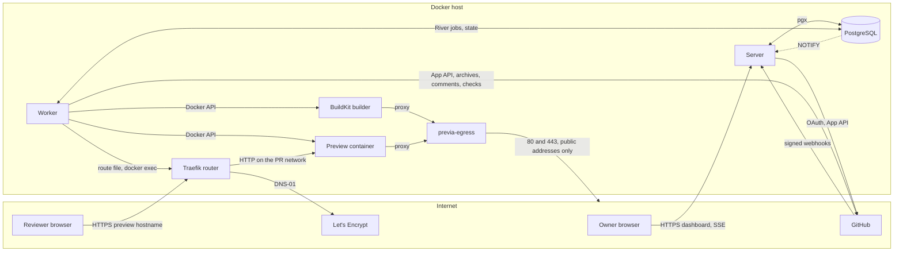

### 1.4 The whole journey on one page

The rest of the book zooms into each arrow of this diagram.

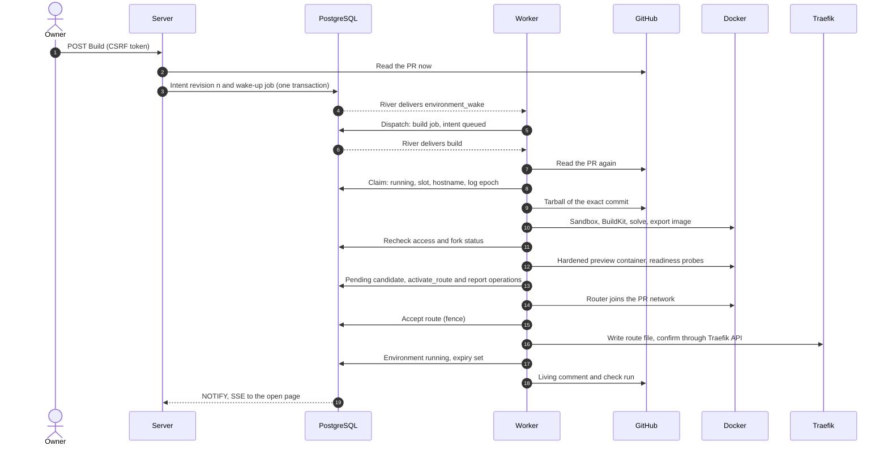

### 1.5 Where the code lives

`cmd → internal/app → feature packages → internal/platform`. Each feature package
owns its handlers, services, SQL and jobs:

| Step | Package |
| --- | --- |
| Sign-in, sessions, CSRF | `internal/auth` |
| App installation, repositories, build mode | `internal/installations` |
| Webhooks | `internal/webhooks` |
| PR observation, sync, mergeability, PR pages and actions | `internal/pullrequests` |
| Intent, scheduling, admission, outbox, teardown, route fence | `internal/environments` |
| `.previewrc.yaml` | `internal/repoconfig` |
| Archive download and extraction | `internal/source` |
| Repository secrets | `internal/secrets` |
| Build logs | `internal/buildlogs` |
| BuildKit builds | `internal/builds` |
| Preview containers | `internal/runtime` |
| Hostnames, route controller, Traefik | `internal/routing` |
| PR comment and check runs | `internal/reporting` |
| Periodic recovery and cleanup | `internal/housekeeping` |
| Config, DB, River, GitHub App auth, HTTP, SSE, Docker, egress, logs, metrics | `internal/platform/*` |
| HTML pages, components, CSS, browser script | `web/` |

## Chapter 2. The technology map

Every library and tool, and the step of the flow where it acts.

| Technology | Version | Used at | What it does there |
| --- | --- | --- | --- |
| Go | 1.26.8 | Everything | One language for server, worker, proxy and tools; cross-compiled into distroless images |
| [chi](https://github.com/go-chi/chi) | v5.3.2 | Server HTTP routing | Routes, middleware groups (session, CSRF, ingress limits) |
| [templ](https://templ.guide) | v0.3.1020 | Every dashboard page | Type-checked Go HTML templates, compiled to Go code |
| [HTMX](https://htmx.org) | vendored, local | Dashboard interactions | Partial page swaps on live updates and filters, CSRF header on requests |
| Tailwind CSS | v4.1.18 standalone | Build time only | Compiles `web/styles` into `web/static/css/app.css` |
| [pgx](https://github.com/jackc/pgx) | v5.10.0 | Every database call | PostgreSQL driver and pool; dedicated `LISTEN` connection |
| [sqlc](https://sqlc.dev) | pinned in `tools/go.mod` | Build time | Generates typed Go from each feature's `queries.sql` |
| [Goose](https://github.com/pressly/goose) | v3.28.0 | `make migrate-up`, `previa-migrate` | Schema migrations 0001–0019, embedded in release images |
| [River](https://riverqueue.com) | v0.47.0 | Every background step | PostgreSQL job queue: transactional inserts, retries, uniqueness, periodic jobs, leader election |
| [SCS](https://github.com/alexedwards/scs) + pgxstore | v2.9.0 | Sign-in, every page | Server-side sessions stored in PostgreSQL |
| [golang.org/x/oauth2](https://pkg.go.dev/golang.org/x/oauth2) | v0.37.0 | Sign-in, installation verification | OAuth code exchange with GitHub |
| [go-github](https://github.com/google/go-github) | v91 | Every GitHub API call | Typed REST client: PRs, archives, comments, check runs, webhook signature validation |
| [ghinstallation](https://github.com/bradleyfalzon/ghinstallation) | v2.18.0 | Every App API call | Signs App JWTs and mints/caches installation tokens |
| [goccy/go-yaml](https://github.com/goccy/go-yaml) | v1.19.2 | `.previewrc.yaml` | Strict YAML parsing with source positions |
| [envconfig](https://github.com/kelseyhightower/envconfig) | v1.4.0 | Process start | Loads and validates settings from the environment |
| Docker Engine API (moby client) | client v0.6.1, API v1.56.1 | Builds, previews, routing, cleanup | Networks, containers, images, volumes, exec |
| [BuildKit](https://github.com/moby/buildkit) | daemon v0.33.1 rootless (pinned digest), client v0.33.0 | Image builds | Executes the Dockerfile in user namespaces, exports the image |
| [fsutil](https://github.com/tonistiigi/fsutil) | pinned | Image builds | Streams the build context from the worker's disk to BuildKit |
| previa-egress | Previa's own (`cmd/egress`) | Builds and previews | Forward proxy to public addresses on 80/443; readiness prober |
| [Traefik](https://doc.traefik.io/traefik/) | v3.7.13 (pinned digest) | Serving previews | HTTPS entry point, file provider, ACME client |
| [lego](https://go-acme.github.io/lego/) | inside Traefik | Certificates | DNS-01 challenge against your DNS provider |
| [Let's Encrypt](https://letsencrypt.org) | staging then production | Certificates | Issues the wildcard certificate |
| [Prometheus client](https://github.com/prometheus/client_golang) | v1.24.1 | Every step | Metrics on the internal listeners |
| [x/time/rate](https://pkg.go.dev/golang.org/x/time/rate) | v0.16.0 | Server ingress | Per-client rate limits on sign-in callbacks |
| PostgreSQL | 17 | Everything stateful | Data, sessions, queue, `LISTEN/NOTIFY`, advisory locks |
| Go standard library | — | Security-critical code | `crypto/aes` + `crypto/cipher` (AES-256-GCM secrets), `crypto/hmac` via go-github (webhooks), `archive/tar` + `compress/gzip` + `os.Root` (extraction), `net/http` (proxy, probes) |

## Chapter 3. Ideas the whole flow depends on

Read this chapter once; every later chapter uses these words.

### 3.1 Observation is not permission

`pull_requests` holds what Previa has **observed** about a PR: its head SHA, whether
it is open, closed or merged, its mergeability, its fork identity. Webhooks,
discovery and fresh API reads update it, in both build modes.

`build_intents` holds the single current **authorized** request to build that PR.
Only two things write it: an owner's request (Manual mode, or any mode) and, in
Automatic mode, a relevant webhook event. Seeing a new commit never builds it by
itself in Manual mode.

So a PR has three commits that can differ at the same moment:

| Commit | Where it lives |
| --- | --- |
| Latest observed | `pull_requests.head_sha` |
| Requested for building | `build_intents.head_sha` |
| Deployed and serving | `environments` active artifact (an image tagged with its SHA) |

A preview can keep serving commit A while B builds; if B fails, A stays up.

### 3.2 Generation and revision: fencing tokens

Two counters order everything:

- **Generation** (`pull_requests.generation`) increases once for each fresh, relevant
  observation: a new commit, a close, a reopen, a teardown request.
- **Revision** (`build_intents.revision`) increases for each deliberate request,
  including a Retry or Rebuild of the same commit (which does not change the
  generation).

Every job, operation, Docker label and image tag carries the pair
`(generation, revision)`. Every write that records a result first locks the PR row
and checks that its pair is still current. A slow worker that finishes building an
old commit after a newer one was observed simply has its result refused. This is the
[fencing token](https://martin.kleppmann.com/2016/02/08/how-to-do-distributed-locking.html)
pattern: the counter, not a lock or a timer, decides who may write.

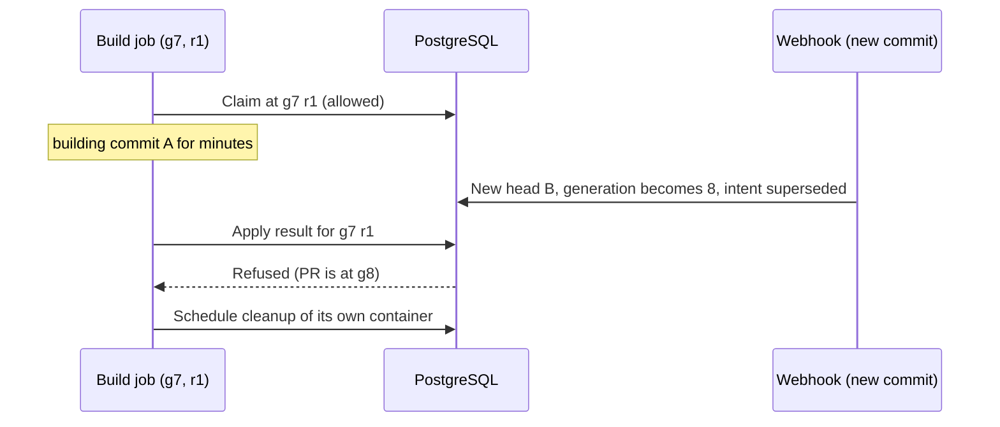

### 3.3 At-least-once jobs and idempotency

River delivers each job **at least once**: a worker can crash after doing the work
but before marking the job complete, and the job runs again. Nothing in Previa
assumes exactly-once. Instead every step is **idempotent**: re-running it reaches the
same end state.

- A build for a revision whose image already exists reuses the image.
- An operation's key (`kind`, PR, generation, revision, target) is unique, so a
  duplicate insert is a no-op.
- A Docker object that is "already gone" counts as removed.
- A PR comment is found again by its stored ID or a hidden marker instead of being
  created twice.

### 3.4 The transactional outbox

PostgreSQL cannot commit atomically with Docker, Traefik or GitHub. So whenever a
state change requires an external action, the same transaction that changes the
state inserts:

1. a durable **operation** row (`environment_operations`), and
2. a River job that wakes a worker to execute it (`InsertTx`).

Both commit or neither does. The external call happens later, outside any
transaction; its outcome is recorded in another short transaction. If the worker dies
in between, the operation row is still there and is retried. This is the
[transactional outbox](https://microservices.io/patterns/data/transactional-outbox.html)
pattern combined with a [saga](https://microservices.io/patterns/data/saga.html).

### 3.5 Short transactions and one lock order

No GitHub, Docker or router call ever happens while a transaction or row lock is
open. A step that needs both reads the relevant counters first, does the slow call
with nothing locked, then reopens a short transaction and checks the counters again.

Every transaction that changes PR work locks rows in the same order:
**installation → repository → pull request → intent** (then environment, route row,
route-table counter). A single global order prevents deadlocks, and checking
ownership, installation status and repository access *after* taking the locks means
a concurrent revocation can never be bypassed.

### 3.6 The server records, the worker executes

The server never runs builds or touches Docker. It writes intent, wake-up jobs,
teardown requests and report work. A worker that can execute registers the
corresponding River workers; a worker without Docker, a preview domain or the App
registers only what it can do and publishes its **capabilities** in
`worker_capabilities` (`discovery`, `execution`, `routing`, `reporting`,
`housekeeping`, `paused`), refreshed as a heartbeat. The dashboard trusts a heartbeat
seen within 90 seconds. Work recorded while no capable worker runs simply waits.

### 3.7 Instance identity and labels

Each database has an identity in `platform_instance` (migration 0016). Every Docker
object Previa creates carries it in its **name** and its labels:

| Label | Example | Meaning |
| --- | --- | --- |
| `io.previa.managed` | `true` | Created by Previa |
| `io.previa.instance` | `40faee5f0a2d` | Which Previa database owns it |
| `io.previa.kind` | `preview`, `builder`, `image`, `build-network`, `preview-network`, `build-cache`, `egress` | What it is |
| `io.previa.pull-request-id`, `generation`, `revision`, `head-sha` | `17`, `7`, `2`, `3f9c…` | Which request created it |
| `io.previa.base-repository-id`, `head-repository-id` | `987654321`, `987654321` | Repositories (fork identity) |
| `io.previa.environment-id`, `image`, `port`, `health-path`, `cpu-millis`, `memory-bytes`, `started-at` | | Preview details used by capacity, readiness and cleanup |

Previa only ever counts, reuses or removes objects whose labels name its own
instance and the right PR. It never runs a global `docker prune`.

### 3.8 Where state lives at each moment

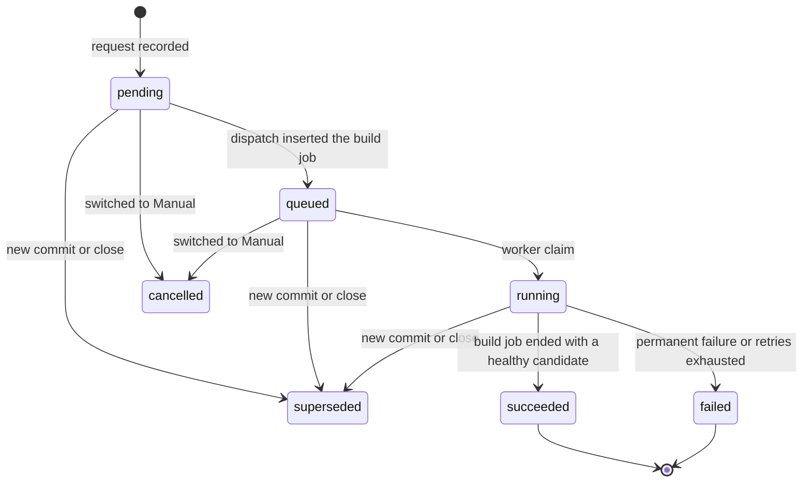

This is the life of one `build_intents` row. A Retry or Rebuild writes a new
revision into the same row and starts again at `pending`. `succeeded` means the
build job handed a healthy candidate to publication; whether the preview is actually
served is the environment's status, which Chapter 25 follows (`publishing` →
`running`).

---

# Part II. Before the first build

## Chapter 4. Starting Previa

Nothing can be previewed until the platform itself runs. Previa runs the same two
binaries in two deployment shapes.

### 4.1 Two ways to run it

| | Local development | Production (one host) |
| --- | --- | --- |
| PostgreSQL | `docker compose -f deploy/docker-compose.yml up -d` (PostgreSQL 17 on `127.0.0.1:5432`) | `postgres` service in `deploy/production/compose.yml`, not published |
| Migrations | `make migrate-up` (Goose migrations, then River's) | One-shot `migrate` service running `previa-migrate up`; server and worker wait for it |
| Server | `make dev` (Air rebuilds on change) or `make run-server` | `server` service, image `previa-server:<version>`, reached only through the router |
| Worker | `make run-worker` | `worker` service, image `previa-worker:<version>`, the only service with the Docker socket |
| Egress proxy image | `make egress-image` builds `previa-egress:dev` | `previa-egress:<version>`, built or pulled with the release |
| Router | `make router-up` (Traefik from `deploy/traefik/compose.yml`) | `router` service (Traefik) on ports 80 and 443, also serving the dashboard |
| Settings | `.env`, loaded by the `make` targets | `/etc/previa/previa.env` (root, mode 600) |

The `make` targets load `.env` with `set -a; . ./.env` and then restore any variable
you exported yourself, so an explicit `export X=…` always wins over the file.

### 4.2 Production topology

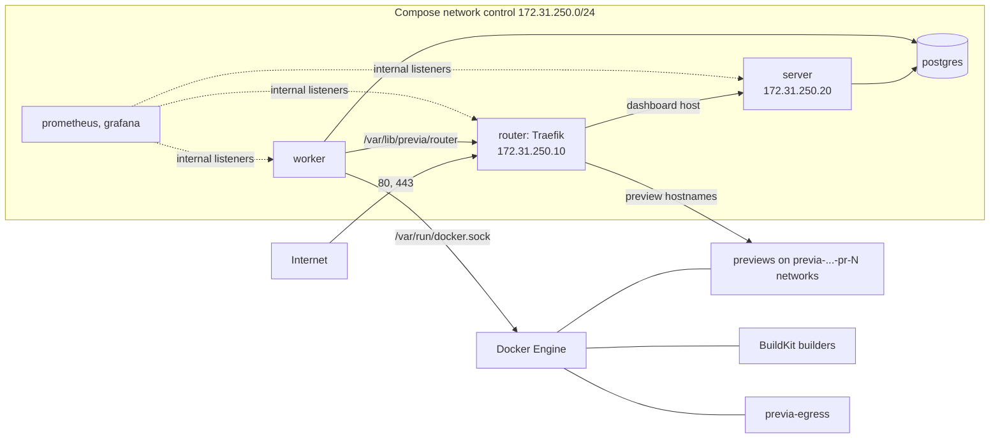

- Every service except the router is unpublished; the internal health and metrics
  listeners are only on the `control` network.
- The server and worker containers are distroless, run as UID 65532 with a read-only
  root filesystem and every capability dropped.
- The worker joins the Docker socket's group (`DOCKER_GID`). That access is
  root-equivalent on the host, which is why the host is dedicated to Previa and no
  other service gets the socket.
- The route directory `/var/lib/previa/router` is shared by the worker (writes
  `previa-routes.yml`) and the router (reads it, read-only).

### 4.3 What the server does at boot

1. `config.LoadServer()` reads settings with envconfig and validates them: the
   database URL, an HTTP(S) `APP_BASE_URL` (HTTPS outside localhost), a 32-character
   `SESSION_SECRET`, the GitHub App settings all-or-nothing, the secrets keyring, the
   preview domain not being the dashboard's host or a parent of it. With
   `APP_ENV=production` it also requires HTTPS, a webhook secret and a private key
   file readable by its owner only.
2. A pgx pool connects; `database.CheckSchema` refuses to continue if the schema is
   older than the migration the binary was built for ("run migrations first").
3. SCS sessions are configured over the `sessions` table; the OAuth client, the
   GitHub App client (when configured) and a River **producer** (insert-only, it
   never executes jobs) are created.
4. `realtime.Listen` opens a dedicated connection and runs `LISTEN previa_events`
   (Chapter 30).
5. The chi router is assembled: ingress controls (host check, trusted proxies, body
   limits, rate limits, security headers with a per-request CSP nonce), static
   files, the public unavailable page, the webhook endpoint, then the session group
   with CSRF and the feature routes.
6. The internal listener serves `/livez`, `/readyz` and `/metrics` on
   `INTERNAL_ADDR`; the public listener serves `HTTP_ADDR`.

### 4.4 What the worker does at boot

The worker decides what it can do from what is configured and reachable, and
refuses to start rather than fail builds later.

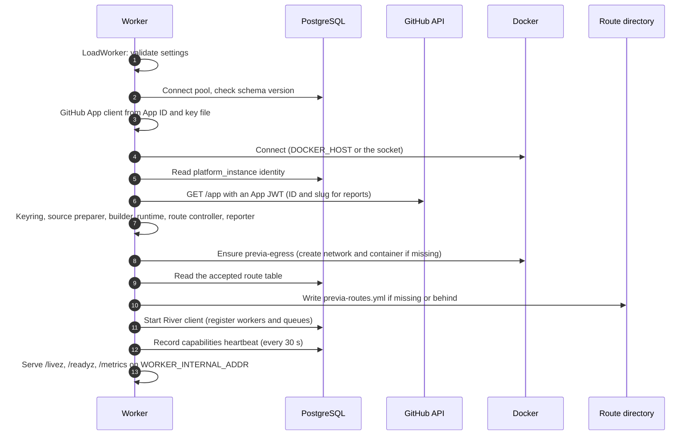

`buildPipeline` (`internal/app/pipeline.go`) composes capabilities in layers:

| Configured | Registered | Capabilities |
| --- | --- | --- |
| Database only | Build-log retention | none |
| + GitHub App ID and key | PR discovery (`pr_discovery`) and mergeability checks | `discovery` |
| + `PREVIEW_BASE_DOMAIN`, Docker, router settings | Builds, teardown, wake-ups, operations (routes, reports, cleanup), teardown sweep, housekeeping | `discovery`, `execution`, `routing`, `reporting`, `housekeeping` |
| + `BUILDS_PAUSED=true` | Everything above | `execution` off, `paused` on |

Every capability that is off is logged with the reason (for example
`PREVIEW_BASE_DOMAIN is not set: previews cannot be published, so this worker builds
nothing`). The dashboard reads `worker_capabilities` and shows a disabled Build
button with that reason instead of a button that would never work.

On `SIGTERM` the worker first removes its capability row (so the dashboard stops
counting on it), lets running jobs finish for 30 seconds, then cancels them. A build
cancelled this way is not a failure: it returns `ErrInterrupted`, keeps its build
slot and is snoozed to run again on the next start.

## Chapter 5. Signing in

Signing in proves who the owner is. It grants no repository access: that is the
GitHub App's job (Chapter 6). The two registrations are separate on purpose, so a
login token is never used for repository work.

### 5.1 The OAuth flow

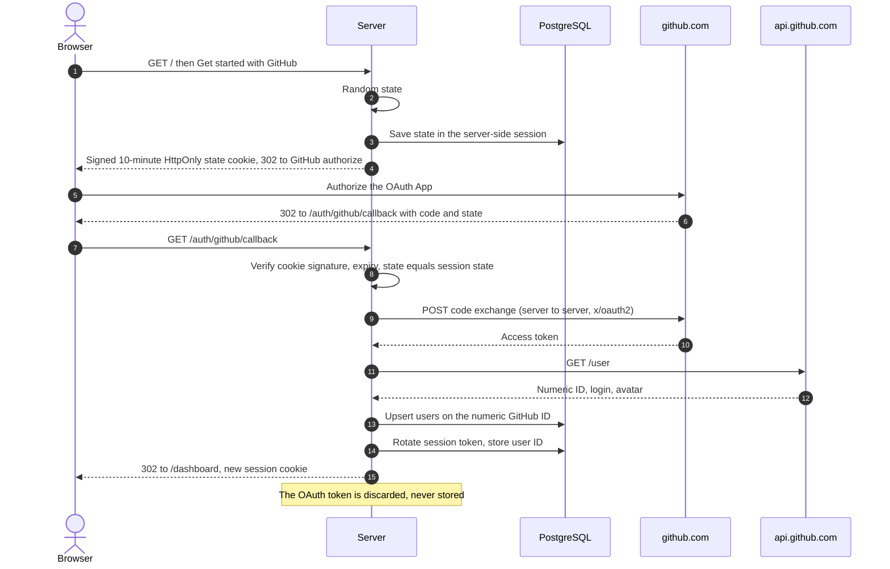

Micro-details that matter:

- **State** is random, stored twice (signed cookie and session) and consumed once,
  so a replayed or forged callback is rejected with 400 and no session.
- **No scopes** are requested: the token can only read the public profile.
- **Session rotation** on login prevents session fixation.
- **Sessions** live in PostgreSQL (`sessions`, SCS pgxstore), with a 30-minute idle
  timeout and a 24-hour absolute lifetime; expired rows are pruned every 5 minutes.

### 5.2 Cookies and CSRF

| Protection | How |
| --- | --- |
| Session cookie | Opaque token, `HttpOnly`, `SameSite=Lax`; over HTTPS it is `__Host-` prefixed and `Secure`, so it is host-only with `Path=/` |
| Why `__Host-` matters | Previews live on other subdomains. A [`__Host-` cookie](https://developer.mozilla.org/en-US/docs/Web/HTTP/Cookies#cookie_prefixes) cannot be set or overwritten by a sibling subdomain, so a malicious preview cannot plant a session |
| CSRF | Every state-changing request carries a token stored in the server-side session (form field, or `X-CSRF-Token` header from HTMX) and passes an `Origin` check |
| Logout | A CSRF-protected POST behind a confirmation modal; deletes the session row |

## Chapter 6. Connecting repositories

### 6.1 The GitHub App and its permissions

The GitHub App is what lets Previa touch repositories. Its permissions are the
minimum the flow needs:

| Permission | Used at |
| --- | --- |
| Contents: read | Downloading the source archive (Chapter 13) |
| Pull requests: write | The living PR comment (Chapter 29) |
| Checks: write | Exact-commit check runs (Chapter 29) |
| Metadata: read (automatic) | Resolving repositories by numeric ID |

It subscribes to **Pull request** events; installation and repository-selection
events are delivered to every App automatically.

### 6.2 How Previa authenticates as the App

GitHub Apps authenticate in two hops
([GitHub docs](https://docs.github.com/en/apps/creating-github-apps/authenticating-with-a-github-app/about-authentication-with-a-github-app)):

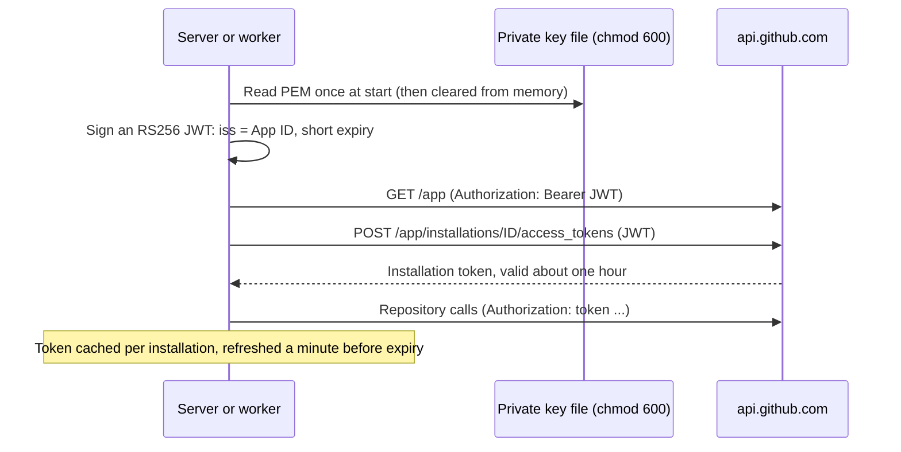

- `ghinstallation` builds the JWT and the installation token transports; Previa keeps
  one cached transport per installation behind a mutex.
- Every GitHub HTTP client has a 10-second timeout. The private key file must be a
  regular file with no group or other permissions.
- Tokens never reach templates, logs, job arguments, URLs or error messages.

### 6.3 Linking an installation

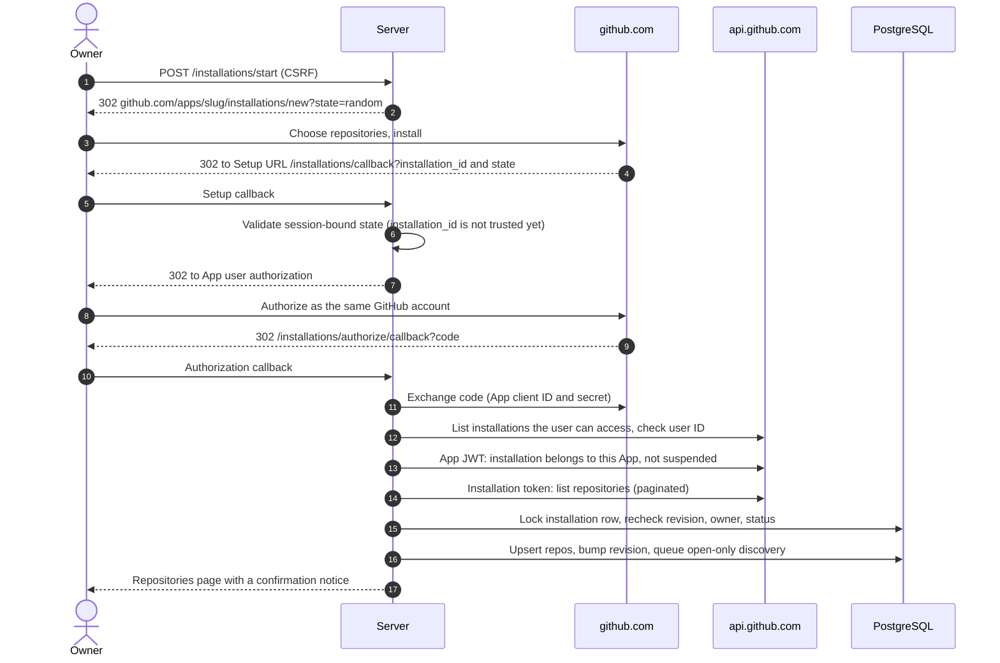

- The setup redirect's `installation_id` is never trusted alone: GitHub's
  [setup URL guidance](https://docs.github.com/en/apps/creating-github-apps/registering-a-github-app/about-the-setup-url)
  warns it can be forged, so Previa proves the signed-in user can access that
  installation through a user-to-server token.
- The installation **revision** is read before the external calls and checked under
  `SELECT … FOR UPDATE` in a short final transaction. A concurrent uninstall or
  suspend makes linking fail with a conflict instead of restoring stale access.
- Linking is bounded to 25 seconds, each GitHub request to 10.
- One verified local user owns an installation; another user cannot take it over.
- Every new repository starts in **Manual** build mode.

## Chapter 7. Learning about pull requests

Previa learns about PRs three ways. All three only **observe**; none of them
authorizes a build in Manual mode.

### 7.1 Webhooks: the live path

A push to the PR makes GitHub send `pull_request` with action `synchronize` to
`POST /webhooks/github`. The handler sits outside the session and CSRF middleware;
its authentication is the signature.

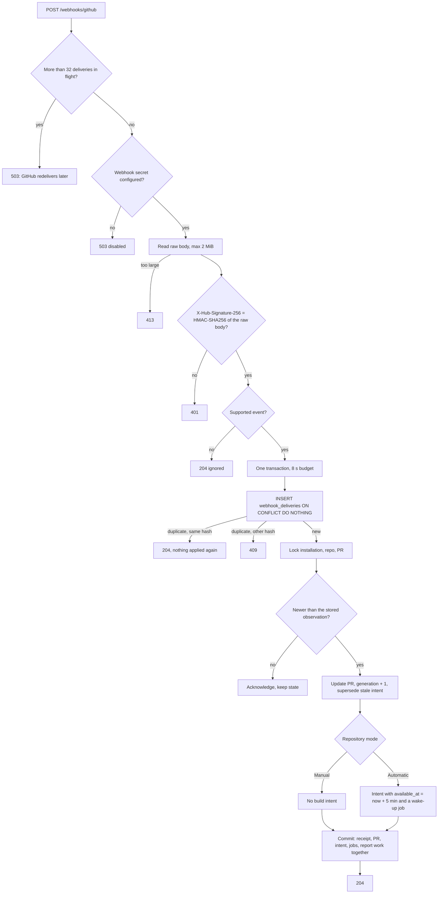

Details:

- **Signature first.** go-github's `ValidateSignature` computes HMAC-SHA256 with the
  webhook secret over the exact raw bytes before anything is parsed
  ([GitHub: validating deliveries](https://docs.github.com/en/webhooks/using-webhooks/validating-webhook-deliveries)).
  SHA-1 signatures are refused.
- **Deduplication.** `webhook_deliveries.delivery_id` (the `X-GitHub-Delivery`
  header) is unique. The receipt stores the event type and a hash of the body, never
  the body. A crash before commit leaves nothing; a crash after commit makes the
  redelivery a no-op.
- **Ordering.** GitHub can reorder deliveries. The PR's `updated_at` from the payload
  orders observations; an older one is acknowledged and ignored. Two different heads
  with the same timestamp cannot be ordered safely, so the PR is marked
  `needs_refresh`, its generation advances and any active intent is superseded until
  a later observation resolves it. A close wins an equal-time tie.
- **No external calls** happen in this transaction; it stays short so GitHub's
  10-second delivery timeout is never at risk.
- **Supported actions:** `opened`, `reopened`, `synchronize`, `closed` (with `merged`
  recorded). Comments and reviews never authorize builds or reset a quiet period.

### 7.2 Discovery: the catch-up path

When a repository is linked, and when the owner clicks **Sync Pull Requests**, a
`pr_discovery` River job lists **open** PRs only (`state=open`, `sort=created`,
ascending, 100 per page). Each page's observations, progress in `pr_syncs` and the
next page's job commit together, so a crash never double-counts or loses a page.
The installation revision and repository observation version are captured before
the API call and rechecked under locks afterwards; if either moved, the page is
retried. Discovery never creates build intent, even in Automatic mode, and never
imports closed history.

A sync requested more than 5 minutes ago that is still unfinished is **stale**: the
dashboard says **Sync stalled** and a new click starts a new revision that fences
out the old job. With no worker that has `discovery`, the page says **Waiting for a
worker** instead of spinning.

### 7.3 Mergeability: the asynchronous answer

GitHub computes whether a PR can merge asynchronously, and the answer changes when
the base branch moves. Each `opened`/`reopened`/`synchronize` resets the status to
**Checking** and schedules a `pr_mergeability` job two seconds later.

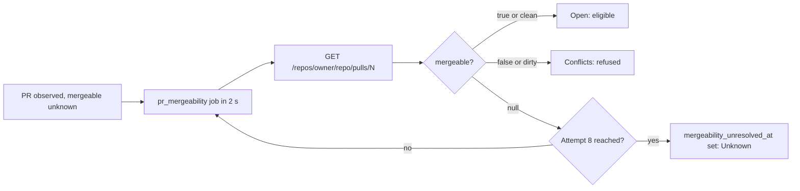

The response is applied only if the installation revision, repository version and
PR generation and SHA are unchanged, so an old answer never overwrites a newer
commit. Mergeability is a **gate** at every build boundary: a manual request,
dispatch and worker admission all refuse **Checking**, **Conflicts** and **Unknown**.

---

# Part III. Triggering a build

A build starts in one of two ways: the owner asks (Manual, or any mode), or a commit
arrives in a repository set to Automatic. Both end in the same place: a durable
`build_intents` row plus a River wake-up job, committed together. The server never
builds anything.

## Chapter 8. A manual build request

### 8.1 What the browser sends

On the PR page the owner clicks **Build latest commit** (or **Retry** after a
failure, **Rebuild** after a success). The button is an ordinary HTML form, enhanced
by HTMX, posting to:

```
POST /repositories/{repoID}/pull-requests/{number}/build
Content-Type: application/x-www-form-urlencoded
X-CSRF-Token: <session token>          (HTMX) or csrf_token form field

action=build|retry|rebuild
expected_revision=<the intent revision the page was rendered with>
request_key=<random URL-safe idempotency key, 16-128 chars>
```

The page renders the button **disabled with the reason and the fix** when it would be
refused anyway: Checking or Conflicts, no worker with `execution`, builds paused,
or a missing `PREVIEW_BASE_DOMAIN` on the worker.

### 8.2 What the server does

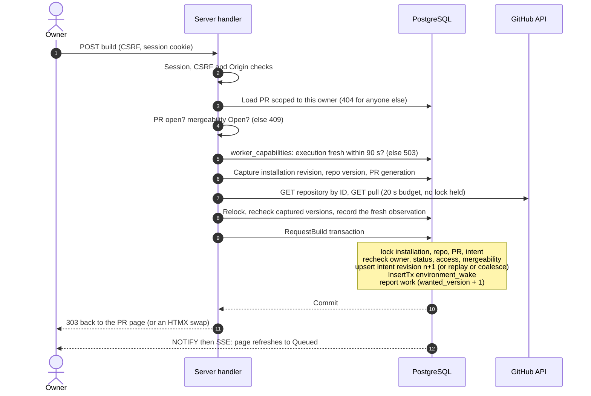

### 8.3 Fresh upstream verification

Saved state can be minutes old. `VerifyUpstream`
(`internal/pullrequests/verification.go`) re-reads the PR from GitHub immediately
before recording the request:

1. A short transaction captures the installation revision, the repository
   observation version and the PR generation. A locally closed PR fails without any
   GitHub call.
2. With nothing locked, one installation-authenticated read (20-second budget)
   resolves the base repository by numeric ID and fetches the PR: state, head SHA,
   head repository (fork identity), mergeability.
3. A second transaction relocks and compares. If anything moved, the result is
   thrown away (`ErrUpstreamChanged`). Otherwise the observation is recorded through
   the normal ordered path, even when the outcome is a refusal, so a close or a
   conflict seen here is never lost.

| GitHub says | The owner sees |
| --- | --- |
| Open, mergeable, same head | The request is recorded |
| A newer head | The newer commit is recorded; the request targets it |
| Closed or merged | 409, nothing requested |
| Conflicts or still computing | 409 with the reason; a recheck job is scheduled |
| 404/403/410 | 409, access is gone |
| 5xx, network error, rate limit | 503 with `Retry-After` when GitHub gave one |

### 8.4 Idempotency and the revision contract

The request names the revision it expects. Inside the locked transaction:

| Situation | Result |
| --- | --- |
| No intent, expected 0, action Build | Intent revision 1, state `pending`, `available_at = now` |
| Same key and action replayed (double click, browser retry) | Returns revision 1 again, nothing new |
| Build while revision 1 is pending, queued or running | Coalesces with it |
| Build after revision 1 succeeded or failed | Returns the existing result (no rebuild by accident) |
| Retry after failure / Rebuild after success, fresh key, expected 1 | Revision 2 for the **same** generation and SHA |
| Stale page expecting revision 0 after revision 2 exists | Conflict, nothing overwritten |
| Retry of an older generation after a newer commit arrived | Conflict: use Build latest |

Only the current key is stored, so no ever-growing token table is needed. The
guarded SQL refuses any transition unless the PR is open at the expected generation
and SHA and the intent is at the expected revision and state.

### 8.5 The wake-up job

In the same transaction the broker inserts an `environment_wake` job with
`InsertTx`:

```
kind:   environment_wake
queue:  environment_coordination
args:   {pull_request_id: 17, generation: 7, revision: 2, ...}
unique: wake:pr:17:g:7:r:2   (available, pending, running, retryable, scheduled)
```

For a manual request it is due immediately. If the transaction rolls back, neither
the intent nor the job exists; if it commits, both do. A database trigger on
`build_intents` emits `NOTIFY previa_events` after commit, so the open page updates
(Chapter 30).

## Chapter 9. An automatic build request

### 9.1 The trigger

When the repository's mode is **Automatic**, the webhook transaction of Chapter 7
(`ObserveTx`) does more than record the observation: for a new generation it writes
an automatic intent (`source = automatic`, no user) with
`available_at = now + 5 minutes`, and inserts an `environment_wake` job scheduled for
that time. All of it commits with the delivery receipt.

### 9.2 The trailing quiet period

Each relevant new commit replaces the intent and its deadline. The commit that is
built is the one that **settles**:

```mermaid
gantt
    title Pushes at 12:00 and 12:04 make the latest commit eligible at 12:09
    dateFormat HH:mm
    axisFormat %H:%M
    section Commits
    Push A :milestone, m1, 12:00, 0m
    Push B :milestone, m2, 12:04, 0m
    section Intent
    A waits, then superseded by B :done, w1, 12:00, 4m
    B waits five minutes :active, w2, 12:04, 5m
    B eligible, wake-up fires :milestone, m3, 12:09, 0m
```

- The wake-up for A (`wake:pr:17:g:7:r:1`) still fires at 12:05, sees that the
  current request is generation 8, and exits without doing anything. Old wake-ups
  are never mutated or deleted; they simply find themselves stale.
- A duplicate delivery of B's webhook does not reset the deadline.
- Switching the repository to **Manual** cancels unstarted automatic intent
  (`pending`, `queued`) in the same transaction as the mode change; running work and
  live previews are untouched.
- A manual **Build** over waiting automatic work skips the quiet period immediately.
- Why five minutes: bursts of pushes produce one build, not many. The trade-off is
  that continuous pushing postpones the build; Manual is the override.

## Chapter 10. From wake-up to build job

### 10.1 The wake-up runs

A worker with `execution` runs `environment_wake` on the `environment_coordination`
queue (4 workers per process, 15-second timeout). It locks installation → repository
→ PR → intent and checks, in order:

1. The intent is still the current generation and revision, and active
   (`pending`/`queued`/`running`); otherwise it exits.
2. Ownership, installation status and repository access are intact.
3. The mode still allows it (manual intent always; automatic only in Automatic mode).
4. The deadline has passed.
5. Mergeability is Open.

### 10.2 Dispatch and the one-job-per-PR rule

If everything holds, **dispatch** inserts the executable job and marks the intent
`queued` in the same transaction:

```
kind:   build
queue:  build                (MAX_CONCURRENT_BUILDS workers per process)
max attempts: 5
unique: environment:pr:17    (across kinds: build AND teardown share it)
```

The uniqueness key deliberately excludes generation, revision and job kind, so a PR
can never have two executable jobs (two builds, or a build and a teardown) at once.

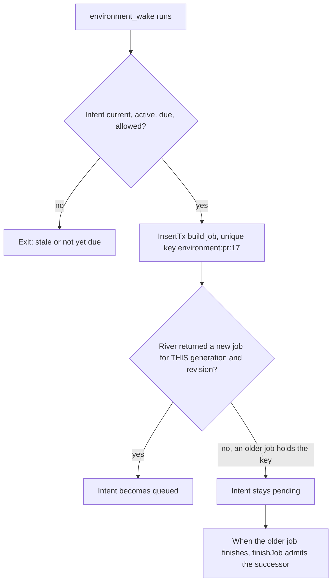

An arbitrary duplicate insert is never taken as proof that *this* request was
admitted: the intent becomes `queued` only when the returned job's arguments match
the current generation, revision and state.

### 10.3 The handoff when a job ends

When a build or teardown job ends, `finishJob` runs in one transaction under the
same locks: it completes (or discards) the River row, which releases the
`environment:pr:17` key, marks the matching intent `succeeded` or `failed`, records
report work, and considers the next authorized request. A newer request that was
waiting behind the old job is admitted right there. A newer Manual observation alone
creates no successor.

---

# Part IV. Admission

## Chapter 11. The worker picks up the job

### 11.1 How River delivers the job

River stores jobs in PostgreSQL (`river_job`). Each worker process runs a producer
per queue; it is woken by PostgreSQL notifications when jobs are inserted and polls
as a fallback, then locks a batch of available jobs with
[`FOR UPDATE SKIP LOCKED`](https://www.postgresql.org/docs/current/sql-select.html#SQL-FOR-UPDATE-SHARE)
so two workers never take the same row, and marks them `running`
([River docs](https://riverqueue.com/docs)).

- The `build` queue runs `MAX_CONCURRENT_BUILDS` workers per process.
- The job's context has a deadline of `BUILD_TIMEOUT` (12 minutes) plus a one-minute
  completion grace for recording the outcome and cleaning up.
- River's middleware (`queue/observe.go`) adds correlation fields to every log line
  (`job_id`, `job_kind`, `job_attempt`, `pr_id`, `generation`, `revision`, `sha`) and
  measures queue wait, run time and outcome.
- If the worker dies while the job is `running`, River's rescuer moves it back to
  retryable after its timeout (scan floor 30 seconds).

### 11.2 How the job can end

| Returned | River does | Meaning |
| --- | --- | --- |
| `nil` | Completes the job | Built (or superseded and cleaned up) |
| `JobSnooze(d)` | Reschedules after `d`, **no attempt spent** | Waiting for capacity, disk or the kill switch (30 s doubling to 5 min); GitHub rate limit (its own delay); worker shutdown (`ErrInterrupted`, runs again at the next start) |
| A retryable error | Retries with backoff, up to 5 attempts | GitHub outage, Docker hiccup |
| A permanent error | Ends after one attempt (`finishJob` discards it and hands off) | Invalid config, failing Dockerfile, app never ready, time limit |

## Chapter 12. The admission checks and the claim

`environments.Service.Build` runs these checks **in order**, each before any
expensive work. The order matters: cheap local checks first, the GitHub read
outside locks, the claim last.

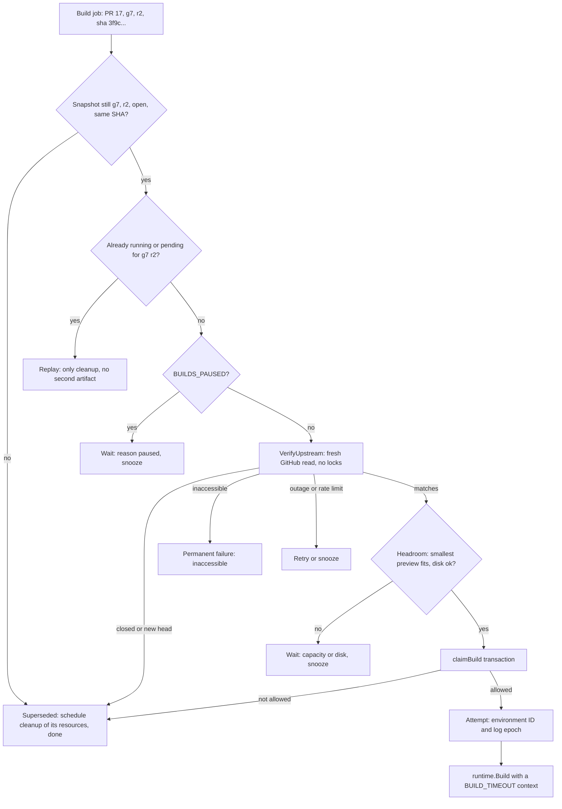

### 12.1 The claim transaction

`claimBuild` is one PostgreSQL transaction that turns a queued request into a
running attempt. It:

1. Locks installation → repository → PR → intent and rechecks owner, installation
   status, repository access, mergeability and eligibility.
2. **Build slots.** Takes a transaction-scoped
   [advisory lock](https://www.postgresql.org/docs/current/explicit-locking.html#ADVISORY-LOCKS)
   and counts running requests of other PRs. When all `MAX_CONCURRENT_BUILDS` slots
   (across every worker) are taken, nothing is claimed: the intent notes
   `waiting_reason = 'capacity'` and the job snoozes.
3. Runs the guarded update (`ClaimBuildIntent`): intent `running`, `started_at` set,
   only if the PR is open at this generation and SHA and the intent is at this
   revision, active and due.
4. **Provisions the environment** on the PR's first admitted build: one lifetime
   `environments` row per PR with its hostname label, allocated once
   (`routing.NewLabel`):

   ```
   pr-<number>-<GitHub repo ID in base 36>-<8 random [a-z0-9]>
   pr-42-gc0uy9-k3x9q2ma   →   https://pr-42-gc0uy9-k3x9q2ma.preview.example.net
   ```

   The repository ID makes renames harmless; the 8 random characters (from
   `crypto/rand`, rejection-sampled to avoid bias) keep private repositories'
   previews unguessable. The label is a valid DNS label, checked again by a database
   constraint, and never reassigned to another PR.
5. **Resets the build log**: `ResetBuildLogStream` increases the stream's `epoch`
   and `ClearBuildLogs` deletes the previous attempt's lines (Chapter 30). Because
   the stream row is locked first, a late writer from an older attempt either
   commits before (and is deleted) or finds the epoch changed and stores nothing.
6. Records report work (the PR comment will say *Building*).

It returns an `Attempt{EnvironmentID, LogEpoch}`. Any failure rolls the whole claim
back and the runtime is never called.

### 12.2 What is true when the claim commits

- The request is `running` and holds one global build slot until its final attempt
  ends, across River retries and worker restarts.
- The PR has a lifetime environment and hostname.
- The log is empty and bound to the new epoch.
- Nothing has touched Docker yet.

---

# Part V. Source and configuration

`runtime.Build` (`internal/runtime/runtime.go`) now takes over. Its first act is a
**recheck** (`TargetStore.Current`): one query confirms the request is still the open
PR's current generation, commit and running revision, the installation is active and
the repository accessible, and returns the installation ID and the base and head
repository IDs. Anything else stops the attempt (`not_current` or `inaccessible`)
before any download.

Then it opens the attempt's **build log** (`buildlogs.Store.Open` bound to the
environment and epoch). Its redactor starts empty: no secret has been decrypted yet,
and no credential ever enters the build. The first system line is written:
`Preparing commit 3f9c2a7b1d04 from GitHub.`

## Chapter 13. Downloading the exact commit

### 13.1 Two HTTP clients, on purpose

The archive download uses **two separate clients** so the installation token can
never follow a redirect to another host:

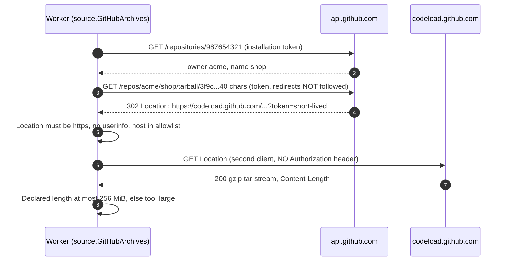

1. **By numeric ID.** The base repository is resolved by its immutable GitHub ID,
   then its current owner and name are used. A rename between steps cannot redirect
   the download to another repository.
2. **By full SHA.** The request is for the 40-character commit SHA; branch names and
   short SHAs are rejected before any call. A branch can move; a SHA cannot.
3. **Through the base repository, even for forks.** GitHub serves a PR's head commit
   through the base repository, so Previa never needs access to the fork, private or
   not ([GitHub: download a repository archive](https://docs.github.com/en/rest/repos/contents#download-a-repository-archive-tar)).
4. **The token stays with the API.** The API call is made with redirects disabled;
   it only returns the archive location. That location carries its own short-lived
   token in the URL, so the download client sends no credentials at all.
5. **Redirects are checked.** The download client follows at most 3 redirects, each
   of which must be HTTPS to an allowlisted host (`codeload.github.com`). Errors never
   include the URL, because it contains a token.

Failures are typed (`source.Error`) with a safe message and whether a retry can help:
`rate_limited` (with GitHub's `Retry-After`), `api_unavailable`, `access_denied`,
`resource_unavailable`, `redirect_rejected`, `too_large`, and so on.

## Chapter 14. Unpacking an untrusted archive

The PR author controls every byte of the archive. Extraction (`internal/source/extract.go`)
treats it as hostile input.

### 14.1 The workspace

Each preparation gets a fresh directory under `SOURCE_WORKSPACE_ROOT` (default
`<temp>/previa-sources`):

```
previa-src-17-g7-r2-<random>/        mode 0700
├── workspace.json                   PR, generation, revision, commit, time, PID (written BEFORE extraction)
└── source/                          the extracted tree = the build context
```

The marker is written first so a crash mid-extraction still leaves an identifiable
leftover for housekeeping. Any failure or cancellation removes the workspace, and
`Preparer.Release` removes it after the build, always.

### 14.2 The identity check

`git archive` records the commit it archived in the tarball's first header, a PAX
**global header** whose `comment` record is the commit ID. Extraction fails with
`identity_mismatch` unless that record names exactly the requested SHA, so GitHub
(or anything in between) cannot substitute another commit unnoticed.

### 14.3 The entry rules

| Rule | Defends against |
| --- | --- |
| Exactly one top-level directory; it is stripped | Archives that scatter files |
| Paths must be canonical and local: no `..`, no absolute paths, no `a/./b` or `a//b`, names at most 255 bytes, paths at most 2,048 bytes | [Path traversal ("zip slip")](https://security.snyk.io/research/zip-slip-vulnerability) |
| Only directories, regular files and relative symlinks that stay inside the tree | Hard links, device files, FIFOs and sparse entries |
| No duplicate or overlapping entries (a file beneath a symlink or a file) | Overwriting through aliasing |
| Symlinks are created **after** every file exists | A later entry writing *through* an earlier link |
| Every write goes through Go's [`os.Root`](https://go.dev/blog/osroot), which refuses to resolve outside the root | Any remaining escape |
| File modes keep only the executable bit | setuid, setgid, sticky bits |

### 14.4 The limits

| Limit | Default |
| --- | --- |
| Compressed archive | 256 MiB (declared length checked before reading) |
| Extracted bytes | 1 GiB |
| Entries | 100,000 |
| Whole preparation | 5 minutes (and the job's cancellation) |

Extracted-byte and entry counters stop a decompression bomb part-way, without
reading the rest.

## Chapter 15. Reading .previewrc.yaml

### 15.1 Where it comes from

The configuration is read **from the same extracted tree**, not from the default
branch and not through a separate API call, so the config and the code always belong
to the same commit. It must be a regular file at the root (not a symlink), opened
with `O_NOFOLLOW` through `os.Root`, at most 64 KiB.

```yaml
dockerfile: ./Dockerfile        # default: Dockerfile at the root
port: 3000                      # default 3000: the port the app listens on
env:                            # non-secret values only
  - NODE_ENV=preview
health_check_path: /health      # default: none (a TCP check is used)
resource_tier: standard         # small | standard | large
```

### 15.2 Strict parsing

`repoconfig.Parse` uses goccy/go-yaml with everything risky turned off:

- one mapping document only; unknown keys, duplicate keys, tags, anchors, aliases,
  merge keys and complex keys are rejected;
- a blank file or explicit `null` is invalid (`{}` is the valid minimum);
- env names must match `[A-Za-z_][A-Za-z0-9_]*`, without duplicates or NUL bytes;
- the Dockerfile path must be relative, without traversal or backslashes, and must
  then resolve through `os.Root` to a **regular file inside the tree**;
- the health path must be a plain absolute path: no host, query, fragment or `..`.

Errors carry the field, a code and the line and column, never a snippet of the file,
so a value never leaks into a message.

### 15.3 Tiers and clamping

| Tier | CPU limit | Memory limit |
| --- | --- | --- |
| `small` | 0.5 vCPU | 512 MiB |
| `standard` (default) | 1 vCPU | 1 GiB |
| `large` | 2 vCPU | 2 GiB |

The platform ceilings are 2 vCPU and 2 GiB. A lower ceiling clamps the tier and adds a
notice (`cpu_clamped`, `memory_clamped`) that is written to the build log. The
repository can never ask for more than the platform allows, and never chooses its
own build mode: that is owner data, not repository data.

### 15.4 What the build now has

| Value | Used at |
| --- | --- |
| Context directory (absolute) and Dockerfile path | The solve (Chapter 18) |
| Port, health path | Readiness (Chapter 24), the route's backend port (Chapter 26) |
| Env entries | The container environment (Chapter 21), never the build |
| CPU and memory | The container limits and capacity admission (Chapters 22, 23) |
| Effective hash | Identifies the effective settings; it is not a secret-safe fingerprint |

A missing file (`missing_file`) or invalid YAML (`invalid_config`) is a **permanent**
failure: retrying the same commit cannot fix it, so the request ends after one
attempt and the log names the field.

---

# Part VI. Building the image

The Dockerfile belongs to the PR's author. Running it is untrusted code execution,
so every build gets its own disposable, unprivileged, resource-limited BuildKit
daemon on a private network whose only exit is a proxy that refuses anything
internal. `internal/builds` does this; nothing in it is shared with another build
except the proxy and, for the same source repository, a cache volume.

## Chapter 16. The build sandbox

### 16.1 Reuse first

`Builder.Build` first looks for `previa/<instance>-pr-17:g7-r2-3f9c2a7b1d04` with this
job's labels. If an earlier attempt of the **same revision** already built it (for
example the worker crashed after exporting), it is reused and the build is skipped.
A Retry or Rebuild is a new revision, so it always gets a new image.

### 16.2 The objects created for one build

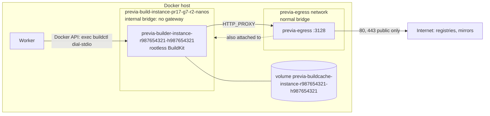

In order (`internal/builds/sandbox.go`):

1. **BuildKit image.** If Docker lacks the pinned `moby/buildkit:v0.33.1-rootless@sha256:…`,
   the Docker Engine pulls it (from the host's network; builders themselves never
   reach a registry except through the proxy).
2. **Build network.** `NetworkCreate` with driver `bridge` and `Internal: true`,
   labelled with the job's identity. An
   [internal network](https://docs.docker.com/engine/network/drivers/bridge/#use-the-internal-mode)
   has no gateway: containers on it can reach each other and nothing else, not the
   host, not other networks, not the internet.
3. **Egress attachment.** `egress.Gateway.Attach` makes sure the `previa-egress`
   container is running (creating its own `previa-egress` network and the container
   if needed), connects it to the build network, reads its IPv4 address there and
   returns `http://<that address>:3128`. The proxy is the only container on the build
   network that has a second network with a route out.
4. **Cache volume.** `previa-buildcache-<instance>-r<base repo>-h<head repo>` is
   created if missing. The **cache scope** is base repository plus source
   repository: same-repository PRs share a cache; each fork gets its own, so a fork
   can never plant layers or cache-mount files that a trusted build (which later
   receives secrets) would reuse.
5. **Builder container.** Created with the scope's fixed name
   `previa-builder-<instance>-r…-h…`, which doubles as a lock: if another build of the
   same scope holds it, Docker answers "conflict" and this build creates a uniquely
   named builder with a throwaway anonymous volume instead, and logs *Another build of
   this source is using its cache, so this build runs without it.* A cache-holding
   builder older than `BUILD_TIMEOUT` + 15 minutes belongs to a crashed worker and is
   removed.
6. **Start and wait.** `ContainerStart`, then `docker exec builder buildctl debug
   workers` every 250 ms until it succeeds (30-second limit).

### 16.3 The builder container, setting by setting

Previa calls the Docker API, not the CLI; this is the equivalent `docker create`:

```sh
docker create \
  --name previa-builder-<instance>-r987654321-h987654321 \
  --network previa-build-<instance>-pr17-g7-r2-<nanos> \
  --read-only \
  --cap-drop ALL --cap-add SETUID --cap-add SETGID \
  --security-opt seccomp=unconfined --security-opt apparmor=unconfined \
  --security-opt systempaths=unconfined \
  --tmpfs /tmp:mode=1777 \
  --tmpfs /run/user/1000:mode=0700,uid=1000,gid=1000 \
  --tmpfs /home/user/.local/tmp:mode=0700,uid=1000,gid=1000 \
  --mount type=volume,source=previa-buildcache-<instance>-r987654321-h987654321,target=/home/user/.local/share/buildkit \
  --cpus 2 --memory 4g --memory-swap 4g --pids-limit 2048 \
  -e HTTP_PROXY=http://10.x.y.z:3128 -e HTTPS_PROXY=http://10.x.y.z:3128 \
  -e http_proxy=http://10.x.y.z:3128 -e https_proxy=http://10.x.y.z:3128 -e NO_PROXY= -e no_proxy= \
  --label io.previa.managed=true --label io.previa.kind=builder ... \
  moby/buildkit:v0.33.1-rootless@sha256:… \
  --oci-worker-gc --oci-worker-gc-keepstorage 5120
```

| Setting | Why |
| --- | --- |
| Not privileged; all capabilities dropped except `SETUID`/`SETGID` | [Rootless BuildKit](https://github.com/moby/buildkit/blob/master/docs/rootless.md) runs as UID 1000 and needs only these for `newuidmap`/`newgidmap` to build its user namespace |
| `seccomp=unconfined`, `apparmor=unconfined`, unmasked `/proc` | BuildKit creates a user, mount and PID namespace **per build step**, which Docker's default profiles forbid. Steps then run under BuildKit's own seccomp profile. This is the documented rootless trade-off, far narrower than `--privileged` |
| Read-only root, owned tmpfs for runtime directories | A compromised step cannot persist anything in the builder image |
| CPU, memory (no swap), PIDs limits | cgroup limits cover the daemon **and** every step it runs. Defaults `BUILD_CPUS=2`, `BUILD_MEMORY=4GiB`, `BUILD_PIDS=2048` |
| Proxy variables on the daemon | `buildkitd` pulls `FROM` images through the egress proxy; it has no other route |
| `--oci-worker-gc-keepstorage` | BuildKit's garbage collector trims the cache to a quarter of `BUILD_DISK_BUDGET` (20 GiB / 4 = 5,120 MiB) |
| No Docker socket, host paths, published ports, Previa credentials or secrets | Nothing in the builder can act on the host or on GitHub |

## Chapter 17. Talking to BuildKit without a network port

### 17.1 The problem

The worker must speak BuildKit's gRPC API to the daemon, but giving the daemon a TCP
port on the build network would let build steps (which share that network) talk to
it too.

### 17.2 The solution: a socket tunnelled through Docker exec

`buildkitd` listens only on a Unix socket inside its container. The worker reaches it
through the Docker API it already holds (`internal/builds/dial.go`):

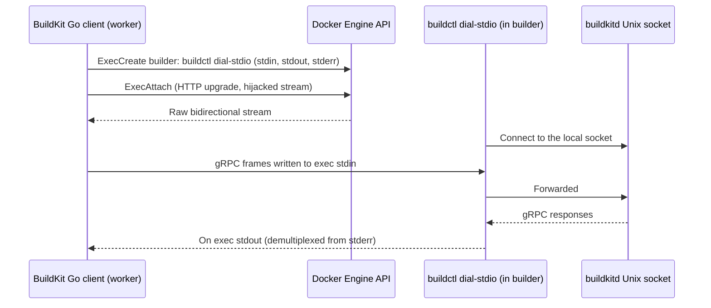

`execConn` wraps the hijacked stream as a `net.Conn`: writes go to the exec's stdin,
reads come from its stdout after `stdcopy` separates stdout from stderr. The BuildKit
client is created with `buildkit.WithContextDialer` returning that connection, so to
the client it is an ordinary gRPC transport. Build steps have no path to the daemon.

### 17.3 Disk admission inside the builder

Before solving, the builder measures what will actually fill up: `docker exec
builder df -Pk /home/user/.local/share/buildkit` (the state directory on the Docker
host's storage). It counts other running builders of this instance and requires:

```
free ≥ BUILD_MIN_FREE_DISK + (other running builds × BUILD_DISK_BUDGET)
       15 GiB              + (n × 20 GiB)
```

Short of that, the build fails with `disk_low`, which is **retryable**: the request
waits as *Waiting for disk space* and housekeeping runs an emergency prune.

## Chapter 18. Running the Dockerfile

### 18.1 The solve request

The worker calls BuildKit's `Solve` with:

| Field | Value | Meaning |
| --- | --- | --- |
| `Frontend` | `dockerfile.v0` | BuildKit's built-in Dockerfile frontend parses and plans the build |
| `FrontendAttrs["filename"]` | `Dockerfile` (or the configured path) | Which Dockerfile in the context |
| `FrontendAttrs["build-arg:HTTP_PROXY"]` (and `HTTPS_PROXY`, lower-case forms) | `http://10.x.y.z:3128` | Steps (`RUN npm ci`) reach the internet only through the proxy. These are [predefined proxy ARGs](https://docs.docker.com/build/building/variables/#pre-defined-build-arguments), which BuildKit keeps **out of the image configuration and cache keys** |
| `FrontendAttrs["label:io.previa.*"]` | The job's identity | The image is labelled for inventory and cleanup |
| `LocalMounts` | `context` and `dockerfile` → the workspace's `source/` directory (fsutil) | BuildKit pulls the files it needs from the worker over the same session; `.dockerignore` is honoured |
| `Exports` | Docker exporter, name `previa/<instance>-pr-17:g7-r2-3f9c2a7b1d04` | The result is streamed back as a Docker image tarball (Chapter 20) |

No secret, build argument from the repository, secret mount or SSH agent is ever
passed. Repository secrets are runtime-only.

### 18.2 What happens inside BuildKit

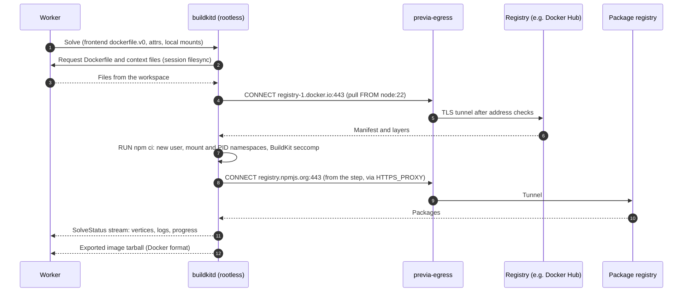

- **Isolation per step.** Each `RUN` executes in fresh namespaces created by the
  rootless daemon, inside the builder's cgroup limits. A step that exceeds the
  memory limit is killed by the kernel (exit code 137); Previa reports *A build step
  was stopped for exceeding the 4.0 GiB memory limit.*
- **Base images** are pulled by `buildkitd` through the proxy (its environment has
  `HTTPS_PROXY`). Registries are public HTTPS endpoints, so the proxy allows them.
- **The cache** lives on the scope's volume, so the second build of the same source
  reuses unchanged layers and cache mounts.

### 18.3 Progress into the log

A goroutine reads BuildKit's `SolveStatus` channel and writes plain-format progress
(step names, their output, timings) into the attempt's log writer
(`internal/builds/logsink.go`), which strips control sequences, redacts, splits lines
and batches them into PostgreSQL (Chapter 30). A viewer watching the log page sees
`#7 [3/6] RUN npm ci` and its output within about a quarter of a second.

### 18.4 Watching disk while it runs

Every 5 seconds the worker asks BuildKit for its disk usage. When the total passes
`BUILD_DISK_BUDGET` (20 GiB) it cancels the solve with cause `disk budget exceeded`:
*The build stored more than 20.0 GiB and was stopped.* A timeout alone is not
resource isolation; this is the disk part of it.

### 18.5 Cancellation from anywhere

The solve's context is cancelled, with a recorded cause, by:

| Cause | Reported as |
| --- | --- |
| `BUILD_TIMEOUT` elapsed | `timeout`: *The build exceeded its time limit.* |
| Worker shutdown | `cancelled` (and the job is snoozed, not failed) |
| The log writer saw its epoch replaced (a newer attempt was admitted) | `superseded`: *A newer attempt replaced this build.* |
| Disk budget | `disk_budget` |

## Chapter 19. The egress proxy, request by request

`previa-egress` is Previa's own forward proxy (`internal/platform/egress`, run by
`cmd/egress`), shared by every build and preview network. It is the one component
every untrusted container can reach, so it is deliberately small and strict.

### 19.1 Its container

| Setting | Value |
| --- | --- |
| Image | `previa-egress:<version>`, a static Go binary in an empty image |
| User | `65532:65532`, read-only root, all capabilities dropped, `no-new-privileges` |
| Limits | 1 CPU, 256 MiB memory (no swap), 512 processes |
| Networks | Its own `previa-egress` bridge (with a route to the internet) plus every build and preview network it is attached to |
| Restart | `unless-stopped` |
| Listens on | Port 3128 |

### 19.2 The decision for every request

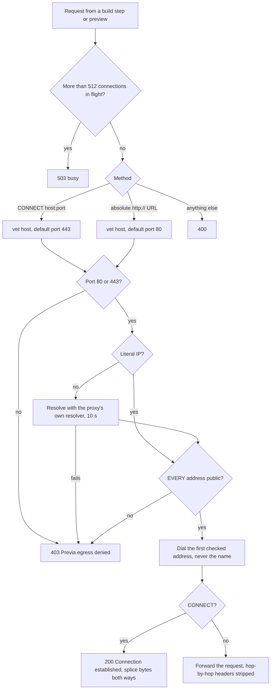

### 19.3 "Public" means all of this is refused

`PublicAddress` accepts only global unicast addresses that are not private, loopback,
link-local, multicast or unspecified, and not in any of these special ranges:

| Refused | Includes |
| --- | --- |
| IPv4 | `0.0.0.0/8`, `10/8`, `127/8`, `169.254/16` (cloud metadata `169.254.169.254`), `172.16/12`, `192.168/16`, `100.64/10` (CGNAT), `192.0.0/24`, documentation ranges, `198.18/15` (benchmarking), `240/4` (reserved), multicast |
| IPv6 | anything outside `2000::/3`, plus NAT64 (`64:ff9b::/96`, `64:ff9b:1::/48`), discard (`100::/64`), Teredo and other `2001::/23` assignments, documentation (`2001:db8::/32`, `3fff::/20`), 6to4 (`2002::/16`), `5f00::/16`, ULA and link-local |

So a build or preview cannot reach PostgreSQL, the server, the worker, the router's
API, the host, other previews or cloud metadata, whatever name it uses.

### 19.4 Why the proxy resolves names itself

[DNS rebinding](https://en.wikipedia.org/wiki/DNS_rebinding) is the classic bypass: a
name resolves to a public address when checked and to `127.0.0.1` when connected. The
proxy closes it by resolving once, refusing the request if **any** returned address
is non-public, and then dialling the **checked IP address**, never the name again.
For plain HTTP forwarding, the HTTP transport's dial function ignores the requested
address and dials only the vetted target carried in the request context.

### 19.5 Timeouts and bounds

| Bound | Value |
| --- | --- |
| DNS lookup and dial | 10 s each |
| Response headers (HTTP forwarding) | 1 min |
| Idle tunnel | 2 min without bytes either way |
| Longest tunnel or request | 1 h |
| Concurrent connections | 512 |

### 19.6 What builds and previews can and cannot do

| Can | Cannot |
| --- | --- |
| Download from public registries and mirrors over 80/443 through the proxy | Reach anything private, local, metadata or another container |
| Call public APIs (sandbox payment APIs, OAuth providers, CDNs) | Use other ports (SSH, databases, SMTP) |
| | Reach the internet with tools that ignore `HTTP(S)_PROXY` (they fail closed) |
| | Resolve external names directly (previews have no external DNS) |

Verified from inside real builds (`make test-builder`) and previews
(`make test-runtime`): direct internet, the default bridge, `host.docker.internal` and
`169.254.169.254` are blocked; `http://example.com` through the proxy works.

## Chapter 20. Exporting the image and cleaning up

### 20.1 The size-capped export

BuildKit's Docker exporter writes the image as a tarball to an `io.WriteCloser`
Previa provides. That writer is a **capped writer** feeding a pipe into the Docker
Engine's image load API (`POST /images/load`, quiet). When the stream passes
`BUILD_MAX_IMAGE_SIZE` (4 GiB) the write fails with `image exceeds the size limit`,
which aborts the export. After loading, the stored image is inspected and measured
again; an oversized or partial image is removed.

The result is in Docker's image store, tagged:

```
previa/<instance>-pr-17:g7-r2-3f9c2a7b1d04
labels: io.previa.managed=true, instance, kind=image, pull-request-id=17,
        generation=7, revision=2, head-sha=3f9c…, base/head repository IDs
```

The log says `Built image previa/…:g7-r2-3f9c2a7b1d04 (182.4 MiB).`

### 20.2 Cleanup, always

`sandbox.close` runs on success, failure, timeout and cancellation, with its own
30-second budget detached from the job's (possibly cancelled) context:

1. Remove the builder container (forced, with its anonymous volumes).
2. Disconnect `previa-egress` from the build network.
3. Remove the build network.

The scope's cache volume stays for the next build. The source workspace is released
by the runtime right after the build, whatever happened.

### 20.3 Failure classes

| Code | Retryable | Typical cause |
| --- | --- | --- |
| `builder_unavailable` | yes | Docker could not create or start the builder |
| `disk_low` | yes (waits) | Not enough free disk on the Docker host |
| `build_failed` | no | A step failed; the log shows which |
| `timeout` | no | `BUILD_TIMEOUT` elapsed |
| `disk_budget` | no | The build wrote more than `BUILD_DISK_BUDGET` |
| `image_too_large` | no | The image exceeds `BUILD_MAX_IMAGE_SIZE` |
| `superseded` | no | A newer attempt took over |
| `cancelled` | no (snoozed on shutdown) | The job's context ended |
| `invalid_job` | no | A programming error caught by validation |

Messages are written for the PR owner and are safe to show; the raw error stays in
the worker's logs.

---

# Part VII. Starting the preview

The image exists. Now `runtime.Build` turns it into a **candidate**: a healthy,
hardened container that nothing routes to yet. Whether it becomes the live preview is
decided later, by publication (Part VIII).

## Chapter 21. Rechecking and deciding secrets

### 21.1 Why check again

A build can take minutes. In that time the owner may have lost access, the
installation may have been suspended, or the PR's source may have changed. So
`TargetStore.Current` runs **again** right before any secret is decrypted. Secrets
are decided with what is true *now*, and an attempt that is no longer current never
starts a container.

### 21.2 The trust rule

```mermaid
flowchart TD
    A[Target after recheck] --> B{Head repository ID equals base repository ID<br/>and GitHub does not mark it a fork?}
    B -- no: fork, deleted head, unknown --> C[Untrusted: decrypt NOTHING]
    C --> C1[Container env = YAML env only]
    C1 --> C2[Log notice: Repository secrets were withheld]
    B -- yes --> D[Load every env_secrets row of the repository]
    D --> E[Decrypt each with its key version]
    E -- any value fails --> F[Fail closed: secrets_unavailable, no container]
    E -- all ok --> G[Merge: secrets override YAML entries of the same name]
    G --> H[Notice per override: Repository secret NAME overrides .previewrc.yaml]
```

Fork authors control the code that would receive the values, so forks **never**
receive secrets, in any mode, on any retry. A repository with secrets on a worker
without the keyring also fails closed (`secrets_unavailable`) rather than starting
without them; repositories without secrets build normally.

### 21.3 How a value is decrypted

Each `env_secrets.encrypted_value` is:

```
12-byte random nonce ‖ AES-256-GCM ciphertext ‖ 16-byte authentication tag
associated data = "previa:env_secret:v1\0" + repository ID + "\0" + name + "\0" + key version
```

The keyring (`SECRETS_ENCRYPTION_KEYS`, `version:base64-key` pairs) holds one AEAD per
version; the row's `key_version` picks the key. Because the repository ID, name and
version are [authenticated associated data](https://en.wikipedia.org/wiki/Authenticated_encryption#Authenticated_encryption_with_associated_data),
a ciphertext copied to another repository or name, or relabelled with another
version, fails to decrypt. Every failure looks the same (`ErrUndecryptable`), so an
error never says which check failed.

The decrypted values live only in worker memory as a `secrets.ContainerEnv`. They go
into the container's configuration and nowhere else: never build arguments, never the
build context, never an image layer, never a job argument or log. `Wipe()` clears the
decrypted bytes when `runtime.Build` returns (string copies handed to the Docker
client cannot be wiped, so their lifetime is kept short).

### 21.4 The startup log gets a real redactor

The startup phase opens a **second** log writer for the same attempt (it continues
the same sequence and caps) whose redactor knows every injected value:

- exact-byte matching, even when a value is split across writes (it holds back at
  most one value's length and never emits part of a possible match);
- each line of a multi-line value (a PEM key) is also redacted on its own;
- values shorter than 4 bytes are not redacted; at most 512 patterns.

If the app prints a secret while starting, the log stores `[redacted]`. Stated
plainly: redaction protects logs, not the credential. Code that receives a value can
transform it (base64) or send it elsewhere.

## Chapter 22. Capacity admission

### 22.1 The budget

Previews share the host with the platform. Their combined limits must fit a budget:

| Budget | Default | Source |
| --- | --- | --- |
| Memory | 60% of Docker's memory | `docker info` `MemTotal`, or `PREVIEW_MEMORY_BUDGET` |
| CPU | 75% of Docker's CPUs | `docker info` `NCPU`, or `PREVIEW_CPU_BUDGET` |
| Previews per repository | 10 PRs | `PREVIEW_MAX_PER_REPOSITORY` |

Usage is read from the **labels** of this instance's preview containers that are
running, restarting or created (`io.previa.cpu-millis`, `io.previa.memory-bytes`).
During a swap both the active preview and its candidate count. Capacity is released
only when a container is actually removed.

### 22.2 The lock

```mermaid
sequenceDiagram
    participant W1 as Worker A
    participant DB as PostgreSQL
    participant D as Docker
    participant W2 as Worker B
    W1->>DB: pg_advisory_lock(hashtext('previa.preview_admission.' + instance))
    W2->>DB: pg_advisory_lock(same key): waits
    W1->>D: List preview containers, sum labels
    W1->>W1: New limits + usage within budget? 10 PRs per repo?
    W1->>D: Ensure network, create labelled container
    W1->>DB: pg_advisory_unlock
    DB-->>W2: Lock granted
    W2->>D: List containers: now sees A's candidate
```

The lock is a PostgreSQL **session** advisory lock held on a dedicated connection
from the capacity check until the labelled container exists, so concurrent admissions
on any worker see each other. If the worker crashes, its connection closes and the
lock is released: there are no reservations to leak.

A refusal is the retryable `capacity` code: the request keeps its build slot, says
*Waiting for capacity*, and its job snoozes with backoff (30 s doubling to 5 min). The
image already built is reused on the next attempt. An earlier, cheaper check
(`Admit`, before the claim) refuses when not even the smallest preview (0.5 CPU,
512 MiB) would fit, so no image is built that could not be started.

## Chapter 23. The preview network and container

### 23.1 The PR's network

Each PR has one lifetime preview network, `previa-<instance>-pr-17`, an internal
bridge created on first use and labelled `kind=preview-network`. A same-named
network Previa did not create, or one that is not internal, is refused. The egress
proxy is attached (giving the proxy URL), and later the router is attached when the
first version is published. Nothing else ever joins it: not the server, not the
worker, not PostgreSQL, not other PRs' previews.

```mermaid
flowchart LR
    subgraph pn[previa-instance-pr-17: internal bridge]
        C1[active preview g6 r1]
        C2[candidate g7 r2]
        E[previa-egress]
        R[previa-router]
    end
    subgraph other[previa-instance-pr-23]
        O[another PR's preview]
        E2[previa-egress]
        R2[previa-router]
    end
    C1 -->|HTTP_PROXY| E
    C2 -->|HTTP_PROXY| E
    R -->|http://container-name:port| C1
    C2 -. no route .-x O
```

### 23.2 The container, setting by setting

Equivalent `docker create` for the candidate (Previa uses the API):

```sh
docker create \
  --name previa-<instance>-pr17-g7-r2-<nanos> \
  --network previa-<instance>-pr-17 \
  --hostname preview \
  --user 65532:65532 \
  --read-only --tmpfs /tmp:rw,nosuid,nodev,size=268435456,mode=1777 \
  --cap-drop ALL --security-opt no-new-privileges \
  --sysctl net.ipv6.conf.all.disable_ipv6=1 --sysctl net.ipv6.conf.default.disable_ipv6=1 \
  --sysctl net.ipv4.ip_unprivileged_port_start=0 \
  --cpus 1 --memory 1g --memory-swap 1g --pids-limit 512 --cpu-shares 512 \
  --oom-score-adj 500 \
  --restart on-failure:3 --stop-timeout 10 \
  --log-driver json-file --log-opt max-size=10m --log-opt max-file=2 \
  [--runtime runsc] \
  -e HTTP_PROXY=http://10.a.b.c:3128 -e HTTPS_PROXY=… -e http_proxy=… -e https_proxy=… \
  -e NO_PROXY=localhost,127.0.0.1 -e no_proxy=localhost,127.0.0.1 -e NODE_USE_ENV_PROXY=1 \
  -e PORT=3000 -e HOME=/tmp -e NODE_ENV=preview -e STRIPE_KEY=<decrypted> \
  --label io.previa.managed=true --label io.previa.kind=preview … \
  <image ID>
```

| Setting | Value | Why |
| --- | --- | --- |
| User | The image's user if not root; otherwise `65532:65532` and `HOME=/tmp` | Running as root inside a container is one kernel bug away from root on the host. `PREVIEW_ALLOW_ROOT=true` is a server-wide opt-out |
| Root filesystem | Read-only; `/tmp` is a 256 MiB tmpfs (`nosuid,nodev`, counted against memory) | Nothing persists; writes are bounded. `PREVIEW_WRITABLE_ROOTFS=true` opts out |
| Capabilities | All dropped, `no-new-privileges` | No raw sockets, no mounts, no setuid escalation |
| Low ports | `ip_unprivileged_port_start=0` | An app on port 80 works without a capability |
| IPv6 | Disabled | The proxy's IPv4 path is the only path |
| seccomp, AppArmor | Docker's defaults (unlike the builder) | Standard syscall filtering applies |
| CPU, memory | The tier (1 vCPU, 1 GiB for `standard`), no swap | Bounded per preview |
| Processes | 512 (`PREVIEW_PIDS`) | Stops fork bombs |
| CPU weight | 512 (half the default 1024) | The platform wins CPU contention |
| OOM score adjustment | 500 | Under memory pressure the kernel kills previews before the platform |
| Restart | On failure, at most 3 times | Then it stays stopped and counts as a crash loop |
| Stop timeout | 10 s | Graceful shutdown on teardown |
| Logs | json-file, 2 × 10 MB | Bounded disk |
| Runtime | `PREVIEW_OCI_RUNTIME`, e.g. [gVisor](https://gvisor.dev) `runsc` | Optional user-space kernel for stronger isolation |
| Host access | No host paths, Docker socket, devices or published ports | Nothing on the host is reachable |

### 23.3 The environment, in order of precedence

1. Values from `.previewrc.yaml` `env`.
2. Repository secrets (trusted sources only) override YAML entries of the same name.
3. Previa adds `PORT` (the configured port) and, when the user was replaced,
   `HOME=/tmp`, **unless** the app already set them.
4. Previa **always** sets `HTTP_PROXY`, `HTTPS_PROXY`, `http_proxy`, `https_proxy`,
   `NO_PROXY`, `no_proxy` and `NODE_USE_ENV_PROXY=1` (Node's `fetch` honours proxy
   variables only with it), overriding YAML and secrets, so neither can point the app
   at another proxy.

### 23.4 Create, unlock, start

The admission lock is released right after `ContainerCreate` (the labelled container
now counts). `ContainerStart` follows. From here, any failure captures the app's last
output into the log and removes the candidate.

## Chapter 24. Readiness

### 24.1 Probes from inside the PR's network

The worker is not on the preview network and must never be. Readiness probes
therefore run **inside the egress container**, which is:

```
docker exec previa-egress /previa-egress probe -target 10.a.b.d:3000 -timeout 2s [-path /health]
```

The target is always the candidate's own IPv4 address on the PR network (read from
`docker inspect`) and the configured port. There is no way to name another URL.

| `health_check_path` | Ready means |
| --- | --- |
| Set (e.g. `/health`) | `GET http://<ip>:<port>/health` with `User-Agent: previa-readiness-probe` answers 200–399. Redirects are not followed; at most 64 KiB of body is read |
| Not set | A TCP connection to the port succeeds |

### 24.2 The loop

```mermaid
flowchart TD
    A[Every 1 s until PREVIEW_STARTUP_TIMEOUT, 120 s] --> B[docker inspect candidate]
    B --> C{Restart count exhausted? crash loop}
    C -- yes --> X1[crashed: exit code, or out of memory]
    C -- no --> D{Running with an address on the PR network?}
    D -- no --> W[wait 1 s]
    D -- yes --> E[Probe through previa-egress, 2 s timeout]
    E -- ready --> OK[Healthy]
    E -- not ready --> F[Remember the reason]
    F --> W
    W --> A
    A -- deadline --> X2[unhealthy: The app was not ready within 2m0s: last reason]
```

### 24.3 The end of the runtime's job

On success the runtime copies the app's last 200 lines (64 KiB) of output into the
log (redacted), writes `The preview is healthy. It is not routed yet.` and returns:

```go
environments.Artifact{ContainerID: "8c1e…", ImageTag: "previa/<instance>-pr-17:g7-r2-3f9c2a7b1d04"}
```

On failure (`unhealthy`, `crashed`, `timeout`, `cancelled`) it captures the same
output, removes the candidate and returns a typed error. `unhealthy` and `crashed` are
permanent: the same commit would fail the same way, so the request ends after one
attempt and the PR comment says why.

---

# Part VIII. Publishing

A healthy candidate exists, but no request reaches it. Making it the live preview
needs three systems to agree: PostgreSQL (the decision), Traefik (the traffic) and
Docker (the network path). None of them can commit together, so publication is an
outbox operation driven by a fenced route controller.

## Chapter 25. Recording the result: the outbox

### 25.1 Apply: the pre-registration gate

Back in `environments.Service.Build`, the artifact is handed to `Repository.Apply`
in one short transaction (with a one-minute budget detached from the job's context,
so even a cancelled job can record a *current* result):

1. Lock the PR scope; check the PR is still open at generation 7 and the intent at
   revision 2 and `running`. If not, nothing is recorded and the candidate is
   scheduled for cleanup: a stale build never becomes visible.
2. Record the candidate as the environment's **pending artifact**
   (`pending_generation`, `pending_revision`, container ID, image tag) and set the
   environment status `publishing`. The previous **active** artifact (the preview
   serving commit A) is untouched and keeps serving.
3. Insert the `activate_route` operation into `environment_operations`, with its
   idempotency key built from kind, PR, generation, revision and target, plus a River
   job (`environment_operation` on queue `environment_route`) via `InsertTx`.
4. Record report work (`wanted_version + 1`).

On failure (`Result{Status: "failed", ErrorCode: …}`) the same transaction records
the failure code on the environment (`last_error_code`), keeps the active preview,
and the job handoff marks the intent `failed` after the last attempt.

Then the build job finishes: `finishJob` marks the intent `succeeded`, releases the
`environment:pr:17` key and the build slot, and admits any waiting successor.

### 25.2 The environment's states

```mermaid
stateDiagram-v2
    [*] --> queued: first admitted build provisions it
    queued --> publishing: healthy candidate recorded
    publishing --> running: route accepted and confirmed
    publishing --> failed: candidate refused or activation failed
    running --> publishing: next commit's candidate
    failed --> publishing: a later candidate
    running --> tearing_down: close, revocation, owner, expiry
    publishing --> tearing_down
    failed --> tearing_down
    tearing_down --> torn_down: route removal confirmed
    torn_down --> publishing: reopened and built again
```

### 25.3 How an operation runs

The operation worker (`internal/environments/operation_worker.go`) is generic; it
runs route activations, route removals, report updates and artifact cleanups, each
on its own queue:

```mermaid
sequenceDiagram
    autonumber
    participant Q as River (environment_route)
    participant OW as Operation worker
    participant DB as PostgreSQL
    participant X as Executor (route controller)
    Q->>OW: environment_operation {operation_id}
    OW->>DB: Claim: state running, lease owner = River job ID, lease 4 min
    OW->>DB: Still relevant? (PR wants exactly this generation and revision)
    alt no longer relevant
        OW->>DB: Mark superseded
    else relevant
        OW->>X: Execute with a 2 min timeout, NO transaction open
        X-->>OW: ok, superseded, or a classified failure
        OW->>DB: Complete or fail (retryable or permanent) under the lease
    end
```

| Operation kind | Queue | Workers per process | Timeout |
| --- | --- | --- | --- |
| `activate_route` | `environment_route` | 2 | 2 min |
| `remove_route` | `environment_route` | 2 | 2 min |
| `report_status` | `environment_report` | 4 | 1 min |
| `cleanup_artifact` | `environment_cleanup` | 2 | 90 s |

- The **lease** (4 minutes, longer than every timeout) prevents two workers from
  running the same operation; the lease owner is River's job ID, so a rescued attempt
  of the same job can reclaim its own lease.
- A lease is not a fence: an expired worker may still have a call in flight. That is
  why the external side (the route controller) enforces its own fence.
- Retryable failures back off (5 seconds doubling to 5 minutes). Route removals and
  cleanups are **retried until done**; running out of River attempts leaves them
  retryable for recovery to re-enqueue.

## Chapter 26. The route controller

### 26.1 Why not Docker labels

Traefik's popular Docker provider routes containers from their labels. Previa does
not use it, for two reasons:

1. Labels are fixed when a container is created, so every candidate would be routed
   **before** it was accepted, and labels cannot be fenced by
   `(generation, revision)`.
2. The Docker provider needs the Docker socket, which is root-equivalent. Previa's
   rule is that only the worker holds it.

Instead Traefik's [file provider](https://doc.traefik.io/traefik/providers/file/)
reads one file that Previa's **route controller** writes from an accepted,
fenced table in PostgreSQL. Traefik's configuration is a materialized view, never the
source of truth.

### 26.2 Activation, step by step

```mermaid
sequenceDiagram
    autonumber
    participant OW as Operation worker
    participant RT as Runtime (Endpoint)
    participant D as Docker API
    participant DB as PostgreSQL
    participant F as previa-routes.yml
    participant T as Traefik
    OW->>RT: Endpoint(PR 17, g7, r2, image)
    RT->>D: Inspect candidate: labels, running
    RT->>D: exec previa-egress probe (up to 5 tries, 1 s apart)
    RT-->>OW: Backend: container name, port 3000, network
    OW->>D: NetworkConnect previa-router to previa-instance-pr-17
    OW->>DB: AcceptRoute transaction (the fence)
    Note over DB: lock installation, repo, PR, environment, route row, route_table<br/>PR open at g7 with this SHA, intent r2 running or succeeded<br/>access intact, candidate is the pending artifact<br/>stored version strictly older: move forward<br/>route_table.version + 1
    OW->>DB: Snapshot the whole accepted table
    OW->>F: Lock file, write temp, fsync, rename (only if version is newer)
    T->>F: File watch fires, reload after a 250 ms throttle
    loop until served, at most 30 s
        OW->>D: exec previa-router wget 127.0.0.1:8080/api/http/routers/preview-ENV@file
        D-->>OW: Router JSON names service preview-ENV-g7-r2?
    end
    OW->>DB: MarkRouteServed (g7, r2)
    OW->>DB: Environment running, active = candidate, expires_at = now + 48 h
    OW->>DB: cleanup_artifact for the previous preview, report work
```

**1. Pre-publication check.** `Runtime.Endpoint` re-inspects the candidate: it must
carry this instance's labels for exactly this PR, generation, revision and image, be
running, and answer readiness probes (up to 5, a second apart, from the egress
container). A missing, foreign, stopped or unready candidate is refused
**permanently** and never routed.

**2. Network attachment.** The worker connects the router container to the PR's
network. Traefik dials previews by container name through Docker's embedded DNS on
that network. The router has no Docker socket; the worker attaches it.

**3. The fence (`AcceptRoute`).** `environment_routes` holds one row per lifetime
environment: the accepted `(generation, revision)`, state `active` or `removed`, the
target (container, image, backend name, port, network) and the served version. The
transaction accepts the new version only if it is strictly newer and the PR still
wants exactly this request. Every acceptance bumps a single `route_table` counter
whose row lock orders acceptances in commit order, so a table snapshot's version
covers every acceptance committed before it.

**4. Materialization.** The controller renders the whole accepted table and writes
it to `ROUTER_DYNAMIC_DIR/previa-routes.yml`:

- writers on the host serialize on `.previa-routes.lock`;
- content goes to `.previa-routes.yml.tmp`, is fsynced, then renamed over the file,
  so Traefik sees either the old or the new file, never half of one;
- the first line carries the version, and a writer only replaces the file when its
  version is **newer**, so a late or concurrent writer can never move it backwards.

**5. Confirmation.** Traefik's API listens on `127.0.0.1:8080` inside the router
container only. The worker runs `wget` there through `docker exec` and waits until
router `preview-<environment>@file` names the new service
`preview-<environment>-g7-r2`. A newer accepted version ends the wait as superseded.

**6. Finalize.** `MarkRouteServed`; the environment becomes `running` with the
candidate as its active artifact; `expires_at` is set to now plus `ENV_TTL_HOURS`; the
previous preview's container, image and (if unused) network are scheduled for
cleanup, which never touches anything the router serves or may still serve.

### 26.3 What the file looks like

```yaml
# previa-route-table-version: 42
{
  "http": {
    "routers": {
      "previa-unavailable": {
        "rule": "HostRegexp(`^.+\\.preview\\.example\\.net$`)",
        "entryPoints": ["websecure"],
        "service": "noop@internal",
        "priority": 1,
        "middlewares": ["previa-unavailable"]
      },
      "preview-5": {
        "rule": "Host(`pr-42-gc0uy9-k3x9q2ma.preview.example.net`)",
        "entryPoints": ["websecure"],
        "service": "preview-5-g7-r2"
      }
    },
    "services": {
      "preview-5-g7-r2": {
        "loadBalancer": {
          "servers": [{"url": "http://previa-<instance>-pr17-g7-r2-<nanos>:3000"}],
          "passHostHeader": true
        }
      }
    },
    "middlewares": {
      "previa-unavailable": {
        "redirectRegex": {"regex": "^.*$", "replacement": "https://previa.example.com/previews/unavailable"}
      }
    }
  }
}
```

It is JSON (which Traefik's YAML reader accepts) after a YAML comment line. Routers
carry no `tls` block on purpose: one would replace the entry point's certificate
resolver. The lowest-priority fallback router catches every unknown preview host and
redirects it to the dashboard's public unavailable page.

### 26.4 Guarantees and limits

| Guaranteed | Not guaranteed |
| --- | --- |
| An older generation or revision never replaces a newer accepted route | Per-request freshness: for about a second after acceptance (file watch plus throttle) requests still reach the previous target, which stays protected |
| A late activation never resurrects a removed route | Availability while Traefik is down or the file is deleted (`Sync` rewrites it) |
| The router's view only moves forward, across restarts | More than one host: writers coordinate with a host-local file lock |
| Old artifacts retire only after a newer version is confirmed | |

## Chapter 27. HTTPS and certificates

### 27.1 One wildcard certificate

Every preview hostname is a direct child of `PREVIEW_BASE_DOMAIN`, so one wildcard
certificate `*.preview.example.net` covers all of them. Traefik's `websecure` entry
point declares the resolver and that single domain; no per-preview certificate is
ever requested, which avoids Let's Encrypt's
[rate limits](https://letsencrypt.org/docs/rate-limits/).

### 27.2 How it is obtained: DNS-01

Wildcards can only be validated with the
[DNS-01 challenge](https://letsencrypt.org/docs/challenge-types/#dns-01-challenge):

```mermaid
sequenceDiagram
    autonumber
    participant T as Traefik (lego ACME client)
    participant LE as Let's Encrypt
    participant DNSP as DNS provider API
    participant NS as Public DNS
    T->>LE: New order for *.preview.example.net (account from ACME_EMAIL)
    LE-->>T: Challenge token
    T->>DNSP: Create TXT _acme-challenge.preview.example.net (token from the credential file)
    T->>NS: Poll ACME_DNS_RESOLVERS until the TXT record is visible
    T->>LE: Ready
    LE->>NS: Look up the TXT record
    LE-->>T: Valid: issue certificate
    T->>DNSP: Delete the TXT record
    T->>T: Store in acme.json (volume acme, mode 600)
```

- **The token stays a file.** The DNS provider token is a Docker secret mounted at
  `/run/secrets/dns_credential`; [lego](https://go-acme.github.io/lego/dns/) reads it
  through `<VARIABLE>_FILE` (for example `CF_DNS_API_TOKEN_FILE`), so `docker inspect`
  shows only a path.
- **Staging first.** `ACME_CA_SERVER` defaults to
  [Let's Encrypt staging](https://letsencrypt.org/docs/staging-environment/); switch to
  production once staging issued a certificate, and remove the `acme` volume so a
  fresh account and certificate are obtained.
- **One machine without a domain.** `PREVIEW_BASE_DOMAIN=preview.localtest.me`
  (every `*.localtest.me` name resolves to `127.0.0.1`) with
  `ACME_CA_SERVER=https://127.0.0.1:1/directory` requests nothing; Traefik serves its
  default self-signed certificate and browsers warn.
- **Restarts** reuse `acme.json`, so no new issuance happens.
- **Production dashboard.** In production the same router also serves the dashboard
  host with its own certificate over TLS-ALPN-01.

### 27.3 Origin separation

The dashboard must not live on the preview domain or below it; the server and worker
refuse that configuration, and warn when both share a registrable domain. A separate
registrable domain (as `githubusercontent.com` is for `github.com`) means a preview
can never read or plant dashboard cookies. Combined with `__Host-` cookies
(Chapter 5), a malicious preview has no way into the dashboard session.

---

# Part IX. The preview is live

## Chapter 28. A visitor's request, hop by hop

A reviewer clicks `https://pr-42-gc0uy9-k3x9q2ma.preview.example.net/` in the PR
comment.

```mermaid
sequenceDiagram
    autonumber
    actor V as Reviewer browser
    participant DNS as Public DNS
    participant T as Traefik (previa-router)
    participant DD as Docker embedded DNS (127.0.0.11)
    participant P as Preview container
    V->>DNS: A pr-42-gc0uy9-k3x9q2ma.preview.example.net?
    DNS-->>V: Host IP (wildcard *.preview.example.net)
    V->>T: TCP 443, TLS ClientHello with SNI = that host
    T-->>V: Wildcard certificate, TLS established
    V->>T: GET / (HTTP/2 or HTTP/1.1)
    T->>T: Entry point websecure, alias headers deleted
    T->>T: Match router preview-5: Host(...) beats the priority-1 fallback
    T->>DD: Resolve previa-instance-pr17-g7-r2-nanos on the PR network
    DD-->>T: 10.a.b.d
    T->>P: GET / Host preserved, X-Forwarded-For, -Proto, -Host added
    P-->>T: 200 HTML
    T-->>V: 200 HTML
```

| Hop | Detail |
| --- | --- |
| DNS | One wildcard `A` record `*.preview.example.net` points at the host; no record per preview |
| Port 80 | The `web` entry point permanently redirects to HTTPS |
| TLS | Terminated by Traefik with the wildcard certificate chosen by SNI |
| Routing | Exact `Host()` rule per environment; the fallback `HostRegexp` router has priority 1 |
| Upstream | Plain HTTP on the PR's internal network to `container-name:port`, `passHostHeader: true` |
| Isolation | The router is the only thing on the PR network besides the PR's own containers and the egress proxy; the path into a preview never becomes a path out |

### 28.1 Unknown or removed hosts

A host that matches no preview (never existed, torn down, typo) hits the fallback
router, whose middleware answers `302` to `https://<dashboard>/previews/unavailable`.
That dashboard page is public, reads no session, sets no cookie, is never cached and
says nothing about which hostname existed, so it cannot be used to probe for private
previews.

### 28.2 What the preview can reach while serving

Outbound requests from the app (a payment sandbox, an OAuth provider) go through
`HTTPS_PROXY` to `previa-egress` and follow the rules of Chapter 19. A preview can
reach other previews' **public** URLs through the internet like anyone else (previews
are public by URL), but never directly over a Docker network.

## Chapter 29. Telling GitHub

Previa keeps reviewers informed on the PR itself: one **living comment** edited in
place, and one **check run per build request** on the exact commit.

### 29.1 From a state change to a report

Every lifecycle transaction that changes what reviewers should see (observation,
request, queueing, admission, result, activation, failure, teardown, removal) calls
`reportTx` **in the same transaction**: it increments
`pull_request_reports.wanted_version` and inserts a `report_status` operation keyed
`report:pr:17:v:<n>`. A report therefore can never be lost and can never precede the
change it describes.

```mermaid
sequenceDiagram
    autonumber
    participant OW as Operation worker (environment_report)
    participant DB as PostgreSQL
    participant API as GitHub API (installation token)
    OW->>DB: Lease the PR in pull_request_reports (2 min)
    OW->>DB: Read wanted and reported versions and the PR snapshot
    alt reported >= wanted
        OW-->>OW: Nothing to do
    else
        OW->>OW: Derive the view from persisted truth (state, URLs, safe failure text)
        OW->>API: GET repository by numeric ID
        OW->>API: GET stored comment, then PATCH (or find by marker, or POST)
        OW->>API: Find check run by external ID for this commit, then create or update
        OW->>DB: Record reported version and content digests (still holding the lease)
        OW->>DB: Did wanted move meanwhile? Render again (at most 3 passes)
    end
```

### 29.2 Rendering from current state

The reporter does not report "what the operation said"; it renders **the PR as it is
now**. Several queued operations for one PR collapse into one GitHub update; the rest
find `reported_version ≥ wanted_version` and finish without calling GitHub. An
unchanged rendering (same digest) costs no API call.

| State | Comment title | Check run |
| --- | --- | --- |
| Waiting (quiet period) | `Previa preview: Waiting` with the eligible time | queued |
| Queued | Queued; builds when a worker is free | queued |
| Checking / Conflicts | Waiting for GitHub / resolve conflicts | queued / completed **neutral** |
| Waiting for capacity or disk | Starts automatically | queued |
| Building | Building commit `3f9c2a7` (also until the route is confirmed) | in progress |
| Ready | The preview URL, the deployed commit, when it expires | completed **success** with the URL |
| Failed | One safe sentence for the failure category | completed **failure** |
| Removed / Expired | No links | an open run is completed as cancelled ("Stopped") |

Rules: *Ready* requires an accepted and confirmed route. The build-log link points to
the owner-only log page. Failure text comes from fixed sentences mapped from stable
codes (`unhealthy`, `crashed`, `build_failed` …), never from raw errors or logs. A fork
PR whose repository has secrets gets a notice that secrets are not given to fork
previews, without naming any.

### 29.3 Stable identity: no duplicates

| Object | How it is found again |
| --- | --- |
| Comment | Its ID is stored on `pull_requests.github_comment_id`; its body starts with `<!-- previa:living-comment -->` and `<!-- previa:version N -->`. If the stored one is gone, the reporter scans this App's comments (at most 5 pages of 100) for the marker and adopts it; ownership is checked by `performed_via_github_app.id` so a human quoting the marker is never edited |
| Check run | One per (commit, revision), external ID `previa:pr:17:3f9c…:r2`, found through the commit's check-run list filtered by name and App ID |

A create that succeeded but whose ID was not saved (crash) is found by the same
discovery next time instead of being created twice.

### 29.4 GitHub calls made

| Purpose | Endpoint |
| --- | --- |
| Resolve the repository | `GET /repositories/{id}` |
| Read, create, edit the comment | `GET/PATCH /repos/{o}/{r}/issues/comments/{id}`, `POST /repos/{o}/{r}/issues/{n}/comments`, `GET /repos/{o}/{r}/issues/{n}/comments` (discovery) |
| Check runs | `GET /repos/{o}/{r}/commits/{sha}/check-runs`, `POST /repos/{o}/{r}/check-runs`, `PATCH /repos/{o}/{r}/check-runs/{id}` |

Rate limits are honoured (`Retry-After` or the reset time, capped at an hour); outages
back off; a refused permission is permanent for that part only (the comment can still
be written when checks are refused). A GitHub outage never delays or rolls back a
publication: reports are separate operations. See
[GitHub: check runs](https://docs.github.com/en/rest/checks/runs) and
[issue comments](https://docs.github.com/en/rest/issues/comments).

## Chapter 30. Telling the dashboard

### 30.1 Live page updates

The open PR page shows *Queued*, then *Building*, then *Ready* without polling.

```mermaid
flowchart LR
    A[Any transaction: server or worker] -->|COMMIT| B[Row triggers on repos, pull_requests,<br/>pr_syncs, build_intents, environments]
    B -->|pg_notify previa_events<br/>topic repository:42| C[realtime.Listen<br/>dedicated LISTEN connection]
    C --> D[Hub: cursor instance.seq,<br/>history of 1024 topics]
    D --> E[GET /repositories/42/events?since=cursor<br/>owner-checked SSE]
    E -->|event change| F[ui.js EventSource]
    F -->|HTMX GET with current filters| G[Swap #repository-detail]
```

- **Triggers, not code paths.** Database triggers raise the notification, so no code
  path can forget to publish. `NOTIFY` is delivered only after commit; rolled-back
  work stays silent and identical payloads in one transaction collapse to one
  ([PostgreSQL NOTIFY](https://www.postgresql.org/docs/current/sql-notify.html)).
- **No missed changes.** The page handler reads the hub cursor **before** loading the
  state it renders and embeds it in the stream URL. Any commit the render did not see
  happened after that cursor, so it arrives as a later event. On reconnect the browser
  sends `Last-Event-ID` and the hub replays or sends a `resync`.
- **Data never travels over the stream.** Events carry only a topic. The browser
  refetches through the ordinary owner-scoped GET handler, so authorization is the
  same as any page load.
- **Bounds.** Heartbeat every 25 s, a 5-minute stream lifetime (the browser
  reconnects through authentication), hidden tabs close their stream.
- **Protocol.** [Server-Sent Events](https://developer.mozilla.org/en-US/docs/Web/API/Server-sent_events)
  over one long-lived HTTP response; proxies must not buffer it (Previa sends
  `X-Accel-Buffering: no`, `Cache-Control: no-cache, no-transform`).

### 30.2 Build logs, from BuildKit to the browser

```mermaid
flowchart LR
    BK[BuildKit progress<br/>app output] --> S1[Strip ANSI and control sequences]
    S1 --> S2[Redact known values]
    S2 --> S3[Split lines: LF, CRLF, lone CR,<br/>8 KiB per line, invalid UTF-8 replaced]
    S3 --> S4[Caps: 20,000 lines or 5 MiB]
    S4 --> S5[Batch: 200 lines or 64 KiB, every 250 ms]
    S5 --> DB[(build_logs, fenced by epoch)]
    DB -->|trigger: buildlog:ENV| H[Hub wake-up]
    H --> SSE[GET .../logs/events<br/>id = epoch.next]
    SSE --> UI[Log page appends lines]
```

1. **Control stripping first**, so a secret split by colour codes is still recognised.
2. **Redaction** holds back only a tail that could still become a known value, so
   `Listening on :3000` appears immediately.
3. **Line splitting**: a lone CR keeps only the text after it (progress bars), a line
   that pauses for 1 second without a newline is stored as it is.
4. **Caps**: past 20,000 lines or 5 MiB, one system line says the limit was reached and
   later lines are only counted.
5. **Batching and fencing**: each batch is one transaction. `AllocateLines` reserves a
   sequence range **only if the stream's epoch is still the writer's and it is open**.
   A writer whose attempt was replaced stores nothing, returns `ErrSuperseded`, and
   its `Done()` channel closes; the builder listens to it and cancels the superseded
   build (Chapter 18).
6. **Slow storage never blocks a build**: up to 5,000 lines or 2 MiB wait in memory
   with retries; beyond that, lines are dropped, counted (`lost_lines`) and a system
   line marks the gap.

The log stream's event IDs are `<epoch>.<next sequence>`. A browser holding a cursor
from another epoch gets a `reset` event and a full replay of the current attempt, so
an old cursor can never skip the start of a new build. Limits: 256 log streams per
server, 8 per user, 10-second write timeout per frame. Lines are rendered as text
nodes, so build output can never become markup. Logs are kept 14 days after the
attempt finishes (`build_log_prune`, hourly).

---

# Part X. After the first preview

## Chapter 31. New commits, retries and rebuilds

### 31.1 A new commit: blue/green swap

The PR is live at commit A (g6, r1). The author pushes commit B.

```mermaid
sequenceDiagram
    autonumber
    participant GH as GitHub
    participant S as Server
    participant DB as PostgreSQL
    participant W as Worker
    participant R as Traefik
    GH->>S: pull_request synchronize (head B)
    S->>DB: Generation 7, older intent superseded, intent for B (Automatic) or none (Manual)
    Note over R: Still serving A at the same hostname
    W->>DB: Build B admitted (g7, r1)
    W->>W: Build image B, start candidate B on the same PR network
    W->>DB: Pending artifact B, activate_route
    W->>DB: AcceptRoute g7 r1 (newer than g6 r1)
    W->>R: File version moves forward, router serves B
    W->>DB: Served: environment running with B, cleanup of A scheduled
    W->>W: Stop A (10 s grace), remove container, then image
```

- The hostname never changes; reviewers keep the same link.
- A keeps serving the whole time B builds. If B fails, A stays live and the comment
  says *Current preview (commit A)* with a note that a newer commit failed.
- During the swap both A and B count against capacity (Chapter 22).
- A is removed only **after** the router confirms B, and its cleanup is refused while
  anything still references it (Chapter 32).
- In **Manual** mode the push records generation 7 and marks the old request
  superseded but starts nothing: the owner clicks **Build latest commit** when ready.

### 31.2 Retry and Rebuild: same commit, new revision

**Retry** after a failure and **Rebuild** after a success target the same SHA. They
advance the intent **revision** without changing the generation (g7, r2). Everything
downstream carries the revision:

| Thing | With revision |
| --- | --- |
| Image tag | `previa/<instance>-pr-17:g7-r2-3f9c2a7b1d04` (a new image, never overwriting r1's) |
| Container name and labels | `…-pr17-g7-r2-…`, `io.previa.revision=2` |
| Operation keys | Include generation **and** revision, so r2's activation never collides with r1's |
| Route fence | `(7, 2)` is newer than `(7, 1)`; replaying r1 is refused |
| Check run | A new run with external ID `…:r2`; r1's finished run is kept as history |
| Log epoch | A new epoch, so r1's late lines can never appear in r2's log |

### 31.3 Races resolved by fences

| Race | What decides it |
| --- | --- |
| A new commit arrives while the old one builds | The claim and `Apply` check the generation: the old result is refused and cleaned up |
| The PR closes while a candidate waits for confirmation | Teardown's removal is accepted with a newer generation; the activation is superseded |
| Two workers pick up the same operation | The lease: only one claims it |
| A stale worker's route write arrives late | The file's version check and the `environment_routes` fence |
| A retried build after its candidate was already recorded | `Service.Build` sees the pending artifact for that revision and only schedules cleanup |

## Chapter 32. Teardown

### 32.1 Four ways a preview ends

| Trigger | Recorded by | Reason |
| --- | --- | --- |
| PR closed or merged | Webhook transaction (or PR reconciliation if the webhook was missed): new generation and a wake-up that dispatches a `teardown` job | `closed` |
| App suspended or uninstalled, repository removed from the App | The lifecycle webhook transaction: teardown request for every affected PR, `cleanup_pending` on the installation, sweep wake-up | `revoked` |
| Owner clicks **Tear down preview** (confirmation modal, CSRF POST) | `RequestTeardown`: new generation, intent superseded | `requested` |
| Expiry (`ENV_TTL_HOURS` after the latest publication) | Housekeeping's expiry pass | `expired` |

Requesting a teardown of an open PR advances its generation, so every in-flight
build, publication and report of an older generation is defeated by the existing
fences, and nothing rebuilds until a new owner request or a later Automatic event.

### 32.2 The flow

```mermaid
flowchart TD
    A[Close, revocation, owner request, expiry] --> B[One short transaction, no external call]
    B --> C[Environment tearing_down at generation g<br/>active and pending artifacts moved into remove_route g]
    C --> D[remove_route operation]
    D --> E[Route controller: tombstone at g unless a newer route exists]
    E --> F[Write the file without the router entry]
    F --> G[Confirm through the Traefik API: router gone]
    G --> H[Environment torn_down, only if still in teardown g]
    H --> I[cleanup_artifact for every artifact the teardown took over]
    I --> J[Container: inspect labels, stop 10 s, remove by force]
    J --> K[Image: remove without force]
    K --> L[PR network: disconnect router and egress, remove once unused]
```

- **Route first.** No request can reach a removed container: the hostname is
  withdrawn (and then redirects to the unavailable page) before any container stops.
- **Verified by labels, never by names.** Before removing anything,
  `RemoveResource` inspects the object and requires `io.previa.managed=true`, this
  instance, the right kind and `io.previa.pull-request-id` equal to the PR. Anything
  else is refused permanently (`not_owned`). An object already gone counts as removed.
- **References protected.** A cleanup re-checks under the PR lock and skips anything
  still referenced: active or pending artifacts, targets of unfinished route
  operations, everything the router serves or may still serve.
- **Images never forced.** An image still used by a container stays (`in_use`, retried).
- **No GitHub needed.** Teardown, route removal and cleanup never call GitHub, so a
  revoked installation cannot strand a preview.
- **Kept:** the PR row, its lifetime environment and hostname (a reopen gets the same
  URL), repository secrets, build caches.
- **Never:** a global prune. Unrelated containers and other PRs' objects survive.

### 32.3 Revocation and the sweep

For a revoked installation, `TeardownSweeper` (queue `environment_teardown`) starts the
recorded teardowns without GitHub access and clears `cleanup_pending` only when no
teardown is unstarted, nothing is live or still tearing down, no route removal or
cleanup is unfinished, and Docker holds nothing for those PRs. Restoring access does
not rebuild anything by itself.

## Chapter 33. Housekeeping and crash recovery

### 33.1 The periodic jobs

All run on the `housekeeping` queue, once when the worker's River client becomes the
elected leader and then on their interval; only the leader runs periodic jobs.

| Job | Every | Timeout | Does |
| --- | --- | --- | --- |
| `housekeeping_recover` | 1 min | 2 min | Recreates lost wake-ups for pending, queued and running requests and closed PRs awaiting teardown; re-enqueues lost operations and releases expired leases; starts recorded teardowns; rewrites the route file if it drifted; an emergency prune when a build waits for disk |
| `housekeeping_resources` | 5 min | 5 min | Inventories Docker objects of a batch of PRs; schedules cleanup of orphans older than the 15-minute grace; removes objects of PRs the database does not know |
| `housekeeping_pull_requests` | 15 min | 5 min | Confirms up to 10 PRs with live work against GitHub (`VerifyUpstream`), catching a close missed while webhooks were down |
| `housekeeping_expiry` | 10 min | 2 min | Tears down previews past `expires_at` (unless a request is in flight) |
| `housekeeping_prune` | 1 h | 15 min | Untagged images, leftover source workspaces, build caches of repositories that can no longer build, then the oldest unused ones beyond `BUILD_CACHE_BUDGET` |
| `build_log_prune` | 1 h | 5 min | Deletes log lines of attempts finished more than 14 days ago, in batches of 5,000 |

`HOUSEKEEPING_DRY_RUN=true` logs every deletion and makes none;
`make housekeeping-dry-run` runs one inventory, expiry and prune pass as a diagnostic.

### 33.2 Every crash point and who resumes it

| Crash or loss | What remains durable | Resumed by |
| --- | --- | --- |
| Server crashes after recording a request | Intent and wake-up job (same transaction) | River runs the wake-up |
| A wake-up job is lost | Pending or queued intent | Recovery inserts a new wake-up |
| Worker dies mid-build | Running intent with its slot; labelled builder, network, maybe an image | River rescues the job after its timeout; admission accepts the running request; an image built for the revision is reused; leftovers are inventoried and cleaned |
| Build retries exhausted before the handoff | Running intent | Recovery wakes it; dispatch inserts a new build job |
| Worker dies during an operation | Operation with an expired lease | Recovery releases the lease and re-enqueues |
| Crash after the route was accepted, before the file write | Accepted route row | The retry finds it accepted, writes the file and confirms; `Sync` at startup also repairs the file |
| Traefik restarts | `previa-routes.yml` on disk, `acme.json` | Traefik reloads both; no new certificate |
| Route file deleted | Accepted table in PostgreSQL | `Sync` (startup and every recovery pass) rewrites it |
| Close webhook missed | Open PR with live work | PR reconciliation records the close; recovery starts the teardown |
| A candidate whose result was never applied | Labelled container | Resource inventory after the grace period |
| Source workspace left behind | `workspace.json` marker | Prune, once older than `BUILD_TIMEOUT` plus the grace |

Recovery only reads durable rows and never authorizes work: every recovered build
goes through the normal dispatch and admission checks.

---

# Part XI. Cross-cutting

## Chapter 34. The security model in one place

### 34.1 Trust boundaries

```mermaid
flowchart TB
    subgraph untrusted[Untrusted: controlled by PR authors]
        SRC[Archive, Dockerfile, .previewrc.yaml]
        BLD[Build steps]
        APP[Running preview]
    end
    subgraph semi[Semi-trusted inputs]
        WH[Webhook payloads]
        GHR[GitHub API responses]
        VIS[Preview visitors]
    end
    subgraph trusted[Trusted platform]
        SRV[Server]
        WRK[Worker]
        DB[(PostgreSQL)]
        RTR[Traefik]
        EG[previa-egress]
    end
    SRC -->|validated, confined| WRK
    BLD -->|proxy only| EG
    APP -->|proxy only| EG
    WH -->|HMAC verified| SRV
    GHR -->|fenced, re-read before use| WRK
    VIS -->|TLS, host routing| RTR
    RTR -->|PR network only| APP
```

### 34.2 Threats and controls

| Threat | Controls |
| --- | --- |
| Contributor triggers platform spend | Manual by default; build mode is owner data, never repository YAML; Automatic is opt-in with a quiet period |
| Forged or replayed webhook | HMAC-SHA256 over the raw body, unique delivery receipts, source-ordered observations |
| Stale state builds the wrong commit | Fresh GitHub read before recording and before admission; exact 40-character SHA; archive identity header check |
| Malicious archive (traversal, links, bombs) | Canonical local paths, `os.Root`, links last, no special files, size, entry and time caps |
| Malicious YAML | Strict parser, no anchors/aliases/tags, 64 KiB cap, errors without snippets |
| Malicious Dockerfile | Rootless BuildKit per build, minimal capabilities, cgroup limits, disk budget, timeout, internal network, egress proxy |
| Build or preview reaching internal services or metadata | Internal networks without gateways; the proxy refuses every non-public address after resolving names itself; no external DNS in previews |
| Fork stealing secrets | Secrets never decrypted for untrusted sources; caches scoped per source repository so forks cannot poison trusted builds |
| Secrets leaking into images or logs | Runtime-only injection; never build args or layers; streaming redaction before storage; values never shown again in the UI |
| Secrets at rest | AES-256-GCM with associated data, versioned keys, rotation without downtime |
| Running PR code escaping its container | Non-root UID, read-only root, no capabilities, `no-new-privileges`, seccomp/AppArmor, resource limits, optional gVisor |
| Preview attacking the dashboard | Separate (ideally registrable) domain, `__Host-` cookies, CSRF tokens and Origin checks, nonce CSP, host validation |
| Previews attacking each other | One internal network per PR; the router is the only shared member and dials previews by name, not the reverse |
| Late or duplicate work overwriting newer state | Generation and revision fences on every write; route versions only move forward |
| Revoked access leaving previews running | Revocation records teardown in the same transaction; teardown needs no GitHub access |
| Deleting someone else's containers | Label- and instance-verified removal; no global prune; grace period for orphans |
| Credential exposure in config | Key material and tokens as mode-600 files; redaction in logs by key and shape; production mode refuses world-readable keys |

### 34.3 Limits stated plainly

- Builders and previews are containers on the host's kernel, not virtual machines; a
  kernel exploit is not contained (gVisor narrows this for previews where installed).
- The builder runs without Docker's outer seccomp and AppArmor profiles (BuildKit's
  own profile applies to steps).
- The worker's Docker socket is root-equivalent on the host; the host is dedicated.
- Anyone with Docker access on the host can read a preview's environment, including
  injected secrets.
- Code that legitimately receives a secret can exfiltrate it over HTTPS to a public
  host; redaction protects logs only.
- Previews are public to anyone who has the URL.

## Chapter 35. Failures, retries and waiting

Previa separates three outcomes, because each needs different handling.

| Outcome | Examples | Handling | Spends an attempt? |
| --- | --- | --- | --- |
| **Waiting** | Build slots full (`capacity`), preview budget full, low disk (`disk_low`), builds paused | Intent stays, `waiting_reason` recorded and shown, job snoozed 30 s doubling to 5 min | No |
| **Retryable failure** | GitHub 5xx or network error, Docker hiccup, builder could not start | River backoff, up to 5 attempts; GitHub rate limits snooze for GitHub's own delay | Yes (rate limits: no) |
| **Permanent failure** | Missing or invalid `.previewrc.yaml`, failing Dockerfile, image too large, app never ready, crash loop, time limit, access gone | Ends after one attempt, reported once with a safe sentence | Ends the request |
| **Superseded** | A newer commit, request, close or teardown | Exits quietly, schedules cleanup of its own resources | No failure is reported |
| **Interrupted** | Worker shutdown during a build | `ErrInterrupted`, slot kept, snoozed to the next start | No |

### 35.1 The kill switch

`BUILDS_PAUSED=true` on the worker stops untrusted code from running during an
incident: admission makes no GitHub or Docker call for a build and every request waits
with reason `paused` (the dashboard, comment and check run say *Builds paused*).
Teardown, cleanup, routing, reports and housekeeping keep running, so nothing is
stranded. The dashboard refuses new build requests while the only workers are paused.

### 35.2 Failure codes on the environment

`environments.last_error_code` stores a stable category, mapped to a fixed sentence
for the dashboard and GitHub: `source_failed`, `build_failed`, `secrets_unavailable`,
`unhealthy`, `crashed`, `timeout`, `cancelled`, `runtime_unavailable`,
`inaccessible`, `incomplete_artifact`, and activation failures. Raw errors, logs and
provider responses never leave the worker's own logs.

## Chapter 36. Observability along the flow

### 36.1 Following one PR through the logs

Every process writes JSON lines to standard output. Every record made with a request's
or job's context carries correlation fields, so one PR can be followed end to end:

```sh
docker compose logs worker | grep '"pr_id":17'
```

| Step | Fields |
| --- | --- |
| HTTP request (Build click) | `request_id` (also `X-Request-ID`), `client_ip`, `method`, `path`, `status`, `duration` |
| Webhook delivery | `delivery_id`, `event`, repository, PR number, installation |
| Every River job | `job_id`, `job_kind`, `job_attempt`, `pr_id`, `generation`, `revision`, `sha`, `operation_id`, `repo_id` |
| Process start | `version`, schema version, `environment`, capabilities and unavailable reasons |

Redaction happens at the logging layer too, by key (`secret`, `token`, `password`,
`authorization`, `cookie`, `private_key`, `credential`, `dsn` …) and by shape (GitHub
tokens, bearer and basic credentials, PEM keys, URL passwords).

### 36.2 Metrics at each step

| Step | Metric |
| --- | --- |
| Webhook arrives | `previa_webhook_deliveries_total{event,outcome}` |
| Any GitHub call | `previa_github_requests_total{status}`, `previa_github_rate_limit_remaining`, `previa_github_rate_limited_total` |
| Job waits and runs | `previa_job_queue_wait_seconds{queue}`, `previa_job_duration_seconds{kind}`, `previa_jobs_total{kind,outcome}` |
| Admission waits | `previa_build_waits_total{reason}` (capacity, disk, paused) |
| Disk check | `previa_build_disk_free_bytes` |
| Build ends | `previa_builds_total{outcome,code}`, `previa_build_duration_seconds{outcome}` |
| Preview serving | `previa_request_to_preview_seconds`: from the request becoming eligible (after any quiet period) to the preview serving. The headline number |
| Housekeeping | `previa_housekeeping_actions_total{job,action}` |
| Durable state (server, at scrape time) | `previa_queue_jobs`, `previa_queue_oldest_available_seconds`, `previa_environments`, `previa_operations`, `previa_build_requests`, `previa_workers_live`, `previa_worker_capability` |

Labels are fixed sets only (PR IDs, URLs and hostnames never become label values), so
cardinality stays bounded. Metrics, `/livez` and `/readyz` are served on the internal
listeners (`127.0.0.1:9090` server, `127.0.0.1:9091` worker), never publicly. The
worker's `/readyz` checks the database, the schema, River, a fresh heartbeat and
Docker, and lists its capabilities.

## Chapter 37. Every timeout and limit

| Step | Bound | Value |
| --- | --- | --- |
| Sign-in | OAuth state cookie | 10 min |
| Sessions | Idle / absolute | 30 min / 24 h |
| Any GitHub HTTP call | Client timeout | 10 s |
| App linking | Whole flow | 25 s |
| Webhook | Body / processing / concurrent | 2 MiB / 8 s / 32 |
| Discovery | Page size / timeout / attempts | 100 PRs / 45 s / 8 |
| Mergeability | First check / interval / attempts | 2 s / 2 s / 8 |
| Upstream verification | Budget | 20 s |
| Automatic quiet period | Trailing | 5 min |
| Wake-up job | Timeout | 15 s |
| Worker heartbeat | Interval / considered gone | 30 s / 90 s |
| Build slots | Across all workers | `MAX_CONCURRENT_BUILDS` |
| Waiting | Snooze backoff | 30 s doubling to 5 min |
| Build job | Timeout / attempts | `BUILD_TIMEOUT` (12 min) + 1 min / 5 |
| Source | Archive / extracted / entries / redirects / time | 256 MiB / 1 GiB / 100,000 / 3 / 5 min |
| `.previewrc.yaml` | Size | 64 KiB |
| Builder | Ready wait / CPUs / memory / PIDs | 30 s / 2 / 4 GiB / 2,048 |
| Builder disk | Budget / image / free host disk | 20 GiB / 4 GiB / 15 GiB |
| Builder disk watch | Interval | 5 s |
| Egress proxy | DNS and dial / headers / idle / max / connections | 10 s / 1 min / 2 min / 1 h / 512 |
| Preview | Tier ceiling / tmpfs / PIDs / restarts | 2 vCPU, 2 GiB / 256 MiB / 512 / 3 |
| Readiness | Interval / probe / deadline | 1 s / 2 s / 120 s |
| Pre-publication check | Probes | 5, 1 s apart |
| Preview budget | Memory / CPU / per repository | 60% / 75% / 10 |
| Operations | Lease / route / report / cleanup | 4 min / 2 min / 1 min / 90 s |
| Route confirmation | Convergence | 30 s |
| Traefik reload | File watch throttle | 250 ms |
| Reporter | Lease / passes / discovery pages | 2 min / 3 / 5 × 100 |
| Logs | Per attempt / per line / batch / retention | 5 MiB or 20,000 lines / 8 KiB / 200 lines, 64 KiB, 250 ms / 14 days |
| SSE | Heartbeat / lifetime / log streams | 25 s / 5 min / 256 per server, 8 per user |
| Expiry | After the latest publication | `ENV_TTL_HOURS` (48 h) |
| Housekeeping | Orphan grace | 15 min |
| Worker shutdown | Drain | 30 s, then cancel |

---

# Appendices

## Appendix A. Docker objects Previa creates

| Object | Name | Kind label | Created at | Removed at |
| --- | --- | --- | --- | --- |
| Egress network | `previa-egress` | `egress` | Worker start (`Gateway.Ensure`) | Never by Previa (shared) |
| Egress container | `previa-egress` | `egress` | Worker start | Never by Previa (restarts unless stopped) |
| Build network | `previa-build-<instance>-pr<P>-g<G>-r<R>-<nanos>` | `build-network` | Each build | End of that build (always) |
| Builder (cached) | `previa-builder-<instance>-r<base>-h<head>` | `builder` | Each build that gets the scope's cache | End of that build |
| Builder (throwaway) | `previa-builder-<instance>-pr<P>-g<G>-r<R>-<nanos>` | `builder` | When the cache is busy | End of that build, with its anonymous volume |
| Build cache volume | `previa-buildcache-<instance>-r<base>-h<head>` | `build-cache` | First build of a scope | Housekeeping prune (revoked repositories first, then oldest beyond `BUILD_CACHE_BUDGET`) |
| Image | `previa/<instance>-pr-<P>:g<G>-r<R>-<sha12>` | `image` | Each build | Cleanup after it is replaced or torn down; untagged images by prune |
| Preview network | `previa-<instance>-pr-<P>` | `preview-network` | First preview of the PR | When the PR's last preview is removed |
| Preview container | `previa-<instance>-pr<P>-g<G>-r<R>-<nanos>` | `preview` | Each candidate | Cleanup after replacement or teardown; immediately on a failed start |
| Router (development) | `previa-router` (`ROUTER_CONTAINER`) | not labelled | `make router-up` | `make router-down` |

Inspect what Previa holds for one PR:

```sh
docker ps -a --filter label=io.previa.managed=true --filter label=io.previa.pull-request-id=17
docker images --filter label=io.previa.pull-request-id=17
docker network ls --filter label=io.previa.managed=true
```

## Appendix B. River jobs and queues

| Kind | Queue | Workers per process | Timeout | Inserted by |
| --- | --- | --- | --- | --- |
| `pr_discovery` | `pr_discovery` | 2 | 45 s | Linking, Sync button, its own next page |
| `pr_mergeability` | `pr_discovery` | (shared) | — | Unresolved observations |
| `environment_wake` | `environment_coordination` | 4 | 15 s | Requests, Automatic observations, close, recovery |
| `build` | `build` | `MAX_CONCURRENT_BUILDS` | `BUILD_TIMEOUT` + 1 min | Dispatch, handoff |
| `teardown` | `teardown` | 2 | 2 min + 1 min | Dispatch after close |
| `environment_operation` | `environment_route`, `environment_report`, `environment_cleanup` | 2, 4, 2 | 2 min, 1 min, 90 s | Lifecycle transactions (outbox) |
| `environment_teardown_sweep` | `environment_teardown` | 1 | — | Revocation webhooks, recovery |
| `housekeeping_recover`, `_resources`, `_pull_requests`, `_expiry`, `_prune` | `housekeeping` | 1 | 2, 5, 5, 2, 15 min | Periodic (leader only) |
| `build_log_prune` | `build_log_prune` | 1 | 5 min | Periodic (leader only) |
| `ping` | default | `MAX_CONCURRENT_BUILDS` | 5 s | Developer tools (not in production) |

Uniqueness: wake-ups by `wake:pr:<id>:g:<generation>:r:<revision>`; build and
teardown share `environment:pr:<id>` across kinds; operations by their arguments.

## Appendix C. Database tables, step by step

| Step (chapter) | Reads | Writes |
| --- | --- | --- |
| Sign-in (5) | `users`, `sessions` | `users` (upsert), `sessions` |
| Linking (6) | `installations`, `repos` | `installations`, `repos`, `pr_syncs`, River job |
| Webhook (7) | `webhook_deliveries`, `installations`, `repos`, `pull_requests` | `webhook_deliveries`, `pull_requests`, `build_intents`, `pull_request_reports`, `environment_operations`, River jobs |
| Discovery, mergeability (7) | `pr_syncs`, `pull_requests` | `pull_requests`, `pr_syncs`, River jobs |
| Manual request (8) | `worker_capabilities`, PR scope | `pull_requests` (fresh observation), `build_intents`, `pull_request_reports`, River job |
| Wake-up and dispatch (10) | PR scope, `build_intents` | `build_intents` (`queued`), River job |
| Claim (12) | PR scope, running intents (slots) | `build_intents` (`running`), `environments` (first time: hostname), `build_log_streams`, `build_logs` (cleared) |
| Build output (18, 30) | `build_log_streams` | `build_logs`, `build_log_streams` |
| Secrets (21) | `env_secrets` | — |
| Capacity (22) | `platform_instance` (lock key) | — (advisory lock only) |
| Apply (25) | PR scope | `environments` (pending artifact, `publishing`), `environment_operations`, `pull_request_reports`, River jobs |
| Route activation (26) | PR scope, `environment_routes`, `route_table` | `environment_routes`, `route_table`, `environments` (`running`, `expires_at`), cleanup operations |
| Reports (29) | `pull_requests`, `environments`, `build_intents`, `pull_request_reports` | `pull_request_reports`, `pull_requests.github_comment_id` |
| Teardown (32) | PR scope | `pull_requests` (teardown generation), `environments`, `environment_routes`, operations |
| Housekeeping (33) | Most tables | `pr_reconciliations`, operations, River jobs |
| Every committed change above | — | `NOTIFY previa_events` via triggers |

## Appendix D. Glossary

| Term | Meaning |
| --- | --- |
| Observation | A PR state learned from a webhook, discovery or a fresh API read |
| Generation | A PR's counter of fresh relevant observations; the main fencing token |
| Intent | The one current authorized build request for a PR (`build_intents`) |
| Revision | The intent's counter of deliberate requests; separates a Retry/Rebuild from the original |
| Wake-up | A scheduled `environment_wake` job that rechecks durable intent at its deadline |
| Dispatch | Inserting the executable build or teardown job and marking intent `queued` |
| Admission / claim | The checks and the transaction that turn a queued request into a running attempt |
| Attempt / log epoch | One admitted execution; its epoch changes on every admission, even a retry |
| Build slot | One of `MAX_CONCURRENT_BUILDS` global places for running requests |
| Workspace | A worker-owned directory holding one extracted commit |
| Cache scope | Base repository + source repository; builds share a BuildKit cache only within one |
| Candidate | A healthy preview container not yet routed |
| Pending / active artifact | The candidate awaiting publication / the container currently served |
| Operation | A durable outbox row for an external effect (route, report, cleanup) |
| Lease | A time-limited claim on an operation or a PR's reports |
| Route fence | `environment_routes`: the accepted `(generation, revision)` per environment, moving only forward |
| Route table version | The `route_table` counter written into the route file's first line |
| Trusted source | A head repository that is provably the base repository; only these receive secrets |
| Egress proxy | `previa-egress`: the only exit from build and preview networks |
| Instance | The identity of the Previa database that owns a Docker object |
| Capability | What a running worker can do, published in `worker_capabilities` |

## Appendix E. Further reading

| Topic | Reference |
| --- | --- |
| GitHub App authentication | [About authentication with a GitHub App](https://docs.github.com/en/apps/creating-github-apps/authenticating-with-a-github-app/about-authentication-with-a-github-app) |
| Setup URL safety | [About the setup URL](https://docs.github.com/en/apps/creating-github-apps/registering-a-github-app/about-the-setup-url) |
| OAuth web flow | [Authorizing OAuth apps](https://docs.github.com/en/apps/oauth-apps/building-oauth-apps/authorizing-oauth-apps) |
| Webhook signatures | [Validating webhook deliveries](https://docs.github.com/en/webhooks/using-webhooks/validating-webhook-deliveries) |
| Pull requests API | [REST: pulls](https://docs.github.com/en/rest/pulls/pulls) |
| Source archives | [Download a repository archive (tar)](https://docs.github.com/en/rest/repos/contents#download-a-repository-archive-tar) |
| Check runs, comments | [Check runs](https://docs.github.com/en/rest/checks/runs), [Issue comments](https://docs.github.com/en/rest/issues/comments) |
| River | [River documentation](https://riverqueue.com/docs), [transactional enqueueing](https://riverqueue.com/docs/transactional-enqueueing) |
| PostgreSQL locking | [Explicit locking and advisory locks](https://www.postgresql.org/docs/current/explicit-locking.html), [`SKIP LOCKED`](https://www.postgresql.org/docs/current/sql-select.html#SQL-FOR-UPDATE-SHARE) |
| PostgreSQL notifications | [LISTEN](https://www.postgresql.org/docs/current/sql-listen.html), [NOTIFY](https://www.postgresql.org/docs/current/sql-notify.html) |
| Outbox and sagas | [Transactional outbox](https://microservices.io/patterns/data/transactional-outbox.html), [Saga](https://microservices.io/patterns/data/saga.html) |
| Fencing tokens | [Martin Kleppmann: How to do distributed locking](https://martin.kleppmann.com/2016/02/08/how-to-do-distributed-locking.html) |
| Rootless BuildKit | [BuildKit rootless mode](https://github.com/moby/buildkit/blob/master/docs/rootless.md) |
| Build arguments and proxies | [Docker build variables](https://docs.docker.com/build/building/variables/) |
| Docker networking | [Bridge networks and internal mode](https://docs.docker.com/engine/network/drivers/bridge/) |
| Container hardening | [Docker seccomp](https://docs.docker.com/engine/security/seccomp/), [AppArmor](https://docs.docker.com/engine/security/apparmor/), [Rootless and user namespaces](https://docs.docker.com/engine/security/userns-remap/) |
| Stronger isolation | [gVisor](https://gvisor.dev/docs/) |
| Safe file APIs | [Go: traversal-resistant file APIs (`os.Root`)](https://go.dev/blog/osroot) |
| Archive attacks | [Zip Slip](https://security.snyk.io/research/zip-slip-vulnerability) |
| DNS rebinding | [DNS rebinding](https://en.wikipedia.org/wiki/DNS_rebinding) |
| Traefik | [File provider](https://doc.traefik.io/traefik/providers/file/), [ACME / certificate resolvers](https://doc.traefik.io/traefik/https/acme/) |
| Certificates | [Let's Encrypt challenge types](https://letsencrypt.org/docs/challenge-types/), [staging](https://letsencrypt.org/docs/staging-environment/), [rate limits](https://letsencrypt.org/docs/rate-limits/), [lego DNS providers](https://go-acme.github.io/lego/dns/) |
| Server-Sent Events | [MDN: Server-sent events](https://developer.mozilla.org/en-US/docs/Web/API/Server-sent_events) |
| Cookies and CSP | [MDN: cookie prefixes](https://developer.mozilla.org/en-US/docs/Web/HTTP/Cookies#cookie_prefixes), [MDN: CSP nonces](https://developer.mozilla.org/en-US/docs/Web/HTTP/Headers/Content-Security-Policy/script-src#unsafe_inline_script) |
| Authenticated encryption | [AEAD](https://en.wikipedia.org/wiki/Authenticated_encryption), [Go `crypto/cipher` GCM](https://pkg.go.dev/crypto/cipher#NewGCM) |
| HTMX, templ | [htmx.org](https://htmx.org/docs/), [templ.guide](https://templ.guide) |

## Appendix F. One build, line by line

A worked timeline for PR #42 (PR row 17) in a repository set to Manual, from the
click to the reviewer's first page load. Times are illustrative; the order is exact.

| Time | Process | What happens | State after |
| --- | --- | --- | --- |
| 10:00:00.000 | Browser | `POST …/pull-requests/42/build` with the CSRF token, `action=build`, `expected_revision=1`, a fresh `request_key` | — |
| 10:00:00.010 | Server | Session, CSRF, Origin, ownership; PR open and mergeable; a worker with `execution` seen 12 s ago | — |
| 10:00:00.400 | Server → GitHub | `GET /repositories/987654321`, `GET /repos/acme/shop/pulls/42`: open, head `3f9c…`, mergeable | Observation recorded (unchanged) |
| 10:00:00.420 | Server → DB | `RequestBuild`: intent revision 2, `pending`, `available_at=now`; `environment_wake` inserted; report work | `build_intents` r2 `pending` |
| 10:00:00.430 | DB → Server → Browser | Trigger → `NOTIFY` → hub → SSE `change` → HTMX refetch | Page shows *Queued* |
| 10:00:00.600 | Worker | `environment_wake` runs: current, due, allowed; dispatch inserts `build` (`environment:pr:17`) | r2 `queued` |
| 10:00:00.700 | Worker | `build` job starts; snapshot matches; not paused | — |
| 10:00:01.100 | Worker → GitHub | `VerifyUpstream`: still `3f9c…`, mergeable | — |
| 10:00:01.120 | Worker | Headroom: smallest preview fits, disk ok | — |
| 10:00:01.140 | Worker → DB | Claim: advisory lock, 1 of 2 slots used, r2 `running`, log epoch 5 → 6, lines cleared | r2 `running`, log empty |
| 10:00:01.160 | Worker → DB | Recheck target; log: `Preparing commit 3f9c2a7b1d04 from GitHub.` | — |
| 10:00:01.500 | Worker → GitHub | Tarball link (token, no redirect follow), then codeload download (no credentials) | Workspace `previa-src-17-g7-r2-…` |
| 10:00:03.200 | Worker | Identity header matches; tree extracted; `.previewrc.yaml` parsed (`standard`, port 3000, `/health`) | — |
| 10:00:03.210 | Worker → Docker | Log: `Starting an isolated builder for commit 3f9c2a7b1d04.` Build network, egress attached, cache volume, builder created and started | Builder running |
| 10:00:05.000 | Worker → Docker | `buildctl debug workers` succeeds; `df` shows 120 GiB free | — |
| 10:00:05.100 | Worker → BuildKit | `Solve` over `buildctl dial-stdio` | Progress lines stream to the log |
| 10:00:06–10:01:40 | BuildKit → egress → internet | `FROM node:22` layers and `npm ci` packages via CONNECT tunnels | Cache volume updated |
| 10:01:42.000 | BuildKit → Docker | Export streamed through the 4 GiB cap into `POST /images/load`; log: `Built image previa/…:g7-r2-3f9c2a7b1d04 (182.4 MiB).` | Image stored |
| 10:01:42.500 | Worker → Docker | Builder removed, egress detached, build network removed; workspace released | Only the image and cache remain |
| 10:01:42.520 | Worker → DB | Recheck target: same repository, not a fork; 3 secrets decrypted; startup log with a redactor | — |
| 10:01:42.540 | Worker → DB, Docker | Admission lock; usage 1.0 of 6 CPUs, 1 GiB of 9.6 GiB; PR network exists; container created; lock released; started | Candidate running |
| 10:01:42.600 | Worker → egress | Log: `Waiting up to 2m0s for the app on port 3000 for HTTP 200-399 from /health.` Probes every second | — |
| 10:01:47.700 | Worker | Probe returns 200; last output copied to the log; `The preview is healthy. It is not routed yet.` | — |
| 10:01:47.720 | Worker → DB | `Apply`: pending artifact, `publishing`, `activate_route` + job, report work; build job completes, slot released | r2 `succeeded`, environment `publishing` |
| 10:01:47.800 | Worker | `activate_route` claimed (lease 4 min); `Endpoint` re-probes the candidate; router connected to the PR network | — |
| 10:01:47.850 | Worker → DB | `AcceptRoute` (g7, r2) > (g6, r1); `route_table` 41 → 42 | Route accepted |
| 10:01:47.860 | Worker → disk | `previa-routes.yml` version 42 written atomically | — |
| 10:01:48.200 | Traefik | File watch + 250 ms throttle: configuration reloaded | Router serves r2 |
| 10:01:48.400 | Worker → Traefik | `docker exec previa-router wget …/routers/preview-5@file` names `preview-5-g7-r2` | Served |
| 10:01:48.420 | Worker → DB | Environment `running`, active = r2, `expires_at` = +48 h; cleanup of r1's container and image scheduled | Live |
| 10:01:48.900 | Worker → GitHub | Reporter: comment edited to *Ready* with the URL; check run `…:r2` completed **success** | PR shows Ready |
| 10:01:49.000 | Worker → Docker | r1's container stopped (10 s grace) and removed, then its image | Old preview gone |
| 10:01:55.000 | Reviewer → Traefik → preview | DNS wildcard, TLS with the wildcard certificate, `Host()` match, Docker DNS, HTTP to port 3000 | Page loads |
