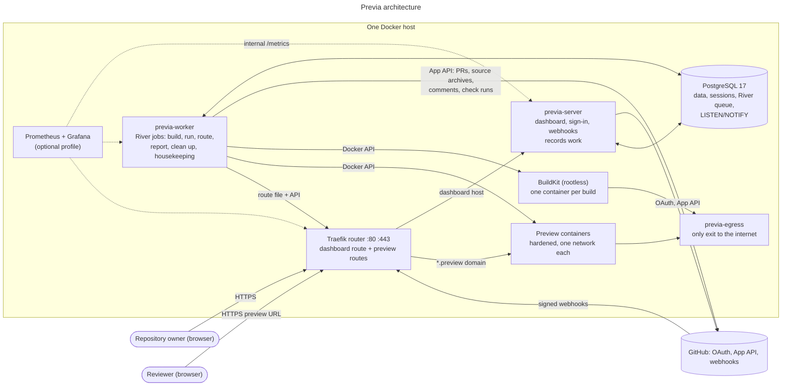

# Tech stack, infrastructure and where everything lives

The single reference for what Previa is built with, what each piece is used for,
where it lives in the code, how it is configured and deployed, which URLs and
built-in dashboards exist, and how it is tested and administered. Deeper
explanations live in the numbered docs ([docs/README.md](../docs/README.md));
this page links to them.

## What Previa is, in one picture

Previa gives each GitHub pull request its own temporary, isolated preview at a
stable HTTPS address. Two Go processes share one PostgreSQL database: the
**server** (dashboard, sign-in, webhooks) records work; the **worker** executes it
(builds, previews, routes, GitHub feedback, cleanup).

## The stack, layer by layer

| Layer | Technology (version) | Used for | Where in the code | Read more |
| --- | --- | --- | --- | --- |
| Language and runtime | Go 1.26 (1.26.8 or newer) | Both processes, the migrator, maintenance commands, the egress proxy | `cmd/*`, `internal/*` | [01](../docs/01-system-overview.md) |
| HTTP routing | chi v5.3.2 | Routes and middleware | `internal/platform/httpx`, each feature's `routes.go`/`handler.go` | [21](../docs/21-ui-architecture.md) |
| Server-rendered UI | templ v0.3.1020 | Every page and HTMX fragment | `web/pages/*`, `web/layouts`, `web/components` | [21](../docs/21-ui-architecture.md) |
| Interactivity | HTMX 2.0.11 (vendored) + one `ui.js` | Partial page updates, live search, modals; works without JavaScript | `web/static/htmx.min.js`, `web/static/js/ui.js` | [21](../docs/21-ui-architecture.md) |
| Styling | Tailwind CSS v4.1.18 standalone (checksum-pinned), templUI v1.13.2 components | The "signal" theme, light and dark | `web/styles/*`, `web/components`, `deploy/install-tailwind.sh` | [21](../docs/21-ui-architecture.md) |
| Live updates | Server-Sent Events + PostgreSQL `LISTEN/NOTIFY` (7 triggers) | Repository pages and build logs update without polling | `internal/platform/realtime`, migrations 0011 and 0013 | [20](../docs/20-realtime-updates.md) |
| Database | PostgreSQL 17 (17.11 in production images) | Application data, sessions, the job queue, change notifications | `db/migrations`, `deploy/docker-compose.yml` | [database-schema.md](database-schema.md) |
| Database driver | pgx v5.10.0 | Connection pool, transactions | `internal/platform/database` | [01](../docs/01-system-overview.md) |
| SQL | sqlc v1.31.1 | Type-safe Go from each feature's SQL | `internal/*/queries.sql` to `internal/*/dbgen`, `sqlc.yaml` | [02](../docs/02-development-setup.md) |
| Migrations | Goose v3.28.0 | Schema changes 0001–0020; CLI for development, embedded library in release images | `db/migrations`, `db/migrations.go`, `cmd/migrate` | [25](../docs/25-production-deployment.md) |
| Job queue | River v0.47.0 (riverpgxv5) | Builds, teardowns, wake-ups, routes, reports, cleanup, discovery, housekeeping, log pruning | `internal/platform/queue`, `internal/environments/{jobs,scheduler,worker,operation_worker}.go`, `internal/housekeeping/jobs.go` | [17](../docs/17-build-scheduling.md) |
| Sessions | SCS v2.9.0 + pgxstore | Server-side sessions, `__Host-` cookie | `internal/auth/session.go` | [04](../docs/04-github-sign-in-and-app.md) |
| Sign-in | golang.org/x/oauth2 v0.37.0 | GitHub OAuth App sign-in; GitHub App user authorization | `internal/auth`, `internal/installations/authorization.go` | [04](../docs/04-github-sign-in-and-app.md) |
| GitHub API | go-github v91 | PRs, repositories, archives, comments, check runs | `internal/platform/githubapp`, `internal/pullrequests/github.go`, `internal/source/github.go`, `internal/reporting/github.go` | [05](../docs/05-webhooks-and-pr-discovery.md), [14](../docs/14-pr-feedback.md) |
| GitHub App auth | ghinstallation v2.18.0 | App JWTs and cached installation tokens | `internal/platform/githubapp` | [04](../docs/04-github-sign-in-and-app.md) |
| Configuration | envconfig v1.4.0 | Environment settings, validated at start | `internal/platform/config` | [.env.example](../.env.example) |
| Repository config | goccy/go-yaml v1.19.2, validator v10.30.5 | `.previewrc.yaml` parsing and strict validation | `internal/repoconfig` | [06](../docs/06-source-and-configuration.md) |
| Docker | moby client v0.6.1 (Engine API 1.56) | Containers, networks, images, exec | `internal/platform/dockerx`, `internal/runtime`, `internal/builds`, `internal/routing/traefik.go`, `internal/platform/egress` | [10](../docs/10-preview-runtime.md) |
| Managed services | Official `postgres` and `redis` images pinned by digest (PostgreSQL 17/16, Redis 8/7 by default) | Per-candidate databases and caches of backend previews | `internal/runtime/backend.go`, `internal/platform/config/backend.go` | [11](../docs/11-backend-previews.md) |
| Outbound forwarding | Go TCP relay in `previa-egress` (allow files per preview network) | Owner-approved connections to external databases and brokers | `internal/platform/egress/forward.go`, `internal/outbound` | [11](../docs/11-backend-previews.md) |
| Image builds | BuildKit client v0.33.0 + rootless `moby/buildkit:v0.33.1-rootless` (pinned), fsutil | One isolated builder per build; build context streamed from the worker | `internal/builds` | [09](../docs/09-image-builds.md) |
| Egress proxy | previa-egress (own Go binary, scratch image) | The only route out of build and preview networks; readiness probes | `cmd/egress`, `internal/platform/egress`, `deploy/egress/Dockerfile` | [09](../docs/09-image-builds.md), [10](../docs/10-preview-runtime.md) |
| Router and TLS | Traefik v3.7.13 (pinned), Let's Encrypt over lego (DNS-01 wildcard for previews, TLS-ALPN-01 for the dashboard) | HTTPS for the dashboard and every preview; routes from a file | `internal/routing`, `deploy/traefik/compose.yml`, `deploy/production/compose.yml` | [12](../docs/12-routing-and-https.md) |
| Secrets at rest | Go `crypto/aes` + `crypto/cipher` (AES-256-GCM), versioned keys | Repository secrets given to previews | `internal/secrets` | [07](../docs/07-repository-secrets.md) |
| Optional sandbox | gVisor (`runsc`) through `PREVIEW_OCI_RUNTIME` | An extra kernel boundary for previews | `internal/runtime` | [10](../docs/10-preview-runtime.md) |
| Logs | `log/slog` JSON + redaction and correlation | Every process's logs | `internal/platform/logging` | [23](../docs/23-observability-and-hardening.md) |
| Metrics | prometheus/client_golang v1.24.1 | Bounded metrics on internal listeners | `internal/platform/metrics`, `internal/app/observe.go` | [23](../docs/23-observability-and-hardening.md) |
| Monitoring | Prometheus v3.5.0, Grafana 12.1.1 (pinned) | Scraping, 24 alert rules, a provisioned dashboard | `deploy/observability` | [23](../docs/23-observability-and-hardening.md), [24](../docs/24-incident-runbook.md) |
| Ingress hardening | golang.org/x/time/rate v0.16.0 and own middleware | Rate limits, host checks, CSP nonce, body limits | `internal/platform/httpx/ingress.go` | [23](../docs/23-observability-and-hardening.md) |
| Packaging | Docker multi-stage build: `golang:1.26.8-bookworm` to distroless static (UID 65532) | Release images `previa-server`, `previa-worker`, `previa-egress` | `Dockerfile`, `.dockerignore` | [25](../docs/25-production-deployment.md) |
| Orchestration | Docker Compose | Local PostgreSQL; the whole production stack | `deploy/docker-compose.yml`, `deploy/production/compose.yml` | [25](../docs/25-production-deployment.md) |
| Backups | `pg_dump`, age (encryption), rclone (object storage), systemd timer | Nightly encrypted backups and restore | `deploy/production/{backup,restore,setup}.sh` | [25](../docs/25-production-deployment.md#backups-and-restore) |
| CI/CD | GitHub Actions, GoReleaser v2, Trivy, actionlint | Checks, tests, image scans, tag-driven releases | `.github/workflows`, `.goreleaser.yaml` | [25](../docs/25-production-deployment.md#ci-and-releases) |
| Developer tools | Air v1.67.4, golangci-lint v2.14.0, govulncheck v1.8.0, sqlc, templ, Goose (all pinned in `tools/go.mod`), shellcheck, promtool | Live reload, linting, vulnerability scans, generation | `tools/go.mod`, `.air.toml`, `Makefile` | [02](../docs/02-development-setup.md) |
| Browser tests | Playwright 1.58.2 (Node 20+), Chromium | 30 UI scenarios under the production CSP | `web/tests/browser` | [web/tests/browser/README.md](../web/tests/browser/README.md) |
| Test infrastructure | Go `testing` (race detector), real Docker/BuildKit/Traefik suites, Pebble (test ACME), a fake GitHub over TLS | Unit, PostgreSQL, real-Docker and end-to-end tests | `*_test.go`, `internal/app/e2e_*_test.go` | [22](../docs/22-mvp-operations.md#what-is-proven-and-by-which-test) |

Design and code diagrams: [class-diagram.md](class-diagram.md) and
[database-schema-diagram.md](database-schema-diagram.md) (Mermaid).

## Processes and containers

| Process / container | Binary or image | What it does | Listens on |
| --- | --- | --- | --- |
| Server | `previa-server` (`cmd/server`) | Dashboard, sign-in, repository linking, webhooks, owner actions; records requests, teardowns and reports; never touches Docker | `HTTP_ADDR` (dev `127.0.0.1:8080`, container `:8080`); internal `INTERNAL_ADDR` (`127.0.0.1:9090`) |
| Worker | `previa-worker` (`cmd/worker`) | River jobs: discovery, mergeability, builds, previews, routes, reports, cleanup, teardown, housekeeping; publishes its capabilities | internal `WORKER_INTERNAL_ADDR` (`127.0.0.1:9091`) only |
| Migrator | `previa-migrate` (`cmd/migrate`, in the server image) | Applies embedded Goose then River migrations and exits | — |
| PostgreSQL | `postgres:17-alpine` (dev), `postgres:17.11-alpine` (production, pinned) | All state and the job queue | dev `127.0.0.1:5432`; production: not published |
| Router | `traefik:v3.7.13` | HTTPS for the dashboard and previews; API on loopback inside its container | `:80`, `:443`; metrics `172.31.250.10:8082` in production (control network only) |
| Egress proxy | `previa-egress` (`cmd/egress`) | Started by the worker; the only exit from build and preview networks | `:3128` on those networks only |
| BuildKit | `moby/buildkit:v0.33.1-rootless` | Started by the worker, one per build, removed afterwards | private network only |
| Previews | built from each PR | The pull request's app, hardened | the router reaches it on its own network |
| Prometheus / Grafana | `prom/prometheus:v3.5.0`, `grafana/grafana:12.1.1` | Metrics, alerts, dashboard (Compose profile `observability`) | Grafana `127.0.0.1:3000` (production), `127.0.0.1:13000` (smoke test) |

## URLs, endpoints and built-in dashboards

### Application URLs

| Where | URL |
| --- | --- |
| Local development | `http://localhost:8080` (must match `APP_BASE_URL`) |
| Local smoke test of the production stack | `https://previa.localtest.me:18443` (Traefik's default certificate: the browser warns) |
| Production | `APP_BASE_URL`, for example `https://previa.example.com` |
| A preview | `https://pr-<number>-<repo id>-<token>.<PREVIEW_BASE_DOMAIN>` |

| Route | Purpose |
| --- | --- |
| `/` | Public home page |
| `/auth/github/login`, `/auth/github/callback`, `/auth/logout` | Sign-in with GitHub (rate limited), sign-out (confirmation) |
| `/dashboard` | Overview: next steps until set up, counts, the newest live previews and build requests, pipeline stages |
| `/repositories` | Linked repositories (Available, Unavailable, All) |
| `/installations/start`, `/installations/callback`, `/installations/authorize/callback` | Installing the GitHub App and verifying it |
| `/repositories/{id}` | A repository's pull requests; `POST …/refresh` syncs, `POST …/policy` sets Manual/Automatic |
| `/repositories/{id}/secrets` | The repository's secrets (`POST` saves one or many lines and pasted `.env` text together; `POST …/delete` removes one or the selected names) |
| `/repositories/{id}/pull-requests/{n}` | Pull request detail; `POST …/build` (Build, Build now, Retry, Rebuild), `POST …/teardown` |
| `/repositories/{id}/pull-requests/{n}/logs` | The current build's log page (`…/logs/events` streams it; `…/logs/download` sends it as a text file) |
| `/repositories/{id}/events` | Live updates for a repository page (Server-Sent Events) |
| `/builds`, `/environments` | Current build requests; current previews |
| `/developer-tools`, `POST /queue/ping` | Queue ping (development only; off when `APP_ENV=production`) |
| `/protected` | Your session and GitHub identity |
| `/faq` | Frequently asked questions (signed out: redirects to the home page's `#faq`) |
| `/webhooks/github` | GitHub webhook receiver (signed; at most 32 at once) |
| `/previews/unavailable` | "Preview not found or expired" page for unknown preview hosts |
| `/static/*` | CSS, HTMX, `ui.js` |

### Operational endpoints (internal listeners, never public)

| Endpoint | Server | Worker |
| --- | --- | --- |
| `/livez` | `http://127.0.0.1:9090/livez` | `http://127.0.0.1:9091/livez` |
| `/readyz` (database, schema, River, heartbeat, Docker, capabilities) | `http://127.0.0.1:9090/readyz` | `http://127.0.0.1:9091/readyz` |
| `/metrics` (Prometheus) | `http://127.0.0.1:9090/metrics` | `http://127.0.0.1:9091/metrics` |

In production Compose they listen on the control network as `server:9090` and
`worker:9091`; reach them with
`docker run --rm --network previa_control curlimages/curl:8.15.0 -fsS http://server:9090/readyz`.
`previa-server healthcheck` / `previa-worker healthcheck` run the same check
inside the containers.

### Built-in dashboards and consoles

| Tool | Is there a UI? | How to reach it |
| --- | --- | --- |
| Previa dashboard | Yes | The application URL above. |
| Grafana (Previa dashboard, 30 panels) | Yes | Production: `ssh -L 3000:127.0.0.1:3000 <host>`, then `http://localhost:3000` (user `admin`, password `GRAFANA_ADMIN_PASSWORD`). Smoke test: `http://127.0.0.1:13000`. Needs the `observability` profile. |
| Prometheus | Yes, but not published | Its UI listens only on the control network. To look temporarily: `docker run --rm -p 127.0.0.1:9095:9095 --network previa_control alpine/socat tcp-listen:9095,fork,reuseaddr tcp:prometheus:9090`, then `http://127.0.0.1:9095` (stop it afterwards). Alerts: `/alerts`; targets: `/targets`. |
| Traefik | Dashboard disabled on purpose (`--api.dashboard=false`) | Its API answers only on 127.0.0.1:8080 inside the router container: `docker exec previa-router wget -qO- http://127.0.0.1:8080/api/http/routers`. The route file is `ROUTER_DYNAMIC_DIR/previa-routes.yml`. |
| River (job queue) | No UI installed (River UI is a separate project, not part of Previa) | `make river-status`; SQL on `river_job` ([02 §7](../docs/02-development-setup.md#7-inspect-jobs-and-operations)); Grafana "Queues and requests"; metrics `previa_queue_jobs`, `previa_jobs_total`. |
| Egress proxy | No UI | Logs: `docker logs previa-egress`. It answers only inside build and preview networks. |
| PostgreSQL | No UI | Development: `docker compose -f deploy/docker-compose.yml exec postgres psql -U previa -d previa`. Production: `docker compose -f deploy/production/compose.yml --env-file /etc/previa/previa.env exec postgres psql -U previa -d previa`. |
| Developer tools (queue ping) | Yes, development only | `/developer-tools` on the dashboard. |

## Configuration and infrastructure files

| File | What it configures |
| --- | --- |
| [.env.example](../.env.example) | Every local setting with a placeholder, purpose and how to obtain it; copy to `.env` (Git-ignored) |
| [deploy/production/previa.env.example](../deploy/production/previa.env.example) | Production settings, copied to `/etc/previa/previa.env` by `setup.sh` |
| `internal/platform/config/*.go` | The loaders and validation rules for every setting |
| [Makefile](../Makefile) | Every developer, test, release and maintenance command (below) |
| `.air.toml`, `.air.templ.toml` | Live reload for `make dev` and template watching |
| `sqlc.yaml`, `tools/go.mod` | Code generation and pinned tools |
| [deploy/docker-compose.yml](../deploy/docker-compose.yml) | Local PostgreSQL |
| [deploy/traefik/compose.yml](../deploy/traefik/compose.yml) | Local/staging router (`make router-up`) |
| [Dockerfile](../Dockerfile), `.dockerignore` | Release images |
| [deploy/production/compose.yml](../deploy/production/compose.yml) | The production stack (and `compose.smoke.yml` for the local smoke test) |
| `deploy/production/setup.sh`, `backup.sh`, `restore.sh`, `smoke.sh` | Host setup, backups, restore, smoke test |
| `deploy/observability/` | `prometheus.yml`, `alerts.yml` + `alerts_test.yml`, Grafana provisioning and dashboard |
| `deploy/egress/Dockerfile` | Development egress image (`make egress-image`) |
| `.github/workflows/ci.yml`, `release.yml`, `.goreleaser.yaml` | CI and releases |
| `db/migrations/*.sql` | Schema migrations 0001–0020 |
| A repository's `.previewrc.yaml` | How its previews build and run: port, health path, resources, environment ([06](../docs/06-source-and-configuration.md)) |

## Deployment setups

| Setup | Use it for | How |
| --- | --- | --- |
| Local development | Working on the dashboard, sign-in, linking, discovery, policies, secrets, logs | `docker compose -f deploy/docker-compose.yml up -d`, `make migrate-up`, `make run-server` + `make run-worker` (or `make dev`) ([02](../docs/02-development-setup.md)) |
| Local previews without a domain | Building and opening previews on your machine | Add `PREVIEW_BASE_DOMAIN=preview.localtest.me` and a `ROUTER_DYNAMIC_DIR`, start the router with `make router-up` (see [user-guide.md](user-guide.md#0-before-you-start)); browsers warn about Traefik's default certificate |
| Local staging of the production stack | Checking release images, Compose, backups, upgrades | `make release-images PREVIA_VERSION=x` then `make prod-smoke PREVIA_VERSION=x` |
| Production (one VPS) | Real use | `deploy/production/setup.sh`, then the production Compose file ([25](../docs/25-production-deployment.md)) |

## Testing

| Command | What it proves | Needs |
| --- | --- | --- |
| `make build`, `make lint`, `make vuln` | Compiles; vet + golangci-lint; known vulnerabilities | — |
| `make test` / `go test -race ./...` | Unit tests; PostgreSQL integration tests when `TEST_DATABASE_URL` is set | PostgreSQL for database tests |
| `make test-builder` | Isolated BuildKit builds, limits, caches, network denial | Docker, internet |
| `make test-runtime` | Hardened previews, secrets, readiness, capacity | Docker |
| `make test-routing` | HTTPS routing with real Traefik and Pebble certificates, swaps, teardown, revocation | Docker |
| `make test-housekeeping` | Orphans, grace periods, pruning under disk pressure | Docker |
| `make test-e2e` | The whole pipeline: source, build, preview, HTTPS route, PR comment and checks, logs, teardown, Automatic bursts, a GitHub outage | Docker |
| `make test-browser` | 30 browser scenarios under the production CSP | Node 20+, Playwright Chromium |
| `make observability-check` | Alert rules and their tests, Prometheus config, dashboard queries | Docker |
| `make prod-smoke` | The production stack: health, HTTPS, hardening, metrics, upgrade/rollback, backup/restore | Docker, release images, `age` |
| `make test-webhook`, `test-github-app`, `test-source`, `test-reporting` | Opt-in checks against real GitHub | Your GitHub App; `test-reporting` writes to a disposable PR |

Manual, end-user test cases are in [user-guide.md](user-guide.md#manual-test-checklist).

## Administration

| Task | Command |
| --- | --- |
| Apply migrations | `make migrate-up` (development); `previa-migrate up` runs automatically in production |
| Check settings before starting | `previa-server check-config`, `previa-worker check-config` |
| Is a process ready? | `/readyz` on the internal listener, or `previa-server healthcheck` |
| Pause all builds (kill switch) | `BUILDS_PAUSED=true`, restart the worker ([24](../docs/24-incident-runbook.md#execution-kill-switch)) |
| Rotate the secrets key | add a key version, switch `SECRETS_ACTIVE_KEY_VERSION`, restart, `make secrets-reencrypt` ([07](../docs/07-repository-secrets.md)) |
| Rewrite the router's route file | `make route-sync` |
| See what housekeeping would delete | `make housekeeping-dry-run` |
| River migration status | `make river-status` |
| Back up / restore | `deploy/production/backup.sh` (nightly timer), `deploy/production/restore.sh --identity KEY --yes DUMP` |
| Upgrade / roll back | change `PREVIA_VERSION`, `docker compose … up -d --wait` ([25](../docs/25-production-deployment.md#upgrades-and-rollback)) |
| Incidents | [24-incident-runbook.md](../docs/24-incident-runbook.md) |

## Security model in brief

- Only the worker has the Docker socket; the server and previews never do.
- Builds and previews run unprivileged, resource-limited, on their own networks,
  with the egress proxy as their only exit; they cannot reach PostgreSQL, the
  server, the host, cloud metadata or each other.
- Forks never receive repository secrets; secrets are AES-256-GCM at rest and
  redacted from logs.
- Dashboard cookies are `__Host-`, host-only, `Secure`, `HttpOnly`; every
  mutation needs a CSRF token and a same-origin `Origin`; responses carry a strict
  Content-Security-Policy; previews belong on a separate domain.
- Credentials (App key, DNS token, keyring) are files or settings, never logged,
  never in job payloads or URLs.

Details: [23](../docs/23-observability-and-hardening.md), [10](../docs/10-preview-runtime.md), [07](../docs/07-repository-secrets.md).
