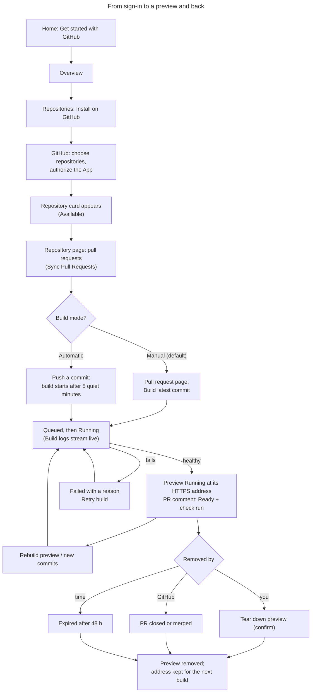
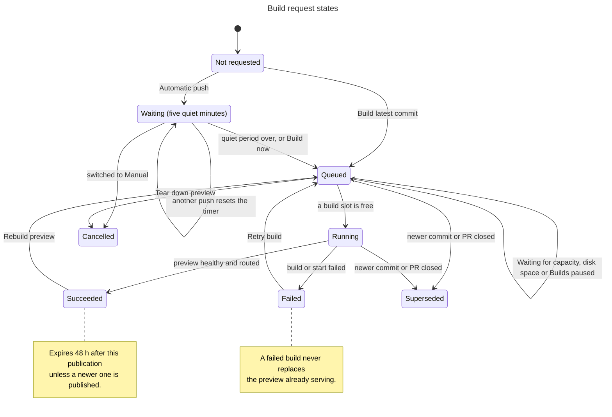

# Previa user guide: features, step-by-step flows and manual tests

Everything a person using Previa needs: what it offers, every flow from first
sign-in to a working preview and its removal, what each screen and message means,
and a checklist to test it all by hand, including the edge cases. Labels in
**bold** are exactly what the screens show. Developer setup is in
[02](../docs/02-development-setup.md); the technical picture is in
[tech-stack.md](tech-stack.md).

## What Previa offers

- **A live preview for every pull request.** Previa builds the pull request's exact
  commit with its `Dockerfile`, runs it in an isolated container and serves it at
  its own HTTPS address, so reviewers can use the change instead of reading it.
- **One stable address per pull request** (`https://pr-<number>-<repo id>-<token>.<preview domain>`),
  kept across rebuilds and reopenings.
- **You decide when it builds**: **Manual** (only when you click) or **Automatic**
  (five quiet minutes after the latest push).
- **Feedback where your team works**: one comment on the pull request that keeps
  itself up to date, and a check run per build.
- **Live build logs** in the browser, with secrets hidden.
- **Safe by default**: previews cannot reach your infrastructure; forks never get
  your secrets; a failed rebuild never replaces a working preview.
- **Tidies up after itself**: previews are removed when the pull request closes or
  merges, when you tear them down, after 48 hours without a new build (by default),
  or when GitHub access is removed.
- **Repository secrets**: values your previews need (sandbox API keys), stored
  encrypted and never shown again.
- **Starter kits**: pick your stack and what it uses, and Previa writes the
  `Dockerfile` and `.previewrc.yaml` your repository needs, ready to copy.

## The journey at a glance



A build request moves through these states (shown on the pull request page and on
**Builds**):



---

## 0. Before you start

You need:

1. A running Previa: the dashboard (server) and a worker
   ([02](../docs/02-development-setup.md)). For previews the worker also needs the
   GitHub App, Docker and a preview domain with its router.
2. A GitHub account that owns (or administers) the repositories you want to preview.
3. In each repository: a `Dockerfile` and a `.previewrc.yaml` at the root (step 5).

**Previews on your own machine without a domain** (for trying everything locally):

1. In `.env`, set `PREVIEW_BASE_DOMAIN=preview.localtest.me` (every
   `*.localtest.me` name points at your own computer) and `ROUTER_DYNAMIC_DIR` to
   a full path on the Linux filesystem, such as
   `/home/<you>/.local/share/previa/router` (`echo $HOME` shows yours). Do not
   write `~`: `.env` does not expand it. `make router-up` creates the directory.
2. Router settings, all required by `make router-up`:
   `ACME_EMAIL=you@example.com`, `ACME_DNS_PROVIDER=cloudflare`,
   `ACME_DNS_CREDENTIAL_VARIABLE=CF_DNS_API_TOKEN`, `ACME_DNS_CREDENTIAL_FILE` = the
   full path of a file containing any text (`mkdir -p ~/.config/previa;
   printf x > ~/.config/previa/dns-credential; chmod 600
   ~/.config/previa/dns-credential`), and
   `ACME_CA_SERVER=https://127.0.0.1:1/directory` so no certificate is requested.
3. In this order: `make egress-image`, `make router-up`, then `make run-worker`.
   Its log says `River worker started execution=true`. If it stops instead, its
   error names the missing setting and the fix.
4. Previews open at `https://pr-…preview.localtest.me`; the browser warns about
   the certificate (Traefik's default one). Accept it for testing only.

Automatic builds and live webhook updates also need GitHub to reach your
dashboard: a tunnel (for example Cloudflare Tunnel or ngrok) to `localhost:8080`,
set as the App's webhook URL with `/webhooks/github`. Without it, use **Sync Pull
Requests** and Manual builds.

## 1. Sign in

1. Open the dashboard and click **Get started with GitHub**.
2. Authorize Previa on GitHub (first time only).
3. You land on **Overview**, signed in as your GitHub user.

What you see on **Overview**, top to bottom:

- The worker status (**Worker connected**, **Builds paused**, …) and when the
  numbers were loaded, with a refresh button.
- When no worker can build, a notice first that says exactly what to fix (for
  example "set `PREVIEW_BASE_DOMAIN` on the worker").
- **Your next steps**, with progress, until every step is done.
- Four tiles: **Linked repositories**, **Open pull requests**, **Live previews** and
  **Needs attention** (failed requests); each opens where the number comes from.
- **Delivery pipeline**: **Open pull requests** → **Waiting or queued** →
  **Building** → **Live previews**, each with its share of open pull requests, plus
  **Failed requests**.
- **Preview coverage**: how many open pull requests have a live preview.
- **Linked repositories**: available and unavailable.
- **Latest activity**: **Build requests** and **Live previews** tabs, each a table
  of pull request, commit, status and when (a failed request says why in plain
  words, for example **Your app didn't become ready**). Click a row to see how it
  was requested, when it started and finished, why it waits or failed with what to
  do first, and links to the pull request and its build logs; a preview also shows
  **Open**, a copy button and how much of its lifetime is left.

## 2. Connect your repositories

1. Open **Repositories** and click **Install on GitHub** (later **Choose
   repositories on GitHub**).
2. On GitHub, pick the account and the repositories Previa may use.
3. GitHub returns to Previa and asks you to authorize the App with the **same
   account**. Previa checks you really own that installation before linking it.
4. Your repositories appear as cards showing open pull requests, live previews,
   the build mode and when pull requests were last synced. Linking never builds
   anything; it starts a first discovery of open pull requests.

To add or remove repositories later, use **Choose repositories on GitHub**.

## 3. Find your repositories

- Tabs: **Available** (default), **Unavailable** (access removed or installation
  suspended; history kept), **All**.
- Search filters as you type; ten per page; the page, tab and search are in the URL.
- Click a card to open the repository.

## 4. Track pull requests

1. The repository page shows **Last synced**, the build mode and the pull requests.
2. **Sync Pull Requests** fetches the open pull requests from GitHub (metadata only;
   never builds). Clicking repeatedly while it syncs does nothing extra. The status
   beside **Last synced** says what is happening:
   - **Syncing** (spinning): a worker is fetching.
   - **Waiting for a worker**: no worker is running, so nothing is fetched; a box
     explains how to start one, and the sync continues by itself once it runs.
   - **Sync stalled**: it did not finish within 5 minutes; **Sync Pull Requests**
     works again and starts a fresh sync.
   - **Sync failed**: GitHub refused (hover for the reason); sync again.
3. With webhooks, new commits, closes and mergeability changes appear by themselves;
   the green **Live** dot means the page is receiving updates.
4. Tabs **Open**, **Closed**, **Merged**, **All**; search by title, number, author
   or branch.
5. Each open pull request shows a state:

   | State | Meaning | Can it build? |
   | --- | --- | --- |
   | **Open** | GitHub says it can merge | Yes |
   | **Checking** | GitHub is still computing mergeability (or, with "Waiting for a worker", no worker is running to ask) | Not yet; wait, or start the worker |
   | **Unknown** | GitHub never answered after 8 checks, so Previa stopped asking | No; **Sync Pull Requests** asks again (a new commit does too) |
   | **Conflicts** | It conflicts with its base branch | No; resolve and push |
   | **Refresh required** | Two observations arrived at the same instant | Sync again |

6. Each row shows the title with its number, author, branch and when GitHub last
   updated it; the head **Commit** (opens it on GitHub); the **State**; and
   **Preview**: **Live** with **Open**, or where the latest build stands
   (**Not built yet**, **Queued**, **Building**, **Build failed**), noting when it
   was for an earlier commit. A repository never synced shows a **Sync Pull
   Requests** button in its empty list.
7. Click a pull request to open its page:
   - The **status card**: a headline (**Preview is live**, **Building …**, **Build
     failed**, **Blocked by merge conflicts**, **No preview yet**, …), the preview
     address with **Copy**, and every action (**Open preview**, Build/Retry/Rebuild,
     **Tear down preview** or **Cancel build**, **Build logs**).
   - While a build is queued or running, a step tracker shows **Queued → Get code →
     Build image → Start preview → Publish → Live**, follows the build live with the
     latest output line under it, and a clock counts the time since it started.
   - A failed build says what went wrong in plain words (for example **GitHub didn't
     let Previa download your code**) and lists **What to do next**. **Technical
     details** opens the exact reason, the failure category, the commit and the
     **Last lines of the build output** with error lines in red.
   - The **Details** panel beside it: **Latest commit** (linked to GitHub, with
     **Ready to build**, **Checking mergeability** or **Has merge conflicts**),
     **Build request** (who asked or **Automatic build**, when it started and
     finished, how long it took), **Deployed preview** (when it was published and
     expires) and **Environment** (managed services and, when live, docs and
     outbound connections).
   - Times read "3 minutes ago"; hover for the exact UTC time. **View on GitHub**
     opens the pull request; the repository name at the top of the page returns to
     the list with its filters.

## 5. Prepare a repository for previews

The quickest start is **Starter kits** in the sidebar:

1. Choose your stack: Next.js, React + Vite, Node.js API, Django, FastAPI, Ruby on
   Rails, Go, Spring Boot or Laravel. Choose **Own Dockerfile** if you already have
   one; you then get only `.previewrc.yaml`.
2. Turn on what your app uses: **PostgreSQL** (sets `DATABASE_URL`), **Redis** (sets
   `REDIS_URL`), **Run migrations first**, **Run a background worker** and **Link API
   docs**. Each command has ready-made choices or **My own command…**.
3. Open **Advanced** to change the port, health check path or preview size.
4. The files update as you choose. **Passes Previa's checks** means a build will
   accept them; otherwise each problem is named. **Copy** or **Download** each file,
   then read **Check in your app** for anything your code must do (for example,
   allowing the preview's address).

Or write the files yourself. At the repository root (on the commit you want to
preview):

1. A `Dockerfile` that builds and starts your app.
2. A `.previewrc.yaml`, for example:

   ```yaml
   port: 3000                 # the port your app listens on inside the container
   health_check_path: /health # optional; without it Previa waits for the port to accept connections
   resource_tier: standard    # small (0.5 CPU, 512 MiB), standard (1 CPU, 1 GiB) or large (2 CPU, 2 GiB)
   env:                       # optional plain settings; use Secrets for sensitive values
     - APP_ENV=preview
   ```

   `{}` alone is valid (port 3000, `Dockerfile` at the root). The file is required:
   without it the build fails with "The commit could not be prepared".
3. Your app runs as a non-root user (UID 65532) with a read-only file system and a
   writable `/tmp`; write only to `/tmp`.

## 6. Choose when previews build

On the repository page (pull request list only):

- **Manual** (default): nothing builds until you click.
- **Automatic builds** switch: a confirmation dialog explains it; confirm to turn it
  on. Each new commit then builds after five minutes without another push. It does
  not build pull requests that already exist.
- Turning it off saves Manual at once and cancels automatic requests that have not
  started; running builds and existing previews stay.

## 7. Build a preview (Manual)

1. Open the pull request's page.
2. Click **Build latest commit**. Previa first reads the pull request fresh from
   GitHub, then records one request (double clicks count once).
3. The button shows **Starting…** while the request is sent. The status card then
   shows **Queued to build …**, then **Building …** with the step tracker moving as
   the build goes; **Build request** in the Details panel shows who asked and when
   it started. Open **Follow the build log** to watch the output live.
4. When the app answers its health check, the preview goes live: the headline says
   **Preview is live**, the address appears with **Copy** and **Open preview**, and
   **Deployed preview** shows **Running**, when it was published and when it
   **Expires** (48 hours later by default).
5. On GitHub, the pull request gets the Previa comment ("Previa preview: Ready" with
   the address) and a **Previa preview** check run with a success result.

If the button is greyed out, the box beside it says why and how to fix it (see
[When Previa says no](#19-when-previa-says-no)). On a local setup, the most common
case is **The running worker cannot build previews: it has no preview domain**: set
`PREVIEW_BASE_DOMAIN=preview.localtest.me` and start the router as described in
[Before you start](#0-before-you-start), then restart the worker and reload.

## 8. Automatic builds

1. Enable Automatic (step 6).
2. Push a commit to an open pull request.
3. The request shows **Waiting** with the time it becomes eligible; the comment says
   it builds after five quiet minutes.
4. Push again within five minutes: the timer restarts and only the newest commit
   builds.
5. **Build now** on the pull request page skips the wait.

## 9. Retry, rebuild, build now

| Button | When you see it | What it does |
| --- | --- | --- |
| **Build latest commit** | Nothing requested yet, or the last request was cancelled or superseded | Builds the commit GitHub reports now |
| **Build now** | An Automatic request is waiting | Builds it without waiting |
| **Retry build** | The current request failed | A new attempt of the same commit |
| **Rebuild preview** | The current request succeeded | Builds the same commit again; the old preview serves until the new one is healthy |

A page left open while things changed refuses an old button with **Reload and try
again**.

## 10. Open and share a preview

- Click **Open preview** in the status panel (or **Open** on the pull request list,
  **Open preview** on **Environments** and **Previews** on Overview). **Copy** puts
  the address on the clipboard to share with reviewers.
- The address never changes for that pull request.
- **This preview serves an earlier commit than the latest one** means a newer
  commit exists but has not been built (Manual) or is building.
- After teardown, close or expiry, the address shows **Preview not found or
  expired** until the next build.

## 11. Feedback on the pull request (GitHub)

One comment, always edited in place, titled **Previa preview: …**:

| Title | Meaning |
| --- | --- |
| Waiting | Automatic: builds after five quiet minutes (with the time) |
| Queued | Waiting for a worker |
| Waiting to build | Mergeability is being checked, or the PR conflicts |
| Waiting for capacity / Waiting for disk space / Builds paused | Waiting, not failing; starts by itself |
| Building | The commit is building |
| Ready | The preview is live (address and expiry) |
| Failed | With a short reason; the earlier preview, if any, keeps serving |
| Removing / Preview removed / Preview expired | Teardown in progress / done / by expiry |

A **Previa preview** check run is added for each build request on its exact commit
(a retry or rebuild of the same commit gets its own run).

## 12. Read build logs

1. Click **Build logs** on the pull request page (or **Logs** on **Builds** /
   **Environments**).
2. The status line says **No build requested**, **Waiting**, **Queued**, **Running**
   or how the attempt ended.
3. New lines appear live while it runs; the view follows the end while you are at
   the bottom. Scroll up to stop following; **Follow output** resumes.
4. **Earlier lines** / **Later lines** page through long logs; each line number is a
   link. Lines that look like errors are red.
5. **Copy** copies the lines shown; **Download** saves the whole output of the
   attempt as a `.log` file.
6. Only the current attempt is kept; a new attempt clears the page. Logs are kept
   14 days after an attempt finishes; at most 5 MiB / 20,000 lines are stored.
7. Secrets and credentials appear as `[redacted]`.

## 13. Tear down a preview

From the pull request page:

1. Click **Tear down preview**.
2. A dialog asks **Tear down this preview?**: **Cancel** (or Escape) changes
   nothing; **Tear down preview** confirms.
3. The preview stops serving, unfinished work is cancelled, containers are removed;
   the comment says the preview was removed. The address stays reserved: build again
   to bring it back.

While a build runs and nothing is deployed yet, the same control reads **Cancel
build** (dialog **Cancel this build?**): it stops the build and publishes nothing.

From **Environments**: each published preview has **Tear down** with the same
dialog.

Automatically: closing or merging the pull request removes its preview; reopening
follows the build mode again.

## 14. Repository secrets

1. Open a repository, then the **Secrets** tab. **Stored secrets** lists names and
   when each was updated; **Add or replace secrets** is below.
2. On each line enter a **Name** (letters, digits and underscores, such as
   `STRIPE_KEY`) and a **Value**. **Add another line** adds a line; × removes one.
3. Shortcut: paste several `NAME=value` lines into a name field; each becomes its own
   line, like a bulk edit.
4. Or open **Paste or import a .env file**: paste the text or **Choose a .env
   file…**, then save it directly or **Move into lines above to review**. Blank lines
   and `#` comments are ignored, quotes are optional, and a double-quoted value may
   span lines (for example a private key).
5. Click **Save N secrets**. Everything is saved together, or nothing if any line is
   wrong (a missing name or value, a repeated name, a name starting with
   `PREVIA_`); the page marks the line and keeps the names, and you enter the values
   again. Names that already exist show **Replaces the stored value**.
6. From then on only names and update times are shown. **Replace** on a row starts a
   line with that name (the old value is never shown).
7. **Delete** on a row asks for confirmation in a dialog. To remove several, tick
   them (or the header box) and click **Delete selected (N)**; one dialog lists them
   and confirms.

Good to know: pull requests from **forks never receive secrets**; a secret overrides
a same-named entry in `.previewrc.yaml`; use preview-only credentials; up to 100
secrets per repository, 32 KiB each; values of 4 characters or more are redacted
from logs. If the server has no encryption keys, the tab says secrets are not
configured.

## 15. Backend previews and outbound connections

An app that needs a database, a cache, migrations or a background worker declares
them in `.previewrc.yaml` (details and examples in
[docs/11](../docs/11-backend-previews.md)):

```yaml
services: { postgres: 17, redis: 7 }   # versions this server offers
setup: ["bin/api", "migrate", "--seed"]
processes:
  - name: worker
    command: ["bin/api", "worker"]
docs_path: /docs
```

1. Every build gets **its own fresh** PostgreSQL and Redis; the app, the setup
   command and the processes receive `DATABASE_URL`, `PG*` and `REDIS_URL`.
   **Data does not survive a rebuild.**
2. The build log shows each service becoming ready, the setup command's output and
   the processes starting. If one fails, the build fails with that reason and the
   previous preview keeps serving.
3. The pull request page shows **Runs with**, **Docs**, **Outbound** and the
   **Managed services** the running worker offers ("None" when the operator
   configured none). The PR comment links the docs path.
4. To let previews reach an external test database or broker, open the
   repository's **Outbound** tab, enter the host name, choose an allowed port and
   **Approve**. **Remove** confirms in a dialog. Pull requests from forks never get
   these connections.

## 16. Builds, Environments and Overview

- **Builds**: the current or latest request of each pull request across your
  repositories, most recent first: the pull request's title, the requested commit
  (and the latest one when it differs), status, why it waits or failed, when it
  became eligible, started or finished and how long it took, and **Logs**. It is not
  a history: a new request replaces the row.
- **Environments**: each preview, most recently published first: title, status
  (**Building**, **Publishing**, **Running**, **Failed**, **Removing**), the deployed
  commit (marked when earlier than the latest), **Open preview** with a copy button,
  when it was published and expires, **Logs**, and **Tear down** for published
  previews.
- **Overview**: see [Sign in](#1-sign-in).

## 17. Everyday navigation

- Sidebar: **Overview**, **Repositories**, **Starter kits**, **Builds**,
  **Environments**, **Developer tools** (development only) and **FAQ**. On phones, the menu button opens it.
- **FAQ** answers common questions as a conversation with Previa; the home page has
  the same answers plus **How it works**, a step-by-step conversation you advance with
  **Ask as Kai** or by choosing one of its seven steps.
- **Ctrl K** (**⌘K** on macOS) opens a command palette to jump anywhere.
- The sun/moon button switches light and dark themes (remembered in this browser).
- Pages are bookmarkable; Back/Forward keep filters; everything works without
  JavaScript (forms submit normally, dialogs still confirm).
- Sign out: account menu, **Log out…**, confirm. Your GitHub session is unaffected.

## 18. What happens automatically

| Event | What Previa does |
| --- | --- |
| New commit, Manual | Records it; builds nothing; the page shows the deployed preview may be older |
| New commit, Automatic | Builds after five quiet minutes; a newer commit replaces an unfinished older request |
| PR closed or merged | Cancels unfinished work, removes the preview, updates the comment |
| PR reopened | Follows the build mode again (Manual waits for you) |
| 48 hours after the last publication | Removes the preview ("Preview expired"); the next build brings it back |
| GitHub access to a repository removed, or the App suspended/uninstalled | Removes its previews; restoring access does not rebuild them |
| Host busy or short of disk | Builds wait ("Waiting for capacity" / "Waiting for disk space") and start by themselves |
| Operator pauses builds | Requests wait ("Builds paused"); new build clicks are refused with a message |
| A container disappears | The preview is marked failed (its container went missing); Retry, Rebuild or a new commit brings it back |

## 19. When Previa says no

On a pull request page, a build action that cannot run now stays visible but greyed
out, and the box beside it shows the message and the fix below.

| Message | Why | What to do |
| --- | --- | --- |
| GitHub access to this repository is unavailable. | The App no longer has access | Restore access with **Choose repositories on GitHub** |
| Closed and merged pull requests are not built. | The PR is closed | Reopen it on GitHub |
| Build refused: resolve merge conflicts and push a new commit first. | **Conflicts** | Fix the conflict and push |
| Build paused: GitHub is checking mergeability… | **Checking** | Wait or **Sync Pull Requests**; if it says no worker is running, start the worker |
| Build paused: GitHub did not report whether this pull request can merge. | **Unknown**: the check gave up after 8 attempts | **Sync Pull Requests** to ask again, or push a commit |
| No worker is running… (repository page) | Syncs, mergeability checks and builds wait | Start the worker (`make run-worker`) and check its log |
| Sync stalled | A sync did not finish within 5 minutes | **Sync Pull Requests** starts a new one |
| Conflicting upstream observations need a fresh GitHub snapshot… | **Refresh required** | **Sync Pull Requests** |
| No worker that can build previews is running. | No worker runs, or it runs without the GitHub App | Start the worker (`make run-worker`) with the GitHub App, Docker and a preview domain, then reload |
| The running worker cannot build previews: it has no preview domain. | The worker tracks pull requests but `PREVIEW_BASE_DOMAIN` is empty | Set `PREVIEW_BASE_DOMAIN` (`preview.localtest.me` on one machine), start Docker and the router, restart the worker, reload |
| Builds are paused by the operator… | Kill switch on | Wait; queued requests start when builds resume |
| GitHub could not confirm the pull request right now… | GitHub outage | Try again shortly; nothing was recorded |
| The pull request or its build changed meanwhile. Reload and try again. | The page is out of date | Reload |
| Failure reasons (on the PR page, Builds and the comment) | "The commit could not be prepared" (download or invalid `.previewrc.yaml`), "The image build failed", "The app did not become ready", "The app exited while starting", "The build took longer than allowed", "Repository secrets could not be decrypted", "The preview could not be published" | Open **Build logs**, fix, then **Retry build** or push |

## 20. Uninstall the GitHub App or remove access

On GitHub, open **Choose repositories on GitHub** from Previa (or **Settings → Applications →
Installed GitHub Apps → Configure**; for an organization, its settings).

| What you do on GitHub | What Previa does |
| --- | --- |
| **Uninstall** | Every repository of that installation moves to **Unavailable**. All their previews are removed and unfinished builds cancelled. |
| **Suspend** | The same as uninstalling. **Unsuspend** makes the repositories available again. |
| Remove one repository | Only that repository becomes unavailable and loses its previews. |

After that:

1. Removal starts as soon as GitHub's notification arrives and does not need GitHub
   access. Preview addresses then show **Preview not found or expired**.
2. Pull request pages say "GitHub access to this repository is unavailable." next to
   a greyed-out build button. Secrets can only be deleted.
3. The Previa comment and check run on GitHub keep their last state, because Previa
   can no longer write to the repository. A comment may still say **Ready** and link
   to the removed preview.
4. Previa keeps your account (you can still sign in), your repositories, pull
   request records, build mode and encrypted secrets.

**Coming back:** install the App again with the same GitHub account while signed in
as the same Previa user. Your repositories, history and build mode return, and open
pull requests are discovered again. Nothing rebuilds by itself: Manual waits for a
click, and Automatic waits for the next push.

**If Previa was offline when you uninstalled**, it missed GitHub's notification, and
GitHub does not resend it on its own. Previews keep serving until they expire (48
hours by default). Reinstalling then fails for those repositories with "This
installation could not be linked…". To fix this, the App's owner opens the App on
GitHub (**Developer settings → GitHub Apps → Advanced → Recent Deliveries**) and
redelivers the failed `installation` delivery. GitHub allows this for 3 days. Previa
then removes everything as described above.

---

## Manual test checklist

Each test: steps, then the expected result. "Worker with builds" means a worker
whose log says `execution=true` (step 0). Use a test repository with a small
`Dockerfile` app and `.previewrc.yaml`, and pull requests you can push to.

### A. Sign-in and session

| # | Steps | Expected |
| --- | --- | --- |
| A1 | Open the dashboard signed out; click **Get started with GitHub**; authorize | Lands on **Overview** with your username |
| A2 | Open `/dashboard` in a private window (signed out) | Redirected to sign in |
| A3 | Sign out: account menu, **Log out…**, **Cancel** | Still signed in |
| A4 | Sign out and confirm | Back on Home; `/dashboard` asks to sign in again |
| A5 | Leave the tab idle 30 minutes, then click a link | Asked to sign in again (idle timeout) |
| A6 | Reload `/auth/github/login` 25 times quickly | After about 20, "Too many requests. Try again shortly." (rate limit) |

### B. Connecting repositories

| # | Steps | Expected |
| --- | --- | --- |
| B1 | **Repositories**, **Install on GitHub**, choose one repository | Its card appears under **Available** |
| B2 | Install with a different GitHub account than the one signed in | Linking is refused (the installation is not yours) |
| B3 | On GitHub, remove the repository from the App | The card moves to **Unavailable**; its previews are removed |
| B4 | Add it back | **Available** again; nothing rebuilds by itself |
| B5 | Search for part of a name; switch tabs; go to page 2 (with 11+ repositories) | Results filter; URL keeps search, tab and page; Back restores them |
| B6 | On GitHub, **Suspend** the App | All its repositories move to **Unavailable**; their previews are removed |
| B7 | **Unsuspend** it | **Available** again; nothing rebuilds by itself |
| B8 | **Uninstall** the App, then install it again with the same account | Previews removed and PR pages say access is unavailable; after reinstalling, repositories and build mode return and nothing rebuilds |

### C. Pull requests and mergeability

| # | Steps | Expected |
| --- | --- | --- |
| C1 | Open a repository, **Sync Pull Requests** | Open PRs appear; **Last synced** updates; nothing builds |
| C2 | Click **Sync Pull Requests** several times quickly | One sync runs |
| C3 | (Webhooks) Open a new PR on GitHub | It appears without reloading (**Live** dot green) |
| C4 | Create a PR that conflicts with its base | State **Conflicts**; **Build latest commit** greyed out; the box beside it gives the reason and fix |
| C5 | Resolve the conflict and push | State becomes **Open** |
| C6 | (Webhooks) Close a PR on GitHub, then open the **Closed** tab | It is listed as closed; it cannot build. Without webhooks, discovery lists open PRs only; housekeeping later notices closes of PRs that have previews |
| C7 | Search by author, branch and number | Matching PRs only |
| C8 | Stop the worker, then **Sync Pull Requests** | **Waiting for a worker** (no spinner) and a box saying no worker is running; start the worker and the sync finishes by itself |
| C9 | Leave a sync waiting for more than 5 minutes (worker stopped) | **Sync stalled**; **Sync Pull Requests** is clickable again and starts a new sync |
| C10 | With the worker stopped, open a PR that shows **Checking** | Headline **Waiting for a worker to check mergeability**, with how to start one |
| C11 | A PR GitHub never resolves (rare; or block the worker's GitHub access during the check) | After about 8 checks the state becomes **Unknown**: "GitHub did not report mergeability"; **Sync Pull Requests** asks again |

### D. Manual builds (worker with builds)

| # | Steps | Expected |
| --- | --- | --- |
| D1 | Open an open PR, **Build latest commit** | Headline **Queued to build …**, then **Building …**; Build logs stream; then **Preview is live** with the address, **Copy** and **Open preview**; **Deployed preview** shows **Running**, published and expiry times |
| D2 | Open the address | Your app over HTTPS |
| D3 | Double-click **Build latest commit** on a fresh PR | One request (one row on **Builds**, one check run) |
| D4 | While queued, look for a second build button | None; **Cancel build** is offered instead (nothing is deployed yet) |
| D5 | Push a new commit to that PR (Manual mode) | Nothing builds; the page notes the preview serves an earlier commit |
| D6 | **Build latest commit** again | Builds the new commit; the address stays the same |
| D7 | Open the PR page in two tabs; build in one, then click the old button in the other | "Reload and try again" |
| D8 | Stop the worker; open the PR page | **Build latest commit** is greyed out; the box says "No worker that can build previews is running." and how to start one |
| D8b | Run the worker with `PREVIEW_BASE_DOMAIN` empty | Greyed out; the box says the worker "has no preview domain" and names `PREVIEW_BASE_DOMAIN`; Overview shows the pipeline first with the same fix |
| D9 | Start the worker with a preview domain, reload | The button works again |
| D10 | Remove `.previewrc.yaml` from a PR's commit and build | **Failed**: "The commit could not be prepared…"; **Retry build** appears |
| D11 | Make the `Dockerfile` fail (`RUN exit 1`) and build | Headline **Build failed**: "The image build failed"; **Last lines of the build output** shows the failing step in red; the log page has it all |
| D12 | Set `health_check_path` to a path that returns 500 | **Failed**: "The app did not become ready" (after the startup timeout) |
| D13 | With a working preview, push a failing commit and build | The failure is shown, and the old preview still serves at the same address |
| D14 | **Retry build** after fixing | A new attempt; new check run on the same commit |
| D15 | **Rebuild preview** on a successful build | Rebuilds; the preview keeps serving until the new one is healthy |

### E. Automatic builds (worker with builds and webhooks)

| # | Steps | Expected |
| --- | --- | --- |
| E1 | Click the **Automatic builds** switch, then **Cancel** in the dialog | Still Manual |
| E2 | Enable and confirm | Mode shows Automatic; existing PRs are not built |
| E3 | Push a commit | **Waiting** with the eligible time; builds about five minutes later |
| E4 | Push three commits a minute apart | Only the last commit builds |
| E5 | While waiting, click **Build now** | Builds at once |
| E6 | While waiting, switch back to Manual | The waiting request is cancelled; nothing builds |

### F. Previews, expiry and teardown

| # | Steps | Expected |
| --- | --- | --- |
| F1 | **Tear down preview**, then **Cancel** / Escape | Nothing changes |
| F2 | **Tear down preview** and confirm | **Removing**, then removed; the address shows "Preview not found or expired"; the comment says removed |
| F3 | Build again | The preview returns at the same address |
| F4 | **Environments**, **Tear down** on a row, confirm | Same as F2, back on Environments |
| F4b | Start a build of a PR with no preview, then **Cancel build** and confirm | The build stops; nothing is published |
| F4c | **Copy** next to a preview address (PR page, Environments, Overview) | The address is on the clipboard; the button says **Copied** briefly |
| F5 | Close the PR on GitHub | The preview is removed automatically |
| F6 | Reopen it (Manual) | Nothing builds until you click |
| F7 | Set `ENV_TTL_HOURS=1` on the worker, build, wait over an hour | The preview expires; the comment says "Preview expired" |
| F8 | Open an address that never existed (`https://pr-999-x-y.<preview domain>`) | "Preview not found or expired" |
| F9 | As another GitHub user, try the first user's PR page URL | Not found (owners only) |

### G. GitHub feedback

| # | Steps | Expected |
| --- | --- | --- |
| G1 | Build a PR and watch the PR on GitHub | One Previa comment moving through Queued, Building, Ready; a **Previa preview** check run that succeeds |
| G2 | Fail a build | The comment says Failed with the reason; the check run fails |
| G3 | Delete the Previa comment on GitHub, then rebuild | A new comment is created (still only one) |
| G4 | Tear down | The comment says Preview removed; an unfinished check run is closed as stopped |

### H. Secrets

| # | Steps | Expected |
| --- | --- | --- |
| H1 | **Secrets**, add `API_KEY` with a value | Listed by name and time only; the value is never shown |
| H1b | Add three lines with **Add another line**, then **Save 3 secrets** | "Saved 3 secrets (3 new, 0 replaced)" |
| H1c | Paste `A=1`, `B=2` (two lines) into an empty name field | Two lines appear, one per name |
| H1d | **Paste or import a .env file**: paste a `.env` with comments and a quoted multi-line value, save | All its names are saved; comments ignored |
| H1e | **Choose a .env file…**, then **Move into lines above to review** | The lines fill in; the text area empties |
| H2 | **Replace** it | A line starts with that name; after saving, the time updates; still no value shown |
| H3 | **Delete**, then **Cancel** / confirm | Kept / removed |
| H3b | Tick two secrets, **Delete selected (2)**, confirm | The dialog lists both; both are removed |
| H4 | Use an invalid name (`my-key`), a repeated name, or a name without a value | Refused with a reason on that line; nothing is saved; names are kept, values are not shown back |
| H5 | Build a PR whose app prints `API_KEY` when it starts | Build logs show the start-up output with `[redacted]` (secrets are given only when the container starts, never during the image build) |
| H6 | Build a PR from a **fork** | The preview runs without the secret |
| H7 | Start the server without `SECRETS_*` keys | The tab says secrets are not configured |

### H2. Backend previews and outbound connections

| # | Steps | Expected |
| --- | --- | --- |
| HB1 | Build a PR whose `.previewrc.yaml` declares `services: {postgres: 17, redis: 7}`, a `setup` command and a `worker` process | The log shows PostgreSQL and Redis ready, the setup output and the worker starting; the preview serves |
| HB2 | Open the PR page | **Runs with** PostgreSQL 17 and Redis 7 · setup ran · process worker; **Docs** links to the docs path; the PR comment says the same |
| HB3 | Write data in the preview, then **Rebuild preview** | The new preview starts with a fresh, seeded database |
| HB4 | Push a commit whose setup command fails | The build fails with "The setup command … failed"; the previous preview and its data keep serving |
| HB5 | Declare `postgres: 9` (not offered) | Preparation fails naming the versions this server offers |
| HB6 | Start the worker with `PREVIEW_SERVICE_CATALOG=none` | The PR page says no managed services are configured; a commit declaring services fails with that reason |
| HB7 | **Outbound** tab: approve `db.example.com` on port 5432; try `10.0.0.1` and a second host on 5432 | Approved and listed; the address and the second host on a used port are refused with reasons |
| HB8 | Rebuild, then connect from the app to the approved host | Works, with TLS verified against the real name; other hosts and ports are refused |
| HB9 | **Remove** the destination (confirm in the dialog) | Running previews lose it within a minute |
| HB10 | Build a PR from a fork | No outbound connections; the PR page says they were withheld |
| HB11 | Start the server with `PREVIEW_OUTBOUND_PORTS=none` | The tab says outbound connections are turned off and offers no form |

### I. Build logs

| # | Steps | Expected |
| --- | --- | --- |
| I1 | Open Build logs during a build | Lines stream; status updates; follows the end |
| I2 | Scroll up | Following stops; **Follow output** resumes it |
| I3 | Switch tabs for a while, come back | Indicator shows paused while hidden, then live again |
| I4 | Start a new attempt while the page is open | The page clears and shows the new attempt |
| I5 | Disable JavaScript; open the log page | Lines show; **Earlier lines**, **Later lines**, **Refresh** work |
| I6 | **Copy** / **Download** on a log page | The lines shown are copied / `<repository>-pr-<number>-build.log` downloads with every line |
| I7 | Open a failed build's log | Lines with "error" or "failed" are tinted red |

### J. Navigation, accessibility and layout

| # | Steps | Expected |
| --- | --- | --- |
| J1 | **Ctrl K**, type "env", Enter | Opens Environments; Escape closes the palette |
| J2 | Toggle the theme, reload | The theme stays |
| J3 | Narrow the window to phone width | Menu button; PR rows become cards; nothing scrolls sideways |
| J4 | Use Tab and Enter only to open a dialog and cancel it | Focus stays in the dialog; returns to the button afterwards |
| J5 | Disable JavaScript; sync, change mode, build, tear down | All work through normal page loads |
| J6 | Bookmark a filtered repository list; open it later | Same filters |
| J7 | Home page, **How it works**: **Ask as Kai** a few times, then choose **Route** | Previa types, then answers each question; choosing a stage shows every answer up to it; **Start over** resets |
| J8 | **FAQ** (home page and sidebar): filter **Security**, search "frameworks", open a question | Only matching questions remain; the answer appears after a short pause; `/faq#faq-secrets` opens that answer directly |
| J9 | **Starter kits**: choose Django, turn on PostgreSQL and a worker, set the port to 70000, then 8001; copy and download both files | The files update in place; 70000 shows "1 to fix" and the files keep the stack's default port, 8000; the copied and downloaded files match the page; reloading the address shows the same kit |

### K. Operator behaviour you can observe

| # | Steps | Expected |
| --- | --- | --- |
| K1 | Stop the worker; look at **Overview** | Stages show **Not running** within about 90 seconds |
| K2 | Start the worker with `BUILDS_PAUSED=true` | Overview says builds are paused; build buttons explain it; teardown still works |
| K3 | Remove `BUILDS_PAUSED` and restart | Waiting requests build by themselves |
| K4 | Open **Developer tools**, **Send a ping** (development) | "Ping queued. Job #N. Your worker will process it."; sending the same key again says an active ping already exists |
| K5 | With `APP_ENV=production` | **Developer tools** says the queue ping is off in production |
