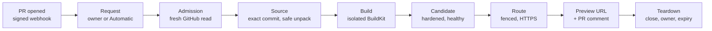

# 16 · End to end: from pull request to preview URL

**Module:** E2E · **Code:** the whole worker pipeline (`internal/app` composes it) ·
**Feature docs:** [01 · System overview](../docs/01-system-overview.md),
[11 · Backend previews](../docs/11-backend-previews.md)

The journey the product exists for, run for real: GitHub (a fake over TLS) sends
signed events, the worker's own pipeline builds with real BuildKit, starts real
containers, routes them through real Traefik with an ACME certificate, and
reports back. These cases follow the journey in order; the security checks that
guard each stage are listed with it.

| Sub-module | Prefix | Cases |
| --- | --- | --- |
| Web app journey | TC-E2E-WEB | 6 |
| Backend app journey | TC-E2E-BE | 4 |
| Security along the pipeline | TC-E2E-SEC | 3 |
| Against real GitHub and DNS | TC-E2E-LIVE | 1 |

## 1. Web app journey (TC-E2E-WEB)

- [x] **TC-E2E-WEB-001 · A Manual PR waits for its owner**  
  Type: Negative · Priority: P1 · Level: End-to-end  
  Steps: Open a PR on a Manual repository (an `opened` pull request event).  
  Expected: The PR is recorded; nothing is built until the owner asks.  
  Evidence: `internal/app` › `TestRealEndToEnd`

- [x] **TC-E2E-WEB-002 · The owner's request becomes a live HTTPS preview, reported on the PR**  
  Type: Positive · Priority: P1 · Level: End-to-end  
  Steps: Request a build; wait for the environment.  
  Expected: The commit is fetched, built and started; the preview URL serves that commit over HTTPS; the build log has lines; the PR comment says Ready and the check run succeeds.  
  Evidence: `internal/app` › `TestRealEndToEnd`

- [x] **TC-E2E-WEB-003 · A failed rebuild keeps the earlier preview serving**  
  Type: Negative · Priority: P1 · Level: End-to-end  
  Steps: Push a commit that does not build; request it.  
  Expected: The request fails and is reported; the preview URL keeps serving the earlier commit.  
  Evidence: `internal/app` › `TestRealEndToEnd`

- [x] **TC-E2E-WEB-004 · A GitHub outage never blocks a preview**  
  Type: Resilience · Priority: P1 · Level: End-to-end  
  Steps: Make GitHub's report API fail while a build publishes.  
  Expected: The preview publishes anyway; no check run is created during the outage; the report catches up when GitHub returns.  
  Evidence: `internal/app` › `TestRealEndToEnd`

- [x] **TC-E2E-WEB-005 · Automatic builds the newest of a burst of pushes**  
  Type: Edge · Priority: P1 · Level: End-to-end  
  Steps: Switch to Automatic; push several commits quickly.  
  Expected: Only the newest is downloaded and built and comes back at the same address; the superseded check is closed; one living comment throughout.  
  Evidence: `internal/app` › `TestRealEndToEnd`

- [x] **TC-E2E-WEB-006 · Teardown and close remove everything**  
  Type: Positive · Priority: P1 · Level: End-to-end  
  Steps: Tear the preview down as the owner; later close the PR.  
  Expected: The route stops serving; containers, images and networks are removed; the removal is reported; no object of the PR remains.  
  Evidence: `internal/app` › `TestRealEndToEnd`

## 2. Backend app journey (TC-E2E-BE)

- [x] **TC-E2E-BE-001 · An API with PostgreSQL, Redis, a migration and a worker previews end to end**  
  Type: Positive · Priority: P1 · Level: End-to-end  
  Steps: Open a PR whose `.previewrc.yaml` asks for PostgreSQL 17, Redis 7, a setup command and a queue worker.  
  Expected: Services are ready before setup, setup before processes, processes before the app; the preview serves over HTTPS; the worker processes a job; the comment names the backend and docs.  
  Evidence: `internal/app` › `TestRealBackendEndToEnd`

- [x] **TC-E2E-BE-002 · Rebuilds start fresh; failed migrations keep the old preview**  
  Type: Edge · Priority: P1 · Level: End-to-end  
  Steps: Rebuild; then push a failing migration.  
  Expected: The rebuild has a new database; the failure ends `setup_failed` while the earlier preview and its data keep serving; the retired candidate's services are removed.  
  Evidence: `internal/app` › `TestRealBackendEndToEnd`

- [x] **TC-E2E-BE-003 · A fork gets services but no outbound connections**  
  Type: Security · Priority: P1 · Level: End-to-end  
  Steps: Open the same PR from a fork, with outbound destinations approved on the repository.  
  Expected: The fork's preview has its services; its approvals are withheld and it reaches nothing outside.  
  Evidence: `internal/app` › `TestRealBackendEndToEnd`

- [x] **TC-E2E-BE-004 · Crashes and teardown leave nothing owned behind**  
  Type: Resilience · Priority: P1 · Level: End-to-end  
  Steps: Leave a crashed candidate's service container; run housekeeping; tear both previews down.  
  Expected: Housekeeping removes the leftover without touching the live preview; no container, image, network or volume of either preview remains.  
  Evidence: `internal/app` › `TestRealBackendEndToEnd`

## 3. Security along the pipeline (TC-E2E-SEC)

- [x] **TC-E2E-SEC-001 · Untrusted input is contained at every stage**  
  Type: Security · Priority: P1 · Level: Integration + System  
  Steps: Send unsigned or replayed webhooks; prepare hostile archives and configuration; run a Dockerfile probing internal targets; run a preview probing internal targets.  
  Expected: Each is refused or blocked at its stage: webhook signature and dedup (TC-HOOK-SIG, TC-HOOK-DUP), archive and config checks (TC-SRC-EXT-002, TC-SRC-CFG-003), build isolation (TC-IMG-ISO-001), runtime isolation (TC-RUN-ISO-001).  
  Evidence: `internal/app` › `TestServerRoutesRegression/webhooks_need_GitHub's_signature_and_a_sound_envelope`; `internal/source` › `TestPrepareRejectsHostileArchives`; `internal/builds` › `TestRealBuilderIsolatesBuildSteps`; `internal/runtime` › `TestRealRuntimeDeniesNetworkAccess`

- [x] **TC-E2E-SEC-002 · Previews are isolated from each other and from Previa**  
  Type: Security · Priority: P1 · Level: End-to-end  
  Steps: From a preview's services and app, probe the internet, the egress proxy, the host, other previews and private or rebinding destinations; probe the services from another preview.  
  Expected: Every probe is refused except approved public destinations through the egress proxy.  
  Evidence: `internal/app` › `TestRealBackendEndToEnd`

- [x] **TC-E2E-SEC-003 · Secrets never reach a fork or a log**  
  Type: Security · Priority: P1 · Level: System  
  Steps: Start candidates for a trusted PR and a fork of a repository with secrets; read the build log.  
  Expected: The trusted preview gets its secrets; the fork gets none; no secret value appears in the log.  
  Evidence: `internal/runtime` › `TestRealRuntimeWithholdsSecretsFromForks`; `internal/runtime` › `TestRealRuntimeStartsAHardenedHealthyCandidate`

## 4. Against real GitHub and DNS (TC-E2E-LIVE)

- [ ] **TC-E2E-LIVE-001 · The same journey on a real repository, App and domain**  
  Type: Positive · Priority: P1 · Level: Acceptance  
  Steps: Run `make test-source`, `make test-reporting` and a real PR on a deployed host with a real domain.  
  Expected: As in TC-E2E-WEB-002 to 006 against github.com and Let's Encrypt.  
  Evidence: `internal/source` › `TestRealSourcePrepare`; `internal/platform/githubapp` › `TestRealInstallationRepositoryAccess`; `internal/reporting` › `TestRealReportingOnADisposablePR`  
  **Not run in this cycle:** needs real GitHub credentials for a disposable PR and a real host (see [README](README.md#not-run-in-this-cycle)).
